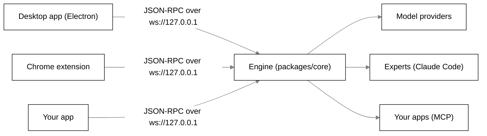

# Tagalong

Tagalong is a desktop screen companion for Windows. One companion, Scout, sits on your screen.
Press a key and Scout sees what you are working on: the text you selected, the window you are in,
or the page you are on in Chrome. It writes a brief, hands the work to an expert (Claude Code
first), follows it and brings the answer back in a bubble beside it. Scout never moves your mouse
or types for you.

There are three ways in:

1. [Download and run it](#download-and-run-it): install the Windows app and use it.
2. [Run it from source](#run-it-from-source): clone the repo and start the desktop app.
3. [Use the engine in your own app](#use-the-engine-in-your-own-app): boot the engine and talk to
   it over its local protocol.

The [user guide](#using-tagalong) follows. Plan, task board and decisions live in
[Notion](https://app.notion.com/p/3d809730490481a4be8ac5bd000b8bfc).

## Download and run it

There is no public download page yet. Until releases are published, build the installer yourself
on Windows with Node.js 22 and pnpm 10:

```powershell
pnpm install
pnpm package:win     # writes apps\desktop\release\Tagalong-Setup-<version>-x64.exe
```

Then run `Tagalong-Setup-<version>-x64.exe`.

- It installs for your user only, needs no administrator rights, and starts Tagalong when it
  finishes.
- The installer is not code signed yet. If Windows SmartScreen says "Windows protected your PC",
  click **More info**, then **Run anyway**.
- Your settings, conversations and stored keys live in `%APPDATA%\Tagalong`. Uninstalling from
  **Settings → Apps** keeps that folder; delete it too to remove everything.

Tagalong lives in the system tray, and Scout sits on your desktop. [First run: Welcome](#first-run-welcome)
walks you through the rest.

## Run it from source

You need Windows 11, Node.js 22 or newer and pnpm 10.

The desktop talks to the Python brain, so start the brain first (you need `uv` and an Anthropic
key in `~/.tagalong/.env`, see [docs/brain.md](docs/brain.md)).

```powershell
cd brain
uv sync
uv run brain        # leave this running
```

In a second terminal, from the repo root:

```powershell
pnpm install
pnpm dev:desktop
```

Scout remembers instructions and facts about you across restarts, in `~/.tagalong/tagalong.db`, and picks the conversation back up after a restart.

If the brain is not running, the desktop still opens and shows "Scout's brain is not running." It
connects by itself once the brain is up.

The [developer guide](docs/development.md) covers getting pnpm, testing, packaging and the Chrome
extension.

## Use the engine in your own app

`packages/core` is the engine. It is pure Node, with no Electron, React or DOM, and both the
desktop app and the Chrome extension run on it. It holds:

- the companion, Scout, and the role it works as;
- the conversation runner, which assembles each prompt, calls the model and runs tools;
- memory: conversations, long-term memories and summaries, in SQLite;
- providers: Claude Code sign-in, Anthropic, OpenRouter and any OpenAI-compatible service;
- experts and hand-offs: briefs sent to Claude Code, with the project and edit permission you
  confirm;
- connected apps over MCP (Notion, GitHub, Linear, or any MCP server): reads run at once, every
  change waits for Allow once;
- routines, and a local WebSocket server that speaks the JSON-RPC protocol defined in
  `packages/protocol` (zod schemas).



`@tagalong/core` and `@tagalong/protocol` are **not published to npm yet**. Both are marked
`"private": true`. Today you use them from this repo: add your app as a package in the pnpm
workspace, depend on them with `"workspace:*"`, and run `pnpm build` so their `dist/` exists.

This boots an engine, connects to it as a host, and asks Scout one question.
`TAGALONG_FAKE_PROVIDERS=1` gives scripted answers, so it runs without a key or the network; leave
it out to use Scout's real provider.

```ts
import { mkdtempSync } from 'node:fs';
import { tmpdir } from 'node:os';
import { join } from 'node:path';
import { Engine, InMemorySecretStore, SCOUT } from '@tagalong/core';
import { engineUrl } from '@tagalong/protocol';

const engine = await Engine.boot({
  dataDir: mkdtempSync(join(tmpdir(), 'tagalong-')), // database, settings and pairing token
  secretStore: new InMemorySecretStore(), // the desktop app uses the OS keychain instead
  engineVersion: '0.0.0',
  port: 0, // let the OS pick; the default is 47321
  env: { TAGALONG_FAKE_PROVIDERS: '1' },
});

const socket = new WebSocket(engineUrl(engine.port));
await new Promise((resolve) => socket.addEventListener('open', resolve, { once: true }));

let nextId = 1;
const pending = new Map<string, (result: unknown) => void>();
const call = (method: string, params: unknown) =>
  new Promise((resolve) => {
    const id = String(nextId++);
    pending.set(id, resolve);
    socket.send(JSON.stringify({ jsonrpc: '2.0', id, method, params }));
  });

const answered = new Promise<void>((resolve) => {
  socket.addEventListener('message', (event) => {
    const message = JSON.parse(String(event.data));
    if (message.id !== undefined && message.method === undefined) {
      pending.get(message.id)?.(message.result);
    }
    if (message.method === 'turn.delta') process.stdout.write(message.params.text);
    if (message.method === 'turn.completed') resolve();
  });
});

await call('hello', {
  host: 'desktop',
  version: '0.0.0',
  capabilities: [], // what your host can read for Scout, such as 'selection' or 'screenshot'
  token: engine.pairingToken,
});
await call('ask', { petId: SCOUT.id, input: { text: 'Hello, Scout' } });
await answered;

socket.close();
await engine.shutdown();
```

A real host also answers the engine's `perception.*` requests for the capabilities it advertises.
The method catalog and every payload schema are in `packages/protocol/src/methods.ts`; the desktop
app's own client for the Python brain is `bodies/desktop/src/main/brain/brain-client.ts`; the
desktop no longer boots the engine. Read
[Architecture](docs/architecture.md) for how the engine and its hosts fit together, and
[How to add a host](docs/development.md#how-to-add-a-host) for the contracts a host implements.

## What is in this build

| In this build                                                                                                                          | Not in this build                                                   |
| -------------------------------------------------------------------------------------------------------------------------------------- | ------------------------------------------------------------------- |
| Windows desktop app with a Welcome window and an NSIS installer                                                                        | macOS and Linux (the installer configs exist but are unverified)    |
| One companion, Scout, that hands work to experts (Claude Code) and brings the answer back                                              | Speech to text through ElevenLabs                                   |
| Scout talks: answers read aloud in a calm British voice, made on this computer, or through ElevenLabs with your own key                |                                                                     |
| Talk to Scout: hold a key, ask out loud, hear a short spoken answer; speech is turned into text on this computer                       |                                                                     |
| Scout thinks through your Claude Code sign-in, or OpenRouter, Anthropic or an OpenAI-compatible service                                | An "always allow" for changes in connected apps                     |
| Connections: Scout uses your apps over MCP (Notion, GitHub, Linear, Claude Code's servers); every change asks first                    |                                                                     |
| Routines: Scout does things on its own, on a schedule or when something happens, and tells you in the bubble, aloud or by notification |                                                                     |
| Background work: Scout reads, compares and summarises on its own while you keep talking; what finishes comes back together, once       |                                                                     |
| Spend: Home shows what Scout and the experts used, and an optional daily budget pauses proactive comments and routines                 |                                                                     |
| Change settings by talking: "talk a bit slower" shows a card, and nothing changes until you click Apply                                |                                                                     |
| Sight: selection, screenshot, every display, every open window, window text, built-in blind spots                                      | ElevenLabs voice cost on the Spend card                             |
|                                                                                                                                        | Data export and delete-all in Settings                              |
| Memory across restarts, rolling screen memory Scout recalls from (opt-in), and watches Scout starts                                    | Code signing (the installer is unsigned) and an app icon of its own |
| The Chrome extension: Scout in Chrome's side panel, reading the page you are on                                                        |                                                                     |

# Using Tagalong

## First run: Welcome

The first time Tagalong starts, one **Set up Tagalong** window opens on the screen you are using.
Scout runs it: it asks each question in its bubble and aloud, and moves on by itself as soon as you
answer by typing in the answer box or tapping a card. There is no Next button. The steps along the
top show what you answered; tap one to change it. If you close the window part-way, the next launch
picks up at the same step, and Scout arrives on your screen either way.

1. **What should I call you?** Scout says why it asks. Type your first name, or tap **Rather not**
   and it never asks again. Scout uses it rarely, in a hello or a moment that warrants it. Change or
   clear it under **Settings → You**.
2. **How should I think?** Scout checks your real Claude sign-in. If Claude Code is installed and
   signed in, it suggests that and needs no key. Signed out, **Sign in to Claude** opens a terminal
   and Scout then suggests Claude once you are in. Not installed, install Claude Code or use **An API key**:
   pick OpenRouter or Anthropic and paste a key. It goes into the operating
   system's keychain and is tested once with one tiny request; if the service turns it down, Scout
   says so and you stay on the step.
3. **Should I talk?** Scout speaks a sample line so you hear how it sounds; choose **Yes, talk** or
   **Text only**.
4. **One key to remember.** Ctrl+Shift+Space asks Scout about whatever is on your screen.
5. **Try it.** Scout docks on your screen with **Try it now** and **Got it** in its bubble, under a
   first hello in its own words when it has one. **Try it now** has Scout look at your screen and say what it could hand to an expert;
   **Got it** sends it back to the dock. If Claude Code is installed it becomes Scout's first
   expert, so hand-offs work straight away.

After that, each time Tagalong opens Scout may say one short line beside itself, in its own words,
without taking the keyboard, or nothing at all; a line fades after a few seconds. It knows how long
you were away, a crash or an update and what is new, routines that ran and where you left off, and
reads nothing on your screen. Turn it off under **Settings → Privacy → Say hello when Tagalong
opens**.

Open Welcome again from **Home → Settings → Advanced → Open Welcome again**. A key saved in Welcome
or in Settings works on the very next question. No restart is needed.

## Asking Scout

Press Ctrl+Shift+Space (or click Scout) to open Scout's bubble. A click opens it at once without
looking; the key also brings what you are on. Drag Scout anywhere on your screen and the bubble
follows. Escape or the × closes it.

The bubble shows what Scout can see as chips (the app and window, selected text, a screenshot).
Remove any chip you do not want sent, type the question and press Enter. The answer appears in the
bubble, the next question continues the same conversation, and **Open full chat** shows the whole
conversation in a taller window (**Back to bubble** returns).

There is no key for a screenshot or for your other windows. Scout lists what is open (minimized
windows too), reads the window that matters, or takes a screenshot itself, only when a question
needs it. It can photograph a window sitting behind others, though not a minimized one, and it
looks past its own bubble to the window you were using. A screenshot adds roughly 1,500 input
tokens, which is why it is not taken on every question.

**Hand-offs.** When Scout hands work to an expert, the bubble shows a card first: the agent, the
project it guessed (from your window, or the projects you used before), whether it may change
files, and the brief. **Change project** picks another guess, searches your code folders or browses
for a folder; **Allow edits** lets this one task change files; **Send** (or **Cancel**) decides.
While the expert works the bubble lists its steps with **Stop**, and its answer comes back to the
bubble when it is done. Ask for a second opinion ("fix the date bug and have someone check it") and
the one card lists two steps, such as **1. Coder** then **2. Reviewer**, each with its own access
and brief, under one project and one **Send**; **Remove step 2** keeps it to one. The Reviewer
starts once the Coder has finished, with the Coder's answer and changed files, and the bubble shows
both answers. If the first step fails or is stopped, the second never runs. While an expert works
you can tell Scout something for it ("tell Coder to use dayjs, not moment"): Scout says "I'll pass
that to Coder", the card shows **Passed on:** with _waiting for Coder to finish this step_, then
_delivered_, and the expert carries on in the same session with your note (or the card says it
finished first). The expert's key moments, such as "Found the bug in `date.ts`", show on the
card and are not said aloud.

**Keeping an eye on things.** Now and then Scout says one short line on its own, beside itself and
without taking the keyboard: a build that failed and why, say. It follows window titles only, reads
one window when you settle on it or its title reads like trouble, and most of the time says
nothing. **Not now** on the line quiets it for an hour; when it offers help, **Hand it over** opens
the hand-off card, and nothing is sent until you press **Send**. See [Privacy](#privacy).
**Scout talks.** Scout reads its answers aloud, so you can look away: the answer, its hello, a
line it says on its own, a routine's result and its line about an expert that finished. Scout
decides what to say: everything it writes is spoken, typed question or spoken, except what it
puts in a block (a draft, code, a long list), which is shown in the bubble and not read. Bars beside the × show while it speaks;
click them, close the bubble or press `Ctrl+Shift+Alt+M` to stop it at once. The voice is
Kokoro, made on this computer: the first time Scout speaks it downloads the voice model (about
92 MB) and uses the Windows voice until that is done. Turn it off, pick a voice, preview it or
change the speed in **Home → Settings → Voice**.

**Talk to Scout.** Hold `Right Ctrl` on its own (or click the mic in the bubble), say
your question and let go (or click again). Press another key while holding it (Right Ctrl+C, say)
and nothing is sent: you meant a shortcut. The bubble shows your words as you talk, then what it
heard, and Scout answers out loud
the way a person talks: short sentences, one question back at most, details left in the bubble.
It starts speaking on the first sentence rather than waiting for the whole answer. Talking while
Scout speaks cuts it off. When it is done the bubble says "Hold Right Ctrl to reply".
The microphone opens on that key or the mic button, or all the time only if you switch Always
listening on in the bubble (then start with "Scout"; "Scout, stop" turns it off; it pauses while a
call or a full-screen window is in front, and while the pets are hidden). Your speech is turned into text on this computer, by
small models (Silero VAD, Moonshine and Smart Turn) downloaded the first time (about 43 MB); the
audio is never sent or kept.

**Read it to me.** Type or say "read this to me" and Scout reads your selection, or the window in
front, aloud in full: the text itself, lists as sentences, code described rather than spelled out.
Ask "summarise this" and it speaks a summary; for something long it gives the gist first. The stop key, ×
and the bars cut it off. Ask "what's in this chart?" (or about a photo, diagram or screenshot) and
Scout gives the kind, the axes, the trend and the values that stand out, and says when it can't
make one out. With ElevenLabs as the voice, the text read goes to ElevenLabs.

**Translate this.** Ask "translate this" and Scout translates your selection, or the window in
front, into the language you name, else one you asked it to remember ("always translate to
Spanish"), else the language you asked in. It names the source language, keeps the layout, names,
numbers and code, and warns when the words came from a picture. Scout's own model translates, with
no translation service. "Translate it and read it to me" speaks an English translation in full; a
translation into another language shows in the bubble only, because the voices speak English.

**What needs me?** Ask it and Scout reads your connected apps (GitHub reviews and assigned issues,
Linear issues, Notion mentions when its tools offer them) and answers with one list grouped by app,
oldest first, one line each with how long it has waited. It only reads, and sends no screen
content. An app that isn't connected is named once at the end; a signed-out one asks you to sign in
again.

**What did we do today?** Ask it (or "how much did I work yesterday?") and Scout sums up the day
from what it looked at and was asked: the apps and windows, when, what you asked and what experts
did. It only knows what it saw; nothing extra is tracked.

**What was that article I read?** Ask "what was that article about vector databases I read
Tuesday?" and Scout searches the window titles it looked at and what you asked it, and answers
with the day, time and app. It only knows titles, never page text, and only as far back as the
record of what Scout saw keeps.

**Memory.** Tell Scout "I prefer short answers" and it remembers across restarts. See and delete
what it remembers in Home, or say "Scout, forget that". Once a day, when you are away, Scout tidies
its memory on its own: it keeps the gist of its recent work and lets stale details go, never your
preferences.

**"Scout, what's wrong?"** Ask that (or "are you OK?", or "health check"), typed or spoken, and the
bubble shows a health card: its sign-in, your experts, your connections, its voice, your
microphone and the browser extension, each with a plain line, starting "Two things need you." or
"Everything's working." (shown, never said aloud). **Fix it** on a row opens the place that fixes it. It calls no model and
reads no screen, so it works even when Scout cannot think.

Upgrading from an earlier build keeps only Scout; any other companion, with its conversations, is
removed.

## Hotkeys

| Key                        | What it does                                                                           |
| -------------------------- | -------------------------------------------------------------------------------------- |
| `Ctrl+Shift+Space`         | **Ask.** Opens the bubble with the text you have selected and the active window's name |
| `Ctrl+Shift+Alt+P`         | **Pause sight.** Nothing is read until you press it again (also in the tray)           |
| `Ctrl+Shift+Alt+M`         | **Stop speaking.** Scout stops talking at once and drops what it was about to say      |
| `Right Ctrl` (hold, alone) | **Talk to Scout.** Listens while held; let go and Scout answers out loud               |
| `Alt+Shift+Space`          | In Chrome, with the extension: opens the side panel with your selection                |

Every key can be changed in **Home → Settings → Shortcuts** (the talk key, one key held alone, under **Voice**), and the
change works at once.

## Home: one window for everything

Right-click the tray icon and choose **Open Tagalong**. The tray has only four items: **Open
Tagalong**, **Pause sight**, **Show or hide Scout** and **Quit**. Home holds the rest, in twelve pages:

- **Overview**: whether Scout is ready and what it thinks with, your experts, what was spent today
  and this month (**Spend**), and the latest activity. Spend shows dollars for models with a known
  price, tokens and "price unknown" for the rest, and tokens "(your plan)" for the Claude sign-in.
  **Settings → Daily budget** (off by default) pauses keep-an-eye comments and scheduled routines
  until midnight once that day's priced spend reaches it; asking Scout, Run now, watches and
  hand-offs always go through.
- **Waiting on you**: every change Scout wants to make in a connected app and every hand-off card
  still waiting for Send, with **Allow once**, **Open** and **Decline**, and the last ones answered
  with how each ended. The nav shows how many wait. A change waits an hour and a card a day; a
  change still waiting when Tagalong closes is never run later. "Can’t be undone" marks a delete,
  a send and the like.
- **Scout**: how Scout thinks, a provider and a model. **Save** applies from the next question.
- **Experts**: the tools Scout hands work to. **Add expert** starts from a template (**Coder**,
  **Debugger**, **Designer**, **Reviewer**) or **Blank**, which fills in the name, what it is good
  at, its **Standing instructions** (what it is told on every task, shown in full) and its switches;
  change any of it before you save. Claude Code is the first kind; it must be installed and signed
  in on this computer, and Welcome adds it for you when it is. It only reads and searches unless you
  switch on **Let it edit files by default** (Coder starts with it on) or allow edits when you send
  a task, and it searches the web only when **Let it search the web** is on. **Save and test**
  checks that Claude Code starts, which costs nothing. There is no default project folder: each
  task picks its project, and you confirm before anything is sent.
  - **From the catalog**, below the templates: **Researcher**, **Trip planner** and **Social media
    manager**. Each card shows the Claude Code plugins it uses (**Installed** or **Missing**), the
    apps it may use from your own Claude Code connectors, what it may do in plain words, and the
    exact app tools it is allowed; every other tool is refused. **Install** first lists each plugin
    it will add, then runs Claude Code's own `claude plugin install` and opens the filled form for
    a last look. These experts work in their own folder, never in your projects, and only they
    may use plugins and apps; templates and experts you make stay sealed.
- **Routines**: things Scout does for you on its own, such as new papers every weekday at 8.
  - **New routine** starts from a template (**Morning papers**, **Today's calendar**, **Reviews
    waiting on GitHub**, **What needs me** at 09:00 on weekdays, **End-of-day summary**, **Meeting
    prep**) or **Blank**. Pick **When** (every day, weekdays, chosen days at a time, or when Tagalong
    opens, an app or site appears, an expert finishes, a watch fires, or 10 or 30 minutes before each
    meeting), say **What** in your own words, and where the **Result goes**: Scout's bubble,
    read aloud, a Windows notification. Activity always keeps each run.
  - **May hand to** lets each run hand work to one expert without asking, read-only, with web search
    and no project, so it never touches your files. Morning papers uses this to search the web with
    Claude Code, or a paper app such as arXiv when you have connected one.
  - **Meeting prep** reads your calendar from its secret .ics link (Google: Secret address in iCal
    format; Outlook: Publish), kept in your keychain. Before each meeting with someone, Scout's line
    gives the gist, and the full prep has the agenda, the last thread, related docs and open
    questions, from your connected apps. A prep still waiting when a call runs past the start comes
    as a Windows notification.
  - Each routine shows its switch, its last run (with **See in Activity**) and its next run, with
    **Run now** and **Edit**.
  - You can also ask Scout: "every weekday at 8, give me new papers on AI agents and explain the best
    one simply". Scout shows a routine card (name, when, what, what it uses, where the result goes)
    with **Save**, **Edit** and **Cancel**; nothing is saved until you press **Save**, and then it
    offers **Run it now** to test. Ask Scout to pause, change or delete a routine by name the same
    way.
  - A routine that was due while the PC was asleep or Tagalong was closed runs once when it is back,
    and says it ran late. Results wait while a full-screen app or a call is in front. Click the
    result's line to read it all and ask a follow-up.
- **Connections**: the apps Scout can use, so "what is on my calendar" or "any reviews waiting on
  GitHub" just work.
  - **Popular**: Notion and Linear connect with **Connect**, which opens their sign-in in your
    browser. GitHub asks for a personal access token instead.
  - **Found on this PC**: the MCP servers already set up in Claude Code. **Use** adds one; a key
    Claude Code keeps is not copied, so you paste it once.
  - **Add a connector**: any other MCP server, by its https address or by the command that starts it
    on this PC.
  - Each connection shows whether it works, its tools (**Reads** or **Asks first**), an on/off
    switch, **Sign in again** when needed, and **Disconnect**, which deletes its sign-in.
  - Scout reads with an app on its own. Anything that changes something (a tool the app does not
    mark read-only) shows a card in Scout's bubble: which app, what will change, **Allow once** or
    **Cancel**.
- **Activity**: every answer, every hand-off, every call to an app and every routine run, newest
  first. Click one to read it.
- **How Scout decided**: every decision Scout made, newest first, including each time it chose to
  stay quiet. Click one to see why it woke, what it was shown, each tool it used, what it said and
  what you did about it (**Not now**, an offer taken, a hand-off sent or dismissed). Kept 30 days,
  on this computer, with no screen text or window titles. **Delete all** clears it.
- **What Scout saw**: every time Scout looked at your screen or sent something to an AI or an
  expert, as metadata only, grouped by day. Delete a row, or **Delete all**.
- **What Scout remembers**: its facts, preferences and conversation summaries, newest first.
  Delete any one.
- **What Scout learned**: Scout's own notes, the pages it keeps about you (**you.md**), what it
  does differently now (**lessons.md**), what it promised to follow up on (**commitments.md**)
  and procedures that worked (**skills**). In a conversation Scout updates you.md and
  commitments.md at once; a new lesson or skill, and everything from **sleep** (once a day, while
  you are away, Scout reads back what it did and what you made of it), arrives as a **proposed**
  change you **Accept** or **Reject**, with its text shown. Each page says how many changes wait
  on you. Every change shows who made it and why, and opens to its text; the newest one has
  **Undo**. Edit any page and **Save** (a page longer than it holds is cut to fit, and says so).
  The pages are plain files in `%APPDATA%\Tagalong\self`.
- **Settings**, in seven sections. Press ⓘ beside a setting for the longer story.
  - **How Scout thinks**: Scout's real brain, and whether your Claude Code sign-in works (checked
    locally with `claude auth status`). Without Claude Code you pick a service and paste its key,
    and saving moves Scout to it.
  - **You**: what Scout calls you. Empty means no name.
  - **Privacy**: the hello when Tagalong opens, keeping an eye on things, screen memory, how many
    days the record of what Scout saw is kept, and what Scout never looks at.
  - **Voice**: **Scout talks** (on by default), the voice (George or Fable) with **▶ Preview**, the
    speed, the **Talk to Scout** key and the microphone it listens on.
  - **Shortcuts**: the ask, pause and stop-speaking keys.
  - **Browser extension (optional)**: the pairing token for the Chrome extension.
  - **Advanced**, closed by default: summaries, API keys (add, replace or remove, and a base URL),
    the ElevenLabs voice (your key and a voice ID from your ElevenLabs library), sight detail,
    screen memory and watches, and **Open Welcome again**.

## Providers and keys

Scout runs on one provider and one model. Keys are entered in Welcome or in **Settings → Advanced →
API keys**, encrypted with the OS keychain, and only ever sent to the provider they belong to.

| Setup                   | Where to get the key                                                                                                       | Model ids                                                                                                                                                                        |
| ----------------------- | -------------------------------------------------------------------------------------------------------------------------- | -------------------------------------------------------------------------------------------------------------------------------------------------------------------------------- |
| **Claude Code sign-in** | Nothing: install [Claude Code](https://claude.com/claude-code) and sign in. Scout thinks through `claude -p`.              | `haiku`, `sonnet`, `opus`.                                                                                                                                                       |
| **OpenRouter + Claude** | [openrouter.ai/keys](https://openrouter.ai/keys)                                                                           | OpenRouter's catalog at [openrouter.ai/models](https://openrouter.ai/models), for example `anthropic/claude-sonnet-5` or `anthropic/claude-haiku-4.5`. Settings lists them live. |
| **Anthropic**           | [console.anthropic.com/settings/keys](https://console.anthropic.com/settings/keys) (an API key, not a Claude subscription) | `claude-opus-5`, `claude-sonnet-5`, `claude-haiku-4-5`.                                                                                                                          |

If Scout answers "model not found", open Settings and pick the id from the live list next to the
model box: it is the authority.

Any other OpenAI-compatible service also works: in **Settings → Advanced → API keys**, put its base
URL in the base URL box, store its key there, and pick its model on the Scout page.

## The Chrome extension

The extension puts Scout in Chrome's side panel and lets it read the exact page you are on. It
needs the desktop app running.

1. Open `chrome://extensions` and turn on **Developer mode**.
2. Click **Load unpacked** and choose the extension folder. The installer ships it in
   `%LOCALAPPDATA%\Programs\Tagalong\resources\extension`. From source, build it with
   `pnpm --filter @tagalong/extension build` and choose `apps/extension/dist`.
3. Copy the pairing token from **Home → Settings → Browser extension**, paste it into the
   extension's options page, and click **Save and connect**.

Then click the toolbar button, or select text and press `Alt+Shift+Space`. More in
[The Chrome extension in detail](docs/development.md#the-chrome-extension-in-detail).

## Screen memory

**Screen memory** (off by default; turn it on in **Home → Settings → Privacy**). Tagalong keeps a
small picture of each screen every five seconds, in memory only, for the last ten minutes. A red dot
on Scout shows while it records. Ask "what was on screen a few minutes ago?" or "what changed?" and
Scout looks back through it.

**Watches.** Ask "tell me when the build finishes" and Scout watches for it, says in one line what it
is watching, and tells you when it happens. A watch stops on its own when it fires or gives up (30
minutes by default). A routine **When a watch fires** runs then too. Scout can also zoom in on small
text and look at your other monitor ("what's on my other screen?"). Blind spots still apply.

**Point, don't click.** Ask "where's the export button?" and Scout tells you, and a soft ring with a
short label shows around it for a few seconds (`Esc` puts it away). Scout never moves the mouse,
clicks or types.

**Draft it for me.** Say "reply to this email, yes but Friday" or "write the PR description" and
Scout reads what is in front of you and writes a short draft in the bubble with a **Copy** button.
Copy puts the draft on your clipboard; you paste it. Scout never types or pastes into an app.

**Drop it on Scout.** Drag a file, an image, a link or selected text onto Scout and it asks whether
to explain it or hand it to an expert. Nothing is read until you press a button, and secrets files
such as `.env` are refused.

**File this as a bug.** With an error on screen, say "file this as a bug" or "make a Linear ticket
for this". Scout reads the window with the error and writes the issue: a short title, then what
happened (the error, quoted), where (the app, the window title and the project), the steps it saw
and what was expected. The connected app's confirm card shows the whole issue; **Allow once** files
it ("Filed as #123"), **Cancel** files nothing. Scout never guesses a GitHub repo: it uses the one on
screen or the one you name, or asks. With both GitHub and Linear connected, it asks which. No
screenshot is attached.

## Privacy

- Nothing on screen is read until you press a hotkey or ask, except screen memory and watches, which
  you turn on, and keeping an eye on things (below). Every look badges Scout and the tray says what
  was read and when.
- **Check-ins.** Now and then, when nobody asked, Scout asks its own model once whether
  anything is worth saying, and most of the time says nothing. Each such call carries what the
  moment is about plus what Scout recalls for it (your preferences, its newest and matching
  memories, up to two matching jobs of its own), your name, the time, what experts are doing and
  your last exchange with Scout (secrets hidden, never a blind spot). At most 24 a day, one
  unprompted every ten minutes, none for an hour after **Not now**, none over calls, full screen or
  once the daily budget is spent.
- **Background jobs.** When Scout works on something in the background, the job sees only the
  brief Scout wrote (no screen, no pictures), uses only your history and your apps' read-only
  tools, and is deleted 14 days after it finishes. At most 3 run at once (fewer on a busy
  machine), 20 a day, none once the daily budget is spent. When jobs and hand-offs finish, one
  check-in covers them all, with a note of at most 300 characters for each.
- **Keeping an eye on things** is on by default: Scout follows window titles only (no picture, no
  model call). Rarely, when you settle on a new window or a title reads like an error or a failed
  build, it reads that one window and checks in, never twice about one window. A line may offer to
  hand the work to an expert: only **Hand it over** reads that window again (secrets hidden) into
  the hand-off card, with the project picked; nothing runs until **Send**. Turn it off under
  **Settings → Privacy → Keep an eye on things**.
- **Scout's face** comes from the mind in a check-in (a wince, a cheer, tired), never from a title
  alone; it dozes after five minutes with no input or when the screen locks (one idle time number
  from the OS, kept on this computer).
- **Pick up where you left off** is on by default: Scout keeps one note, from window titles only,
  of the projects open in your editor and the hand-offs left half done. Back after six hours or
  more, the mind may say one line about it with a Pick up card, or nothing, once; nothing opens
  until you click on the card. Turn it off
  under **Settings → Privacy → Pick up where you left off**, which also deletes the note.
- **Gentle nudges** are off by default (**Settings → Privacy → Gentle nudges**). On, after an hour
  and a half with no break, or late at night, Scout checks in once with how long you have been at
  it and the window in front: it may say a line, offer a write-up by your expert, look tired, or
  say nothing. Idle time and titles only, no window text; quiet during calls and full screen.
- Scout never looks at its built-in blind spots: password managers, the Windows sign-in and security
  prompts, secret files such as `.env` and SSH keys, private browsing, authenticator apps and Remote
  Desktop. They are always on and listed in Settings; you can add your own.
- Any key, token, password or card number in what is sent is replaced with `[hidden: ...]` before it
  leaves your computer, and Claude Code is told not to open secret files.
- Screenshots are not written to disk. Screen memory and watches live in memory only and are thrown
  away when you pause sight or quit.
- **Home → What Scout saw** lists every look (windows listed, text read, screenshots) and every send
  to an AI or an expert: the app and window, where it went and how much, never the content. Kept 7
  days (1 to 30 in Settings → Privacy); delete one row or all.
- **Home → What Scout remembers** lists what Scout keeps about you until you delete it; delete any
  one there, or ask Scout to forget it.
- Once a day Scout sends up to 150 of its memories, 30 conversation summaries and the notes of up
  to 10 recent background jobs to its summaries model to tidy them. Background jobs are deleted
  after 14 days, Home's Activity after 90.
- What you ask goes only to the provider Scout runs on. There is no Tagalong server.
- Scout's voice is made on your computer. With an ElevenLabs key and voice, only the words Scout
  says are sent to ElevenLabs, never your screen or your questions.
- When you talk to Scout, your speech is turned into text on your computer. The audio never leaves
  it and is never stored; only the text goes to Scout's provider, like a typed question.
- API keys are encrypted with the OS keychain.
- `Ctrl+Shift+Alt+P` pauses all sight at once.
- Tagalong never moves your mouse or types for you. Scout does not click, type or drive other
  applications. It changes things only through apps you connect, and only after you press
  **Allow once**; every call is logged in Activity (which app and tool, never the content).
- Connected apps get only what Scout fills in for one tool, with keys and passwords hidden. Their
  sign-in tokens are kept in the OS keychain and deleted on **Disconnect**.

The full detail is in [Privacy in detail](docs/privacy.md).

## Troubleshooting

| Problem                                                        | What to do                                                                                                                                      |
| -------------------------------------------------------------- | ----------------------------------------------------------------------------------------------------------------------------------------------- |
| Scout shows **Signed out**, **No brain** or **No key**         | Click Scout: the bubble's row says why it can't think. **Fix it** opens the right place in Settings.                                            |
| Scout says "No … API key is stored"                            | Paste that provider's key in Welcome or Settings. It works on the next question.                                                                |
| Scout says the model was not found, or the provider refused it | Open Settings and pick the model from the live list next to the model box.                                                                      |
| Scout ignores the screenshot, or warns it cannot see           | Its model is text-only. Move it to Claude (the sign-in, OpenRouter or Anthropic) on Home's Scout page.                                          |
| A hotkey does nothing                                          | Settings and the bubble name any key another app already owns; pick another. Check that sight is not paused (tray → **Pause sight**).           |
| Scout is silent                                                | Check **Scout talks** in Home → Settings → Voice, and your sound output. The stop key only silences the current answer.                         |
| Talk to Scout says it could not open the microphone            | Windows Settings → Privacy → Microphone: let desktop apps use it. Pick the right microphone in Home → Settings → Voice.                         |
| Scout shows **Mic busy**, **No mic** or **Can't listen**       | Click Scout: the bubble's row says why, and **Fix it** opens Voice settings. Close the app holding the microphone; Can't listen retries itself. |
| With Always listening on, Scout doesn't react                  | Say "Scout" first ("Scout, what is this?"). The dot pulses when it hears you. Right after Scout answers aloud, a reply needs no name for 20 s.  |
| The first spoken question takes a while                        | The first time, Tagalong downloads its speech models (about 43 MB). After that they are read from disk.                                         |
| Scout's voice changes after the first answers                  | The first time it speaks, Scout downloads its voice (about 92 MB) and uses the Windows voice until then. Offline, it keeps the Windows voice.   |
| The Chrome side panel says "Disconnected"                      | The desktop app must be running. If it is, copy the pairing token again from Settings and paste it into the extension's options.                |
| "Windows protected your PC" when installing                    | The installer is unsigned. Click **More info**, then **Run anyway**.                                                                            |
| Sending logs with a problem report                             | Ask Scout "what's wrong?", press **Open logs folder** (`%APPDATA%\Tagalong\logs`). Warnings and errors only, never speech or screen text.       |
| You want Welcome again                                         | Home → Settings → Advanced → **Open Welcome again**.                                                                                            |
| You want to start over                                         | Quit Tagalong and delete `%APPDATA%\Tagalong`. That removes settings, conversations, memories and stored keys; Welcome opens on the next start. |
| From source, a look always captures the whole screen           | The active-window helper was not downloaded: run `node bodies/desktop/scripts/fetch-native.mjs`. The installer already includes it.             |
| It does not start on macOS or Linux                            | Not in this build: only Windows has a platform adapter so far.                                                                                  |

# For developers

- [Engineering docs](docs/README.md): the index of every subsystem doc, with a reading order.
- [Developer guide](docs/development.md): build, run, test and package from source.
- [Architecture](docs/architecture.md): how the engine and its hosts fit together.
- [Feature test guide](docs/testing/feature-test-guide.md): manual tests for this build.
- [Product](PRODUCT.md) and [design system](DESIGN.md).
- [Privacy in detail](docs/privacy.md): exactly what is read, when, and what never is.
