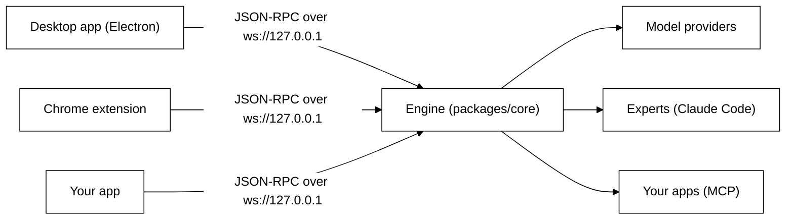

# Tagalong

Tagalong is a desktop screen companion for Windows. One companion, Scout, sits on your screen.
Press a key and Scout sees what you are working on: the text you selected, the window you are in,
or the page you are on in Chrome. It writes a brief, hands the work to an expert (Claude Code
first), follows it and brings the answer back in a bubble beside it. Scout never moves your mouse
or types for you.

There are three ways in:

1. [Download and run it](#download-and-run-it): install the Windows app and use it.
2. [Run it from source](#run-it-from-source): clone the repo and start the desktop app.
3. [Use the engine in your own app](#use-the-engine-in-your-own-app): boot the engine and talk to
   it over its local protocol.

The [user guide](#using-tagalong) follows. Plan, task board and decisions live in
[Notion](https://app.notion.com/p/3d809730490481a4be8ac5bd000b8bfc).

## Download and run it

There is no public download page yet. Until releases are published, build the installer yourself
on Windows with Node.js 22 and pnpm 10:

```powershell
pnpm install
pnpm package:win     # writes apps\desktop\release\Tagalong-Setup-<version>-x64.exe
```

Then run `Tagalong-Setup-<version>-x64.exe`.

- It installs for your user only, needs no administrator rights, and starts Tagalong when it
  finishes.
- The installer is not code signed yet. If Windows SmartScreen says "Windows protected your PC",
  click **More info**, then **Run anyway**.
- Your settings, conversations and stored keys live in `%APPDATA%\Tagalong`. Uninstalling from
  **Settings → Apps** keeps that folder; delete it too to remove everything.

Tagalong lives in the system tray, and Scout sits on your desktop. [First run: Welcome](#first-run-welcome)
walks you through the rest.

## Run it from source

You need Windows 11, Node.js 22 or newer and pnpm 10.

```powershell
pnpm install
pnpm dev:desktop
```

The [developer guide](docs/development.md) covers getting pnpm, testing, packaging and the Chrome
extension.

## Use the engine in your own app

`packages/core` is the engine. It is pure Node, with no Electron, React or DOM, and both the
desktop app and the Chrome extension run on it. It holds:

- the companion and its pets, and the role library they are built from;
- the conversation runner, which assembles each prompt, calls the model and runs tools;
- memory: conversations, long-term memories and summaries, in SQLite;
- providers: Claude Code sign-in, Anthropic, OpenRouter, Nebius Token Factory and any
  OpenAI-compatible service;
- experts and hand-offs: briefs sent to Claude Code, with the project and edit permission you
  confirm;
- connected apps over MCP (Notion, GitHub, Linear, or any MCP server): reads run at once, every
  change waits for Allow once;
- watches, and a local WebSocket server that speaks the JSON-RPC protocol defined in
  `packages/protocol` (zod schemas).



`@tagalong/core` and `@tagalong/protocol` are **not published to npm yet**. Both are marked
`"private": true`. Today you use them from this repo: add your app as a package in the pnpm
workspace, depend on them with `"workspace:*"`, and run `pnpm build` so their `dist/` exists.

This boots an engine, connects to it as a host, and asks Scout one question.
`TAGALONG_FAKE_PROVIDERS=1` gives scripted answers, so it runs without a key or the network; leave
it out to use Scout's real provider.

```ts
import { mkdtempSync } from 'node:fs';
import { tmpdir } from 'node:os';
import { join } from 'node:path';
import { Engine, InMemorySecretStore, SCOUT } from '@tagalong/core';
import { engineUrl } from '@tagalong/protocol';

const engine = await Engine.boot({
  dataDir: mkdtempSync(join(tmpdir(), 'tagalong-')), // database, settings and pairing token
  secretStore: new InMemorySecretStore(), // the desktop app uses the OS keychain instead
  engineVersion: '0.0.0',
  port: 0, // let the OS pick; the default is 47321
  env: { TAGALONG_FAKE_PROVIDERS: '1' },
});

const socket = new WebSocket(engineUrl(engine.port));
await new Promise((resolve) => socket.addEventListener('open', resolve, { once: true }));

let nextId = 1;
const pending = new Map<string, (result: unknown) => void>();
const call = (method: string, params: unknown) =>
  new Promise((resolve) => {
    const id = String(nextId++);
    pending.set(id, resolve);
    socket.send(JSON.stringify({ jsonrpc: '2.0', id, method, params }));
  });

const answered = new Promise<void>((resolve) => {
  socket.addEventListener('message', (event) => {
    const message = JSON.parse(String(event.data));
    if (message.id !== undefined && message.method === undefined) {
      pending.get(message.id)?.(message.result);
    }
    if (message.method === 'turn.delta') process.stdout.write(message.params.text);
    if (message.method === 'turn.completed') resolve();
  });
});

await call('hello', {
  host: 'desktop',
  version: '0.0.0',
  capabilities: [], // what your host can read for Scout, such as 'selection' or 'screenshot'
  token: engine.pairingToken,
});
await call('ask', { petId: SCOUT.id, input: { text: 'Hello, Scout' } });
await answered;

socket.close();
await engine.shutdown();
```

A real host also answers the engine's `perception.*` requests for the capabilities it advertises.
The method catalog and every payload schema are in `packages/protocol/src/methods.ts`; the desktop
app's own client is `apps/desktop/src/main/engine-client.ts`. Read
[Architecture](docs/architecture.md) for how the engine and its hosts fit together, and
[How to add a host](docs/development.md#how-to-add-a-host) for the contracts a host implements.

## What is in this build

| In this build                                                                                                                          | Not in this build                                                   |
| -------------------------------------------------------------------------------------------------------------------------------------- | ------------------------------------------------------------------- |
| Windows desktop app with a Welcome window and an NSIS installer                                                                        | macOS and Linux (the installer configs exist but are unverified)    |
| One companion, Scout, that hands work to experts (Claude Code) and brings the answer back                                              | Voice input: push to talk                                           |
| Scout talks: answers read aloud in a calm British voice, made on this computer, or through ElevenLabs with your own key                |                                                                     |
| Scout thinks through your Claude Code sign-in, or OpenRouter, Nebius Token Factory, Anthropic or an OpenAI-compatible service          | Per-pet tool grants (ask me, always allow)                          |
| Connections: Scout uses your apps over MCP (Notion, GitHub, Linear, Claude Code's servers); every change asks first                    |                                                                     |
| Routines: Scout does things on its own, on a schedule or when something happens, and tells you in the bubble, aloud or by notification |                                                                     |
| Sight: selection, screenshot, every display, every open window, window text, built-in blind spots                                      | A cost dashboard                                                    |
| Vision routing: a text-only Nemotron model reads pictures with Nemotron Nano 2 VL                                                      | Data export and delete-all in Settings                              |
| Memory across restarts, rolling screen memory (opt-in), watches ("tell me when this finishes")                                         | Code signing (the installer is unsigned) and an app icon of its own |
| The Chrome extension: Scout in Chrome's side panel, reading the page you are on                                                        |                                                                     |

# Using Tagalong

## First run: Welcome

The first time Tagalong starts, one Welcome window opens on the screen you are using. Scout
waits until you are done with it, then arrives on your screen.

1. **Hi, I'm Scout.** What Tagalong does: Scout sits on your screen, sees what you are working on,
   hands the work to the right agent and tells you what came back.
2. **Found on this computer.** The coding agents Tagalong found (Claude Code, Gemini CLI, Codex), with
   a **How to add** link for the missing ones.
3. **How I think.** If Claude Code is installed, Scout thinks through your Claude Code sign-in and
   needs no key. Otherwise pick OpenRouter, Nebius Token Factory or Anthropic and paste a key; it goes
   straight into the operating system's keychain.
4. **What should I call you?** Optional: type your first name, or skip it. Scout uses it rarely,
   in a hello or a moment that warrants it. Change or clear it under **Settings → You**.
5. **One key to remember.** Ctrl+Shift+Space asks Scout about whatever is on your screen.
6. **Start.** Scout docks on your screen and introduces itself in its bubble in three short beats
   (**Next** between them): where it lives, how it hands real work to an expert, and the key to
   press. **Try it now** has Scout look at your screen and say what it could hand to an expert;
   **Got it** sends it back to the dock. If Claude Code is installed it becomes Scout's first
   expert, so hand-offs work straight away.

After that, each time Tagalong opens Scout says one short line beside itself, without taking the
keyboard, and it fades after a few seconds: the time of day, how long you were away, or a hand-off
that finished meanwhile. It reads nothing on your screen. Turn it off under **Settings → Privacy →
Say hello when Tagalong opens**.

Open Welcome again from **Home → Settings → Advanced → Open Welcome again**. A key saved in Welcome
or in Settings works on the very next question. No restart is needed.

## Asking Scout

Press Ctrl+Shift+Space (or click Scout) to open Scout's bubble. A click opens it at once without
looking; the key also brings what you are on. Drag Scout anywhere on your screen and the bubble
follows. Escape or the × closes it.

The bubble shows what Scout can see as chips (the app and window, selected text, a screenshot).
Remove any chip you do not want sent, type the question and press Enter. The answer appears in the
bubble, the next question continues the same conversation, and **Open full chat** shows the whole
conversation in a taller window (**Back to bubble** returns).

There is no key for a screenshot or for your other windows. Scout lists what is open (minimized
windows too), reads the window that matters, or takes a screenshot itself, only when a question
needs it. It can photograph a window sitting behind others, though not a minimized one, and it
looks past its own bubble to the window you were using. A screenshot adds roughly 1,500 input
tokens, which is why it is not taken on every question.

**Hand-offs.** When Scout hands work to an expert, the bubble shows a card first: the agent, the
project it guessed (from your window, or the projects you used before), whether it may change
files, and the brief. **Change project** picks another guess, searches your code folders or browses
for a folder; **Allow edits** lets this one task change files; **Send** (or **Cancel**) decides.
While the expert works the bubble lists its steps with **Stop**, and its answer comes back to the
bubble when it is done.

**Keeping an eye on things.** Now and then Scout says one short line on its own, beside itself and
without taking the keyboard: a build that failed and why, say. It follows window titles only, reads
one window when you settle on it or its title reads like trouble, and most of the time says
nothing. **Not now** on the line quiets it for an hour; when it offers help, **Hand it over** opens
the hand-off card, and nothing is sent until you press **Send**. See [Privacy](#privacy).
**Scout talks.** Scout reads its answers aloud, so you can look away: the answer, its hello, a
line it says on its own, a watch that fires and an expert that finished. It never reads code, lists or long text; it says the
first sentence or two and "The rest is in the bubble." Bars beside the × show while it speaks;
click them, close the bubble or press `Ctrl+Shift+Alt+M` to stop it at once. The voice is
Kokoro, made on this computer: the first time Scout speaks it downloads the voice model (about
90 MB) and uses the Windows voice until that is done. Turn it off, pick a voice, preview it or
change the speed in **Home → Settings → Voice**.

**Memory.** Tell Scout "I prefer short answers" and it remembers across restarts.

Earlier versions shipped a crew of three (Scout, Ink and Bolt). Ink and Bolt are removed on
upgrade, and their conversations stay on disk.

## Hotkeys

| Key                | What it does                                                                           |
| ------------------ | -------------------------------------------------------------------------------------- |
| `Ctrl+Shift+Space` | **Ask.** Opens the bubble with the text you have selected and the active window's name |
| `Ctrl+Shift+Alt+P` | **Pause sight.** Nothing is read until you press it again (also in the tray)           |
| `Ctrl+Shift+Alt+M` | **Stop speaking.** Scout stops talking at once and drops what it was about to say      |
| `Alt+Shift+Space`  | In Chrome, with the extension: opens the side panel with your selection                |

Every key can be changed in **Home → Settings → Shortcuts**, and the change works at once.

## Home: one window for everything

Right-click the tray icon and choose **Open Tagalong**. The tray has only four items: **Open
Tagalong**, **Pause sight**, **Show or hide Scout** and **Quit**. Home holds the rest, in seven pages:

- **Overview**: whether Scout is ready and what it thinks with, your experts, and the latest
  activity.
- **Scout**: how Scout thinks, a provider and a model. **Save** applies from the next question.
- **Experts**: the tools Scout hands work to. Choose **Add expert**, give it a name and say what it
  is good at. Claude Code is the first kind; it must be installed and signed in on this computer,
  and Welcome adds it for you when it is. It only reads and searches unless you switch on **Let it
  edit files by default** or allow edits when you send a task. **Save and test** checks that Claude
  Code starts, which costs nothing. There is no default project folder: each task picks its
  project, and you confirm before anything is sent.
- **Routines**: things Scout does for you on its own, such as new papers every weekday at 8.
  - **New routine** starts from a template (**Morning papers**, **Today's calendar**, **Reviews
    waiting on GitHub**, **End-of-day summary**) or **Blank**. Pick **When** (every day, weekdays,
    chosen days at a time, or when Tagalong opens, an app or site appears, an expert finishes, a
    watch fires), say **What** in your own words, and where the **Result goes**: Scout's bubble,
    read aloud, a Windows notification. Activity always keeps each run.
  - **May hand to** lets each run hand work to one expert without asking, read-only, with web search
    and no project, so it never touches your files. Morning papers uses this to search the web with
    Claude Code, or a paper app such as arXiv when you have connected one.
  - Each routine shows its switch, its last run (with **See in Activity**) and its next run, with
    **Run now** and **Edit**.
  - You can also ask Scout: "every weekday at 8, give me new papers on AI agents and explain the best
    one simply". Scout shows a routine card (name, when, what, what it uses, where the result goes)
    with **Save**, **Edit** and **Cancel**; nothing is saved until you press **Save**, and then it
    offers **Run it now** to test. Ask Scout to pause, change or delete a routine by name the same
    way.
  - A routine that was due while the PC was asleep or Tagalong was closed runs once when it is back,
    and says it ran late. Results wait while a full-screen app or a call is in front. Click the
    result's line to read it all and ask a follow-up.
- **Connections**: the apps Scout can use, so "what is on my calendar" or "any reviews waiting on
  GitHub" just work.
  - **Popular**: Notion and Linear connect with **Connect**, which opens their sign-in in your
    browser. GitHub asks for a personal access token instead.
  - **Found on this PC**: the MCP servers already set up in Claude Code. **Use** adds one; a key
    Claude Code keeps is not copied, so you paste it once.
  - **Add a connector**: any other MCP server, by its https address or by the command that starts it
    on this PC.
  - Each connection shows whether it works, its tools (**Reads** or **Asks first**), an on/off
    switch, **Sign in again** when needed, and **Disconnect**, which deletes its sign-in.
  - Scout reads with an app on its own. Anything that changes something (a tool the app does not
    mark read-only) shows a card in Scout's bubble: which app, what will change, **Allow once** or
    **Cancel**.
- **Activity**: every answer, every hand-off, every call to an app and every routine run, newest
  first. Click one to read it.
- **Settings**, in seven sections. Press ⓘ beside a setting for the longer story.
  - **How Scout thinks**: Scout's real brain, and whether your Claude Code sign-in works (checked
    locally with `claude auth status`). Without Claude Code you pick a service and paste its key,
    and saving moves Scout to it.
  - **You**: what Scout calls you. Empty means no name.
  - **Privacy**: the hello when Tagalong opens, keeping an eye on things, screen memory, and what
    Scout never looks at.
  - **Voice**: **Scout talks** (on by default), the voice (George or Fable) with **▶ Preview**, and
    the speed.
  - **Shortcuts**: the ask, pause and stop-speaking keys.
  - **Browser extension (optional)**: the pairing token for the Chrome extension.
  - **Advanced**, closed by default: summaries, API keys (add, replace or remove, and a base URL),
    the ElevenLabs voice (your key and a voice ID from your ElevenLabs library), sight detail,
    screen memory and watches, and **Open Welcome again**.

## Providers and keys

Scout runs on one provider and one model. Keys are entered in Welcome or in **Settings → Advanced →
API keys**, encrypted with the OS keychain, and only ever sent to the provider they belong to.

| Setup                               | Where to get the key                                                                                                       | Model ids                                                                                                                                                                                                                                                                                                                     |
| ----------------------------------- | -------------------------------------------------------------------------------------------------------------------------- | ----------------------------------------------------------------------------------------------------------------------------------------------------------------------------------------------------------------------------------------------------------------------------------------------------------------------------- |
| **Claude Code sign-in**             | Nothing: install [Claude Code](https://claude.com/claude-code) and sign in. Scout thinks through `claude -p`.              | `haiku`, `sonnet`, `opus`.                                                                                                                                                                                                                                                                                                    |
| **OpenRouter + Claude**             | [openrouter.ai/keys](https://openrouter.ai/keys)                                                                           | OpenRouter's catalog at [openrouter.ai/models](https://openrouter.ai/models), for example `anthropic/claude-sonnet-5` or `anthropic/claude-haiku-4.5`. Settings lists them live.                                                                                                                                              |
| **Nebius Token Factory + Nemotron** | [tokenfactory.nebius.com](https://tokenfactory.nebius.com/), under API keys                                                | Token Factory's model list (`GET https://api.tokenfactory.nebius.com/v1/models`, shown live once the key is stored): `nvidia/nemotron-3-super-120b-a12b` (Nemotron 3 Super, text), `nvidia/Nemotron-Nano-V2-12b` (Nemotron Nano 2 VL, sees pictures), `nvidia/nemotron-3-nano-30b-a3b` (Nemotron 3 Nano, cheap watch checks). |
| **Anthropic**                       | [console.anthropic.com/settings/keys](https://console.anthropic.com/settings/keys) (an API key, not a Claude subscription) | `claude-opus-5`, `claude-sonnet-5`, `claude-haiku-4-5`.                                                                                                                                                                                                                                                                       |

If Scout answers "model not found", open Settings and pick the id from the live list next to the
model box: it is the authority.

**Pictures on a text-only model.** Nemotron 3 Super cannot see. On it, Scout gets a **vision model**
(Nemotron Nano 2 VL by default), and any turn that carries a screenshot goes there instead. Claude
sees on its own and needs no vision model.

Any other OpenAI-compatible service also works: in **Settings → Advanced → API keys**, put its base
URL in one of the base URL boxes, store its key there, and pick its model on the Scout page.

## The Chrome extension

The extension puts Scout in Chrome's side panel and lets it read the exact page you are on. It
needs the desktop app running.

1. Open `chrome://extensions` and turn on **Developer mode**.
2. Click **Load unpacked** and choose the extension folder. The installer ships it in
   `%LOCALAPPDATA%\Programs\Tagalong\resources\extension`. From source, build it with
   `pnpm --filter @tagalong/extension build` and choose `apps/extension/dist`.
3. Copy the pairing token from **Home → Settings → Browser extension**, paste it into the
   extension's options page, and click **Save and connect**.

Then click the toolbar button, or select text and press `Alt+Shift+Space`. More in
[The Chrome extension in detail](docs/development.md#the-chrome-extension-in-detail).

## Watches and screen memory

- **Watches.** Ask "tell me when this finishes" and Scout watches the screen for you. Tagalong
  compares the screen on your machine every five seconds and only asks a small, cheap model
  (Nemotron 3 Nano on Token Factory, Claude Haiku elsewhere) once something changed and settled.
  When it happens you get a notification and a card in the bubble. A **Watching** chip shows the
  checks spent and has **Stop**.
- **Screen memory** (off by default; turn it on in **Home → Settings → Privacy**). Tagalong keeps a
  small picture of each screen every five seconds, in memory only, for the last ten minutes, so you
  can ask "what was I reading five minutes ago?". A red dot on Scout shows while it records.

## Privacy

- Nothing on screen is read until you press a hotkey or ask, except screen memory and watches, which
  you turn on, and keeping an eye on things (below). Every look badges Scout and the tray says what
  was read and when.
- **Keeping an eye on things** is on by default: Scout follows window titles only (no picture, no
  model call). Rarely, when you settle on a new window or a title reads like an error or a failed
  build, it reads that one window and asks the summaries model in one short call whether there is
  one useful thing to say; most of the time there is not. At most one line every ten minutes,
  never twice about one window, quiet over full-screen apps and calls, and **Not now** quiets it for
  an hour. Turn it off under **Settings → Privacy → Keep an eye on things**.
- Scout never looks at its built-in blind spots: password managers, the Windows sign-in and security
  prompts, secret files such as `.env` and SSH keys, private browsing, authenticator apps and Remote
  Desktop. They are always on and listed in Settings; you can add your own.
- Any key, token, password or card number in what is sent is replaced with `[hidden: ...]` before it
  leaves your computer, and Claude Code is told not to open secret files.
- Screenshots are not written to disk. Screen memory and watches live in memory only and are thrown
  away when you pause sight or quit.
- What you ask goes only to the provider Scout runs on. There is no Tagalong server.
- Scout's voice is made on your computer. With an ElevenLabs key and voice, only the words Scout
  says are sent to ElevenLabs, never your screen or your questions.
- API keys are encrypted with the OS keychain.
- `Ctrl+Shift+Alt+P` pauses all sight at once.
- Tagalong never moves your mouse or types for you. Scout does not click, type or drive other
  applications. It changes things only through apps you connect, and only after you press
  **Allow once**; every call is logged in Activity (which app and tool, never the content).
- Connected apps get only what Scout fills in for one tool, with keys and passwords hidden. Their
  sign-in tokens are kept in the OS keychain and deleted on **Disconnect**.

The full detail is in [Privacy in detail](docs/privacy.md).

## Troubleshooting

| Problem                                                        | What to do                                                                                                                                      |
| -------------------------------------------------------------- | ----------------------------------------------------------------------------------------------------------------------------------------------- |
| Scout says "No … API key is stored"                            | Paste that provider's key in Welcome or Settings. It works on the next question.                                                                |
| Scout says the model was not found, or the provider refused it | Open Settings and pick the model from the live list next to the model box.                                                                      |
| Scout ignores the screenshot, or warns it cannot see           | Its model is text-only. Give it a vision model in Settings (Nemotron Nano 2 VL on Token Factory) or move it to Claude.                          |
| A hotkey does nothing                                          | Settings and the bubble name any key another app already owns; pick another. Check that sight is not paused (tray → **Pause sight**).           |
| Scout is silent                                                | Check **Scout talks** in Home → Settings → Voice, and your sound output. The stop key only silences the current answer.                         |
| Scout's voice changes after the first answers                  | The first time it speaks, Scout downloads its voice (about 90 MB) and uses the Windows voice until then. Offline, it keeps the Windows voice.   |
| The Chrome side panel says "Disconnected"                      | The desktop app must be running. If it is, copy the pairing token again from Settings and paste it into the extension's options.                |
| "Windows protected your PC" when installing                    | The installer is unsigned. Click **More info**, then **Run anyway**.                                                                            |
| You want Welcome again                                         | Home → Settings → Advanced → **Open Welcome again**.                                                                                            |
| You want to start over                                         | Quit Tagalong and delete `%APPDATA%\Tagalong`. That removes settings, conversations, memories and stored keys; Welcome opens on the next start. |
| From source, a look always captures the whole screen           | The active-window helper was not downloaded: run `node apps/desktop/scripts/fetch-native.mjs`. The installer already includes it.               |
| It does not start on macOS or Linux                            | Not in this build: only Windows has a platform adapter so far.                                                                                  |

# For developers

- [Developer guide](docs/development.md): build, run, test and package from source.
- [Architecture](docs/architecture.md): how the engine and its hosts fit together today.
- [Design](docs/specs/2026-09-11-tagalong-design.md) and
  [feature test guide](docs/testing/feature-test-guide.md).
- [Concepts](docs/concepts/): how pets remember, meet and talk to each other.
- [Privacy in detail](docs/privacy.md): exactly what is read, when, and what never is.
