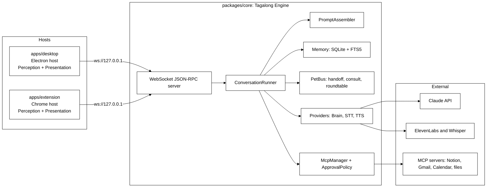
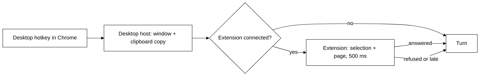
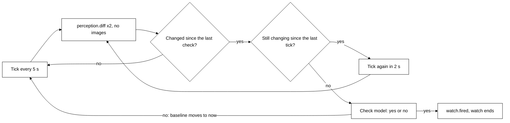
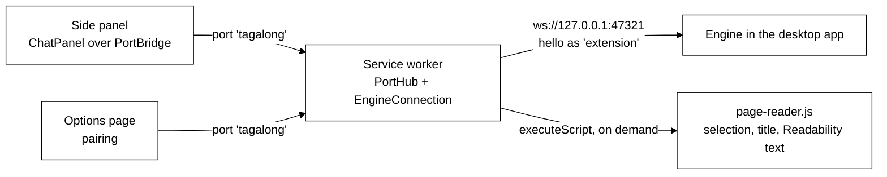

# Tagalong architecture

Adapted from the project home in Notion:
<https://app.notion.com/p/3d809730490481a4be8ac5bd000b8bfc>

This page describes how the engine and its hosts are built today. How pets remember, meet and talk
to each other, including designs not built yet, is in [concepts/](concepts/README.md). Building and
running from source is in [development.md](development.md).

## Core engine, thin hosts

One core engine, many thin hosts. The core never knows which OS or which host it is talking to.

`packages/core` is the whole engine: pets, the conversation loop, prompt assembly, memory, and the
provider adapters today; the voice pipeline, the inter-pet bus, and the MCP client in later phases. It
runs as pure Node TypeScript and exposes itself to hosts through a WebSocket JSON-RPC server.

A host is a thin shell around that engine. It captures what the user is looking at and renders what the
pets say. `apps/desktop` runs the engine in the Electron main process; `apps/extension` connects to an
already-running engine over the socket. Adding a host, or adding an operating system, never touches the
core.

## Components

The diagram is the finished shape. What exists after Phase 1: the server (`server/ws-server.ts` plus
`server/pairing.ts`), the runner (`conversation/runner.ts`), the prompt assembler
(`conversation/prompt-assembler.ts`), memory as plain SQLite tables (`memory/db.ts`, `memory/store.ts` —
FTS5 arrived with Phase 4 recall), the pet registry (`pets/registry.ts`), settings and the SecretStore
interface (`settings/settings.ts`), and the brain providers (`providers/`). `Engine.boot` in `engine.ts`
wires all of it together and is the only thing a host starts. The diagram's PetBus is not one class:
Phase 4 built it as `crew/` (handoff, consult, roundtable) on top of the runner — see "The crew" below.
`McpManager` and `ApprovalPolicy` (Phase 5), and the STT and TTS providers (Phase 3) do not exist yet. The Chrome extension
landed in Phase 6, which ran fifth; see "The browser host" below.

## Package responsibilities

| Package           | Responsibility                                                                                                                                                                                                                                                                          | Must never import                                |
| ----------------- | --------------------------------------------------------------------------------------------------------------------------------------------------------------------------------------------------------------------------------------------------------------------------------------- | ------------------------------------------------ |
| packages/protocol | Zod schemas for context snapshots, pets, messages, settings, and JSON-RPC envelopes, plus the method and notification catalog                                                                                                                                                           | anything except zod                              |
| packages/core     | Engine facade, conversation runner, prompt assembler, SQLite memory, pet registry, settings and SecretStore, pairing, websocket server, brain providers                                                                                                                                 | electron, react, DOM globals                     |
| packages/ui       | React components — `PetAvatar`, `MessageList`, `Composer`, `SightBar`, `ChatPanel` — plus the `HostBridge` contract and its context, and a fake bridge for host tests                                                                                                                   | electron, sockets, node APIs                     |
| apps/desktop      | Electron host. Runs the engine in the main process, dials it over the loopback socket, owns avatar, panel and settings windows, the tray, the two global hotkeys (text-only and look), perception with exclusions and capture announcements, and safeStorage secrets, one folder per OS | nothing from core internals, only its public API |
| apps/extension    | Chrome MV3 host. Connects to the running engine from its service worker, supplies the exact selection and page text on demand, renders pets in the side panel, pairs from its options page                                                                                              | core at all; it speaks the protocol only         |

## Host contracts

Hosts implement two contracts.

- **Perception** answers `perception.capture`: selection, active window, clipboard, page text, and from
  Phase 2 the screenshot. The result is a `ContextSnapshotPatch` defined in `packages/protocol`, and a
  host advertises what it can actually read in the `capabilities` array of `hello`. The desktop host
  advertises `selection`, `activeWindow`, `clipboard`, `screenshot` and `displays`; page text only ever
  comes from the extension, and `textLayer` is not advertised until the host can honour it — a
  capability the host cannot deliver makes the engine call a method that fails, which reads to the user
  as a broken pet rather than a missing feature.
- Phase 2B adds three more core-to-host methods and two capabilities behind them. `perception.listWindows`
  returns the window inventory — what each window is and where, never what is in it. `perception.readText`
  returns the text of **exactly one** window, named by id or defaulting to the foreground one, capped and
  flagged when truncated. `perception.captureRegion` returns a native-resolution crop of one display.
  A host that can do the first and third advertises `displays`; one that can do the second advertises
  `textLayer`.

  There is deliberately no scope that reads every window at once. Measured on a twelve-window Windows
  desktop, the whole text layer is 46,491 characters — roughly 11,600 tokens — in a single call, and one
  background browser window supplied 34,588 of them. The inventory costs about 200 tokens, so the pet
  reads that, picks a window, and pays for one. The absence is asserted by a test, not left to habit.

- **Presentation** renders pets, streams replies, plays audio, and shows approval cards.

### Routing between the desktop and the browser host

The extension advertises `selection`, `pageText` and `activeWindow`, and nothing else. The engine tells
the two hosts apart by `pageText`, which only the browser host can read, so connection order never
decides who answers (`perception/browser-route.ts`):

- **Window identity** always comes from the desktop host when one is connected. Exclusions are checked
  against it before either host reads anything.
- **`get_selection`** asks the extension first when the front window is a browser, and the desktop's
  clipboard trick otherwise. The extension gets `BROWSER_HOST_TIMEOUT_MS` (500 ms); a refusal falls back
  at once, a silence after 500 ms.
- **A desktop hotkey ask made in a browser** is filled in by the engine before the turn starts:
  `browserContextFor` asks the extension for the selection, the page and the tab, replaces the clipboard
  copy with the exact selection when there is one, adds the page, and drops the lot if the tab it read is
  excluded. Past 500 ms the ask goes out exactly as the desktop made it.
- **An ask from the side panel** carries the extension's own snapshot. The engine applies the exclusion
  list to its tab before the turn starts and, on a match, keeps only which tab it was.

Adding a host or an OS never touches the core.

## Host transport

Hosts talk to the engine over a JSON-RPC WebSocket bound to loopback only: `ws://127.0.0.1:47321` by
default, and the engine reports the port it actually bound when settings asked for something else.

Every connection is unauthenticated until it presents the pairing token in `hello`. Loopback is not a
permission boundary — any local process can open a socket — so the token is what keeps other programs
out. The engine writes it to `pairing.token` in its data dir, compares it in constant time, and answers
a mismatch with RPC error `-32000` before closing the socket. Any method other than `hello` on an
unauthenticated connection gets the same error.

The catalog in `packages/protocol/src/methods.ts` is the whole surface:

- **Host to core:** `hello`, `ask`, `interrupt`, `pets.list`, `pets.upsert`, `pets.delete`,
  `settings.get`, `settings.set`, `models.list`, `tool.approve` (Phase 5), `watch.stop`
  (Phase 3B), and from Phase 8 `roles.list` and `roles.recommendModel` (see
  [Roles over RPC](concepts/roles-and-tools.md#roles-over-rpc)), `notices.rolesUpgrade` and
  `notices.dismiss` (see [The roles notice](concepts/roles-and-tools.md#the-roles-notice)).
  Protocol 0.5.0.
- **Core to host:** `perception.capture`, from Phase 2B `perception.captureRegion`,
  `perception.listWindows` and `perception.readText`, and from Phase 3B `perception.recall` and
  `perception.diff`, both behind the `recall` capability (see [Awareness](#awareness-phase-3b)).
- **Core to host notifications** gained `turn.toolRequest` and `turn.toolResult` in Phase 2B. They were
  in the catalog from Phase 1 and nothing emitted them, which left a tool call invisible twice over: the
  user watching the panel could not tell a working pet from a hung one, and no test could observe that a
  tool call reached the host at all. The result carries a short summary rather than the tool's content —
  the model already has that, and forwarding an 8,000-character window read to every open window would
  be megabytes of IPC to render one line.
- **Core to host notifications:** `turn.started`, `turn.delta`, `turn.completed`, `turn.error`,
  `turn.warning`, plus `turn.audio` (Phase 3), `turn.toolRequest` and `turn.toolResult` (Phase 5),
  `pet.message` and `crew.status` (Phase 4), and `watch.fired` and `watch.status` (Phase 3B).
  `turn.warning` carries the same `{ code, message }` as `turn.error`
  but does not end the turn — a host that aborts on it throws away a reply that is still coming.

## The ask flow

## The turn lifecycle, as implemented

`ask` is not a request that returns an answer. It returns a receipt, and the answer arrives as
notifications.

1. The host calls `ask` with a `petId`, an optional `conversationId`, the input text, and an optional
   `ContextSnapshot`.
2. `ConversationRunner.run` opens a conversation if none was named, stores the user message (with its
   snapshot) in SQLite, mints a `turnId`, emits `turn.started`, and **returns immediately**. The `ask`
   result is `{ turnId }` and nothing else. The stored snapshot loses its screenshot unless
   `screenshotRetention` allows keeping it, and the same call sweeps screenshots that have outlived
   the setting — the turn is the only moment the engine reliably wakes up, and Phase 4 owns timers.
3. If none of the pet's models can see (`modelForTurn` answers null — see
   [Brain providers](#brain-providers)) and the ask carried a screenshot, the
   image is dropped before the request is assembled and a `turn.warning` with code
   `vision_unsupported` goes out. The turn continues without the picture.
4. The runner reads back the last `settings.historyMessages` messages — after the question was stored,
   so the prompt ends on what was asked — and `assemblePrompt` builds the provider-neutral request:
   the base instructions, the pet's role instructions and the user's notes for it, the reply-style rule, the history, and a screen-context
   block appended to the last user message rather than sent as its own turn.
5. The provider streams. Every text delta becomes a `turn.delta` notification.
6. The turn ends with exactly one of `turn.completed` — carrying the full text, a stop reason of `end`,
   `max_tokens`, `aborted` or `refusal`, and token usage — or `turn.error`, carrying a `BrainErrorCode`
   (`rate_limit`, `auth`, `connection`, `config`, `unknown`) and a message written for the person
   looking at the panel. The assistant message is stored only if it has text, so an interrupted turn
   leaves no empty row to replay at the model.

Notifications are broadcast to every connected host session, so a second window sees the same stream.

**One turn per pet.** `run` interrupts any turn already in flight for that pet before starting the new
one: two streams into one panel read as nonsense. A second `ask` for the same pet is therefore an
interruption, not a queue. Explicit `interrupt(turnId)` aborts through the same `AbortController` and
answers `{ aborted: false }` when the turn had already finished. `Engine.shutdown` interrupts everything
still running before closing the database, because a stream left in flight would keep writing to a
database that is about to close.

Tool calls are part of the contract already: the provider's `onToolUse` is awaited before the dependent
text streams. Phase 2 fills it with two built-ins, now in `packages/core/src/tools/builtin/perception.ts` —
`look_at_screen` and `get_selection` — offered to every pet whose provider advertises
`capabilities.tools`, and to no other. A call that arrives with no toolset wired still gets the honest
"no tools are available yet" error result rather than a pretend success.

Both tools call the connected host's `perception.capture` through the injected `hosts()` lookup, which
is read per call because hosts connect and drop mid-conversation. Each one asks for `activeWindow`
**first** and runs `findCaptureBlock` against the live exclusion list before asking for pixels or
selected text: an exclusion that only filters the answer has already taken the screenshot it promised
not to take. A blocked window, a host with no `screenshot` capability, and a host that fails to answer
all come back as error tool results naming the reason, never as silence.

Results are **text**, never a snapshot object: `BrainTool` results are strings by contract, and a model
handed `{"screenshot":{"base64":"iVBO…"}}` learns nothing it can reason about while the blob swamps its
context. So `get_selection` returns the selected text itself, and `look_at_screen` reports the window and
the image size and says plainly that pixels cannot ride back through a tool result — the image reaches
the model through the snapshot attached to an ask.

## Brain providers

`BrainProvider` (`providers/brain.ts`) is the only thing the runner talks to. Four ids are
registered in `providers/registry.ts`:

| id           | Class                      | Wire format                                                                      |
| ------------ | -------------------------- | -------------------------------------------------------------------------------- |
| `openrouter` | `OpenAiCompatibleProvider` | OpenAI chat completions through the `openai` SDK, preset base URL OpenRouter     |
| `nebius`     | `OpenAiCompatibleProvider` | The same, preset base URL Nebius Token Factory                                   |
| `anthropic`  | `AnthropicProvider`        | Anthropic Messages API through `@anthropic-ai/sdk`                               |
| `fake`       | `FakeBrainProvider`        | None: scripted words, for tests and demos; forced by `TAGALONG_FAKE_PROVIDERS=1` |

**Each pet picks its own.** `Pet.providerId`, `Pet.model` and the optional `Pet.visionModel` decide
the brain; `Settings.providerId` and `defaultModel` are no longer read. The engine resolves a pet's
provider on its first turn and caches it per id. Keys come from the SecretStore entries in
`SECRET_KEYS` (`anthropic.apiKey`, `nebius.apiKey`, `openrouter.apiKey`), read at boot; base URLs come
from `Settings.providerBaseUrls`, falling back to the preset's. A provider that cannot be built — no
key, an unknown id — fails only that turn, as a `turn.error`, and boot never depends on a key.

The two OpenAI-compatible ids are presets in `providers/presets.ts`: a label, a base URL, a fallback
model list, and a vision list. Any other chat-completions server is configuration only — a base URL
override, a key, a model id.

**Vision routing** (`providers/vision-routing.ts`). `modelForTurn` returns the pet's model for a
turn without an image; with one, the model if the provider says it can see (`canSee`, or every model
when a provider has no `canSee`), else the vision model, else null. The runner uses it to decide
whether to drop a screenshot (with the `vision_unsupported` warning) and passes the answer to the
perception tools with every call, so a blind pet's `look_at_screen` answers in words. The
OpenAI-compatible provider re-routes every request round, so an image a tool returns mid-turn moves the
rest of the turn to the vision model, and as a last resort replaces images it may not send with a note
saying one was attached. Token Factory lists only Nemotron Nano 2 VL as seeing; OpenRouter lists none,
meaning all.

**Model lists.** `models.list` answers with `GET /models` from the service when a key is stored and
the app is not in fake mode, sorted; anything else — no key, fake mode, a refused key, a wrong URL —
answers the preset's fallback list with `source: 'fallback'`. The key is read fresh for this call, so
a key saved a moment ago fills the picker without a restart.

**Keys without a restart.** Turns get their provider from `KeyedProviderResolver`
(`providers/key-resolver.ts`). The engine calls its `refresh` before every `ask`, which re-reads the
three keychain entries; `resolve` reuses the built provider until its key or base URL changes, then
builds a new one. A key pasted into the onboarding wizard therefore answers the very next question,
which is what lets a fresh install reach a first answer without a restart.

How the provider-neutral blocks map onto the chat-completions
format:

- The system prompt is the first message, role `system`.
- A user message with only text goes as a plain string; one with images goes as content parts, the
  `image_url` parts (base64 `data:` URLs) ahead of the text, as Anthropic gets them.
- `tool_use` becomes an assistant `tool_calls` entry whose `arguments` is the input as JSON.
- `tool_result` becomes a `tool` message. That message is text-only in this format, so **an image a
  tool returns cannot ride inside it**: the tool message says an image follows, and the pictures go in
  one user message placed straight after the tool messages, captioned with the tool's name. An error
  result is prefixed `Error: `.
- Streamed tool calls arrive in fragments keyed by `index`; they are joined, and a call whose
  arguments are not valid JSON reaches the tool as the raw string, so the tool's own validation
  answers instead of the turn dying. Calls are run whenever the stream produced any, even if the
  server said `stop` — some do.
- Finish reasons: `length` is `max_tokens`, `content_filter` is `refusal` (with the shared refusal
  line), anything else is `end`. Usage comes from the final chunk (`stream_options.include_usage`)
  and is summed across tool rounds; a server that sends none reports zero.
- Reasoning deltas (`reasoning_content`) are ignored, so a model's thinking never reaches the bubble.
- HTTP 429 is `rate_limit`, 401 and 403 are `auth`, 404 is `config` naming the model, a network
  failure is `connection`. Aborting returns the text so far with stop reason `aborted`.

The unit tests feed the real SDK a fake `fetch` that answers with canned server-sent events, so the
parsing path is the production one and nothing reaches the network.

## The desktop host's shape

`apps/desktop` runs the engine **in the Electron main process and still speaks to it over the socket**.
In-process is an optimisation, not a shortcut: `startEngineHost` boots `Engine`, then dials it with an
ordinary `EngineClient`. Nothing in the host can come to depend on engine internals the Chrome host
will not have.

The main process is the **single websocket client** for this host. Renderers never dial the engine; they
go through IPC to main, which holds the one connection. That is what keeps the pairing token out of
every window, and what makes the two hosts interchangeable.

The preload exposes exactly two globals, and the split between them is deliberate:

- `window.tagalong` is precisely the `HostBridge` interface that `@tagalong/ui` consumes — `ask`,
  `capture`, `interrupt`, `listPets`, `listRoles`, `recommendModel`, `rolesNotice`,
  `dismissRolesNotice`, `onTurnEvent`. Nothing more. `capture` is how the panel's
  Look button reaches the screen; it resolves to null when the window is excluded, so the sight bar
  can say capture is blocked here instead of quietly showing nothing.
- `window.tagalongHost` carries everything specific to this host — the captured snapshot, the settings
  view, saving the API key, opening settings, hiding and toggling the panel.

Keeping them apart means a shared UI component can never grow a dependency on something the Chrome host
will not have: if it compiles against `HostBridge`, it runs in both hosts.

Every window — avatar, panel, settings, onboarding, office — is created with `contextIsolation: true`,
`nodeIntegration: false`, and `sandbox: true`. Nothing from node or electron crosses the preload
boundary; only plain data over the IPC channels named in `src/shared/ipc.ts`. Because a sandboxed
preload can only be CommonJS while the package is ESM, the preload is built to `dist/preload/index.cjs`.

The host also degrades rather than dying. If the engine refuses to boot — the ordinary first run with no
API key stored — the app still starts, opens the settings window, and reports why; settings reads and
writes fall back to `SettingsStore` directly so the user can fix the thing that blocked the boot.

### The attach policy

A full-view capture holds far more than fits in a prompt: one picture per display, a composite, and
every open window. What actually rides along is decided in `assemblePrompt`, once, so no host has to
know the rules.

Two pictures by default. The composite leads — it is the map of how the monitors sit, and a reader
makes sense of one screen faster having already seen where that screen is — then the display being
worked on. Every other display is named in text with its id and size, for the pet to fetch by tool.
Three monitors must not mean three images on every ask, and the test counts image blocks rather than
trusting a comment.

Each display line carries both its ordinal and its Electron id, because they serve different needs.
The composite draws ordinals in its corners, since a ten-digit id costs seven glyphs of a five-pixel
font and is unreadable at composite scale; `look_at_display` takes the id. Printing one without the
other leaves the pet able to see a screen it cannot name, or name one it cannot see.

`sightDetail` is the escape hatch, `focused` by default and `all` to attach every display. The
default is the cheap one because the expensive one scales with hardware rather than with intent.

### Pausing sight

Every read the host can make goes through one `Platform` method, which is what makes a single pause
gate possible. `gateSight` wraps the adapter at construction in `start()`, and nothing downstream is
ever handed the ungated one — so a capture path added later consults the pause by construction
rather than by its author remembering to.

Which methods pause covers is a mapped type over `keyof Platform`, so adding a method to the adapter
without deciding what pause does to it is a compile error. `sight` covers everything that reads the
screen, window titles included: "Re: Q3 layoffs — Outlook" is screen content, and a pet that cannot
see a window but can name it has not been paused in any sense the user meant. `handed-over` covers
the selection and the clipboard, which the user passed over deliberately.

A paused read **throws** rather than returning nothing. Returning an empty capture would be
indistinguishable from a quiet screen, which is the exact shape that let four broken reads ship
earlier in this phase — and `attempt`, which swallows failures because perception is best effort,
re-throws this one specifically. A refusal is not a failure and must not be treated as one.

Phase 3B's rolling memory needs no change here to be covered: it will read the screen through the
same adapter, so the gate refuses it on the same flag without that code knowing pause exists.

### Settings that take effect without a restart

Three of the sight settings are read at the moment they are used rather than at boot, and that is
deliberate rather than incidental.

The exclusion list, the window text budget and the sight detail are all passed into the engine as
**functions**, not values — `exclusions: () => settings.get().captureExclusions` and its two
neighbours in `Engine.boot`. A value captured at boot would make each of them a control that stores
what the user typed and changes nothing until the next launch, which is the worst kind of settings
bug: the screen agrees with the user and the program does not.

A hotkey that cannot be registered is reported, never fatal. `HotkeyManager` binds each accelerator
independently, so one refusal costs only its own action, and `describeHotkeyProblems` turns the
outcomes into a message naming the action rather than only the combination. That message is pushed to
every open window on `IPC.hotkeyProblemEvent` and also returned by `getHostView`, so a window opened
after the failure and a window already open both show it — and both stop showing it the moment the
binding is corrected. Boot deliberately does not raise a modal for this: the only way to store a bad
accelerator is to type it in Settings, and a modal before any window exists locks the user out of the
one surface that could fix it.

The hotkeys work the other way round from the sight settings, because a global accelerator is held by
the OS rather than read per use. `HotkeyManager` owns what is currently registered and swaps only the accelerators that
changed, and the settings save handler calls it. That one call is the whole of "without restart" for
hotkeys, and it is covered by a smoke test rather than a unit test — every unit test injects a fake
registrar and applies the bindings itself, which proves the manager rebinds and never that a save
reaches it.

### The platform adapter

Everything OS-specific sits behind `Platform` in `src/main/platform/`. `createPlatform` throws on any
OS with no adapter rather than returning a stub, because a host that silently perceives nothing looks
like a broken engine instead of a missing port. Windows is the only implementation until Phase 7.

`TextLayerProvider` is the second interface here, and it exists for the same stated reason: Phase 7
names the macOS implementation, which answers the same two questions through the Accessibility API.
It reads one window's text by id — including a window behind another and a minimized one, both of
which UI Automation answers for — and counts readable characters for the inventory.

Each capability is a free function taking its Electron dependencies as ports — `desktopCapturer`,
`screen`, `nativeImage` — and the class only wires the real ones in. That is what lets the whole
perception layer be tested in plain Node with no display attached, which matters because CI has no
desktop and the one test that does use real pixels is the Playwright smoke test.

`captureDisplays` takes the exclusion list, and `captureActiveWindowImage` does not. The difference is
not an inconsistency. For a single screenshot the caller checks exclusions and then either asks for a
picture or does not, so the answer is yes or no. For a full-view capture one display can be refused
while the others are returned, and the composite has to show that refusal in the refused display's
slot — so the decision has to happen inside the capture rather than above it.

#### Talking to PowerShell

The window scripts are strings in the source, passed to `powershell.exe` through
`-EncodedCommand` as base64 UTF-16LE. Both halves of that are deliberate and both were learned the
expensive way.

A bundled `.ps1` would have to survive electron-vite, the asar archive and the installer, each of
which is a way for the inventory to work in development and be missing from the packaged app. A
string cannot go missing.

`-EncodedCommand` rather than feeding the script to `-Command -` over stdin, because stdin is parsed
line by line. A `foreach` whose body spans lines, or an `Add-Type @"..."@` block, produces **nothing
at all** — exit 0, empty stdout, empty stderr, and every statement after it silently lost. The same
text saved as a `.ps1` and run directly works perfectly, which is what makes the failure so easy to
ship: verifying the script proves nothing about the transport. `-EncodedCommand` delivers the whole
script as one argument, parsed as one block. Base64 of UTF-16LE is about 2.7 times the source and
Windows allows roughly 32,000 characters of command line, so these scripts sit an order of magnitude
inside the limit. A test asserts the encoded length stays there, and another asserts no here-string
returns.

#### Building the composite

The composite is the one image Tagalong builds rather than captures. Electron's `nativeImage` resizes
and encodes but cannot compose, so the pixels are handled directly: `toBitmap` hands over a BGRA
buffer, `createFromBitmap` takes one back, and everything between is ordinary buffer arithmetic in
`canvas.ts`, `composite.ts` and `label.ts`. No image library, and one Electron call at the end.

### The window inventory

`listWindows` enumerates every top-level window through a UI Automation helper. The helper is a
PowerShell script held as a string in `window-helper.ts` rather than a `.ps1` on disk: a bundled file
has to survive electron-vite, the asar archive and the installer, and each of those is a way for the
inventory to work in development and be missing in the packaged app. It is fed to PowerShell over
stdin, which also sidesteps every quoting question a long `-Command` argument would raise.

The helper reads **no window contents**. That is what makes the inventory cheap enough to attach to
every capture — walking one background browser window's descendants yielded 34,588 characters on a
real desktop. Reading a window is a separate, deliberate call against one id.

The split is the usual one. The host enumerates and maps windows to displays, because both need the
OS. What a window _means_ — whether it may be read, whether its tabs are reachable, how it reads in a
prompt — is decided in `packages/core/src/perception/inventory.ts`, where it is tested without a
desktop. `renderInventory` produces the text the prompt assembler attaches, under a budget of 300
tokens for a twelve-window desktop.

Two things the inventory is careful about. A blocked window keeps its process name and **loses its
title**: a process name says a password manager is open, which the user can see anyway, while "Chase —
Transfer to savings" says most of what the window holds. And an empty inventory is omitted from the
prompt rather than rendered as "no windows are open" — an empty list means the enumeration failed, not
that the desktop is empty, and a pet told otherwise will reason from it.

Since Phase 2B, a display is blanked when **any window on it that the user can see** is excluded, not
only when the foreground window is. The foreground check remains as a floor beneath the inventory, so
that a helper which cannot run does not silently remove the protection Phase 2 already shipped.

## The crew (Phase 4)

Phase 4 turns one companion into a crew. Everything below lives in `packages/core`; hosts only render
what the engine broadcasts.

### The registry and the default crew

`pets/registry.ts` keeps each pet as a validated JSON blob in the `pets` table and exposes it through
`pets.list`, `pets.upsert` and `pets.delete`. `pets.upsert` refuses a `roleId` the role library does
not have with RPC error `-32602`, and stamps a new pet (or one changing role) with that role's
library `version`. A fresh install is seeded with three pets that
deliberately run on different brains, so the crew spans providers from the first boot:

| Pet   | Role             | Provider     | Model                                                |
| ----- | ---------------- | ------------ | ---------------------------------------------------- |
| Scout | Generalist       | `nebius`     | Nemotron 3 Super, Nemotron Nano 2 VL for pictures    |
| Ink   | Writer           | `openrouter` | `anthropic/claude-sonnet-5`                          |
| Bolt  | Backend engineer | `nebius`     | Nemotron Nano 2 VL (reads screenshots of errors too) |

Seeding is remembered per pet in `pet_seeds` (migration 2). Migration 5 gives every stored pet a
role (Scout generalist, Ink writer, Bolt backend engineer, any other pet generalist) and keeps an
edited persona as the pet's notes. An install that predates the crew gains Ink and Bolt on its next
boot, a pet the user edited is never overwritten, and a default the user deleted stays deleted. Each
pet carries an optional `color` (`#rrggbb`) for the strip and the panel.

### Memory

`memory/memories.ts` is the crew's memory: `memories(id, scope, pet_id, kind, text, created_at)` with
an external-content FTS5 index (`memories_fts`, porter stemming) kept in step by triggers (migration 3).
`scope` is `pet` (private, `pet_id` set) or `crew` (the shared notebook, `pet_id` null); `kind` is
`fact`, `preference` or `summary`. Every read — `recent(petId)` and `search(petId, text)` — filters on
`scope = 'crew' OR pet_id = ?` in SQL, so no code path can load another pet's private memories. A
question is turned into an FTS query by quoting each distinct word and OR-ing them (`ftsQuery`), so
quotes, `*`, `NEAR(` and friends in a user's text are plain words rather than syntax errors, and BM25
ranks the closest memory first.

### Recall

Every turn recalls before it assembles (`memory/recall.ts`): the pet's five newest visible memories,
then up to five FTS matches against the question plus the selection that are not already listed,
dropping whole memories past a 2,000-character budget. `assemblePrompt` renders them last in the system
prompt under `## What you remember`, labelled `(preference)`, `(fact)` or `(fact, shared by the
crew)`, and caps the whole section — heading included — at 2,000 characters. Last, so a remembered
"short answers" reads as overriding the generic reply-style rule above it.

Memories are written two ways. The `remember` tool (`tools/builtin/crew.ts`) is offered to every
pet whose provider supports tools: `{ text, kind: fact | preference, shared? }`, filed under the
calling pet or, with `shared: true`, in the crew notebook. Under it sits a deterministic safety net:
when the user's own message states a lasting preference — "I prefer…", "from now on…", "remember
that…", "always answer…" — the runner files that sentence as a private `preference` before the turn
runs, so "Scout keeps answers short after a restart" does not hinge on a model choosing to call a tool.
`addOnce` keeps the same sentence from filling five recall slots.

### Summaries

`memory/summarizer.ts` keeps long conversations short. After every turn that answered, the runner's
`afterTurn` hook hands the conversation to `Summarizer.schedule` without awaiting it, so the job never
sits on the request path. Once twenty messages have built up unsummarised, all but the newest four go
to a brain as a `User: … / Scout: …` transcript with a one-paragraph instruction and no tools; the
reply becomes a `summary` memory for the pet and those messages get `summarized_at` (migration 4).
`ConversationStore.lastMessages` skips summarised rows, so the history replayed to the model shrinks
while recall carries the gist. Rows stay on disk. A failure — no key, a timeout after 60 s, an empty
reply — changes nothing and the next turn tries again; concurrent schedules share one job.

The brain is `settings.summarizer` (`{ providerId, model }`) when set, and otherwise the pet's own
provider and model. The phase page named `claude-haiku-4-5`; defaulting to the pet's own brain means a
crew on Token Factory and OpenRouter never needs a third key for housekeeping.

### Handoff

`crew/commands.ts` reads the crew syntax at the start of an ask, in core, so every host gets it: a
leading `@Name` (a pet's name or id, any case) other than the pet being asked is a handoff, and
`/crew <question>` is a roundtable. A mention of the pet already being asked is stripped; an unknown
mention, or one mid-sentence, is ordinary text.

`crew/handoff.ts` builds the `HandoffPayload` — `{ fromPetId, toPetId, summary, request, snapshot }` —
from the stored thread without a model call. The summary is two paragraphs: what the user asked (first
and latest questions, and the page or app they were in), then the source pet's latest answer, clipped
to 700 characters. The snapshot is the one attached to this ask, or else the latest one in the thread.
`startHandoff` opens a new conversation for the target, whose first user message is the summary plus
the request, and broadcasts `pet.message { kind: 'handoff', text: summary, turnId, conversationId }`
through the runner's `beforeStart` hook — so it reaches hosts _before_ the target's `turn.started`
and the panel draws the bubble ahead of the answer.

`turn.started` now carries `providerId` and `model` (and `runId` for crew runs), so a panel can label
every answer with who said it and on what.

### Consult

`tools/builtin/crew.ts` gives every pet an `ask_pet(petId, question)` tool whenever the crew has someone else
to ask and the turn allows it (roundtable turns pass `allowConsult: false`). Its description lists the
other pets as directory cards: id, name, role, summary, good at and not for, never their notes or memories. A call runs one nested turn for the target:
its own role instructions and notes, provider, model and recalled memories, the caller's question framed as "X is
consulting you mid-answer", and the caller's screen context as text only — no pixels. The nested turn
is offered **no tools**, which is the depth limit: a consulted pet cannot consult, and a nested
`ask_pet` it invents anyway is answered with an error result. It has 60 seconds (`AbortSignal.any` of
the caller's signal and a timeout); a timeout, a provider error or an empty reply comes back to the
caller as an error tool result — "Ink did not answer within 60 seconds. Answer without it." — and the
caller carries on. Nothing of the nested turn is stored. The consult is broadcast as `pet.message
{ kind: 'consult', text: question, turnId: callerTurn }` before it runs, so the panel draws a small
card above the caller's answer.

`turn.completed.modelCalls` counts what a turn cost: one for the first call, one per tool round trip,
one per consult. The panel footer shows "N model calls" whenever a run made more than one.

### Roundtable

`crew/roundtable.ts` runs `/crew <question>`. The asking pet speaks first and writes the synthesis; the
rest of the crew follows in registry order. Rounds include the synthesis and are clamped to 2..3: the
default is one discussion round and the synthesis, and three rounds adds a second pass in which each
pet responds to the others. Every turn is an ordinary runner turn on the pet's own provider and model,
tagged with the run's `runId` and with `allowConsult: false`, so a mixed crew — Nemotron 3 Super,
Claude through OpenRouter, Nemotron Nano — takes turns on three brains. Each pet keeps one
conversation for the run, and its prompt carries the transcript so far (each answer clipped to 800
characters); the user's snapshot rides on each pet's first turn only, so a screenshot is not paid for
twice per pet.

Hosts follow the run through `pet.message { kind: 'roundtable', round, text: 'Round 1 of 2' |
'Synthesis by Scout' }` — sent before the turn that opens the round — and `crew.status { runId,
state: running | done | stopped, round, rounds, modelCalls }` after every turn. A pet that cannot
answer is written into the transcript as "(Ink could not answer: …)" and the table carries on.
Interrupting the turn in flight — the panel's Stop button — or `stop()` cancels every remaining turn.

### The crew in the hosts

`ChatPanel` in `packages/ui` is one timeline for the whole crew, in both hosts. It lists the crew
(from the host, or `bridge.listPets()`), shows the active pet's name and colour with a `CrewStrip` to
switch, threads each pet's follow-ups into the conversation `turn.started` reported for it, labels each
answer `Name · model`, draws handoff bubbles, consult cards and round markers from `pet.message`, moves
to the target pet on a handoff (and tells the host through `onPetChange`), offers a **Hand off…** menu
under each answer that writes `@Name ` into the composer, and a **Crew** button that sends
`/crew <text>`. While a roundtable runs (`crew.status` running) the composer waits and **Stop**
interrupts the turn in flight, which ends the run. The footer shows `crew.status.modelCalls`, or a single
turn's `modelCalls` when it was more than one. `HostBridge.onTurnEvent` now also delivers
`pet.message` and `crew.status`; the desktop forwards every notification and the extension's port
bridge lets these two through.

The desktop avatar window became a strip: one `PetAvatar` button per visible pet, the default pet
first, sized by `stripWidth(n)` and clamped on screen. The window background is still the drag handle,
so the crew moves as one and its position is the existing `avatar` setting — one position for the
strip rather than one per pet. A click calls `selectPet`, which opens the panel and sends it the pet.
Each avatar's ring follows its own turns (`nextPetStates`), so a roundtable lights the pets in turn.
`settings.hiddenPets` takes pets off the strip; they still answer in the panel. Settings edits every
pet field, adds pets (on the fake brain until a provider is picked) and deletes them, and sets
`settings.summarizer`.

### The Crew Office

The office is a framed desktop window (`windows/office.ts`, the `office` renderer page) opened from the
tray's **Open office** item or `tagalongHost.openOffice()`, with a 1280x800 page (`useContentSize`) so
the floor fits without scrolling; a screen too small for that clamps the window and the floor scrolls. It shows the crew as 16-bit pixel characters
at desks on an office floor, with a party list on the left and a meetings panel on the right. The
renderer entry only wraps `OfficeView` from `@tagalong/ui` in the preload's `HostBridge`; everything
it draws is in `packages/ui/src/office`, so the browser host can reuse it.

It is split so the look can change without touching component logic:

- **Tokens** — `office/tokens.ts` holds every colour, font, font size, spacing value, radius, sprite
  scale and timing. Components read only from it; `office-styles.ts` builds the few rules inline
  styles cannot express (hover, focus ring, `::selection`, scrollbar, the stepped idle bob and its
  `prefers-reduced-motion` switch-off) from the same tokens, scoped under `.office`.
- **Sprites as data** — `office/sprites/` keeps each character as a pixel map (rows of characters),
  a palette and optional overlay pixels. `spriteShadow` turns a sprite into a CSS `box-shadow` (one
  1px shadow per pixel) and `PixelSprite` draws it on one pixel scaled by a whole number. No images,
  no canvas. `characterFor(pet)` is the one mapping from a pet to a character: Scout, Ink and Bolt get
  their own; any other pet gets the shared body recoloured from its `color`.
- **Job labels from roles** — the party list's job label is the pet's role name in capitals, from
  `bridge.listRoles()` by `pet.roleId` (`office/job.ts`, `jobFor`); an unknown role reads
  `GENERALIST`. Its colour is `officeTokens.roleInk[roleId]`, one ink per class. The office lists
  pets and roles together; if only the roles fail, the crew still shows, labelled as generalists.
  The furniture is sprites too (`sprites/furniture.ts`: desk, monitor, chair, meeting table, wall
  window, a shelf, a water cooler, and a lounge of rug, sofa, coffee table and plant that
  `loungeAt(n)` places below the desks until a seventh pet needs that band), drawn at the pets' 3x scale with shading painted into the
  pixels. Each desk's monitor stands beside its pet facing the viewer, lit teal while the pet works.
- **Layout as data** — `office/layout.ts` holds the floor size, the two meeting rooms (`ROOM_COUNT`),
  windows, plants and props, and pure functions for desk positions (`deskLayout(n)`, two columns of up to
  eight desks), seats, monitors and the selection cursor.
- **Small components** — `PartyList`, `OfficeFloor`, `MeetingsPanel` and `PixelSprite`, composed by
  `OfficeView`.
- **The roles notice (Phase 8)** — `OfficeView` reads `bridge.rolesNotice()` with the crew and, while
  it is unseen, shows `RolesNotice` (`office/roles-notice.tsx`): a modal `<dialog>` over the office with
  a row per upgraded pet (sprite, name, the new role in its ink, what happened to its persona), a
  **What changed?** disclosure, **Review my crew** and **Got it**. Both buttons and Escape call
  `bridge.dismissRolesNotice()`; Review my crew then calls the `onReviewCrew` prop, which the desktop
  wires to `tagalongHost.openSettings()`. At launch, main asks `notices.rolesUpgrade` once the engine
  is up and opens the office when a notice is pending, so an upgraded user sees it without looking
  for it. See [The roles notice](concepts/roles-and-tools.md#the-roles-notice).

Status comes from the turn notifications main already forwards to every window: `nextActivity` keeps
the turns in flight, so a pet reads **Working** (and its monitor lights) from `turn.started` until that
turn completes or errors, and **At desk** otherwise — always an icon and a word. Meetings, task
assignment and office settings are later phases: the rooms read **Free**, the meetings panel shows an
empty state, and the assign field is disabled with a tooltip saying so. A **Still office** toggle in the
top bar stops the idle bob and the cursor hop (as `prefers-reduced-motion` does) and is remembered in
the page's `localStorage`. The two typefaces, Onest and
Pixelify Sans, are bundled from `@fontsource` packages (Latin subset) so the window makes no network
request.

### The Settings window

Settings (`windows/settings.ts`, the `settings` renderer page, 1080x760) is drawn in the office's
world: a navy top bar with the Save button, a navy nav with the crew and links to each section, and
off-white panels for the sections. Its sheet is `SETTINGS_CSS` in `@tagalong/ui`
(`packages/ui/src/settings/settings-styles.ts`), built from `officeTokens`, so Settings has no palette
of its own.

The renderer entry `settings.tsx` holds the window state and the save; each section is one file
under `apps/desktop/src/renderer/src/settings/`:

| File                    | Section                                                                      |
| ----------------------- | ---------------------------------------------------------------------------- |
| `pets-section.tsx`      | Every pet's editor, the selected one shown; look, reply style, strip, delete |
| `keys-section.tsx`      | Provider API keys and OpenAI-compatible base URLs                            |
| `summaries-section.tsx` | The summarizer provider and model                                            |
| `hotkeys-section.tsx`   | The four global hotkeys and the hotkey problem, if any                       |
| `sight-section.tsx`     | What a see-everything look sends, and the window text budget                 |
| `awareness-section.tsx` | Rolling memory and the watch limits                                          |
| `browser-section.tsx`   | The Chrome extension's pairing token                                         |
| `section.tsx`           | The section list the nav links to, and the panel every section sits in       |

The role-shaped part of a pet is pure components in `packages/ui/src/settings/`, which take the role
library and the recommended model as props: `CrewList` (each pet's sprite, name and role),
`RolePicker` (one role, its summary and good-at, and a warning that a role change replaces
instructions and tools while name, look, notes and memories stay), `BrainPicker` (provider and model,
a **Recommended** or **Your choice** chip and **Use recommended**), `ToolToggles` (one switch per tool
the role lists, stored as `toolGrants`), and `DirectoryCard` (the card teammates read: name, role,
summary, good at, not for, the tools it can reach, and its brain tier or custom). `PetSettings`
composes them with the name and notes. The desktop editor keeps the edits in state and hands them to
the one `FormData` save as hidden inputs; `buildPet` validates them and `roleVersionFor` keeps the
pet's role version unless the role changed. Every pet's editor stays mounted while another is shown,
so switching pets before saving loses nothing.

The window loads the role library once with `window.tagalong.listRoles()` and asks
`window.tagalong.recommendModel(roleId, providerId)` whenever a pet's role or provider changes. Role
names, never ids, appear in the crew nav, the picker and the card; until the library arrives the
editor says the roles are loading and a save keeps each pet's role. Role labels take their colour
from `officeTokens.roleInk` by role id, through the office's `jobFor`, so a role reads the same in
Settings and the office. Saving goes through `pets.upsert`, which refuses an unknown role and sets
`roleVersion` for a new pet or a changed role.

## Awareness (Phase 3B)

The pet can remember the last few minutes of the desktop and watch for something to happen. Both
live behind the `recall` capability, and both stay on the machine: frames are held in memory by the
desktop host and only a frame the pet asks for, or the crop a watch shows its check model, ever
reaches a model.

### The wire

`packages/protocol/src/awareness.ts` holds the shapes, because they share one idea the rest of the
catalog does not have — time.

- `perception.recall { secondsAgo, displayId? }` returns the buffered frame nearest that moment for
  one display or every display, each with its `capturedAt`, plus the window list and focused window at
  that time, whether recording is on, and `oldestAt`, how far back the buffer reaches.
- `perception.diff { displayId, sinceSeconds, rect?, includeImages? }` compares the display (or a
  region of it, in display pixels) now with the frame nearest `sinceSeconds` ago, and returns a
  `changeRatio` from 0 to 1, the changed bounding box, and before and after crops of it. A watch polls
  with `includeImages: false` and asks for the crops only when it is about to show them to a model.
- `watch.fired { watchId, petId, message, displayId }` says a watch's condition came true; the watch is
  over. `watch.status` reports `watching`, then exactly one final state — `fired`, `stopped`,
  `timeout`, `capped` or `error` — with the checks spent and the check model, so a host can show a Watching chip and take
  it down. `watch.stop { watchId }` is the chip's Stop button.

### Rolling memory

`apps/desktop/src/main/awareness/` holds the desktop half. `RollingMemory` ticks every five seconds
while it is on and sight is not paused: it asks for the focused window first and skips the frame if
that window is on the exclusion list, then captures every display at 640 pixels through the
sight-gated platform, lists the windows, and pushes the moment into a `FrameRing`. The ring is a time
window, not a count — `minutes` from settings, ten by default — and frames are kept as PNGs, about a
tenth of the raw bitmap. A blocked display's placeholder is never stored.

Pausing sight stops the timer and clears the ring; turning memory off clears it; quitting disposes it.
Nothing in the folder imports `fs`, and a test asserts that. While it records, every avatar shows a
small red dot (`PetAvatar recording`), driven by `onRecordingChange` over IPC.

`PerceptionMemory` answers the two methods. Recall reads the rolling ring. Diff takes a fresh frame —
reusing one taken in the last second, since a watch asks twice per tick — and compares it with the
frame nearest `sinceSeconds` ago from the rolling ring or, when memory is off, a scratch ring kept only
for displays a diff asked about and dropped after 30 s without one. `pixel-diff.ts` does the
comparison on BGRA buffers: a channel moving more than 24 levels counts, the ratio is changed pixels
over the region's area, and frames of different sizes count as wholly changed. The after crop is taken
again at native resolution through `captureRegion` (1024 px long side), so a check model can read text
a 640-pixel frame turns into a smear.

### The tools

`packages/core/src/tools/builtin/awareness.ts` adds two built-ins to the perception set, after the
full-view five. Both find a host that advertises `recall` and implements the method, and both name
the moment they describe in every answer, because a pet describing a frame from five minutes ago as
the screen now is the failure this feature invites.

- `recall_screen(secondsAgo, displayId?)` calls `perception.recall`. A seeing pet gets each frame as
  an image block followed by `Display 1 at <time>`, then a text block with the time in words, the
  focused window and the window list of that moment. When the frame found is more than ten seconds
  newer than the moment asked for, the text says how far back memory actually reaches. Memory off
  and memory empty are two different sentences, so the pet can tell the user which.
- `what_changed(displayId, sinceSeconds)` calls `perception.diff` with images. A seeing pet gets
  `Before, at <time>`, the before crop, `After, at <time>`, the after crop, and the share of the
  display that changed with the changed box. No earlier frame and nothing changed are answered in
  words.

A blind pet gets the same facts as text and is told it has not seen the pictures. The panel's
`turn.toolResult` summary counts images rather than forwarding them.

### Watch mode

`packages/core/src/watch/` holds it. `watch_for(condition, displayId?, rect?, timeoutMinutes?)` is a
crew-style tool, because the watch belongs to the pet that called it; without a `displayId` it
watches the display of the window in front and remembers that window for a text-only check. The
`WatchManager` belongs to the engine, not the turn — a watch outlives the reply that started it — and
runs on an injected clock, so every timing rule below is unit tested with a fake one.

- **When a model is asked.** Each tick asks the host for two ratios with no images: the region
  against the previous tick, and against the frame at the last check (or the watch start). A check
  happens only when the baseline ratio is at least `WATCH_CHANGE_THRESHOLD` (0.5% of the region) and
  the tick ratio is below it — the screen changed and then held still. Scrolling build output never
  holds still, so it costs nothing until the build stops; a finished command is checked 2 to 7 s
  after its last line. After a no, the baseline moves to now: one check per change.
- **Which model.** `watchModelsFor(pet)`: the pet's `watchModel`, else its provider's default —
  Nemotron 3 Nano on Token Factory, `anthropic/claude-haiku-4.5` on OpenRouter, `claude-haiku-4-5` on
  Anthropic. If that model can see, it gets the native-resolution after crop and the condition. If it
  cannot, it gets the last 4,000 characters of the watched window's text instead, which is how Nano
  reads a terminal; with no text it gets the crop routed to the pet's vision model (Nemotron Nano 2
  VL on Token Factory). The answer is JSON `{answer, reason}`; a plain "Yes, ..." also counts.
- **Caps.** From `settings.watch`: at most `maxChecks` (60) checks a watch, then `capped`; at most
  `maxConcurrent` (3) watches, and a fourth is refused with a sentence the pet repeats; the timeout
  (`defaultTimeoutMinutes`, 30, unless the pet names one, at most 240) ends it with `timeout`.
  `watch.stop` ends it with `stopped`. A host that refuses a diff for a while — paused sight, an
  excluded window in front — skips ticks rather than ending the watch.
- **Fired.** `watch.fired` carries the model's one-sentence reason as `message`. The panel shows it as
  a message from the pet and the avatar shows an alert. It is not spoken: Phase 3 (Voice) is not
  built, and speaking it is deferred there.

### What an ask with pictures costs

The sight bar shows `~N image tokens` beside what is attached, summing width × height ÷ 750 over every
image the ask would carry — the screenshot, the composite and each display's own picture
(`estimateImageTokens` in `packages/ui/src/sight-bar.tsx`). It is an estimate, labelled as one, so the
user sees roughly what an ask costs before sending it.

## The browser host

`apps/extension` is a Manifest V3 extension built by Vite into `dist/`, the folder Chrome loads
unpacked. It imports `@tagalong/protocol` and `@tagalong/ui`, never `@tagalong/core`.

- **One socket, in the service worker.** `EngineConnection` holds the pairing token, sends `hello`
  with `selection`, `pageText` and `activeWindow`, and reconnects with backoff from one second to
  thirty. A rejected token stops the retries until the user pairs again. A `pets.list` heartbeat every
  20 s proves the engine is answering and keeps Chrome from stopping the worker; a 30 s alarm wakes a
  stopped worker so it notices the app coming back.
- **Pages talk to the worker, not the engine.** The side panel and options page open a
  `chrome.runtime` port; `PortHub` relays engine calls, tab captures, turn notifications and the
  connection status, and replays the status to every page that opens.
- **Reading a page is on demand.** There is no standing content script. The worker injects
  `page-reader.js` (a single classic script, 35 kB, Readability inlined, no zod) into the active tab
  and reads the selection exactly as Chrome reports it, the URL and title, and the main text capped at
  40,000 characters. Chrome allows this on a tab the user invoked the extension on (`activeTab`), or on
  any tab once the user switches on the optional all-sites grant.
- **The shortcut** (`Alt+Shift+Space`) opens the side panel inside the command's user gesture and
  hands it the tab's selection and page. The desktop's `Ctrl+Shift+Space` is a global hotkey and
  never reaches Chrome.

## Bundling the workspace packages

`electron.vite.config.ts` **bundles** `@tagalong/core`, `@tagalong/protocol`, and `@tagalong/ui` into
the app rather than externalizing them. They compile with `moduleResolution: bundler`, so their emitted
relative imports carry no file extension, and Node's ESM loader cannot resolve those at runtime. Letting
Rollup inline them resolves the imports at build time, which is what a packaged Electron app wants
anyway.

Only the genuinely native dependencies stay external: `better-sqlite3` and `get-windows` ship `.node`
binaries Rollup cannot inline. Because they are then resolved at runtime from the desktop app, they are
declared as its own dependencies. Pure JavaScript dependencies such as `ws`, the Anthropic SDK and the `openai` SDK are
inlined with everything else.

The workspace packages are therefore `devDependencies` of `apps/desktop`: they exist at build time
and are inside `dist/main.js` afterwards. That keeps the desktop's `dependencies` to the native modules
alone, which matters to packaging: electron-builder copies exactly the `dependencies` tree into the
installer, and listing the workspace packages there would ship their whole trees a second time.

## Onboarding (Phase 7)

A fresh install opens the setup wizard, a fourth renderer page (`onboarding.html`) in an ordinary
framed window. Main opens it from `start` when `shouldOpenOnboarding(settings, env)` says so: the
protocol setting `onboarding.done` is false (its default, so a settings file from before the wizard
reads as not done) and `TAGALONG_SKIP_ONBOARDING` is not `1`.

```mermaid
%%{init: {'theme': 'base', 'themeVariables': {'primaryColor': '#ffffff', 'primaryTextColor': '#000000', 'primaryBorderColor': '#000000', 'lineColor': '#000000'}}}%%
flowchart LR
  W[Welcome and privacy] --> P[Provider and key]
  P -->|saveApiKey| C[Crew models]
  C -->|applyCrew| H[Hotkeys]
  H --> M[Rolling memory]
  M -->|saveSettings| E[Chrome extension]
  E --> F[Done]
  F -->|finishOnboarding| X[Panel on Scout]
```

- **Each step saves when it is left**, not at the end, so closing the window halfway keeps a pasted
  key. Skip setup and the last step both call `finishOnboarding`, which sets `onboarding.done`.
- **The wizard's decisions are pure functions.** `renderer/src/onboarding-flow.ts` holds the steps,
  the gate on the provider step (a key stored or typed for at least one of OpenRouter, Token Factory
  and Anthropic), and each pet's starting pick; `main/onboarding.ts` holds the per-provider model
  suggestions and `applyCrewChoice`. Both are unit tested in Node; the markup is covered by two
  Electron smoke tests.
- **Roles in the crew step (Phase 8).** Each pet shows its role's name in its class ink
  (`jobFor` and `officeTokens` from `@tagalong/ui`) and the role's summary, from
  `window.tagalong.listRoles()`. Leaving the provider step asks `recommendModel(roleId, providerId)`
  for every pet on every keyed provider (`recommendationsFor`), and `withRecommendations` lays the
  answers over main's suggestions, so a pet moving provider starts on its role's model, marked
  **Recommended** until it is edited (`isRecommended`). A pet already on a keyed provider keeps its
  model, as before.
- **Crew picks are applied in main**, because the rules need core's constants: a pet put on a
  text-only Token Factory model gets Nemotron Nano 2 VL as its vision model, a pet moved to Claude
  loses any Token Factory vision model, and a watch model is dropped when the provider changes.
- **A new key answers the next question.** `KeyedProviderResolver` re-reads the keychain before every
  `ask` and rebuilds a provider only when its key or base URL changed, so a key pasted in the wizard is
  used without a restart. `models.list` already read the key fresh, so the crew step's live model list
  appears as soon as the provider step saves.
- **Links leave through an allowlist.** "Get a key" asks main to open the provider's key page; main
  opens only `https://openrouter.ai`, `https://tokenfactory.nebius.com` and
  `https://console.anthropic.com` (`isAllowedLink`), so a renderer cannot make it open anything else.

## Packaging (Phase 7)

`apps/desktop/electron-builder.json` builds a per-user NSIS installer for Windows x64, the target that
matters for the hackathon, and carries best-effort, unverified dmg, AppImage and deb targets.

- `files` is `dist/**/*` and `package.json`: everything else the app needs is bundled.
- `asarUnpack: ['**/*.node']`. Node cannot `dlopen` from inside an asar archive; Electron redirects
  `require` to `app.asar.unpacked` when the file lives there.
- `npmRebuild: false`. `better-sqlite3` 13, `libnut` and `get-windows` all ship N-API binaries, which
  are ABI-stable across Node and Electron, so there is nothing to rebuild and no toolchain to require.
  The phase plan's "rebuild native modules in postinstall" is therefore unnecessary and not done.
- `get-windows` is in `pnpm.ignoredBuiltDependencies`, which also skips the step that downloads its
  prebuilt Windows binary. `scripts/fetch-native.mjs` runs that download (never a compile) before
  `package:win`; without it the active-window lookup answers "no window" and a look captures the whole
  screen.
- `extraResources` copies `apps/extension/dist` to `resources/extension`, and `HostView.extensionFolder`
  points the wizard at it (`main/links.ts#extensionFolder`: the resources folder when packaged, the
  extension's build in a checkout).
- `publish: null`: there is no auto-update channel, and electron-builder otherwise crashes writing
  update metadata for one.
