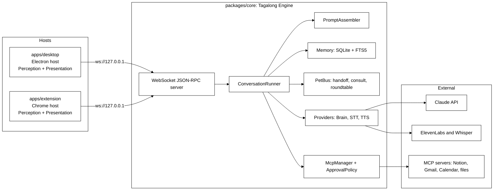
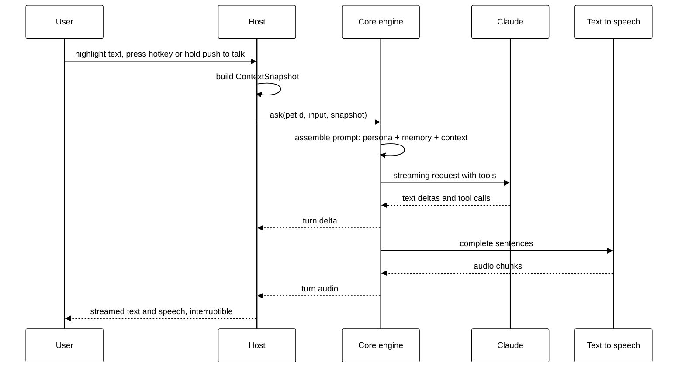

# Tagalong architecture

Adapted from the project home in Notion:
<https://app.notion.com/p/3d809730490481a4be8ac5bd000b8bfc>

## Core engine, thin hosts

One core engine, many thin hosts. The core never knows which OS or which host it is talking to.

`packages/core` is the whole engine: pets, the conversation loop, prompt assembly, memory, the voice
pipeline, the inter-pet bus, the MCP client, and the provider adapters. It runs as pure Node
TypeScript and exposes itself to hosts through a WebSocket JSON-RPC server.

A host is a thin shell around that engine. It captures what the user is looking at and renders what the
pets say. `apps/desktop` runs the engine in the Electron main process; `apps/extension` connects to an
already-running engine over the socket. Adding a host, or adding an operating system, never touches the
core.

## Components

## Package responsibilities

| Package           | Responsibility                                                                                                                                                           | Must never import                                |
| ----------------- | ------------------------------------------------------------------------------------------------------------------------------------------------------------------------ | ------------------------------------------------ |
| packages/protocol | Zod schemas for context snapshots, pets, messages, and the JSON-RPC method catalog                                                                                       | anything except zod                              |
| packages/core     | Pets, conversation loop, prompt assembly, memory, voice pipeline, inter-pet bus, MCP client, host protocol server, provider adapters                                     | electron, react, DOM globals                     |
| packages/ui       | React components: avatar, chat panel, composer, context chip, approval card, crew view, settings panels                                                                  | electron                                         |
| apps/desktop      | Electron host. Runs the engine in the main process, exposes the localhost socket, transparent overlay windows, hotkeys, tray, secret storage, one platform folder per OS | nothing from core internals, only its public API |
| apps/extension    | Chrome MV3 host. Connects to the running engine, supplies exact page text and selection, renders pets in the side panel                                                  | core at all; it speaks the protocol only         |

## Host contracts

Hosts implement two contracts.

- **Perception** answers capture requests: selection, active window, screenshot, clipboard, page text.
  The result is a `ContextSnapshot` defined in `packages/protocol`.
- **Presentation** renders pets, streams replies, plays audio, and shows approval cards.

Adding a host or an OS never touches the core.

## Host transport

Hosts talk to the engine over a JSON-RPC WebSocket bound to loopback only: `ws://127.0.0.1:47321`. The
connection is authenticated with a pairing token, so only hosts that hold the token can drive the
engine. Every method and payload on that socket is defined in `packages/protocol`.

## The ask flow

