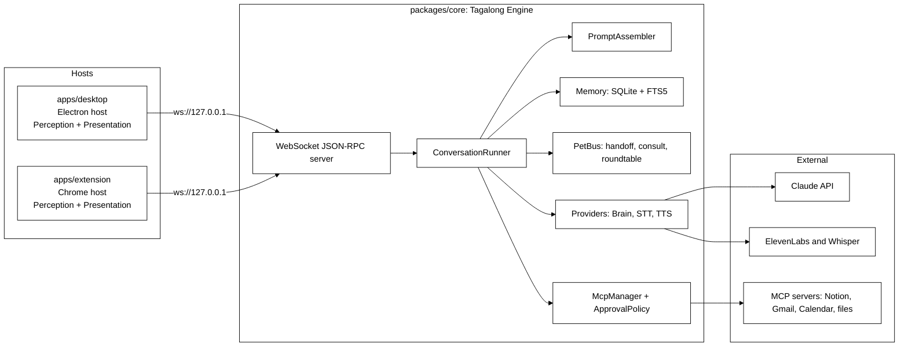
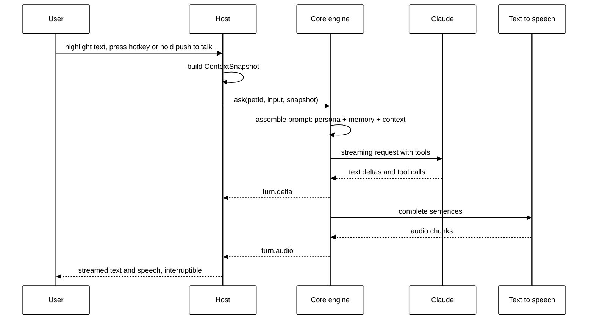

# Tagalong architecture

Adapted from the project home in Notion:
<https://app.notion.com/p/3d809730490481a4be8ac5bd000b8bfc>

## Core engine, thin hosts

One core engine, many thin hosts. The core never knows which OS or which host it is talking to.

`packages/core` is the whole engine: pets, the conversation loop, prompt assembly, memory, and the
provider adapters today; the voice pipeline, the inter-pet bus, and the MCP client in later phases. It
runs as pure Node TypeScript and exposes itself to hosts through a WebSocket JSON-RPC server.

A host is a thin shell around that engine. It captures what the user is looking at and renders what the
pets say. `apps/desktop` runs the engine in the Electron main process; `apps/extension` connects to an
already-running engine over the socket. Adding a host, or adding an operating system, never touches the
core.

## Components

The diagram is the finished shape. What exists after Phase 1: the server (`server/ws-server.ts` plus
`server/pairing.ts`), the runner (`conversation/runner.ts`), the prompt assembler
(`conversation/prompt-assembler.ts`), memory as plain SQLite tables (`memory/db.ts`, `memory/store.ts` —
FTS5 arrives with Phase 4 recall), the pet registry (`pets/registry.ts`), settings and the SecretStore
interface (`settings/settings.ts`), and the brain providers (`providers/`). `Engine.boot` in `engine.ts`
wires all of it together and is the only thing a host starts. `PetBus` (Phase 4), `McpManager` and
`ApprovalPolicy` (Phase 5), and the STT and TTS providers (Phase 3) do not exist yet; the extension is a
stub until Phase 6.

## Package responsibilities

| Package           | Responsibility                                                                                                                                                                                                                                                                          | Must never import                                |
| ----------------- | --------------------------------------------------------------------------------------------------------------------------------------------------------------------------------------------------------------------------------------------------------------------------------------- | ------------------------------------------------ |
| packages/protocol | Zod schemas for context snapshots, pets, messages, settings, and JSON-RPC envelopes, plus the method and notification catalog                                                                                                                                                           | anything except zod                              |
| packages/core     | Engine facade, conversation runner, prompt assembler, SQLite memory, pet registry, settings and SecretStore, pairing, websocket server, brain providers                                                                                                                                 | electron, react, DOM globals                     |
| packages/ui       | React components — `PetAvatar`, `MessageList`, `Composer`, `SightBar`, `ChatPanel` — plus the `HostBridge` contract and its context, and a fake bridge for host tests                                                                                                                   | electron, sockets, node APIs                     |
| apps/desktop      | Electron host. Runs the engine in the main process, dials it over the loopback socket, owns avatar, panel and settings windows, the tray, the two global hotkeys (text-only and look), perception with exclusions and capture announcements, and safeStorage secrets, one folder per OS | nothing from core internals, only its public API |
| apps/extension    | Chrome MV3 host. Connects to the running engine, supplies exact page text and selection, renders pets in the side panel                                                                                                                                                                 | core at all; it speaks the protocol only         |

## Host contracts

Hosts implement two contracts.

- **Perception** answers `perception.capture`: selection, active window, clipboard, page text, and from
  Phase 2 the screenshot. The result is a `ContextSnapshotPatch` defined in `packages/protocol`, and a
  host advertises what it can actually read in the `capabilities` array of `hello`. The desktop host
  advertises `selection`, `activeWindow`, `clipboard`, `screenshot` and `displays`; page text only ever
  comes from the extension, and `textLayer` is not advertised until the host can honour it — a
  capability the host cannot deliver makes the engine call a method that fails, which reads to the user
  as a broken pet rather than a missing feature.
- Phase 2B adds three more core-to-host methods and two capabilities behind them. `perception.listWindows`
  returns the window inventory — what each window is and where, never what is in it. `perception.readText`
  returns the text of **exactly one** window, named by id or defaulting to the foreground one, capped and
  flagged when truncated. `perception.captureRegion` returns a native-resolution crop of one display.
  A host that can do the first and third advertises `displays`; one that can do the second advertises
  `textLayer`.

  There is deliberately no scope that reads every window at once. Measured on a twelve-window Windows
  desktop, the whole text layer is 46,491 characters — roughly 11,600 tokens — in a single call, and one
  background browser window supplied 34,588 of them. The inventory costs about 200 tokens, so the pet
  reads that, picks a window, and pays for one. The absence is asserted by a test, not left to habit.

- **Presentation** renders pets, streams replies, plays audio, and shows approval cards.

Adding a host or an OS never touches the core.

## Host transport

Hosts talk to the engine over a JSON-RPC WebSocket bound to loopback only: `ws://127.0.0.1:47321` by
default, and the engine reports the port it actually bound when settings asked for something else.

Every connection is unauthenticated until it presents the pairing token in `hello`. Loopback is not a
permission boundary — any local process can open a socket — so the token is what keeps other programs
out. The engine writes it to `pairing.token` in its data dir, compares it in constant time, and answers
a mismatch with RPC error `-32000` before closing the socket. Any method other than `hello` on an
unauthenticated connection gets the same error.

The catalog in `packages/protocol/src/methods.ts` is the whole surface:

- **Host to core:** `hello`, `ask`, `interrupt`, `pets.list`, `pets.upsert`, `pets.delete`,
  `settings.get`, `settings.set`, `tool.approve` (Phase 5).
- **Core to host:** `perception.capture`, and from Phase 2B `perception.captureRegion`,
  `perception.listWindows`, and `perception.readText`. Nothing for recall, diff, or watch — those belong
  to Phase 3B, and a test asserts they have not crept in early.
- **Core to host notifications:** `turn.started`, `turn.delta`, `turn.completed`, `turn.error`,
  `turn.warning`, plus `turn.audio` (Phase 3), `turn.toolRequest` and `turn.toolResult` (Phase 5),
  and `pet.message` (Phase 4). `turn.warning` carries the same `{ code, message }` as `turn.error`
  but does not end the turn — a host that aborts on it throws away a reply that is still coming.

## The ask flow

## The turn lifecycle, as implemented

`ask` is not a request that returns an answer. It returns a receipt, and the answer arrives as
notifications.

1. The host calls `ask` with a `petId`, an optional `conversationId`, the input text, and an optional
   `ContextSnapshot`.
2. `ConversationRunner.run` opens a conversation if none was named, stores the user message (with its
   snapshot) in SQLite, mints a `turnId`, emits `turn.started`, and **returns immediately**. The `ask`
   result is `{ turnId }` and nothing else. The stored snapshot loses its screenshot unless
   `screenshotRetention` allows keeping it, and the same call sweeps screenshots that have outlived
   the setting — the turn is the only moment the engine reliably wakes up, and Phase 4 owns timers.
3. If the pet's provider reports `capabilities.vision === false` and the ask carried a screenshot, the
   image is dropped before the request is assembled and a `turn.warning` with code
   `vision_unsupported` goes out. The turn continues without the picture.
4. The runner reads back the last `settings.historyMessages` messages — after the question was stored,
   so the prompt ends on what was asked — and `assemblePrompt` builds the provider-neutral request:
   the base instructions, the pet's persona, the reply-style rule, the history, and a screen-context
   block appended to the last user message rather than sent as its own turn.
5. The provider streams. Every text delta becomes a `turn.delta` notification.
6. The turn ends with exactly one of `turn.completed` — carrying the full text, a stop reason of `end`,
   `max_tokens`, `aborted` or `refusal`, and token usage — or `turn.error`, carrying a `BrainErrorCode`
   (`rate_limit`, `auth`, `connection`, `config`, `unknown`) and a message written for the person
   looking at the panel. The assistant message is stored only if it has text, so an interrupted turn
   leaves no empty row to replay at the model.

Notifications are broadcast to every connected host session, so a second window sees the same stream.

**One turn per pet.** `run` interrupts any turn already in flight for that pet before starting the new
one: two streams into one panel read as nonsense. A second `ask` for the same pet is therefore an
interruption, not a queue. Explicit `interrupt(turnId)` aborts through the same `AbortController` and
answers `{ aborted: false }` when the turn had already finished. `Engine.shutdown` interrupts everything
still running before closing the database, because a stream left in flight would keep writing to a
database that is about to close.

Tool calls are part of the contract already: the provider's `onToolUse` is awaited before the dependent
text streams. Phase 2 fills it with two built-ins from `packages/core/src/perception/tools.ts` —
`look_at_screen` and `get_selection` — offered to every pet whose provider advertises
`capabilities.tools`, and to no other. A call that arrives with no toolset wired still gets the honest
"no tools are available yet" error result rather than a pretend success.

Both tools call the connected host's `perception.capture` through the injected `hosts()` lookup, which
is read per call because hosts connect and drop mid-conversation. Each one asks for `activeWindow`
**first** and runs `findCaptureBlock` against the live exclusion list before asking for pixels or
selected text: an exclusion that only filters the answer has already taken the screenshot it promised
not to take. A blocked window, a host with no `screenshot` capability, and a host that fails to answer
all come back as error tool results naming the reason, never as silence.

Results are **text**, never a snapshot object: `BrainTool` results are strings by contract, and a model
handed `{"screenshot":{"base64":"iVBO…"}}` learns nothing it can reason about while the blob swamps its
context. So `get_selection` returns the selected text itself, and `look_at_screen` reports the window and
the image size and says plainly that pixels cannot ride back through a tool result — the image reaches
the model through the snapshot attached to an ask.

## The desktop host's shape

`apps/desktop` runs the engine **in the Electron main process and still speaks to it over the socket**.
In-process is an optimisation, not a shortcut: `startEngineHost` boots `Engine`, then dials it with an
ordinary `EngineClient`. Nothing in the host can come to depend on engine internals the Chrome host
will not have.

The main process is the **single websocket client** for this host. Renderers never dial the engine; they
go through IPC to main, which holds the one connection. That is what keeps the pairing token out of
every window, and what makes the two hosts interchangeable.

The preload exposes exactly two globals, and the split between them is deliberate:

- `window.tagalong` is precisely the `HostBridge` interface that `@tagalong/ui` consumes — `ask`,
  `capture`, `interrupt`, `listPets`, `onTurnEvent`. Nothing more. `capture` is how the panel's
  Look button reaches the screen; it resolves to null when the window is excluded, so the sight bar
  can say capture is blocked here instead of quietly showing nothing.
- `window.tagalongHost` carries everything specific to this host — the captured snapshot, the settings
  view, saving the API key, opening settings, hiding and toggling the panel.

Keeping them apart means a shared UI component can never grow a dependency on something the Chrome host
will not have: if it compiles against `HostBridge`, it runs in both hosts.

Every window — avatar, panel, settings — is created with `contextIsolation: true`,
`nodeIntegration: false`, and `sandbox: true`. Nothing from node or electron crosses the preload
boundary; only plain data over the IPC channels named in `src/shared/ipc.ts`. Because a sandboxed
preload can only be CommonJS while the package is ESM, the preload is built to `dist/preload/index.cjs`.

The host also degrades rather than dying. If the engine refuses to boot — the ordinary first run with no
API key stored — the app still starts, opens the settings window, and reports why; settings reads and
writes fall back to `SettingsStore` directly so the user can fix the thing that blocked the boot.

### The platform adapter

Everything OS-specific sits behind `Platform` in `src/main/platform/`. `createPlatform` throws on any
OS with no adapter rather than returning a stub, because a host that silently perceives nothing looks
like a broken engine instead of a missing port. Windows is the only implementation until Phase 7.

Each capability is a free function taking its Electron dependencies as ports — `desktopCapturer`,
`screen`, `nativeImage` — and the class only wires the real ones in. That is what lets the whole
perception layer be tested in plain Node with no display attached, which matters because CI has no
desktop and the one test that does use real pixels is the Playwright smoke test.

`captureDisplays` takes the exclusion list, and `captureActiveWindowImage` does not. The difference is
not an inconsistency. For a single screenshot the caller checks exclusions and then either asks for a
picture or does not, so the answer is yes or no. For a full-view capture one display can be refused
while the others are returned, and the composite has to show that refusal in the refused display's
slot — so the decision has to happen inside the capture rather than above it.

The composite is the one image Tagalong builds rather than captures. Electron's `nativeImage` resizes
and encodes but cannot compose, so the pixels are handled directly: `toBitmap` hands over a BGRA
buffer, `createFromBitmap` takes one back, and everything between is ordinary buffer arithmetic in
`canvas.ts`, `composite.ts` and `label.ts`. No image library, and one Electron call at the end.

### The window inventory

`listWindows` enumerates every top-level window through a UI Automation helper. The helper is a
PowerShell script held as a string in `window-helper.ts` rather than a `.ps1` on disk: a bundled file
has to survive electron-vite, the asar archive and the installer, and each of those is a way for the
inventory to work in development and be missing in the packaged app. It is fed to PowerShell over
stdin, which also sidesteps every quoting question a long `-Command` argument would raise.

The helper reads **no window contents**. That is what makes the inventory cheap enough to attach to
every capture — walking one background browser window's descendants yielded 34,588 characters on a
real desktop. Reading a window is a separate, deliberate call against one id.

The split is the usual one. The host enumerates and maps windows to displays, because both need the
OS. What a window _means_ — whether it may be read, whether its tabs are reachable, how it reads in a
prompt — is decided in `packages/core/src/perception/inventory.ts`, where it is tested without a
desktop. `renderInventory` produces the text the prompt assembler attaches, under a budget of 300
tokens for a twelve-window desktop.

Two things the inventory is careful about. A blocked window keeps its process name and **loses its
title**: a process name says a password manager is open, which the user can see anyway, while "Chase —
Transfer to savings" says most of what the window holds. And an empty inventory is omitted from the
prompt rather than rendered as "no windows are open" — an empty list means the enumeration failed, not
that the desktop is empty, and a pet told otherwise will reason from it.

Since Phase 2B, a display is blanked when **any window on it that the user can see** is excluded, not
only when the foreground window is. The foreground check remains as a floor beneath the inventory, so
that a helper which cannot run does not silently remove the protection Phase 2 already shipped.

## Bundling the workspace packages

`electron.vite.config.ts` **bundles** `@tagalong/core`, `@tagalong/protocol`, and `@tagalong/ui` into
the app rather than externalizing them. They compile with `moduleResolution: bundler`, so their emitted
relative imports carry no file extension, and Node's ESM loader cannot resolve those at runtime. Letting
Rollup inline them resolves the imports at build time, which is what a packaged Electron app wants
anyway.

Only the genuinely native dependencies stay external: `better-sqlite3` and `get-windows` ship `.node`
binaries Rollup cannot inline. Because they are then resolved at runtime from the desktop app, they are
declared as its own dependencies. Pure JavaScript dependencies such as `ws` and the Anthropic SDK are
inlined with everything else.
