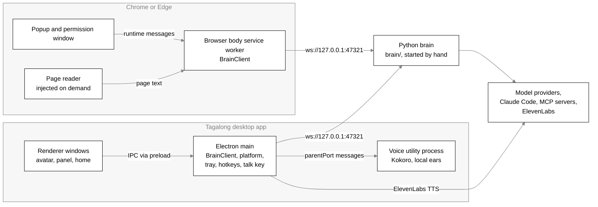
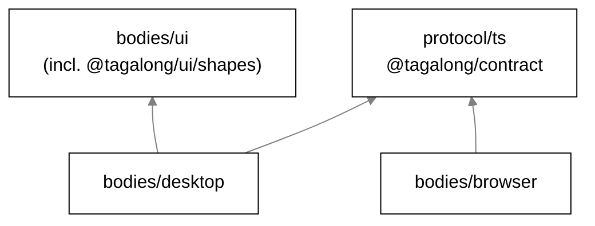
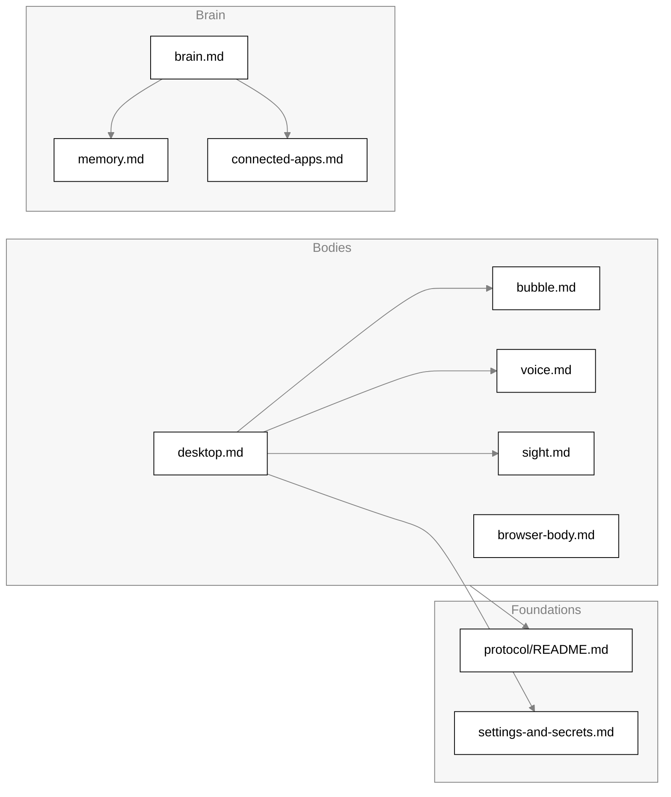

# Architecture

Tagalong is a desktop companion. One on-screen character, Scout, sits beside the person's work,
reads what is on screen when asked, answers small things itself, and hands real work to an
expert such as Claude Code. Everything runs on the person's machine except the model calls.

This page is the map: the processes, the packages, how a body talks to the brain, and the life of
one turn. Each subsystem has its own page, linked from [the subsystem map](#subsystem-map).

## One brain, thin bodies

The brain is the Python program in `brain/`: the conversation, Scout's mind, memory, experts,
connected apps and asks. It never knows which operating system or which body it is serving. See
[brain.md](brain.md).

A body is a thin shell around it. It perceives (selection, windows, screenshots, page text),
offers tools and presents (the figure, the bubble, the voice). A body reaches the brain only
through contract v1 ([protocol/README.md](../protocol/README.md)), over a loopback WebSocket. The
desktop app (`bodies/desktop`) dials it from its main process (`bodies/desktop/src/main/brain/start.ts`,
`startBrain`; start the brain with `cd brain && uv run brain`). So does the browser body
(`bodies/browser`), a tools-only body that gives Scout the `tabs`, `page_parts`, `browser_search`
and `tab_actions` tools and lets you ask Scout from a right-click or the address bar; see
[browser-body.md](browser-body.md).

Speech is the one capability that lives in the desktop body rather than the brain: the
speech-to-text and text-to-speech models are native ONNX runtimes. The brain only learns that an
ask was spoken.

## Processes

| Process                | Entry point                                    | What runs there                                                                                                                                                                                   |
| ---------------------- | ---------------------------------------------- | ------------------------------------------------------------------------------------------------------------------------------------------------------------------------------------------------- |
| Electron main          | `bodies/desktop/src/main/index.ts`             | The desktop `BrainClient` (to the Python brain), the platform adapter (window list, captures, OCR, selection), tray, global shortcuts, the talk key hook, IPC handlers, rolling memory            |
| Renderer windows       | `bodies/desktop/src/renderer/*.html`           | One page per window: `avatar`, `panel` (the bubble), `home` (`RendererPage` in `main/windows/page.ts`). Sandboxed, context-isolated, no Node                                                      |
| Voice utility process  | `bodies/desktop/src/main/voice/worker/main.ts` | Kokoro text to speech and the local ears (speech to text, turn detection), started by `utilityProcess.fork` as `voice-worker.js` (`VoiceWorker` in `voice/worker/client.ts`)                      |
| Browser service worker | `bodies/browser/src/service-worker.ts`         | The browser body's one `BrainClient` socket to the brain; runs the `tabs`, `page_parts`, `browser_search` and `tab_actions` tools, the right-click and address-bar asks, and asks for permissions |
| Browser popup          | `bodies/browser/src/popup/popup.html`          | Link status, brain address, browser name, what has been allowed (talks to the worker by runtime message)                                                                                          |
| Browser page reader    | `bodies/browser/src/content/page-reader.ts`    | Injected on demand to read a page's readable text (Readability)                                                                                                                                   |

How they connect:

- **Renderer to main.** Electron IPC only. The preload (`bodies/desktop/src/preload/index.ts`)
  exposes `window.tagalong` and `window.tagalongHost` through `contextBridge`; channel names live in
  `bodies/desktop/src/shared/ipc.ts`. Handlers live in `bodies/desktop/src/main/ipc/` and in
  `main/index.ts` for the ones that need Electron itself. No renderer opens the socket.
- **Main to brain.** `BrainClient` dials `ws://${TAGALONG_BRAIN_ADDR}` (default 127.0.0.1:47321) and
  retries every 2 s. There is no pairing token. Brain notifications are mapped to turn events and
  forwarded to every window as `IPC.turnEvent` by `forwardToRenderers` in `main/index.ts`.
- **Main to voice process.** Numbered `call` messages and plain events over the utility
  process's `parentPort` (`voice/worker/messages.ts`). The process starts on first need; if it
  dies, waiting calls fail at once and the next call starts a fresh one. Details in
  [voice.md](voice.md).
- **Browser to brain.** The service worker owns a `BrainClient` socket (default
  `127.0.0.1:47321`, the same address as the desktop), with a keepalive call every 20 s so the
  worker stays awake. See [browser-body.md](browser-body.md).

There is one desktop instance per user: `app.requestSingleInstanceLock()` runs before anything
else, because two desktops would fight over the global shortcuts and the settings file.

## Packages and import rules

Arrows point at what a package depends on. The edges are the TypeScript project references
(`tsconfig.json` at the root and in each package) and the workspace dependencies in each
`package.json`.

| Package          | Responsibility                                                                                                                                                                                                      | Must never import                                | Enforced by                                                                                                                                       |
| ---------------- | ------------------------------------------------------------------------------------------------------------------------------------------------------------------------------------------------------------------- | ------------------------------------------------ | ------------------------------------------------------------------------------------------------------------------------------------------------- |
| `protocol/ts`    | `@tagalong/contract`: zod schemas for contract v1, the brain-body wire                                                                                                                                              | `node:*`, `electron`, `react`, any `@tagalong/*` | `eslint.config.js` (block for `protocol/ts/**`); its only dependency is `zod`                                                                     |
| `bodies/ui`      | React components the desktop renders: the bubble, dock pet, chat panel, Home, the Settings sheet, cards, the `HostBridge` contract and a fake bridge. Its `shapes` export holds the React-free shared shapes        | `electron`, `ws`, `node:*`                       | `shapes/**` may not import React or `../*` (ESLint block and `bodies/ui/src/source-guard.test.ts`); no lint rule bans electron, ws or node:* here |
| `bodies/desktop` | Electron body: windows, tray, hotkeys, talk key, platform adapter, perception, voice, the settings and secret stores (`SafeStorageSecretStore`)                                                                     |                                                  |                                                                                                                                                   |
| `bodies/browser` | Browser body (Chromium MV3): the `tabs`, `page_parts`, `browser_search` and `tab_actions` tools, right-click and address-bar asks, permission window, popup; speaks the brain contract through `@tagalong/contract` | `@tagalong/ui`                                   | Not a dependency and not a project reference                                                                                                      |

`@tagalong/ui/shapes` (`bodies/ui/src/shapes`) holds the shapes the desktop main process, the
voice process and the UI share: addressing, apps, context, memory, pet, status marks, turn events
and voice ids. It has no React, so main can import it. The desktop's own files are
`bodies/desktop/src/shared/{settings,blind-spots,voice}.ts` and `main/awareness/recall.ts`.

The contract package's ESLint block replaces the shared purity options for its own files rather
than adding to them, so for `protocol/ts` the lint list is exactly `electron`, `react`, `node:*`
and `@tagalong/*`.

The desktop bundles the workspace packages into its main, preload and renderer builds with
electron-vite; only the native dependencies stay external (`get-windows`, `onnxruntime-node`,
`uiohook-napi`; `bodies/desktop/electron.vite.config.ts`). See [desktop.md](desktop.md).

## Body contracts

A body implements two things.

**Perception.** The desktop reads the screen itself: the window list, captures, OCR and the
selection (`bodies/desktop/src/main/platform`). It says what it can do in `DESKTOP_CAPABILITIES`
(`bodies/desktop/src/main/context.ts`): `selection`, `activeWindow`, `clipboard`, `screenshot`,
`displays`, `textLayer`, `recall`. Exclusions and the built-in blind spots are checked before
anything is read; the details are in [sight.md](sight.md). The Python brain does not ask the
desktop for reads yet.

**Presentation.** The desktop renders Scout and its bubble, shows the cards (the drop card, the
settings card) and speaks. The UI package draws all of it against `HostBridge`
(`bodies/ui/src/host-bridge.ts`), which the desktop implements over IPC. The browser body has no
presentation: it only offers tools. See [bubble.md](bubble.md).

## The brain connection

The contract, its envelope, every message, sessions, replay and errors are in
[protocol/README.md](../protocol/README.md). The Python side is in [brain.md](brain.md). The
desktop's client is `BrainClient`, started by `startBrain` (`main/brain/start.ts`); the browser
body has its own socket in its service worker. The brain binds `127.0.0.1` only; there is no
pairing or TLS yet (single user).

## The life of one turn

1. **Ask.** The ask hotkey (`openPanelWithContext` in `main/index.ts`) captures a snapshot first
   (`captureAskSnapshot` in `main/context.ts`: the front window and the selection, no pixels) and
   opens the bubble; a click on the figure opens it with nothing captured. Typing or the talk key
   produces the text: the talk key is watched by a key hook in main (`main/talk-key.ts`), the
   microphone runs in the renderer, and the voice process transcribes ([voice.md](voice.md)). The
   bubble sends `IPC.ask`; `registerTurnIpc` (`main/ipc/turns.ts`) adds the pending snapshot, or a
   dropped item when a drop card's button sent it, and sends the ask to the brain.
2. **Turn.** The brain runs the turn: prompt, model, tools, asks. It answers only with
   notifications ([brain.md](brain.md), [connected-apps.md](connected-apps.md)).
3. **Bubble.** Main maps the brain's notifications to turn events (`main/brain/turn-events.ts`)
   and forwards each to every window as `IPC.turnEvent` (`forwardToRenderers` in `main/index.ts`).
   See [bubble.md](bubble.md).
4. **Voice.** The bubble hands each finished line to the desktop's mouth; the renderer calls
   `IPC.speak` (`renderer/src/voice-player.ts`), main synthesises with Kokoro in the voice process
   or with ElevenLabs, or answers `fallback` for the system voice, and the window plays the audio.
   See [voice.md](voice.md).

## Boot and shutdown

The desktop's `start()` (`bodies/desktop/src/main/index.ts`) gates the platform adapter behind the
sight pause, opens the secret store and settings, records the launch, builds rolling memory, then
calls `startBrain` (`brain/start.ts`), which dials the Python brain over contract v1 and keeps
retrying while it is down. The panel and the avatar are created next.

On `before-quit` the desktop disposes the hotkeys, the talk key hook, the voice process, presence,
rolling memory and the perception memory, records a clean close and closes the brain client.

## Subsystem map

| Doc                                                | Covers                                                                                 | Main code                                                                                                        |
| -------------------------------------------------- | -------------------------------------------------------------------------------------- | ---------------------------------------------------------------------------------------------------------------- |
| [protocol/README.md](../protocol/README.md)        | Contract v1 between the brain and the bodies                                           | `protocol/ts/src`, `brain/src/brain/protocol.py`                                                                 |
| [brain.md](brain.md)                               | The Python brain: files, tools, asks, experts, memory, the mind                        | `brain/src/brain`                                                                                                |
| [desktop.md](desktop.md)                           | Windows, tray, hotkeys, IPC modules, platform adapter, packaging, log file             | `bodies/desktop/src/main`, `bodies/desktop/src/preload`, `bodies/desktop/src/renderer`                           |
| [bubble.md](bubble.md)                             | The companion bubble, status marks, drafts, drops                                      | `bodies/ui/src`                                                                                                  |
| [voice.md](voice.md)                               | Hearing, speaking, talk key, always listening, models and downloads, the voice process | `bodies/desktop/src/main/voice`, `main/talk-key.ts`, `main/always-listening.ts`, `bodies/ui/src/shapes/voice.ts` |
| [sight.md](sight.md)                               | Window list, captures, OCR, exclusions, pausing sight, rolling memory                  | `bodies/desktop/src/main/platform`, `main/awareness`                                                             |
| [memory.md](memory.md)                             | The memory store and the rolling memory                                                | `brain/src/brain/memory.py`, `bodies/desktop/src/main/awareness`                                                 |
| [connected-apps.md](connected-apps.md)             | MCP connections, tool calls, approvals for writes                                      | `brain/src/brain/apps.py`, `app_tools.py`                                                                        |
| [browser-body.md](browser-body.md)                 | The browser body: identity, the `tabs` tool, permissions, popup, install               | `bodies/browser/src`                                                                                             |
| [settings-and-secrets.md](settings-and-secrets.md) | Settings store, the secret store, hiding secrets in logs                               | `bodies/desktop/src/main/settings-store.ts`, `secret-store.ts`, `hide-secrets.ts`                                |
| [privacy.md](privacy.md)                           | What is captured, sent, kept and deleted                                               | across the above                                                                                                 |
