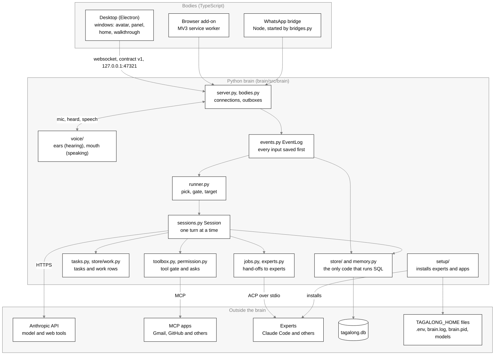
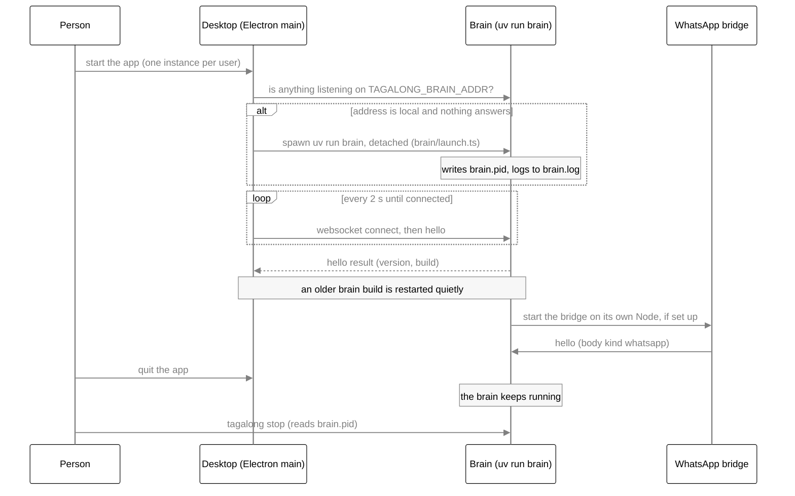
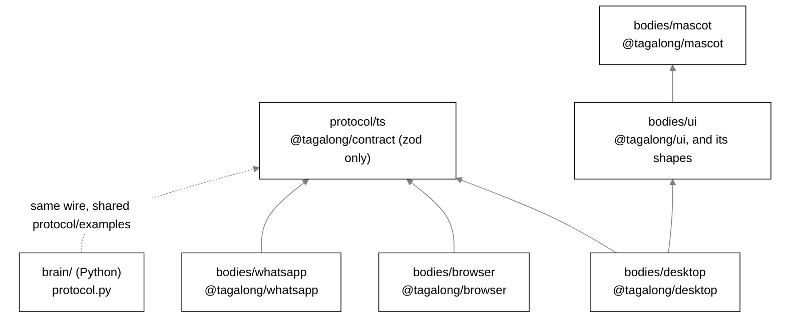
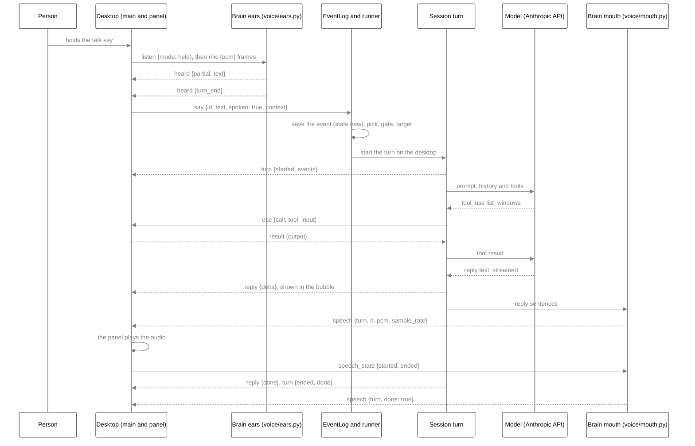

# Architecture

The map of the whole system: which processes run, how they start and talk, how the code is split into packages, what is inside the brain, and one request followed end to end. Read it first; every other doc goes deeper on one part and is linked from [Where to read next](#where-to-read-next).

## Contents

- [What Tagalong is](#what-tagalong-is)
- [Tagalong at a glance](#tagalong-at-a-glance)
- [Processes and how they start](#processes-and-how-they-start)
- [Packages](#packages)
- [Inside the brain](#inside-the-brain)
- [One request end to end](#one-request-end-to-end)
- [Where to read next](#where-to-read-next)

## What Tagalong is

Tagalong is a desktop companion for Windows. One on-screen character, Scout, sits beside the person's work, reads what is on screen when asked, answers small things itself and hands real work to an expert such as Claude Code. Everything runs on the person's machine except the model calls. Product intent is in [bodies/PRODUCT.md](../bodies/PRODUCT.md).

The design is one Python brain and thin TypeScript bodies. The brain thinks, remembers, hears and speaks. A body perceives (selection, windows, page text), offers tools and presents (the figure, the bubble, the sound). Bodies talk only to the brain, over contract v1 ([protocol/README.md](../protocol/README.md)).

## Tagalong at a glance

A body connects to the brain and nothing else. Everything a person says or that happens (a timer, a finished job) is saved in the event log first, and the runner starts one turn at a time from it. A turn talks to the model over HTTPS, runs tools through the toolbox (body tools over the same websocket, apps over MCP), and hands real work to an expert over ACP. Memory, tasks and events live in `tagalong.db`; keys, logs and downloaded models live in the files under `TAGALONG_HOME`.

## Processes and how they start

Three kinds of process can run: the desktop app, the brain, and optional helpers (the browser add-on inside Chrome or Edge, the WhatsApp bridge, and the experts the brain launches).

The desktop dials the brain itself and starts it when none is running (`bodies/desktop/src/main/brain/launch.ts`, started by `start.ts`); the brain output goes to `<TAGALONG_HOME>/brain.log`. It never stops the brain on quit, so the brain outlives the desktop; `tagalong stop` ends it, and a brain started by hand is used as is. Packaged, the desktop runs `uv sync` first. Set `TAGALONG_START_BRAIN=0` to stop the desktop starting one.

| Process                | Entry point                            | What runs there                                                                                         |
| ---------------------- | -------------------------------------- | ------------------------------------------------------------------------------------------------------- |
| Brain                  | `brain/src/brain/main.py`              | The websocket server, the event log, the runner, Scout's turns, memory, hearing and speaking, the setup |
| Electron main          | `bodies/desktop/src/main/index.ts`     | The desktop `BrainClient`, the platform adapter (windows, captures, OCR), tray, hotkeys, the talk key   |
| Renderer windows       | `bodies/desktop/src/renderer/*.html`   | `avatar`, `panel` (the bubble), `home` and `walkthrough`. Sandboxed, no Node; they reach main by IPC    |
| Browser service worker | `bodies/browser/src/service-worker.ts` | The browser body's own socket; the `tabs`, `page_parts`, `browser_search` and `tab_actions` tools       |
| WhatsApp bridge        | `bodies/whatsapp/dist/index.js`        | Meta's signed webhook in, Graph send out; started and watched by the brain (`bridges.py`)               |
| Experts                | ACP adapters installed by `setup/`     | Claude Code and others, one process per expert, launched by `experts.py`                                |

## Packages

Arrows point at what a package depends on. The desktop is the only one that uses `@tagalong/ui`; the UI draws everything against `HostBridge` and uses the mascot engine to draw Scout. The browser body and the WhatsApp bridge use only the contract. The Python brain does not import TypeScript: `brain/src/brain/protocol.py` mirrors the contract, and both sides test against `protocol/examples`.

The rules, each enforced in `eslint.config.js` or a test:

- The contract package stays pure: `protocol/ts` depends on `zod` only and never imports `node:*`, `electron`, `react` or any `@tagalong/*`.
- `@tagalong/ui/shapes` (`bodies/ui/src/shapes`) holds the React-free shapes shared with the desktop main process. It may not import React or files outside `shapes/`.
- The browser body and the WhatsApp bridge never import `@tagalong/ui`.
- Bodies reach the brain only through the contract; no body imports another body.

The desktop bundles the workspace packages into its main, preload and renderer builds with electron-vite; only the native dependencies stay external. See [bodies/desktop.md](bodies/desktop.md).

## Inside the brain

The brain is the Python program in `brain/`. It never knows which operating system or which body it is serving. The full tour is [brain/README.md](brain/README.md).

| Part              | Files in `brain/src/brain`                                     | Job                                                                | Doc                                                                              |
| ----------------- | -------------------------------------------------------------- | ------------------------------------------------------------------ | -------------------------------------------------------------------------------- |
| Server and bodies | `server.py`, `bodies.py`, `protocol.py`, `bridges.py`          | Contract v1 over a websocket, who is online, outboxes and replay   | [protocol/README.md](../protocol/README.md)                                      |
| Event log         | `events.py`, `store/events.py`                                 | Every input is saved first; retries, give-up, sweep                | [brain/turns.md](brain/turns.md)                                                 |
| Runner and turns  | `runner.py`, `sessions.py`, `presence.py`, `mind/`             | One turn at a time: `pick`, `gate`, `target`; prompt, model, tools | [brain/turns.md](brain/turns.md)                                                 |
| Tasks and work    | `tasks.py`, `store/tasks.py`, `store/work.py`, `open_items.py` | What Scout started and what waits on the person                    | [brain/tasks.md](brain/tasks.md)                                                 |
| Tools and asks    | `toolbox.py`, `permission.py`, `asks.py`, `approvals.py`       | The tool gate, the one permission engine, how each ask ended       | [brain/permissions.md](brain/permissions.md)                                     |
| Jobs and experts  | `jobs.py`, `job_records.py`, `experts.py`, `expert_apps.py`    | Hand-offs to Claude Code and others over ACP                       | [brain/experts.md](brain/experts.md)                                             |
| Connected apps    | `apps.py`, `app_oauth.py`, `app_tools.py`                      | MCP apps, their sign-in and their tools                            | [bodies/connected-apps.md](bodies/connected-apps.md)                             |
| Memory and store  | `memory.py`, `store/`, `masking.py`                            | Facts, the saved chat, every SQL statement                         | [data/memory.md](data/memory.md)                                                 |
| Loops             | `loops/`, `timers.py`                                          | Things left open (mail) and Scout's timers                         | [brain/loops.md](brain/loops.md)                                                 |
| Voice             | `voice/`, `speech_tools.py`                                    | Ears (speech to text) and mouth (text to speech)                   | [senses/hearing.md](senses/hearing.md), [senses/speaking.md](senses/speaking.md) |
| Setup             | `setup/`, `cli.py`                                             | Installing experts and apps, the `tagalong` command                | [brain/setup.md](brain/setup.md)                                                 |
| Safety            | `guardrails.py`, `guards.py`, `masking.py`, `retry.py`         | Budget, guards, secrets hidden, which failures retry               | [brain/safety.md](brain/safety.md)                                               |

Every input reaches Scout the same way. A say, a timer, a finished job, a loop, a card answer or setup news is saved as an event. The runner (`runner.py`) is the only thing that starts a Scout turn. `pick` takes the person's words first, then news oldest first; `gate` decides whether news may be told now (key set, not quiet hours, budget left, speech and idle windows); `target` picks the body the turn runs on: the body that sent the message, else where the person is. Code sets how urgent each event kind is; the model decides what to say. The details, with the diagram of the runner, are in [brain/turns.md](brain/turns.md).

## One request end to end

The person holds the talk key and asks a question by voice. The model reads the window, then answers aloud.

Notice that the desktop turns heard words into a spoken `say`, and that the same `say` frame is used for typed words. The brain saves the say before anything else, so a crash cannot lose it. The reply goes out twice: as `reply` text for the bubble, and as `speech` chunks the desktop plays and reports back with `speech_state`.

## Where to read next

| Doc                                                            | Covers                                                  |
| -------------------------------------------------------------- | ------------------------------------------------------- |
| [README.md](README.md)                                         | The index and reading paths                             |
| [principles.md](principles.md)                                 | The rules: one brain and many bodies, code versus model |
| [development.md](development.md)                               | Build, run, test, package and the conventions           |
| [../protocol/README.md](../protocol/README.md)                 | Contract v1, with a typical session                     |
| [brain/README.md](brain/README.md)                             | The brain: files, run, hello, Home tools                |
| [brain/turns.md](brain/turns.md)                               | The event log, the runner and a turn                    |
| [brain/tasks.md](brain/tasks.md)                               | Tasks, work rows and open items                         |
| [brain/experts.md](brain/experts.md)                           | Hand-offs to Claude Code and others over ACP            |
| [brain/permissions.md](brain/permissions.md)                   | Tool modes, asks and the one permission engine          |
| [brain/setup.md](brain/setup.md)                               | Installing experts and apps, the `tagalong` command     |
| [brain/safety.md](brain/safety.md)                             | Budget, guards, masking, retries                        |
| [brain/loops.md](brain/loops.md)                               | Loops, mail and timers                                  |
| [senses/sight.md](senses/sight.md)                             | Windows, captures, OCR, exclusions                      |
| [senses/hearing.md](senses/hearing.md)                         | The talk key, the brain's ears, always listening        |
| [senses/speaking.md](senses/speaking.md)                       | The brain's mouth, chunks, playback, the system voice   |
| [senses/bubble.md](senses/bubble.md)                           | The companion bubble and its cards                      |
| [senses/stt-results.md](senses/stt-results.md)                 | Speech-model measurements                               |
| [bodies/desktop.md](bodies/desktop.md)                         | The Electron body                                       |
| [bodies/browser.md](bodies/browser.md)                         | The browser body                                        |
| [bodies/whatsapp.md](bodies/whatsapp.md)                       | The WhatsApp body                                       |
| [bodies/mascot.md](bodies/mascot.md)                           | The mascot engine                                       |
| [bodies/connected-apps.md](bodies/connected-apps.md)           | MCP apps                                                |
| [data/storage.md](data/storage.md)                             | Every store by kind                                     |
| [data/memory.md](data/memory.md)                               | Memory, recall and forgetting                           |
| [data/privacy.md](data/privacy.md)                             | What is captured, sent, kept and deleted                |
| [data/settings-and-secrets.md](data/settings-and-secrets.md)   | Settings and secrets                                    |
| [testing/feature-test-guide.md](testing/feature-test-guide.md) | Manual test steps per feature                           |
