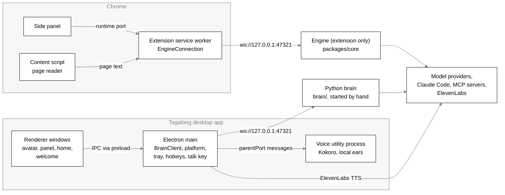
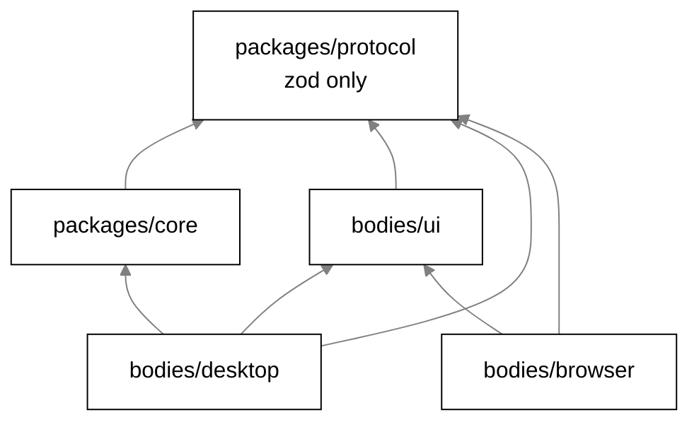
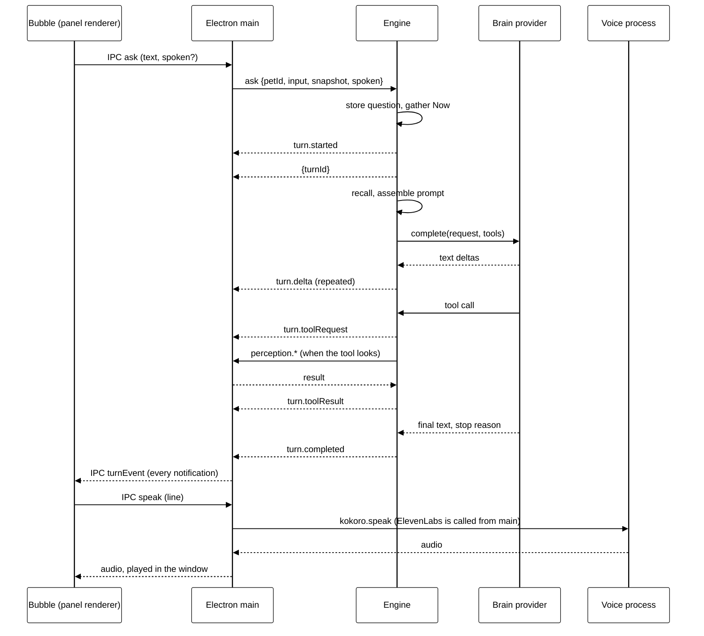
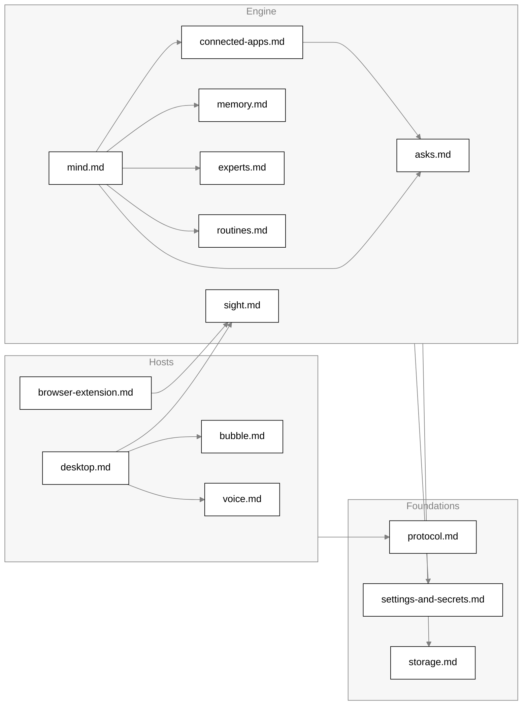

# Architecture

Tagalong is a desktop companion. One on-screen character, Scout, sits beside the person's work,
reads what is on screen when asked, answers small things itself, and hands real work to an
expert such as Claude Code. Everything runs on the person's machine except the model calls.

This page is the map: the processes, the packages, how a host talks to the engine, and the life of
one turn. Each subsystem has its own page, linked from [the subsystem map](#subsystem-map).

## Core engine, thin hosts

`packages/core` is the whole engine: the conversation runner, prompt assembly, memory, experts,
connected apps, asks, routines, check-ins and the brain providers. It is pure Node TypeScript and
never knows which operating system or which host it is serving.

A host is a thin shell around the engine. It perceives (selection, windows, screenshots, page
text) and presents (the figure, the bubble, the voice). A host reaches the engine only through the
JSON-RPC protocol in `packages/protocol`, over a loopback WebSocket. The desktop app no longer
runs the engine: its main process dials the Python brain instead (`bodies/desktop/src/main/brain/start.ts`, `startBrain`; start it with
`cd brain && uv run brain`). The Chrome extension still uses the engine for now.

Speech is the one capability that lives in a host rather than the core: the speech-to-text and
text-to-speech models are native ONNX runtimes, which the pure core must not load. The core only
learns that an ask was spoken (`ask`'s `spoken: true`).

## Processes

| Process                  | Entry point                                    | What runs there                                                                                                                                                                        |
| ------------------------ | ---------------------------------------------- | -------------------------------------------------------------------------------------------------------------------------------------------------------------------------------------- |
| Electron main            | `bodies/desktop/src/main/index.ts`             | The desktop `BrainClient` (to the Python brain), the platform adapter (window list, captures, OCR, selection), tray, global shortcuts, the talk key hook, IPC handlers, rolling memory |
| Renderer windows         | `bodies/desktop/src/renderer/*.html`           | One page per window: `avatar`, `panel` (the bubble), `home`, `welcome` (`RendererPage` in `main/windows/page.ts`). Sandboxed, context-isolated, no Node                                |
| Voice utility process    | `bodies/desktop/src/main/voice/worker/main.ts` | Kokoro text to speech and the local ears (speech to text, turn detection), started by `utilityProcess.fork` as `voice-worker.js` (`VoiceWorker` in `voice/worker/client.ts`)           |
| Extension service worker | `bodies/browser/src/service-worker.ts`         | The extension's one socket to the engine (`EngineConnection`), answers `perception.capture` for the active tab                                                                         |
| Extension side panel     | `bodies/browser/src/sidepanel/main.tsx`        | Scout in Chrome's side panel, talking to the service worker over a runtime port (`port-bridge.ts`, `port-hub.ts`)                                                                      |
| Extension content script | `bodies/browser/src/content/page-reader.ts`    | Reads the page's readable text on request (Readability)                                                                                                                                |

How they connect:

- **Renderer to main.** Electron IPC only. The preload (`bodies/desktop/src/preload/index.ts`)
  exposes `window.tagalong` and `window.tagalongHost` through `contextBridge`; channel names live in
  `bodies/desktop/src/shared/ipc.ts`. Handlers live in `bodies/desktop/src/main/ipc/` and in
  `main/index.ts` for the ones that need Electron itself. No renderer opens the socket.
- **Main to brain.** `BrainClient` dials `ws://${TAGALONG_BRAIN_ADDR}` (default 127.0.0.1:47321) and
  retries every 2 s. There is no pairing token. Brain notifications are mapped to turn events and
  forwarded to every window as `IPC.turnEvent` by `forwardToRenderers` in `main/index.ts`.
- **Main to voice process.** Numbered `call` messages and plain events over the utility
  process's `parentPort` (`voice/worker/messages.ts`). The process starts on first need; if it
  dies, waiting calls fail at once and the next call starts a fresh one. Details in
  [voice.md](voice.md).
- **Extension to engine.** The service worker owns the socket, with a 20 s heartbeat and
  reconnect backoff from 1 s up to 30 s (`engine-connection.ts`). See
  [browser-extension.md](browser-extension.md).

There is one desktop instance per user: `app.requestSingleInstanceLock()` runs before anything
else, because two engines would fight over the port and the SQLite file.

## Packages and import rules

Arrows point at what a package depends on. The edges are the TypeScript project references
(`tsconfig.json` at the root and in each package) and the workspace dependencies in each
`package.json`.

| Package                          | Responsibility                                                                                                                                          | Must never import                                                                                                               | Enforced by                                                                                                          |
| -------------------------------- | ------------------------------------------------------------------------------------------------------------------------------------------------------- | ------------------------------------------------------------------------------------------------------------------------------- | -------------------------------------------------------------------------------------------------------------------- |
| `packages/protocol`              | Zod schemas for every message, the method catalog, settings schema and defaults, limits, blind spots, status marks, shared voice and addressing helpers | `node:*`, `electron`, `react`, any `@tagalong/*`                                                                                | `eslint.config.js` (block for `packages/protocol/**`); its only dependency is `zod`                                  |
| `packages/core`                  | The engine: `Engine` facade, runner, prompt, providers, memory, experts, connections, asks, routines, check-ins, the socket server                      | `electron`, `electron/*`, `react`, `react-dom`, `@tagalong/ui`, DOM globals (`window`, `document`, `navigator`, `localStorage`) | `eslint.config.js` (`PURITY_PATHS`, `PURITY_PATTERNS`, `no-restricted-globals`)                                      |
| `packages/core` (runner, engine) | `conversation/**` and `engine.ts` reach tools through the registry                                                                                      | `tools/builtin/**`                                                                                                              | `eslint.config.js` (block for `conversation/**` and `engine.ts`)                                                     |
| `bodies/ui`                      | React components shared by both hosts: the bubble, dock pet, chat panel, Home, the Settings sheet, cards, the `HostBridge` contract and a fake bridge   | `electron`, `ws`, `node:*`, `@tagalong/core`                                                                                    | Dependencies and references only (`protocol`, `react`); browser globals in ESLint. No lint rule names these imports. |
| `bodies/desktop`                 | Electron host: windows, tray, hotkeys, talk key, platform adapter, perception, voice, `SafeStorageSecretStore`                                          | core internals                                                                                                                  | `@tagalong/core` exports only `.` (`packages/core/package.json`), so deep imports do not resolve                     |
| `bodies/browser`                 | Chrome MV3 host: selection and page text, side panel, pairing                                                                                           | `@tagalong/core`                                                                                                                | Not a dependency and not a project reference                                                                         |

The protocol's ESLint block replaces the shared purity options for its own files rather than
adding to them, so for `packages/protocol` the lint list is exactly `electron`, `react`, `node:*`
and `@tagalong/*`.

The desktop bundles the workspace packages into its main, preload and renderer builds with
electron-vite; only the native dependencies stay external (`better-sqlite3`, `get-windows`,
`onnxruntime-node`, `uiohook-napi`; `bodies/desktop/electron.vite.config.ts`). See
[desktop.md](desktop.md).

## Host contracts

A host implements two things.

**Perception.** The engine asks a host to look through core-to-host requests:
`perception.capture`, `perception.listWindows`, `perception.readText`,
`perception.captureRegion`, `perception.captureWindow`, `perception.recall`,
`perception.diff`, and `screen.pointAt`, which draws a ring and never moves the mouse. A host
says what it can do in `hello`'s `capabilities`; the engine only asks a host for what it
advertised.

| Host      | Capabilities (`hello`)                                                                               | Source                                                         |
| --------- | ---------------------------------------------------------------------------------------------------- | -------------------------------------------------------------- |
| Desktop   | `selection`, `activeWindow`, `clipboard`, `screenshot`, `displays`, `textLayer`, `recall`, `pointer` | `DESKTOP_CAPABILITIES`, `bodies/desktop/src/main/context.ts`   |
| Extension | `selection`, `pageText`, `activeWindow`                                                              | `EXTENSION_CAPABILITIES`, `bodies/browser/src/capabilities.ts` |

Exclusions and the built-in blind spots are checked before anything is read; the details are in
[sight.md](sight.md).

**Presentation.** The host renders Scout and its bubble, streams `turn.*` notifications, shows the
cards (hand-off, connector confirm, routine, settings) and speaks. The UI package draws all of it
against `HostBridge` (`bodies/ui/src/host-bridge.ts`), which each host implements: the desktop
over IPC, the extension over its runtime port. See [bubble.md](bubble.md).

### Routing between the desktop and the browser

The engine tells the two hosts apart by `pageText`, which only the extension advertises
(`isBrowserHost` in `packages/core/src/perception/browser-route.ts`). Connection order never
decides who answers.

- Window identity always comes from the desktop host when one is connected, and exclusions are
  checked against it first.
- `captureSelection` asks the extension first when the front window is a browser, and the
  desktop's clipboard read otherwise.
- `browserContextFor` fills a desktop ask made in a browser with the extension's exact selection,
  page text and tab, and drops them if that tab is excluded.
- The extension gets `BROWSER_HOST_TIMEOUT_MS` (500 ms). A refusal falls back at once, a silence
  after 500 ms.

Details in [browser-extension.md](browser-extension.md).

## Host transport

The full method catalog is in [protocol.md](protocol.md). The rules of the socket live in
`packages/core/src/server/ws-server.ts` (`EngineServer`, `SessionImpl`).

| Rule                    | Value                                                                                                                         |
| ----------------------- | ----------------------------------------------------------------------------------------------------------------------------- |
| Bind address            | `127.0.0.1` only (`ENGINE_HOST`)                                                                                              |
| Port                    | `settings.enginePort`, default `47321` (`DEFAULT_ENGINE_PORT`); tests pass `0`. `Engine.port` reports the port actually bound |
| Envelope                | JSON-RPC 2.0, one JSON object per WebSocket message (`packages/protocol/src/rpc.ts`)                                          |
| Hello deadline          | 10 s (`HELLO_TIMEOUT_MS`), then the socket is terminated                                                                      |
| Bytes before hello      | 64 KiB at most (`MAX_BYTES_BEFORE_HELLO`), then terminated                                                                    |
| Engine-to-host requests | 5 s to answer (`CAPTURE_TIMEOUT_MS`); a dropped host fails every pending request at once                                      |
| Host-to-engine calls    | 30 s client timeout in both hosts (`CALL_TIMEOUT_MS`, `DEFAULT_CALL_TIMEOUT_MS`)                                              |

**Pairing.** `readOrCreatePairingToken` (`server/pairing.ts`) writes 32 random bytes as hex to
`pairing.token` in the data folder, file mode 0600, and keeps it across boots. Every connection is
unauthenticated until `hello` presents that token; `tokensMatch` compares in constant time. A
mismatch answers `-32000` and closes the socket; any other method before `hello` answers `-32000`.
Loopback is not a permission boundary, which is why the token exists. The desktop reads the token
from the engine in-process; the extension stores it in `chrome.storage.local` after the person
pastes it into the options page (`bodies/browser/src/pairing.ts`).

**Scoping.** A session that said `host: 'extension'` may call only `EXTENSION_METHODS`: `ask`,
`interrupt` and `pets.list`. Everything else answers `-32000` before any handler runs. The
desktop may call every method.

**Dispatch.** A request is checked in this order: valid JSON (`-32700`), a JSON-RPC request
(`-32600`), `hello` or an authenticated session (`-32000`), a catalogued method (`-32601`), allowed
for the host kind (`-32000`), params valid against the catalog schema (`-32602`), a wired handler
(`-32601`). A handler that throws `RpcFailure` answers with its own code; any other throw is
`-32603`. Every request gets a response.

**Notifications** are validated against their schema on the way out (`SessionImpl.notify`) and
broadcast to every authenticated session, so a second window sees the same stream. The one
exception is `settings.proposed`, sent to desktop sessions only, because only the desktop bubble
can apply a settings card.

## The life of one turn

1. **Ask.** The ask hotkey (`openPanelWithContext` in `main/index.ts`) captures a snapshot first
   (`captureAskSnapshot` in `main/context.ts`: the front window and the selection, no pixels) and
   opens the bubble; a click on
   the figure opens it with nothing captured. Typing or the talk key produces the text: the talk
   key is watched by a key hook in main (`main/talk-key.ts`), the microphone runs in the renderer,
   and the voice process transcribes ([voice.md](voice.md)). The bubble sends `IPC.ask`;
   `registerTurnIpc` (`main/ipc/turns.ts`) adds the pending snapshot, or a dropped item when a drop
   card's button sent it, and calls `ask`.
2. **Receipt.** The engine's `ask` handler (`engine.ts`, `buildHandlers`) re-reads provider keys,
   records the snapshot in the sight log, lets `browserContextFor` fill in browser context, and
   calls `ConversationRunner.run`. `run` interrupts any foreground turn of the same pet, stores the
   question (without pixels unless screenshot retention allows them), gathers the Now facts, emits
   `turn.started` and returns `{ turnId }` at once. The answer arrives only as notifications.
3. **Prompt.** `#stream` reads the last `settings.historyMessages` messages, resolves the pet's
   provider, drops pixels with a `turn.warning` (`vision_unsupported`) if the brain cannot see,
   recalls memories and recent work, and calls `assemblePrompt`
   (`conversation/prompt-assembler.ts`): the system prompt (constitution, soul, role, name), the
   history, and on the last user message the fenced screen context, notes, memories and Now. The
   order and limits are in [mind.md](mind.md).
4. **Provider.** The resolver wraps every brain three ways (`Engine.boot`): `guardBrain` hides
   secrets in everything sent ([settings-and-secrets.md](settings-and-secrets.md)), `recordBrain`
   writes a "Sent to AI" sight-log row, and `meterBrain` records usage. Providers are
   `claude-code`, `openrouter`, `anthropic` and `fake` (`providers/registry.ts`).
5. **Tools.** `ToolRegistry.forTurn` (`tools/registry.ts`) decides the turn's tools; a provider
   without tool support gets none. Each call is announced with `turn.toolRequest` before it runs
   and `turn.toolResult` (a short summary, not the content) after. Tools that look go through the
   connected hosts; tools that change things in connected apps wait on an ask
   ([asks.md](asks.md), [connected-apps.md](connected-apps.md)).
6. **End.** Exactly one of `turn.completed` (full text, `stopReason`, usage, `modelCalls`) or
   `turn.error` (a `BrainError` code and a message for the person). The answer is stored only when
   it has text. After a turn with text, a summary is scheduled off the request path
   ([memory.md](memory.md)).
7. **Bubble.** Main forwards every notification to every window as `IPC.turnEvent`, tracks
   foreground turns in `activeTurns`, and brings the bubble up for cards. Background turns
   (`background: true`, from routines and jobs) never take over the bubble.
   See [bubble.md](bubble.md).
8. **Voice.** The bubble hands each finished line to the host's mouth; the renderer calls
   `IPC.speak` (`renderer/src/voice-player.ts`), main synthesises with Kokoro in the voice process
   or with ElevenLabs, or answers `fallback` for the system voice, and the window plays the audio.
   See [voice.md](voice.md).

`interrupt { turnId }` aborts through the turn's `AbortController` and answers `{ aborted: false }`
when the turn had already ended.

## Boot and shutdown

The desktop's `start()` (`bodies/desktop/src/main/index.ts`) gates the platform adapter behind the
sight pause, opens the secret store and settings, records the launch, builds rolling memory, then
calls `startBrain` (`brain/start.ts`), which dials the Python brain over contract v1 and keeps
retrying while it is down. The desktop does not boot `packages/core`. The panel and the avatar are
created next; Welcome does not open yet. The sections below describe `packages/core`, the old brain.

`Engine.boot` (`packages/core/src/engine.ts`) in order:

1. `openDatabase` (`memory/db.ts`: `tagalong.db`, WAL, foreign keys, migrations) and
   `SettingsStore` (`settings.json`). Scout is seeded (`PetRegistry.seedDefaults`).
2. The provider resolver (`KeyedProviderResolver`, keys refreshed), then the guard, sight-log and
   usage wrappers. The sight log prunes.
3. Records that survive a crash are closed out: `activity.interrupted()`, then prune;
   `experience.interrupted()`, then prune; `routineStore.interrupted()`; `asks.boot()` and prune;
   `jobStore.interrupted()`, then prune. The count of interrupted activity is a launch fact for
   the check-in.
4. The managers: `WatchManager`, `ExpertStore`, `Asks`, `HandoffManager`, `Jobs`, `Digest`,
   `Sleep`, `CheckIn`, `Arrivals`, `ConnectionManager` (started without awaiting, so one app that
   fails never stops boot), `ConversationRunner`, `CalendarFeed`, `Routines` and `PickUp`.
5. The handler table (`buildHandlers`, plus `usage.summary`, `memory.list`, `memory.delete`), then
   `EngineServer.start` on the settings port with the pairing token.
6. The timers start last: `routines.start()`, `pickUp.start()`, `digest.start()`,
   `sleep.start()`.

Managers that need the server are built before it exists; a `live` holder ties that knot, and no
turn can run before `boot` returns.

`Engine.shutdown` in order: `asks.closeHeld()` (a waiting change ends expired, closed, before its
turn is stopped), `asks.stop()`, routines, pick-up, arrivals, digest and sleep stop, `watches.stopAll()`,
then awaited `handoffs.stopAll()`, `jobs.stopAll()`, `connections.closeAll()`,
`runner.stopAll()` (aborts every turn and waits for each to write its last row), `server.close()`,
and last `db.close()`.

On the desktop, `before-quit` disposes the hotkeys, the talk key hook, the voice process, keep an
eye, the listening guard, the pointer overlay, presence, rolling memory and the perception memory,
records a clean close, and calls `host.shutdown()` (client first, then engine) without awaiting it.

## Subsystem map

| Doc                                                | Covers                                                                                 | Main code                                                                                                         |
| -------------------------------------------------- | -------------------------------------------------------------------------------------- | ----------------------------------------------------------------------------------------------------------------- |
| [protocol.md](protocol.md)                         | Envelope, every method and notification, main schemas, versioning                      | `packages/protocol/src`                                                                                           |
| [desktop.md](desktop.md)                           | Windows, tray, hotkeys, IPC modules, platform adapter, packaging, log file, Welcome    | `bodies/desktop/src/main`, `bodies/desktop/src/preload`, `bodies/desktop/src/renderer`                            |
| [bubble.md](bubble.md)                             | The companion bubble, status marks, pointing, drafts, drops                            | `bodies/ui/src`                                                                                                   |
| [voice.md](voice.md)                               | Hearing, speaking, talk key, always listening, models and downloads, the voice process | `bodies/desktop/src/main/voice`, `main/talk-key.ts`, `main/always-listening.ts`, `packages/protocol/src/voice.ts` |
| [sight.md](sight.md)                               | Window list, captures, OCR, exclusions, pausing sight, sight log, rolling memory       | `bodies/desktop/src/main/platform`, `main/awareness`, `packages/core/src/perception`                              |
| [mind.md](mind.md)                                 | Prompt assembly, roles, Now, providers, check-ins, watches, the Self, sleep, usage     | `packages/core/src/conversation`, `providers`, `check-in`, `watch`, `self`, `usage`                               |
| [memory.md](memory.md)                             | Memory store, recall, digest, summaries, forgetting                                    | `packages/core/src/memory`                                                                                        |
| [experts.md](experts.md)                           | Experts and connectors, hand-offs, jobs and the task board, pick up where you left off | `packages/core/src/experts`, `jobs`, `projects`, `pick-up`                                                        |
| [asks.md](asks.md)                                 | Saved asks (Waiting on you), risk, expiry, outcomes                                    | `packages/core/src/asks`                                                                                          |
| [routines.md](routines.md)                         | Triggers, schedule, delivery, results, the calendar feed                               | `packages/core/src/routines`, `meetings`                                                                          |
| [connected-apps.md](connected-apps.md)             | MCP connections, tool calls, approvals for writes                                      | `packages/core/src/connections`                                                                                   |
| [browser-extension.md](browser-extension.md)       | The Chrome host, pairing, routing, what it reads                                       | `bodies/browser/src`, `packages/core/src/perception/browser-route.ts`                                             |
| [settings-and-secrets.md](settings-and-secrets.md) | Settings store, change by talking, the secret store, secrets on the way out            | `packages/core/src/settings`, `privacy`, `providers/guard.ts`, `bodies/desktop/src/main/secret-store.ts`          |
| [storage.md](storage.md)                           | SQLite tables, migrations, retention jobs                                              | `packages/core/src/memory/db.ts`                                                                                  |
| [privacy.md](privacy.md)                           | What is captured, sent, kept and deleted                                               | across the above                                                                                                  |
