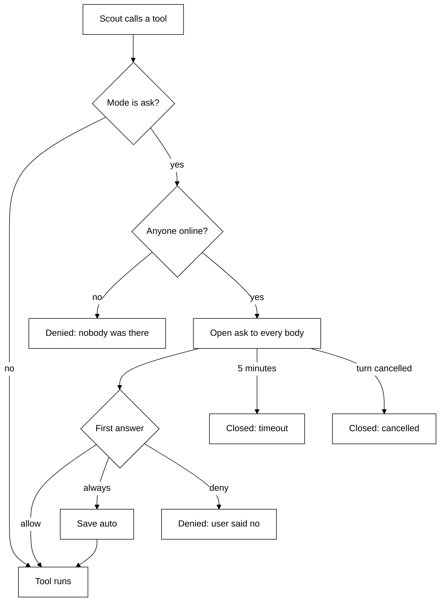
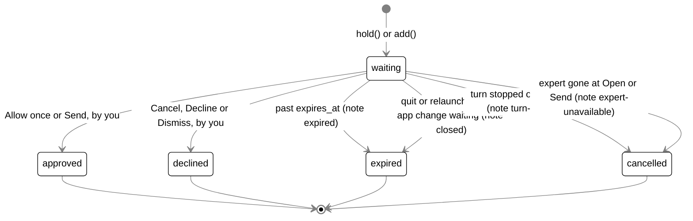

# Asks (Waiting on you)

## Purpose

An **ask** is one saved row for something that waits on the person's click: a change in a connected
app (`app-change`) or a hand-off card (`handoff`). Asks give every card one outcome set, one expiry
rule, one place in Home (**Waiting on you**) and one audit trail. Only a person's click approves an
ask; silence never does.

## In the Python brain

The Python brain asks before Scout runs a tool that changes something. It is a different, simpler
thing from the saved asks below: an ask lives only in memory and waits for one `answer`.



- Ask chain: after the mode check says `ask`, the `ask` hook runs three guards in order:
  `anyone_online` (nobody online: denied), `side_check` (Scout may approve once under your
  preference) and `person_ask` (the card you answer). Claude Code's permission asks use the same
  chain.
- Expert ask while nobody is online: the expert is denied at once ("no answer"), and the brain
  raises the `job_question` event keyed by the job, so Scout tells the owner what the expert asked
  when someone returns. Only the latest such ask per job is kept: a second offline ask from the
  same job replaces the first.
- Options are `allow`, `always`, `deny`; a locked tool has no `always`, so "Always" stays hidden
  for it.
- Locked rule: a locked tool (destructive hint or risky name, or a body's `confirm`) asks by
  default. It runs without asking only after you set its Home switch to **Auto** (Home warns that
  it is a risky action and Scout will no longer ask; the switch back to **Ask** needs no
  confirmation), or when Scout approves it under a preference you made that names the tool. A
  general preference never approves a locked tool, even with the built-in default removed.
- The first answer wins. A second answer, an answer after the ask closed, or an unknown id gets
  `not_found`. An option the ask did not offer gets `invalid_params`.
- A body that connects while an ask is open is sent it again.
- Code: `brain/src/brain/asks.py` and gate step 3 in `brain/src/brain/toolbox.py`. Details are in
  [brain.md](brain.md#permissions-and-asks).

### Approvals history and preferences

Every ask that reaches an end is logged in `tagalong.db` by `Approvals`
(`brain/src/brain/approvals.py`). The log is never pruned. Each new row sends `changed {what: "approvals"}` to every body.

| Table         | Holds                                                                                                                                                                        |
| ------------- | ---------------------------------------------------------------------------------------------------------------------------------------------------------------------------- |
| `approvals`   | One row per ask: `source`, `tool`, `summary` (at most 200 characters), `input`, `job_id`, `group_key`, `outcome`, `decided_by`, `preference_id`, `preference_sentence`, `at` |
| `preferences` | Plain sentences. "Always ask me before risky actions" is seeded once as the built-in default; it can be edited or removed, and stays removed                                 |
| `offers`      | One row each time Scout looked at a group of asks: when, and the result (`none` for no offer, `yes`, `keep_asking` or `no_answer`)                                           |

- **outcome** is `approved`, `refused`, `timed_out` or `no_one`. **decided_by** is `person`,
  `scout` or `none` (a timeout or nobody online). A Scout row also holds the preference id and
  `preference_sentence`, the words as they were when Scout approved. Editing or removing the
  preference later does not change old rows.
- **Where it is recorded.** `Toolbox._ask` logs Scout's tools (`source` `scout_tool`), body tools
  (`scout_tool`) and connected-app tools (`app`); `group_key` is the tool name. `Always` counts as
  `approved`. `Jobs._permission` logs Claude Code's permission asks (`claude_code`): `tool` is
  `claude_code:<title>` and `group_key` is `claude_code:<job folder>`.
- **Not recorded.** A cancelled ask, tools in `auto` mode, which never ask, and a side-check
  that passed (the ask simply went to you, and its row is yours).
- **No timeout for Claude Code.** A Claude Code permission ask waits until you answer or the job
  ends, so a Claude Code row is never `timed_out`.
- **Home calls** (audience `home`, never offered to the model): `list_approvals`,
  `list_preferences`, `remove_preference`, `edit_preference`. See
  [brain.md](brain.md#home-tools).
- **Seen in Home.** The Approvals page shows the preferences and this history, and the bubble shows
  the "Approved for you" card; see [bubble.md](bubble.md#home) and [desktop.md](desktop.md).

### Scout approves under your preferences

Code decides when Scout looks; the model decides whether a preference covers the ask. There is no
rules engine, allowlist or command matching in code. Code is
`brain/src/brain/side_check.py` (`SideCheck`), called from `Toolbox._ask` (tools) and
`Jobs._permission` (Claude Code), wording in `brain/src/brain/mind/approvals.md` (`## decide`).

Before an ask reaches you, `SideCheck.decide` runs these checks in order. Any "no" sends the ask
to you as before, with no wait.

1. You have at least one preference you made. The built-in default does not count, so with none
   there is no model call and no cost.
2. If the tool is `locked`, only a preference you made whose tool is that tool's name can cover
   it (one comes from accepting Scout's offer for that tool); the built-in default and general preferences never do. (Claude Code asks have no such
   flag: their risk is the model's judgment.)
3. The daily budget allows it.
4. The model, given the ask, your preferences and the recent history for that tool or folder,
   either approves under one preference id or passes. It has 20 seconds; an error, a timeout or
   an unknown or built-in id is a pass. The preference is read again after the answer, so one
   removed meanwhile is a pass.

Scout never refuses; only you do. When it approves, it approves once: for tools the ask mode stays
as it is, and for Claude Code it picks the `allow_once` option, never `allow_always`. The row is
saved with `decided_by: "scout"` and the preference, the preference's use count goes up, and the
`approved` notification `{tool, text, preference}` goes to every body so you see what Scout did and
why: the desktop panel shows a card "Approved for you: {text}" and "per '{preference}'" (`approved-card.tsx`) over whatever it is showing, a bubble or a quiet line. If the panel was hidden it comes up quietly and hides again when the card fades, after about 7 seconds. The model's spend counts toward the daily budget.

### Scout offers a preference

After each approval you gave by hand (not **Always**, which already makes the tool Auto),
`Offers.consider` (`brain/src/brain/offers.py`, wording in
`## offer` of `mind/approvals.md`) may look at that kind of ask. A group is the job folder for
Claude Code, and the tool name for everything else. Cheap checks first; any "no" ends it quietly:

- someone is online, and the group has no preference yet;
- no look at this group in the last day, and none within `TAGALONG_KEEP_ASKING_DAYS` of a "Keep
  asking";
- you approved this group at least `TAGALONG_OFFER_MIN_APPROVALS` times in the last
  `TAGALONG_OFFER_WINDOW_DAYS` days, and the budget allows a look.

Then the model either offers one plain sentence naming the kind of action, or makes no offer (it
should not offer when the approvals differ in risk, or could delete, send, spend or publish). The
offer is an ask with exactly two options, **Yes, auto-approve** and **Keep asking**, and waits up
to 10 minutes. A preference is saved only on **Yes**; a timeout, a cancel or **Keep asking** saves
nothing. **Keep asking** also stops new offers for that group for the keep-asking days. The look
runs in the background and never delays the ask that caused it; one group has at most one look
or offer in flight.

You can edit or remove any preference later with the Home calls; removing one means the next
matching ask reaches you.

## Where it lives (old brain)

| File                                             | What it holds                                                                                                                         |
| ------------------------------------------------ | ------------------------------------------------------------------------------------------------------------------------------------- |
| `packages/protocol/src/asks.ts`                  | `Ask`, `AskKind`, `AskRisk`, `AskState`, `AskNote`, the `asks.*` params and results, `AsksChangedParams`                              |
| `packages/core/src/asks/store.ts`                | `AskStore` (the `asks` table), `AskRecord`, `ASK_KEEP_DAYS`, `ANSWERED_SUMMARY_CHARS`                                                 |
| `packages/core/src/asks/asks.ts`                 | `Asks`: `hold`, `add`, `answer`, `settle`, `get`, `list`, `boot`, `closeHeld`, `prune`, `clear`, `stop`; `HELD_ASK_MS`, `FREE_ASK_MS` |
| `packages/core/src/memory/db.ts`                 | Migration 25, which creates `asks`                                                                                                    |
| `packages/core/src/engine.ts`                    | Builds `Asks`, calls `boot` and `prune`, the `asks.*` and `tool.approve` handlers, `closeHeld` on shutdown                            |
| `packages/core/src/tools/builtin/connections.ts` | Holds an app change through `deps.confirm` (`Asks.hold`); see [connected-apps.md](connected-apps.md)                                  |
| `packages/core/src/experts/handoffs.ts`          | Adds a hand-off card (`Asks.add`), settles it on Send, Dismiss or a gone expert; see [experts.md](experts.md)                         |
| `bodies/ui/src/connector-confirm.tsx`            | `ConnectorConfirmCard` (Allow once / Cancel)                                                                                          |

## How it works

### Two kinds

- **An app change is held.** `Asks.hold(params, signal)` saves the row, emits `connector.confirm`,
  and returns a promise the connector tool awaits. The turn stays open the whole time. When the
  turn's `signal` aborts (stopped or replaced), the ask settles `cancelled` with note `turn-ended`;
  a signal already aborted settles it at once and shows no card.
- **A hand-off card is free.** `Asks.add(params)` saves the row with a `payload` (the brief without
  its screen context) and returns `{ id }`. Nothing awaits it. The card is sent later through
  `handoffs.confirm`, from the bubble or after **Open** in Home.

The routine card (`routine.proposed`, held in `Routines`' in-memory `#proposals` map) and the
settings card (`settings.proposed`, held only by the bubble until **Apply** calls `settings.set`) are
consent cards for saving config, not actions. They are not asks and stay in memory.

### Risk

`AskRisk` is `read`, `change` or `high`.

- `read` never asks: a read tool runs at once and no row is written.
- `change` is every write that is not high, and every hand-off card.
- `high` is a write the app marks `destructiveHint`, or whose tool name holds a word such as `send`,
  `delete` or `publish` (`riskOf` in `connections/access.ts`). The confirm card and Waiting on you
  add `Can’t be undone`.

### States and settling

`state` starts `waiting` and ends in exactly one of `approved`, `declined`, `expired`, `cancelled`.



| Way out                                | State       | `answered_by` | `note`               |
| -------------------------------------- | ----------- | ------------- | -------------------- |
| Allow once (card, Home), Send          | `approved`  | `you`         |                      |
| Cancel, Decline, Dismiss               | `declined`  | `you`         |                      |
| Timer at `expires_at`, or read past it | `expired`   |               | `expired`            |
| Quit, or relaunch, with an app change  | `expired`   |               | `closed`             |
| Turn stopped or replaced               | `cancelled` |               | `turn-ended`         |
| Expert removed or switched off         | `cancelled` |               | `expert-unavailable` |

Every way out goes through `Asks.settle(id, state, how)`, which calls `AskStore.settle`:

```sql
UPDATE asks SET state = ?, answered_by = ?, note = ?, answered_at = ?, summary = ?, payload_json = NULL
WHERE id = ? AND state = 'waiting'
```

Only one settle can win, so a card and Home answering at once cannot both: the late one gets
`accepted: false`. A winning settle then, in order:

1. clears the ask's timer;
2. resolves a held ask's promise with the state, so the connector tool learns how it ended;
3. writes the outcome on the episode of the turn that asked: `ExperienceLog.outcome(originTurnId,
state)` finds the episode whose `ref` is that turn id and adds an `outcome` event named
   `approved`, `declined`, `expired` or `cancelled` (see [mind.md](mind.md));
4. broadcasts `asks.changed { waiting }`.

`Asks.answer(id, decision)` refuses (`false`) an ask that no longer waits and a hand-off with
`approve`: Send needs a folder, so a hand-off is only approved by `handoffs.confirm`.

No tool of Scout's can answer an ask. `asks.answer`, `tool.approve` and `handoffs.confirm` are host
methods called only by buttons, and `tools/registry.test.ts` pins that no role's tool is wired to the
asks.

### Expiry

| Kind         | Constant      | Value    | Why                                                                              |
| ------------ | ------------- | -------- | -------------------------------------------------------------------------------- |
| `app-change` | `HELD_ASK_MS` | 1 hour   | Its turn is held open the whole time, which holds arrivals, check-ins and sleep. |
| `handoff`    | `FREE_ASK_MS` | 24 hours | A brief about yesterday's problem goes stale.                                    |

Each waiting ask has one `setTimeout` at its `expires_at` (unref'd). `Asks.get(id)`, which every
answer, Open and Send goes through, settles an ask read past its time as `expired` there, so a timer
running late after the computer slept never lets it be answered.

### Restart

Nothing is resumed after a restart.

- `asks.boot()` runs at engine start, after `experience.interrupted()`. A waiting `app-change`
  becomes `expired` with note `closed`: its turn is gone, so nothing can run it, and the app is never
  called. A `handoff` past its time becomes `expired`; the others keep waiting with their timers
  re-armed.
- On a clean quit, `Engine.shutdown()` calls `asks.closeHeld()` first, before any turn is stopped,
  so a held ask ends `expired/closed` rather than `cancelled/turn-ended`. Then `asks.stop()` clears
  every timer, so none fires on a closed database.
- A hand-off card that waited across a restart reopens from its row with `restored: true`, without
  the window it was written from; see [experts.md](experts.md).

### Home's Waiting on you

Home has no Waiting on you page and the bubble does not watch `asks.changed`. The Python brain's permission asks are answered on their cards in the bubble and
listed in Home's Approvals page.

## Interfaces

### RPC methods

| Method         | Params                                       | Result                              | Notes                                                    |
| -------------- | -------------------------------------------- | ----------------------------------- | -------------------------------------------------------- |
| `asks.list`    | `{}`                                         | `{ waiting: Ask[], recent: Ask[] }` | `recent` is the last 20 answered                         |
| `asks.answer`  | `{ id, decision: 'approve' \| 'decline' }`   | `{ accepted }`                      | `false` when it no longer waits, or approving a hand-off |
| `asks.open`    | `{ id }`                                     | `{ opened }`                        | A hand-off: `handoff.proposed` again                     |
| `tool.approve` | `{ approvalId, decision: 'once' \| 'deny' }` | `{ accepted }`                      | The confirm card's answer: an alias of `asks.answer`     |

None of these is in `EXTENSION_METHODS`, so the browser extension cannot answer an ask.

### Notifications

- `asks.changed { waiting: Ask[] }` on every insert and every settle.
- `connector.confirm { approvalId, turnId, petId, app, tool, summary, risk? }` when an app change is
  held; `approvalId` is the ask id.
- `handoff.proposed { …, restored? }` when a hand-off card is added or opened; `proposalId` is the
  ask id.

### Types

```ts
Ask = {
  id: uuid; kind: 'app-change' | 'handoff'; petId; summary; risk: 'read' | 'change' | 'high';
  app?; tool?; expertName?; originTurnId?: uuid;
  state: 'waiting' | 'approved' | 'declined' | 'expired' | 'cancelled';
  answeredBy?: 'you' | 'rule'; note?: 'turn-ended' | 'closed' | 'expert-unavailable' | 'expired';
  createdAt; expiresAt?; answeredAt?;
}
```

`Asks.list` maps each row to `Ask`: the payload is never sent, and `expertId` becomes `expertName`
(left out once the expert is gone).

## Constants and limits

| Constant                 | Value    | File              |
| ------------------------ | -------- | ----------------- |
| `HELD_ASK_MS`            | 1 hour   | `asks/asks.ts`    |
| `FREE_ASK_MS`            | 24 hours | `asks/asks.ts`    |
| `ASK_KEEP_DAYS`          | 30       | `asks/store.ts`   |
| `ANSWERED_SUMMARY_CHARS` | 120      | `asks/store.ts`   |
| Recent answered listed   | 20       | `AskStore.recent` |

## Storage

Table `asks`, migration 25, written only by `AskStore`:

| Column                                    | Holds                                                                               |
| ----------------------------------------- | ----------------------------------------------------------------------------------- |
| `id`                                      | UUID; also the `approvalId` or `proposalId` on the cards                            |
| `kind`                                    | `app-change` or `handoff` (CHECK)                                                   |
| `pet_id`                                  | The pet that asked                                                                  |
| `summary`                                 | What will happen, written by Scout, secrets hidden on insert                        |
| `risk`                                    | `read`, `change` or `high` (CHECK)                                                  |
| `app`, `tool`                             | For an app change                                                                   |
| `expert_id`                               | For a hand-off                                                                      |
| `origin_turn_id`                          | The turn that asked, which is its episode's `ref`                                   |
| `payload_json`                            | Only a hand-off card's brief without its screen context; set to `NULL` once settled |
| `state`                                   | Default `waiting` (CHECK over the five states)                                      |
| `answered_by`                             | `NULL`, `you` or `rule` (CHECK; no code path writes `rule`)                         |
| `note`                                    | A code from `AskNote`                                                               |
| `created_at`, `expires_at`, `answered_at` | ISO times                                                                           |

Index `asks_state` on `(state, created_at)`.

- **Answered rows shrink.** A settle replaces `summary` with its first non-empty line, secrets
  hidden, cut to 120 characters, and drops `payload_json`.
- **Retention.** `asks.prune()` deletes answered rows whose `answered_at` is older than 30 days. It
  runs at boot and in the digest's 30-minute `tidy`. Waiting rows are never pruned.
- **Delete all.** `experience.clear` also calls `asks.clear()`, which deletes every answered ask and
  keeps what waits, so its card still works.

See [storage.md](storage.md) for every table.

## Failure handling

- Two answers at once: the compare-and-set `UPDATE` lets one win; the other returns
  `accepted: false`, and Home reloads.
- A late timer (the PC slept): `Asks.get` expires the ask when it is read, before any answer.
- A quit or crash with an app change waiting: `boot` or `closeHeld` ends it `expired/closed`, and the
  app is never called.
- An expert gone before Open or Send: `cancelled/expert-unavailable`; `handoffs.confirm` answers
  `-32602` `That expert is no longer available.`; `asks.open` answers `{ opened: false }`.
- An outcome for a turn whose episode was already pruned writes nothing (`ExperienceLog.outcome`
  returns `false`).

## Privacy notes

`summary` is what will happen, in Scout's words: never a window title, a selection or window text.
A hand-off's saved payload holds the brief without its context, which stays in memory only. Answered
rows keep one short line for 30 days. See [privacy.md](privacy.md).

## Tests that pin it

- `packages/core/src/asks/asks.test.ts`: the held card with id and risk; decline; cancel on a stopped
  turn and at once on an already-stopped one; expiry after an hour; never approved past its time
  with a late timer; `asks.changed` after every change; the outcome on the episode; `closeHeld`; a
  free card named by its expert; never approved from Home; expiry after a day; `boot` closing,
  keeping, re-arming and expiring.
- `packages/core/src/asks/store.test.ts`: secrets hidden in the summary; settle once; the short first
  line and dropped payload; list order; the 30-day prune that never touches a waiting row; Delete all.
- `packages/protocol/src/asks.test.ts`: the schemas, refusing unknown states, risks, kinds, answerers
  and notes.
- `packages/core/src/engine.test.ts` (asks over RPC): Home's Allow once runs a waiting write and a
  second answer loses; a write waiting at quit is `expired/closed` after relaunch and nothing ran; a
  hand-off card survives a relaunch and Send starts it; Delete all keeps the waiting.
- `packages/core/src/tools/registry.test.ts`: no role's tool can answer an ask.
