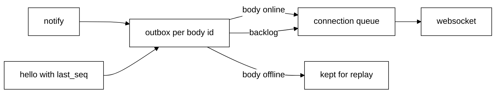

# The Python brain

The brain is the Python side of contract v1 ([protocol/README.md](../protocol/README.md)). It is
being built row by row and replaces `packages/core`. Today it is a skeleton: bodies can connect,
declare their tools and catch up on missed notifications. It cannot think yet.

## Run it

```text
cd brain
uv sync
uv run brain
```

It logs one line, `brain listening on ws://127.0.0.1:47321`, and runs until Ctrl+C.

| Variable              | Default           | Meaning                                              |
| --------------------- | ----------------- | ---------------------------------------------------- |
| `TAGALONG_BRAIN_ADDR` | `127.0.0.1:47321` | `host:port` to listen on. Port `0` picks a free port |
| `TAGALONG_HOME`       | `~/.tagalong`     | Data folder. Holds the `session` file                |

The `session` file keeps one id across restarts. `hello` returns it.

## Files

| File                          | What it does                                                                       |
| ----------------------------- | ---------------------------------------------------------------------------------- |
| `brain/src/brain/protocol.py` | Contract v1 as pydantic types                                                      |
| `brain/src/brain/config.py`   | Reads the environment, keeps the session id                                        |
| `brain/src/brain/bodies.py`   | Online bodies, their tools, and one outbox per body id                             |
| `brain/src/brain/server.py`   | The websocket server: parsing, errors, `hello`, `tools`, the per-connection writer |
| `brain/src/brain/main.py`     | The `uv run brain` entry point                                                     |

## What a connection does

- The first message must be `hello`. Anything else gets `invalid_request` and the connection closes.
- A bad `hello` closes the connection: `invalid_params`, or `version_mismatch` with
  `data.protocol` set to `1`.
- After `hello`, `tools` replaces the body's tool list and answers `{}`. A second `hello` gets
  `invalid_request`. The connection stays open.
- `say`, `call` and `answer` answer `method_not_found` until they are built. `event`, `cancel`,
  `progress` and unknown notifications are ignored. An unknown request gets `method_not_found`.
- Bad JSON or a binary frame gets `parse_error`. Anything that is not a JSON-RPC object gets
  `invalid_request`. After `hello` the connection stays open.
- A newer connection with the same body id closes the older one.
- The largest frame is 28,000,000 bytes.

## Outbox and replay



- Every notification gets the next `seq` in each body's outbox, online or not.
- The outbox keeps the last 500 notifications or 24 hours, whichever is smaller. It lives in
  memory, so a brain restart means `resync`.
- On `hello` with `last_seq`, the brain sends the `hello` result first, then the missed
  notifications in order, with nothing else in between.
- If something was dropped, or `last_seq` is ahead of the brain, the result says `resync: true`
  and nothing is replayed. Replaying live asks and turns is not built yet.
- Writes go through one queue per connection. `send` never waits and never raises, so one slow
  body cannot stop the others.

## Not built yet

| Row   | Brings                                                                                                                                                                |
| ----- | --------------------------------------------------------------------------------------------------------------------------------------------------------------------- |
| 4     | The thinking loop and sessions: `say`, turn `cancel`, `turn`, `reply` and `tool` notifications, live-state replay after `resync`, the budget, the step cap            |
| 6     | Memory                                                                                                                                                                |
| 7     | Tools: the brain's tools in the `hello` result, `use` and its `cancel` to bodies, `call`, model tool names `<body>__<tool>`, part size checks as `say` and tools land |
| Later | Asks, `answer` and confirm guardrails                                                                                                                                 |

Until then these requests answer `method_not_found`.

## Tests

`cd brain && uv run pytest`. `tests/test_server.py` runs a real server on a free port with the
`websockets` client.
