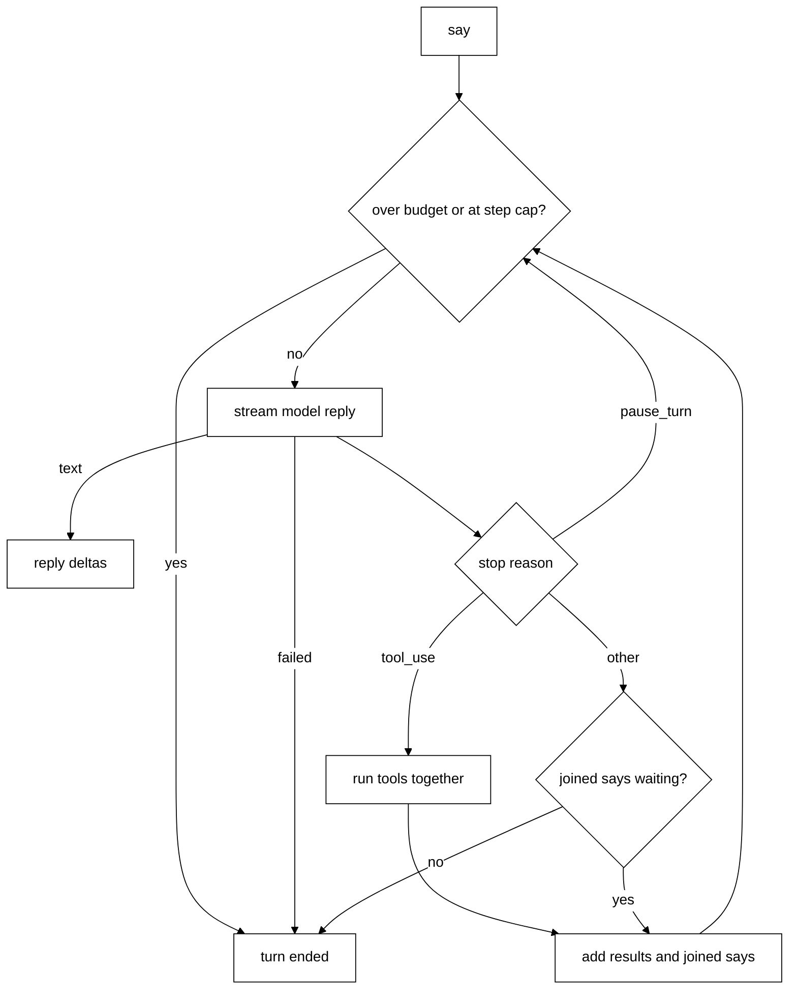
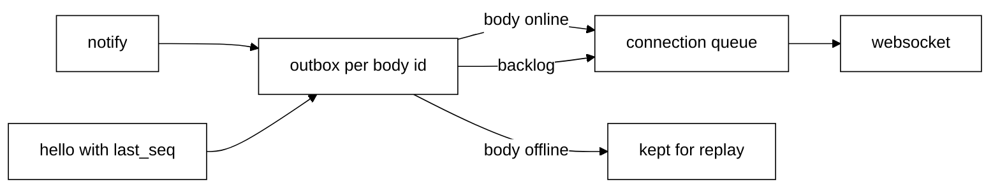

# The Python brain

The brain is the Python side of contract v1 ([protocol/README.md](../protocol/README.md)). It is
being built row by row and replaces `packages/core`. Today bodies can connect, declare their tools,
catch up on missed notifications, and talk to Scout: `say` starts a turn and the reply streams
back. Scout has no tools, memory or saved chat yet (see [Not built yet](#not-built-yet)).

## Run it

```text
cd brain
uv sync
uv run brain
```

It logs one line, `brain listening on ws://127.0.0.1:47321`, and runs until Ctrl+C.

It needs an Anthropic key. With no `ANTHROPIC_API_KEY` in the environment or in
`<TAGALONG_HOME>/.env`, it logs one line saying where to put it and exits with status 1.

| Variable                    | Default           | Meaning                                              |
| --------------------------- | ----------------- | ---------------------------------------------------- |
| `TAGALONG_BRAIN_ADDR`       | `127.0.0.1:47321` | `host:port` to listen on. Port `0` picks a free port |
| `TAGALONG_HOME`             | `~/.tagalong`     | Data folder. Holds `session`, `budget.json`, `.env`  |
| `TAGALONG_MODEL`            | `claude-opus-5-5` | Model Scout thinks with                              |
| `TAGALONG_DAILY_BUDGET_USD` | `5`               | Most Scout may spend per local day, in USD           |
| `TAGALONG_STEP_CAP`         | `25`              | Most model calls in one turn                         |
| `ANTHROPIC_API_KEY`         | none, required    | Anthropic key                                        |

`<TAGALONG_HOME>/.env` holds `KEY=value` lines (`#` comments and quotes allowed). It only fills
keys the environment lacks, so the environment wins. A bad budget or step cap stops the brain at
start.

The `session` file keeps one id across restarts. `hello` returns it.

`budget.json` holds `{"date": "2026-10-25", "spent_usd": 0.42}` and starts again at zero each
local day. After each model call the brain adds its cost. A model call that would start at or
over the limit ends the turn with `over_budget`. A cancelled or failed stream records no spend, so
the total can run a little low.

## Files

| File                             | What it does                                                                         |
| -------------------------------- | ------------------------------------------------------------------------------------ |
| `brain/src/brain/protocol.py`    | Contract v1 as pydantic types                                                        |
| `brain/src/brain/config.py`      | Reads the environment and `.env`, keeps the session id                               |
| `brain/src/brain/guardrails.py`  | The daily budget and its `budget.json` ledger                                        |
| `brain/src/brain/sessions.py`    | The one conversation: history, the running turn, `say` joins, `cancel`               |
| `brain/src/brain/mind/soul.md`   | Scout's character, the start of the system prompt                                    |
| `brain/src/brain/mind/prompt.py` | The system prompt (soul, local time, online bodies) and `say` content blocks         |
| `brain/src/brain/mind/turn.py`   | The thinking loop and the Anthropic streaming call                                   |
| `brain/src/brain/bodies.py`      | Online bodies, their tools, and one outbox per body id                               |
| `brain/src/brain/server.py`      | The websocket server: parsing, errors, `hello`, `tools`, `say`, `cancel`, the writer |
| `brain/src/brain/main.py`        | The `uv run brain` entry point                                                       |

## What a connection does

- The first message must be `hello`. Anything else, including bad JSON, gets an error and the
  connection closes.
- A bad `hello` closes the connection. The protocol version is checked first, so a wrong
  version gets `version_mismatch` with `data.protocol` set to `1` even if the rest of the shape
  is wrong; otherwise a bad shape gets `invalid_params`.
- After `hello`, `tools` replaces the body's tool list and answers `{}`. A second `hello` gets
  `invalid_request`. The connection stays open.
- `say` starts or joins a turn (see [What a turn does](#what-a-turn-does)); bad params get
  `invalid_params`. `cancel` with a turn id ends that turn; a turn that is over or unknown is
  ignored. `call` and `answer` answer `method_not_found` until they are built. `event`,
  `progress` and unknown notifications are ignored. An unknown request gets `method_not_found`.
- Bad JSON or a binary frame gets `parse_error`. Anything that is not a JSON-RPC object gets
  `invalid_request`. After `hello` the connection stays open; before it, it closes.
- A newer connection with the same body id closes the older one. Its `tools` frames are
  ignored if one still arrives.
- The largest frame is 28,000,000 bytes.

## What a turn does

`say` answers `{turn, joined}` at once. The work then runs in the background and streams
notifications. There is one conversation for all bodies and at most one running turn.



- A `say` while a turn runs joins it: the result has `joined: true` and the message is folded
  into the next step.
- Every step rebuilds the system prompt: Scout's soul, the local time, and the bodies online.
- Text streams as `reply` notifications with `delta`. Tools run at the same time, each with
  `tool` `started` then `ended`. No body tools are offered to the model yet.
- A turn ends with one of `done`, `cancelled`, `error`, `over_budget` or `step_cap`. A refusal or
  a failed model call is `error`.
- If any delta was sent, exactly one `reply` with `done: true` follows, whatever the end reason.
- History is append-only and always valid: a half-streamed message is never kept, and a
  `tool_use` always gets a `tool_result`, even on cancel.
- The model runs with adaptive thinking at medium effort, server-side compaction (beta
  `compact-2026-01-12`) and server-side fallbacks (`fallbacks: "default"`).
- The code never writes Scout's words. The model decides whether and what to say, and silence is
  allowed.

Decision: the loop is our own, not the SDK tool runner. The runner hides the history, fixes the
tool list when it starts, cannot take a `say` in the middle of a turn, and ends silently on
`pause_turn`.

## Outbox and replay



- Every notification gets the next `seq` in each body's outbox, online or not.
- The outbox keeps the last 500 notifications or 24 hours, whichever is smaller. It lives in
  memory, so a brain restart means `resync`.
- On `hello` with `last_seq`, the brain sends the `hello` result first, then the missed
  notifications in order, with nothing else in between.
- If something was dropped, or `last_seq` is ahead of the brain, the result says `resync: true`
  and nothing is replayed. Replaying live asks and turns is not built yet.
- Writes go through one queue per connection. `send` never waits and never raises, so one slow
  body cannot stop the others.

## Not built yet

| Row   | Brings                                                                                                                                                                                                           |
| ----- | ---------------------------------------------------------------------------------------------------------------------------------------------------------------------------------------------------------------- |
| 4     | Live-state replay after `resync` (the thinking loop, `say`, `cancel`, budget and step cap are built)                                                                                                             |
| 6     | Memory and saved chat history. A restart starts a fresh conversation                                                                                                                                             |
| 7     | Body tools for Scout (`use` plugs into the loop), the brain's tools in the `hello` result, `use` and its `cancel` to bodies, `call`, model tool names `<body>__<tool>`, part size checks as `say` and tools land |
| Later | Asks, `answer` and confirm guardrails                                                                                                                                                                            |

Until then `call` and `answer` answer `method_not_found`.

## Tests

`cd brain && uv run pytest`. `tests/test_server.py` runs a real server on a free port with the
`websockets` client. The model is faked in tests, so none call Anthropic.
