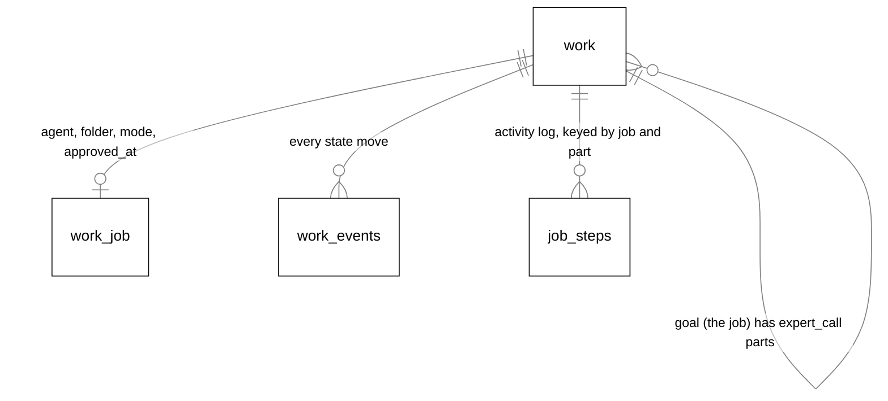
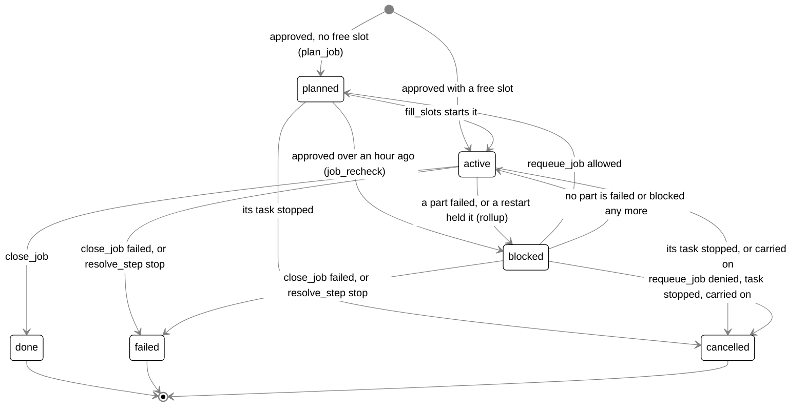
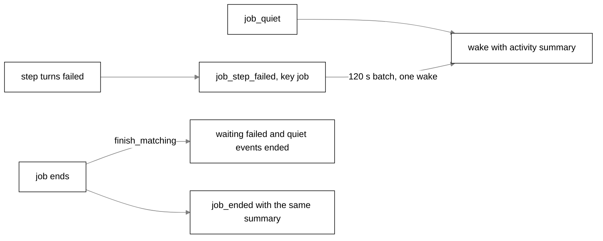

# Experts

How Scout hands work to an expert such as Claude Code: the ACP hosts that run the expert, the jobs and their queue, the activity log, the questions and permission asks an expert raises, and the bridge that lets an expert reach connected apps. Read this to change how jobs run or to follow a job from approval to its end.

Contents: [ACP hosts and runs](#acp-hosts-and-runs) · [Hosts, sessions and resume](#hosts-sessions-and-resume) · [Expert adapters](#expert-adapters) · [Where jobs live](#where-jobs-live) · [Jobs](#jobs) · [Job lifecycle](#job-lifecycle) · [Asks and questions from an expert](#asks-and-questions-from-an-expert) · [The expert-to-apps bridge](#the-expert-to-apps-bridge) · [Retries and give-ups](#retries-and-give-ups). Starting and stopping the task a job belongs to is in [tasks.md](tasks.md); the permission engine its asks use is in [permissions.md](permissions.md).

## ACP hosts and runs

`experts.py` holds `ExpertRun`, the one object that drives Claude Code in a folder over the Agent
Client Protocol. `Jobs` creates one per job. `start(folder)` spawns the adapter, runs
`initialize` (advertising `elicitation.form` so questions work) and `session/new`, and returns
the modes. `begin(mode, task)` sets the mode and sends the first prompt without waiting. `note(text)`
queues a follow-up prompt for after the current turn and returns `False` once the run has ended.
`stop()` sends `session/cancel` and ends the process; `close()` ends it too. All callbacks are
async: `on_permission` returns an option id (`None` sends a cancelled outcome), `on_question`
returns the answer fields (`None` cancels), `on_progress` gets the latest assistant message and
`on_end(state, reason, result)` ends the run with `done`, `error` (including `timeout` and an
adapter crash) or `stopped`.

`ExpertRun` takes the expert's `command` and its `expert_id`; a missing executable raises
`ExpertError("command not found: <exe>")`, a fact the model words. Experts come from
the installed list (`setup/store.py`); `TAGALONG_EXPERT_CMD` adds one custom expert (id `custom`,
source `custom`) beside them and works with none installed. A job has no run limit; see the quiet
clock below. The override is split like a shell on Linux and macOS; on Windows backslashes are kept
(quote it if it has spaces). A question's `QuestionField` carries the key,
title, the question's own text (`description`), the option labels and `multi` (a multi-select
answers with a list of labels). The child gets the brain's environment through `setup/env.py` `expert_env(expert_id, ...)`,
without that expert's own key variables (the last column of the table below; an unknown id loses
all of them) and without `ANTHROPIC_API_KEY` and `ANTHROPIC_AUTH_TOKEN`, so each expert runs on the user's own login, never a key Scout uses. For an expert on the private
Node, that Node's folder goes first on the child's PATH (the brain's own PATH is unchanged). The process is closed by closing its stdin; if it stays alive it is killed with
its children (`taskkill /T /F` on Windows; on Linux and macOS only the adapter process is
killed, and its children exit when their stdin closes). Start and the mode change are bounded by a 60 s
startup limit (an adapter that never answers is killed and reported). `stop()` and `close()` are
safe from any state, including from inside `on_end`; teardown is shared, so `on_end` fires once,
after the process is gone. A stop answers any pending permission or question as cancelled.

`ExpertRun` is one session; the process belongs to an `ExpertHost`. Run alone (tests), a run
builds its own host that stops with it, as above. `Jobs` gets its runs from `ExpertHosts`
(`ExpertHosts(idle_s, quiet_s=...)`), which keeps one host per installed expert and command.

## Hosts, sessions and resume

- **One adapter per expert.** The host starts the process with the first session
  (`initialize` once, then `session/new` or `session/load` per session) and routes each frame to
  its session: `session_update` and `request_permission` by `sessionId`, `create_elicitation` by
  the session id in its mode; a frame for an unknown session is dropped (cancelled for an ask).
  Two jobs of one expert share the process, and a stop ends only its own session. A stop that the
  adapter ignores (past the grace period) kills the process, and any session sharing it ends in
  `error`.
- **Idle stop.** After the last session ends the process stays up for `TAGALONG_EXPERT_IDLE_S`
  (default 300 s; 0 stops it at once), so a follow-up reuses a warm adapter. A finished job's
  session is forgotten at once, but the adapter and the `claude` process it started stay up for
  that period, and each later job restarts the timer. This is by design: `tagalong stop`
  ends them, and a lower value frees the memory sooner. A new session cancels
  the wait. The brain stops every host on exit. A session that ends in `error` stops the process
  at once if no other session uses it, so a crash is never kept warm; the next session starts a
  new process.
- **Resume.** `initialize` says whether the adapter supports `session/load`
  (`ExpertHost.can_resume`, `null` until the adapter has started once; `list_experts` shows it).
  `ExpertRun.start(folder, resume=<session id>)` calls `session/load` when it can. Otherwise, or
  when the call fails (the adapter no longer has that session), it opens a fresh session and sets
  `resumed = False` and `fresh_reason` to a fact: `expert cannot reopen sessions` or
  `session could not be loaded`. An adapter that died and restarted is the second case.

Claude Code runs on the user's own login. It must be logged in, or the first hand-off fails with
the adapter's own message (for example that auth is required).

## Expert adapters

What the adapters in the ACP Registry need, read from `initialize` and the packages (login on a clean machine was read from `authMethods` and source, not run):

| Expert                | Install command                                    | Bundles the agent                 | Node floor    | load_session | Login kind                                                                                                                                                                                                                                                                      | Env to strip                                                                                     |
| --------------------- | -------------------------------------------------- | --------------------------------- | ------------- | ------------ | ------------------------------------------------------------------------------------------------------------------------------------------------------------------------------------------------------------------------------------------------------------------------------- | ------------------------------------------------------------------------------------------------ |
| Claude (`claude-acp`) | `npx @agentclientprotocol/claude-agent-acp@0.99.1` | Yes (Agent SDK and native binary) | 22            | yes          | terminal: the client runs the adapter exe with `--cli auth login --claudeai` (or `--console`); methods appear only if the client sends `clientCapabilities.auth.terminal: true`; one `claude-login` (`claude /login`) when `NO_BROWSER`, `SSH_*` or `CLAUDE_CODE_REMOTE` is set | `ANTHROPIC_API_KEY`, `ANTHROPIC_AUTH_TOKEN`, `CLAUDE_CODE_USE_BEDROCK`, `CLAUDE_CODE_USE_VERTEX` |
| Codex (`codex-acp`)   | `npx @agentclientprotocol/codex-acp@2.5.0`         | Yes (`@openai/codex`)             | none declared | yes          | browser (`chat-gpt`) via ACP `authenticate`; or `api-key`                                                                                                                                                                                                                       | `CODEX_API_KEY`, `OPENAI_API_KEY`                                                                |

The registries: ACP `https://cdn.agentclientprotocol.com/registry/v1/latest/registry.json`, MCP
`https://registry.modelcontextprotocol.io/v0.1/servers?limit=30&version=latest` (plus `&search=`
and `&cursor=` when set, URL-encoded; a blank search is no search). Samples of both are in
`brain/tests/fixtures/`.

The Claude row also reads the opt-in `clientCapabilities._meta.terminal_output` (see Terminal
output and exit codes under Jobs and tools).

## Where jobs live

Expert jobs (Claude Code hand-offs) live in `work` rows, read through `JobRecords` (`job_records.py`, the only code that knows the layout; columns in [storage.md](../data/storage.md#jobs-as-work-rows)). A job is a `goal` row with the job id; each expert hand-off inside it is an `expert_call` row named `<job>.<part>` (`p1`, `p2`, ...). `work_job` holds what `work` has no column for: agent, folder, mode and the first task. `JobRecords` hands out `Job` and `JobPart` shapes: a job has id, task, folder, mode, state, start and end times, `parent_job` (the job a follow-up continued, kept as a `continued` event), Scout's `watch` list, and `title`, `scout_result` and `closed_at` (Scout writes the title with `hand_off`, the result with `set_job_result` and closes the job with `close_job`, which takes an optional `outcome` of `done` or `failed`). A part has agent, task, `folder` (parts of one job may work in different folders; a session is only continued in the part's own folder), state, reason, progress, report, session id, a `reported` flag and start and end times. Work states map to the words Home shows: `active` is `running`, `done` is `done`, `failed` is `error`, and `cancelled` (or anything else) is `stopped`; a part's reason is left out when it only repeats its state. A report or result over 2,000 characters keeps its start in the row and the whole text in `tool_outputs`. A finished part has no progress line (the work store clears it when a row ends). A job's state is derived: `running` while any part runs, `error` once the job is closed as failed, otherwise the outcome of the part that ended last. Parts still running at brain start become `blocked` when their session can be reloaded, otherwise `failed`, with reason `brain restarted`; the job stays open, and the activity log and timers of those jobs are cleaned by `Jobs.startup`. Carrying on from a part a restart, a shutdown or a stop left behind starts the continuation as its own job and closes the old one as `cancelled` ("carried on") and already reported, so it does not stay open beside the new one. Only an explicit carry-on (`hand_off` with `continue_job`) closes a failed or stopped job; the implicit same-folder continuation does it only for a part the restart held (blocked, reason `brain restarted`), so a genuine failure is not hidden by a new task in that folder. An older job with another part still open, or a part added to the same job, stays open. A failed part blocks its job, and adding a part to a blocked job makes it run again. A part's id is fixed before its run starts, so anything the run reports while starting files under that part. A job's wake note carries the report of the part that just ended (tagged with the part, its expert and its folder when there are several); the other parts appear as facts only, and Scout reads one with `job_report`.

A job is one `goal` row with its parts as child `expert_call` rows; `work_job` holds the job's own columns, `work_events` the history of each row, and `job_steps` the activity log Home reads.

## Jobs

`Jobs` (`jobs.py`) owns the running `ExpertRun`s, one per part (`_runs[job][part]`, with the
activity logs and ask ids keyed the same way), and the job records (`JobRecords`, goal and expert_call `work` rows;
columns in [storage.md](../data/storage.md#jobs-as-work-rows)). `start()` checks the request and
calls `_start_part`, the one place an expert run begins; it adds a part to the job and counts
running parts and claimed starts against the two slots (see the queue below). Callbacks (`permission`, `question`, `progress`, `quiet`,
`end`) carry the part, so two parts of one job never share an ask. `tell_expert` and `stop_job`
take an optional `part`: with several running parts `tell` must name one, and `stop` stops all
of them unless one is named. The job's `JobId` carries `.part`. A wake about a job with more than
one part names the part and its expert; `on_finished` fires only once no part is still running. `Session` builds it with the expert list (`main.py` passes the installed experts plus the custom
override) and the `ExpertRun` factory (`ExpertHosts(TAGALONG_EXPERT_IDLE_S, quiet_s=TAGALONG_JOB_QUIET_MIN * 60)`) and calls
`startup()`, which runs the work store's resume scan (see Restart under Job state).

**The job queue.** At most two jobs run at once (`MAX_RUNNING`). A hand-off the person
approves while a slot is free starts at once. With no slot free it is saved as a `planned` goal
with its `task_id` and `work_job.approved_at` (`JobRecords.plan_job`), and `hand_off` answers with
`queued: n`, its place in line (1 is next); a part added to an existing job (`job`) is refused
instead, because the job it joins is already running. A job counts for its slot from the moment
it is claimed until its row exists (`Jobs._claimed`), and a job waiting on an expert's card keeps
its slot. When a job ends, `fill_slots()` starts the oldest approved goal (oldest `approved_at`);
it also runs when a start fails (its slot goes on to the next in line) and once at start-up,
after the resume scan and `apps.start()`, so a restart loses no approved job. Each
start runs in a background task, so nothing waits for an expert to come up; one that cannot start
ends `failed` and Scout hears it as `job_ended`, and only then gives its slot on (a queued start
keeps its claim until its goal is closed, so a failed start is never tried twice); its apps are
checked again first, because one may have been removed while it waited. Only the start-up fill
(`fill_slots(settling=True)`) accepts an app that is still `connecting`; every later fill is as
strict as a hand-off. A new hand-off never jumps ahead of one already in line.
Stopping a task cancels its goals, so queued ones leave the line, and `fill_slots` never starts a
goal of a stopped task; `shutdown` cancels the waiting starts and awaits them. Every start counts
in `_in_flight` (a due redo of a held part, `run_planned`, takes no slot claim), and a stop's mark on a
task is only forgotten when none is in flight or claimed. A redo refuses (`both job slots are busy`)
when the other running parts and claims already fill the two slots.

A goal whose approval (or last recheck) is over `RECHECK_AFTER_S` (one hour) old is not started:
it moves to `blocked`, posts `job_recheck` and the slot goes to the next in line. Scout answers
with `requeue_job {job}`, an ask-tier tool, so the owner's card is the question on the same task.
Allow (`Jobs.requeue`) sets `work_job.rechecked_at` and moves the goal back to `planned`, keeping
`approved_at`, so it is first in line with a fresh hour. **Deny** ends the task:
`ToolSpec.deny_stops_task` makes `AskRunner` treat a no on that card like Stop the task. Home's
Jobs list shows a queued row as `queued` with `place` and `task_id`; its Stop calls `task_stop`.
A held goal (blocked, never ran) shows as `held`, "Needs your OK", with its `task_id` and the
same Stop (`Jobs.held`). `fill_slots` posts `job_recheck` again for a held goal whose question was
lost (a restart, a card that ran out, a silent Scout): not while its `requeue_job` card is open or
a `job_recheck` for it is still `new` in the event log, and at most once an hour.

**One session per folder.** A `hand_off` without `continue_job` continues the expert's last
finished session in that folder: `JobRecords.last_part_for(agent, folder)` returns the newest job and
part of that expert that is not running and has a `session_id` (stopped and error parts count; folders
compare as paths, so case on Windows and a trailing slash do not matter). The job then starts as
a follow-up of it: resume id, `parent_job`, and the same fallbacks to a fresh session (including
`session is in use by another job` when a running job holds the session). The card is shown
as for any new job and the old job's mode and permissions are not carried over, so the preference
gate below never runs for it. `hand_off` takes `fresh: true` to skip the lookup (`parent_job`
stays unset); `continue_job` together with `fresh` is refused (`pass continue_job or fresh, not
both`). There is no setting or button for it: guidance lives in `mind/soul.md` and the tool
description.

**Follow-ups.** `hand_off` takes an optional `continue_job`, the id of a finished job. The new
job must use the same expert and the same folder as that job, which must not be running; each
mismatch is a `JobError` with a plain reason. It reopens the earlier job's saved session id when
the expert can, and records the earlier job in `parent_job` so `list_jobs` shows the chain. The
hand-off result is JSON, facts only: `{"job", "session": "continued" | "fresh", "why_fresh", "parent_job", "mode"}` (`mode` is the mode the job started in, from Scout's argument or the expert's default. `parent_job` is the job
whose session this one continues, `null` for none),
with `why_fresh` one of `expert cannot reopen sessions`, `session could not be loaded`,
`session is in use by another job` (a second follow-up of one session runs fresh, so asks never
cross), `session reported no modes`, `the earlier job saved no session` or `null`. Scout words it (see `mind/soul.md`: a short brief,
never the chat; the expert's summary stays whole in its part's report, and the Home `list_jobs` row shows it cut at 1,000 characters; `job_report` reads it whole).
`list_jobs` rows carry `parts`, each with `expert` and `session_id_known` instead of the session id. The card
still opens for a follow-up.

**Activity log.** `job_activity.py` records what each running job did, so a body can show it
later. `ExpertRun` forwards every ACP update of its session to `on_update` (through
`ExpertRun._update`), but only after `begin`: a resumed session replays its old chat first, and
that replay never reaches the log. `Jobs` creates one `JobActivity` per part when the part starts
and ends it in `_end`; updates are keyed by the run found from the session id, so jobs
sharing one adapter each get only their own steps. All parts of a job write into one log: the
`seq` counter continues from the job's highest (`WorkStore.max_seq`), each entry carries its `part`
(and a `source`, empty), and the caps apply to the job as a whole. The wake summary
(`activity_summary`) tags a step with its expert, `[codex-acp] make`, only when the job has more
than one part, and keys a step's output by part and step id, since two experts can reuse an id.

Entries (`ActivityEntry` in `store/work.py`) have a `rev` that rises on every write to the job's log
(the cursor readers will use), a `seq` fixed at insert (display order; `0` is the
`[older steps dropped]` marker), a `kind` (`command`, `output`, `edit`, `read`, `search`,
`other`, `say`, `plan`, `end`, `tool`), an optional `status` (`pending`, `running`, `done`,
`failed`, `refused`), an optional `source` (see Scout's own steps), the
tool call id as `step` and the text. A tool call is one entry updated in place as its status moves;
its output is one `output` entry per step, replaced in place. A message is one `say` entry per
message id, the plan one `plan` entry (`[x]` or `[ ]` per line), and the end one `end` entry
(`# done`, `# error: <reason>`, `# stopped`). Unknown kinds or a missing command become `other`
with the title, never an error.

Every text is masked (`mask_json(guards, "job_activity", ...)`) on the whole accumulated text,
then capped: a command's output keeps its last 64 KB behind `[earlier output cut]` (cut on a
character boundary), a message 8,192 characters, a job `TAGALONG_JOB_STEPS_MAX_ENTRIES` (2,000) entries or
`TAGALONG_JOB_STEPS_MAX_BYTES` (1 MB) of text. Over the
caps `WorkStore.trim_activity` blanks the oldest `output` text first (bumping its `rev`), then
deletes rows by entry count and by bytes, least recently written first (lowest `rev`, so a plan
or step still being updated survives), and keeps one marker. Messages without an id join into one
entry only until a tool call or plan intervenes. When a job ends stopped or errored, steps still
`running`/`pending` are closed before the `end` entry: `stopped` when the person stopped the job
(not a failure: the summary and `list_jobs` say "stopped: <step>"; a person's Stop, a restart and a clean shutdown all read the same), `failed` on an
error. `Jobs.stop` and `Jobs.shutdown` first call `JobActivity.stopping()` on each part: the
adapter reports the tool call a cancelled permission ask left open as failed ("The user doesn't
want to proceed"), and while stopping that status is written `stopped`, so a stop never reads "1
failed". A command killed by the stop (exit code none or a signal's) is also written `stopped`, and a `stopped` step never counts as failed in the summary, `list_jobs` or the failure event, whatever its exit code. A cancelled job's wake note (a stop by the person or Scout, or a clean shutdown)
adds "This job was stopped. Do not start it again or start a replacement unless the person
asks."; a brain restart reads blocked, not that. A job stopped by a brain restart gets its `# stopped` entry too and its open steps are
closed as `stopped`. Nothing unmasked is stored. The log lives as long as its job row.

**Terminal output and exit codes.** `ExpertHost` sends `clientCapabilities._meta =
{"terminal_output": true}` (`CLIENT_META` in `experts.py`). Claude Code's adapter then sends a
command's result as `_meta` instead of a console text block: `terminal_info {terminal_id}` on the
tool call (the id equals the tool call id), `terminal_output {terminal_id, data}` (or
`terminal_output_delta`, which appends) and `terminal_exit {terminal_id, exit_code, signal}`.
Output arrives once, when the command finishes; the heartbeats before that carry nothing and
change nothing. `JobActivity` replaces (or appends to) the step's `output` entry and sets the
command entry's `exit`: `0` gives `done`, any other code `failed` with `exit` set, and a signal
(`exit_code` null) `failed` with `exit` null. Once an exit has decided the status, a later plain
`completed` does not undo it. A secret split across delta chunks is still masked: the raw tail
(at most `OUTPUT_CAP` plus `CARRY` characters per delta step, released at exit) lives in memory
only, and each write masks the whole accumulated text, then drops the carry and caps it, so a cut
never lands inside a secret and a trimmed output always starts with the cut marker. An exit for an unknown terminal id is dropped; output goes to the update's own tool call. An adapter that ignores the
opt-in (Codex untested) keeps the console text block, whose `console` fence is
stripped, so the page shows the same text, with no `exit`.

**Serving the log.** Home reads it with the Home-only tool `job_activity` (it rides `call`, so the
contract does not change). With `{job, after_rev}` it returns `{job, title, state, started_at,
ended_at, closed_at, result, parts, rev, entries, more, watch}`, where `parts` is `[{id, expert, state,
reason, folder, started_at, ended_at}]` and each entry also carries `part` and `source`: the entries whose `rev` is above the cursor, in `rev` order, at most 500 (`more: true`
when cut). `rev` is the cursor to send next; a body that missed notices or reconnected sends
`after_rev: 0` and gets the whole log, and a repeat with the last `rev` returns nothing. Rows were
masked when written, so serving does no second pass. `result` is Scout's `scout_result`. A part's full
report is read separately, on demand, with the tool `job_report {job, part}` (Home and Scout; Scout's copy is capped like any tool result) (`Jobs.part_report`), so
the page stays small. An unknown job is `invalid_params`; a job
from before the log existed has an empty page. `watch` is Scout's watch list for the job (see Watch
list), or `null` when it has none. With no `job` it returns
`{"running": [{job, expert, text, at}]}`: the latest running or pending step of each running job (`expert` is the
expert's display name), for the bubble's one live line. `list_jobs` rows gain `activity: true`
when the job has any rows (one query, `WorkStore.jobs_with_activity`).

`Jobs` tells bodies with `changed {what: "job_activity"}` at most once per `ACTIVITY_NOTIFY_S`
(250 ms): the first change goes at once, a burst becomes one trailing send so the last write is
never left unannounced, and the job's end cancels the trailing send; the `end` entry's own change
is the one notice, sent after that row. The Jobs list keeps its own 2 s `changed {what: "jobs"}`.

## Job lifecycle

These are the `work` states of a job's `goal` row. A goal reaches `done` or `failed` only through a close (`WorkStore` refuses any other way), and its only automatic move is the rollup: a failed or blocked part blocks an active goal, and it runs again once none is left. Each part (`expert_call`) has its own row: `active` while its expert runs, then `done`, `failed` (error, timeout or crash) or `cancelled` (stopped, or a failed part skipped with `resolve_step`), or `blocked` when a restart held it. Home does not show the goal's state: it shows the job's derived state (`running` while any part runs, `error` once closed as failed, else the state of the part that ended last) through `home_state`, plus `queued` and `held` for a goal that never ran. `closed_at` is Scout's own judgement that the work is over, so a job can be `done` and still open.

When a job ends, the session emits a `job_ended` event whose fact is a note (id, task, folder,
state, reason and the report of the part that just ended (other parts of a multi-part job appear as facts only: expert, folder, state, reason; Scout reads one with `job_report`); a report over the preview cap arrives as a preview with
an `output_id`, see [Long tool output](README.md#long-tool-output)). The event's id is
`job_ended:{job}@{ended_at}`, so a restart that derives the same ending again posts it once. The
log is what keeps it until a turn has told it. Scout's prompt says an event is not a request
from the owner; the model decides whether to speak, and may say nothing.

The person is told what an expert did even when they were away. A finished or
dead expert arrives as `job_ended` and waits in the log until a body is online, then told once. A question an
expert asked while nobody was online raises `job_question` with no question id, keyed by the job:
nothing is open to answer, so the note tells the owner what the expert asked. The expert itself
still gets "no answer" at once. A permission request does not do this: its card waits and is shown
when a body joins.

### Tools

| Tool             | Audience    | Effect | Gate                            | Does                                                                                                                                                                                                                                                                                                                                                                                                                                                                                                                                                                                                                                                                                                                                                   |
| ---------------- | ----------- | ------ | ------------------------------- | ------------------------------------------------------------------------------------------------------------------------------------------------------------------------------------------------------------------------------------------------------------------------------------------------------------------------------------------------------------------------------------------------------------------------------------------------------------------------------------------------------------------------------------------------------------------------------------------------------------------------------------------------------------------------------------------------------------------------------------------------------ |
| `hand_off`       | scout       | change | tier `ask` (`task_kind` do)     | `{task, folder, expert?, mode?, continue_job?, fresh?, title?, job?, apps?, task_id?}`. `mode` is matched by id or name, ignoring case; left out, the job starts in the expert's own default mode (`ExpertRun.default_mode`, the session's current mode), and an unknown mode starts nothing and returns `{error: "unknown_mode", offered: [names]}`. `task_id` puts the job under an open task (else a new Do task opens for the turn); `title` names a new job; `job` adds a part to that open job (title ignored; a closed or unknown job is a plain refusal). Returns JSON `{task, job, part, title, session, why_fresh, parent_job, mode}` (`title` is the saved, masked one; null when attaching to a job), or the plain reason it did not start |
| `list_experts`   | scout, home | read   | `auto`                          | `{"experts": [{id, name, version, logged_in, tested, can_resume}]}`; `tested` is true for `claude-acp`, `codex-acp` only, `can_resume` is null until sessions can resume                                                                                                                                                                                                                                                                                                                                                                                                                                                                                                                                                                               |
| `tell_expert`    | scout       | change | `ask`, free in a person's task  | `{job, note, part?}`. `part` names which running part when the job has several. Queues a follow-up prompt for a running job; Scout-started nudges follow the preference rule (see Follow-ups under the preference rule)                                                                                                                                                                                                                                                                                                                                                                                                                                                                                                                                |
| `requeue_job`    | scout       | change | tier `ask`; a no stops the task | `{job}`. The recheck card for a job held after an hour in line: Allow puts it first in line again (`rechecked_at` set), Deny ends the task (`deny_stops_task`). Refused (plain line) for a job that is not waiting for a recheck                                                                                                                                                                                                                                                                                                                                                                                                                                                                                                                       |
| `close_job`      | scout       | change | `auto`                          | `{job}`. Scout's judgement that the work is done: sets `closed_at`, state stays the last outcome. Refused (plain line) for an unknown or closed job or one with a running part                                                                                                                                                                                                                                                                                                                                                                                                                                                                                                                                                                         |
| `set_job_result` | scout       | change | `auto`                          | `{job, text}`. Scout's own result for the whole job (`Job.scout_result`): masked, replaceable, allowed on a closed job; stored up to 20,000 characters, no template or length rule. Unknown job: a plain refusal line. `list_jobs` rows carry it as `scout_result` (clipped to 1,000 characters). With none, nothing is invented                                                                                                                                                                                                                                                                                                                                                                                                                       |
| `watch_job`      | scout       | change | `auto`                          | `{job, items: [{text, done}]}`. Replaces Scout's watch list for a job (see Watch list); returns `{job, watch}` or a plain refusal line                                                                                                                                                                                                                                                                                                                                                                                                                                                                                                                                                                                                                 |
| `list_jobs`      | home        | read   | `auto`                          | `{"jobs": [...]}`, the last 20 rows newest first, with `parts` (each: `id`, `expert`, `state`, `reason`, `progress`, `result`, `session_id_known`, times), a one-line `summary` of its steps, Scout's `watch` list, `title`, `closed_at` and `parent_job`                                                                                                                                                                                                                                                                                                                                                                                                                                                                                              |
| `stop_job`       | scout, home | change | `auto`                          | `{job, part?}`. Stops a running job (all its running parts, or the named one); Home gets `{"job", "stopping": true}`                                                                                                                                                                                                                                                                                                                                                                                                                                                                                                                                                                                                                                   |
| `resolve_step`   | scout, home | change | `auto`                          | `{id, choice}`, `choice` is `retry`, `skip` or `stop`. `retry` sends a failed or blocked step back to `planned`, due now, with its tries reset; `skip` ends it as `cancelled` ("skipped") and the job carries on; `stop` stops the job's running parts and closes the whole job as failed. Only for `tool_call` and `expert_call` rows; `retry` and `skip` only from `failed` or `blocked`. Returns `{id, choice, state}` (`{id, choice, goal}` for stop), or `{error}` as a plain line when the step is gone or has already moved                                                                                                                                                                                                                     |
| `work_status`    | scout       | read   | `auto`                          | `{id?, words?}`. With `id`: `{goal, steps, events}` (the goal, its steps and the last 20 events across them); with `words`: `{found: [...]}`, the best 5 matches by title; with neither: `{open: [...]}`, the open goals and timers (loops and the quiet digest are left out). Rows carry `id`, `kind`, `state`, `title`, `summary`, `progress`, `attempt`, `end_reason`, `due_at`. Replaces Scout's `list_jobs`                                                                                                                                                                                                                                                                                                                                       |
| `job_activity`   | home        | read   | `auto`                          | `{job?, after_rev?}`. Serves the activity log by cursor (see Activity log); Scout never gets it                                                                                                                                                                                                                                                                                                                                                                                                                                                                                                                                                                                                                                                        |
| `job_report`     | scout, home | read   | `auto`                          | `{job, part}`. One part's whole report as `{"text"}`. Scout's copy is previewed by the output cap, `read_output` pages the rest; Home gets it whole                                                                                                                                                                                                                                                                                                                                                                                                                                                                                                                                                                                                    |

Which expert: with one installed it is the default; with several and none named, or a name that is
not installed, `Jobs.start` raises a `JobError` of facts (`several experts installed, name one: <ids>`,
`expert <id> is not installed; installed: <ids>`, `no experts installed`) and Scout words it.
A setup refusal also carries `JobError.facts`, and `hand_off` returns them as JSON instead of the
line: `{problem, expert?, needs: {node_major: 22}, machine: {os, arch, node, private_node,
claude_code}, candidates: [registry ids buildable here], stale}`. `problem` is `no_expert`,
`unknown_expert`, `expert_not_logged_in` (the saved record says so; nothing is spawned) or
`expert_missing_node` (the expert runs on a Node that is gone). All values are ids, versions and
numbers, never sentences. Offline with no cache, `candidates` is empty and `stale` is true. They
are facts only: `mind/soul.md` does not tell Scout to push an expert as the fix. Installs
(`install_expert`, `install_app`) still open the Allow card whatever preference is saved. The
row's `agent` is the expert id; its asks are logged and grouped by that id (`codex-acp:<folder>`; Claude Code keeps `claude_code:<folder>`), so a preference saved for one expert never approves another's. Refusals (`JobError`) are plain sentences: for `hand_off` and `tell_expert` they are the tool's
result line; for `stop_job` they are an `invalid_params` `RpcError` with the same words, so Home
shows them as Scout does.

- **Hand-off ask.** `hand_off` needs an absolute folder that exists ("no folder at <path>"
  otherwise). Its call is saved and the card opens at once, with the task, folder, expert, mode and
  apps as facts. Scout names `mode` in the arguments or leaves it out for the expert's default
  mode. The approved saved call starts the adapter and the job. Deny, no answer by the deadline, or nobody online
  ends the card and starts nothing. The card follows the ask-tier rules, so Home can set the tool
  Off or Auto like any other.

## Asks and questions from an expert

An expert's permission request that reaches the person, and an expert's question Scout passed on, are held by `Holds` (`holds.py`): a card with no timeout, an `expert_ask` open item (`live_only`, with the job's id and task; its id is the card's ask id) and an `ask` work row that is its log entry. It is opened only when the person is asked, so a rule's or Scout's grant leaves none. The expert waits on a future in memory; the card's answer event (`Asks.answer`, which saves a `card_answer` and calls the handler `Holds` registered for kinds `expert_ask` and `question`) resolves it, so nothing in a Scout turn waits and the job keeps its slot meanwhile. The item is finished once the person has answered (an expert's reject is never turned into an allow). A card of a task also offers Not now (the check-back moves and the wait goes on) and Stop the task (the task ends and every card of it is closed, whichever card it was pressed on, a Scout `ask` card included; the stop also stops the task's jobs, so a job can open no new card on the ended task: `Holds.ask` raises cancelled). The toolbox's cards for an expert's app tools (`Holds.permission`) belong to no part, so a part ending never cancels them. When Scout's side-check says yes first, the card closes as answered by Scout. Not now on an expert card moves its check-back, but no `card_due` is posted for it: only Scout's own `ask` cards get one. Each part's own asks are cancelled when that part ends or is stopped (`Holds.cancel_part`; its request is cancelled), a job that ends releases its waits with the reason, and when the job's last part ends `Jobs._forget` calls `OpenItems.expire_live_only(job_id=...)` as the backstop, so only that job's items expire. A later answer to the card is refused with `not_found` and "that ask expired; the expert stopped" (`Session.answer`, for `expert_ask` items only). `Job.open_items` lists the ids of the asks the person saw, read from `open_items` by `job_id`.

- **Relayed asks.** Claude Code's permission requests and questions become turn-less asks
  (`Asks.card`, shown by `Holds`) tied to the job and kept open as long as it lives. A stopped or finished job
  closes its open asks with `cancelled`. Each answer sends `changed {what: "jobs"}`. Permission
  asks and progress always go straight to the owner.
- **Questions go to Scout first.** When a body is online, `Jobs` hands Claude Code's question to
  `ScoutQuestions` (`questions.py`), which emits a `job_question` event (id, job, message and one
  line per field: key, title, description, options, `multi`). It wakes Scout at once: no batch
  window, no per-hour cap, and it does not count against the global wake cap. Scout settles it with
  `answer_expert {question, answers}` (every field key mapped to one of its options or to its own
  text; a multi field takes a list) or `pass_question {question}`. Both are Scout-only and `auto`;
  an unknown id gives `no open question <id>.`, a missing key `answer is missing: <keys>.`, a wrong
  argument type `answer_expert needs question (a string) and answers (an object).`. An answer
  outside a field's options is sent as `<key>_custom`. The user's question card (the open ask
  below) appears only when Scout passes, when its wake turn ends with neither tool called, or when
  the wake cannot run (daily budget spent, or the turn failed to start). A job that ends cancels
  its open questions. With nobody online Scout is skipped: a `job_question` with no question id is posted for the
  owner and the expert gets no answer at once. A question is refused a second answer once it is settled
  (passed, answered or its job ended): `answer_expert` and `pass_question` then get
  `no open question <id>.`
- **Known gap (questions).** A question whose job ends while its wake is still queued behind a busy
  turn still wakes Scout once; that spends budget and `answer_expert` then gets "no open question".
  The runner does not recall a queued event (the same gap timers document). If the body goes
  offline after the question is queued, the question waits for a body to reconnect or for the job
  to time out.

### Limits, the quiet clock and what Scout sees

- **Limits.** At most 2 jobs run at once (a hand-off waiting on its ask holds a slot); a third
  approved hand-off waits in line (see the queue above). Stored text is kept whole: a report or Scout's result is capped only at
  1,000,000 characters (a storage safety), and progress keeps its last 2,000 (it is a running
  tail). Only the `list_jobs` row is compact: it trims each row, a result
  (and `scout_result`) to its first 1,000 characters and progress to its last 1,000, a trimmed
  end marked with `…`. Home reads the whole text instead, from `job_activity`'s `result` and
  `job_report`. A job has
  no run limit: code never ends a job for taking long.
- **Quiet clock.** Each `ExpertRun` records the time of its last real activity: a new tool call,
  a tool call that changes status or carries content or output, a message chunk or a plan. A
  repeated status with no content is a heartbeat and does not count, so a stuck command is not
  hidden. When `TAGALONG_JOB_QUIET_MIN` minutes (default 20) pass with none, `Jobs` emits
  `job_quiet`, keyed by the job, and the clock restarts for a full threshold; Scout may reply
  "wait" and is not asked again before then. Time with a permission or question ask open does
  not count (the job waits for a person), and the clock stops when the run ends. Code only
  reports facts; whether to check on, nudge or stop the job is Scout's call.

```mermaid
%%{init: {"theme": "base", "themeVariables": {"primaryColor": "#ffffff", "primaryTextColor": "#000000", "primaryBorderColor": "#000000", "lineColor": "#808080", "arrowheadColor": "#808080", "secondaryColor": "#f2f2f2", "tertiaryColor": "#ffffff", "clusterBkg": "#f7f7f7", "clusterBorder": "#808080", "edgeLabelBackground": "#ffffff", "titleColor": "#808080", "actorBkg": "#ffffff", "actorBorder": "#000000", "actorTextColor": "#000000", "actorLineColor": "#808080", "signalColor": "#808080", "signalTextColor": "#808080", "sequenceNumberColor": "#ffffff", "labelBoxBkgColor": "#ffffff", "labelBoxBorderColor": "#808080", "labelTextColor": "#000000", "loopTextColor": "#808080", "noteBkgColor": "#f7f7f7", "noteBorderColor": "#808080", "noteTextColor": "#000000", "activationBkgColor": "#f7f7f7", "activationBorderColor": "#808080", "fontFamily": "Segoe UI, Helvetica, Arial, sans-serif"}, "themeCSS": ".relationshipLabelBox{opacity:1} .relationshipLabelBox rect{opacity:1}"}}%%
flowchart LR
    U[ACP update] -->|step, message or plan,<br/>not a heartbeat| C[quiet clock restarts]
    C --> S[sleeper waits TAGALONG_JOB_QUIET_MIN]
    S -->|nothing new, no ask open| E[job_quiet event]
    E --> W[Scout decides: wait, check, nudge, ask or stop]
    S -->|ask open| R[wait another full threshold]
    R --> S
    E --> S
```

- **What Scout sees (activity summary).** Every job wake (`job_ended`, `job_quiet`,
  `job_step_failed`) carries an `activity` fact from `activity_summary` in `job_activity.py`: plain
  reads of the stored log, no model call, about 1,500 characters at most (`SUMMARY_CAP`). It holds
  the step and failed counts, the step running now with how long, the last five commands with exit
  codes, then each failed command (last three) with its exit code and the last three lines of its
  output (each line cut at 100 characters). The running step and recent commands come first so the
  cap never cuts them. A step is failed when its status is `failed` or it exited non-zero. A job with no
  entries gets `no activity recorded`. The log is masked when written and `Jobs.wake_facts` masks
  the finished text once more. `list_jobs` rows gain `summary`, a one-line form (`activity_line`, at
  most 200 characters). Scout has no tool to read the whole log.
- **Titles, parts and closing.** `hand_off` takes `title` (a new job) or `job` (add a part to an
  open job). Scout's title is stored whole, masked, with only a 200-character storage cap
  (`JobRecords.set_title`); a blank one is not stored, and `job_title(job)` falls back to the brief's
  first line, clipped to 80 characters, for the jobs list and wake text. `Jobs.close` /
  `JobRecords.close_job` set `closed_at`; code never closes a job, nor limits how Scout splits one. A
  part ending wakes Scout with that part named (`Part: pN`), every part's state, and each part's
  own reason and result; the job stays open until Scout closes it. A job closed while a part
  start is still waiting takes no part (re-checked just before the part is added). Parts may work in different folders; folder-session reuse looks up the part by
  expert and folder.
- **Result.** `set_job_result {job, text}` stores Scout's own words for the whole job
  (`Jobs.set_result`, `JobRecords.set_result`). The text is masked (`mask_json(guards, "job_result", ...)`),
  then capped at 1,000,000 characters, a storage safety only. Calling it again replaces it, also after
  `close_job`. Code never writes or checks a result: if Scout never calls it the job has none and the
  page shows status and reports. Guidance lives in the tool description, `mind/soul.md` and the
  `job_ended` note in `mind/events.md`.
- **Scout's own steps.** Tool and app calls Scout makes while a turn works for a job land on that
  job's timeline. `Toolbox.run`, the one gate every call passes, tells an `on_call` hook after each
  call of a known tool: `(call, spec, source kind, status, result)` with status `ok`, `failed` (it
  ran and raised) or `refused` (a guard or the ask stopped it). `Session` turns that into
  `Jobs.record_step(job, source, text, status)`, which appends a `tool` entry in part `scout`
  (the job-level part, not an expert's) with the job's shared `seq`, masked and clipped to 300
  characters: what was tried (tool or app name plus the arguments), never the result. `source` is
  `app:<app id>` for a connected app (the prefix of its `<app>__<tool>` name) and `scout:<tool>`
  for the brain's own and body tools; expert steps carry no source. Status `ok` is stored as
  `done`. Which calls count is mechanical: the turn must be bound to a job, and every call in it is
  recorded except `set_job_result`, `watch_job` and `work_status`. A turn is bound when it is the wake
  for exactly one job (`job_ended`, `job_quiet`, `job_step_failed`) or when a job tool
  (`hand_off`, `tell_expert`, `stop_job`, `close_job`, `set_job_result`) ran fine, named a job and
  the turn had none; the binding (`Session._turn_job`) ends with the turn. A batched wake that
  carries several jobs binds to none: the first job tool decides. A timer that names a job does
  not bind its wake turn. A job tool always records on the job it names, even when it was refused
  or failed; plain tools go to the turn's job. A turn with no job in play records nothing.
  Scout's steps are not counted in the wake's activity summary and never raise `job_step_failed`.

```mermaid
%%{init: {"theme": "base", "themeVariables": {"primaryColor": "#ffffff", "primaryTextColor": "#000000", "primaryBorderColor": "#000000", "lineColor": "#808080", "arrowheadColor": "#808080", "secondaryColor": "#f2f2f2", "tertiaryColor": "#ffffff", "clusterBkg": "#f7f7f7", "clusterBorder": "#808080", "edgeLabelBackground": "#ffffff", "titleColor": "#808080", "actorBkg": "#ffffff", "actorBorder": "#000000", "actorTextColor": "#000000", "actorLineColor": "#808080", "signalColor": "#808080", "signalTextColor": "#808080", "sequenceNumberColor": "#ffffff", "labelBoxBkgColor": "#ffffff", "labelBoxBorderColor": "#808080", "labelTextColor": "#000000", "loopTextColor": "#808080", "noteBkgColor": "#f7f7f7", "noteBorderColor": "#808080", "noteTextColor": "#000000", "activationBkgColor": "#f7f7f7", "activationBorderColor": "#808080", "fontFamily": "Segoe UI, Helvetica, Arial, sans-serif"}, "themeCSS": ".relationshipLabelBox{opacity:1} .relationshipLabelBox rect{opacity:1}"}}%%
flowchart LR
  W[job wake or job tool] -->|binds| T[Session._turn_job]
  C[any tool call] --> G[Toolbox.run gate]
  G -->|on_call: call, spec, kind, status| S[Session._on_tool_call]
  T --> S
  S -->|record_step| J[Jobs] --> A[(job_steps, part scout, source)]
```

- **Watch list.** Right after `hand_off` returns the job id, Scout writes what it expects in its own
  words with `watch_job {job, items: [{text, done}]}`; it calls it again to tick an item or reword
  one. The call replaces the whole list: at most 10 items, text 1 to 200 characters, `done` a
  boolean. A bad shape (or an unknown job) is a plain refusal line for Scout and the stored list
  is left as it was; `[]` clears it. The list is the `watch` key of the goal row's `input`
  (`JobRecords.set_watch`, `Job.watch`), masked when saved (`mask_json(guards, "job_watch", ...)`), so
  it survives a restart. `Jobs.wake_facts` adds a `watching` fact (`[x] done item` / `[ ] open
item`, one per line, only when a list exists), so `job_ended`, `job_quiet` and `job_step_failed`
  show it; `list_jobs` rows (Home) carry `watch`; and `job_activity` pages carry it for the job page,
  where it is read-only. A change sends the throttled `changed {what: "job_activity"}`. Code
  never checks a brief or the list against the result: the model judges. How to brief an expert
  (the goal, how done will be judged, that it tests its own work and ends with a summary of what
  changed, test results and what is left, no pasted chat) is guidance in `mind/soul.md` and the
  `hand_off` description only.
- **Failed steps.** When a step turns failed, `JobActivity` calls `on_failed` once per step id and
  `Jobs` emits `job_step_failed` (facts: job, step, exit, activity), keyed by the job. Failures
  batch for 120 s and failures inside the window share one wake, so ten red commands in a
  burst are one wake; the cap is 4 an hour. When the job ends, `Jobs` calls
  `EventLog.finish_matching` so a waiting `job_step_failed` or `job_quiet` for it is ended (never told)
  and `job_ended`, which carries the same summary, is the only wake.

- **Changed.** Every state change sends `changed {what: "jobs"}`. Progress text is throttled to
  one per 2 seconds, with no trailing notify, so a body may show slightly stale progress until
  the next change.
- **Restart.** `Jobs.startup()` runs `WorkStore.resume_scan` once the brain starts. A part that was
  running and saved a session whose expert can reload it (`can_resume`) becomes `blocked` with the
  reason `brain restarted`; its job stays open and Scout is told once (`job_ended`) and offers to
  carry on with `hand_off` and `continue_job`. Any other running part becomes `failed` with the same
  reason. Each such part's step log ends with a `# stopped` line; the job's timers stay planned
  (only closing the job removes them). Running it twice changes nothing.
- **Shutdown.** On exit `main.py` calls `Jobs.shutdown()` before closing memory: it stops every
  running job (rows become `stopped`, adapters end) and ignores a run that fails to stop. Shutdown
  still posts a `job_ended` for each job it stops; the runner is already stopped, so the event waits
  `new` in the log and the next start tells it.

## The expert-to-apps bridge

An expert never connects to an app itself and never holds an app's sign-in. When a job part is
started with apps (`ExpertRun.apps`, set from `hand_off`'s `apps`, see below), `ExpertRun` asks
`ExpertApps` (`expert_apps.py`) for a grant and passes one MCP server in `new_session` /
`load_session` `mcp_servers`. Without apps `mcp_servers` stays `[]`.

**Hand-off carries apps.** `hand_off` takes `apps`, a list of connected app ids the job
needs (none by default). `Jobs.start` refuses an id that is unknown ("no app x; connected apps:
...") or not `connected` (off, needs sign-in, error) before anything starts. The card's facts list
the apps as a line of names. Allowing the card is the approval for the apps: `ExpertRun.keep_apps(apps)`
sets the grant before the expert is given its task, with no per-app ask at start, while a risky
tool call still asks through the bridge. Only the person answers a card that no person began, whatever preferences
exist. An expert that cannot take http MCP servers (or a brain with no bridge) is refused before
the card ("this expert can't take connected apps"). The grant's `sent` flag is set by
`keep_apps`; until then the bridge lists tools but refuses calls.

- **One server, loopback only.** `ExpertApps` starts one HTTP MCP server (streamable, stateless,
  JSON replies) on `127.0.0.1` at a random port, the first time a grant is asked for. Each grant
  has its own random bearer token, sent in the descriptor's `Authorization` header; a missing or
  wrong token is a 401. The token is revoked when the part's session is released (it ended,
  stopped, errored or failed to start) and the brain's exit revokes all.
- **Only the chosen apps.** The grant lists the tools of its apps (`app__tool`, the names Scout
  uses), skipping apps that are not connected and tools set to Off. A name outside the grant is
  "No tool named ...", whichever app it belongs to.
- **Same gate.** Each call is `Toolbox.run(call, caller="expert", job_id=...)`. App specs carry
  the audience `expert` (no other tool does), so an expert reaches nothing else. The gate asks the
  person exactly as it does for Scout (Ask or Auto, Off, preferences, the side-check), the ask
  card carries no turn, and every approval log entry records the job id. Home's Approvals therefore
  shows which job a change was for.
- **Masked and capped.** The text that leaves is passed through the save guards (known secrets
  become `[secret]`) and, past the preview size, capped like Scout's results (`outputs.preview`).
  An expert has no `read_output`, so it sees a capped preview with no `output_id`: a header with
  `chars`, `shown` and `truncated`, then the start of the text.
- **The ask names the job.** An Ask-mode call's text is the tool and its input plus
  `(expert job <id>)`, plain data, so the person can tell who wants it.
- **Only if the agent takes HTTP.** The descriptor is sent only when the agent's `initialize`
  advertised `mcpCapabilities.http`; otherwise `mcp_servers` is `[]`, no token is minted and one
  line is logged.
- **Why HTTP.** Claude Code's adapter advertises `mcpCapabilities.http` and forwards an HTTP
  descriptor with its headers to Claude Code, so no helper process is needed. An expert that does
  not accept HTTP would need a stdio shim; none is built.
- **Cancelled runs.** If a run's task is cancelled, its session is still released and the token
  revoked.

## Retries and give-ups

How a failed step is retried, given up and told to Scout is in [safety.md](safety.md#retries-and-give-ups).
