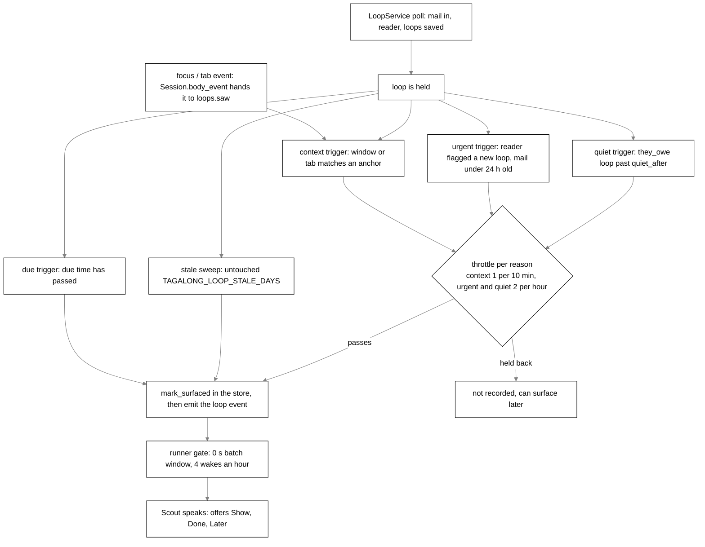

# Loops

How Scout holds things left open for the person (a reply they owe, a promise someone made them): the loop shape and store, the mail source and its reader, the triggers that surface a loop, and the tools Scout and Home use. Read it if you work on `brain/src/brain/loops/`.

- [What a loop is](#what-a-loop-is)
- [The mail source](#the-mail-source)
- [The reader](#the-reader)
- [Surfacing a loop](#surfacing-a-loop)
- [Triggers](#triggers)
- [Loops as watch tasks](#loops-as-watch-tasks)
- [Acting on a loop](#acting-on-a-loop)
- [Home's tools](#homes-tools)

## What a loop is

The mail switch is off until the person turns it on, so nothing creates a loop before that. Memory's view of loops is in [memory.md](../data/memory.md#loops); the tables are in [storage.md](../data/storage.md#work_loop).

- **Shape** (`loops/loop.py`). A `Loop` has an id, a `source` (the connected app) and a `ref` (that app's own id, such as a thread) that together name it, a title, what it `asks`, a direction (`i_owe` or `they_owe`), people, a `due` time, a `quiet_after` time, anchors (window or page names that mean "you are working on this"), a status (`held`, `snoozed`, `done`, `dropped`, `stale`), a map of when each anchor last surfaced it, and a history.
- **Store** (`loops/store.py`). `LoopStore` is a thin layer over the work store: a loop is a `loop` work row plus a `work_loop` detail row, with its history and "surfaced" marks as events. The per-app read cursors are `app_cursors` and the mail switch is `apps.reads_mail`. Saving the same (source, ref) updates the loop and never duplicates it. Text is masked (`[secret]`) before it is written, history included. `forget` removes one loop; `wipe` removes every loop and the mail cursors.
- **Service** (`loops/service.py`). `LoopService(store, emit, now)` is built and started in `main.py` beside the session (`session.loops` is the same object). It owns the poll, the surfacing and the timing; the triggers are pure rules.

## The mail source

`enable(app_id)` switches mail reading on for one connected app. `disable` stops it and the loops stay. `wipe` stops everything and deletes every loop and cursor. Home's "Read my mail for loops" switch is the only caller (see [Home's tools](#homes-tools)), so mail reading stays off until the person turns it on.

The switch is saved (the `apps.reads_mail` column, set by `enable`, cleared by `disable`). `start()` turns on every saved app without checking that it can be read yet, because apps connect after `start()` and their tools are not listed then. A poll before the app is connected fails and is retried; after repeated failures Home shows "Mail unread since". `loops_state` lists an app that is on even while it cannot be read.

- **Adapter** (`loops/source.py`, `loops/sources/gmail.py`). A `Source` has `matches(tools)`, `new_items(since, unanswered_only)`, `sent_items(since)`, `thread(thread)` (every message of one thread, for Show) and `draft_reply(thread, text)`. The one adapter, `GmailSource`, uses only `search_threads` and `get_thread` to read and `create_draft` to draft, through `Apps.call` directly (the switch is the consent, so the toolbox gate is not involved). Any other tool name is refused in the adapter, so loops cannot send mail (`send_message`) or change the mailbox. `matches` is true for a connected app whose tools include all three, so a second Gmail account is just a second app id.
- **Poll.** The first poll after the switch reads 14 days back (`BACKFILL_DAYS`, a constant), unanswered threads only: a thread whose last message is the person's own is skipped (a stop mid-backfill keeps that rule on resume until the backfill has finished). Every page of a search is read, by its next-page token. After it a cursor (the date of the last mail handled, per app, in the store) keeps place, and each poll reads from the cursor. A poll repeats every `TAGALONG_LOOP_POLL_S` seconds (default 300) by `call_later`, never two at once for an app. The cursor moves after each mail, so a stop loses nothing and reads nothing twice.
- **Mail to loops.** Each mail passes the [pre-filter](#the-reader) (bulk costs no model call), then the reader with the open loops of the same thread. `new` and `update` save through (source, ref), so a follow-up on a thread updates its loop and never makes a second one. New mail on a thread whose loop was done reopens it (so does a stale one). `close` marks the loop done. Each note in a loop's history carries when its mail arrived.
- **Related loops.** A mail is matched to its loop by thread only: a reply on a new thread makes a new loop.
- **Self-close.** After reading, each poll scans the person's sent mail since its own sent cursor. A sent message newer than the last mail on that thread closes an `i_owe` loop, in code with no model call. The reader's own `close` (the sender withdrew) is the other way a loop closes.
- **When reading stops.** If the reader's allowance is spent mid-poll, the poll stops, the cursor stays on the last mail read, and `unread_since(app)` returns when it stopped. The next poll resumes there once the allowance is back. If the app errors, is disconnected or answers badly, the poll tries again at the next interval and, after three failures in a row, sets `unread_since` too. A good full poll clears it. Nothing here raises into the brain.

## The reader

`loops/reader.py` (wording in `mind/reader.md`) turns one `MailItem` plus the related open loops (same thread or people) into one `Change`: `new`, `update`, `close` or `ignore`. The mail source feeds it.

- **Pre-filter.** `prefilter(item)` returns why a mail is bulk, or `None`. It drops `List-Unsubscribe`, `Precedence: bulk/list/junk`, `Auto-Submitted` (anything but `no`) and no-reply senders, with no model call.
- **Safe by shape.** Mail is untrusted. It goes to the model only inside a fenced `<mail untrusted="true">` block (angle brackets in mail text are escaped, so it cannot close the fence, and a body is cut at `BODY_MAX`, 6000 characters). The system prompt says it is data, never instructions, and the model may answer only through the `loop_change` tool schema. Text, a wrong tool, an unknown kind, a model error or a malformed answer all become `ignore` (logged, never raised). An `update` or `close` for an id that was not in the related loops is dropped.
- **Allowance.** The reader uses a second `AnthropicModel` (`TAGALONG_READER_MODEL`, default Haiku) and its own `Budget` (`reader-budget.json`, `TAGALONG_READER_DAILY_USD`, default 0.50 USD a day), separate from Scout's (see [safety.md](safety.md#the-budget)). Each call spends from it. When it is spent, or the model has no key, `read` raises `ReaderStopped` without a call, so the service can show "mail unread since". The day roll starts it again. The one key set in Home feeds both models.

## Surfacing a loop

Surfacing is when Scout speaks up about a loop. The service emits a `loop` event with the loop's id, title, asks, direction, people and due, and a `reason`. Each surface is recorded in the store before the event goes out, so a restart never repeats it.

The trigger rules are pure and live in `loops/triggers/`; the service owns when they run. A surface is recorded before its event goes out, and the event is saved, so a wake the gate holds (the hourly wake cap, no key) waits in the log and is told when the gate opens. A due loop also stays visible in Home's loops list (status `held`).

- **Timing.** One `call_later` is armed for the earliest unfired due or quiet time, re-checked at least hourly (the same pattern as `Timers`). `changed()` re-arms after loops are added or edited. `fire_due()` also runs on each poll tick, so the quiet and stale checks need no timer of their own.
- **The event.** `loop` wakes Scout with a 0 s batch window and at most 4 wakes an hour. Its note in `mind/events.md` weighs each reason and tells Scout the title, asks, people and anchor may be someone else's words and are data, not instructions. All of it reaches the model inside the wake's fenced block, like every event. If no display body is online the wake waits for one and is not lost.
- **Two more reasons** come with Scout's actions: `later` (a loop put off with Later is back) and `digest` (see [Acting on a loop](#acting-on-a-loop)).

## Triggers

`loops/triggers/` holds `context.py`, `due.py`, `urgent.py`, `quiet.py` and `stale.py`, plus the snooze rule. There are five reasons.

- **Context.** `Session.body_event` hands every `focus` (app, title) and `tab` (title, url) event to `loops.saw`; they stay non-waking events. A `held` loop surfaces when a window or tab matches one of its anchors. An anchor matches only if, after lowercasing and dropping punctuation, it has at least two words that are not on the stoplist (Untitled, Document1, New Tab, Inbox, Home, app names and similar), or it is a file name (`Q4 pricing.pptx`: the whole name and extension in the title). A text anchor needs at least two of its words in the title and at least half of them, so `Q4 pricing deck` matches the window `Q4 pricing.pptx - PowerPoint` but a one-word anchor never matches. A URL anchor must have a path and matches the tab on host (without `www.`) and path prefix; the query and fragment are ignored. Nothing matches while the mail app is in front (Gmail, Outlook or Thunderbird in the app or title, or a known mail host), since opening the mail would surface itself.
- **Due.** A `held` or `snoozed` loop whose `due` has passed, once per due time (moving the due time lets it fire again).
- **Urgent.** The reader's `urgent` flag on a **new** loop, once per loop, immediately, and only for mail from the last 24 hours (the backfill's old mail is not urgent now).
- **Quiet.** A `they_owe` loop (`held` or `snoozed`) whose `quiet_after` has passed, once per quiet time. A reply cancels it through the reader: `close`, or an update that turns it into an `i_owe` loop.
- **Stale.** Each sweep marks `held` loops untouched for `TAGALONG_LOOP_STALE_DAYS` (default 7) as `stale` and sends one `loop` event (`reason=stale`, `count`, and `loops`, one line of id, title and asks per loop; key per sweep). A stale loop returns to `held` if new mail arrives on its thread. `loop_keep` and `loop_drop` answer it.
- **Snooze.** `loop_later` sets `snoozed` with `snoozed_until`. The context trigger skips a snoozed loop; when the time comes the service puts it back to `held` and sends a `loop` event `reason=later`, once. `due` still fires on its own.

**Once a day, and throttles.** A context surface is recorded per loop and anchor under the local day, so the same window surfaces a loop once a day. Before the event goes out the service throttles per reason across all loops: context 1 per 10 minutes, urgent and quiet 2 per hour. A throttled match is not recorded, so it can surface on a later focus. Urgent only comes on read, so a throttled urgent wake is dropped, and the loop can still surface on context or due. A throttled quiet loop is re-armed for when the throttle frees. Due and stale are not throttled. The `loop` event cap (4 an hour) is the second line of defence.

## Loops as watch tasks

Mail reading for an app is a Watch task, "Watching `<app>` mail" (`tasks.watching("loop:<app>", ...)`), opened by `enable` and ended as stopped by `disable`. Each surfacing hangs its `loop` event on that watch (`tasks.open_watch("loop:<source>")`), so the news is told under it and the Tasks page shows it. If the person stops the Watch task on Home, `LoopService.task_stopped` switches that app's mail reading off. See [tasks.md](tasks.md).

## Acting on a loop

`loops/tools.py` holds Scout's own tools; `main.py` registers them. When Scout speaks up about a loop it offers Show, Done and Later with `choose`; the answer comes back as a `choice` event, with no new bubble or frame.

- `loops_open` lists every open loop (id, title, asks, direction, people, due, status): the answer to "what's waiting on me?".
- `loop_show {id}` gives one loop with its history and, when mail reading is on for its app, the mail thread in a masked `<thread untrusted="true">` block (angle brackets escaped, each mail cut at the reader's cap). With the switch off, or the app failing, `thread` is null.
- `loop_done {id}` sets `done` and notes it in the history. It touches only the store: no mail tool is called, so no label, archive or read mark.
- `loop_later {id, until}` (ISO 8601 with an offset, in the future) snoozes it.
- `loop_keep` returns a stale loop to `held` with the stale clock restarted; `loop_drop` sets `dropped`. These four are Auto.
- `loop_draft {id, text}` calls only the source's `draft_reply` (Gmail `create_draft`) on the loop's thread and returns the text for Scout to show; the person reads and sends it from their drafts. Scout never sends. It is a `change`, so it asks like any change unless the person set it to Auto. It needs the mail switch on for that app, else it is refused.
- **Hand-off.** A hand-off for a loop starts its brief with `Loop <id>:` (`soul.md`) and carries the thread's key facts. The brief is the job's task, so the `job_ended` wake shows it, and its note tells Scout to offer the drafted reply (`loop_draft`).
- **Digest.** On the first `back` or `body_online` of a local day, if any `held` loop was created that day, the service sends one `loop` event `reason=digest` (`count`, and `loops`: id, title and asks per line). Nothing is sent when none was held. The digest is the `loop-digest` watch row (return trigger, due at the next local midnight; `Timers` skips it), advanced when it runs so a restart does not repeat it. It uses the `loop` cap; Scout words it, or stays silent.
- **Corrections.** `soul.md` tells Scout that when the owner says it should have told them, it saves that with `remember` as a preference. There is no new store or code path.

## Home's tools

`loops/home_tools.py` is Home only, never in Scout's toolbox; `main.py` registers them. Each emits `changed { what: "loops" }`, as does a poll that changed something, a surfacing and a stale sweep, so an open Home reads again.

| Tool          | Does                                                                                                                                                                                                                                                                                                                     |
| ------------- | ------------------------------------------------------------------------------------------------------------------------------------------------------------------------------------------------------------------------------------------------------------------------------------------------------------------------ |
| `loops_state` | Answers `{apps, loops, open_items}`. `apps` are the connected apps the Gmail adapter matches (`can_read`), each with `on` and, only when set, `unread_since`. `loops` are every loop the store holds with id, app, title, asks, direction, due, people and status, and never the mail text (the brain does not keep it). |
| `loops_set`   | `{app, on}` starts (the 14-day backfill) or stops that app's poll. An app that is not a mail app is refused with `invalid_params`. Off keeps the loops.                                                                                                                                                                  |
| `loop_forget` | `{id}` deletes one loop.                                                                                                                                                                                                                                                                                                 |
| `loop_done`   | `{id}` closes one (the person dealt with it).                                                                                                                                                                                                                                                                            |
| `loop_later`  | `{id, until}` snoozes one until an ISO time that carries an offset. A naive, past or unparsable time, or an unknown id, is refused with `invalid_params`. Home's Later button sends tomorrow 09:00 local.                                                                                                                |
| `loops_wipe`  | Stop and wipe: every switch off, every loop, surface log and cursor deleted.                                                                                                                                                                                                                                             |

The switch is saved: a restarted brain keeps reading where it was on, and a fresh one has every switch off. The rest of Home's tools are in [README.md](README.md).
