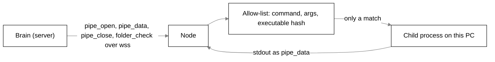

# The node

A node is a small process on a body's machine that runs commands for the brain when the brain is on another machine. It exists so an expert or app that must run on the person's own PC (their login, their folders) can be used from a brain on a server. The node moves bytes; the brain keeps all the thinking (ACP, MCP, memory, permissions). A node holds no memory and makes no decisions.

- [How it connects](#how-it-connects)
- [The allow-list](#the-allow-list)
- [Pipes](#pipes)
- [Running one](#running-one)
- [Not in this slice](#not-in-this-slice)

## How it connects

The node dials the brain's network listener over `wss`, trusting only the certificate whose SHA-256 fingerprint it was given (`connect_pinned` in `brain/src/brain/link.py`; a different certificate closes the socket before any frame, the token included, is sent). It then sends `hello` as a body of kind `node` with `display: false` and no tools, using the device token of the desktop it runs beside. A refused token ends the node (`tagalong node run` exits 1); any other loss of the brain is retried every 2 seconds.

The desktop starts the node itself while it is paired to a remote brain and stops it when it goes back to the brain on this PC (`bodies/desktop/src/main/node/runner.ts`). The pairing reaches the node through its environment, not its arguments, so the token never shows in a process list; the node removes these variables from its own environment on start and does not load `<TAGALONG_HOME>/.env`, so no allowed child inherits the token or the brain's keys: `TAGALONG_NODE_ADDR`, `TAGALONG_NODE_FP`, `TAGALONG_NODE_TOKEN`, `TAGALONG_NODE_ID`.

## The allow-list

The allow-list is the security boundary. It lives in `<TAGALONG_HOME>/node/allowlist.json` on the node's machine and holds entries of `command`, `args`, the resolved file `path` and the file's `sha256`, or of an exact `url` (an HTTP MCP server). A `pipe_open` for a URL runs only when an entry has that same address character for character; no command runs for it. A `pipe_open` runs only when an entry matches the spec exactly (same command, same args in the same order), the command resolves to the same file, and that file still hashes to the recorded value. Anything else gets `denied` and nothing starts, even from a genuine brain with a valid token. A file that was updated or swapped no longer matches until the person approves it again. A damaged list file permits nothing. The node starts the command as found on the path, not the file a link points to, so a venv's `python` link still finds its venv; the hash is checked on the target.

Only the person on the node's machine adds an entry, in one of two ways. From a terminal there: `tagalong node allow <command> [-- args...]` records the current hash, and `tagalong node allow --url <address>` approves one exact address. Or from the desktop: when a pipe is `denied`, the brain sends `node_needs` (`need: approve`) to the desktop that runs the node, which shows a card ("Needs you here") with the program as this PC resolves it and, on **Allow**, runs that same `tagalong node allow` command itself. The brain has no message that adds or changes an entry; it only asks, and a click on this PC does the writing. If nobody answers in 10 minutes, or the node goes offline, the request closes and the job keeps the old line (`X is not approved on <name>. On that machine run: tagalong node allow ...`). The list is per machine and not synced.

Each entry records when it was allowed (`at`). `tagalong node list` prints the entries as JSON (command, args or url, resolved path, `at`, a `key`; never a secret) and `tagalong node revoke <key>` removes one (exit 1 for an unknown key). Home > Devices shows them as **Approved on this PC** with a Revoke per line when the brain is not on this PC.

## Asking the person (`node_needs`)

`NodeNeeds` (`brain/node_needs.py`) wraps `Bodies.open_pipe` for experts and apps. A `denied` asks `approve`; a `not_installed` (the node found no such program) with an expert id asks `install`; an ACP sign-in failure (-32000) on a node host asks `signin`. After the desktop answers `done` the pipe is tried again, at most twice per pipe, then the original error stands. `not_now` fails the job now and leaves the request open so Home still lists it. A new ask with the same node, need and spec closes the older one as `replaced`. The desktop side is `bodies/desktop/src/main/node/needs.ts`; install runs `tagalong install <expert>`, sign-in `tagalong login <expert>`. See [protocol](../../protocol/README.md).

A hash covers the file the command resolves to, not what that file goes on to load: approving `npx` approves `npx` running anything. Approve the program that is the tool.

## Pipes

`pipe_open { pipe, spec: { command, args? } | { url } }` asks the node to start the child (for a `url`, `relay.py` posts the brain's JSON-RPC lines to that HTTP MCP server and returns its messages as lines, so the brain's end is the same); its answer is `{}` or an error (`denied`, `not_installed` when the command is not on the node's path, `invalid_params` for a pipe id already open, `tool_failed` when the OS cannot start it). The brain's bytes go to the child's stdin as `pipe_data { pipe, data }` (base64) and the child's stdout comes back the same way; stderr is dropped. `pipe_close` from the brain kills the child and its whole process tree (so a `.cmd` shim cannot keep the pipe open) and is not echoed; a child that exits on its own makes the node send `pipe_close { pipe, code }`. When the brain connection ends, every child is killed. `folder_check { path }` answers `{ exists }` for a folder on this machine. The wire shapes are in [protocol/README.md](../../protocol/README.md).

## Secrets stay on the node

An app that needs a key must not hand it to the brain. The person types it on the node's machine, in the same `tagalong node allow` that approves the entry (options go before the command):

- `tagalong node allow --secret-env API_KEY <command> [-- args...]` asks, with the input hidden, for the value of each named variable and keeps it in that entry. The node adds it to that child's environment only.
- `tagalong node allow --url <address> --url-secret` asks for the secret query string (like `key=value`) and keeps it in the entry. The node adds it to the address when it connects.

The values live in `allowlist.json` beside the entry, written owner-only through the brain's one private-file writer (mode 0600; on Windows icacls removes inherited access and grants only the current user). Approving the same entry again after an update keeps them unless new ones are typed. A spec never carries a secret: the brain sends only the command and args, or the URL, so no frame, log or brain database row holds one (`brain/tests/test_node_secrets.py` captures every frame, decoded). A server that echoes the query back in a message cannot leak it either: the relay replaces each secret value, raw and percent-encoded, with `[secret]` in every line it sends the brain. A line to the relay that is not a JSON-RPC message is answered with an error for its id, and a line over 8 MiB ends the pipe. An app placed on a node ignores the brain's own copies of its keys.

## Signing in on the node

An http app with a sign-in runs on a node once the person has signed in there:

- `tagalong node signin <address>` runs the app's OAuth on this machine: the browser opens here, the loopback listener catches the redirect here (`app_oauth.make_provider`, `LoopbackCallback`) and the tokens are saved in `<TAGALONG_HOME>/node/app-oauth/<hash of the address>.json`, owner-only through the same private-file writer as the allow-list, by `FileTokenStorage`. The sign-in runs in a scratch folder beside it and the file is moved into place only once it has finished, so a declined, timed-out or unreachable sign-in saves nothing and leaves a token already saved as it was. A failure prints one plain line and exits 1. It then approves the address as `allow --url` does.
- `tagalong node allow --url <address> --bearer` asks for a bearer token with hidden input and keeps it in the entry like the other secrets.

The relay (`node/relay.py`) sends the bearer, or uses the stored OAuth tokens (refreshing them), when it connects; it never opens a browser, so an expired sign-in ends the pipe and the person signs in again here. The brain then shows the app's error as the command to run on the node (for an OAuth app ``Sign in to {app} on {node}: `tagalong node signin <address>` ``, for a token app `tagalong node allow --url <address> --bearer`), and the `sign_in_app` call refuses the app with the same line rather than opening a browser on the brain's machine. Tokens are masked in every line the relay sends the brain, read from the saved file for each line so a token the SDK refreshes while the pipe is open is masked too, and `brain/tests/test_node_signin.py` shows neither an OAuth token nor a bearer in any decoded frame or brain database row.

## Running one

- `tagalong node allow <command> [-- args...]`: approve a command on this machine; `--secret-env NAME` (repeatable) types a secret for it here.
- `tagalong node allow --url <address> [--url-secret]`: approve an HTTP MCP server's exact address, with an optional secret query typed here. An address that already carries a secret (a `key=` style query or `user:pass@`) is refused: give the secret with `--url-secret`.
- `tagalong node allow --url <address> --bearer`: as above, with a bearer token typed here.
- `tagalong node list` and `tagalong node revoke <key>`: show and remove what is approved on this machine.
- `tagalong node signin <address>`: sign in to an OAuth app on this machine ([Signing in on the node](#signing-in-on-the-node)).
- `tagalong node run`: connect and serve; needs the four `TAGALONG_NODE_*` variables (the desktop sets them).

`brain.node` imports nothing of the voice models (`brain/tests/test_node_imports.py`).

## Not supported yet

- Other AI tools on the person's PC reach a remote brain's memory without a node: `tagalong memory-mcp` (BA11) dials the brain itself over the same pinned `wss` link a body uses, as an `mcp_client` (see [Memory for other AI tools](../data/memory.md#memory-for-other-ai-tools)).
- An app that stays on a remote brain cannot sign in from the person's PC: the node would have to forward the OAuth code to the brain, which needs a new contract frame and has no design yet. Sign in on the machine the brain runs on, or place the app on the node.
- The brain does not install an expert on a node by itself: the person's click on the install card runs `tagalong install` on that machine. The card shows no folder, because an allow-list entry is per program, not per folder. Both the toolbox's use (an app's stdio MCP server, [Where an app runs](../bodies/connected-apps.md#where-an-app-runs)) and the expert host's use ([Where an expert runs](experts.md#where-an-expert-runs)) go over a pipe.

The node reuses the desktop's device token under body id `node-xxxxxx`, so it cannot be revoked apart from the desktop and its device kind is `desktop`.
