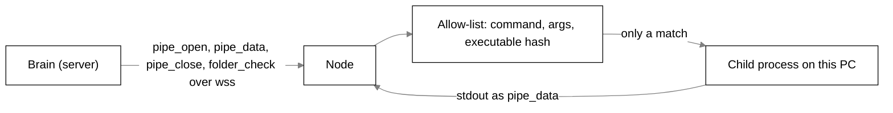

# The node

A node is a small process on a body's machine that runs commands for the brain when the brain is on another machine. It exists so an expert or app that must run on the person's own PC (their login, their folders) can be used from a brain on a server. The node moves bytes; the brain keeps all the thinking (ACP, MCP, memory, permissions). A node holds no memory and makes no decisions.

- [How it connects](#how-it-connects)
- [The allow-list](#the-allow-list)
- [Pipes](#pipes)
- [Running one](#running-one)
- [Not in this slice](#not-in-this-slice)

## How it connects

The node dials the brain's network listener over `wss`, trusting only the certificate whose SHA-256 fingerprint it was given (`connect_pinned` in `brain/src/brain/node/main.py`; a different certificate closes the socket before any frame, the token included, is sent). It then sends `hello` as a body of kind `node` with `display: false` and no tools, using the device token of the desktop it runs beside. A refused token ends the node (`tagalong node run` exits 1); any other loss of the brain is retried every 2 seconds.

The desktop starts the node itself while it is paired to a remote brain and stops it when it goes back to the brain on this PC (`bodies/desktop/src/main/node/runner.ts`). The pairing reaches the node through its environment, not its arguments, so the token never shows in a process list; the node removes these variables from its own environment on start and does not load `<TAGALONG_HOME>/.env`, so no allowed child inherits the token or the brain's keys: `TAGALONG_NODE_ADDR`, `TAGALONG_NODE_FP`, `TAGALONG_NODE_TOKEN`, `TAGALONG_NODE_ID`.

## The allow-list

The allow-list is the security boundary. It lives in `<TAGALONG_HOME>/node/allowlist.json` on the node's machine and holds entries of `command`, `args`, the resolved file `path` and the file's `sha256`. A `pipe_open` runs only when an entry matches the spec exactly (same command, same args in the same order), the command resolves to the same file, and that file still hashes to the recorded value. Anything else gets `denied` and nothing starts, even from a genuine brain with a valid token. A file that was updated or swapped no longer matches until the person approves it again. A damaged list file permits nothing. The node starts the command as found on the path, not the file a link points to, so a venv's `python` link still finds its venv; the hash is checked on the target.

Only the person on the node's machine adds an entry: `tagalong node allow <command> [-- args...]` there records the current hash. The brain has no message that adds or changes an entry. The list is per machine and not synced.

A hash covers the file the command resolves to, not what that file goes on to load: approving `npx` approves `npx` running anything. Approve the program that is the tool.

## Pipes

`pipe_open { pipe, spec: { command, args? } }` asks the node to start the child; its answer is `{}` or an error (`denied`, `invalid_params` for a pipe id already open, `tool_failed` when the OS cannot start it). The brain's bytes go to the child's stdin as `pipe_data { pipe, data }` (base64) and the child's stdout comes back the same way; stderr is dropped. `pipe_close` from the brain kills the child and its whole process tree (so a `.cmd` shim cannot keep the pipe open) and is not echoed; a child that exits on its own makes the node send `pipe_close { pipe, code }`. When the brain connection ends, every child is killed. `folder_check { path }` answers `{ exists }` for a folder on this machine. The wire shapes are in [protocol/README.md](../../protocol/README.md).

## Running one

- `tagalong node allow <command> [-- args...]`: approve a command on this machine.
- `tagalong node run`: connect and serve; needs the four `TAGALONG_NODE_*` variables (the desktop sets them).

`brain.node` imports nothing of the voice models (`brain/tests/test_node_imports.py`).

## Not supported yet

- A spec that is an HTTP MCP URL (an app with an http transport cannot be placed on a node yet), and the browser add-on's loopback proxy: BA10.
- The brain does not install an expert on a node: it runs the expert's installed command there once the person has approved it. Both the toolbox's use (an app's stdio MCP server, [Where an app runs](../bodies/connected-apps.md#where-an-app-runs)) and the expert host's use ([Where an expert runs](experts.md#where-an-expert-runs)) go over a pipe.

The node reuses the desktop's device token under body id `node-xxxxxx`, so it cannot be revoked apart from the desktop and its device kind is `desktop`.
