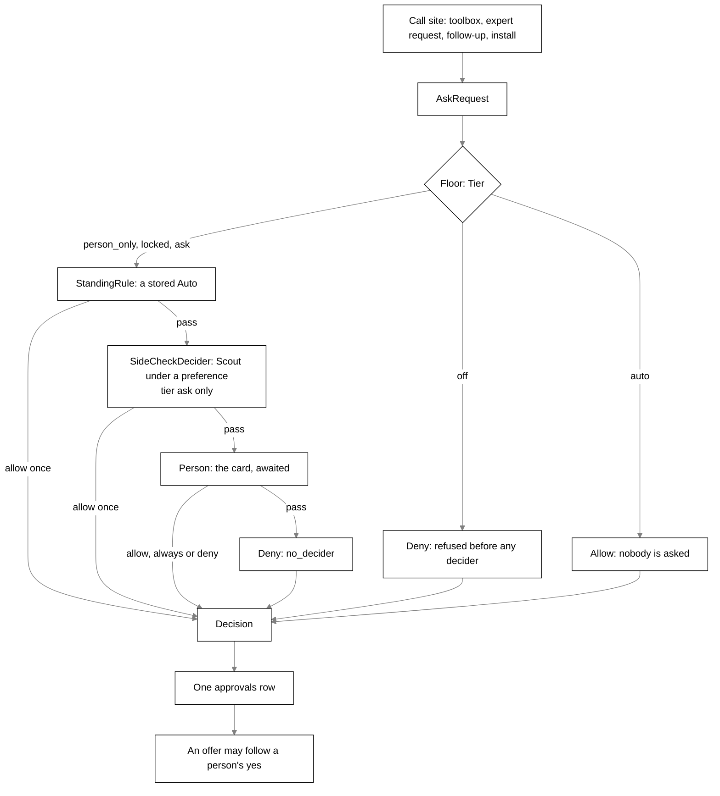
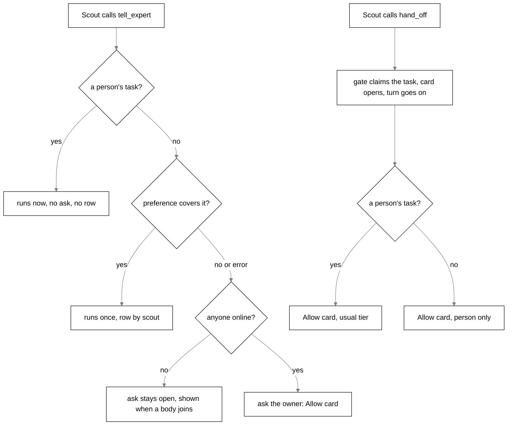
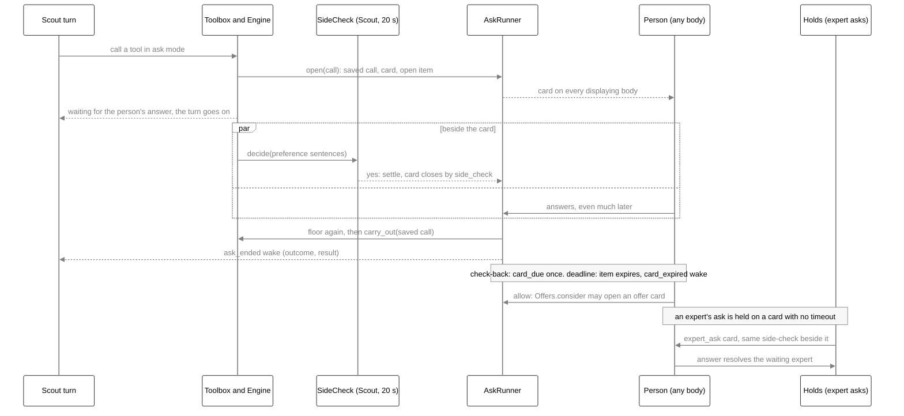

# Permissions

How Scout decides whether something may happen: the one permission engine, the fixed floor under it, the cards the person answers, how an ask waits for an answer, and the approvals log. Read this to change what Scout may do on its own, or to see why a card appeared.

Contents: [The engine and the floor](#the-engine-and-the-floor) · [Tool modes and cards](#tool-modes-and-cards) · [Asks that wait](#asks-that-wait) · [One ask from start to end](#one-ask-from-start-to-end) · [Choices and preferences](#choices-and-preferences) · The open-item lifecycle is in [tasks.md](tasks.md#open-items) and an expert's own asks in [experts.md](experts.md#asks-and-questions-from-an-expert).

## The engine and the floor

`permission.py` is the one place that answers "may this happen?". Call sites build an `AskRequest`
and take the `Decision`; the floor, the deciders and the outcome mapping live here. The tool gate (`toolbox.py`) asks it for every tool call. Expert jobs (`jobs.py`) give their permission asks to the same engine (`Engine.decide`).

### The floor

`Tier` is derived once per tool and fixed in code; `ALLOWED` says which deciders may speak for it.
Nothing the model, a preference or a sentence says changes a tier.

| Tier          | Who may decide                                                          |
| ------------- | ----------------------------------------------------------------------- |
| `off`         | Nobody: refused before any decider runs                                 |
| `person_only` | The person, every time. No stored Auto, no side-check, no standing rule |
| `locked`      | A standing rule (the Home switch's stored Auto) or the person           |
| `ask`         | Standing rule, side-check, then the person                              |
| `auto`        | Nobody is asked: allowed                                                |

### Deciders and the engine

Deciders run in order: `StandingRule` (a stored Auto is one unscoped allow `Rule`; scope and
expiry are in the shape but are not matched), `SideCheckDecider` (Scout under a preference
sentence; it sees tier `ask` only) and `Person` (awaits the request's `how_to_ask`, built by
`tool_asker` or `expert_asker`, both held by `Holds`). `Engine.decide` skips a decider the tier does not allow and, when
the request cannot be allowed once, the rule and the side-check. Each decider returns a `Grant`, a
`Refusal` or `None` (pass).

The always-hold rules the engine enforces:

1. Off refuses before any decider runs.
2. A decider the tier does not allow is skipped, and a grant is honoured only from the decider
   that returned it, so a buggy side-check cannot approve a `person_only` ask.
3. Fail closed: a decider that raises or returns anything else is a pass; if all pass, the answer
   is deny (`no_decider`) and no row is written.
4. An allow is once only. The one way to widen is the person's "always" (a stored Auto), and only
   on `ask` and `locked` tiers for a `tool` request: never `person_only`, never an expert request.
5. A cancelled ask is not a final outcome and writes no row.

One approvals row is written per outcome: `approved` (decided by `rule`, `scout` with the
preference, or `person`), `refused`, `expired` (it ended unanswered; the `decided` event keeps the reason) or `no_one` (a turn-bound card found nobody). A person's once-allow may be
followed by an offer (not after a rule, Scout, an "always", a `person_only` tool or `offer=False`).

Read it top to bottom: the floor (`Tier`) is fixed in code, so it decides who may be asked at all. Each decider can only speak for the tiers `ALLOWED` gives it, and an engine that hears nothing denies.

## Tool modes and cards

Every tool has a mode: `off`, `ask` or `auto`. `Toolbox.mode(spec)` picks it in this order: a stored
`off` first (see [Off](#off)); a tool that
asks for itself (below) is `auto`; then the user's saved choice (a locked tool included); then a
locked tool is `ask`; then the tool's own default; then the effect. The same function,
`resolve_mode` in `permission.py`, feeds Home's permission list, so the list and the gate agree.

| Tool                                            | Default mode                                                         |
| ----------------------------------------------- | -------------------------------------------------------------------- |
| Reads (`effect: "read"`), such as `work_status` | `auto`                                                               |
| Changes (`effect: "change"`)                    | `ask`                                                                |
| A connected app's tool, read-only too           | `ask` (`default_mode`), until you change it                          |
| Memory tools (`remember`, `forget`)             | `auto`                                                               |
| Timer tools `set_timer` and `cancel_timer`      | `auto`                                                               |
| Expert tools `watch_job` and `stop_job`         | `auto`                                                               |
| `tell_expert` (`follow_up`)                     | `ask` on a wake turn, free in a person's task                        |
| `hand_off` (`task_kind` do, see below)          | `ask`, the card is a saved call and never holds the turn             |
| A body tool that does not declare effect        | `ask`                                                                |
| Locked (`confirm: true` from the body)          | `ask`, until you set it to `auto` on Home                            |
| Always-ask (`confirm: "always"` from the body)  | `ask` every time; cannot be set to `auto`, no preference approves it |

The user's saved choices live in `tagalong.db` as `mode` rows of the `rules` table (`tool` is the full
tool name, `effect` is `off`, `ask` or `auto`); `brain.store.rules` reads and writes them
(see [storage.md](../data/storage.md#rules)).

No row means the tool's default applies. `Toolbox.set_mode` accepts `auto` for a locked tool: that
is the explicit unlock, made with the Home switch (which warns first, see
[Home tools](README.md#home-tools)), and a stored `auto` counts even if it was saved before the tool was locked. Flip it back to `ask` and the tool asks again. Only a tool that asks for itself or is person-only is refused Auto.

A tool whose `ToolSpec.tier` is `auto` (it asks for itself) runs its own ask with the user, so the gate opens none:
its mode is `auto` unless Off; `Toolbox.set_mode` refuses Auto for it ("<name> asks for itself.") but accepts Off, and Ask (which puts it back to normal).
`list_permissions` rows carry `self_asks` (true for such a tool) next to `locked`; `locked` stays false for it.

### Off

Off is the third per-tool state, stored in the same `mode` rows of `rules`, so it holds for every body, survives a restart and survives
a body reconnecting. `resolve_mode` returns `off` before any other rule, so it beats every tier (`locked`,
`person_only` and `auto`). `person_only` and tier-`auto` tools can't be set Auto; a `locked` tool's Auto is its
explicit unlock. Off does three things:

- `Toolbox.active_specs()` skips the tool, and `model_tools()` and the capability picture
  read only that list, so Scout never sees it and routes around it.
- The gate (`Toolbox._gate`) refuses a call to it with `denied` and "<name> is turned off by the owner.",
  for a model that still calls it. Home's own calls are not blocked. The guard chain runs even
  for a toolbox with no `Asks`; only the ask itself needs one.
- `set_mode` looks in `known_specs`, so a tool of a body that is offline right now can be turned Off
  and stays Off when the body connects.

`list_permissions` rows carry `source` (`built_in`, `body:<id>` or `app:<id>`) so Home can group them, `source_name` (the body's declared name or the app's name; "Built in" for Scout's own) for the heading, and `person_only` so Home never offers Auto for a tool that always needs the person's yes.

Each row also carries plain words from `tool_words.py`: `title` (the name Home shows), `line` (what it does, in one sentence) and `info` (the longer explanation behind the ⓘ button, possibly empty) and `group` (which group it sits in). One table keyed by the tool's short name serves the built-in, desktop and browser tools; a tool the table does not know (a connected app's, or a new one) falls back to its own text: the short name as `title`, the first sentence of its description as `line`, the rest as `info`, and the group of its app, body or `other`. `description` stays the model's text, unchanged. The reply's `groups` list holds `{id, title, note}` for each group that has a tool, in this order: the table's groups (`memory`, `timers`, `jobs`, `talking`, `held`, `setup`, `web`, `computer`, `browser`), then other bodies, then `other` ("Other tools"), then apps by name. The `browser` group is titled by the connected browser body's own name with the note "Your browser"; an app's group is `app:<id>`, titled by the app, with the note "From <app>". A test checks that every tool Scout can hold has wording.

Shipped defaults match the design: built-in memory, timers, `read_output` and the job tools are
`auto`; a body's reads are `auto` and its changes `ask` (the desktop's `open_url` and the browser's
`tab_actions` ask); every app tool asks until changed. `test_tools.py` pins the built-in rows
against the real specs and the body tests pin each body's declared `effect` and `confirm`.

An ask is a `confirm` ask (see [protocol/README.md](../../protocol/README.md#asks-and-confirm)):

- **Options.** `["allow", "always", "deny"]`, or `["allow", "deny"]` for a locked tool (a locked
  tool is only unlocked on Home). `always` allows this call and saves `auto` for the tool.
- **Text.** The words Scout wrote just before the tool call. The soul tells Scout so: "When you
  call a tool that changes something, the words you write just before it are what the user sees
  when asked to approve it, so say what you are about to do."
- **Answering.** Any online body can send `answer {ask, option}`. The first answer wins: the brain
  closes the ask for every body (`reason: "answered"`, with `by`), and later answers get
  `not_found`. An option the ask did not offer gets `invalid_params` and the ask stays open.
- **Scout first.** If you have made a preference, `SideCheck.decide` runs beside the card, never in
  front of it (Scout's tools and Claude Code's permission asks go through the engine's side-check
  decider). The card is on screen at once; when the look approves first, the card closes
  (`reason: "answered"`, `by: "side_check"`) and the call runs once, the row says
  `decided_by: "scout"`, and an `approved` notification
  `{tool, text, preference}` goes to every body. A pass, an error (in the check or in logging its
  approval) or a 20 s timeout leaves the ask as described below. The look never holds the card
  back: the card is shown first (a live ask is asked beside the look; a Scout ask's open item is
  opened first), whoever settles first decides, and Scout's yes answers the item with
  `by="side_check"` and closes the card (`Engine._beside_card`, `AskRequest.show_card` and
  `settled`, `AskRunner.settle`). A very long input is cut to 4,000 characters in what the model sees.
  The floor keeps a locked or person-only tool from this look: only a standing rule or you decide it.
- **One person-task rule.** A task is a person's when the event that caused it is a say or a card
  answer (`PERSON_KINDS` in `events.py`): `Tasks.person_cause(event)` and `Tasks.is_person(task)`.
  A body's wake, a timer or a job's news is not, even when its source is a body, and a swept or
  missing cause counts as not a person (the card shows). `Session.person_task(turn_id)` asks it of
  the running turn's first event; `Jobs` asks it of the task a hand-off hangs off.
- **Follow-ups under the preference rule.** `Session.person_task(turn_id)` is true while that
  turn runs and its first event is a person's say or card answer.
  No contract change. `tell_expert` is an `ask`-mode tool marked `follow_up`: in a person's task
  the gate waves it through (their message was the yes, no ask, no log entry; never for a
  `person_only` tool); in any other task it runs the normal decision (the side-check, the Allow
  card, with offers after a person's allow). A stored `auto` (Home's permission switch) still
  means no ask. With nobody online the nudge waits like any Scout ask (see
  [Asks that wait](#asks-that-wait)).
- **The start-work rule.** `hand_off` is an `ask`-tier tool with `task_kind` "do", so its call is
  saved like any Scout ask: it returns at once with the card open and never blocks the turn, and
  the approved saved call starts the job later. The gate claims the task before the card opens:
  the open task the call names by `task_id`, else a new Do task for the turn titled from `task`,
  put in the waiting state. The card belongs to that task and the approved call carries its
  `task_id`, so the job runs under the same task. A task the gate made ends `stopped` when the card
  is refused, expires, is refused in the turn, ends in any way but approved before the handler
  runs (a restart, a secret held, the tool gone, a failed start), or the handler fails to start. A task no person
  began (see the one person-task rule above) raises the gate to `person_only`: no standing rule and
  no side-check approves it, only the person's yes starts the work. A person's task asks at the
  usual tier. The card's facts are task, folder, expert, mode and apps; its options are Allow,
  Deny, Not now and Stop the task. The same `hand_off` again is the same card: `AskRunner.find` compares
  the saved calls with `task_id` and `new_task` left out, and the gate reuses the open card's task
  instead of making another, so two identical calls make one card and one task; a repeat with
  `check_back_minutes` moves that card's check-back. An unknown `mode` is found only after the
  person approves, so Scout names a mode only from an earlier result's offered list.
- **Claude Code's permission asks.** `Jobs._permission` builds an `expert_request` ask (tier
  `ask`, group `<expert>:<folder>`) with the expert's own option names on the card and gives it
  to the engine. A standing rule or Scout's grant answers with the expert's allow-once option (an
  expert that offers none is only ever answered by the person, so Scout and rules never pick
  allow-always); the person's own pick, allow or reject, goes back as chosen. With nobody online
  the ask stays open with its job and is shown when a body joins; it ends `expired` if the job
  ends first (the reason says "job ended: ...").
- **Standing rules.** A tool the owner set to Auto on Home that would otherwise ask (a `change`
  tool, or a `locked` one) is a standing rule: the engine grants it, the call runs and the log
  row says `approved`, `decided_by: "rule"`. A read, and a tool that asks for itself (tier
  `auto`), runs with no engine and no row.

- **Offers.** After you approve by hand, `Offers.consider` may open a separate ask (`tool`
  `approval_offer`, options `Yes, auto-approve` and `Keep asking`, no turn) in the background.
  Settings are `TAGALONG_OFFER_MIN_APPROVALS`, `TAGALONG_OFFER_WINDOW_DAYS` and
  `TAGALONG_KEEP_ASKING_DAYS`. The offer is an `offer` open item whose card text is the model's
  sentence alone (code adds no words), shown with `Asks.card` and answered by the handler `Offers`
  registered for kind `offer` (an answer that finds the item already closed counts as no answer), and no timer drops it. One you have not answered when the
  brain stops is shown again when a body comes online (`Offers.resume`, called on a connect; at
  start nobody is there yet, so the item just stays open); the item is let go after the one
  deadline, and a click after it counts as no answer.
- **Deny.** The tool does not run. Scout is told "The user said no to <tool>."
- **No answer.** A Scout ask never holds its turn: the turn gets "waiting for the person's
  answer" at once and the ask stays open up to its deadline (see
  [Asks that wait](#asks-that-wait)). A job's ask has no deadline and waits with its job.
- **Nobody online.** The ask is still opened and saved. Only bodies that display count: with
  just a `display: false` body (the browser) online, the card is replayed to the first
  displaying body that joins.
- **Turn cancelled.** A Scout ask is not tied to its turn, so a cancel leaves the card and the
  saved call alone; a later yes still runs the call. Only a job's ask or a turn-bound card closes
  with `reason: "cancelled"`.
- **Relaunch of a body.** A body that joins with no `last_seq` (the desktop is a new process) is sent every open ask again after the hello result, and can still answer it; the turn or job waiting on it goes on. The desktop keeps the cards it was sent and its bubble pulls them when it mounts, since the live frame can arrive before any window exists (`openConfirms`, see [desktop.md](../bodies/desktop.md)). Known gap: after a relaunch the bubble cannot Stop the old turn (open turns are not announced again), so the old turn stays until it ends (a Scout ask no longer holds it). There is no "Stop job" in the bubble: the bubble's Stop ends the turn; a job is stopped from Home > Jobs.
- **Reconnect.** A job's ask or a turn-bound card waits in memory, with an `active` `ask` work row. A restart expires them ("brain restarted"), but keeps a Scout ask (an open item)
  with its deadline: it comes back when a body that shows cards joins (see
  [Restart and return](tasks.md#restart-recovery)). A body that joins with no `last_seq`, or that is told
  `resync`, is sent every ask still open again, with fresh `seq` numbers. A body that reconnects
  without `resync` gets the ask once, from its backlog.
- **Cards.** Expert permission requests and questions are shown by `Holds` with `Asks.card` (a
  `confirm` card for a tool call, a task's Not now and Stop the task) and are the one place that waits,
  with no timeout. Every other card is `Asks.show` (Scout's permission card) or
  `Asks.card(ask_id, kind=, text=, options=, ...)` (a choice, an offer, a preference or a Home setup
  card): neither waits, and `Asks.register(kind, handler)` names the code that takes the answer,
  called with the ask id, the option, the body, the typed text and the check-back time. With
  `free_text=True` an answer whose option is not listed is accepted when it carries non-empty
  `text`. `Asks.cancel(ask_id)` closes a card with `reason: "cancelled"`. `answer {ask, option, text}`
  passes `text` through to the handler. A card sends `free_text: true` (when set) and `recommended`
  (one of the options, else `ValueError`), so a body shows a text box and marks the recommendation.

### Asks that wait

A turn never waits for a card. A Scout tool call in `ask` mode that needs the person (no rule or
side-check settles it) becomes an `ask` open item (`open_item_runner.py` `AskRunner`) holding the
call: `{name, input, text}` masked through the log's guards, plus its source and whether masking
changed anything. The card goes to every displaying body, with no `turn`, and the toolbox returns
at once: "<tool> is waiting for the person's answer (ask <id>). It runs by itself if they allow it;
do not call it again." The same call again (same tool and input) while its item is open is the same
ask, never a second card. Stopping the turn leaves the card and the item alone. A job's ask is
different: it waits with its job and ends with it.

A tool in `ask` mode takes three extra arguments: `ask_wait_hours` (1 to 168, default 72, that is 3 days),
`check_back_minutes` (a number: when to look at the card again) and `urgent` (true: a
check-back is told even in quiet hours). They are shown in the tool's schema and named in the
capability picture. The toolbox strips them from every call, so no tool, card or log line sees
them, and passes them to `AskRunner.open` as the item's deadline (`ttl_s`), check-back and urgency
(`Hold`, `hold_from` in `permission.py`). They apply to Scout's own calls only.

_The answer._ `Asks.answer` hands a card without a waiter to the handler of its kind (`AskRunner.answered` for `ask`), which counts the
answer on the item (`answered`), then runs the saved call through the same gate: the floor (a tool
turned off since refuses, a tool that no longer exists fails), then the person's word, then
`Toolbox.carry_out`. The rule and side-check already had their say when the ask opened. It does not
matter whether the turn is still alive. The item ends `done` and a waking `ask_ended` event
`{ask, tool, summary, outcome, result | reason}` keyed `ask:<id>` goes to Scout, who words it.
`outcome` is `approved`, `refused` or `failed` (yes, but it could not run). A no
never reaches the gate: it is logged `refused` and ended at once, so a tool that is Auto
since the card opened cannot run on a Deny. A call that held a secret is saved masked; the
unmasked call is kept in memory for this process only, so the yes runs it, while after a restart
it fails with "held a secret" (the masked copy is never run). A second answer
to a closed ask gets `not_found`. The log row is made when the ask ends (`Approvals.record`).

_Check-back and deadline._ An item has a check-back time. Without one it is two-thirds of the
way to the deadline, set by Scout. One `call_later` is armed for the earliest check-back or
deadline over the open `ask` items. At the check-back Scout gets one `card_due`
`{ask, tool, summary, age_s, left_s, urgent}` with the item's `task` and `caused_by`, and may
remind the person once or stay silent (a check-back told before a restart is cleared, so it is not
told again). Quiet hours hold a `card_due` unless the ask was urgent. To look again later Scout
calls the tool again with `check_back_minutes`; that moves Scout's check-back but never one the
person set. At the deadline the item expires, the card closes for every body (reason `timeout`),
the ask is logged `expired` (`decided_by: none`, reason `no answer`) and a `card_expired` event
wakes Scout. An expired ask runs nothing; the deadline never changes what is allowed. With no wait
given the deadline is 3 days (`ASK_WAIT_DEFAULT`, 1 hour to 7 days allowed). Other open items that
name no wait get `DEADLINE_S`, one day.

## One ask from start to end

One ask, three ways it ends. Scout's own ask never holds the turn and has a deadline. The side-check runs beside the card and wins only if it says yes first. An expert's ask (`Holds`) waits with no timeout for as long as its job lives.

## Choices and preferences

`choose` (`choices.py`, `choice_tools`) is Scout's way to ask the person a setup question with
clickable options. It is `effect: "read"`, mode `auto` (the ask is its own gate), and it does not
wait: it opens an ask (`tool: "choose"`, optional `free_text`, optional `recommended`, 1-6 short
options, none only with `free_text`) and returns `{"asked": id}` at once. A background task waits
(10 minutes) and the ask is a `choice` open item (its id is the ask id). When the person answers
it closes the item and emits a `choice` event `{ask, question, option, text}` (`option` is empty
when the person typed their own answer) that wakes Scout (never merged, outside the hourly
caps). A choice nobody answers in time expires its item (reason `no_answer`, logged) and emits the
same event with `expired: "yes"` and no option, so Scout learns nothing was decided and the
drop is never silent. No turn is stuck, and a late answer gets `not_found`. The item is tied to
the running brain, so the session expires one left from a last run at start (every live-only item
does, once) and Scout is not told of those. With nobody online the tool
refuses.

Saved preferences reach Scout as facts: `render_preferences` (`mind/prompt.py`) lists the
owner's non-built-in preferences, newest first (at most 40, 300 characters each), after "What you
know" in the system prompt. They are data to weigh, not orders, and the gate stays code: a
preference never replaces the Allow card. `save_preference {sentence, question}` is a person-only tool: the gate shows `question` as a card
and the call runs, saving through
`Approvals.add_preference(source="setup", tool=None, group_key=None)`, only when the person allows
it. No rule or side-check can allow it for them, and nothing waits on the card. Setup
preferences are never candidates for `SideCheck`, so they cannot approve an ask.
