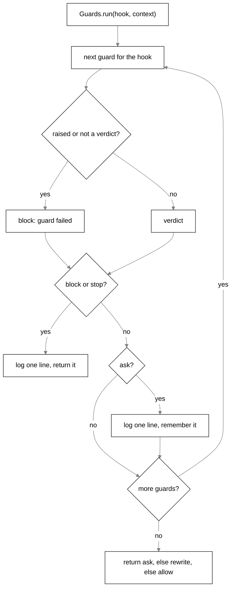
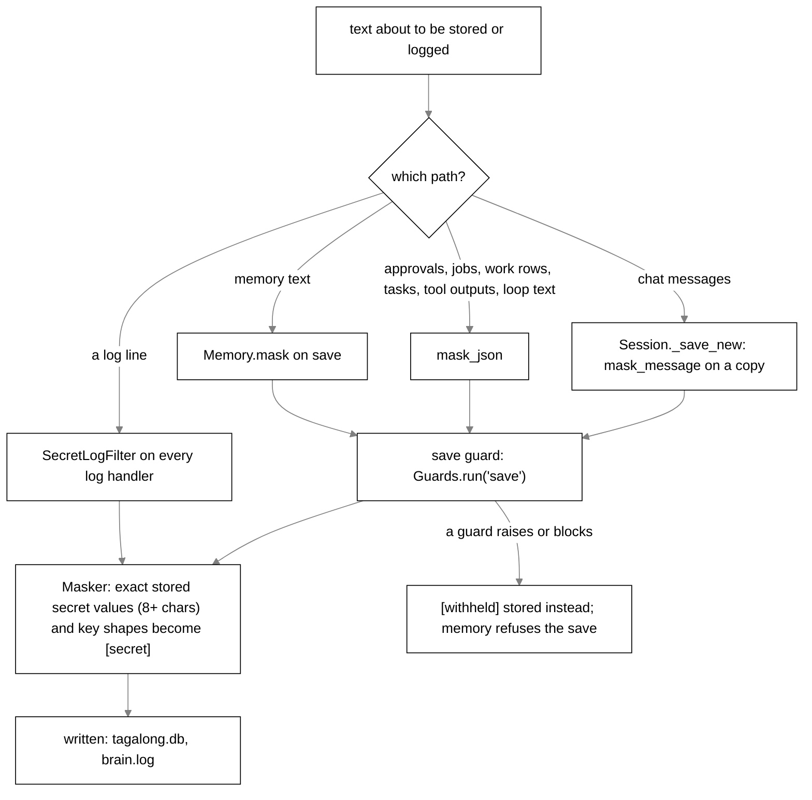
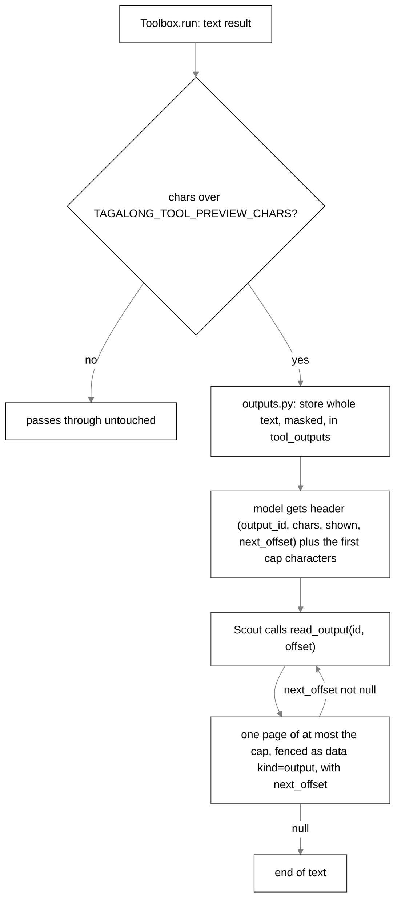

# Guards, masking, budget and limits

The brain's safety nets that are not about asking the person: the guard runner, secret masking, the daily budget, retries, the cap on long tool output, and the web tools. Read it before you add a guard, a spend, or anything that saves text. Who may approve a tool call is in [permissions.md](permissions.md).

- [Guards](#guards)
- [Who may connect](#who-may-connect)
- [Masking secrets](#masking-secrets)
- [The budget](#the-budget)
- [Retries and give-ups](#retries-and-give-ups)
- [Long tool output](#long-tool-output)
- [Web search and fetch](#web-search-and-fetch)

## Guards

The budget, the step cap and the wake caps go through one runner, `guards.py`, so precedence and logging live once. A guard is a plain function that gets a context and returns a verdict. `sessions.py` builds one `Guards` set and hands it to the turn loop, the runner, the side-check and offers. The budget ledger stays in `guardrails.py`; the guards that use it are in `builtin_guards.py`.

### Hooks

| Hook         | Runs                                      | Built in                                                                                                                                                                                           |
| ------------ | ----------------------------------------- | -------------------------------------------------------------------------------------------------------------------------------------------------------------------------------------------------- |
| `model_call` | Before each model call                    | `daily_budget`, `step_cap`                                                                                                                                                                         |
| `emit`       | In the runner's gate, before news is told | `daily_budget` (code `over_budget`: the gate stays shut, so queued news waits in the log), then `wake_caps` (a `held` block: the wake waits until the per-kind or the overall hourly cap frees up) |
| `save`       | Before text is stored                     | `mask_secrets` (`masking.py`): a `rewrite` with secrets replaced by `[secret]`                                                                                                                     |

There is no `ask` hook. Every permission ask, Scout's and an expert's, goes through the permission engine (`permission.py`), which owns the floor, the deciders and the one approvals-log write.

`model_call` is checked for a turn (`kind: turn`, with the step count), the side-check and an offer. `step_cap` only counts turns. The budget guard is listed first so a spent day reports `over_budget` even when the step cap is also reached.

### Verdicts

| Verdict   | Meaning                                      |
| --------- | -------------------------------------------- |
| `allow`   | Carry on                                     |
| `ask`     | Put it to the person                         |
| `block`   | Refuse this one action, with a reason        |
| `stop`    | End the whole turn, with a reason and a code |
| `rewrite` | Carry on with a changed value (masking)      |

`stop` carries the code the body already knows: `over_budget` or `step_cap`. The contract does not change. The first `block` or `stop` ends the run; otherwise the order is `ask`, then `rewrite`, then `allow`. A guard that raises, or returns something that is not a verdict, counts as a `block` (reason `guard failed (<ExceptionClassName>)`, code `error`), so a broken spend check fails closed.



Notice that a refusing verdict ends the run at once, while `ask` and `rewrite` wait until every guard has spoken.

### The log line

Each refusing verdict (`block`, `stop`, `ask`) is logged once at INFO on `brain.guardrails`:

```
guard=<name> hook=<hook> verdict=<kind> reason=<text> turn=<id>
```

`turn=<id>` is added only when a turn is known. `allow` is not logged. The line never holds tool input or result text, and a guard that raised logs `guard failed (<ExceptionClassName>)`, never the message.

### Adding a guard

One function, one test, one `add` in `sessions.py`:

1. Write the guard in `builtin_guards.py`: a function that takes its settings and returns `Guard(name, hook, check)`. `check` gets the hook's context and returns a verdict. It runs on the event loop, so keep it quick (or `async` with its own time limit; `emit` is sync, so no `async` there).
2. Test it first in `brain/tests`: the verdict for an allowed and a refused context.
3. Register it with `guards.add(...)`. `sessions.py` calls `spend_guards(budget, step_cap)`, which adds the built-ins in order; a new guard gets one more `add` there, with its settings passed in (never import `config`).

The limits are `TAGALONG_DAILY_BUDGET_USD` and `TAGALONG_STEP_CAP` (see Run it in [README.md](README.md#run-it)). The turn timeout `TAGALONG_TURN_TIMEOUT_S` is a plain argument to the turn loop, not a guard (see [turns.md](turns.md)).

## Who may connect

Every body's `hello` carries a token, checked by `auth.py` before the body joins (`bodies.connect` is not reached for a refused hello). The local token is made at start (`local_token.py`) and saved in `<TAGALONG_HOME>/local-token`, readable only by the owner (`private_file.py`: mode 0600, or `icacls` on Windows); the desktop reads the file and the brain passes it to the WhatsApp bridge as `TAGALONG_LOCAL_TOKEN`. An empty or unknown token gets `unauthorized` (-32009) and the connection closes. Tokens are compared in constant time, added to the masker so they never reach the log or saved text, and never logged.

With `TAGALONG_NETWORK=1` a second listener takes bodies from other devices on `TAGALONG_NETWORK_PORT` (default 47323) over TLS. Its self-signed certificate and key live in `identity/` in the data folder (`identity.py`); a body pins the certificate's SHA-256 fingerprint, which `brain_status` reports. The loopback listener stays plain `ws`.

The network listener accepts device tokens only, never the local token: a leaked local-token file on one machine cannot be used from another.

### Memory clients

`/mcp/memory` (`memory_mcp.py`, loopback only, port `TAGALONG_MCP_PORT`, default 47324) takes bearer tokens of `devices` rows of kind `mcp_client`, looked up on every request, so a revoked token fails at once. Such a token is refused as a body's `hello`, and a body's token is refused here. Each call goes through `Toolbox.run` as caller `mcp:<client>` (audience `mcp`), so modes, the Allow card and masking apply; a client gets recall, remember and list only, never forget. Its `memory_remember` is a locked tool: only the owner (or an Auto set on Home) decides it, never Scout's side-check, because the note is an outside tool's text. Requests whose `Host` is not `127.0.0.1` or `localhost` are refused (DNS rebinding). See [Memory for other AI tools](../data/memory.md#memory-for-other-ai-tools).

### A node's allow-list

A node (a body of kind `node` on the person's own PC) starts a process for the brain, so its own allow-list, not the brain's token, is the boundary. A `pipe_open` runs only when the node's `<TAGALONG_HOME>/node/allowlist.json` holds that exact command and arguments and the program's SHA-256 still matches; anything else is `denied`, even from a genuine brain. The brain cannot add or change an entry: the person runs `tagalong node allow` on that machine. The hash covers only the file the command resolves to (a `.cmd` shim, `npx`), not what that file goes on to load. See [node.md](node.md).

### Pairing a device

A device earns its token with a one-time code. `uv run tagalong pair` (works with no brain running, needs `TAGALONG_NETWORK=1`) or Home's `pair_make` gives a QR and a `tagalong://pair?addr=...&fp=...&code=...` link. The code lasts 10 minutes and works once (one atomic SQL update, so two simultaneous redeems give one success); only its SHA-256 is stored (`pair_codes`). Five wrong codes in a minute lock redemption for that minute, even for the right code. The device sends the code in a `pair` request before `hello` and gets a long random device token back; the brain stores only the token's SHA-256 (`devices`) and closes the connection after the reply, and the device then reconnects with `hello`. A code is bound to a kind, so a desktop code cannot make a browser device. The browser add-on pairs over loopback with a 6-digit code (loopback accepts only that kind; the network listener refuses it). `tagalong pair --kind browser` prints the 6-digit browser code (no network listener needed). The brain's announcement on the home network lists names and addresses only; it carries no code, token or fingerprint, so finding a brain never lets a device in. `brain_status` adds `host` (the machine's name) and `local` (true for a body on the loopback listener, false for one that came in over the network), so a remote desktop does not offer to restart or open the folder of a brain it is not on. A device owns the body ids it joins with, so another device cannot take over its id (`unauthorized`); that ownership is in memory, so after a brain restart the first device to connect claims an id.

Home's `devices_list`, `device_rename` and `device_revoke` manage paired devices. A paired device has full Home rights: any authenticated body can call Home tools. The five-wrong-codes limit is global across both listeners, so someone on the LAN can keep pairing locked. Revoking closes that device's live connections immediately and its next `hello` gets `unauthorized`. No typed (SPAKE2) code is offered: no maintained Node SPAKE2 library exists, so pairing is QR or link only (see [protocol/README.md](../../protocol/README.md#pairing)).

## Masking secrets

Secrets become `[secret]` before they are saved. The `save` hook runs `masking.py` over everything that is written to disk or to a log. The live turn and the side-check prompt are not masked, because Scout needs the real values to work.



The `Masker` replaces exact stored secret values of 8 or more characters and common key shapes with `[secret]`; its list of values is cached for 1 second. The log filter calls the masker directly, not the runner, because the runner logs.

- `Session._save_new` saves a masked copy of the new chat messages while `history` keeps the real values for the live turn.
- A guard that raises or blocks stores `[withheld]` instead of the raw text. Memory is the exception: `Memory.remember` and `save_source_facts` raise `MemoryRefused` and store nothing, since a `[withheld]` memory would be noise.
- `mask_json` masks the string leaves of a value. It covers the approval log, jobs and their steps, every work row (timers, asks, loops through `WorkStore`), tasks and the stored long tool outputs (`OutputStore`).
- `EventLog` masks each event's payload with the `Masker` before it is saved; if masking fails, that text is saved as `[withheld]`.
- `mask_message` leaves the values of structural keys (`role`, `type`, `id`, `tool_use_id`, `name`, `signature`) alone on a message, its content blocks and the blocks inside a tool result's content, so a saved chat always rebuilds. A `name` or `id` inside a tool's input is still masked.
- `Session._save_new` drops a `thinking` block from the saved copy when masking would change it (a message left empty is saved with empty content). `redacted_thinking` blocks are kept.
- Each turn's saved batch is tagged with the kind of body it was shown on (`messages.body`, the `BODY_*` constants in `protocol.py`). `Session._start_turn` reads the turn body's `kind` once, so it holds even if the body leaves first. A turn with no body (a wake) or no longer-online body reads `desktop`. Nothing reads the column.

What is masked on disk and what is not is in [privacy.md](../data/privacy.md#what-is-masked-on-disk-what-is-not). How memory text is masked on save is in [memory.md](../data/memory.md#masking-on-save).

## The budget

`guardrails.py` `Budget` is a small JSON ledger in the data folder (`budget.json`: the date and `spent_usd`), so the daily limit survives a restart. It rolls to zero when the date changes.

- `Budget.spend(usage, model)` adds the tokens at the model's rate from `PRICES` (input, output, cache write, cache read, USD per million tokens). A model not in the table is priced like Opus, so a typo can never make spending look free.
- Web searches count too: `usage.server_tool_use.web_search_requests` times `WEB_SEARCH_USD` (0.01). A missing field counts none. Fetching a page has no fee of its own; its text is billed as input tokens.
- `Budget.allows()` is true while `spent` is under the limit. The `daily_budget` guard turns a spent day into `stop` with code `over_budget` on `model_call`, and keeps the runner's gate shut on `emit`, so queued news waits in the log (see [turns.md](turns.md)).
- The limit starts at `TAGALONG_DAILY_BUDGET_USD`. Home's `set_daily_limit` saves the new value to `.env` and sets `Budget.limit`, so it applies at once, with no restart.
- Mail reading has its own ledger, `reader-budget.json`, with its own allowance `TAGALONG_READER_DAILY_USD` and model `TAGALONG_READER_MODEL` (see [loops.md](loops.md)). `main.py` builds both.

## Retries and give-ups

A tool call Scout makes while working for a job (a wake about it, or a job tool that named it) is also a `tool_call` row under that job's goal: `done` with the first 300 characters of the result, or failed. The job tools and `resolve_step` themselves leave no row. `retry.py` decides what happens to a failure:

- `classify(err)`: `TimeoutError`, `ConnectionError`, Anthropic rate-limit, connection and timeout errors and an `RpcError` with the timeout code are `transient`. Everything else is `permanent`.
- `safe_to_retry(spec)`: only a read-effect tool whose name holds none of `NEVER_RETRY_WORDS` (`pay`, `purchase`, `buy`, `send_money`, `delete`, `remove`, `trash`, `wipe`, `forget`). Anything else is never repeated on a guess. A call whose saved input was changed by masking (a secret became `[secret]`) is not safe either, because replaying it would send the placeholder.

A transient failure on a safe step goes back to `planned` with `due_at` after a backoff of 30 s, 2 min, then 10 min: three retries, so four runs in total. `Timers` finds due `tool_call` and `expert_call` rows, moves them to `active` and calls the session's rerun. A tool call runs again through the toolbox as Scout; an `expert_call` runs again with `Jobs.run_planned` (the same row, the saved session and the job's mode, no card).

Any other failure, or the last try, ends the step as `failed`, which blocks its goal and emits `work_failed` (goal, step, title, reason) so Scout is woken once. The person (or Scout for them) answers with `resolve_step`: retry, skip or stop. It takes only a `tool_call` or `expert_call` row; retry and skip need it `failed` or `blocked`. Stop stops the job's running experts, then closes the job as failed through `Jobs.close`.

A step that ended while the brain was down is not repeated unless it was safe (see the resume scan in [storage.md](../data/storage.md)). A failed step nobody was told about (the wake never started, or the scan failed it as "unsure if it ran") is told at the next start, once: the `work_failed` event's id is `work_failed:{step}@{ended_at}`, so a second telling is refused by the log. A step that gives up and its news are saved in one transaction.

The three tries and the 30/120/600 waits are the work store's own defaults (`RetrySettings` in `store/work.py`). `TAGALONG_RETRY_MAX` and `TAGALONG_RETRY_BACKOFF_S` are read and checked by `config.py`, but nothing passes them to the work store, so changing them has no effect.

```mermaid
%%{init: {"theme": "base", "themeVariables": {"primaryColor": "#ffffff", "primaryTextColor": "#000000", "primaryBorderColor": "#000000", "lineColor": "#808080", "arrowheadColor": "#808080", "secondaryColor": "#f2f2f2", "tertiaryColor": "#ffffff", "clusterBkg": "#f7f7f7", "clusterBorder": "#808080", "edgeLabelBackground": "#ffffff", "titleColor": "#808080", "actorBkg": "#ffffff", "actorBorder": "#000000", "actorTextColor": "#000000", "actorLineColor": "#808080", "signalColor": "#808080", "signalTextColor": "#808080", "sequenceNumberColor": "#ffffff", "labelBoxBkgColor": "#ffffff", "labelBoxBorderColor": "#808080", "labelTextColor": "#000000", "loopTextColor": "#808080", "noteBkgColor": "#f7f7f7", "noteBorderColor": "#808080", "noteTextColor": "#000000", "activationBkgColor": "#f7f7f7", "activationBorderColor": "#808080", "fontFamily": "Segoe UI, Helvetica, Arial, sans-serif"}, "themeCSS": ".relationshipLabelBox{opacity:1} .relationshipLabelBox rect{opacity:1}"}}%%
flowchart TD
    A[tool call fails] --> B{"transient and safe_to_retry?"}
    B -- no --> F["step failed, goal blocked"]
    B -- yes --> C{tries left?}
    C -- no --> F
    C -- yes --> D["planned, due_at after backoff"]
    D --> E["Timers reruns it"]
    E -->|fails| B
    E -->|works| G[step done]
    F --> H["work_failed wakes Scout"]
    H --> I{resolve_step}
    I -- retry --> D
    I -- skip --> J["step cancelled, goal goes on"]
    I -- stop --> K["goal closed as failed"]
```

A failure that is permanent, or a step that is not safe to repeat, goes straight to `failed`; only a transient failure on a safe step loops back through the backoff.

## Long tool output

One cap, at the gate. `Toolbox.run` measures each text result in characters (not the `read_output` result, and not image or other block results). At or under `TAGALONG_TOOL_PREVIEW_CHARS` (default 4000) it passes through untouched. One character over, `outputs.py` stores the whole text masked (the Masker, so a secret past the cap never shows in a later page) in the `tool_outputs` table, and the model gets a facts header plus the first cap characters:

```
{"output_id": "9f2c...", "chars": 12840, "shown": 4000, "next_offset": 4000}
<the first 4000 characters>
```



The cap is a transport guardrail only. How to present a long result (gist first, detail on request, the short version in voice) is guidance in `mind/soul.md`, not code.

`read_output(id, offset)` is Scout's own auto tool. It returns one page (at most the cap) of the stored text as JSON with `next_offset`, which is `null` at the end.

- A page is never previewed again. Its text is fenced as `<data kind="output">`, so stored app text cannot pass as instructions. A lone surrogate in a stored result becomes U+FFFD.
- An unknown id or a negative offset is a plain refusal line. An offset past the end is an empty last page. Cuts are on characters, never mid-character.
- Brain tools, connected-app tools and an expert's report on a job wake all use this one path. The stored job report stays whole in the database, so the Reports tab shows it in full.
- At startup the newest `TAGALONG_OUTPUTS_KEEP` (200) stored outputs that no work row names are kept and older ones go. Finished work is swept at the same time (`TAGALONG_WORK_KEEP_DAYS`, see [storage.md](../data/storage.md#cleanup)).

## Web search and fetch

`web_tools.py` declares Anthropic's server-side `web_search_20260209` and `web_fetch_20260209` (dynamic filtering; no beta header, no separate code-execution tool) with `max_uses` 5 each per request (`MAX_USES`). Each `pause_turn` continuation is a new request, so the real limit per question is the step cap times 5. The `_20260209` versions may not be supported on Haiku 5.5.

`WebSource` makes them two ordinary `ToolSpec`s (read, Auto by default) that carry a `server_tool` declaration. So Home lists them, Off removes them from the model's list and the capability picture, and `Toolbox.model_tools()` sends the typed declaration instead of an `input_schema`. The brain never runs them: Anthropic returns the `server_tool_use` and `*_tool_result` blocks in the same reply (`pause_turn` is already continued by the loop), and `WebSource.run` refuses.

**Cost.** Tokens as usual (fetched pages are input tokens) plus `WEB_SEARCH_USD` (0.01, 10 USD per 1,000 searches) per search, added in `Budget.spend`. Fetch has no extra charge. A research-heavy day can reach the daily limit sooner; when it does the `over_budget` stop applies, and `mind/soul.md` has Scout say so plainly and point to Settings, never at an expert.

**Saved chat.** A server block is `server_tool_use` or any `*_tool_result` (`web_search`, `web_fetch`, `code_execution`, `tool_search` and so on; `web_tools.is_server_block` matches by shape, so new tool versions need no list edit).

- `without_server_blocks` drops the server blocks and text citations from the copy written to disk. The live history keeps them.
- A message that loses any block also loses all its `thinking` and `redacted_thinking` blocks (`without_thinking`; masking a thinking block does the same), because the API rejects a thinking run with a hole in it.
- In place of the dropped search blocks the save keeps one short text note (`[Searched the web for "q". Read <url>. Sources: Title (url); ...]`, from the `server_tool_use` input and the `web_search_tool_result` content; at most 5 queries, pages and sources, 120 characters each), so a restarted Scout still knows it searched. The note is saved text, so it is masked too. A message with only server blocks and no search or fetch among them is saved with empty content.
- `rebuild_history` (see [turns.md](turns.md)) drops server blocks too, so a saved chat holding an orphaned server result still loads (such a result makes the API reject every request). It also drops thinking from every message it rebuilds, because the API only accepts thinking cut from the front of a history. A resumed chat holds the answer text only, masked like any other message, and thinking restarts with the next turn. An assistant message left empty (a silent reply) is dropped together with the turn-start message it answered, never given a stand-in text the model would copy; roles still alternate.

**Modes.** Ask is meaningless for them, since they never reach the gate. `Toolbox.set_mode` refuses `ask` for a spec with `server_tool`, `list_permissions` rows carry `server_tool`, and Home shows only Off and Auto.

If a guard (budget, step cap, timeout, cancel) stops a turn right after a `pause_turn`, `run_turn` drops the trailing `server_tool_use` block with no result (and the message, if empty), so the next message gets valid history.
