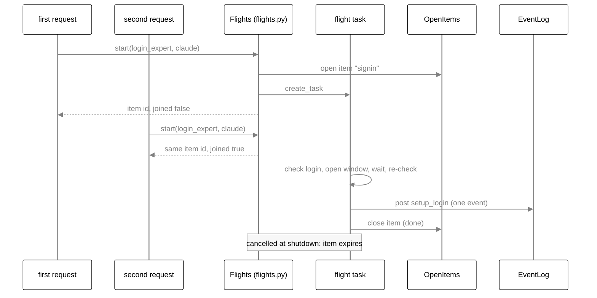
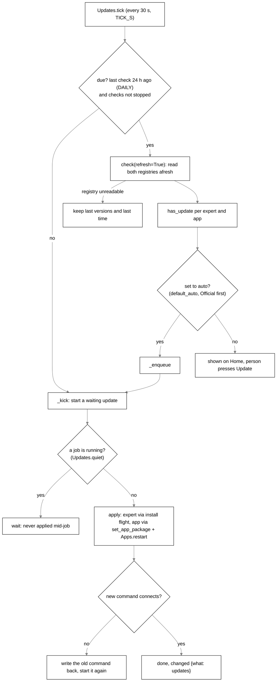

# Setting things up

How Scout looks at the machine, finds experts and apps in the registries, installs and signs them in, keeps them up to date, and runs the WhatsApp bridge. It also covers the `tagalong` command for a machine with no screen. Read it if you work on `brain/src/brain/setup/`, `cli.py` or `bridges.py`.

- [What setup is](#what-setup-is)
- [Looking at the machine](#looking-at-the-machine)
- [Registries, trust and grouping](#registries-trust-and-grouping)
- [Tagalong's own Node](#tagalongs-own-node)
- [Installing an expert](#installing-an-expert)
- [Signing an expert in](#signing-an-expert-in)
- [One flight per expert](#one-flight-per-expert)
- [Installing an app](#installing-an-app)
- [Updates](#updates)
- [The `tagalong` command](#the-tagalong-command)
- [WhatsApp bridge](#whatsapp-bridge)

## What setup is

Scout can look before it suggests a fix, and it can install what it finds. `brain/src/brain/setup/` holds the machine facts, the registry reads, the installs, the sign-ins and the update check. Setup functions return JSON facts; the model words what the person reads (guidance in `mind/soul.md`).

Installing an expert or an app, and signing an expert in, are `person_only` tools: only the person can allow them, every time (see [permissions.md](permissions.md)). Looking (`inspect_machine`, `find_experts`, `find_apps`) is read-only and automatic, and is never offered to Home.

- `paths.py`: where Tagalong keeps its own Node, expert packages, the registry cache and the installed-experts list, all under `TAGALONG_HOME`.
- `tools.py`: Scout's three looking tools, plus `setup_facts`, the facts a refused `hand_off` carries (see [experts.md](experts.md)).
- `home_tools.py`: Home's setup tools for the Connections page and the tour (see Home tools in [README.md](README.md)).

## Looking at the machine

`facts.py` `inspect()` reports the OS, the CPU and the versions of `node`, `npm`, `git` and `claude`, and Tagalong's own Node separately. A missing or failing tool is `None`. The command runner (`RunCmd`) is a seam; `real_run_cmd` is the only place a process starts. `inspect_machine` also lists the installed experts.

`store.py` `ExpertStore` keeps the installed experts in `experts.json`: id, name, version, the command that starts it, `registry` or `custom`, whether it is logged in, and which Node the command runs on (`private` or `system`, so a later change of the system Node can be re-checked; none for a binary or custom expert). The file is re-read on every call because the CLI writes it too. Writes are atomic. A corrupt file is kept as `experts.json.bad` and read as empty.

## Registries, trust and grouping

`registry.py` and `net.py` read two registries: the ACP agent registry (experts) and the MCP server registry (apps). The MCP one is read through its `search` parameter and a cursor, latest versions only. Each entry is parsed leniently into something with a way to run it: `npx`, `uvx`, `binary` per platform, or `remote`. `build_for` says whether an entry can run on this computer.

- Results are cached for 24 hours in `cache/`.
- Offline, the cache is served with `stale: true`. Offline with no cache is `registry_unavailable`.
- Only the first MCP page is read. `more: true` in the result says the registry has more pages; `find_apps` takes the next cursor.
- `net.http_fetch` is the real `Fetch`. It streams chunks and raises on a non-200 or on a redirect away from https.

`trust.py` decides who is Official. An app is Official when its registry namespace is the service's own reversed domain (`com.notion` is Notion's); the registry proves a namespace by DNS or HTTP. A GitHub login (`io.github.*`) proves only who the user is, so it never counts. An expert is Official only when its vendor is on a short allowlist (`EXPERT_VENDORS`). Everything else is Community.

`grouping.py` groups the results per service so Home shows one card per service, Official first. Only `trust.is_official_app` decides who heads a group; a lookalike title cannot take the top spot.

`why.py` writes the one-line "why pick it" for a community app (wording in `mind/why_pick.md`). The registry description is a stranger's text, so it goes to the model fenced as untrusted, and what comes back is stripped of markup and cut to `SHORT_MAX` (100) characters. It is cached per version. Any trouble (model not ready, over the allowance, an error) falls back to the shortened description, so a search never fails here.

## Tagalong's own Node

`node_runtime.py` and `archive.py` keep a Node of Tagalong's own under `runtime/node/`. The system Node, `PATH` and global npm are never touched.

- `pick_build` takes the newest LTS at or above a minimum major from nodejs.org's `index.json` that has an official archive for this OS and CPU. None is a fact, `NodeBuildMissing`.
- `ensure_node` reads the checksum from the release's `SHASUMS256.txt`, streams the archive to `runtime/node.part/` while hashing and checks it (one retry, then `NodeIntegrityError`).
- It extracts into `runtime/node.new/` with `safe_extract`. That checks every member first and refuses absolute paths, drive letters, `..` (also with backslashes), symlinks and hard links that point out, and device files (`UnsafeArchive`), before it writes anything.
- Only then does the new folder replace `runtime/node/`; the old one goes after the swap. If the swap fails because the old Node is running or locked, the old Node stays and the fact is `NodeInUse`.
- One download runs at a time. A failed or broken download removes its `.part` and leaves any existing Node alone.
- A marker file records the release, so a Node that is already new enough returns at once with no network.

## Installing an expert

`install.py` and `expert_tools.py` give Scout `install_expert(id)`. It installs one expert from the ACP registry into `tools/<id>/`.

- **The card.** Only the person can allow it. The tool is `person_only` (`ToolSpec.tier`, no Always button), so a stored Auto never opens it, `set_mode` refuses it, the side-check never sees the ask, and a preference in Scout's prompt cannot skip the card. The card's input is built by code (`ToolSpec.card`): the expert, its version, the folder, `recommended` (shows the "Recommended" chip) and `node_download` (the Node version and folder, or `null` when a system Node is new enough).
- **The result.** After Allow the tool returns `{"started": id, "item": <install open item id>}` at once. The install runs in the background, outside the turn, as one [flight](#one-flight-per-expert) per expert id. If the registry moved on after the card named a version, it returns `version_changed` (`"<shown> -> <now>"`) and installs nothing.
- **`npx` entries** run `npm install --prefix tools/<id>.part <package>@<version>` (the card shows that same version). The Node is a system one that is new enough and has its own npm, else Tagalong's own; the floor is 22 for every `npx` expert. npm gets a minimal environment of its own (`PATH` with the chosen Node first, the OS essentials and proxy settings), never an API key or any `npm_config_*` of the person's. Nothing is global.
- **Progress** is real. npm runs at `loglevel=http` and its output is read line by line (`on_line`, an optional fourth argument of a `RunCmd`). The stages are `resolving` (until npm logs its first request), `fetching` (it is downloading the package and what it depends on) and `finishing` (npm exited, the program is being checked), each said once with no percent. A `binary` entry says `downloading` with a `percent` from the response's Content-Length (`ByteStream.size`), at most one update per 5 percent (`percent_steps`); with no length there is only the stage. Tagalong's own Node download uses the same percent, filling 5 to 80 percent of the `node` stage. `extracting` and `done` follow.
- **Limits.** `NPM_TIMEOUT_S` (900 s) is the whole install's ceiling, not a stage. A command that is cancelled or times out is killed with its whole process tree.
- **The stored command** is `[node, <the package's bin js>, <registry args>]`, resolved against the final folder. A `binary` entry is streamed to `tools/<id>.dl`, checked against its listed sha256 and extracted with `safe_extract` into `tools/<id>.part`.
- **The swap.** The staged tree moves into `tools/<id>/` only on success, and then the record is written. A reinstall keeps the old files and record until then; a failure or cancel removes only what was staged. `sweep_staging` removes any `tools/*.part` and `tools/*.dl` a killed brain left (`tagalong stop` kills the brain on Windows).
- **What is never offered.** A binary with no listed sha256 is dropped by the registry reader and skipped by `build_for`, so it is absent from Home's list and Scout's `find_experts`, and `install_expert` answers `no_build` without downloading. `uvx` and hosted entries are `unsupported`. An id must be a plain folder name.
- **Failures** are `InstallError(kind, detail)` facts: `bad_id`, `no_build`, `unsupported`, `node_failed`, `npm_failed`, `integrity`, `unsafe_archive`, `download_failed`, `swap_failed`. They travel in `setup_done`, and a failed expert or app install is also one WARNING in `brain.log` with its id, kind and detail.

Progress and the result are events. `setup_progress` (`expert`, `stage`, `percent`) does not wake Scout and comes with `changed {what: "setup"}`. One waking `setup_done` ends the install: `expert`, `ok`, and either `installed` (the expert as JSON) or `error` and `detail`. A waking `setup_done` or `setup_login` is saved in the event log until a turn has told it, so a restart or a budget-dropped wake loses nothing. `SetupEvents` (`events.py`) posts the new one first and then ends the older waiting one for the same expert or app (`finish_matching`), so a crash between the two loses no news.

## Signing an expert in

`login.py`, `terminal.py` and `env.py` give Scout `login_expert(id)`, which logs an installed expert in on the person's own subscription. Like install it is `person_only`. Its card (built by code) shows just `expert` and appears at once, because it runs no check: nothing opens before the OK, and the checks run after it.

- **The check.** `LoginDriver.check` spawns the adapter with `clientCapabilities.auth.terminal = true` (without it Claude lists no methods), calls `new_session` in a scratch folder and sends no prompt. Success is logged in. An auth-required error is not logged in (with the advertised methods). Anything else is unknown.
- **The method.** The flight picks a subscription method: the terminal `claude-ai-login`, else the one terminal method, else a browser one (`chat-gpt`). Never an API-key method.
- **A terminal method** opens a visible window (the `OpenTerminal` seam; `real_open_terminal` is Windows only: `cmd` with `CREATE_NEW_CONSOLE`) running the adapter's own command plus the method's args, with the expert's env. It is wrapped so the exit code lands in a done file, `cache/login-<id>-<random>.done`, new for every start. A watcher writes `closed` there if the window is closed with X, so the login ends as failed at once. Arguments or paths with `" % ! & | < > ^` are refused with `NoTerminal`, as `cmd` would act on them. Elsewhere it raises `NoTerminal` too, and the flight ends in a `setup_login` event with `state` `failed`, `detail` `no_terminal` and the `command`, so Scout can tell the person what to run.
- **A browser method** calls ACP `authenticate(method_id)` and the adapter opens the browser.
- **The end.** The flight waits at most 10 minutes for the done file or the call, re-checks login, records it in `experts.json` and posts one waking `setup_login` event (`expert`, `state` = `logged_in`, `failed` or `unknown`, `detail`, plus `command` for `no_terminal`). It sends `changed setup` so Home and the tour reload. A login already done ends the same way with `logged_in` and nothing opened.
- **No secrets pass through Scout.** No link or code passes through Scout or the brain, so nothing is masked.
- **`env.py`** holds the per-expert table of keys that would switch an expert to an API key (Claude, Codex; an unknown expert loses all of them; every expert also loses `ANTHROPIC_API_KEY` and `ANTHROPIC_AUTH_TOKEN`). It is used for the login child, the check and expert runs. The expert's ACP client also accepts the adapter's `auth/status_update` notification (logged at INFO, `logged_in` untouched) rather than letting the library log an error for a method it has no route for (`experts.py` `_Client`).

## One flight per expert

`flights.py` makes sure an install or a sign-in runs once per expert. A flight is a background task plus the open item (`signin` or `install`) that stands for it. A request that finds one running gets the same item back with `"joined": true` and starts nothing, so a person who taps twice, or a model that asks again, never opens a second window or a second install.

A second request never starts a second flight and never cancels the waiter, so there is one event for all the requests. A request after the flight has ended is a new request. `update` (the updates check) runs as the same install flight, with the same `setup_progress` and `setup_done` events, so an install that joins a running update gets its result. An install that finds an update running joins it. An update that finds an install running refuses with `already_installing`. Brain shutdown cancels the flights, each cleans up what it staged, and every adapter process tree is killed on the way out.

From Home's own buttons the work is the person's, not a task of Scout's, so `from_home()` opens no task. Scout's own request opens one through the session's `Claim`, so the news is told under it (see [tasks.md](tasks.md)).

## Installing an app

`apps.py` gives Scout `install_app` (`change`, `person_only` like `install_expert`: no skipping the card, no Always). `app_params` turns an MCP registry entry into the params `validate_app` takes, and `app_tools.save_app` (the same path Home's `add_app` uses) stores it.

- An `npx` package becomes a stdio app that runs `<node> <npm-cli.js> exec --yes -- <package>@<version>` with absolute paths. The Node is the system one when it is 22 or newer, else Tagalong's own (downloaded first, named on the card). The system `PATH` is never edited; only that app's own `PATH` has the Node folder first.
- A `uvx` package becomes stdio `uvx` when it is installed, else the `uv_missing` fact.
- A remote entry becomes an http app with `auth: "oauth"` (it only prompts when the server answers 401). When a browser body is online it starts the sign-in through `Apps.sign_in`; with no browser the result says `browser: false`.
- A remote entry that requires a header is the `needs_token` fact: a secret is the person's to supply with Home's `add_app`.
- Required environment variables become `${NAME}` references and no value is stored. The result lists the ones the brain's environment lacks as `needs_env`.
- The card names the id, transport, package and version (or host), required env names and any Node download. Pass the same `query` as `find_apps` so the entry is in the cached page.
- The result is `{id, transport, auth, status}`, where `status` is the app's state after at most 20 s: `connected` (with `tools` and `tools_total`), `connecting`, `needs-sign-in`, `error`, or `signing_in`. Only `signing_in` and a `connecting` still pending end later in a `setup_done` event (see Missing tool: Connect in [README.md](README.md)).
- Failures are `{error, detail}` facts: `unknown_app`, `needs_token`, `no_build`, `node_missing`, `uv_missing`, `already_added`, `registry_unavailable`.

How a connected app works once it is added is in [connected-apps.md](../bodies/connected-apps.md).

## Updates

`updates.py` `Updates` finds newer versions of installed experts and local apps. An app's version is the package version pinned in its command (`apps.version`); a remote app has none. It keeps the last check and the latest versions in `cache/updates.json`.

The check runs once a day and reads the registries afresh, because a cached answer would hide the update. An update waits while a job runs, so a running expert is never swapped out from under its work.

- An expert updates through `expert_setup_tools`' `update`: the install path's staging and swap, under the same one-per-expert guard as Home's install, keeping the expert's login.
- An app updates by `set_app_package` plus `Apps.restart`, then `Apps.wait_settled`. If the new command does not connect, the old one is written back and started again.
- The daily check runs under a Watch task, "Checking for updates" (`Updates.watch`, one however often it is called). If the person stops that task from Home, `task_stopped` stores the setting that turns the check off (see [tasks.md](tasks.md)).

## The `tagalong` command

`cli.py` is the `tagalong` command (`uv run tagalong`, or `tagalong` once installed), for a brain machine with no screen. It is a thin caller of the functions above (`inspect`, `Registry`, `install_card`, `install_expert`, `app_params`, `save_app`, `LoginDriver`, `ExpertStore`) with the same seams (`run`, `fetch`, `get_json`, `ask`). It never contacts a running brain: it reads and writes the files under the data folder, and a brain re-reads them when it next needs them (an app it adds connects when the brain next starts).

| Command             | What it does                                                                                                                                                                                                       |
| ------------------- | ------------------------------------------------------------------------------------------------------------------------------------------------------------------------------------------------------------------ |
| `doctor`            | Prints the machine, Node, npm, git, whether a key is set (never the key), the installed experts and their login, and the registry (from the cache, flagged, when offline). Exits 0 even when something is missing. |
| `key set`           | Reads the key from a hidden prompt or `--stdin`, never from the command line, and writes `ANTHROPIC_API_KEY` to `.env` with `upsert_env_value`.                                                                    |
| `install <expert>`  | Prints what the Allow card shows (id, version, folder, the Node download), then asks `[y/N]`.                                                                                                                      |
| `apps add <app>`    | The same for an app from the MCP registry.                                                                                                                                                                         |
| `login <expert>`    | Runs the same `LoginDriver` as Scout's tool: a terminal window or the expert's own browser step, then waits. Where no window can open it prints the command to run yourself.                                       |
| `stop`              | Ends the brain the desktop left running (see Start-up and shutdown in [README.md](README.md)).                                                                                                                     |
| `perf [--since 1h]` | Step timings and cancelled asks, read from `brain.log`.                                                                                                                                                            |

`--yes` skips the question. With no terminal to answer on and no `--yes`, the command prints "Run again with --yes to go ahead without a prompt." and exits 1. A failure prints `failed: <kind>: <detail>` and exits 1; a usage error exits 2.

## WhatsApp bridge

`bridges.py` runs the WhatsApp bridge (`bodies/whatsapp`, built to `dist/index.js`) as a child process of the brain, on Tagalong's own Node only (`ensure_node`; the system Node is never used). The bridge itself is described in [whatsapp.md](../bodies/whatsapp.md).

- **When it runs.** Only when `TAGALONG_WHATSAPP_ENABLED` is `1` and the access token, app secret, verify token, phone number id and allowed number are all set. Otherwise nothing runs. `BridgeSupervisor.state` is `off`, `incomplete`, `starting`, `running`, `not_built` (the file is missing: one log line says to run `pnpm --filter @tagalong/whatsapp build`) or `node_failed`.
- **Its environment** is built by the brain: `TAGALONG_BRAIN_ADDR` (always `127.0.0.1` and the port the brain actually bound), the five values, the port (default 47322) and `PATH`/`SystemRoot`. It never sees the Anthropic key and never reads `.env`.
- **Restarts.** A bridge that exits (or whose output stream fails) is started again after 1, 2, 4, 8, 16 s and then every 30 s. A bridge that ran for a minute or more starts the waits over at 1 s. Stopping waits for the child to exit (5 s, then it is killed), so a new bridge never meets the old one on its port.
- **Start and stop.** `main.py` starts it after the server is up and stops it before the jobs shut down. The brain also holds the child's stdin pipe, which the bridge exits on when it closes, so a brain that is killed hard (`tagalong stop` on Windows) leaves no bridge behind.
- **Logs.** The child's output is logged by the `brain.bridge` logger, so it reaches `brain.log` through the secret filter. The access token, app secret and verify token are masked like the Anthropic key. The phone number id and the person's own number are not secret and are kept as written.

### WhatsApp setup tools

`bodies_tools.py` gives Home these tools (never offered to Scout; `main.py` passes the bridge supervisor as a getter, because it is built once the brain's port is known):

| Tool              | Input                                                          | Result text (JSON)                                                                                                                                                                                                                                                                    |
| ----------------- | -------------------------------------------------------------- | ------------------------------------------------------------------------------------------------------------------------------------------------------------------------------------------------------------------------------------------------------------------------------------- |
| `brain_status`    | `{}`                                                           | `{"version", "build", "pid", "started_at", "started_by", "addr", "data_dir", "log_path", "places": [{"id", "kind", "name"}], "work_running", "model"}` (`model` is the chosen model's name): the facts on Home's "Scout's brain" card (Home only; `brain_status_tools` in `tools.py`) |
| `bodies_status`   | `{}`                                                           | `{"bodies": [{"id", "kind", "name", "connected"}]}`, one row per online body (two desktops are two rows); a kind with none online keeps one row (`connected` false, `id` the kind), so `desktop`, `browser` and `whatsapp` always appear                                              |
| `whatsapp_status` | `{}`                                                           | `{"enabled", "set": {access_token, app_secret, verify_token, phone_number_id, allowed_number: bool}, "complete", "state", "port"}`; never a value                                                                                                                                     |
| `whatsapp_set`    | any of `enabled` (bool), the five strings, `port` (1024-65535) | the same JSON as `whatsapp_status`                                                                                                                                                                                                                                                    |

`whatsapp_set` changes only the keys given. They are written together in one atomic replace of `<TAGALONG_HOME>/.env` (`upsert_env_values`, `enabled` as `1` or `0`) and to the running environment, then the supervisor applies it (start, stop or restart) and the brain tells bodies `changed { what: "bodies" }`.

- The number is kept as digits only.
- A bad value is refused with fixed text that never quotes it. A value must be one printable line (a line break of any kind is refused).
- A failed write says where (`Scout could not save the WhatsApp settings to <path>.`) and changes nothing: the file and the running environment stay as they were.
- After the write the log masker's secret cache is cleared, so the restarted bridge's first lines are already masked.
- Bridge restarts run one at a time. A `tagalong key set` in another process is not covered.
- No frame is added to contract v1.
