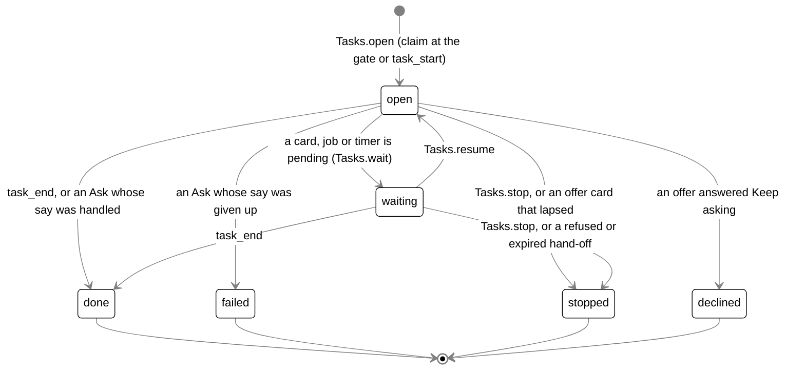
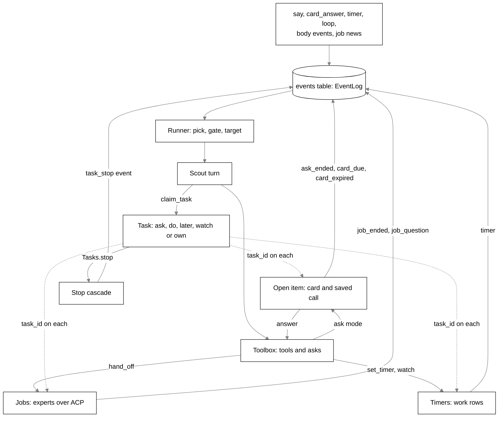
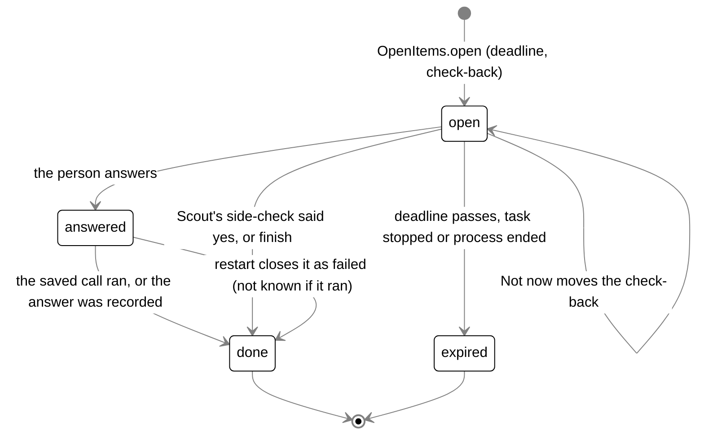
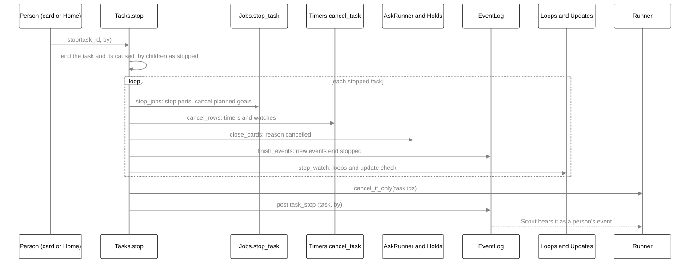
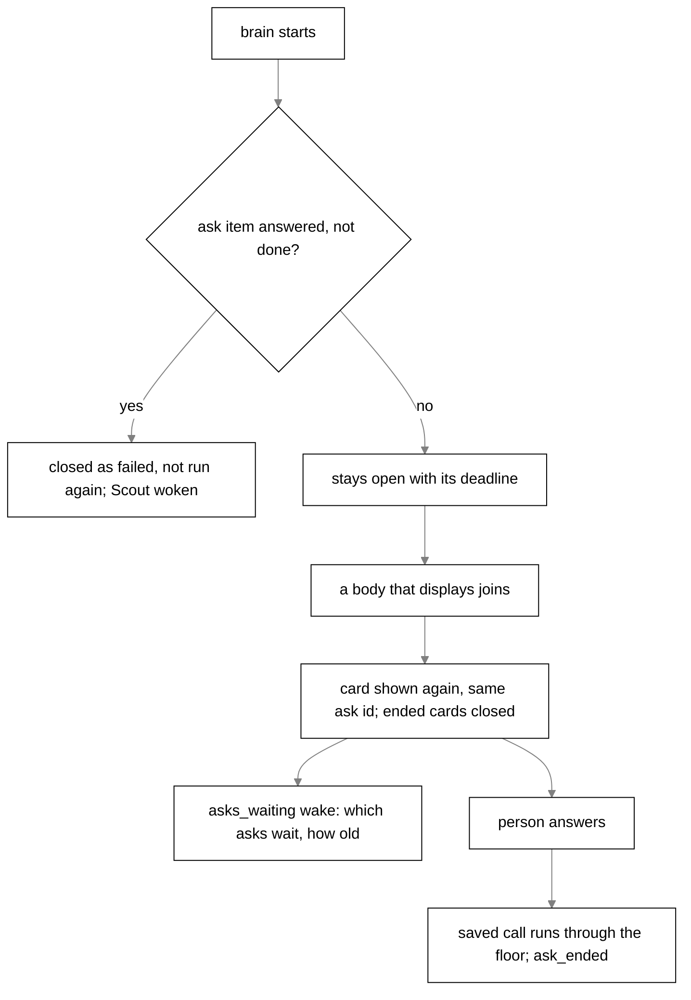

# Tasks

How Scout handles many things at once: what a task is, how work, cards and news hang off one, what Stop does, and how all of it is picked up again after a restart. Read this to follow a piece of work from the moment Scout starts it to its end.

Contents: [What a task is](#what-a-task-is) · [The orchestration map](#the-orchestration-map) · [Starting and ending tasks](#starting-and-ending-tasks) · [Open items](#open-items) · [The Stop cascade](#the-stop-cascade) · [Restart recovery](#restart-recovery) · [What Home shows](#what-home-shows). The turn that creates tasks is in [turns.md](turns.md); the permission engine behind the cards is in [permissions.md](permissions.md).

## What a task is

A task (`tasks.py`, rows in `tasks`) is one piece of work with a title, a `kind`, a `state`, a `source` and the event that caused it (`caused_by`). Events, work rows and open items point at it with `task` or `task_id`.

| Kind    | What it is                                                     | Made by                                   |
| ------- | -------------------------------------------------------------- | ----------------------------------------- |
| `ask`   | One thing the person said; ends with the turn that answered it | Code, for each say                        |
| `do`    | Work Scout was asked to do, such as a hand-off or an install   | `task_start`, or claimed at a tool's gate |
| `later` | Something Scout will come back to, such as a timer             | `task_start`, or claimed by `set_timer`   |
| `watch` | A standing check: mail for an app, the daily update check      | Code (`LoopService`, `Updates`)           |
| `own`   | Scout's own idea: an approval offer, or one Scout opens itself | `Offers`, or `task_start`                 |

States are `open`, `waiting`, `done`, `failed`, `stopped` and `declined`.

`ENDED` is done, failed, stopped and declined. `Tasks.settle` runs after every turn and ends what the turn answered: an Ask when its say is handled or given up, a Later when nothing is left running for it, and an offer's Own task whose card lapsed.

## The orchestration map

A task is the thread that ties one piece of work together: the card, the job, the timers and the news all carry its `task_id`, so one Stop reaches all of them. Everything that comes back to Scout comes back as an event in the same log.

## Starting and ending tasks

`task_tools.py` gives Scout `task_start` (a Do, Later or Own task) and `task_end(task_id, result)`
(it cancels the task's planned timers, and refuses while a job still runs under it: Scout stops
the job first). A job, an install, a sign-in, a connected-app add and
a timer each hang off a task: the call's `task_id` names an open one, else `Session.claim_task`
opens a new task from the turn's first event (a joined running flight opens none). The job's goal
row keeps `task_id` and `input.caused_by`; its news is posted with that task. `Runner.target`
sends news to the body in use, else the body its task came from (`Tasks.source_of`, only when that
source is a body), else the first screen. A hand-off that is refused or expires ends the Do
task it opened `stopped`; Home's own Connections and tour buttons open no task (setup handlers
claim through `not_for_home`).

**Tasks.** Each say carries the id of its Ask task (`Event.task`), and `wake_text` marks any event
that has one with `task=<id>`. After every turn ends the runner calls `Tasks.settle()`, so the
Ask ends with the turn that answered it (or fails if the say was given up). The system prompt
carries an open-tasks block (`Tasks.open_block`, placed after the preferences and before the
capability picture): a line per open task that is not an Ask, newest first, at most 15.

### The person-task rule

A task is a person's when the event that caused it is a say or a card
answer (`PERSON_KINDS` in `events.py`): `Tasks.person_cause(event)` and `Tasks.is_person(task)`.
A body's wake, a timer or a job's news is not, even when its source is a body, and a swept or
missing cause counts as not a person (the card shows). `Session.person_task(turn_id)` asks it of
the running turn's first event; `Jobs` asks it of the task a hand-off hangs off.

### Own tasks

An Own task is Scout's own idea: an approval offer, or one Scout opens with `task_start`. An offer's Own (source `scout`): `Offers._consider` opens it with the offer's card and the answer ends it (`done` on Yes, `declined` on Keep asking, `stopped` with reason `no answer` when the card lapsed or the answer was neither). `Tasks.settle` is the backstop: an offer's Own that had a card, with none open now and no event, ends `stopped` (`no answer`), never `done`. An Own Scout started with `task_start` never had a card and is not swept; it ends by `task_end` or when the person stops it. Setup news (`setup_done`, `setup_login`) is not an Own task: it belongs to Scout's Do task when Scout started the install or sign-in, and to nobody when the person pressed it on Home.

### Watch tasks

Two standing things are Watch tasks, so Home can list and stop them. Each app Scout reads mail for has one, "Watching <app> mail" (source `loop:<app>`), opened by `LoopService.enable` (and at start for an app whose switch was left on) and ended `stopped` ("switched off") by `disable`; every loop event the app surfaces (due, later, context, urgent, quiet) is posted with `task` set to it, so the news names it. The day's digest and the stale sweep span apps and name no task. Stopping the task calls `LoopService.task_stopped`, which runs `disable`: polling stops and the switch stays off across a restart, and loops already held stay. The daily update check has one, "Checking for updates" (source `updates`), opened when `Updates.run` starts; stopping it saves the setting `update_check` = `0`, so after a restart `run` opens no Watch task and `tick` skips the daily check, never an install already queued or running. Turning auto-update on (`set_auto`) or Home's check now (`Updates.resume`) clears it and opens a new Watch task. Stopping a mail Watch task and switching the app back on opens a new task; a restart reuses the open one. A check posts no news, so nothing names that task. A `watch` row Scout adds with `task_id` belongs to that task and is cancelled by `Timers.cancel_task` when it stops; with none named it belongs to no task.

## Open items

An open item (`open_items.py`, rows in `open_items`) is anything that waits on the person. It has a `kind`, a `state` (`open`, `answered`, `done` or `expired`), the `task_id` and `caused_by` it belongs to, an optional `saved_call`, `live_only` (true when it dies with the running brain or its expert), a `job_id`, a deadline (`deadline_at`) and a check-back (`check_back_at`, set `by` scout or the person).

| Kind         | What waits                                                       | Made by            |
| ------------ | ---------------------------------------------------------------- | ------------------ |
| `ask`        | A Scout tool call in ask mode, saved with its input              | `AskRunner.open`   |
| `choice`     | A `choose` question with clickable options                       | `choices.py`       |
| `offer`      | An offer to make an approval a standing preference               | `Offers`           |
| `install`    | An expert or app install in flight                               | `setup/flights.py` |
| `signin`     | An expert sign-in in flight                                      | `setup/flights.py` |
| `expert_ask` | An expert's permission request or question, held with no timeout | `Holds`            |

The default check-back is two thirds of the way to the deadline. A deadline is `DEADLINE_S` (one day) unless the item names another; a Scout ask gets three days (`ask_wait_hours`). `OpenItems.not_now` moves the check-back (30 minutes on when no time is given) and keeps the wait length (`window_s`), and Scout cannot move a check-back the person set.

An open item is the one record of something that waits on the person. An expired item is not reopened by a late answer. A restart closes every answered-but-unfinished ask as failed rather than run it twice.

### Task cards

When the card has a task (never an Ask task: the person does not see those, so their card is a plain card with no task fields, no Not now and no Stop task), `Asks.show` adds the options `not_now` and `stop_task`
after the card's own options, and puts `task {id, title}`, `check_back_at`, `check_back_by` and
`urgent` on the `ask` frame (see protocol/README.md). Not now keeps the card open and starts no
turn: `OpenItems.not_now(id, at, by)` moves the check-back (30 minutes on when no time is given,
by the person) and the deadline past it (the window kept in `window_s`, so it never grows), and the brain sends the card again with the new
check-back. A check-back the person set is not moved by Scout. Stop task closes the card and calls
`Tasks.stop(task_id, by)`. Stop task calls `Tasks.stop`, the same call Home's `task_stop` tool makes (Home only; the desktop's `tagalong:tasks:stop`).

## The Stop cascade

`Tasks.stop(task_id, by)` ends a task and everything hanging off it. It returns nothing when the task is already over; the runner then tells Scout with `ask_ended` (refused) if it came from a card. The steps, in code order:

1. The task ends `stopped` ("the person stopped it").
2. Every task whose `caused_by` chain leads to it ends `stopped` too ("the task that started it was stopped").
3. For each stopped task, through `TaskStopHooks` (all required, built by `Session`), one step at a time, so a step that fails is logged and the rest still run:
   - `stop_jobs`: `Jobs.stop_task` stops each running part of the task's jobs (`session/cancel`; the adapter process is killed only if it ignores the stop) and cancels planned goals. A job still queued or starting never starts: `_start_part` checks the stopped set after its last await, and `ExpertRun.begin` refuses a run stopped while its mode was being set.
   - `cancel_rows`: `Timers.cancel_task` cancels its timers and watches.
   - `close_cards`: its open cards close with reason `cancelled` (`AskRunner.close_cards`, or the `Holds` card of an expert ask, which cancels its waiting expert).
   - `finish_events`: its `new` events end `stopped` (`EventLog.finish_task`).
   - `stop_watch`: `Session.watch_stops` runs `LoopService.task_stopped` and `Updates.task_stopped`.
4. The running turn is cancelled when it took only these tasks' events (`Runner.cancel_if_only`).
5. One `task_stop {task, by}` event is posted. It is a person's event with urgency `now`, so Scout never works on after it.

A failing stop from an expert's card still cancels that card, so the expert is not left waiting.

The order matters for one reason: the task is marked stopped first, so nothing the later steps wake can start new work on it. Each step is isolated, so a failure in one does not leave the others undone.

## Restart recovery

A Scout ask is an open item, so it outlives the turn, your absence and a brain restart. Other work is settled at start too: `EventLog.recover` returns `taken` events to `new` (counted as a failed attempt, reason `restart`), the work resume scan blocks or fails running job parts, and `Tasks.sweep` removes old ended tasks after `Tasks.settle` runs. A job's
ask (and a turn-bound card such as a choice) ends with its source; a restart expires it ("brain
restarted").

_At start._ `AskRunner.start` closes every `ask` item that was answered but not finished: the brain
cannot know if its call ran, so it is never run twice. The item ends `done`, and Scout hears "the
brain restarted, so it is not known if it ran" through `ask_ended` (outcome `failed`). Items that
came due while the brain was away expire as at any deadline. The other open items are kept with
their deadline.

_On return._ `Session._on_connect` calls `AskRunner.returned(away)` when the joining body displays (a
`display: false` body such as the browser does nothing); `away` is the seconds the body was gone, or
none if it was never seen. Three things happen, in order. An item that expired since the body left
(`OpenItems.expired_since`, for example a live-only expert ask whose process ended) gets an `ask`
frame `state: "closed"`, `reason: "timeout"`, so a card the body still shows goes away; a body that
never showed it ignores the frame. Every open `ask` item whose card is not live in `Asks` (a restart
leaves none) gets its card shown again, with the same ask id and no `turn`, for every body. A tool
that has gone ends the ask `failed` ("that tool is gone"). Then, if any card was shown again (or, when the absence is known, an open ask created during it, for
example one opened while no screen was up), one
`asks_waiting` event is posted: `count` and `asks`, a JSON list of `ask`, `tool`,
`summary` and `age_s` (seconds waited), oldest first, so Scout can say how old each is in his own
words. A card that cannot be built is logged and skipped; the others still show. Nothing is decided without the
person on return: the rule and side-check ran when the ask opened. The Waiting tab lists the open
items too (see `loops_state`); it also lists the news not yet told (`events_waiting`), read again on `changed {what: "events"}`, which the event log sends when an event is saved or changes state.

## What Home shows

A `started` or `joined` turn frame carries `tasks: [{id, kind, title}]` when the events the turn
took belong to non-Ask tasks (`Tasks.named_by`; a say alone names none, and the field is left out).
Home's `tasks_list` tool (`tasks_tools.py`, `{include_ended?}`) returns every non-Ask task newest
first as `{id, kind, state, title, source, caused_by, chain, created_at, ended_at}`; `chain` walks
`caused_by` through the event log (the event, then its cause, to a depth of 5) as
`[{kind, source}]`, and stops where an event was swept. Ended tasks are listed only when asked.
