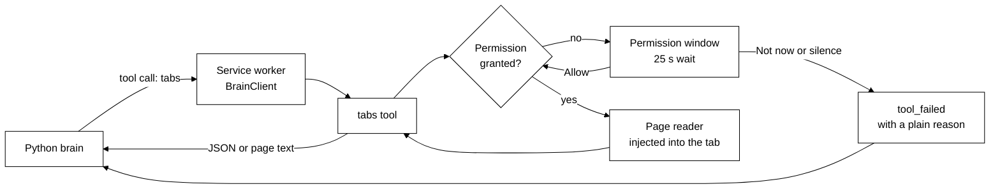

# The browser body

## Purpose

`bodies/browser` is a Chromium Manifest V3 extension that makes your browser a body for the Python
brain. Scout can list your open tabs and read a page when you ask, after you say yes. It holds no
brain of its own: it dials the brain over the websocket contract in
[protocol/README.md](../protocol/README.md) and offers one tool, `tabs`. It works in Chrome, Edge,
Brave, Opera, Vivaldi, Arc and any other Chromium browser from version 116.

The store listing, permission justifications and the public privacy policy are in
[chrome-web-store/listing.md](chrome-web-store/listing.md) and
[chrome-web-store/privacy-policy.md](chrome-web-store/privacy-policy.md).

## Where it lives

| Path (under `bodies/browser/`)       | What                                                                |
| ------------------------------------ | ------------------------------------------------------------------- |
| `src/service-worker.ts`              | Entry: wires the body to Chrome's APIs and the reconnect alarm      |
| `src/body.ts`                        | Owns one `BrainClient`, the hello, the tool dispatch, restart, stop |
| `src/reconnect.ts`                   | The alarm's redial rule                                             |
| `src/identity.ts`, `src/settings.ts` | The body id and name, the brain address                             |
| `src/tools/tabs.ts`                  | The `tabs` tool (list and read)                                     |
| `src/permissions.ts`                 | The permission broker and its 25 s wait                             |
| `src/permission/`                    | The permission window page                                          |
| `src/popup/`                         | The toolbar popup page                                              |
| `src/content/`                       | The page reader injected into a tab on demand                       |
| `src/layer/`                         | Thin wrappers over `chrome.*`, so tests can fake them               |
| `src/manifest.ts`                    | Builds `manifest.json`                                              |

The build (`pnpm --filter @tagalong/browser build`) writes `bodies/browser/dist`: `manifest.json`,
`service-worker.js`, `page-reader.js`, `popup/popup.html`, `permission/permission.html` and
`assets/`. That folder is what you load unpacked. The package imports `@tagalong/contract` (the
`BrainClient`), never `@tagalong/protocol`, `@tagalong/ui` or `packages/core`.

## How it works



1. The service worker starts and builds one `BrainClient`. It dials the brain at the saved
   address, then sends a hello with the body kind `browser`, the body id, the name and the `tabs`
   tool.
2. The brain calls `tabs`. The tool asks the broker for what it needs. If a permission is missing,
   the broker opens a small window and waits up to 25 seconds for an answer.
3. With the permissions in place the tool returns the tab list as JSON, or injects the page reader
   into one tab and returns its text.
4. If the connection drops, the client retries. A 30-second alarm named `tagalong-reconnect` wakes a
   stopped worker and restarts the body, because Chrome stops idle workers.

The `BrainClient` options this body sets (see
[protocol/README.md](../protocol/README.md#the-typescript-client)):

- `body`: the kind `browser`, plus the id and name.
- `seqStore`: keeps the last sequence number in `chrome.storage.session` under `lastSeq`, so a
  worker restart resumes where it was; Chrome clears it when the browser closes.
- `keepalive`: `{everyMs: 20000, tool: 'spend_today'}` sends a cheap call every 20 s so Chrome does
  not stop the worker while the socket is open.

The extension's content security policy allows `connect-src ws:` and nothing else to connect to.

## Identity

The body id is `<browser>-<4 random chars>`, for example `chrome-7k2f` or `edge-q9x1`. The browser
is read from the user agent brands: `chrome`, `edge`, `brave`, `opera`, `vivaldi`, `arc`, or
`chromium` when none matches; the display name is Chrome, Edge, and so on. The id is made once and
kept as `bodyId` in `chrome.storage.local`, so a restart keeps it and a second browser profile has
its own, which makes it a second body. The name can be changed in the popup (32 characters at most).

## Tools

One tool: `tabs`. Its effect is `read`: it never changes a page.

```json
{
  "name": "tabs",
  "input_schema": {
    "type": "object",
    "properties": {
      "action": { "type": "string", "enum": ["list", "read"] },
      "tab_id": { "type": "number" }
    },
    "required": ["action"]
  }
}
```

**`list`** needs the `tabs` permission. It returns JSON text:

```json
{
  "tabs": [
    {
      "id": 12,
      "title": "Article",
      "url": "https://example.com/a",
      "active": true,
      "asleep": false
    }
  ]
}
```

**`read`** needs the `tabs` permission and then the permission for the tab's site. It reads the tab
given by `tab_id`, or by default the active tab in the focused window. It refuses:

- a sleeping tab: "That tab is asleep, and Scout will not wake it. Ask the user to open it first."
- a locked page (the Chrome Web Store, the Edge add-ons store, `chrome-extension:` pages and any scheme other than http,
  https or file): "I cannot read that tab: ..." with the reason.

It returns text of this shape, with the page text after the header lines:

```text
url: https://example.com/a
title: Article
selection: the text you had selected, if any

The page's readable text...
```

The page text has menus and footers removed. It is cut at 40,000 characters with the note
"[truncated at 40,000 characters]".

## Permissions

The manifest asks only for `alarms`, `scripting` and `storage` at install. Everything else is
optional and asked for when a tool needs it. The window is the only place a grant is made, because
`chrome.permissions.request` needs a click.

| Tool call     | Needs                                | Asked as                                                                |
| ------------- | ------------------------------------ | ----------------------------------------------------------------------- |
| `tabs` `list` | the `tabs` permission                | "see open tabs": **Allow** or **Not now**                               |
| `tabs` `read` | the `tabs` permission, then the site | the site: **Allow on this site**, **Allow on all sites** or **Not now** |

A `file:` page uses the origin `file://`. **Allow on all sites** grants `<all_urls>`.

The window: one is open at a time for each need, and it waits 25 seconds. A click on **Not now**, or
no answer, fails the tool with `tool_failed` and a plain sentence the brain can pass on, for example
"the person has not allowed Scout to see open tabs" or "the person has not allowed reading
example.com". The title reads "Scout wants to read a page" for a site, otherwise "Scout wants to
help". The window sends its answer back with the runtime message `permission-answer`.

The manifest also lists `history`, `bookmarks`, `downloads`, `sessions`, `readingList`, `tabGroups`
and `contextMenus` as optional, for later tools. Nothing asks for them yet. There is no side panel
and no keyboard command.

## Popup

The toolbar button opens `popup/popup.html`. It asks the worker for its state with the runtime
message `{type: 'status'}` and shows:

- a status line: "Connecting to Scout's brain...", "Connected to Scout's brain", "Scout's brain is
  not reachable", or "Needs an update: this browser add-on is older than the brain";
- the **Brain address** (`host:port` only, default `127.0.0.1:47321`; a bad value is refused and not
  saved);
- the **Name** of this browser;
- an **Allowed** list of what you have granted, each with a remove button.

## Install from the desktop

Run `pnpm --filter @tagalong/browser build`. In the desktop app open Home, then Settings, then **Add
Scout to your browser**. The section shows the folder to load unpacked and a **Show folder** button
(`browserFolder` and `showBrowserFolder` in `bodies/desktop/src/main/ipc/browser.ts`). In the
installed app the folder is `resources/extension`; in development it is `bodies/browser/dist`. Then
open `chrome://extensions` (or `edge://extensions`), switch on Developer mode and choose **Load
unpacked**.

## Failure handling

| Situation                        | What happens                                                              |
| -------------------------------- | ------------------------------------------------------------------------- |
| Brain not running                | The client retries; the popup says it is not reachable                    |
| Add-on older than the brain      | The popup says it needs an update                                         |
| Worker stopped by Chrome         | The reconnect alarm (30 s) wakes it; the keepalive keeps it from stopping |
| Permission declined or no answer | `tool_failed` with a plain reason; nothing is granted                     |
| Sleeping or locked tab           | The tool refuses with a plain reason; the tab is not touched              |

## Privacy notes

- Nothing is read until Scout asks and you have allowed it. No script runs in a page before that.
- A read takes the selection, the URL, the title and the main text, and nothing else.
- The body keeps no pages and no chats. It stores the brain address, the name and the id in local
  extension storage, and the last sequence number in session storage.
- It sends what it read only to the brain at the address you set. The brain sends it on to the AI
  service you chose.
- No analytics, no ads, no remote code.

## Events

None yet. Pushing browser events to Scout is added in slice 12b.

## Tests that pin it

| Test file (under `bodies/browser/src/`) | What it pins                                                                                            |
| --------------------------------------- | ------------------------------------------------------------------------------------------------------- |
| `body.test.ts`                          | Hello, tool dispatch, restart, stop, keepalive                                                          |
| `reconnect.test.ts`                     | The alarm redials unless the body is online or outdated                                                 |
| `identity.test.ts`                      | The id shape and the browser kind                                                                       |
| `settings.test.ts`                      | Address and name validation                                                                             |
| `manifest.test.ts`                      | Permissions, optional permissions, CSP, popup path                                                      |
| `permissions.test.ts`                   | One window per need, the 25 s wait, decline and silence                                                 |
| `permission/model.test.ts`              | The window's wording and buttons                                                                        |
| `popup/model.test.ts`                   | The popup's status lines and allowed list                                                               |
| `tools/tabs.test.ts`                    | List, read, asleep, locked, truncation                                                                  |
| `tools/registry.test.ts`                | The tool catalog the hello sends                                                                        |
| `content/read-page.test.ts`             | The page text, selection and the cut at 40,000 characters                                               |
| `content/injected-weight.test.ts`       | The injected reader stays small                                                                         |
| `source-guard.test.ts`                  | Only the permission window requests permissions (the popup only removes them); no protocol or ui import |

Run them with `pnpm --filter @tagalong/browser test`. Manual steps are in
[testing/feature-test-guide.md](testing/feature-test-guide.md#the-browser-body).
