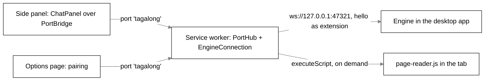
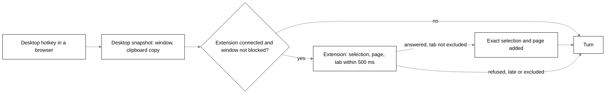

# The browser extension host

## Purpose

`apps/extension` is a Chrome Manifest V3 extension: a second host for the same engine, with the same
Scout, memory and settings. It gives Scout the **exact** selection and the readable text of the page
in front, and puts Scout in Chrome's side panel. It holds no engine of its own: it connects to the
one inside the Tagalong desktop app over the loopback WebSocket, so it needs the desktop app running.
It imports `@tagalong/protocol` and `@tagalong/ui`, never `@tagalong/core`.

The store listing, permission justifications and the public privacy policy are in
[chrome-web-store/listing.md](chrome-web-store/listing.md) and
[chrome-web-store/privacy-policy.md](chrome-web-store/privacy-policy.md).

## Where it lives

| File                                                           | What it holds                                                                                                                           |
| -------------------------------------------------------------- | --------------------------------------------------------------------------------------------------------------------------------------- |
| `apps/extension/src/manifest.ts`                               | The manifest as data (`manifest`, `COMMAND_OPEN_PANEL`); the build writes `dist/manifest.json`                                          |
| `apps/extension/src/service-worker.ts`                         | The entry point: wires `EngineConnection`, `PortHub` and Chrome's events                                                                |
| `apps/extension/src/engine-connection.ts`                      | `EngineConnection`: the one socket, `hello`, heartbeat, reconnect, answering `perception.capture`; `reconnectDelay`, `ConnectionStatus` |
| `apps/extension/src/port-hub.ts`                               | `PortHub`: the worker's side of every open extension page                                                                               |
| `apps/extension/src/port-bridge.ts`                            | `createPortBridge`: the side panel's `HostBridge` over a `chrome.runtime` port                                                          |
| `apps/extension/src/port-messages.ts`                          | `PORT_NAME`, `PageMessage`, `WorkerMessage`, `PortLike`                                                                                 |
| `apps/extension/src/pairing.ts`                                | `parsePairingInput`, `readPairing`, `savePairing`, `clearPairing` over `chrome.storage.local`                                           |
| `apps/extension/src/tab-capture.ts`                            | `captureTab` (answers `perception.capture`), `captureSnapshot` (an ask's snapshot)                                                      |
| `apps/extension/src/chrome-adapters.ts`                        | `localStorageArea`, `chromeTabAccess`: the real Chrome APIs behind the tested interfaces                                                |
| `apps/extension/src/content/read-page.ts`                      | `readPage`: selection and Readability text, run inside the tab                                                                          |
| `apps/extension/src/content/page-reader.ts`                    | The injected entry point; installs `globalThis.__tagalongReadPage`                                                                      |
| `apps/extension/src/capabilities.ts`                           | `EXTENSION_CAPABILITIES`                                                                                                                |
| `apps/extension/src/page-targets.ts`                           | `PAGE_TARGETS`                                                                                                                          |
| `apps/extension/src/status-text.ts`                            | `describeStatus`: one sentence per connection state                                                                                     |
| `apps/extension/src/sidepanel/`                                | `SidePanelApp` (the shared `ChatPanel` for Scout) and its glue                                                                          |
| `apps/extension/src/options/main.ts`, `options.html`           | Pairing and the optional all-sites grant                                                                                                |
| `apps/extension/vite.config.ts`, `vite.content.config.ts`      | The two builds                                                                                                                          |
| `packages/core/src/perception/browser-route.ts`                | Engine side: `captureSelection`, `browserContextFor`, `BROWSER_HOST_TIMEOUT_MS`, `isBrowserHost`                                        |
| `packages/core/src/server/ws-server.ts`                        | `EXTENSION_METHODS`, the hello timeout and size limit                                                                                   |
| `bodies/desktop/src/renderer/src/settings/browser-section.tsx` | Settings' Browser extension section: the token and its Copy button                                                                      |

## How it works

### Pairing

The engine writes a 32-byte hex token to `pairing.token` in its data dir at first boot
(`server/pairing.ts`, `readOrCreatePairingToken`). The desktop's Settings window shows it in the
**Browser extension** section with a **Copy** button.

1. On install, `chrome.runtime.onInstalled` opens the options page.
2. The person pastes the token and, only if the engine moved off the default, a port.
   `parsePairingInput` accepts exactly 64 hex characters (trimmed) and a port from 1 to 65535; an
   empty port means `DEFAULT_ENGINE_PORT` (47321).
3. **Save and connect** writes `{ token, port }` under the `pairing` key in `chrome.storage.local`
   (never `sync`: the token opens the engine on this machine and has no reason to travel).
4. `chrome.storage.onChanged` on that key calls `connection.restart()`, so there is no separate
   connect step. **Forget pairing** clears it.

`readPairing` treats a missing or corrupted record (wrong token shape) as unpaired.

### The transport

**One socket, in the service worker.** Pages never open their own: the token stays in the worker,
and there is one connection however many side panels are open.

`EngineConnection`:

- **Connect.** With no pairing the status is `unpaired` and no socket opens. Otherwise it dials
  `engineUrl(port)` (`ws://127.0.0.1:<port>`) and, on open, sends
  `hello { host: 'extension', version, capabilities: EXTENSION_CAPABILITIES, token }`. A good
  `HelloResult` sets `connected` with the engine version and pets and starts the heartbeat.
- **Rejected token.** The engine answers `-32000` and closes the socket. The reply is handled
  synchronously, before the close, so the close knows not to retry: the status becomes `rejected`
  ("The Tagalong app rejected the pairing token. Paste the current one.") and retries stop until the
  pairing changes.
- **Reconnect.** Any other close schedules a retry with `reconnectDelay(attempt)`: 1 s, doubling,
  capped at 30 s; status `disconnected` with the reason and the delay. A good hello resets the
  backoff. The connection never gives up on its own.
- **Calls.** JSON-RPC requests with ids `extension-<n>`, each with `DEFAULT_CALL_TIMEOUT_MS`.
  Results are parsed with the protocol's `resultSchemaFor(method)`. A call while not connected is
  refused at once, naming the state. Calls in flight fail when the socket drops.
- **Requests from the engine.** The only one answered is `perception.capture`, through `captureTab`.
  Any other method, or a failed capture, is answered with error `-32000` and its message, so the
  engine falls back at once instead of waiting out its timer.
- **Notifications.** Only names in `coreToHostNotifications` are passed on, to every open page.

The engine side (`ws-server.ts`): a connection must send `hello` within 10 s and before 64 KiB, the
token is compared in constant time, and a session with `host: 'extension'` may call only
`EXTENSION_METHODS`: `ask`, `interrupt` and `pets.list`. Anything else, such as `settings.set`,
`tool.approve`, `asks.*`, `connections.*`, `routines.*`, `experts.*`, `handoffs.*` or
`hosts.status`, gets `-32000` and never reaches a handler.

**Pages talk to the worker, not the engine.** The side panel and the options page open a
`chrome.runtime` port named `tagalong`:

| Direction     | Message                                      | Meaning                                                            |
| ------------- | -------------------------------------------- | ------------------------------------------------------------------ |
| page → worker | `{ type: 'call', id, method, params }`       | An engine call, relayed by `PortHub`                               |
| page → worker | `{ type: 'capture', id, targets }`           | Read the tab the panel sits beside                                 |
| page → worker | `{ type: 'ping' }`                           | Keeps the worker awake while a panel is open                       |
| worker → page | `{ type: 'status', status }`                 | Sent to each page as it opens, then on every change                |
| worker → page | `{ type: 'notification', method, params }`   | A turn notification from the engine                                |
| worker → page | `{ type: 'reply', id, ok, result \| error }` | The answer to a call or capture                                    |
| worker → page | `{ type: 'context', snapshot \| null }`      | What the shortcut or a tab switch captured; `null` clears the chip |

`PortHub.publishContext` keeps a shortcut's capture for a panel that is still opening and hands it
over when that panel connects; a `null` with no page open is dropped.

`createPortBridge` turns the port into the shared UI's `HostBridge`: `ask`, `interrupt`,
`listPets`, `onTurnEvent`, plus `onStatus` (replays the last status to a late subscriber),
`onContext` and `capture`. Everything in flight fails when the worker goes away.

### The worker keep-alive

Chrome stops an idle MV3 service worker after thirty seconds, and with it the reconnect timer and
the engine's route to the browser. Three things keep it working:

- **Heartbeat.** While connected, `pets.list` every `DEFAULT_HEARTBEAT_MS` (20 s). Since Chrome 116
  socket traffic resets the idle timer (`minimum_chrome_version: '116'`), so this keeps the worker
  alive between asks and refreshes the pets. A heartbeat that fails closes the socket, so a wedged
  engine reads as down.
- **Panel ping.** An open panel posts `ping` every `PING_MS` (20 s); port traffic resets the timer.
- **Alarm.** `chrome.alarms` fires `tagalong-reconnect` every 30 s (`periodInMinutes: 0.5`) and calls
  `connection.start()`, which is a no-op while a socket is up or a retry is pending. A stopped worker
  so notices the desktop app coming back with no panel open.

Every listener is registered synchronously at the top level of `service-worker.ts`, because Chrome
only delivers events to listeners that exist when a stopped worker wakes. With the app closed the
panel says `Disconnected: could not reach the Tagalong app. Retrying in Ns. Is the Tagalong app
running?` and reconnects within a second or two with the panel open, within about thirty seconds
without.

### What it reads

`EXTENSION_CAPABILITIES` is `selection`, `pageText` and `activeWindow`, and nothing else. No
screenshot and no displays: the desktop host owns those, and a host advertising them would be asked
for them.

**Reading is on demand.** There is no standing content script. `chromeTabAccess.inject(tabId)`
runs `chrome.scripting.executeScript` twice: once with `files: ['page-reader.js']`, which installs
`__tagalongReadPage` in the page's isolated world, and once with a function that calls it.
`readPage(document, window)`:

- **Selection**: exactly as the user made it, never trimmed or reflowed; a selection inside a
  focused `textarea` or text `input` is read from the field. Cut at `MAX_SELECTION_CHARS` with
  `selectionTruncated`.
- **Text**: `Readability` on a clone of the document (it rewrites what it is given, and the page is
  the user's); with no article, the body's `innerText` (or `textContent`). Runs of spaces and blank
  lines are collapsed, then cut at `MAX_PAGE_TEXT_CHARS` with `truncated`.
- **URL and title.**

`captureTab(targets, access)` reads the active tab of the last focused window. `activeWindow` gives
`app: { name: <browser>, windowTitle: <tab title> }` without touching the page, with the browser
named the way the desktop's process list names it (`msedge` for `Edg/`, `opera` for `OPR/`,
otherwise `chrome`). `selection` and `pageText` inject the reader once. Only `http:`, `https:` and
`file:` pages can be scripted; anything else fails with `Chrome does not let extensions read <url>`.
Targets the host does not have are left out. An empty selection is left out, not sent as `''`.
`captureSnapshot` wraps the patch as a full `ContextSnapshot` with `host: 'extension'`.

**Which tabs.** Chrome allows injection on a tab the user invoked the extension on (`activeTab`: the
toolbar button, the shortcut, or the side panel beside it). The optional `<all_urls>` grant, switched
on with **Allow reading any tab when I ask** on the options page (requested from that click, as
Chrome requires), covers a tab switched to with the panel open and the desktop hotkey pressed over a
tab never clicked. It still reads nothing until asked.

**Entry points.**

- **Toolbar button**: `setPanelBehavior({ openPanelOnActionClick: true })`. The panel, once
  connected, captures `PAGE_TARGETS` itself, so "summarise this" with nothing selected uses the page
  text. A shortcut capture that arrived meanwhile is kept.
- **Shortcut** `Alt+Shift+Space` (`open-tagalong`): `chrome.sidePanel.open` first, inside the
  command's user gesture, then the capture, published to the panel. The desktop's ask key
  (`CommandOrControl+Shift+Space` by default) is a global hotkey that Chrome never sees, which is why
  the extension's key differs. It can be rebound at `chrome://extensions/shortcuts`.
- **Tab switch** with a panel open: a new capture, or `null` when the tab cannot be read, so the chip
  never names the previous page.

The side panel (`SidePanelApp`) shows the connection line, **Pair with the Tagalong app** when
unpaired or rejected, and the shared `ChatPanel` for the first pet the engine lists (Scout), with the
snapshot attached, `lookTargets = PAGE_TARGETS` and the Look button labelled **Read this page**.
**Clear** sends the next ask with nothing attached. The pets seen while connected are kept through a
disconnect, so the conversation on screen survives the app restarting.

### Routing between the desktop and the browser host

The engine tells the two hosts apart by `pageText`, which only the browser host advertises
(`isBrowserHost`), so connection order never decides who answers (`perception/browser-route.ts`).

- **Window identity** always comes from the desktop host when one is connected (`desktopFor`).
  Exclusions are checked against it before either host reads anything.
- **`get_selection`** (`captureSelection`): when the front window is a browser process (`chrome`,
  `msedge`, `brave`, `vivaldi`, `opera`, `chromium`, `firefox`) and the extension is connected, the
  extension is asked first with `BROWSER_HOST_TIMEOUT_MS`; a refusal falls back at once, a silence
  after 500 ms, to the desktop's clipboard read. With only the extension connected it answers alone.
- **A desktop hotkey ask made in a browser** (`browserContextFor`, called from the engine's `ask`
  handler before the turn starts): the desktop snapshot was already checked against the exclusions.
  Unless the desktop marked the window blocked, the extension is asked for selection, page and tab
  within 500 ms. Its selection replaces the clipboard copy only when it has one; the page is added;
  and if the tab it read is excluded the extension's read is dropped and the snapshot keeps only the
  app name. Past 500 ms, or on a refusal, the ask goes out exactly as the desktop made it.
- **An ask from the side panel** carries the extension's own snapshot. The engine applies the
  exclusion list to it before the turn starts and, on a match, strips it to the bare ask: id, time,
  host and the app name, never the tab's title or anything read from it.

`hosts.status` → `{ extension }` tells the desktop's health check whether the extension is
connected; the extension itself may not call it.

### How it is built

`pnpm --filter @tagalong/extension build` runs `tsc -b && vite build && vite build --config
vite.content.config.ts` into `apps/extension/dist`, the folder Chrome loads unpacked.

- **`vite.config.ts`**: `root: 'src'`, inputs `sidepanel.html`, `options.html` and
  `service-worker.ts`, built as ES modules; the worker is emitted as `service-worker.js` and the rest
  as `assets/[name]-[hash].js`. `assetsInlineLimit: 0` and `modulePreload: false` keep every asset a
  file under the CSP. The `tagalong-manifest` plugin writes `manifest.json` from `manifest.ts`, so
  the two cannot drift. JSX is compiled by Vite's own esbuild transform.
- **`vite.content.config.ts`**: `src/content/page-reader.ts` as a single IIFE, `page-reader.js`,
  with Readability inlined, because Chrome injects it as a classic script that cannot import the
  shared chunks. `emptyOutDir: false` so it lands beside the first build. It imports the zod-free
  `@tagalong/protocol/limits` subpath, never the protocol barrel, because it ships into the page on
  every read (about 35 kB).

To load it: `chrome://extensions` → **Developer mode** → **Load unpacked** → `apps/extension/dist`.
After a rebuild, reload the card there. See [development.md](development.md).

## Interfaces

### Manifest

| Key                                       | Value                                                                |
| ----------------------------------------- | -------------------------------------------------------------------- |
| `manifest_version`                        | `3`                                                                  |
| `minimum_chrome_version`                  | `116`                                                                |
| `background`                              | `{ service_worker: 'service-worker.js', type: 'module' }`            |
| `permissions`                             | `activeTab`, `alarms`, `scripting`, `sidePanel`, `storage`           |
| `optional_host_permissions`               | `<all_urls>` (off until switched on)                                 |
| `host_permissions`                        | none                                                                 |
| `content_security_policy.extension_pages` | `script-src 'self'; object-src 'self'; connect-src ws://127.0.0.1:*` |
| `commands`                                | `open-tagalong`, suggested `Alt+Shift+Space`                         |
| `side_panel`, `options_ui`                | `sidepanel.html`; `options.html` in a tab                            |

`connect-src` closes MV3's open default, so a bug or a compromised dependency cannot send page text
off the machine.

### RPC

Extension to engine: `hello`, then only `ask`, `interrupt`, `pets.list`. Engine to extension:
`perception.capture { what }` → `{ snapshot: ContextSnapshotPatch }`. Notifications received: the
turn notifications the chat panel uses.

### Types

`ConnectionStatus` is `unpaired`, `connecting`, `connected { engineVersion, pets }`,
`disconnected { reason, retryInMs }` or `rejected { reason }`. `PageReading` is
`{ url, title, selection, selectionTruncated, text, truncated }`.

## Constants and limits

| Constant                   | Value                  | File                                            |
| -------------------------- | ---------------------- | ----------------------------------------------- |
| `DEFAULT_ENGINE_PORT`      | 47321                  | `packages/protocol/src/index.ts`                |
| `DEFAULT_CALL_TIMEOUT_MS`  | 30 seconds             | `engine-connection.ts`                          |
| `DEFAULT_HEARTBEAT_MS`     | 20 seconds             | `engine-connection.ts`                          |
| Reconnect backoff          | 1 s doubling, 30 s cap | `engine-connection.ts`                          |
| `PING_MS`                  | 20 seconds             | `port-bridge.ts`                                |
| `tagalong-reconnect` alarm | every 30 seconds       | `service-worker.ts`                             |
| `MAX_SELECTION_CHARS`      | 20,000                 | `packages/protocol/src/limits.ts`               |
| `MAX_PAGE_TEXT_CHARS`      | 40,000                 | `packages/protocol/src/limits.ts`               |
| `BROWSER_HOST_TIMEOUT_MS`  | 500 ms                 | `packages/core/src/perception/browser-route.ts` |
| Hello deadline, size       | 10 s, 64 KiB           | `packages/core/src/server/ws-server.ts`         |
| Token                      | 64 hex chars           | `pairing.ts`                                    |

## Storage

`chrome.storage.local`, key `pairing`: `{ token, port }`. Nothing else is stored by the extension:
no page text, no history. Conversations live in the engine's database like any other host's.

## Failure handling

- App closed: `disconnected`, retried with backoff and by the alarm; the panel says so and keeps the
  conversation on screen; an ask made meanwhile fails readably in the chat.
- Wrong token: `rejected`, no retries until the pairing changes.
- Engine wedged: the heartbeat fails and closes the socket.
- A tab Chrome will not script, or no active tab: `captureTab` throws a plain error; the engine falls
  back to the desktop at once, and the panel shows the page as not attached.
- A page reader that did not run: `the page reader did not run in this tab`.
- Unknown worker messages and pings are ignored by `PortHub`.

## Privacy notes

- Nothing is read until the person asks; there is no standing content script.
- Exclusions apply to every extension read, in the engine, before the turn starts.
- The token is kept in local extension storage only, never synced.
- Sockets go only to `ws://127.0.0.1`.

See [privacy.md](privacy.md) and [chrome-web-store/privacy-policy.md](chrome-web-store/privacy-policy.md).

## Tests that pin it

Every `chrome.*` surface is reached through an injected fake; no test starts Chrome.

- `engine-connection.test.ts`: backoff; unpaired opens no socket; hello with the token on the paired
  port; connected with pets; a rejected token stops retries; disconnected and recovering; calls in
  flight fail on a drop; results validated; requests answered, failures as RPC errors; unknown
  notifications dropped; the heartbeat and a dead heartbeat; restart on a new pairing; idempotent
  `start`.
- `manifest.test.ts`: MV3 module worker; exactly the five permissions and no `optional_permissions`;
  no host permissions; `<all_urls>` only as optional host permission; the shortcut; the description
  within the store's 132 characters; loopback-only `connect-src`.
- `pairing.test.ts`, `port-hub.test.ts`, `port-bridge.test.ts`, `status-text.test.ts`,
  `tab-capture.test.ts`.
- `content/read-page.test.ts`: Readability, the live page untouched, the 40,000 cap, the body
  fallback, the selection untouched and inside a textarea, the selection cap.
  `content/injected-weight.test.ts`: the reader imports only the limits subpath.
- `sidepanel/app.test.tsx`: chat once connected; disconnected state; the conversation kept; pairing
  prompt; reads the page it opened beside; the shortcut's capture; the chip cleared on an unreadable
  tab; Scout first; streaming; the **Read this page** label.
- `packages/core/src/perception/browser-route.test.ts`: routing to the extension, the 500 ms
  fallback, the immediate fallback on refusal, desktop identity whichever host connected first,
  exclusions before reading, extension-only, filling a desktop ask, excluded tabs stripped.
- `packages/core/src/server/ws-server.test.ts`: the extension's method scope.
