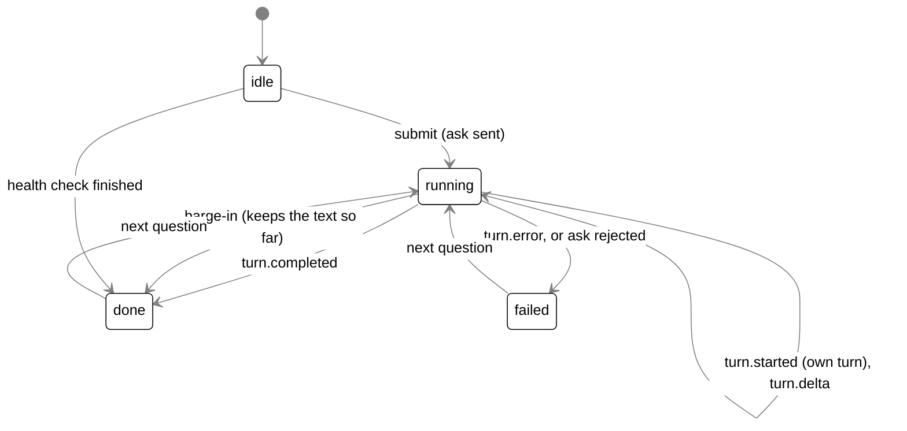

# The companion UI

## Purpose

`bodies/ui` (`@tagalong/ui`) holds the React components both hosts render: Scout's bubble and
the cards it hosts, the dock pet, the status marks and Home. It never
imports Electron, opens a socket or calls a Node API. Each host hands it a `HostBridge`, and that
is all it knows about the outside world.

The desktop windows that render these components are in [desktop.md](desktop.md). Speech (the
queue, the mouth, listening) is in [voice.md](voice.md); this doc covers only what the bubble
decides to hand to it.

## Where it lives

| Path (under `bodies/ui/src/`)                        | What it holds                                                                                                                                                                  |
| ---------------------------------------------------- | ------------------------------------------------------------------------------------------------------------------------------------------------------------------------------ |
| `index.ts`                                           | The public surface                                                                                                                                                             |
| `host-bridge.ts`                                     | `HostBridge`, `TurnEvent`, `AskInput`, `HostBridgeProvider`, `useHostBridge`                                                                                                   |
| `test-support/fake-host-bridge.ts`                   | `createFakeHostBridge`, `FakeHostBridge` (exported for host tests)                                                                                                             |
| `companion-bubble.tsx`                               | `CompanionBubble`, `GreetingLine`, `BubbleTalk`                                                                                                                                |
| `chat-styles.ts`, `chat-icons.tsx`, `scout-mark.tsx` | `CHAT_CSS` (the chat window's look), the close and collapse icons, `ScoutMark` (Bean's still tile)                                                                             |
| `answer.tsx`                                         | `Answer` (Markdown), `ANSWER_CSS`                                                                                                                                              |
| `connector-confirm.tsx`, `drop-card.tsx`             | The other cards in the bubble; the confirm card also shows Scout's `choose` asks (a text field for `free_text`, the `recommended` option first with a quiet "Recommended" tag) |
| `approved-card.tsx`                                  | `ApprovedReport` (the panel's host of the "Approved for you" card), `ApprovedCard`                                                                                             |
| `health-ask.ts`, `health.ts`, `health-card.tsx`      | "Scout, what's wrong?": `wantsHealthCheck`, `healthRows`, `healthHeadline`, `HealthCard`                                                                                       |
| `stop-status.ts`                                     | `stopStatus`: the quiet line for a turn that ended with nothing said                                                                                                           |
| `status-mark.tsx`                                    | `StatusMark` (`tag` and `row`)                                                                                                                                                 |
| `job-line.tsx`                                       | `useRunningStep`, `JobLine`: the live job line                                                                                                                                 |
| `dock-pet.tsx`, `theme/bean-clip.tsx`                | `DockPet`, `DockMood`, `BeanFigure`, `ListeningDot`; `BeanClip`                                                                                                                |
| `home/`                                              | `HomeView` and its pages                                                                                                                                                       |
| `voice/`                                             | `PushToTalk`, `ListenController` (see [voice.md](voice.md))                                                                                                                    |
| `theme/tokens.ts`, `settings/settings-styles.ts`     | Theme tokens; `SETTINGS_CSS`                                                                                                                                                   |

Host-side files that feed these components: `bodies/desktop/src/renderer/src/panel.tsx` (the bubble),
`avatar.tsx` and `dock.ts` (the dock pet's mood), `home.tsx` (Home).

## How it works

### Long answers

The bubble shows what Scout writes; it does not cut or summarise anything. Scout's soul tells it to put the
gist first, laid out so it is easy to follow, and give the detail when asked, so a long tool result or
expert report (which reaches Scout as a capped preview, see [brain.md](brain.md#long-tool-output))
appears as a short structured answer plus an offer of the rest.

### The HostBridge contract

`HostBridge` (`host-bridge.ts`) is every call and notification a component may use. Four members
are required:

- `ask(input: AskInput): Promise<{ turnId }>`. `AskInput` is `{ petId, conversationId?, text?,
snapshot?, spoken?, drop? }`. No `conversationId` opens a new conversation; `turn.started`
  reports its id. `spoken: true` marks a question asked by voice. `drop: true` is set only by a
  button on the drop card, and the host then reads the dropped item and attaches it as
  `snapshot.dropped`.
- `interrupt(turnId)`.
- `onTurnEvent(handler)`, returning an unsubscribe function.
- `listPets()`.

Every method is required: Home's calls (approvals, jobs, connections, permissions, memories,
`usageSummary`), the hand-off questions, `approveTool` and the health calls (`checkHealth`,
`openFix`, `openLogs`). On desktop the preload supplies all but the health calls (`PreloadBridge`);
the renderer's `fullBridge()` adds those. Each method's channel on desktop is in
[desktop.md](desktop.md#the-ipc-modules).

`TurnEvent` is derived from the protocol's notification catalog, not restated: `{ type: N } &
NotificationParamsOf<N>` for every `turn.*` notification plus `connector.confirm`, `connector.dismiss`,
`connections.changed` and `pet.remark`. A new `turn.*` notification is therefore a compile error in
the UI, never a silently ignored event. The desktop host sends every notification as `{ type:
method, ...params }`; main's own `presence.away` and `presence.back` travel the same channel to
the avatar.

`HostBridgeProvider` puts a bridge in React context; `useHostBridge()` throws "useHostBridge must
be used inside a HostBridgeProvider" when none is there, so a wiring mistake fails loudly.

**The fake bridge.** `createFakeHostBridge(options)` (`test-support/fake-host-bridge.ts`) is an
in-memory `HostBridge` shipped from the package, so a body's tests can use it too. `emit(event)`
delivers an event to every subscriber synchronously, so tests need no timers. `ask` resolves
`{ turnId: 'turn-<n>' }`, and the fake records what components asked for: `asks`, `interrupts`,
`approvals`, `copied` and the rest. Options seed its data (`pets`, `jobs`, `memories`,
`permissions`, ...). Its `checkHealth` rejects; a test that wants a health card replaces it.

### CompanionBubble

The desktop panel window renders `CompanionBubble` (`companion-bubble.tsx`) inside
`HostBridgeProvider`. Its props, as the panel passes them: `petId`, `petName`, `snapshot` (what the
ask hotkey captured), `expanded`, `tail` (`'left' | 'right'`, the side the pet is on),
`speaking` and `onStopSpeaking`, `talk` (`BubbleTalk`: the mic state,
heard text, partials, the key label, Always listening), `seeing` (`{ on, onToggle }`),
`drop`, `status`, and the callbacks `onOpenChat`, `onCollapse`, `onClose`,
`onDropDone`.

It renders one of two looks:

| Look      | When       | Shows                                                                                                                                                         |
| --------- | ---------- | ------------------------------------------------------------------------------------------------------------------------------------------------------------- |
| Bubble    | default    | chips and the header switches, "You said" for a spoken question, the latest answer, the cards, the status row, the question box, hints and **Open full chat** |
| Full chat | `expanded` | a header (name, switches, **Back to bubble**, ×), the whole conversation with the cards inline, and a **Message** box                                         |

The bubble and the full chat are the same component instance state, so they show the same
conversation: past exchanges (`Exchange { question, answer, failed }`) plus the current one.

**Scout's own line.** A line Scout starts (a remark) is kept as `scoutLine`, separate from `reply`,
and seeded from the `remark` prop when the person clicks the quiet line open (`GreetingLine`
`onOpen(text)`; the panel hands the text over, see [desktop.md](desktop.md)). A `pet.remark` turn
event while the bubble is open sets it too. Asking anything moves it into `past` as an `Exchange`
with `question: null`, so a follow-up keeps it and the full chat shows it first, with no user tile.
Lines Scout starts show `ScoutMark` (Bean's still, from the `scout` prop, 20 px) and the name above
the words; replies to the person's own questions show neither. The quiet line also shows a muted
"Click to reply" and three bars while Scout reads it aloud.

**The full chat window** (`CHAT_CSS`): a 52 px header (name, the two switches, a separator, then
**Back to bubble** and **Close** as drawn icon buttons that keep their names), a log with 24 px
between turns and 12 px inside one, your messages on a tile, Scout's replies full width, code blocks
with a hairline edge and muted list markers. The log scrolls to the newest message when the chat
opens and whenever a message, the streamed text or Scout's line changes, never while you type. While
a turn runs with no text yet the log shows a gold dot, "Scout is thinking…" and **Stop** on one
row; streamed text ends in a gold cursor; the field is dimmed (`aria-busy`) but stays focusable and
Enter is ignored. The approval card in the chat takes the card surface with 16 px inside. The footer
puts the status row above the field, with the mic inside it and a 2 px gold focus ring. The
placeholder is "Reply to Scout" after Scout's line, otherwise "Ask Scout anything". An empty chat
shows a 48 px Bean, "Ask Scout anything about what is on your screen." and, when talking is wired,
"Hold [key] to talk" with the real key from `talk.keyLabel`. Padding rule: anything bordered or
filled that holds text keeps at least 8 px inside (12 to 16 px for cards and message tiles).

**Asked from Home.** The optional `onAsk` prop subscribes to text Home sends as the person ("Ask Scout to fix it" sends "Fix text from pictures"); the bubble asks it like typed text and keeps the words on screen, with no snapshot. Empty text is ignored. The desktop panel opens the full chat when one arrives.

**One answer, as a state machine.** `reply` is one of:

- `submit(text, context, asSpoken, heard, withDrop)` moves a finished exchange into `past`, then
  either runs the health check (see below) or sets `running` with `turnId: null` and calls
  `bridge.ask` with the current `conversationId`. The ask's `turnId` fills `mine` if
  `turn.started` has not already.
- `turn.started` is taken only while `running` and only when it is not `background: true` (a
  job's turn never answers in the bubble). It sets `mine` and the conversation id
  the next question continues.
- `turn.delta` and `turn.completed` count only for `mine`. A completed turn with no text and a
  `stopReason` shows `stopStatus` as a quiet line ("Declined" for `refusal`, "Stopped: too many
  steps" for `tool_limit`), never spoken. Otherwise the answer shows through `Answer`. With Scout talks
  on the brain reads a typed question's answer aloud too (the `read_aloud` event, docs/voice.md).
- `turn.error` for `mine`, or a rejected `ask`, shows a `role="alert"` line (the error message, or
  "Tagalong could not reach its brain.").
- **Stop** (while running) calls `interrupt(mine)`.
- A spoken question (`talk.onHeard`) asks with `asSpoken`, so the ask carries `spoken: true`. The
  brain speaks the answer and the panel plays it ([voice.md](voice.md)). After the turn completes
  the hints show "Hold <key> to reply".
- **Talking over a spoken answer** (Always listening) does not go through `onListen`: the panel
  pauses Scout, and words that are not noise or Scout's echo arrive as an ordinary heard question
  whose `say` carries `interrupted` (see [Voice](voice.md#talking-over-scout)).
- **Barge-in** (`talk.onListen` while running) interrupts the turn, clears `mine` and keeps what
  was said so far as `done`. The panel's `SpeechPlayer.stop()` tells the brain to `hush`.

**Chips.** `chipsOf(snapshot)` makes up to two removable chips: the app (`name · window title`),
and `Selected text`. Removing one leaves that part out of the ask (`without`). A new snapshot
brings every chip back.

**The header.** The bubble's surface is `on-navy` (and injects `CONTROLS_CSS`), so focus rings are gold. In the compact bubble the header row holds only the switches, the speaking indicator and ×; the context chips sit in their own row below it, so they never crowd the close button. The mic button sits inside the question box (the box pads 44px on the right for it). **Always listening** and **Seeing**
are `role="switch"` buttons with `aria-checked`; Seeing calls `toggleSightPause` (the same pause as
the hotkey and the tray). The question box has its own `aria-label` ("Ask Scout", "Message Scout")
so the mic button inside its label never joins its name. A speaking indicator (three bars scaled
by `--tg-voice-level`) doubles as **Stop speaking**. The talk status line says "Listening. Start
with “Scout” to ask.", "Listening paused during a call or full screen.", "Listening… let go of the
key, or click the mic, to send." or "Turning that into text…", plus any `talk.note` and the words
heard so far (`aria-live="off"`).

**The "Approved for you" card.** It is not one of the bubble's cards: the desktop panel hosts it
(`ApprovedReport`, subscribed to `bridge.onApproved`) above whatever the panel shows, the bubble or
a quiet line, so it appears either way. It is a quiet "Approved for you: {text}" with "per
'{preference}'", no speech and no buttons, and it goes after about 7 seconds. When main brought a
hidden panel up only for it (`cameUp` on the notice), the panel hides again as the card goes; a
panel that was already showing is left alone.

**The cards.** Below the answer, in this order: the drop card, then the connector confirm card.
The bubble keeps each one's state from its notification:

| Card                   | Opened by           | Buttons and bridge calls                                                                                                                                                                                                                                                                                                                                                                                                                                                                                                                                                                                                                                                                                                                                                                           | Closes when                                                                                                  |
| ---------------------- | ------------------- | -------------------------------------------------------------------------------------------------------------------------------------------------------------------------------------------------------------------------------------------------------------------------------------------------------------------------------------------------------------------------------------------------------------------------------------------------------------------------------------------------------------------------------------------------------------------------------------------------------------------------------------------------------------------------------------------------------------------------------------------------------------------------------------------------- | ------------------------------------------------------------------------------------------------------------ |
| `DropCard`             | the `drop` prop     | Explain (asks "Explain this." or the person's words), Hand it to an expert (asks "Hand this to an expert: … (path)"), both with `drop: true`; Cancel                                                                                                                                                                                                                                                                                                                                                                                                                                                                                                                                                                                                                                               | a button; a new drop reopens it                                                                              |
| `ConnectorConfirmCard` | `connector.confirm` | The options are a vertical stack of full-width rows (`.bubble-choices`, one row per `.bubble-choice`, labels wrap, the recommended row first and primary; a permission ask has no recommended option, so its first row is primary): Allow once / Always allow / Deny (`approveTool(approvalId, 'once' \| 'always' \| 'deny')`). Always allow shows only when the event's `options` include `always` (a locked tool has none); an event without `options` gets Allow once and Deny. A brain ask (it has `options`) leads with Scout's own words and shows the tool name, never "Change in <app>"; its text shows whole. Open asks queue oldest first and the card shows the head, so several asks at once each get their turn. A click that does not get through (brain offline) leaves the card up | an answer that got through; its turn ending; `connector.dismiss` for it; `asks.changed` no longer listing it |

Asks are described in [brain.md](brain.md).

**Loops in the bubble.** When Scout brings up a held loop (see [brain.md](brain.md#loops)) it asks
with `choose`, so Show, Done and Later are these same option rows, the recommended one first. The
answer comes back to Scout as a `choice` event and Scout calls its loop tools. There is no loop card
or frame of its own.

**GreetingLine.** The quiet line beside the pet, rendered by the panel instead of the bubble for
a remark or a brain status mark. It fades after `holdMs` (7,000 ms
by default, 12,000 for remarks) with a 300 ms fade (`LEAVE_MS`); pointing at it or
focusing it holds it. Clicking the text opens the bubble (`onOpen(text)`, so the words carry over);
× closes it (`onDone`). It shows Scout's mark and name, a "Click to reply" hint and, with `speaking`,
the reading-aloud bars. A status line shows no mark.
Optional `status` shows a `StatusMark` row with Fix it in place of text.

**The live job line.** While any expert job runs, `CompanionBubble` shows one muted 12 px line
above the status row: `<expert>: <step title>` (`Claude Code: npm init -y`), from `job-line.tsx`.
`useRunningStep(bridge)` calls `runningSteps()` on mount and on each `onBrainChanged` of
`job_activity` or `jobs`, at most once per 250 ms (leading read, then one trailing read). With
several jobs running it shows the first entry, the most recently updated. It shows the step's own
title only, never output, so nothing new needs masking. It takes no space when absent, is
`aria-live="off"`, is never spoken, truncates with an ellipsis (the full text is its `title`), and
disappears when the next `jobs` change leaves nothing running. A failed read (brain offline) logs
once and shows no line.

```mermaid
%%{init: {"theme": "base", "themeVariables": {"primaryColor": "#ffffff", "primaryTextColor": "#000000", "primaryBorderColor": "#000000", "lineColor": "#808080", "arrowheadColor": "#808080", "secondaryColor": "#f2f2f2", "tertiaryColor": "#ffffff", "clusterBkg": "#f7f7f7", "clusterBorder": "#808080", "edgeLabelBackground": "#ffffff", "titleColor": "#808080", "actorBkg": "#ffffff", "actorBorder": "#000000", "actorTextColor": "#000000", "actorLineColor": "#808080", "signalColor": "#808080", "signalTextColor": "#808080", "sequenceNumberColor": "#ffffff", "labelBoxBkgColor": "#ffffff", "labelBoxBorderColor": "#808080", "labelTextColor": "#000000", "loopTextColor": "#808080", "noteBkgColor": "#f7f7f7", "noteBorderColor": "#808080", "noteTextColor": "#000000", "activationBkgColor": "#f7f7f7", "activationBorderColor": "#808080", "fontFamily": "Segoe UI, Helvetica, Arial, sans-serif"}}}%%
flowchart LR
  A[brain: changed job_activity or jobs] --> B[useRunningStep, 250 ms throttle]
  B --> C[bridge.runningSteps]
  C --> D[JobLine in the bubble]
```

**Placement.** `Speech` wraps every look and draws a rotated square as the tail on the `tail` side,
34 px above the bottom, so the bubble reads as the pet speaking. Main places the window; see
[desktop.md](desktop.md#the-window-inventory).

### The health check

`wantsHealthCheck(text)` (`health-ask.ts`) matches only a whole question, after lower-casing and
removing "hey", "Scout" and "please": "what's wrong (with you)", "what is the matter", "are you
ok/okay/alright", "(run a) health check", "is something/anything wrong with you", "why can't you
hear/see me". "What's wrong with this code" or "are you working?" stay with Scout.

On a match, when the bridge has `checkHealth`, the bubble interrupts any running turn and shows
`HealthCard` instead of asking: no turn, no tool and no model call. `healthRows(facts)` turns
`HealthFacts` (`connections`, `voice`, `microphone`, each
possibly `'unknown'`) into one row per check, `ok`, `broken`, `info` or `unknown` (`Not
checked.`); `healthHeadline` counts the broken rows ("Everything’s working.", "Two things need
you."). The headline is kept as the exchange's answer; nothing is said aloud. A check that fails
shows "Health check failed."; one that finishes after a newer question is dropped (`healthRun`).
Each broken row has Fix it (`openFix(target)`), and **Open logs folder** calls `openLogs`.

On desktop the panel builds `checkHealth` from calls that already exist (`gatherHealth`,
`renderer/src/health-facts.ts`), each limited to `HEALTH_TEST_BUDGET_MS` (5,000 ms); a slow or
failed call makes only its own row `unknown`. `openFix` is `openSettings(target)` and `openLogs`
is `openLogsFolder`.

### Show-only blocks

The mind decides what is said: everything it writes is spoken except what it puts in a show-only
block, which the bubble shows and the voice skips. Show-only means a fenced code block, a table row
(a line starting with `|`) or a quoted line (starting with `>`). Bare URLs are dropped too. The
brain does this before it speaks (`brain/src/brain/voice/speakable.py`; see
[brain.md](brain.md#brain-mouth)); the bubble only shows the full answer.

### Answers

`Answer` (`answer.tsx`) renders answers with `react-markdown` and `remark-gfm` (`skipHtml`: HTML
stays out; a link renders as text with its address in `title`, because a click would navigate the
bubble's own window). A fenced block is an ordinary code block.

### Status marks

Only the mind speaks in Scout's voice. What the body knows (it cannot think, the microphone is
busy, the brain is loading its speech models, listening is paused) shows as a neutral status mark.

- **The wording table** is `bodies/ui/src/shapes/status.ts`. `StatusId`, in the order that picks
  the top mark: `brain-offline`, `brain-outdated`, `ears-failed`, `mic-busy`,
  `mic-failed`, `ears-loading`, `listening-paused`, `say-name`, `listening-on`. `StatusMark { id,
percent? }`. `STATUS_WORDS[id]` holds `tag` (one or two words on Scout), `detail` (the tooltip,
  the aria label and the bubble row) and an optional `fix` (a `FixTarget`: `brain`, `voice`,
  `browser`, `privacy`, `experts`, `connections`). A mark with a fix is a problem. `statusTag`
  adds the download percent ("Ears 40%"); `topStatus` picks the first by order.
- **The component** is `StatusMark` (`status-mark.tsx`) with `variant`:
  - `tag`: a pill at the dock pet's bottom centre, 18 px up so it clears the 8 px dots in the
    corners, `data-testid="status-mark"`, `data-id`, `data-tone` (`warn` or `muted`), `detail` as
    its `title`. Not a button: Scout is the button.
  - `row`: a `role="status"` line in the bubble above the question box
    (`data-testid="status-row"`), with **Fix it** when the table names a fix and the host passed
    `onFix`.
    Problems use the warn colours, the rest the muted ones; nothing animates.
- **The holder** is main's `StatusMarks` (`bodies/desktop/src/main/status-marks.ts`): one map, an
  optional time limit per mark, and a callback that broadcasts the top mark on
  `IPC.statusMarkEvent`. Windows read `getStatusMark()` on mount. Who sets what:

| Mark                                           | Set by                                                                                                                 | Cleared by                                       |
| ---------------------------------------------- | ---------------------------------------------------------------------------------------------------------------------- | ------------------------------------------------ |
| `brain-offline`, `brain-outdated`              | `markBrainLink`: from the brain link status (offline, or an outdated brain)                                            | the link coming back to online                   |
| `listening-on`                                 | `markListening`: at launch when Always listening is on, and each time it is switched on, for 8 s (`LISTENING_MARK_MS`) | the time, or switching it off                    |
| `listening-paused`                             | `markListening`: on but paused (a call, full screen)                                                                   | resuming or switching off                        |
| `ears-loading` (with `percent`), `ears-failed` | `createVoiceBridge` from the brain's `voice` frames (`loading` with progress, `ready`, `failed`)                       | the next `ready`                                 |
| `mic-busy`, `mic-failed`, `say-name`           | the panel only, through `IPC.setStatusMark(id, on)`; `say-name` for 8 s (`SAY_NAME_MARK_MS`)                           | the panel; `setPanelMark` refuses every other id |

A turn that ends with nothing said is not a status mark; it shows `stopStatus`'s line.

### DockPet and the moods

`DockPet` (`dock-pet.tsx`) draws Bean, the 3D Scout, in a 96 px box from pre-rendered clips. The
host bundles the strips and hands them in as `figure: BeanFigure` (one `BeanClipData { src, frames,
fps, loop }` per mood plus `idle-blink` and `listening-blink`). On desktop the strips are 192 px
frames at 12 fps (`renderer/src/bean/manifest.json`), loaded by `bean-assets.ts`.

`BeanClip` (`theme/bean-clip.tsx`) shows one strip as a CSS background stepped with `steps()`: a
loop runs forever; a one-shot (a blink) runs `steps(n-1)` with `forwards` and holds
its last frame. With `still` (reduced motion) it shows frame 0 of a loop or the last frame of a
one-shot. Each clip is keyed by mood, so a one-shot always plays from its first frame.

**The moods** (`DockMood`) and what the dock shows:

| Mood        | Tag (9 px, top right) | Means                                                   | Label words                    |
| ----------- | --------------------- | ------------------------------------------------------- | ------------------------------ |
| `idle`      | none                  | nothing going on                                        | is idle                        |
| `listening` | Seeing (blue)         | a capture just happened, or a drop is held over the pet | is looking at your screen      |
| `reading`   | none                  | a screen tool is in flight                              | is reading your screen         |
| `thinking`  | none                  | Scout is answering the person                           | is thinking                    |
| `working`   | Working (gold)        | one of Scout's own background turns (a job)             | is working on a job of its own |
| `dozing`    | none                  | the person is away or the screen is locked              | is dozing                      |

**Where the mood comes from.** The desktop avatar page keeps `DockState` with a pure reducer,
`nextDock` (`bodies/desktop/src/renderer/src/dock.ts`), over every `TurnEvent`, main's
`presence.away` / `presence.back`, and its own events (`seeing` and `seen` around a capture
notice, `dropHover`, `dropLeave`). `dockMood(state)` picks, in
order: seeing, reading, thinking, working, a held drop (Seeing), dozing, idle.

- A `turn.started` without `background` adds to `turns` (thinking); with `background: true` to
  `jobs` (working). `turn.completed` and `turn.error` remove the turn from both and from `reading`
  (an aborted turn sends no tool result).
- `reading` is a `turn.toolRequest` for one of `READING_TOOLS` (`list_windows`,
  `read_window_text`, `look_at_window`; spelled out because the renderer never bundles main) until its `turn.toolResult`.
- Seeing lasts `SEEING_MS` (2,500 ms, `avatar.tsx`) after a capture notice that was neither paused
  nor blocked.
- Presence comes from main (`presence.ts#watchPresence`): `powerMonitor.getSystemIdleTime()`
  every 15 s (`PRESENCE_POLL_MS`), away after 5 minutes (`AWAY_AFTER_MS`), and the
  `lock-screen` / `unlock-screen` events.

**Marks that show in every mood:**

- `sightPaused`: a Paused pill top left (`data-testid="paused-eye"`). It also hides the mood's tag,
  which would overlap it; the pose and the label still say the mood.
- `listening` (`ListeningDot`): `on` (a solid dot), `paused` (an outline), `hearing` (a pulse while
  speech is heard; no words are read) and `follow-up` (a ring: one reply needs no name). The avatar
  derives it from `ListeningState` and the ears' `speechStart` / `turnEnd`.
- `status`: the top status mark as a `tag`.

The `aria-label` reads `<name> <mood words>`, then ", sight paused",
", listening" (or "listening paused", "listening for your reply") and the status mark's detail.

**Blinking.** In `idle` and `listening` only, a blink is due every 3 to 6 s (random, or
`blinkEveryMs`). It waits for the loop's `animationiteration` (frame 0, the pose the blink was
rendered from), then shows the blink clip over the hidden loop for `frames / fps` (2/12 s), so
nothing jumps. A mood change cancels a waiting blink; reduced motion turns blinking off.

**Input.** The avatar page wraps `DockPet` in a button. A press that moves more than
`DRAG_THRESHOLD` (4 px, `dock.ts#moveDrag`) is a drag: each step goes to main as `dragAvatar(dx,
dy)` and the release as `dropAvatar()`. A press that does not move is a click: `looked`, then
`openBubble()`. A file, link or text dragged in from another app is a drop (`pet-input.ts`), never
a drag of the pet. Drops are in [desktop.md](desktop.md#the-ipc-modules) (`dropOnPet`).

### Home

`HomeView` (`home/home-view.tsx`) is the whole Home window. The desktop page (`renderer/src/
home.tsx`) gives it `window.tagalong` as the bridge, a `HomeHost`, Bean's idle clip as `scout`
(drawn still in the nav tile) and the settings form as the `settings`
slot.

`HomeHost`: an optional `status()` (the overview's line: "Ready", or "Ready, sight paused"
when sight is paused).

The nav lists six pages (`HomePage`), the companion's name filling in where it appears:

| Page (`HomePage`)               | Component                  | Reads and writes                                                                                                                                |
| ------------------------------- | -------------------------- | ----------------------------------------------------------------------------------------------------------------------------------------------- |
| Overview (`overview`)           | `Overview`                 | `host.status()`; `WhereThingsRun`; the Spend card (`usageSummary`)                                                                              |
| Jobs (`jobs`)                   | `JobsPanel`                | `listJobs`, `stopJob`, and the hand-off questions; re-reads on `onBrainChanged('jobs')`                                                         |
| Connections (`connections`)     | `ConnectionsPanel`         | `listConnections`, `addConnection`, `setConnectionEnabled`, `restartConnection`, `removeConnection`, `setupOverview`, `setupExpert`, `setupApp` |
| Approvals (`approvals`)         | `ApprovalsView`            | `listApprovals`, `listPreferences`, `removePreference`, `editPreference`; re-reads on `onBrainChanged('approvals')`                             |
| What Scout remembers (`memory`) | `MemoryView`               | `listMemories`, `deleteMemory`; re-reads on `onBrainChanged('memory')`                                                                          |
| Settings (`settings`)           | the host's `settings` slot | the host's settings form, then `PermissionsPanel`                                                                                               |

- **Navigation.** The `page` prop selects a page when the host names one (main's
  `homePageEvent`, through `homeTarget`, which also splits `settings#<section>` for a Fix it and
  scrolls to that Settings section, trying every 100 ms up to 30 times). `onPage` reports each move.
- **Approvals.** `ApprovalsView` (`home/approvals-view.tsx`) has two halves. `PreferencesList`
  (`preferences-list.tsx`) lists "STANDING PREFERENCES", the built-in default first: each card shows
  the sentence, "Agreed {day}", "Used {n} times" and "Last used" once used, with **Edit** (an inline
  field with **Save** and **Cancel**; an empty sentence is refused) and **Remove**. A refusal from
  the brain shows as an alert in the brain's own words (Electron's "Error invoking remote method"
  prefix is stripped, as on the Connections page); **Cancel** clears it. With none: "None yet. Scout offers one
  after you approve the same kind of thing a few times." `ApprovalHistory` (`approval-history.tsx`)
  shows a summary strip (asks, Scout answered, refused), the **All** / **Decided by Scout** /
  **Refused** filter with its counts, and rows grouped by local day (Today, Yesterday, then the date):
  time, what was asked, where it came from (Expert, Scout tool, Connected app), who
  decided, and a chip (Approved, Refused, Timed out, No one online). A Scout row reads "Scout decided,
  per your preference" with the sentence it relied on, and an "Auto" pill. A row a standing rule decided (a tool set to Auto, `decided_by: "rule"`) shows its chip and no "decided by" line. **Show more** pages back
  with `before: next`; a click while that read is out is ignored, and an answer for a list since
  re-read (a new filter, a change notice) is dropped. Until a read succeeds nothing is claimed; a failed read shows an alert.
  `e2e/approvals.spec.ts` covers it on the fake brain.
- **Jobs.** `JobsPanel` (`home/jobs-panel.tsx`) lists the jobs Scout handed to Claude Code, each with
  Stop while it runs; see [brain.md](brain.md#experts).

## Interfaces

- `HostBridge`, `AskInput`, `TurnEvent` (`host-bridge.ts`).
- `CompanionBubbleProps`, `BubbleTalk { state: 'idle' | 'listening' | 'hearing', onHeard,
onListen?, note, partial?, keyLabel, onMic, always? }`, `GreetingLineProps`.
- `DropOffer = { dropped, explain } | { refusal }` (`drop-card.tsx`).
- `DockPetProps { pet, mood, figure, sightPaused?, listening?, blinkEveryMs?,
status? }`, `DockMood`, `ListeningDot`, `BeanFigure`, `BeanClipData`.
- `useRunningStep(bridge): RunningStep | null`, `JobLine({ step })` (`job-line.tsx`).
- `StatusMarkProps { mark, variant: 'tag' | 'row', onFix? }`; `StatusId`, `StatusMark`,
  `STATUS_WORDS`, `FixTarget` (protocol).
- `HomeViewProps { host, scout, settings, page?, onPage? }`, `HomeHost`, `HomePage`.
- `HealthFacts`, `HealthRow`, `HealthCheckId`.

## Constants and limits

| Constant                                | Value                                   | Where                                             |
| --------------------------------------- | --------------------------------------- | ------------------------------------------------- |
| `GreetingLine` `holdMs`                 | 7,000 ms default; 12,000 ms for remarks | `companion-bubble.tsx`, `panel.tsx`               |
| `LEAVE_MS`                              | 300 ms fade                             | `companion-bubble.tsx`                            |
| Answer box height                       | 260 px max, then scrolls                | `companion-bubble.tsx` (`BUBBLE_CSS`)             |
| `HEALTH_TEST_BUDGET_MS`                 | 5,000 ms per call                       | `bodies/desktop/src/renderer/src/health-facts.ts` |
| Dock size (`SIZE`)                      | 96 px                                   | `dock-pet.tsx`                                    |
| Blink interval                          | 3,000 to 6,000 ms                       | `dock-pet.tsx`                                    |
| `SEEING_MS`                             | 2,500 ms                                | `bodies/desktop/src/renderer/src/avatar.tsx`      |
| `DRAG_THRESHOLD`                        | 4 px                                    | `bodies/desktop/src/renderer/src/dock.ts`         |
| `LISTENING_MARK_MS`, `SAY_NAME_MARK_MS` | 8,000 ms each                           | `bodies/desktop/src/main/status-marks.ts`         |

## Storage

None. The bubble's conversation, cards and chips live in component state for as long as the panel
window exists (main hides it rather than closing it). Everything durable is behind the bridge in
the brain.

## Failure handling

- A rejected `ask` shows the error as a `role="alert"` line; the panel never sits streaming.
- `turn.error` shows its message. A turn with no text and a refusal or tool-limit reason shows
  the quiet `stopStatus` line.
- A card's bridge call that fails: the connector confirm card keeps the card and shows the error.
- A health check that throws shows "Health check failed."; a late one is dropped.
- `useHostBridge` throws without a provider.

## Privacy notes

The UI only sees what the bridge returns: keys never cross it. Removing a
chip keeps that part out of the ask. A dropped item is sent only by a drop card button. Status
marks and the health card are shown, never spoken. See [privacy.md](privacy.md).

## Tests that pin it

| Test (under `bodies/ui/src/` unless noted)                                       | Pins                                                                                                                                                                                                                                                                                                 |
| -------------------------------------------------------------------------------- | ---------------------------------------------------------------------------------------------------------------------------------------------------------------------------------------------------------------------------------------------------------------------------------------------------- |
| `companion-bubble.test.tsx`                                                      | chips and `without`; streaming with Stop; formatted answers; continuing the conversation; failures; full chat; background turns ignored; × close; the tail side; `GreetingLine` timing, hold and offers; the header switches; mic, partials, spoken questions and barge-in; typed questions unspoken |
| `chat-styles.test.ts`, `scout-mark.test.tsx`, `answer.test.tsx`                  | the chat's padding minimums, 52 px header, rhythm, pill, thinking row, cursor, field and empty-state rules; the mark's size; code block and marker styles                                                                                                                                            |
| `companion-bubble-health.test.tsx`                                               | the health card instead of a turn, nothing said aloud, Fix it, Open logs folder, real questions left to Scout, a host without the check, failure, late results dropped                                                                                                                               |
| `health-ask.test.ts`, `health.test.ts`, `health-card.test.tsx`                   | which questions match; rows and the headline; the card                                                                                                                                                                                                                                               |
| `answer.test.tsx`                                                                | Markdown formatted, links as text, HTML as text, tables                                                                                                                                                                                                                                              |
| `connector-confirm.test.tsx`, `drop-card.test.tsx`                               | each card's buttons and bridge calls; the drop card's asks and secrets refusal                                                                                                                                                                                                                       |
| `status-mark.test.tsx`                                                           | the tag, its tooltip and tone, the percent, its position above the dots; the row with or without Fix it                                                                                                                                                                                              |
| `dock-pet.test.tsx`, `theme/bean-clip.test.tsx`                                  | the 96 px box, tags and their place, the paused, listening and status marks, labels, blinking at frame 0, reduced motion, one-shots from their start                                                                                                                                                 |
| `bodies/desktop/src/renderer/src/dock.test.ts`                                   | the mood reducer and its order, reading tools, background turns, drag threshold                                                                                                                                                                                                                      |
| `home/home-view.test.tsx`                                                        | six pages, Bean in the nav, the overview, the status line, page routing, the removed pages absent                                                                                                                                                                                                    |
| the other `home/*.test.tsx`                                                      | each page's list, actions, live re-reads, empty and failure states                                                                                                                                                                                                                                   |
| `host-bridge.test.tsx`, `test-support/fake-host-bridge.test.ts`, `index.test.ts` | the provider and its loud failure, the public surface                                                                                                                                                                                                                                                |
