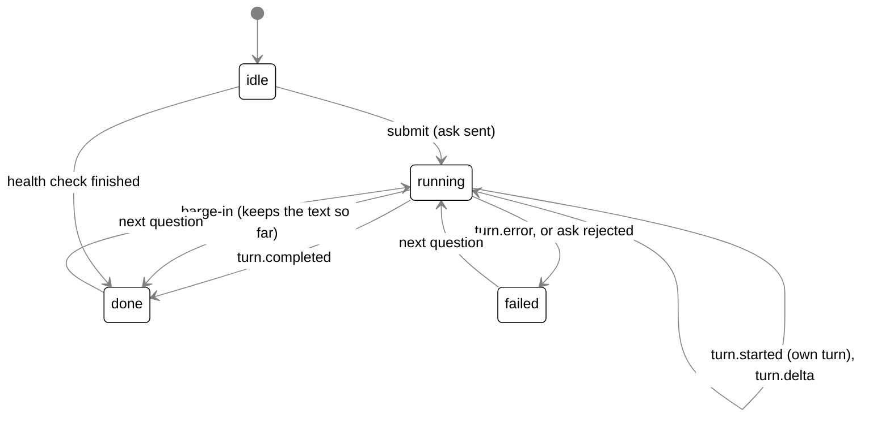

# The companion UI

## Purpose

`bodies/ui` (`@tagalong/ui`) holds the React components both hosts render: Scout's bubble and
the cards it hosts, the dock pet, the status marks, Home and the extension's chat panel. It never
imports Electron, opens a socket or calls a Node API. Each host hands it a `HostBridge`, and that
is all it knows about the outside world.

The desktop windows that render these components are in [desktop.md](desktop.md). Speech (the
queue, the mouth, listening) is in [voice.md](voice.md); this doc covers only what the bubble
decides to hand to it.

## Where it lives

| Path (under `bodies/ui/src/`)                                                                         | What it holds                                                                                  |
| ----------------------------------------------------------------------------------------------------- | ---------------------------------------------------------------------------------------------- |
| `index.ts`                                                                                            | The public surface                                                                             |
| `host-bridge.ts`                                                                                      | `HostBridge`, `TurnEvent`, `AskInput`, `ConfirmHandoff`, `HostBridgeProvider`, `useHostBridge` |
| `test-support/fake-host-bridge.ts`                                                                    | `createFakeHostBridge`, `FakeHostBridge` (exported for host tests)                             |
| `companion-bubble.tsx`                                                                                | `CompanionBubble`, `GreetingLine`, `TryItInvite`, `BubbleTalk`                                 |
| `answer.tsx`                                                                                          | `Answer` (Markdown), `DraftBlock` (a draft with Copy), `ANSWER_CSS`                            |
| `handoff-card.tsx`                                                                                    | `ProposalCard`, `HandoffStatus`, `Handoff`, `withProgress`, `undelivered`, `HANDOFF_CSS`       |
| `connector-confirm.tsx`, `routine-card.tsx`, `settings-card.tsx`, `pick-up-card.tsx`, `drop-card.tsx` | The other cards in the bubble                                                                  |
| `health-ask.ts`, `health.ts`, `health-card.tsx`                                                       | "Scout, what's wrong?": `wantsHealthCheck`, `healthRows`, `healthHeadline`, `HealthCard`       |
| `stop-status.ts`                                                                                      | `stopStatus`: the quiet line for a turn that ended with nothing said                           |
| `status-mark.tsx`                                                                                     | `StatusMark` (`tag` and `row`)                                                                 |
| `dock-pet.tsx`, `theme/bean-clip.tsx`                                                                 | `DockPet`, `DockMood`, `BeanFigure`, `ListeningDot`; `BeanClip`                                |
| `chat-panel.tsx`, `message-list.tsx`, `composer.tsx`, `sight-bar.tsx`                                 | The extension's chat panel                                                                     |
| `home/`                                                                                               | `HomeView` and its pages                                                                       |
| `voice/speakable.ts`, `voice/spoken-stream.ts`                                                        | `toSpeakable`, `mergeShortLines`, `SpokenStream`: what of a line is said                       |
| `voice/` (the rest)                                                                                   | `SpeechQueue`, `QueueMouth`, `PushToTalk`, `ListenController` (see [voice.md](voice.md))       |
| `theme/tokens.ts`, `settings/settings-styles.ts`                                                      | Theme tokens; `SETTINGS_CSS`                                                                   |

Host-side files that feed these components: `bodies/desktop/src/renderer/src/panel.tsx` (the bubble),
`avatar.tsx` and `dock.ts` (the dock pet's mood), `home.tsx` (Home),
`apps/extension/src/sidepanel/app.tsx` (the chat panel).

## How it works

### The HostBridge contract

`HostBridge` (`host-bridge.ts`) is every call and notification a component may use. Four members
are required:

- `ask(input: AskInput): Promise<{ turnId }>`. `AskInput` is `{ petId, conversationId?, text?,
snapshot?, spoken?, drop? }`. No `conversationId` opens a new conversation; `turn.started`
  reports its id. `spoken: true` marks a question asked by voice. `drop: true` is set only by a
  button on the drop card, and the host then reads the dropped item and attaches it as
  `snapshot.dropped`.
- `capture(targets): Promise<ContextSnapshot | null>`. Null means the host refused (an excluded
  window, or sight paused), so the UI can say so instead of staying blind.
- `interrupt(turnId)`.
- `onTurnEvent(handler)`, returning an unsubscribe function.
- `listPets()`.

Everything else is optional, so a host without a feature never shows it: `stopWatch`; Home's
calls (activity, the experience log, the Self, experts and the catalog, Waiting on you,
connections, routines, the sight log, memories, `usageSummary`, the calendar link); the hand-off
calls (`pickFolder`, `confirmHandoff`, `dismissHandoff`, `cancelHandoff`, `searchProjects`);
`approveTool`; the pick-up calls (`openPickUp`, `rebriefPickUp`, `dismissPickUp`); `copyText`;
`applySettings`; and the health calls (`checkHealth`, `openFix`, `openLogs`). Each method's
channel on desktop is in [desktop.md](desktop.md#the-ipc-modules).

`TurnEvent` is derived from the protocol's notification catalog, not restated: `{ type: N } &
NotificationParamsOf<N>` for every `turn.*` notification plus `watch.fired`, `watch.status`,
`handoff.proposed`, `handoff.progress`, `handoff.finished`, `connector.confirm`, `connector.dismiss`, `asks.changed`,
`routine.proposed`, `routine.result`, `routines.changed`, `connections.changed`, `pet.mood`,
`settings.proposed` and `pet.remark`. A new `turn.*` notification is therefore a compile error in
the UI, never a silently ignored event. The desktop host sends every notification as `{ type:
method, ...params }`; main's own `presence.away` and `presence.back` travel the same channel to
the avatar.

`HostBridgeProvider` puts a bridge in React context; `useHostBridge()` throws "useHostBridge must
be used inside a HostBridgeProvider" when none is there, so a wiring mistake fails loudly.

**The fake bridge.** `createFakeHostBridge(options)` (`test-support/fake-host-bridge.ts`) is an
in-memory `HostBridge` shipped from the package, so the extension's tests use it too. `emit(event)`
delivers an event to every subscriber synchronously, so tests need no timers. `ask` resolves
`{ turnId: 'turn-<n>' }`, and the fake records what components asked for: `asks`, `interrupts`,
`captures`, `stoppedWatches`, `confirmedHandoffs`, `approvals`, `answeredAsks`, `copied`,
`appliedSettings` and the rest. Options seed its data (`pets`, `capture`, `activity`, `experts`,
`savedAsks`, `routines`, `sightLog`, `memories`, ...) and failures (`selfWriteFails`,
`answerAskFails`). `nextCapture` is what the next `capture()` resolves to; null stands in for a
blocked window. It implements no `checkHealth`; a test adds one.

### CompanionBubble

The desktop panel window renders `CompanionBubble` (`companion-bubble.tsx`) inside
`HostBridgeProvider`. Its props, as the panel passes them: `petId`, `petName`, `snapshot` (what the
ask hotkey captured), `greeting`, `expanded`, `tail` (`'left' | 'right'`, the side the pet is on),
`onSay` and `mouth` (speech), `speaking` and `onStopSpeaking`, `talk` (`BubbleTalk`: the mic state,
heard text, partials, the key label, Always listening), `seeing` (`{ on, onToggle }`), `resume`,
`pickUp`, `drop`, `status`, and the callbacks `onDismiss`, `onOpenChat`, `onCollapse`, `onClose`,
`onPickUpDone`, `onDropDone`.

It renders one of three looks:

| Look      | When                 | Shows                                                                                                                                                         |
| --------- | -------------------- | ------------------------------------------------------------------------------------------------------------------------------------------------------------- |
| Hello     | `greeting && !tried` | `TryItInvite`: the mind's first line (if any), **Try it now**, **Got it**                                                                                     |
| Bubble    | default              | chips and the header switches, "You said" for a spoken question, the latest answer, the cards, the status row, the question box, hints and **Open full chat** |
| Full chat | `expanded`           | a header (name, switches, **Back to bubble**, ×), the whole conversation with the cards inline, and a **Message** box                                         |

The bubble and the full chat are the same component instance state, so they show the same
conversation: past exchanges (`Exchange { question, answer, failed }`) plus the current one.

**One answer, as a state machine.** `reply` is one of:

- `submit(text, context, asSpoken, heard, withDrop)` moves a finished exchange into `past`, then
  either runs the health check (see below) or sets `running` with `turnId: null` and calls
  `bridge.ask` with the current `conversationId`. The ask's `turnId` fills `mine` if
  `turn.started` has not already.
- `turn.started` is taken only while `running` and only when it is not `background: true` (a
  routine's or a job's turn never answers in the bubble). It sets `mine` and the conversation id
  the next question continues.
- `turn.delta` and `turn.completed` count only for `mine`. A completed turn with no text and a
  `stopReason` shows `stopStatus` as a quiet line ("Declined" for `refusal`, "Stopped: too many
  steps" for `tool_limit`), never spoken. Otherwise the answer shows through `Answer`, and a typed
  question's answer goes to `onSay` once.
- `turn.error` for `mine`, or a rejected `ask`, shows a `role="alert"` line (the error message, or
  "Tagalong could not reach its engine.").
- **Stop** (while running) calls `interrupt(mine)`.
- A spoken question (`talk.onHeard`) asks with `asSpoken`: the bubble opens a `Pushable` stream on
  `mouth.speak` and feeds each `turn.delta` through a `SpokenStream`, so the first sentence is said
  while the rest streams. After it completes the hints show "Hold <key> to reply".
- **Barge-in** (`talk.onListen` while running) ends the spoken stream, interrupts the turn, clears
  `mine` and keeps what was said so far as `done`.

**Chips.** `chipsOf(snapshot)` makes up to three removable chips: the app (`name · window title`),
`Selected text`, and `Screenshot` (a screenshot or a composite). Removing one leaves that part out
of the ask (`without`, which also drops `composite` and `displays` with the screenshot). A new
snapshot brings every chip back.

**The header.** The mic button sits inside the question box. **Always listening** and **Seeing**
are `role="switch"` buttons with `aria-checked`; Seeing calls `toggleSightPause` (the same pause as
the hotkey and the tray). The question box has its own `aria-label` ("Ask Scout", "Message Scout")
so the mic button inside its label never joins its name. A speaking indicator (three bars scaled
by `--tg-voice-level`) doubles as **Stop speaking**. The talk status line says "Listening. Start
with “Scout” to ask.", "Listening paused during a call or full screen.", "Listening… let go of the
key, or click the mic, to send." or "Turning that into text…", plus any `talk.note` and the words
heard so far (`aria-live="off"`).

**The cards.** Below the answer, in this order: the pick-up card, the drop card, the connector
confirm card, the routine card, the settings card, then the hand-off card (proposed, or working and
finished). The bubble keeps each one's state from its notification:

| Card                   | Opened by                               | Buttons and bridge calls                                                                                                                                                                                                                                                                                                                                                                                                                                                                                                                                                       | Closed by                                                                                                    |
| ---------------------- | --------------------------------------- | ------------------------------------------------------------------------------------------------------------------------------------------------------------------------------------------------------------------------------------------------------------------------------------------------------------------------------------------------------------------------------------------------------------------------------------------------------------------------------------------------------------------------------------------------------------------------------ | ------------------------------------------------------------------------------------------------------------ |
| `PickUpCard`           | the `pickUp` prop (Pick up on the line) | Open per project (`openPickUp`), Brief again (`rebriefPickUp`), Not now (`dismissPickUp`)                                                                                                                                                                                                                                                                                                                                                                                                                                                                                      | `onPickUpDone`                                                                                               |
| `DropCard`             | the `drop` prop                         | Explain (asks "Explain this." or the person's words), Hand it to an expert (asks "Hand this to an expert: … (path)"), both with `drop: true`; Cancel                                                                                                                                                                                                                                                                                                                                                                                                                           | a button; a new drop reopens it                                                                              |
| `ConnectorConfirmCard` | `connector.confirm`                     | Allow once / Always allow / Deny (`approveTool(approvalId, 'once' \| 'always' \| 'deny')`). Always allow shows only when the event's `options` include `always` (a locked tool has none); an event without `options` (the old brain) gets Allow once and Deny. A brain ask (it has `options`) leads with Scout's own words and shows the tool name, never "Change in <app>"; its text shows whole. Open asks queue oldest first and the card shows the head, so several asks at once each get their turn. A click that does not get through (brain offline) leaves the card up | an answer that got through; its turn ending; `connector.dismiss` for it; `asks.changed` no longer listing it |
| `RoutineCard`          | `routine.proposed`                      | Save, Pause, Turn on or Delete (`confirmRoutine`), Edit (`editRoutine`), Cancel (`dismissRoutine`)                                                                                                                                                                                                                                                                                                                                                                                                                                                                             | `onDone`                                                                                                     |
| `SettingsCard`         | `settings.proposed`                     | Apply, or Turn on when a row `loosens` (`applySettings(patch)`), Cancel (local)                                                                                                                                                                                                                                                                                                                                                                                                                                                                                                | `onDone`; a failed apply stays with the error                                                                |
| `ProposalCard`         | `handoff.proposed`                      | Change project (`searchProjects`, `pickFolder`), Allow edits, Edit brief, Send (`confirmHandoff`), Cancel (`dismissHandoff`)                                                                                                                                                                                                                                                                                                                                                                                                                                                   | Send turns it into `HandoffStatus`; `asks.changed` no longer listing it                                      |
| `HandoffStatus`        | after Send                              | Stop (`cancelHandoff`) while working; dismiss when finished                                                                                                                                                                                                                                                                                                                                                                                                                                                                                                                    | dismiss                                                                                                      |

`Handoff` is `proposed`, `working` (`handoffId` null until Send answers, the expert, project,
steps, passed notes, and for a chain `{ step: 1, nextName }` or `{ step: 2, earlier }`) or
`finished` (state, text, changed files, error, the earlier step's result, a skipped step 2, notes
that never arrived, and the mind's `line`). `handoff.progress` for the working expert goes through
`withProgress` and is never said aloud. A `handoff.finished` with `next` switches the card to step
2; otherwise it finishes. A `pet.remark` with this card's `handoffId` sets its `line` and is said
once through `onSay`. A finish that beats Send's answer is kept (`onSent` never overwrites a
finished card or a later step). The hand-off flow itself is in [experts.md](experts.md); asks are
in [asks.md](asks.md); routines in [routines.md](routines.md); the settings card's checks in
[settings-and-secrets.md](settings-and-secrets.md).

**The hello after Welcome.** With `greeting` set (main's `IPC.greetEvent` after Welcome),
`TryItInvite` shows **Try it now** (focused) and **Got it**, and writes no line of its own. The
line above them is the mind's: the first `pet.remark` without a `handoffId` that arrives while the
hello is up, typed in at 22 ms a character (`TYPE_MS`; whole under `prefers-reduced-motion`), read
whole by a hidden `role="status"`, and said once. **Try it now** captures
`['activeWindow', 'screenshot']` and asks "What am I working on, and what could you hand to an
expert?"; when the capture is refused it asks without a snapshot.

**GreetingLine.** The quiet line beside the pet, rendered by the panel instead of the bubble for
a launch line, a remark, a routine result or a brain status mark. It fades after `holdMs` (7,000 ms
by default, 12,000 for remarks and routines) with a 300 ms fade (`LEAVE_MS`); pointing at it or
focusing it holds it. Clicking the text opens the bubble (`onOpen`); × closes it (`onDone`).
Optional `onNotNow` adds **Not now**, `offer` adds one primary button (Hand it over, Pick up), and
`status` shows a `StatusMark` row with Fix it in place of text.

**Placement.** `Speech` wraps every look and draws a rotated square as the tail on the `tail` side,
34 px above the bottom, so the bubble reads as the pet speaking. Main places the window; see
[desktop.md](desktop.md#the-window-inventory).

### The health check

`wantsHealthCheck(text)` (`health-ask.ts`) matches only a whole question, after lower-casing and
removing "hey", "Scout" and "please": "what's wrong (with you)", "what is the matter", "are you
ok/okay/alright", "(run a) health check", "is something/anything wrong with you", "why can't you
hear/see me". "What's wrong with this code" or "are you working?" stay with Scout.

On a match, when the bridge has `checkHealth`, the bubble interrupts any running turn and shows
`HealthCard` instead of asking: no turn, no tool and no model call. `healthRows(facts)` turns
`HealthFacts` (`brain`, `experts`, `connections`, `voice`, `microphone`, `extension`, each
possibly `'unknown'`) into one row per check, `ok`, `broken`, `info` or `unknown` (`Not
checked.`); `healthHeadline` counts the broken rows ("Everything’s working.", "Two things need
you."). The headline is kept as the exchange's answer; nothing is said aloud. A check that fails
shows "Health check failed."; one that finishes after a newer question is dropped (`healthRun`).
Each broken row has Fix it (`openFix(target)`), and **Open logs folder** calls `openLogs`.

On desktop the panel builds `checkHealth` from calls that already exist (`gatherHealth`,
`renderer/src/health-facts.ts`), each limited to `HEALTH_TEST_BUDGET_MS` (5,000 ms); a slow or
failed call makes only its own row `unknown`. `openFix` is `openSettings(target)` and `openLogs`
is `openLogsFolder`.

### Show-only blocks

The mind decides what is said: everything it writes is spoken except what it puts in a show-only
block, which the bubble shows and the voice skips. Show-only means a fenced block (a `draft`,
code), a table row (a line starting with `|`) or a quoted line (starting with `>`, which mostly
holds a translation). Bare URLs are dropped too.

- `toSpeakable(text)` (`voice/speakable.ts`) does this for a whole line: removes fenced blocks,
  quoted and table lines, strips heading and list markers, images, link targets, inline code
  marks, emphasis and URLs, and collapses spaces. Nothing is cut and nothing is added: an answer
  that is all blocks says nothing.
- `SpokenStream` (`voice/spoken-stream.ts`) does the same while an answer streams: it hands each
  complete sentence (`SENTENCE_END`: `.`, `!` or `?` followed by a space, or a line break) to the
  voice at once, tracks whether it is inside a fence (keeping a fence's first backticks in case the
  rest is still arriving), drops a show-only line up to its line break, and waits on a line start
  that could still turn into a list marker.
- `mergeShortLines` joins consecutive lines under `SHORT_LINE` (40 characters), which the local
  voice says badly alone.

### Drafts and the clipboard

Scout writes a short draft (a reply, a message, a PR description) alone in a fenced `draft` block.
`Answer` (`answer.tsx`) renders answers with `react-markdown` and `remark-gfm` (`skipHtml`: HTML
stays out; a link renders as text with its address in `title`, because a click would navigate the
bubble's own window). Its `pre` renderer turns a code element with class `language-draft` into
`DraftBlock`: the text framed, without the fence's closing newline, and **Copy** when `onCopy` is
given. Copy shows "Copied" or "Couldn't copy" for 2 s (`COPIED_MS`). Any other fenced block stays a
code block with no Copy.

The bubble passes `bridge.copyText` as `onCopy` when the host has it; the extension has none, so
its drafts have no button. On desktop `copyText` goes to main (`IPC.copyText`), which writes the
clipboard itself because `navigator.clipboard` fails while the panel is unfocused. Main takes only a
string of at most 20,000 characters, only from the panel window, and never reads the clipboard or
pastes (see [desktop.md](desktop.md#the-ipc-modules)). The fence also keeps the draft out of
speech.

### Status marks

Only the mind speaks in Scout's voice. What the body knows (it cannot think, the microphone is
busy, the speech models are downloading, listening is paused) shows as a neutral status mark.

- **The wording table** is `packages/protocol/src/status.ts`. `StatusId`, in the order that picks
  the top mark: `brain-signed-out`, `brain-no-sign-in`, `brain-no-key`, `ears-failed`, `mic-busy`,
  `mic-failed`, `ears-loading`, `listening-paused`, `say-name`, `listening-on`. `StatusMark { id,
percent? }`. `STATUS_WORDS[id]` holds `tag` (one or two words on Scout), `detail` (the tooltip,
  the aria label and the bubble row) and an optional `fix` (a `FixTarget`: `brain`, `voice`,
  `browser`, `privacy`, `experts`, `connections`). A mark with a fix is a problem. `statusTag`
  adds the download percent ("Ears 40%"); `topStatus` picks the first by order.
- **The component** is `StatusMark` (`status-mark.tsx`) with `variant`:
  - `tag`: a pill at the dock pet's bottom centre, 18 px up so it clears the 8 px dots in the
    corners, `data-testid="status-mark"`, `data-id`, `data-tone` (`warn` or `muted`), `detail` as
    its `title`. Not a button: Scout is the button.
  - `row`: a `role="status"` line in the bubble above the question box
    (`data-testid="status-row"`), with **Fix it** when the table names a fix and the host passed
    `onFix`.
    Problems use the warn colours, the rest the muted ones; nothing animates.
- **The holder** is main's `StatusMarks` (`bodies/desktop/src/main/status-marks.ts`): one map, an
  optional time limit per mark, and a callback that broadcasts the top mark on
  `IPC.statusMarkEvent`. Windows read `getStatusMark()` on mount. Who sets what:

| Mark                                                   | Set by                                                                                                                                         | Cleared by                                                                                       |
| ------------------------------------------------------ | ---------------------------------------------------------------------------------------------------------------------------------------------- | ------------------------------------------------------------------------------------------------ |
| `brain-signed-out`, `brain-no-sign-in`, `brain-no-key` | `greetOnLaunch` from `brainReadiness`                                                                                                          | a `turn.completed` with text, or a sign-in check that finds Claude signed in (`clearBrainMarks`) |
| `listening-on`                                         | `markListening`: at launch when Always listening is on, and each time it is switched on, for 8 s (`LISTENING_MARK_MS`)                         | the time, or switching it off                                                                    |
| `listening-paused`                                     | `markListening`: on but paused (a call, full screen, Welcome)                                                                                  | resuming or switching off                                                                        |
| `ears-loading` (with `percent`), `ears-failed`         | `forwardEars` from the voice process's `ears.status` and `ears.progress`; a voice process that exits after the ears were used is `ears-failed` | the next `ready`                                                                                 |
| `mic-busy`, `mic-failed`, `say-name`                   | the panel only, through `IPC.setStatusMark(id, on)`; `say-name` for 8 s (`SAY_NAME_MARK_MS`)                                                   | the panel; `setPanelMark` refuses every other id                                                 |

A turn that ends with nothing said is not a status mark; it shows `stopStatus`'s line.

### DockPet and the moods

`DockPet` (`dock-pet.tsx`) draws Bean, the 3D Scout, in a 96 px box from pre-rendered clips. The
host bundles the strips and hands them in as `figure: BeanFigure` (one `BeanClipData { src, frames,
fps, loop }` per mood plus `idle-blink` and `listening-blink`). On desktop the strips are 192 px
frames at 12 fps (`renderer/src/bean/manifest.json`), loaded by `bean-assets.ts`.

`BeanClip` (`theme/bean-clip.tsx`) shows one strip as a CSS background stepped with `steps()`: a
loop runs forever; a one-shot (cheer, wince, a blink) runs `steps(n-1)` with `forwards` and holds
its last frame. With `still` (reduced motion) it shows frame 0 of a loop or the last frame of a
one-shot. Each clip is keyed by mood, so a one-shot always plays from its first frame.

**The moods** (`DockMood`) and what the dock shows:

| Mood        | Tag (9 px, top right) | Means                                                   | Label words                    |
| ----------- | --------------------- | ------------------------------------------------------- | ------------------------------ |
| `idle`      | none                  | nothing going on                                        | is idle                        |
| `listening` | Seeing (blue)         | a capture just happened, or a drop is held over the pet | is looking at your screen      |
| `reading`   | none                  | a screen tool is in flight                              | is reading your screen         |
| `thinking`  | none                  | Scout is answering the person                           | is thinking                    |
| `expert`    | Working (gold)        | an expert has a task                                    | has an expert working          |
| `working`   | Working (gold)        | one of Scout's own background turns (a job, a routine)  | is working on a job of its own |
| `done`      | Done (green)          | a hand-off finished, until the pet is clicked           | has an answer for you          |
| `dozing`    | none                  | the person is away or the screen is locked              | is dozing                      |
| `wince`     | none                  | `pet.mood` `wince`, for 4 s                             | winces                         |
| `cheer`     | none                  | `pet.mood` `cheer`, for 4 s                             | is cheering                    |
| `tired`     | none                  | `pet.mood` `tired`, until `rested`                      | looks tired                    |

**Where the mood comes from.** The desktop avatar page keeps `DockState` with a pure reducer,
`nextDock` (`bodies/desktop/src/renderer/src/dock.ts`), over every `TurnEvent`, main's
`presence.away` / `presence.back`, and its own events (`seeing` and `seen` around a capture
notice, `looked` on a click, `reacted`, `dropHover`, `dropLeave`). `dockMood(state)` picks, in
order: seeing, reading, thinking, expert, working, a held drop (Seeing), the wince or cheer, tired,
done, dozing, idle.

- A `turn.started` without `background` adds to `turns` (thinking); with `background: true` to
  `jobs` (working). `turn.completed` and `turn.error` remove the turn from both and from `reading`
  (an aborted turn sends no tool result).
- `reading` is a `turn.toolRequest` for one of `READING_TOOLS` (`look_at_screen`,
  `look_at_display`, `look_at_window`, `look_closer`, `read_window_text`, `get_selection`,
  `list_windows`, `list_displays`, `recall_screen`, `what_changed`; spelled out because the
  renderer never bundles core) until its `turn.toolResult`.
- `handoff.progress` adds the hand-off; `handoff.finished` removes it and sets `done`; a click
  (`looked`) clears `done`.
- Seeing lasts `SEEING_MS` (2,500 ms, `avatar.tsx`) after a capture notice that was neither paused
  nor blocked. A `pet.mood` reaction clears after `REACTION_MS` (4,000 ms); `tired` and `rested`
  never start that timer.
- Presence comes from main (`presence.ts#watchPresence`): `powerMonitor.getSystemIdleTime()`
  every 15 s (`PRESENCE_POLL_MS`), away after 5 minutes (`AWAY_AFTER_MS`), and the
  `lock-screen` / `unlock-screen` events.

**Marks that show in every mood:**

- `sightPaused`: a Paused pill top left (`data-testid="paused-eye"`). It also hides the mood's tag,
  which would overlap it; the pose and the label still say the mood.
- `recording`: the rolling-memory dot ("recording the screen" in the label, not while paused).
- `listening` (`ListeningDot`): `on` (a solid dot), `paused` (an outline), `hearing` (a pulse while
  speech is heard; no words are read) and `follow-up` (a ring: one reply needs no name). The avatar
  derives it from `ListeningState` and the ears' `speechStart` / `turnEnd`.
- `status`: the top status mark as a `tag`.

The `aria-label` reads `<name> <mood words>`, then ", sight paused", ", recording the screen",
", listening" (or "listening paused", "listening for your reply") and the status mark's detail.

**Blinking.** In `idle` and `listening` only, a blink is due every 3 to 6 s (random, or
`blinkEveryMs`). It waits for the loop's `animationiteration` (frame 0, the pose the blink was
rendered from), then shows the blink clip over the hidden loop for `frames / fps` (2/12 s), so
nothing jumps. A mood change cancels a waiting blink; reduced motion turns blinking off.

**Input.** The avatar page wraps `DockPet` in a button. A press that moves more than
`DRAG_THRESHOLD` (4 px, `dock.ts#moveDrag`) is a drag: each step goes to main as `dragAvatar(dx,
dy)` and the release as `dropAvatar()`. A press that does not move is a click: `looked`, then
`openBubble()`. A file, link or text dragged in from another app is a drop (`pet-input.ts`), never
a drag of the pet. Drops are in [desktop.md](desktop.md#the-ipc-modules) (`dropOnPet`).

### Home

`HomeView` (`home/home-view.tsx`) is the whole Home window. The desktop page (`renderer/src/
home.tsx`) gives it `window.tagalong` as the bridge, a `HomeHost`, Bean's idle clip as `scout`
(drawn still in the nav tile and on each Activity entry) and the settings form as the `settings`
slot.

`HomeHost`: `setup()` (`providers` with `needsKey`, minus the fake provider, and `sightLogDays`),
`listModels(providerId)`, `savePet(pet)` and an optional `status()` (the overview's line: "Ready"
only when Scout can think and see, from `overviewStatus(scoutBrain(...), paused)`).

The nav lists twelve pages (`HomePage`), the companion's name filling in where it appears:

| Page (`HomePage`)               | Component                  | Reads and writes                                                                                     |
| ------------------------------- | -------------------------- | ---------------------------------------------------------------------------------------------------- |
| Overview (`overview`)           | `Overview`                 | `host.status()`, `listExperts`, `listActivity({ limit: 3 })`; the Spend card (`usageSummary`)        |
| Waiting on you (`waiting`)      | `WaitingView`              | `listAsks`, `answerAsk`, `openAsk`; re-reads on `asks.changed`                                       |
| Scout (`scout`)                 | `ScoutPanel`               | provider and model, `host.listModels`, `host.savePet`                                                |
| Experts (`experts`)             | `ExpertsPanel`             | `listExperts`, `saveExpert`, `deleteExpert`, `testExpert`, `expertCatalog`, `installExpert`          |
| Routines (`routines`)           | `RoutinesPanel`            | `listRoutines`, `saveRoutine`, `deleteRoutine`, `setRoutineEnabled`, `runRoutine`, the calendar link |
| Connections (`connections`)     | `ConnectionsPanel`         | `listConnections`, `addConnection`, `setConnectionEnabled`, `signInConnection`, `removeConnection`   |
| Activity (`activity`)           | `ActivityView`             | `listActivity` pages                                                                                 |
| How Scout decided (`decisions`) | `DecisionsView`            | `listExperience`, `getExperience`, `clearExperience`                                                 |
| What Scout saw (`sightLog`)     | `SightLogView`             | `listSightLog`, `deleteSightLog`, `clearSightLog`; days from `setup().sightLogDays`                  |
| What Scout remembers (`memory`) | `MemoryView`               | `listMemories`, `deleteMemory`                                                                       |
| What Scout learned (`learned`)  | `LearnedView`              | `listSelf`, `getSelf`, `writeSelf`, `undoSelf`, `acceptSelf`, `rejectSelf`                           |
| Settings (`settings`)           | the host's `settings` slot | the host's settings form                                                                             |

- **Navigation.** The `page` prop selects a page when the host names one (main's
  `homePageEvent`, through `homeTarget`, which also splits `settings#<section>` for a Fix it and
  scrolls to that Settings section, trying every 100 ms up to 30 times). `onPage` reports each move.
- **Waiting on you.** The nav item shows the count while asks wait ("Waiting on you (2)"), read
  once from `listAsks` and then kept by `asks.changed`. `WaitingView` lists each ask ("Change in
  Notion · create_page" or "Hand to Claude Code"; "Changes something" or, for a high-risk ask,
  "Can’t be undone"; the summary; when it was asked and when it ends) with **Allow once** and
  **Decline**, or for a hand-off **Open** (the card comes up again in the bubble) and **Decline**.
  Answered asks end with fixed words: "Approved by you", "Declined by you", "Expired: no answer in
  time", "Expired: Tagalong closed first", "Cancelled: the conversation was stopped", "Cancelled:
  expert no longer available"; all but Approved add "Nothing was changed." Empty: "Nothing is
  waiting on you." A failed answer shows as an alert. Risk classes, expiry and outcomes are in
  [asks.md](asks.md).
- **Activity.** `ActivityView` reads 30 entries a page (`PAGE`), newest first, and **Show older** pages
  back with `before: next`. It re-reads the first page on `changesActivity(event)`: `turn.started`,
  `turn.completed`, `turn.error`, `handoff.finished`, `routine.result`, `routines.changed` (a
  routine run with nothing to deliver sends only the last). A re-read keeps older pages already
  loaded below the fresh first page. Each entry reads in words by kind ("Scout handed off to
  Claude Code", "Scout read Notion", "Scout ran Morning brief", "… did not run") with a state word
  (Working, Done, Failed, Stopped) and opens to its thread. The record behind it (`activity.list`)
  is in [storage.md](storage.md).
- **Routines** stay mounted (hidden) once opened, so a routine being edited, Scout's card
  included, survives a look at another page. `routineDraft` (from the routine card's Edit) opens
  the form on Scout's draft.
- **Scout.** Saving a provider change drops `watchModel`, which named the old provider's model.
  "Saved. Scout thinks this way from the next question." or "Not saved. …".

### ChatPanel (the extension's chat)

`ChatPanel` (`chat-panel.tsx`) is the Chrome side panel's chat; the desktop never renders it. Props:
`pet` (who answers and whose name labels each answer), `snapshot` (the host's capture),
`lookTargets` (default `['screenshot', 'activeWindow']`) and `lookLabel`.

- **SightBar** (`sight-bar.tsx`) is always shown, so a pet that cannot see looks different before
  anyone asks. It says **Seeing** with what is attached (selection, app and window, the page title,
  how many screens and which were blanked) and a thumbnail (the screenshot or, failing that, the
  composite), or "Not seeing anything", "Capture is blocked here" (`capture` returned null) or
  "Capture did not work" (it threw). `estimateImageTokens` shows roughly what the images cost:
  width x height / 750 each, summed. **Look** calls `capture(lookTargets)`; the remove control
  clears the attachment. A fresh host snapshot replaces whatever was attached.
- **MessageList** (`message-list.tsx`) shows `ChatMessage { id, role, text, speaker?, kind?,
condition? }`: user and assistant bubbles, the speaker label ("Scout · haiku", from
  `turn.started`'s model), notes, fired-watch cards naming the condition, and the streaming answer
  as its own bubble.
- **Composer** (`composer.tsx`): a textarea (`aria-label="Message"`) and **Send**. Enter sends,
  Shift+Enter is a newline, whitespace never sends, and it is disabled while a turn streams. The
  placeholder promises sight only when something is attached.
- Turn handling: background turns are ignored entirely; `turn.delta` grows the streaming text;
  `turn.completed` is authoritative (deltas may have been dropped) and an empty one is not shown,
  with `stopStatus` added as a note; `turn.error` shows its message. The footer shows `modelCalls`
  when a turn made more than one. A follow-up continues the conversation the last answer came
  from. **Stop** interrupts the active turn.
- Watches: `watch.status` `watching` shows a **Watching** chip (condition, checks used of max,
  the check model) with Stop (`stopWatch`); other endings except fired and stopped add a note;
  `watch.fired` adds a card with the reason and the condition.

## Interfaces

- `HostBridge`, `AskInput`, `ConfirmHandoff { proposalId, folder?, canEdit, brief?, then? }`,
  `TurnEvent` (`host-bridge.ts`).
- `CompanionBubbleProps`, `BubbleTalk { state: 'idle' | 'listening' | 'hearing', onHeard,
onListen?, note, partial?, keyLabel, onMic, always? }`, `GreetingLineProps`.
- `DropOffer = { dropped, explain } | { refusal }` (`drop-card.tsx`).
- `DockPetProps { pet, mood, figure, sightPaused?, recording?, listening?, blinkEveryMs?,
status? }`, `DockMood`, `ListeningDot`, `BeanFigure`, `BeanClipData`.
- `StatusMarkProps { mark, variant: 'tag' | 'row', onFix? }`; `StatusId`, `StatusMark`,
  `STATUS_WORDS`, `FixTarget` (protocol).
- `HomeViewProps { host, scout, settings, page?, onPage?, routineDraft? }`, `HomeHost`,
  `HomePage`.
- `ChatPanelProps`, `ChatMessage`, `SightProblem` (`'blocked' | 'failed'`).
- `HealthFacts`, `HealthRow`, `HealthCheckId`.

## Constants and limits

| Constant                                | Value                                                         | Where                                             |
| --------------------------------------- | ------------------------------------------------------------- | ------------------------------------------------- |
| `TYPE_MS`                               | 22 ms a character (the hello's line)                          | `companion-bubble.tsx`                            |
| `GreetingLine` `holdMs`                 | 7,000 ms default; 12,000 ms for remarks and routines          | `companion-bubble.tsx`, `panel.tsx`               |
| `LEAVE_MS`                              | 300 ms fade                                                   | `companion-bubble.tsx`                            |
| `TRY_IT`                                | "What am I working on, and what could you hand to an expert?" | `companion-bubble.tsx`                            |
| Answer box height                       | 260 px max, then scrolls                                      | `companion-bubble.tsx` (`BUBBLE_CSS`)             |
| `COPIED_MS`                             | 2,000 ms                                                      | `answer.tsx`                                      |
| `SHORT_LINE`                            | 40 characters                                                 | `voice/speakable.ts`                              |
| `HEALTH_TEST_BUDGET_MS`                 | 5,000 ms per call                                             | `bodies/desktop/src/renderer/src/health-facts.ts` |
| Dock size (`SIZE`)                      | 96 px                                                         | `dock-pet.tsx`                                    |
| Blink interval                          | 3,000 to 6,000 ms                                             | `dock-pet.tsx`                                    |
| `SEEING_MS`                             | 2,500 ms                                                      | `bodies/desktop/src/renderer/src/avatar.tsx`      |
| `REACTION_MS`                           | 4,000 ms                                                      | `bodies/desktop/src/renderer/src/dock.ts`         |
| `DRAG_THRESHOLD`                        | 4 px                                                          | `bodies/desktop/src/renderer/src/dock.ts`         |
| `LISTENING_MARK_MS`, `SAY_NAME_MARK_MS` | 8,000 ms each                                                 | `bodies/desktop/src/main/status-marks.ts`         |
| Activity page (`PAGE`)                  | 30 entries                                                    | `home/activity-view.tsx`                          |
| Overview recent activity                | 3 entries                                                     | `home/home-view.tsx`                              |
| Image token estimate                    | width x height / 750 per image                                | `sight-bar.tsx`                                   |

## Storage

None. The bubble's conversation, cards and chips live in component state for as long as the panel
window exists (main hides it rather than closing it). Everything durable is behind the bridge in
the engine.

## Failure handling

- A rejected `ask` shows the error as a `role="alert"` line; the panel never sits streaming.
  ChatPanel settles a rejected ask the same way.
- `turn.error` shows its message. A turn with no text and a refusal or tool-limit reason shows
  the quiet `stopStatus` line.
- `capture` returning null is a refusal: Try it now asks without a snapshot; ChatPanel's sight bar
  says "Capture is blocked here"; a thrown capture says "Capture did not work".
- A card's bridge call that fails: the settings card keeps the card and shows the error; it also
  says "This window can’t apply settings. Change them in Settings instead." on a host without
  `applySettings`. The pick-up card says "Could not open <name>." Waiting on you shows an alert.
- A health check that throws shows "Health check failed."; a late one is dropped.
- Home's Activity says "Tagalong could not read Scout’s activity. Reopen Home to try again." when
  the first read fails, and "Activity is not available here." on a host without `listActivity`.
  The Scout page stays usable when the model list cannot be read.
- `useHostBridge` throws without a provider.

## Privacy notes

The UI only sees what the bridge returns: keys never cross it (`hasKey` booleans only). Removing a
chip keeps that part out of the ask. A dropped item is sent only by a drop card button. Health
facts carry whether a key is stored, never the key. Status marks and the health card are shown,
never spoken. See [privacy.md](privacy.md).

## Tests that pin it

| Test (under `bodies/ui/src/` unless noted)                                                                                                              | Pins                                                                                                                                                                                                                                                                                                                                                                                                                                           |
| ------------------------------------------------------------------------------------------------------------------------------------------------------- | ---------------------------------------------------------------------------------------------------------------------------------------------------------------------------------------------------------------------------------------------------------------------------------------------------------------------------------------------------------------------------------------------------------------------------------------------- |
| `companion-bubble.test.tsx`                                                                                                                             | the hello writes no line of its own and takes the mind's once; Try it with and without sight; chips and `without`; streaming with Stop; formatted answers; continuing the conversation; failures; full chat; background turns ignored; × close; the tail side; draft Copy; `GreetingLine` timing, hold, Not now and offers; each answer said once; the header switches; mic, partials, spoken questions and barge-in; typed questions unspoken |
| `companion-bubble-health.test.tsx`                                                                                                                      | the health card instead of a turn, nothing said aloud, Fix it, Open logs folder, real questions left to Scout, a host without the check, failure, late results dropped                                                                                                                                                                                                                                                                         |
| `health-ask.test.ts`, `health.test.ts`, `health-card.test.tsx`                                                                                          | which questions match; rows and the headline; the card                                                                                                                                                                                                                                                                                                                                                                                         |
| `answer.test.tsx`                                                                                                                                       | Markdown formatted, links as text, HTML as text, tables, draft Copy with exact text, code blocks without Copy, Copied for 2 s, Couldn't copy                                                                                                                                                                                                                                                                                                   |
| `voice/speakable.test.ts`, `voice/spoken-stream.test.ts`                                                                                                | show-only blocks never read (fences, drafts, tables, quotes), lists read without markers, no cap, sentences handed over early, fences in pieces                                                                                                                                                                                                                                                                                                |
| `handoff-card.test.tsx`, `connector-confirm.test.tsx`, `routine-card.test.tsx`, `settings-card.test.tsx`, `pick-up-card.test.tsx`, `drop-card.test.tsx` | each card's buttons and bridge calls; the settings card's Turn on and its failure; the drop card's asks and secrets refusal                                                                                                                                                                                                                                                                                                                    |
| `status-mark.test.tsx`                                                                                                                                  | the tag, its tooltip and tone, the percent, its position above the dots; the row with or without Fix it                                                                                                                                                                                                                                                                                                                                        |
| `dock-pet.test.tsx`, `theme/bean-clip.test.tsx`                                                                                                         | the 96 px box, tags and their place, the paused, recording, listening and status marks, labels, blinking at frame 0, reduced motion, one-shots from their start                                                                                                                                                                                                                                                                                |
| `bodies/desktop/src/renderer/src/dock.test.ts`                                                                                                          | the mood reducer and its order, reading tools, background turns, drag threshold                                                                                                                                                                                                                                                                                                                                                                |
| `home/home-view.test.tsx`                                                                                                                               | twelve pages, the waiting count, Bean in the nav, the overview, Routines kept mounted, the status line, page routing, saving how Scout thinks                                                                                                                                                                                                                                                                                                  |
| `home/waiting-view.test.tsx`, `home/activity-view.test.tsx` and the other `home/*.test.tsx`                                                             | each page's list, actions, live re-reads, paging, empty and failure states                                                                                                                                                                                                                                                                                                                                                                     |
| `chat-panel.test.tsx`, `chat-panel-watch.test.tsx`, `message-list.test.tsx`, `composer.test.tsx`, `sight-bar.test.tsx`                                  | the extension chat: sight bar states and Look, streaming and settling, speakers, background turns ignored, conversation continuation, errors, watch chips; the composer's Enter rules; the image token estimate                                                                                                                                                                                                                                |
| `host-bridge.test.tsx`, `test-support/fake-host-bridge.test.ts`, `index.test.ts`                                                                        | the provider and its loud failure, the fake's capture recording, the public surface                                                                                                                                                                                                                                                                                                                                                            |
