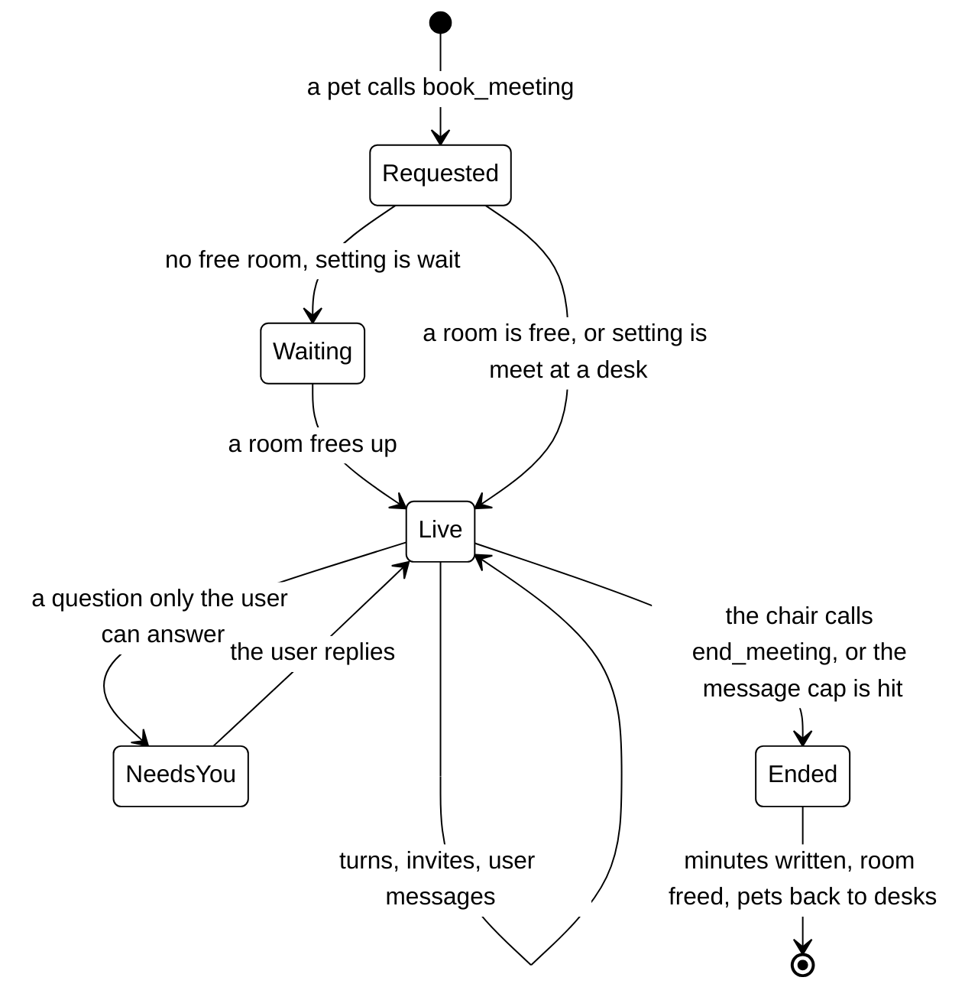

# Meetings

**Status: design.** Replaces today's handoff, consult and roundtable (see
[../architecture.md](../architecture.md#the-crew-phase-4)) when the Meetings phase ships.

A meeting is how pets work something out together. Pets talk in a meeting room and work at their
desks: a meeting is for discussing, and each pet then goes back to its desk to do its part.

## Rooms

- The office has a fixed number of meeting rooms, set in Office settings (default 2, range 1 to 6),
  each with a number of seats (default 4).
- **Pets do not choose a room.** A pet asks for a meeting; the engine gives it the first free room.
  Rooms are a capacity pool, which is also the cap on how many meetings, and so how many parallel
  model calls, can run at once.
- When every room is taken, the user's setting decides: the request **waits** in a first-come queue
  and the pet says so, or the meeting runs **at a desk** with the same rules and no room.

## A pet is in one place at a time

Every pet has a lock. A pet in a meeting cannot be pulled into a second one; the asker either waits
for it, invites someone else, or catches it after the meeting with a quick question. This is the
real-office rule, and it also means a pet is never mid-turn in two threads at once.

## Lifecycle

1. **Booking.** A pet working on a task calls `book_meeting` with a title, a brief, and the pets to
   invite. The pet that books is the **chair**.
2. **Running.** Turns are taken one at a time (below). The chair can invite more pets while seats
   are free.
3. **Ending.** The chair calls `end_meeting`, or the meeting reaches the **longest meeting** cap
   from Office settings and the chair is told to wrap up. The chair writes the minutes (see
   [memory.md](memory.md#minutes-design)), action items become task cards, the room is freed and
   the pets go back to their desks.

## Turn-taking

The engine runs a meeting; pets do not run themselves. One turn at a time:

- The **chair speaks first**, then hands the floor with `pass_to(pet)`, or ends the meeting.
- A pet that was passed the floor answers, and may pass it on or back.
- A pet that has nothing to add says so in one line and passes back, so silence never stalls a
  meeting.
- **The user can speak at any time.** A user message is queued and taken as the next turn's input;
  the chair decides who answers it.

Every turn is one model call, and the panel shows the running count per meeting.

## The user in a meeting

The user can open any meeting in the panel, add themselves, and type. In the office view they take a
seat in the room. Their messages go into the same thread the pets read, so feedback steers the
meeting from the next turn on. When a meeting needs a decision only the user can make, it moves to
**Needs you** and the chair's task card says so.

## Tools a meeting adds

| Tool           | Who can call it                        | What it does                            |
| -------------- | -------------------------------------- | --------------------------------------- |
| `book_meeting` | Any pet, or group leads only (setting) | Requests a room and invites pets        |
| `invite`       | The chair                              | Adds a pet while seats are free         |
| `pass_to`      | The pet speaking                       | Hands the floor to another attendee     |
| `end_meeting`  | The chair                              | Ends the meeting and writes the minutes |

## What it replaces

| Today (Phase 4)    | With meetings                                                                 |
| ------------------ | ----------------------------------------------------------------------------- |
| `@Name` handoff    | Assigning a task to a pet                                                     |
| `ask_pet`          | A quick question at a desk (see [pet-communication.md](pet-communication.md)) |
| `/crew` roundtable | A meeting with every pet invited                                              |
