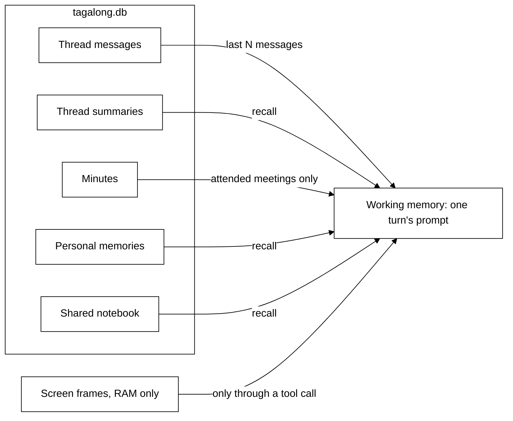

# Memory

**Status: built (thread, summaries, personal, shared notebook, screen) + design (minutes, tidy-up,
vector search).**

A pet remembers the way a colleague does: what is being said right now, what was decided in
meetings it attended, what it has learned over time, and what the team wrote down. It does not
remember meetings it was not in.

## The kinds of memory

| Kind                | Real-world equivalent          | Where it lives                                 | Lifetime                   | Status |
| ------------------- | ------------------------------ | ---------------------------------------------- | -------------------------- | ------ |
| **Working**         | What is in your head right now | The prompt, rebuilt for every turn             | One turn                   | Built  |
| **Thread**          | The meeting you are sitting in | `messages` table, verbatim                     | Until deleted              | Built  |
| **Thread summary**  | Your notes partway through     | `memories` table, kind `summary`               | Until deleted              | Built  |
| **Minutes**         | The meeting notes              | `meeting_minutes` table, one row per meeting   | Until deleted              | Design |
| **Personal**        | What you have learned          | `memories` table, scope `pet`                  | Until tidied up or deleted | Built  |
| **Shared notebook** | The team wiki                  | `memories` table, scope `crew`                 | Until tidied up or deleted | Built  |
| **Screen**          | What you just saw              | RAM in the desktop host, never written to disk | Ten minutes, rolling       | Built  |

Everything except screen memory lives in `tagalong.db`, the local SQLite file in the data
directory (`%APPDATA%\Tagalong` on Windows). Nothing leaves the machine except what a turn sends to
the pet's own model provider.

## Working memory: building one turn

Every turn is assembled from scratch by the prompt assembler
(`packages/core/src/conversation/prompt-assembler.ts`). A pet holds nothing in memory between turns,
which is what makes the isolation rules in [context-isolation.md](context-isolation.md) enforceable.

A turn contains, in order:

1. The pet's role instructions, its name, and its notes (see [roles-and-tools.md](roles-and-tools.md)).
2. The teammate directory: the pets this pet can reach, in the `ask_pet` tool's description.
3. Recalled memories, within a budget (below).
4. The thread: the last `historyMessages` messages of this conversation or meeting.
5. The context the user attached: selection, window, screenshot, page text.

Screen memory is never placed in a prompt automatically. A pet reaches it only by calling
`recall_screen` or `what_changed`, which the user can see in the panel.

## Recall: which memories ride along

Built today in `packages/core/src/memory/recall.ts`:

- The pet's **5 newest** memories it can see, then **up to 5 more** that match the question.
- Matching is SQLite FTS5 full-text search, ranked by BM25. Every word of the question is quoted
  and OR-ed, so punctuation in a question can never break the query.
- The total is capped at **2,000 characters**. Whole memories are dropped from the end rather than
  cut mid-sentence.
- What a pet can see is decided in SQL on every read: `scope = 'crew' OR pet_id = <this pet>`. No
  code path loads another pet's private memories and filters them afterwards.

**Design change:** recall also includes the minutes of meetings the pet attended (below), with the
same rule written into the same query: a minutes row is visible only to its attendees.

## Summarising long threads

Long-running work is compressed in layers, each with a fixed budget, so a thread can run for weeks
without the prompt growing.

| Layer                     | When                                        | Output                                                                 | Status |
| ------------------------- | ------------------------------------------- | ---------------------------------------------------------------------- | ------ |
| Messages → thread summary | 20 unsummarised messages build up           | One paragraph, ≤1,000 characters; the newest 4 messages are left alone | Built  |
| Meeting → minutes         | The meeting ends                            | Decisions, action items with owners, open questions                    | Design |
| Personal memory → tidy-up | Periodically, and when a pet passes its cap | Duplicates merged, unused memories faded out                           | Design |

Built today in `packages/core/src/memory/summarizer.ts`: summarising runs after a turn, never
blocks one, uses the summarizer model chosen in Settings → Advanced → Summaries (Same as Scout by default), and gives up after a minute to try again
next turn.

### Minutes (design)

When a meeting ends, the pet that booked it writes the minutes in a fixed shape:

- **Decisions**: what was agreed.
- **Action items**: who does what, which become task cards on desks.
- **Open questions**: anything left for the user or a later meeting.

Minutes are stored once, with the meeting id and its attendee list. They are what a pet "remembers
about that meeting" from then on; the full transcript stays available to the user in the panel but
is not recalled into later prompts.

### Tidy-up (design)

Personal memory and the shared notebook grow forever unless something prunes them. A tidy-up job:

- merges memories that say the same thing;
- lowers the rank of memories that have not been recalled for a long time, and drops them past a
  per-pet cap;
- never deletes a memory the user pinned.

The user can always see, edit and delete every memory a pet holds.

## Vector search (design: planned, built only after measuring)

Keyword search misses paraphrases: asking about "the CI problem" will not find a memory that says
"the build was failing". Vector search finds memories by meaning instead.

The plan:

- **Same file.** Embeddings live in `tagalong.db` through the `sqlite-vec` extension: no server, no
  second store, and the same visibility rule applies in the same query.
- **Hybrid.** Vector matches and keyword matches are merged with reciprocal rank fusion, so exact
  names and error codes still win where keywords are better.
- **Embeddings** come from the provider's embedding endpoint or a small local model; which one is
  decided when it is built.

The gate: it is built only when a recall test set shows keyword search failing. The test set is a
list of questions, each with the memories it should recall, run against both methods. Until then
the extra model, extension and cost are not justified.

## Screen memory

Built in the desktop host (`apps/desktop/src/main/awareness/`), off by default:

- One small frame per display every five seconds, kept in RAM for the last ten minutes.
- Never written to disk and never sent anywhere unless a pet calls a recall tool inside a turn the
  user started.
- Excluded windows and paused sight apply to it exactly as they do to a live capture.

## Who can see what

| Kind            | The pet itself  | Other pets                  | The user |
| --------------- | --------------- | --------------------------- | -------- |
| Thread          | Its own threads | Only meetings they attended | All      |
| Minutes         | If it attended  | If they attended            | All      |
| Personal        | Yes             | No                          | All      |
| Shared notebook | Yes             | Yes                         | All      |
| Screen          | Through tools   | Through tools               | All      |

The full rules, and the tests that prove them, are in [context-isolation.md](context-isolation.md).
