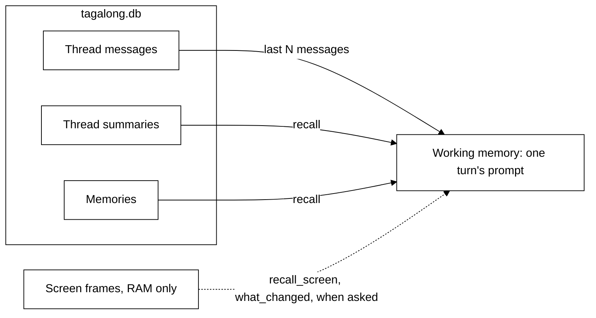

# Memory

**Status: built (thread, summaries, memories, screen) + design (vector search).**

Scout remembers what is being said now, what it has learned about you, and, if you turn it on, the
last few minutes of your screen.

## The kinds of memory

| Kind               | Where it lives                                 | Lifetime               | Status |
| ------------------ | ---------------------------------------------- | ---------------------- | ------ |
| **Working**        | The prompt, rebuilt for every turn             | One turn               | Built  |
| **Thread**         | `messages` table, verbatim                     | Until deleted          | Built  |
| **Thread summary** | `memories` table, kind `summary`               | Until deleted          | Built  |
| **Memories**       | `memories` table, kind `fact` or `preference`  | Until deleted          | Built  |
| **Screen**         | RAM in the desktop host, never written to disk | Ten minutes by default | Built  |
| **Pick-up**        | `pick_up` table, one row from window titles    | Until offered or off   | Built  |

Everything except screen memory lives in `tagalong.db`, the local SQLite file in the data
directory (`%APPDATA%\Tagalong` on Windows). Nothing leaves the machine except what a turn sends to
Scout's own model provider.

### The daily briefing reads, never stores

"What did we do today?" (`recall_day`) keeps nothing of its own. It reads the log of what Scout
saw (`sight_log`), the activity record (`activity`: questions, hand-offs, routines and app calls,
never their answers), the pick-up snapshot (`pick_up`, only while pick-up is on) and the briefs
waiting for Send (in memory). Screen memory is not read.

### Searchable work memory

"What was that article about vector databases I read Tuesday?" (`search_history`) searches two
FTS5 indexes in `tagalong.db` (migration 18): the window titles and apps in `sight_log`, and the
`activity` text (questions, expert asks, routine names). Triggers keep them in step, so a row
deleted or pruned from the log of what Scout saw is gone from search too. At most 20 hits, newest
first, never older than the log keeps. Titles only: no page text was ever stored.

## Working memory: building one turn

Every turn is assembled from scratch by the prompt assembler
(`packages/core/src/conversation/prompt-assembler.ts`). Nothing is held between turns.

A turn contains, in order:

1. The system prompt: Scout's soul, the role's instructions and the person's name (see
   [roles-and-tools.md](roles-and-tools.md)). The same on every turn.
2. The thread: the last `historyMessages` messages of this conversation.
3. On the person's latest message, after their words: the context they attached (selection,
   window, screenshot, page text), then the recalled memories under `## What you remember`,
   within a budget (below), then `## Now`, the facts about this moment. Memories ride here
   rather than in the system prompt because they change with every question.

## Recall: which memories ride along

Built in `packages/core/src/memory/recall.ts`:

- The **5 newest** memories, then **up to 5 more** that match the question.
- Matching is SQLite FTS5 full-text search, ranked by BM25. Every word of the question is quoted
  and OR-ed, so punctuation in a question can never break the query.
- The total is capped at **2,000 characters**. Whole memories are dropped from the end rather than
  cut mid-sentence.
- Visibility is decided in SQL on every read: `pet_id = <Scout>`. Older installs kept some
  memories in a shared crew notebook; migration 20 moved those to Scout, so none were lost (one
  Scout already held is not copied twice).

Scout files a memory with the `remember` tool (`{ text, kind: fact | preference }`), so "I prefer
short answers" is kept across restarts.

## Summarising long threads

Built in `packages/core/src/memory/summarizer.ts`. When 20 unsummarised messages build up, they
are folded into one paragraph of at most 1,000 characters; the newest 4 messages are left alone.
Summarising runs after a turn and never blocks one, uses the model chosen in Settings → Advanced →
Summaries (Same as Scout by default), and gives up after a minute to try again next turn.

## Vector search (design: built only after measuring)

Keyword search misses paraphrases: "the CI problem" will not find "the build was failing". The
plan is embeddings in `tagalong.db` through `sqlite-vec`, merged with keyword matches by reciprocal
rank fusion. It is built only when a recall test set shows keyword search failing.

## Screen memory

Built in the desktop host (`apps/desktop/src/main/awareness/`), off by default (Settings → Privacy →
**Remember the last few minutes of the screen**):

- One small frame per display every five seconds, kept in RAM for the last ten minutes (1 to 30).
- Never written to disk. Pausing sight or quitting throws it away; blind spots are never recorded.
- A red dot shows on Scout while it records.
- Scout reads it back with `recall_screen` and `what_changed` when you ask about something seen
  earlier or what changed.

Screen memory is not the same as Home's **What Scout saw**. That is a record on disk (the
`sight_log` table) of each look and each send, holding only the kind, the app and window, where it
went and how much, never a picture or any text. Screen memory holds pictures, in RAM only. Deleting
the record does not touch screen memory, and clearing screen memory does not delete the record.
