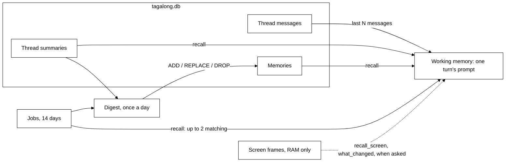

# Memory

**Status: built (thread, summaries, memories, screen, digest) + design (vector search).**

Scout remembers what is being said now, what it has learned about you, and, if you turn it on, the
last few minutes of your screen.

## The layers

| Layer         | What                                                                        | Kept                                              | How it fades                                                                                                 |
| ------------- | --------------------------------------------------------------------------- | ------------------------------------------------- | ------------------------------------------------------------------------------------------------------------ |
| **Working**   | The prompt, rebuilt every turn: last 20 messages, the board, the screen now | One turn                                          | Rebuilt each turn                                                                                            |
| **Recent**    | `jobs` rows + one conversation per job                                      | 14 days after the job finishes                    | Deleted (row, conversation, messages) at boot and after each digest                                          |
|               | `messages`: chats, verbatim                                                 | Until deleted                                     | At 20 unsummarised messages, older ones fold into a `summary` memory                                         |
|               | `activity`: questions, hand-offs, routines, app calls                       | 90 days                                           | Deleted at boot; the search index follows                                                                    |
|               | `sight_log`: what Scout saw, titles only                                    | 7 days by default (1 to 30, Settings › Privacy)   | Deleted (`SightLog.prune`)                                                                                   |
|               | Screen frames, RAM in the desktop host, never on disk                       | 10 minutes by default (1 to 30), off by default   | Dropped from RAM                                                                                             |
|               | `pick_up`: one row from window titles                                       | Until offered or switched off                     | Replaced                                                                                                     |
| **Long-term** | `memories`: `fact`, `preference`, `summary`                                 | Until deleted; at most 200 summaries              | The digest may change or let go of a fact or summary, never a preference; the oldest summaries beyond 200 go |
| **Digest**    | Once a day the mind folds recent work into long-term memory                 | Its run is a `jobs` row on the board              | Same as jobs                                                                                                 |
| **Recall**    | One path into every prompt and check-in                                     | 2,000 characters of memories + 500 of recent work | Whole items dropped, never cut                                                                               |

Activity rows go after 90 days, but the digest has kept the gist in long-term memory first, so
"what did I do six months ago?" can still be answered roughly from memories; the exact detail is
not kept.

Everything except screen memory lives in `tagalong.db`, the local SQLite file in the data
directory (`%APPDATA%\Tagalong` on Windows). Nothing leaves the machine except what a turn sends to
Scout's own model provider.

### The daily listing reads, never stores

"What did we do today?" (`search_history` with no search words) keeps nothing of its own. It
reads the log of what Scout saw (`sight_log`) and the activity record (`activity`: questions,
hand-offs, routines and app calls, never their answers) for a time range, today by default.
Screen memory is not read. What is running, finished or waiting for Send rides in the Now block of
every question instead.

### Searchable work memory

"What was that article about vector databases I read Tuesday?" (`search_history`) searches two
FTS5 indexes in `tagalong.db` (migration 18): the window titles and apps in `sight_log`, and the
`activity` text (questions, expert asks, routine names). Triggers keep them in step, so a row
deleted or pruned from the log of what Scout saw is gone from search too. At most 20 hits, newest
first, never older than the log keeps. Titles only: no page text was ever stored.

### Scout's own jobs and the task board

Background work Scout starts with `work_on_it` is recent memory: one `jobs` row (migration 21:
the task, a short note that is the answer's first line, how it ended) and a conversation of its
own whose last answer is the whole result. Both are deleted 14 days after the job finishes. A job's
conversation is never summarised into a memory, and its turn writes no activity row. The task
board is working memory: a read model over the jobs, running and waiting hand-offs, watches,
running routines and the last day's finished work, read by the `board` and `open_result` tools; Now
carries the running jobs and those finished since the last talk or not mentioned yet (no check-in
line about them was shown, `reported_at`) on every turn. What jobs learned reaches long-term memory
through the daily digest (below) before the rows go.

## Working memory: building one turn

Every turn is assembled from scratch by the prompt assembler
(`packages/core/src/conversation/prompt-assembler.ts`). Nothing is held between turns.

A turn contains, in order:

1. The system prompt: Scout's soul, the role's instructions and the person's name (see
   [roles-and-tools.md](roles-and-tools.md)). The same on every turn.
2. The thread: the last `historyMessages` messages of this conversation.
3. On the person's latest message, after their words: the context they attached (selection,
   window, screenshot, page text), then the recalled memories under `## What you remember`,
   within a budget (below), then `## Now`, the facts about this moment. Memories ride here
   rather than in the system prompt because they change with every question.

## Recall: which memories ride along

Built in `packages/core/src/memory/recall.ts`, one path for every turn and check-in, in order:

1. **Preferences**, the newest 5. They always ride, so a growing store cannot push them out.
2. The **3 newest** other memories (facts and summaries).
3. **Up to 5** memories that match the question.
4. **Recent work**: up to **2** of Scout's own jobs that finished well in the last 14 days and share
   words with the question (most shared words, then newest), as
   `- (your job, 3 days ago, j-1b2c) "task": note`, within their own **500 characters**.

- Matching is SQLite FTS5 full-text search, ranked by BM25. Every word of the question is quoted
  and OR-ed, so punctuation in a question can never break the query.
- Preferences and facts the user stated are listed plain. What the digest added or reworded
  (`origin = 'digest'`), summaries and recent work can carry text from connected apps or the web,
  so they go in one `~~~text` fence, as data, never as instructions.
- The memories are capped at **2,000 characters**. Whole memories are dropped from the end rather than
  cut mid-sentence.
- Visibility is decided in SQL on every read: `pet_id = <Scout>`. Older installs kept some
  memories in a shared crew notebook; migration 20 moved those to Scout, so none were lost (one
  Scout already held is not copied twice).

Scout files a memory with the `remember` tool (`{ text, kind: fact | preference }`), so "I prefer
short answers" is kept across restarts; the summary also records preferences the user stated.
Nothing is filed by matching phrases in what they typed: the model decides.

Check-ins (when Scout wakes on its own: a settled window, an error title, a long stretch, a
finished hand-off) use the same recall, matched against the words of why it woke (the window's
title, or the expert and its ask), under the same `## What you remember` heading and budgets,
together with the last exchange
(the latest answered question and answer, 300 characters each, from the activity record). See
`packages/core/src/check-in/bundle.ts` and [privacy.md](../privacy.md).

## Seeing and deleting what Scout remembers

Memories are kept until deleted, and the person can see and delete every one:

- **Home → What Scout remembers** lists Scout's facts, preferences and conversation summaries,
  newest first, each with its kind, the day it was saved and a delete button (`memory.list`,
  `memory.delete`). There is no Delete all.
- **"Scout, forget that"**: the `forget` tool. With a query it lists up to five matching memories
  with short ids (`m-3fa1c2d0`) and deletes nothing; with an id it deletes that one memory. A short
  id that matches none, or two, deletes nothing. No card: deleting only takes away. Finished jobs
  are listed too (`j-1b2c9a0e (finished job) <task>`), and `forget { id: "j-…" }` deletes that job
  row with its conversation; a job still queued or running is never deleted.

A deleted memory leaves the full-text index with it, so recall never brings it back.

## The digest: tidying memory once a day

Built in `packages/core/src/memory/digest.ts`. Code decides only when and checks the reply; what
matters is the mind's call.

- **When**: checked 5 minutes after start and every 30 minutes. It runs when Scout exists, the
  budget is not spent, no turn of theirs and no job is running, the
  last digest that worked ended at least 20 hours ago, and there is something new (a finished job
  not yet read, 3 or more summaries since the last digest, or more than 200 summaries). At most 2
  attempts a local day, so a failure is retried once.
- **What it reads** (one call, no tools, 60 s, 800 tokens, on the Summaries model or Scout's): the
  newest 150 facts and preferences with short ids (`m-3fa1c2d0`), up to 20 summaries older than
  30 days, up to 10 summaries since the last digest, and up to 10 finished jobs not yet read (task,
  note and the first 1,500 characters of the result). Secrets are hidden over all of it. The system
  prompt is the soul and a fixed "Tidying your memory" block, the same every day.
- **What it may reply**: `ADD fact|preference|summary: ...`, `REPLACE <id>: ...`, `DROP <id>`, or
  `NOTHING`. Code applies at most 10 of each in one transaction; an id must be one it was shown;
  a `DROP` of a preference is ignored; facts and preferences are clipped to 300 characters and
  summaries to 1,000; `ADD` never files a duplicate. What it adds or rewords is stored with
  `origin = 'digest'` (migration 22), so recall fences it as data.
- **After**: the jobs it read are marked, jobs older than 14 days are deleted, and the oldest
  summaries beyond 200 go. The run is a `jobs` row (`kind = 'digest'`) the board shows as
  "Tidying your memory" and then "Tidied your memory ... Note: Added 2, changed 1, let 3 go." (a
  failed run: "Tidying your memory, failed"). The note counts only real changes: an `ADD` of a
  memory it already has is not counted. It is never spoken, never in Now and never an Arrival. A
  failure or timeout changes nothing and is only logged.

## Summarising long threads

Built in `packages/core/src/memory/summarizer.ts`. When 20 unsummarised messages build up, they
are folded into one paragraph of at most 1,000 characters; the newest 4 messages are left alone.
Summarising runs after a turn and never blocks one, uses the model chosen in Settings → Advanced →
Summaries (Same as Scout by default), and gives up after a minute to try again next turn.

## Vector search (design: built only after measuring)

Keyword search misses paraphrases: "the CI problem" will not find "the build was failing". The
plan is embeddings in `tagalong.db` through `sqlite-vec`, merged with keyword matches by reciprocal
rank fusion. It is built only when a recall test set shows keyword search failing.

## Screen memory

Built in the desktop host (`apps/desktop/src/main/awareness/`), off by default (Settings → Privacy →
**Remember the last few minutes of the screen**):

- One small frame per display every five seconds, kept in RAM for the last ten minutes (1 to 30).
- Never written to disk. Pausing sight or quitting throws it away; blind spots are never recorded.
- A red dot shows on Scout while it records.
- Scout reads it back with `recall_screen` and `what_changed` when you ask about something seen
  earlier or what changed.

Screen memory is not the same as Home's **What Scout saw**. That is a record on disk (the
`sight_log` table) of each look and each send, holding only the kind, the app and window, where it
went and how much, never a picture or any text. Screen memory holds pictures, in RAM only. Deleting
the record does not touch screen memory, and clearing screen memory does not delete the record.
