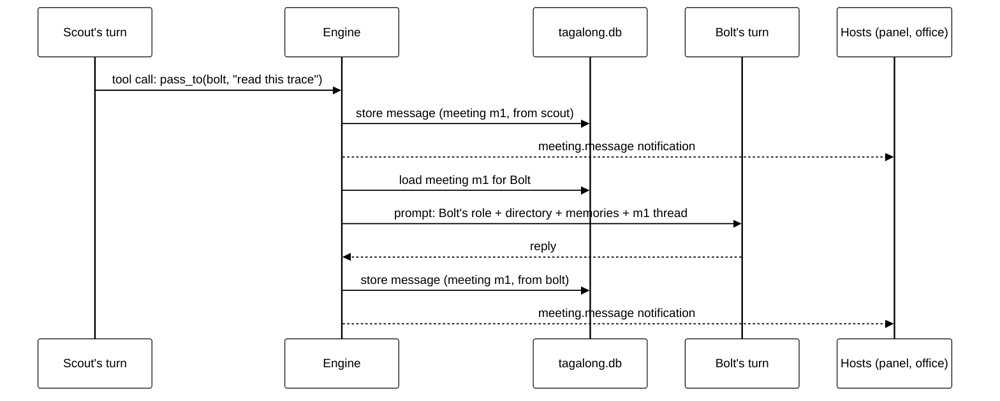

# Pet communication

**Status: design.** Builds on the engine, store and JSON-RPC transport that exist today.

## Pets never talk directly

There is no channel from one pet to another. A pet is a configuration plus a model call; it has no
process, no socket and no state between turns. When "Scout asks Bolt", what happens is:

1. Scout's turn ends with a tool call (`ask_pet`, `book_meeting`, `pass_to`).
2. The engine records it as a message, decides whose turn is next, and builds that pet's prompt.
3. Bolt's turn runs, and its reply is recorded as a message.

Everything a pet "says" is therefore a stored message the engine routed, and everything a pet
"hears" is a message the engine chose to put in its prompt. That single path is what
[context-isolation.md](context-isolation.md) guards.

## Three ways pets interact

| Way                | Real-world equivalent              | Needs a room | Model calls             | Who sees it                          |
| ------------------ | ---------------------------------- | ------------ | ----------------------- | ------------------------------------ |
| **Quick question** | Walking over to a colleague's desk | No           | One, for the answer     | The asker, and the user in the panel |
| **Meeting**        | Booking a room                     | Yes          | One per turn            | Attendees, and the user              |
| **Task**           | Handing someone a piece of work    | No           | Whatever the work takes | The assignee, and the user           |

A **quick question** is today's consult, kept: the asked pet gets only the question, no thread, no
tools, and has 60 seconds to answer. It is cheap because it carries nothing. If a question needs
discussion, the asker books a meeting instead.

## The message envelope

Every message in a conversation or meeting is stored with:

| Field       | Meaning                                                             |
| ----------- | ------------------------------------------------------------------- |
| `id`        | Unique id                                                           |
| `threadId`  | The conversation or meeting it belongs to. Every read filters on it |
| `from`      | A pet id, `user`, or `system`                                       |
| `kind`      | `text`, `tool_call`, `tool_result`, `event` (invited, left, ended)  |
| `content`   | The message itself                                                  |
| `model`     | For pet messages, the provider and model that wrote it              |
| `createdAt` | When                                                                |

Today's `messages` table already holds `conversation_id`, `role`, `content_json` and `created_at`;
meetings add the sender and kind, and a `meetings` table records the room, chair, attendees and
state.

## How hosts are told

Hosts (the desktop panel, the office window, the Chrome side panel) do not poll. The engine pushes
JSON-RPC notifications over the existing loopback WebSocket (`ws://127.0.0.1:47321`, pairing token
required), the same transport turns already stream over:

| Notification      | When                                               |
| ----------------- | -------------------------------------------------- |
| `meeting.started` | A room is assigned                                 |
| `meeting.message` | Any message is stored in a meeting                 |
| `meeting.state`   | Live, waiting, needs you, ended                    |
| `pet.status`      | A pet moves: at desk, in a room, visiting, working |
| `task.updated`    | A task card changes state                          |

The office view is driven entirely by these: a pet walking to a room is the host animating a
`pet.status` change. The engine never knows the office exists.

The user's messages go the other way as a request, `meeting.post`, and joining a meeting is
`meeting.join`.
