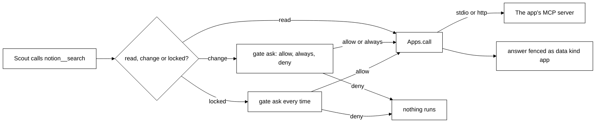

# Connected apps (MCP)

## Purpose

Scout can use the user's own apps (Notion, GitHub, Linear, or any local tool) through the Model
Context Protocol. The Python brain is the MCP client (the official `mcp` SDK). Each app tool becomes
one Scout tool: reads run at once, changes ask first, and risky ones ask every time.

Status: the brain side is built (slice 9a). Home's Connections page on the brain is coming in 9b,
and OAuth sign-in in 9c. Until 9b, apps are managed through the Home calls below.

## Where it lives

| File                             | What it holds                                                                |
| -------------------------------- | ---------------------------------------------------------------------------- |
| `brain/src/brain/apps.py`        | `AppRow`, `validate_app`, `slug_for`, `expand_env`, `TokenFile`, `Apps`      |
| `brain/src/brain/app_tools.py`   | `classify`, `specs_for`, `format_result`, `AppSource`, `app_home_tools`      |
| `brain/src/brain/memory.py`      | The `apps` table: `list_apps`, `add_app`, `set_app_enabled`, `remove_app`    |
| `brain/src/brain/sessions.py`    | Adds `AppSource` as the toolbox's third source, and Home's app calls         |
| `brain/src/brain/main.py`        | Builds `Apps`, starts it after the server is up, shuts it down before memory |
| `brain/tests/fake_mcp_server.py` | A small stdio and http MCP server for tests                                  |

The old TypeScript engine (`packages/core/src/connections/`) is no longer used by the desktop and
will be deleted with `packages/core`.

## How it works

### Definitions

An app row is `{ id, name, transport, config, auth, enabled }`.

- `id` is a slug of the name (`Google Calendar` becomes `google-calendar`, then `-2`, `-3`), at most
  24 characters, never `desktop`, `extension` or `brain`. It prefixes the tool names.
- `transport` is `stdio` (config `{ command, args, env }`) or `http` (config `{ url }`, Streamable
  HTTP; `https` only, or `http` to `localhost`, `127.0.0.1` or `::1`; the url needs a host).
- `auth` is `none`, `token` (http apps only: a pasted key sent as `Authorization: Bearer <token>`)
  or `oauth` (sign-in comes in 9c; until then an `oauth` app connects without credentials).
- A stdio app's `env` values may hold `${VAR}` or `${VAR:-default}`. They stay as written in the row
  and are filled from the brain's environment only when the app is launched. An unset variable ends
  as `needs VAR set in brain's environment` (the variable name only, never a value). Literal env
  values are saved in the apps table as typed, so put secrets in the brain's environment and refer
  to them as `${VAR}`.

A token is never in the row. It is in `app-tokens.json` in the data directory, by app id.

### Connecting

`Apps.start()` runs at boot and returns at once. Each enabled app connects in its own task, so a
failing or hanging app is one `error` row and never stops the others, boot or a turn. A connect
that takes over 30 seconds ends as `error`. Status is `off`, `connecting`, `connected`,
`needs-sign-in` (9c) or `error`, with a plain line for `error`. Every change sends
`changed {what: "apps"}`. An idle connection is pinged every 30 seconds, and a closed one turns
into `error` with `The connection <app> closed.`. A server that cannot answer a ping because a long
tool call blocks it (single-threaded) is dropped the same way and shows the error, so restart it.
When an app says its tool list changed, the brain reads it again.

### Read, change and locked

`classify` reads the tool's own hints:

- **read**: the tool says `readOnlyHint` and is not locked;
- **change**: anything else, including a tool with no hints at all;
- **locked**: `destructiveHint`, or a whole word in the name (split on `_`, `-`, `.`, spaces and
  camelCase) of `send`, `delete`, `remove`, `destroy`, `trash`, `pay` or `charge`. A risky word wins
  over a read-only hint, since hints are the app's own claim. Locked tools ask every time and can
  never be set to `auto`.

Modes are the toolbox's usual ones (see [brain.md](brain.md)): reads `auto`, changes `ask`, and the
user may save `auto` for a change (not a locked one).

### Scout's side

`AppSource` is the toolbox's third source. Only connected apps offer tools; a tool of an app that
dropped is offline ("<app> is not connected right now."), and a disabled app's tools are gone.

- **Name**: `<app id>__<tool>`, characters outside `A-Za-z0-9_-` replaced by `_`, cut to fit 64.
  A name that clashes is dropped and logged.
- **Audience**: Scout only. Home never calls an app's tool.
- **Result**: text blocks, resource text or links, `[image: type]` for images, or the structured
  content as JSON, capped at 8,000 characters and fenced as `<data kind="app" app="<id>">`. A
  `</data` inside is defused so the app cannot close the fence.
- **Failures**: an app's own error reads `<app> could not do that: <first line>`; a timeout (60
  seconds) reads `<app> did not answer in time.`; a closed connection turns the app into `error`.
  Never any env value or token.

### Home calls

Home-only tools (see the table in [brain.md](brain.md#home-tools)): `list_apps`, `add_app`,
`set_app_enabled`, `remove_app`, `restart_app`. `add_app` stores a token in `app-tokens.json` only
after the rest is valid, and removes it again if saving the row fails. `remove_app` stops the app
and deletes its row and token. A bad request is a plain line, such as `a stdio app needs a command.`,
`the url must use https (http is only allowed for localhost).` or `an app with token sign-in needs
its token.`.

### Not built yet

- **9b**: Home's Connections page and the desktop IPC on the brain (the old page still talks to the
  old engine).
- **9c**: OAuth sign-in, and the popular and "found in Claude Code" lists.

## Storage

| Where                         | Holds                                                             |
| ----------------------------- | ----------------------------------------------------------------- |
| `apps` table in `tagalong.db` | `id`, `name`, `transport`, `config` (JSON), `auth`, `enabled`     |
| `permissions` table           | The user's saved `ask` or `auto` per tool, like any other tool    |
| `app-tokens.json`             | `{ "<app id>": "<token>" }`, owner-only where the platform allows |

## Failure handling

- One app failing is an `error` row; the others, boot and turns carry on.
- A call never leaves a raw exception for Scout: every failure is a plain sentence.
- Shutdown stops every app (its process is ended, even a stuck one after a short wait).

## Privacy notes

- Tokens are only in `app-tokens.json`, never in a row, a tool list, a log line or an error.
- App answers are fenced as data so the model reads them but never obeys them.
- Arguments go to the app as Scout filled them in, after the user allowed the change.

## Tests that pin it

- `brain/tests/test_apps.py`: slugs, `${VAR}` expansion, validation (including a malformed or
  hostless url), the store, and the manager against a real fake server over stdio and http (connect,
  call, hang, exit, drop, restart, process cleanup).
- `brain/tests/test_app_tools.py`: classification, names, results and `AppSource`.
- `brain/tests/test_app_home_tools.py`: the Home calls, the token file, the wiring in `Session`,
  and `main` shutting apps down before memory closes and booting despite a hanging app.
