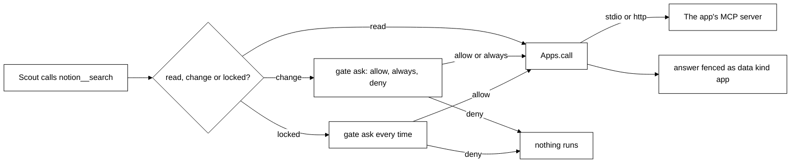
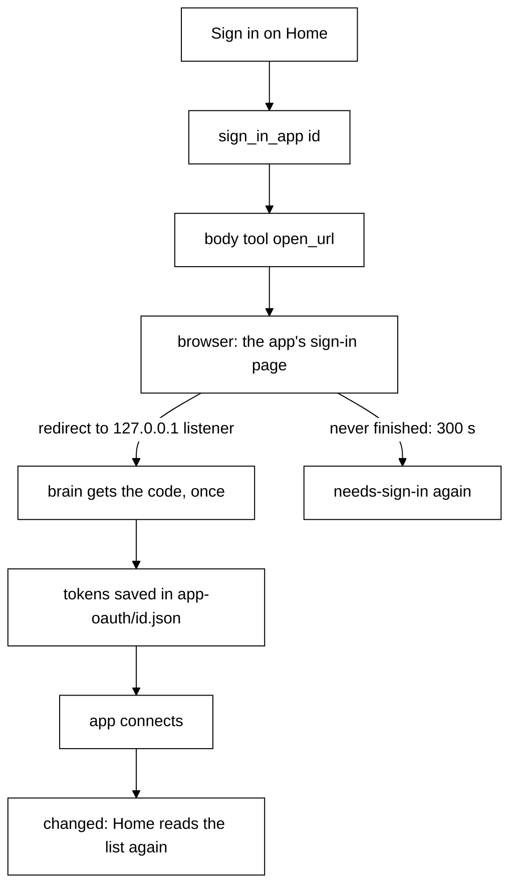
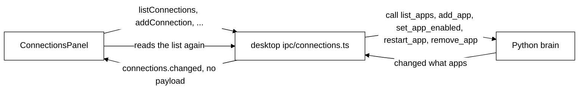

# Connected apps (MCP)

## Purpose

Scout can use the user's own apps (Notion, GitHub, Linear, or any local tool) through the Model
Context Protocol. The Python brain is the MCP client (the official `mcp` SDK). Each app tool becomes
one Scout tool: reads run at once, changes ask first, and risky ones ask every time until unlocked on Home.

Status: the brain side (slice 9a), Home's Connections page on it (9b) and browser sign-in (OAuth,
9c) are built.

## Where it lives

| File                             | What it holds                                                                |
| -------------------------------- | ---------------------------------------------------------------------------- |
| `brain/src/brain/apps.py`        | `AppRow`, `validate_app`, `slug_for`, `expand_env`, `TokenFile`, `Apps`      |
| `brain/src/brain/app_tools.py`   | `classify`, `specs_for`, `format_result`, `AppSource`, `app_home_tools`      |
| `brain/src/brain/app_oauth.py`   | `FileTokenStorage`, the loopback callback listener, the OAuth provider       |
| `brain/src/brain/memory.py`      | The `apps` table: `list_apps`, `add_app`, `set_app_enabled`, `remove_app`    |
| `brain/src/brain/sessions.py`    | Adds `AppSource` as the toolbox's third source, and Home's app calls         |
| `brain/src/brain/main.py`        | Builds `Apps`, starts it after the server is up, shuts it down before memory |
| `brain/tests/fake_mcp_server.py` | A small stdio and http MCP server for tests                                  |

## How it works

### Definitions

An app row is `{ id, name, transport, config, auth, enabled }`.

- `id` is a slug of the name (`Google Calendar` becomes `google-calendar`, then `-2`, `-3`), at most
  24 characters, never `desktop`, `extension` or `brain`. It prefixes the tool names.
- `transport` is `stdio` (config `{ command, args, env }`) or `http` (config `{ url }`, Streamable
  HTTP; `https` only, or `http` to `localhost`, `127.0.0.1` or `::1`; the url needs a host).
- `auth` is `none`, `token` (http apps only: a pasted key sent as `Authorization: Bearer <token>`)
  or `oauth` (the app's own sign-in page in the browser; see [Sign-in](#sign-in-oauth)).
- A stdio app's `env` values may hold `${VAR}` or `${VAR:-default}`. They stay as written in the row
  and are filled from the brain's environment only when the app is launched. An unset variable ends
  as `needs VAR set in brain's environment` (the variable name only, never a value).

A secret is never in the row. All of them are in `app-tokens.json` in the data directory:

- **Bearer token**: key `<id>`.
- **Literal env value** of a stdio app: key `<id>:env:<NAME>`. Every literal value moves, whether or
  not it looks like a secret. A `${VAR}` or `${VAR:-x}` reference stays in the row, and so does a
  value that mixes a reference with literal text (it counts as a reference). The row keeps only the
  names of the moved variables (`secret_env`).
- **Secret url parts** of an http app: key `<id>:url_query`. Query params named `token`,
  `access_token`, `api_key`, `apikey`, `key`, `secret`, `password`, `auth`, `sig` or `signature`,
  and any `user:pass@` in the url, move there. The rest of the url stays in the row (`url_secret`
  marks that a part was taken).

At connect time the brain puts these back (env into the process environment, the url parts onto the
url) and nowhere else. If a key is missing the app ends as `error` with `<name> needs its secret
added again.`.

### Connecting

`Apps.start()` runs at boot and returns at once. Each enabled app connects in its own task, so a
failing or hanging app is one `error` row and never stops the others, boot or a turn. A connect
that takes over 30 seconds ends as `error`. Status is `off`, `connecting`, `connected`,
`needs-sign-in` or `error`, with a plain line for `error`. Every change sends
`changed {what: "apps"}`. An idle connection is pinged every 30 seconds, and a closed one turns
into `error` with `The connection <app> closed.`. A server that cannot answer a ping because a long
tool call blocks it (single-threaded) is dropped the same way and shows the error, so restart it.
When an app says its tool list changed, the brain reads it again.

### Sign-in (OAuth)

An `oauth` app signs in through the app's own page in the browser. The brain never sees the
password; it keeps only the tokens.

- **Start**: an `oauth` app with no saved tokens starts as `needs-sign-in` and opens no browser.
  **Sign in** on Home calls `sign_in_app {id}`, which returns `{id, status: "connecting"}` at once.
  The outcome arrives as `changed`, so the page reads the list again.
- **Refusals**: `sign_in_app` says so plainly for an unknown id, an app that does not use sign-in
  ("X does not use sign-in."), or one that is switched off ("Turn X on before signing in.").
- **Browser**: the brain asks an online body that offers `open_url` (the desktop; https only,
  through the system browser). With none: "Open Tagalong on the machine the brain runs on to sign
  in."
- **Callback**: a one-request listener on `127.0.0.1` (port picked by the system), waiting at most
  300 seconds. A second request, or none, never signs anyone in. A new sign-in clears the old client
  registration because the redirect port changes.
- **Tokens**: `app-oauth/<app id>.json` in the data directory, with `saved_at` and `expires_in` so
  they refresh before they expire. Removing the app deletes the file.
- **Later 401**: a 401 in a live session flips the app to `needs-sign-in` ("Sign in to X again.").
- **Guard**: the brain only follows https addresses, or http to loopback.
- **Same machine**: the browser opens, and the callback lands, on the machine the brain runs on. A
  brain on another machine cannot finish a sign-in from this desktop.

### Read, change and locked

`classify` reads the tool's own hints:

- **read**: the tool says `readOnlyHint` and is not locked;
- **change**: anything else, including a tool with no hints at all;
- **locked**: `destructiveHint`, or a whole word in the name (split on `_`, `-`, `.`, spaces and
  camelCase) of `send`, `delete`, `remove`, `destroy`, `trash`, `pay` or `charge`. A risky word wins
  over a read-only hint, since hints are the app's own claim. Locked tools ask every time until you
  unlock one on Home: its switch is on and reads "Risky action", and turning it to **Auto** first
  warns that Scout will no longer ask. Switch it back to **Ask** to undo.

Modes are the toolbox's usual ones (see [brain.md](brain.md)): reads `auto`, changes `ask`, and the
user may save `auto` for a change, and for a locked one only through that Home switch.

### Scout's side

`AppSource` is the toolbox's third source. Only connected apps offer tools; a tool of an app that
dropped is offline ("<app> is not connected right now."), and a disabled app's tools are gone.

- **Name**: `<app id>__<tool>`, characters outside `A-Za-z0-9_-` replaced by `_`, cut to fit 64.
  A name that clashes is dropped and logged.
- **Audience**: Scout only. Home never calls an app's tool.
- **Result**: text blocks, resource text or links, `[image: type]` for images, or the structured
  content as JSON, capped at 8,000 characters and fenced as `<data kind="app" app="<id>">`. A
  `</data` inside is defused so the app cannot close the fence.
- **Failures**: an app's own error reads `<app> could not do that: <first line>`; a timeout (60
  seconds) reads `<app> did not answer in time.`; a closed connection turns the app into `error`.
  Never any env value or token.

### Home calls

Home-only tools (see the table in [brain.md](brain.md#home-tools)): `list_apps`, `add_app`,
`set_app_enabled`, `remove_app`, `restart_app`. `add_app` stores the token and the other secrets in
`app-tokens.json` only after the rest is valid, and removes them again if saving the row fails.
`remove_app` stops the app and deletes its row and every key of that app (token, env values, url
parts). A bad request is a plain line, such as `a stdio app needs a command.`,
`the url must use https (http is only allowed for localhost).` or `an app with token sign-in needs
its token.`.

### Home's Connections page

`bodies/ui/src/home/connections-panel.tsx` shows the brain's `list_apps` and nothing else; the brain
owns the list and the keys.

- **Rows**: name, "Runs on this PC" or "Web address", a status dot and word (`Connected`,
  `Connecting`, `Needs sign-in`, `Not working`, `Off`), the tool count, the brain's error line when
  there is one, the on/off switch, **Restart** and **Remove**. **Remove** asks again inside the page
  (**Yes, remove** or **Keep**) before `remove_app`.
- **Add an app** (one form): a command on this PC (command, args, `NAME=value` env lines, which may
  be `${NAME}`) or a web address (https only; auth none, the app's own sign-in page, or a pasted
  key in a password field). The key is sent once, as `token`, and the field is cleared as soon as
  the brain accepts it. An app added with its own sign-in lands on `Needs sign-in` with its button.
- **After every call** the page reads `list_apps` again, whatever the call answered, and it does the
  same on `connections.changed`.
- **Brain away**: the calls reject with `brain offline`; the page says the brain is not running and
  offers **Try again**.
- **Sign in**: an `oauth` app that is `Needs sign-in` shows **Sign in** (desktop IPC
  `signInConnection`, then `sign_in_app`). While it is connecting the chip reads **Waiting for the
  browser** and the button is gone. A note says the brain and the browser must be on the same
  computer.
- **Where things run**: Overview has a read-only card with each app's command line
  (`node files-server.js`) or web address, plus its status. Secrets never show: the brain strips
  them from `list_apps` (see [brain.md](brain.md#home-tools)). Env values and secret url parts are
  moved to the token file for you; do not put secrets in args, which stay in the row.
- **Per-tool permissions** stay in Settings › Permissions; this page has no tool list.

### Out of scope

MCP resources, prompts, sampling and elicitation; deferred tool loading; a catalog of popular
apps; importing apps from Claude Code's config; SSE transport; signing in from a different machine
than the brain's; TLS, pairing and multi-user.

## Storage

| Where                         | Holds                                                                                                            |
| ----------------------------- | ---------------------------------------------------------------------------------------------------------------- |
| `apps` table in `tagalong.db` | `id`, `name`, `transport`, `config` (JSON), `auth`, `enabled`                                                    |
| `permissions` table           | The user's saved `ask` or `auto` per tool, like any other tool                                                   |
| `app-tokens.json`             | `{ "<id>": token, "<id>:env:<NAME>": value, "<id>:url_query": "a=b&c=d" }`, owner-only where the platform allows |
| `app-oauth/<app id>.json`     | The app's OAuth tokens and client registration, per app                                                          |

## Failure handling

- One app failing is an `error` row; the others, boot and turns carry on.
- A call never leaves a raw exception for Scout: every failure is a plain sentence.
- Shutdown stops every app (its process is ended, even a stuck one after a short wait).

## Privacy notes

- Tokens and secrets are only in `app-tokens.json` and `app-oauth/`, never in a row, a tool list, a log line or an error.
  What reaches disk is also masked if a secret shows up in it anyway (see [privacy](privacy.md)).
- App answers are fenced as data so the model reads them but never obeys them.
- Arguments go to the app as Scout filled them in, after the user allowed the change.

## Tests that pin it

- `brain/tests/test_apps.py`: slugs, `${VAR}` expansion, validation (including a malformed or
  hostless url), the store, and the manager against a real fake server over stdio and http (connect,
  call, hang, exit, drop, restart, process cleanup).
- `brain/tests/test_app_tools.py`: classification, names, results and `AppSource`.
- `brain/tests/test_apps.py` also pins the secret split, the merge at connect, the startup
  migration and clearing every key on remove.
- `brain/tests/test_app_oauth.py`: token storage, the loopback listener, and sign-in against a
  fake OAuth server.
- `bodies/ui/src/home/connections-panel.test.tsx`: the Sign in button, Waiting for the browser, the
  add form and the same-computer note.
- `brain/tests/test_app_home_tools.py`: the Home calls, the token file, the wiring in `Session`,
  and `main` shutting apps down before memory closes and booting despite a hanging app.
