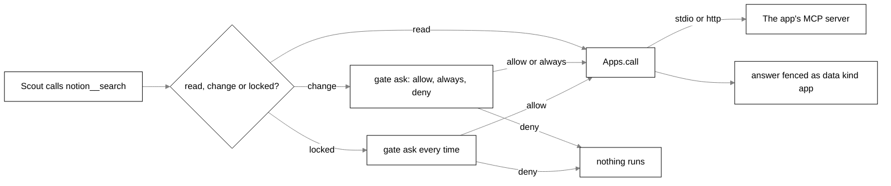
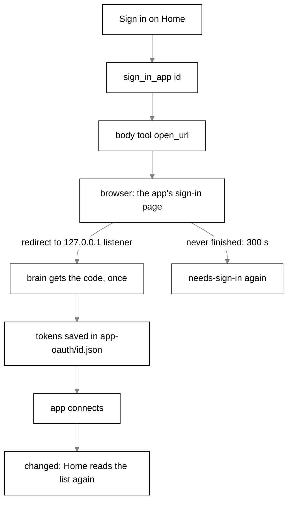
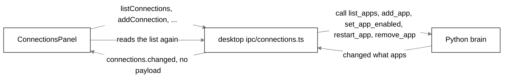

# Connected apps (MCP)

## Purpose

Scout can use the user's own apps (Notion, GitHub, Linear, or any local tool) through the Model
Context Protocol. The Python brain is the MCP client (the official `mcp` SDK). Each app tool becomes
one Scout tool: reads run at once, changes ask first, and risky ones ask every time until unlocked on Home.

## Where it lives

| File                                   | What it holds                                                                |
| -------------------------------------- | ---------------------------------------------------------------------------- |
| `brain/src/brain/apps.py`              | `AppRow`, `validate_app`, `slug_for`, `expand_env`, `TokenFile`, `Apps`      |
| `brain/src/brain/app_tools.py`         | `classify`, `specs_for`, `format_result`, `AppSource`, `app_home_tools`      |
| `brain/src/brain/app_oauth.py`         | `FileTokenStorage`, the loopback callback listener, the OAuth provider       |
| `brain/src/brain/store/connections.py` | The `apps` table: `list_apps`, `add_app`, `set_app_enabled`, `remove_app`    |
| `brain/src/brain/sessions.py`          | Adds `AppSource` as the toolbox's third source, and Home's app calls         |
| `brain/src/brain/main.py`              | Builds `Apps`, starts it after the server is up, shuts it down before memory |
| `brain/tests/fake_mcp_server.py`       | A small stdio and http MCP server for tests                                  |

## How it works

### Definitions

An app row is `{ id, name, transport, config, auth, enabled }`.

- `id` is a slug of the name (`Google Calendar` becomes `google-calendar`, then `-2`, `-3`), at most
  24 characters, never `desktop`, `extension` or `brain`. It prefixes the tool names.
- `transport` is `stdio` (config `{ command, args, env }`) or `http` (config `{ url }`, Streamable
  HTTP; `https` only, or `http` to `localhost`, `127.0.0.1` or `::1`; the url needs a host).
- `auth` is `none`, `token` (http apps only: a pasted key sent as `Authorization: Bearer <token>`)
  or `oauth` (the app's own sign-in page in the browser; see [Sign-in](#sign-in-oauth)).
- A stdio app's `env` values may hold `${VAR}` or `${VAR:-default}`. They stay as written in the row
  and are filled from the brain's environment only when the app is launched. An unset variable ends
  as `needs VAR set in brain's environment` (the variable name only, never a value).

A secret is never in the row. All of them are in `app-tokens.json` in the data directory:

- **Bearer token**: key `<id>`.
- **Literal env value** of a stdio app: key `<id>:env:<NAME>`. Every literal value moves, whether or
  not it looks like a secret. A `${VAR}` or `${VAR:-x}` reference stays in the row, and so does a
  value that mixes a reference with literal text (it counts as a reference). The row keeps only the
  names of the moved variables (`secret_env`).
- **Secret url parts** of an http app: key `<id>:url_query`. Query params named `token`,
  `access_token`, `api_key`, `apikey`, `key`, `secret`, `password`, `auth`, `sig` or `signature`,
  and any `user:pass@` in the url, move there. The rest of the url stays in the row (`url_secret`
  marks that a part was taken).

At connect time the brain puts these back (env into the process environment, the url parts onto the
url) and nowhere else. If a key is missing the app ends as `error` with `<name> needs its secret
added again.`.

### Connecting

`Apps.start()` runs at boot and returns at once. Each enabled app connects in its own task, so a
failing or hanging app is one `error` row and never stops the others, boot or a turn. A connect
that takes over 30 seconds ends as `error`. Status is `off`, `connecting`, `connected`,
`needs-sign-in` or `error`, with a plain line for `error`. Every change sends
`changed {what: "apps"}`. An idle connection is pinged every 30 seconds, and a closed one turns
into `error` with `The connection <app> closed.`. A server that cannot answer a ping because a long
tool call blocks it (single-threaded) is dropped the same way and shows the error, so restart it.
When an app says its tool list changed, the brain reads it again.

### Sign-in (OAuth)

An `oauth` app signs in through the app's own page in the browser. The brain never sees the
password; it keeps only the tokens.

- **Start**: an `oauth` app with no saved tokens starts as `needs-sign-in` and opens no browser.
  **Sign in** on Home calls `sign_in_app {id}`, which returns `{id, status: "connecting"}` at once.
  The outcome arrives as `changed`, so the page reads the list again.
- **Refusals**: `sign_in_app` says so plainly for an unknown id, an app that does not use sign-in
  ("X does not use sign-in."), or one that is switched off ("Turn X on before signing in.").
- **Browser**: the brain asks an online body that offers `open_url` (the desktop; https only,
  through the system browser). With none: "Open Tagalong on the machine the brain runs on to sign
  in."
- **Callback**: a one-request listener on `127.0.0.1` (port picked by the system), waiting at most
  300 seconds. A second request, or none, never signs anyone in. A new sign-in clears the old client
  registration because the redirect port changes.
- **Tokens**: `app-oauth/<app id>.json` in the data directory, with `saved_at` and `expires_in` so
  they refresh before they expire. Removing the app deletes the file.
- **Later 401**: a 401 in a live session flips the app to `needs-sign-in` ("Sign in to X again.").
- **Guard**: the brain only follows https addresses, or http to loopback.
- **Same machine**: the browser opens, and the callback lands, on the machine the brain runs on. A
  brain on another machine cannot finish a sign-in from this desktop.

### Read, change and locked

`classify` reads the tool's own hints:

- **read**: the tool says `readOnlyHint` and is not locked (this sets its effect only; it never
  sets its mode);
- **change**: anything else, including a tool with no hints at all;
- **person-only**: whole word in name (split on `_`, `-`, `.`, spaces and camelCase) of `pay`,
  `charge` or `delete`. Only you decide it, every time: Home offers Off or Ask, never Auto, and
  no preference or Always button ever skips the Allow card;
- **locked**: `destructiveHint`, or whole word in name of `send`, `remove`, `destroy` or `trash`.
  A risky word wins over a read-only hint, since hints are the app's own claim. Locked tools ask
  every time until you unlock one on Home: reads "Risky action", and choosing **Auto** first
  warns Scout will no longer ask. Choose **Ask** again to undo. Scout's own side-check never
  looks at a locked tool.

Modes are the toolbox's usual ones (see [brain.md](brain.md)), but every app tool starts at `ask`,
read-only ones too (`default_mode="ask"`): the app's own hint never lets a tool run unasked. The
user may save `auto` for any of them, and for a locked one only through that Home switch.

### Scout's side

`AppSource` is the toolbox's third source. Only connected apps offer tools; a tool of an app that
dropped is offline ("<app> is not connected right now."), and a disabled app's tools are gone.

- **Name**: `<app id>__<tool>`, characters outside `A-Za-z0-9_-` replaced by `_`, cut to fit 64.
  A name that clashes is dropped and logged.
- **Audience**: Scout only. Home never calls an app's tool.
- **Result**: text blocks, resource text or links, `[image: type]` for images, or the structured
  content as JSON, capped at 8,000 characters and fenced as `<data kind="app" app="<id>">`. A
  `</data` inside is defused so the app cannot close the fence.
- **Failures**: an app's own error reads `<app> could not do that: <first line>`; a timeout (60
  seconds) reads `<app> did not answer in time.`; a closed connection turns the app into `error`.
  Never any env value or token.

### Home calls

Home-only tools (see the table in [brain.md](brain.md#home-tools)): `list_apps`, `add_app`,
`set_app_enabled`, `remove_app`, `restart_app`. `add_app` stores the token and the other secrets in
`app-tokens.json` only after the rest is valid, and removes them again if saving the row fails.
`remove_app` stops the app and deletes its row and every key of that app (token, env values, url
parts). A bad request is a plain line, such as `a stdio app needs a command.`,
`the url must use https (http is only allowed for localhost).` or `an app with token sign-in needs
its token.`.

### Home's Connections page

`bodies/ui/src/home/connections-panel.tsx` shows the brain's `list_apps` and nothing else; the brain
owns the list and the keys.

- **Rows**: name, "Runs on this PC" or "Web address", a status dot and word (`Connected`,
  `Connecting`, `Needs sign-in`, `Not working`, `Off`), the tool count, the brain's error line when
  there is one, the on/off switch, **Restart** and **Remove**. **Remove** asks again inside the page
  (**Yes, remove** or **Keep**) before `remove_app`.
- **Cards**: the list sits in a "Connected apps" card, the form in an "Add an app" card. Above
  them a **FOR LONG JOBS** card (`experts-group.tsx`) lists installed experts, each led by the kind
  of job it does (`jobs-kinds.ts`) with the product underneath, with a state chip (Ready,
  Needs login, Update available) and a **Log in** or **Update** button; **Browse and add**
  (`browse-list.tsx`) lists what the registries offer, for experts and for apps, with an **Add**
  button. These go through `setup_overview`, `setup_expert` and `setup_app` (see
  [brain.md](brain.md#home-tools)): the button opens the same Allow card Scout's install opens, and
  progress ("Installing 40%") rides `changed setup`.
- **Add an app** (one form): a command on this PC (command, args, `NAME=value` env lines, which may
  be `${NAME}`) or a web address (https only; auth none, the app's own sign-in page, or a pasted
  key in a password field). The key is sent once, as `token`, and the field is cleared as soon as
  the brain accepts it. An app added with its own sign-in lands on `Needs sign-in` with its button.
- **After every call** the page reads `list_apps` again, whatever the call answered, and it does the
  same on `connections.changed`.
- **Brain away**: the calls reject with `brain offline`; the page says the brain is not running and
  offers **Try again**.
- **Sign in**: an `oauth` app that is `Needs sign-in` shows **Sign in** (desktop IPC
  `signInConnection`, then `sign_in_app`). While it is connecting the chip reads **Waiting for the
  browser** and the button is gone. A note says the brain and the browser must be on the same
  computer.
- **Where things run**: Overview has a read-only card: for the brain and each app a letter tile,
  the name over its command line (`node files-server.js`) or web address, and a coloured status
  chip; Claude Code closes the list. A group above it, "How Scout reads your screen", has two rows
  (Reading window text, Text from pictures) with the same kind of chip; see [desktop.md](desktop.md). Secrets never show: the brain strips
  them from `list_apps` (see [brain.md](brain.md#home-tools)). Env values and secret url parts are
  moved to the token file for you; do not put secrets in args, which stay in the row.
- **Per-tool permissions** stay in Settings › Permissions; this page has no tool list.

### Out of scope

MCP resources, prompts, sampling and elicitation; deferred tool loading; a catalog of popular
apps; importing apps from Claude Code's config; SSE transport; signing in from a different machine
than the brain's; TLS, pairing and multi-user.

## Finding apps

`find_apps(query)` (Scout, read-only) searches the MCP Registry
(`registry.modelcontextprotocol.io`, latest versions only) and lists each server with whether it
can run on this computer. Packages map to `npx` (npm) or `uvx` (pypi); hosted servers are
`remote`. Results are cached for 24 h under `<TAGALONG_HOME>/cache/`. Nothing is installed or
connected by searching.

## Adding an app from the registry

`install_app(id, query?)` (Scout) adds a registry app without typing its settings. It is `person_only`: the Allow card names the transport, the package and version (or the host), the
environment variable names it needs and any Node download, and neither a saved preference nor a
stored Auto skips it. After Allow it saves the app through the same code as `add_app`. A connected
app is reported with its tool names in the result; a sign-in or slow start that ends later sends
a `setup_done` event (app, name, ok, state, tools, tools_total; `tools` lists at most 30 names, `tools_total` is the full count), so Scout can carry on with the request that led
to the Connect offer (see [docs/brain.md](brain.md#missing-tool-connect-then-carry-on)).

- **Local (`npx`, `uvx`).** A stdio app that runs by absolute path: Node's `npm exec` (the system
  Node if 22 or newer, else Tagalong's own, downloaded first) or `uvx` when it is installed
  (otherwise Scout is told `uv_missing`). Required environment variables are stored as `${NAME}`
  references; set the values in the brain's environment or `<TAGALONG_HOME>/.env` and restart the
  app. Scout is told which are missing (`needs_env`). The first start of an `npx` app downloads
  its package, which can exceed the 30 second connect timeout, so it may show `error` once;
  Restart fixes it. A package name that could be read as an option (one starting with `-`) is
  dropped from the registry listing, and `uvx` gets `--` before the package.
- **Remote (hosted).** An http app with sign-in `oauth`: if the server asks for a sign-in, the
  browser opens through the existing flow (`app_oauth.py`). A server that requires a header
  (a token) is not added by Scout; add it by hand with a token from Home.
- No secret value is ever written into the app's row, the card or the result.

## Storage

| Where                         | Holds                                                                                                            |
| ----------------------------- | ---------------------------------------------------------------------------------------------------------------- |
| `apps` table in `tagalong.db` | `id`, `name`, `transport`, `config` (JSON), `auth`, `enabled`                                                    |
| `rules` table (`mode` rows)   | The user's saved `ask` or `auto` per tool, like any other tool                                                   |
| `app-tokens.json`             | `{ "<id>": token, "<id>:env:<NAME>": value, "<id>:url_query": "a=b&c=d" }`, owner-only where the platform allows |
| `app-oauth/<app id>.json`     | The app's OAuth tokens and client registration, per app                                                          |

## Failure handling

- One app failing is an `error` row; the others, boot and turns carry on.
- A call never leaves a raw exception for Scout: every failure is a plain sentence.
- Shutdown stops every app (its process is ended, even a stuck one after a short wait).

## Privacy notes

- Tokens and secrets are only in `app-tokens.json` and `app-oauth/`, never in a row, a tool list, a log line or an error.
  What reaches disk is also masked if a secret shows up in it anyway (see [privacy](privacy.md)).
- App answers are fenced as data so the model reads them but never obeys them.
- Arguments go to the app as Scout filled them in, after the user allowed the change.

## Experts reach apps through the brain

An expert (Claude Code) never gets an app's token or url. A job part started with apps gets one
local MCP server hosted by the brain (`expert_apps.py`, `127.0.0.1`, random port, a bearer token
per job part) that lists only those apps' tools. Every call runs through the same gate as Scout's
(Ask, Auto, Off, preferences) and is logged in Approvals with the job id; answers are masked and
capped. The token ends with the job part. Scout names the apps in `hand_off`; the card lists them,
the person may remove some, and the job gets only the rest. See [the bridge](brain.md#apps-for-an-expert-the-bridge).

## On a job's timeline

When Scout calls an app's tool while working for a job (a wake about it, or after it handed work
to it), the call is a step on that job's timeline, labelled `app:<app id>` (the id before `__` in
the tool's name), with the tool's short name and its masked, clipped arguments and a status of
done, failed or refused. The app's result is never copied there. See Scout's own steps in
[docs/brain.md](brain.md).

## Mail as a source for loops

A connected Gmail app can also feed Scout's loops (see [brain.md](brain.md#loops)), but only when
reading is switched on for that app (saved as `apps.reads_mail`) (the Home switch comes with a later slice; it is off until
then). The loops service reads through `Apps.call` directly, so the toolbox gate is not involved:
the switch is the consent. The Gmail adapter (`loops/sources/gmail.py`) may call only
`search_threads` and `get_thread` to read and `create_draft` to draft; it refuses any other tool, so
`send_message` and everything that changes the mailbox (labels, archive, read state, delete) is out
of reach. `get_thread` also serves Show (one thread, read again on demand) and `create_draft` serves
Scout's `loop_draft`, which leaves a draft for the person to send; nothing else is called. An app
qualifies when its tool list has all three names. Mail text goes to the model that
reads it (Haiku) and a loop keeps only a title, what is asked, people and anchors, masked for
secrets.

## Tests that pin it

- `brain/tests/test_apps.py`: slugs, `${VAR}` expansion, validation (including a malformed or
  hostless url), the store, and the manager against a real fake server over stdio and http (connect,
  call, hang, exit, drop, restart, process cleanup).
- `brain/tests/test_app_tools.py`: classification, names, results and `AppSource`.
- `brain/tests/test_loops_gmail.py`: the Gmail adapter against the fake server (items after a time,
  unanswered only, sent mail, missing fields, only the allowed tools) and a fake mailbox of 3
  unanswered, 1 answered and 1 bulk mail becoming 3 loops.
- `brain/tests/test_loops_tools.py`: Scout's loop tools, including that Done reaches no mail tool and
  a draft reaches only `create_draft`.
- `brain/tests/test_apps.py` also pins the secret split, the merge at connect and
  clearing every key on remove.
- `brain/tests/test_app_oauth.py`: token storage, the loopback listener, and sign-in against a
  fake OAuth server.
- `bodies/ui/src/home/connections-panel.test.tsx`: the Sign in button, Waiting for the browser, the
  add form and the same-computer note.
- `brain/tests/test_app_home_tools.py`: the Home calls, the token file, the wiring in `Session`,
  and `main` shutting apps down before memory closes and booting despite a hanging app.
