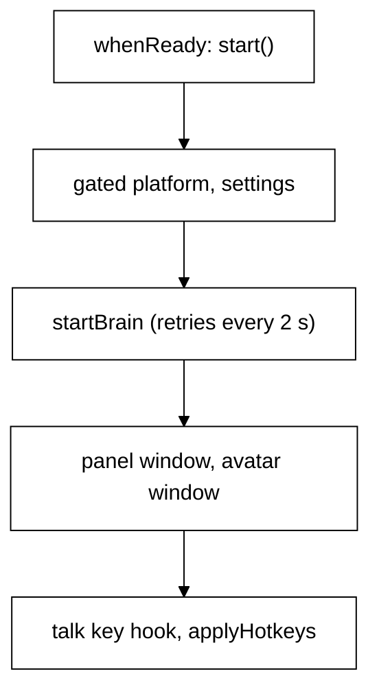

# Desktop host

## Purpose

`bodies/desktop` is the Electron body. Its main process dials the Python brain over the websocket
(contract v1, [protocol/README.md](../protocol/README.md)) and owns every window, the tray, the
global hotkeys and the IPC that connects the windows to the brain. The renderers never talk to the
brain directly. In development the desktop starts the brain itself when none is running (see
[The brain in the main process](#the-brain-in-the-main-process)); or run it yourself
with `cd brain && uv run brain` (see [brain.md](brain.md#the-desktop-body)).

Sight internals (the platform adapter's captures, the window inventory, OCR, exclusions) are in
[sight.md](sight.md). Hearing, speaking, the talk key and Always listening are in
[voice.md](voice.md). The components the windows render come from `@tagalong/ui`, described in
[bubble.md](bubble.md).

## Where it lives

| Path (under `bodies/desktop/`)             | What it holds                                                                                                                                                               |
| ------------------------------------------ | --------------------------------------------------------------------------------------------------------------------------------------------------------------------------- |
| `src/main/index.ts`                        | The main process: single-instance lock, `start`, the `Desktop` record, window routing, tray, `registerIpc`                                                                  |
| `src/main/brain/start.ts`                  | `startBrain`: builds and starts the `BrainClient` on the global `WebSocket`; address from `TAGALONG_BRAIN_ADDR` (default `127.0.0.1:47321`); declares the window body tools |
| `src/main/brain/launch.ts`                 | `launchBrain`: spawns `uv run brain` in `brain/` when the address is local and nothing answers; stops only that child on quit                                               |
| `src/main/brain/body-tools.ts`             | `bodyTools(platform, exclusions, onCapture)`: the body tools declared in `hello` and their `run`                                                                            |
| `src/main/brain/body-events.ts`            | `createBackSender`, `frontWindow`, `startFocusWatch`: the `back` and `focus` events sent to the brain                                                                       |
| `src/main/hotkeys.ts`                      | `HotkeyManager`, `registerHotkey`, `describeHotkeyProblems`, default accelerators                                                                                           |
| `src/main/talk-key.ts`                     | `TalkKeyWatch`, `startTalkKey`, `loadKeyHook` (see [voice.md](voice.md))                                                                                                    |
| `src/main/tray-menu.ts`, `tray-icon.ts`    | `trayMenuTemplate`, `createTrayIcon`                                                                                                                                        |
| `src/main/windows/`                        | One module per window: `avatar.ts`, `panel.ts`, `home.ts`; placement in `position.ts`, `move.ts`; `bubble-focus.ts`; `page.ts` (loading a page)                             |
| `src/main/ipc/`                            | One `register…Ipc(handle, deps)` per area; `handle.ts` (types), `fake-ipc.ts` (test double)                                                                                 |
| `src/main/drop.ts`, `drop-io.ts`           | Drop it on Scout: `dropDesk`, `readDrop`, `registerDropIpc`, `guardNavigation`                                                                                              |
| `src/main/status-marks.ts`                 | `StatusMarks` and the marks main sets (see [bubble.md](bubble.md#status-marks))                                                                                             |
| `src/main/settings-store.ts`               | `SettingsStore`: settings.json with atomic saves, a .bak and a .corrupt copy                                                                                                |
| `src/main/hide-secrets.ts`                 | `hideSecrets`: keys, tokens, passwords and card numbers become `[hidden: kind]` before the log file is written                                                              |
| `src/main/front-window.ts`                 | `isMeeting`, `callOrFullScreenInFront`: Scout keeps out of the way of a call or a full-screen window                                                                        |
| `src/main/fix-target.ts`                   | `fixPage` (the Fix it allowlist)                                                                                                                                            |
| `src/main/log-file.ts`, `log-text.ts`      | The log file                                                                                                                                                                |
| `src/main/platform/`                       | The platform adapter (`Platform`, `createPlatform`, `Win32Platform`, `gateSight`)                                                                                           |
| `src/main/platform/exclusions.ts`          | `findCaptureBlock`, `secretFileRule`, `normalizeProcessName`: which window may not be read                                                                                  |
| `src/main/platform/inventory.ts`           | `buildInventory`: applies the exclusions to the host's window list                                                                                                          |
| `src/main/platform/text-layer-notes.ts`    | What a window's text does not say (editors, terminals and canvas apps publish little)                                                                                       |
| `src/preload/index.ts`, `held.ts`          | The preload: `window.tagalong` and `window.tagalongHost`; `heldUntilHeard`                                                                                                  |
| `src/shared/ipc.ts`                        | `IPC` (every channel name) and the shapes that cross it (`HostView`, `TagalongHostApi`, ...)                                                                                |
| `src/renderer/*.html`, `src/renderer/src/` | One page per window: `avatar`, `panel`, `home`                                                                                                                              |
| `electron.vite.config.ts`                  | The build: main and the voice worker, the preload, the six renderer pages                                                                                                   |
| `electron-builder.json`                    | The installer                                                                                                                                                               |
| `scripts/`                                 | `ensure-electron.mjs`, `fetch-native.mjs`, `start-fresh.mjs`, `bean/` (Bean's renders)                                                                                      |
| `e2e/`                                     | Playwright suites run against the built app                                                                                                                                 |

## How it works

### Boot

`index.ts` runs at import time, before the app is ready:

1. With `TAGALONG_FAKE_STT=1` it appends Chromium's `use-fake-device-for-media-stream` and
   `use-fake-ui-for-media-stream` switches (a fake microphone for tests).
2. `app.requestSingleInstanceLock()`. A second launch quits at once; the first gets
   `second-instance` and runs `showPets()` (shows the pet and the bubble with focus). This happens before anything else.
3. `installLogFile({ dir: <userData>/logs })`, and `web-contents-created` hooks every window's
   `console-message` into `rendererConsole` (see [The log file](#the-log-file)).
4. `app.whenReady().then(start)`. A rejection from `start` shows
   `dialog.showErrorBox('Tagalong could not start', …)` and quits.

`window-all-closed` is a no-op: the app lives in the tray.

`start()` then:

1. Builds the platform as `gateSight(createPlatform(), () => sightPause.paused)`: nothing downstream
   is ever handed the ungated adapter (see [sight.md](sight.md)).
2. Opens `SettingsStore(userData)`,
   so settings are read from the file before anything else needs them.
3. Creates `AlwaysListening` from `settings.listening.always`, `StatusMarks` (broadcasting the top
   mark on `IPC.statusMarkEvent`).
4. `startBrain(...)` builds the `BrainClient` (kept as `desktop.brain`) and starts it. It never
   throws and never blocks boot: if the brain is not running, the client retries every 2 s.
5. Creates the `VoiceWorker` (a `utilityProcess.fork` of `voice-worker.js`, started lazily; see
   [voice.md](voice.md)) and the `Desktop` record, including the tray, the `HotkeyManager` and the
   `TalkKeyWatch`.
6. Wires the sight pause, Always listening, the listening guard and `forwardEars`, then
   `registerIpc()`.
7. Creates the panel and the avatar window, starts presence watching and `startTalkKey`, and calls
   `applyHotkeys(settings)`. The desktop makes no launch greeting of its own; the brain decides
   whether Scout speaks first.

### The brain in the main process

`startBrain` (`brain/start.ts`) builds a `BrainClient` (from `brain/client.ts`) on the global
`WebSocket` and dials `ws://${TAGALONG_BRAIN_ADDR}` (default `127.0.0.1:47321`). The desktop
declares four body tools in `hello` (`brain/body-tools.ts`) and answers the brain's `use` for them.
If the socket is down the client retries every 2 s, so the app opens whether or not the brain is
running.

Before dialing, an unpackaged desktop runs `launchBrain` (`brain/launch.ts`). If the address is
local (`127.0.0.1`, `localhost` or `::1`), the repo's `brain/` folder has a `pyproject.toml`, and a
TCP connect to the address is refused, it spawns `uv run brain` there with the environment passed
through; the child writes to the dev terminal, not to `tagalong.log`. If something already answers, or the address is remote, it spawns nothing. On
quit it stops only the child it started (on Windows `taskkill /pid <pid> /t /f`, so uv's Python
child dies too). If `uv` is missing or the child exits, it logs one line and does not respawn; the
client keeps retrying. `TAGALONG_START_BRAIN=0` turns the spawn off.

- **Body tools.** `list_windows` returns visible and minimized windows as JSON text.
  `read_window_text(windowId)` works on minimized windows, and a read from pixels (OCR) raises the
  capture notice. `look_at_window(windowId)` returns an image part and raises the notice; a
  minimized window fails with "That window is minimized, so there is nothing drawn to look at."
  An excluded window fails `tool_failed` with the exclusion sentence. Each run is bounded at 15 s
  and answers `timeout` (-32004) past that. The brain now offers these to Scout as `desktop__<tool>`.
  `open_url(url)` opens an https address in the default browser (`shell.openExternal`) and refuses
  anything else; the brain uses it for connected apps' sign-in pages. Scout can call it too, as
  `desktop__open_url`, and it always asks first (`confirm`: there is no Always allow button; only its Home switch can unlock it).

- **Body events.** `brain/body-events.ts` sends two facts with `event`; the brain decides whether
  they matter (see [brain.md](brain.md)). `back {idle_seconds}` goes out when the person
  returns after being away at least 5 minutes (`AWAY_AFTER_MS`, a screen lock counts), with whole
  seconds; the away starts when the idle did (the system idle time at the `away` is subtracted), so
  `idle_seconds` is the real time away. The sight pause does not stop it, since it carries no screen
  data. `focus {app, title}` is read every 5 s (`FOCUS_POLL_MS`) and sent only when the front
  window changes. A blocked or excluded window is never sent, and nothing is read while sight is
  paused. When an excluded window comes to the front, or sight is paused, an empty focus
  (`app: ""`) goes once, so the brain stops showing the old app as in front. `BrainClient.event`
  returns whether it was sent; a `focus` it dropped (brain offline) is sent again on the next poll.
  A brain that restarts while the window stays the same, after the last send got through, learns
  the front window only at the next change.
- **Brain-started turns.** A `turn` with `started_by: "brain"` (a wake) shows no thinking state, no
  bubble and no tool rows. If it ends `done` with words (not just whitespace), they appear once as a
  pet remark: the quiet line beside Scout when the bubble is closed, or Scout's message in the
  bubble when it is open and no answer is streaming (main keeps the remark from the hidden bubble,
  so it is never shown twice). A silent, failed, cancelled or over-budget wake shows nothing. If the
  person asks something while a wake runs, their `say` joins it (`joined: true`) and `ipc/turns.ts`
  calls `claim(turnId)` on the mapper: the wake stops being quiet, the bubble gets `turn.started`
  and the text so far, and the rest streams and ends as a normal turn (no pet remark).
- **Status marks.** `markBrainLink` (`status-marks.ts`) sets `brain-offline` ("Scout's brain is not
  running.") while the client is offline and `brain-outdated` ("Update Tagalong to talk to this
  brain.") when the contract versions differ. Coming online clears either; "connecting" changes
  nothing.
- **Asking.** The `ask` IPC (`ipc/turns.ts`) sends `say` with the text, the pending screenshot as an
  image part, dropped items as parts and the active window title as `context.window`, and returns
  `{ turnId }`. While the brain is offline it throws "Scout's brain is not running." Interrupt sends
  `cancel`.
- **Turn events.** The brain's `reply` and `turn` notifications are mapped to the UI's turn events
  and go to `forwardToRenderers`, which keeps `activeTurns` for the bubble's blur rule and sends the
  events to every window on `IPC.turnEvent`. After a reconnect the client reports `resync`, and
  main ends any turn that was open when the socket dropped (the bubble shows it as failed).
- **Settings.** The desktop's local `SettingsStore` holds its own settings (hotkeys, listening,
  exclusions). The brain's model, key and budget are in the brain's `.env`.
- **Not wired yet.** Pets are a fixed local Scout; they come back when the brain plans them.

`shutdown()` stops the client.

### The window inventory

Every window has `contextIsolation: true`, `nodeIntegration: false`, `sandbox: true` and the one
preload `PRELOAD_PATH` (`dist/preload/index.cjs`). `loadPage` (`windows/page.ts`) loads
`${ELECTRON_RENDERER_URL}/<page>.html` in development and `dist/renderer/<page>.html` otherwise.
Every page sets the CSP `default-src 'self'; style-src 'self' 'unsafe-inline'`.

| Window | Module              | Shape                                                                                                               | Created                              | Shown                                   |
| ------ | ------------------- | ------------------------------------------------------------------------------------------------------------------- | ------------------------------------ | --------------------------------------- |
| Avatar | `windows/avatar.ts` | 96 x 96 (`AVATAR_SIZE`), transparent, frameless, always on top (`floating`), `skipTaskbar`, not resizable           | once, at start                       | at creation                             |
| Panel  | `windows/panel.ts`  | 420 wide (`PANEL_WIDTH`), 180 high to start (`BUBBLE_HEIGHT`), transparent, frameless, always on top, `skipTaskbar` | once, at start                       | `showPanelBeside` or `showPanelQuietly` |
| Home   | `windows/home.ts`   | framed, 1440 x 800 content, min 880 (`HOME_MIN_WIDTH`) x 600, centred, titled "Home", no menu bar                   | on `openHome`, again after it closes | `ready-to-show`                         |

Rules each module enforces:

- **Avatar.** Position from `resolveAvatarPosition(settings.avatar, workArea)` on the display
  nearest the saved point, or nearest the cursor for a pet never moved; never simply the primary
  display. With no saved point it docks to the right edge, `AVATAR_EDGE_MARGIN` (16 px) in,
  vertically centred. A saved point is clamped into the work area, so an unplugged monitor never
  leaves the pet off screen. `moved` and `IPC.dropAvatar` save `settings.set { avatar }`. The pet
  is moved by `IPC.dragAvatar` steps from the page (a drag region would swallow its clicks);
  `moveWindow` moves it, and the open panel follows through `placePanel`. `show`/`hide` feed the
  Always listening pause (`petsShown`).
- **Panel.** `placePanel` uses `panelPosition(pet, size, workArea)`: right against the pet with no
  gap, on the right when there is room, otherwise the left, its bottom level with the pet's,
  clamped to the work area. It then sends `IPC.panelSideEvent` (`'left' | 'right'`) so the bubble
  draws its tail at the pet. `fitPanel(height)` clamps to 80..520 (`PANEL_HEIGHT`). Escape hides
  it (`before-input-event`); it is hidden, never closed, so the conversation in the renderer
  survives.
- **Mixed scales.** `moveWindow` calls `setBounds` twice when the move `crossesScale` (the two
  displays have different `scaleFactor`): Electron places the first move with the old display's
  scale.
- **Home.** Escape closes it. `openHome(page?)` focuses an open one and sends
  `IPC.homePageEvent` with the page; a new one gets the page on `did-finish-load`.
- **Settings.** `openSettingsPage(target)` opens Home on `fixPage(target)`.
- **Navigation.** The avatar and panel call `guardNavigation`, which cancels every `will-navigate`,
  so a dropped file never opens in the window.

### Focus rules and showPanelQuietly

`windows/panel.ts` has two ways to show the bubble:

- `showPanelBeside(panel, avatar)`: `placePanel`, `show()`, `focus()`. For something the person
  answers with the keyboard.
- `showPanelQuietly(panel, avatar)`: `placePanel`, `showInactive()`. The bubble appears without
  taking focus from the app the person is typing in.

| Trigger                                                                   | Shown with                                                            |
| ------------------------------------------------------------------------- | --------------------------------------------------------------------- |
| Ask hotkey or tray click (`openPanelWithContext`)                         | `showPanelBeside`                                                     |
| Click on the pet (`IPC.openBubble`, `IPC.togglePanel` when hidden)        | `showPanelBeside`                                                     |
| Second launch (`showPets`)                                                | `showPanelBeside`                                                     |
| `connector.confirm`                                                       | `showPanelBeside` (via `bringUpBubble(true)`)                         |
| `pet.remark`                                                              | `showPanelQuietly`                                                    |
| Talk key held (`talkPressed`)                                             | `showPanelQuietly`                                                    |
| Words addressed to Scout from Always listening (`forwardEars` `onSpoken`) | `showPanelQuietly`, only when the pet is visible and the panel hidden |

The talk key must not take focus: its release comes from the key hook in main, and a focused
bubble would swallow the shortcut the person meant if the press turns into Right Ctrl+C.

**Hiding on blur.** On `blur` the panel reads `isStreaming()` (any `activeTurns`) at once, then
after 60 ms asks `hidesOnBlur({ streaming, focusWentToPet, focusedAgain })`
(`windows/bubble-focus.ts`): it hides only when no answer is streaming, focus did not go to the
pet's window (a click or a drag on the pet keeps the bubble) and the bubble has not taken focus
back. A click on the pet never closes the bubble: `openBubble` opens it, or gives the open one the
keyboard back.

**Lines that wait.** `showRemark` drops a line when the bubble is already open or the pet is
hidden, and waits for `did-finish-load` when the panel is still loading.

### The tray

`createTray()` builds the `Tray` from `createTrayIcon()`: a 16 x 16 filled dot drawn into a BGRA
buffer and passed to `nativeImage.createFromBitmap`, so no asset file can go missing from a build.
A left click runs `openPanelWithContext()` (the ask hotkey's path). `trayMenuTemplate` has four
items and a separator:

| Item               | Action                                                 |
| ------------------ | ------------------------------------------------------ |
| Open Tagalong      | `openHome()`                                           |
| Pause sight        | checkbox, `checked: sightPaused`; `toggleSightPause()` |
| Show or hide Scout | hides the avatar and the panel, or shows the avatar    |
| Quit               | `app.quit()`                                           |

The menu is rebuilt on every sight pause change, so the checkmark cannot drift. The tooltip is
`Tagalong`, `Tagalong — sight is paused` while paused, and `captureTooltip(notice)` after each
capture. The tray carries Pause sight because that is the one hotkey whose loss matters.

### Global hotkeys

`hotkeys.ts` binds three accelerators through Electron's `globalShortcut`:

| Action        | Settings key         | Default                                                       | Runs                                 |
| ------------- | -------------------- | ------------------------------------------------------------- | ------------------------------------ |
| Ask           | `hotkeys.ask`        | `CommandOrControl+Shift+Space`                                | `openPanelWithContext()`             |
| Pause sight   | `hotkeys.pauseSight` | `CommandOrControl+Shift+Alt+P` (`DEFAULT_PAUSE_SIGHT_HOTKEY`) | `toggleSightPause()`                 |
| Stop speaking | `hotkeys.stopVoice`  | `CommandOrControl+Shift+Alt+M` (`DEFAULT_STOP_VOICE_HOTKEY`)  | `IPC.stopVoiceEvent` to every window |

The talk key (`hotkeys.talk`, default Right Ctrl) is not a global shortcut. A key hook watches it
(`talk-key.ts`); see [voice.md](voice.md). Its outcome is reported here alongside the three.

`openPanelWithContext` reads the selection and the active window (`captureAskSnapshot`) before the
bubble takes focus, keeps the result as `pendingSnapshot` (sent with the next ask), announces the
capture, sends `IPC.contextEvent` to the panel and shows it beside the pet. No screenshot rides
along; Scout takes one itself when a question needs it.

`HotkeyManager.apply(bindings)` returns one `HotkeyOutcome { accelerator, action, registered,
error? }` per action, in ask, pause, stop order. It touches only accelerators that changed, so an
unedited key is never briefly dead, and binds each one independently, so one refusal costs only
its own action. `registerHotkey` never throws: `register` returning false becomes "Another
application already owns …", and a thrown error (a malformed accelerator) becomes its message.
`dispose()` releases all of them on quit.

**The hotkey-problem path.** `applyHotkeys(settings)` in `index.ts` applies the three, points the
talk key watch at `settings.hotkeys.talk ?? TALK_KEY_RIGHT_CTRL`, adds a `talk` outcome (failed
when `talkKeyError` is set, the reason the key hook could not start), and runs
`describeHotkeyProblems`. That returns null, or a message naming each refused action by its
Settings label (Ask, Pause sight, Stop speaking, Talk to Scout) with its accelerator and reason,
and ends with "Every other hotkey still works. Pick a different combination in Settings." or, when
all failed, "Pick different combinations in Settings, or use the tray." The message:

- is stored as `hotkeyError` and logged with `console.error`;
- is broadcast on `IPC.hotkeyProblemEvent` (null once fixed) to every window;
- is returned in `HostView.hotkeyError` by `IPC.hostView`, for a window opened later (the same
  field carries no other error);
- shows in the panel as a `role="status"` line with **Open Settings**
  (`data-testid="hotkey-problem"`).

Boot never raises a modal for it: the only way to store a bad accelerator is to type it in
Settings, and a modal before any window exists would lock the person out of the one surface that
fixes it. `applyHotkeys` runs again from the settings save handler whenever a patch has `hotkeys`,
which is how a rebind takes effect without a restart.

### Settings applied live

`registerSettingsIpc`'s `save(patch, byTalk)` is the one save path for Settings, Home and
the bubble's settings card. After `SettingsStore` saves, it:

- stores the result as `desktop.settings`;
- calls `applyHotkeys` when the patch has `hotkeys`;
- broadcasts the saved settings on `IPC.settingsChangedEvent`, which open windows apply at once
  (the panel reads its talk key and microphone from it).

The exclusions are read when used rather than at boot and are covered in [sight.md](sight.md); the settings store itself, the chat allowlist
and the settings card's checks are in [settings-and-secrets.md](settings-and-secrets.md).

### The IPC modules

Each module in `src/main/ipc/` exports `register…Ipc(handle, deps)`. `handle` is
`ipcMain.handle` in the app and a recording fake in tests (`fake-ipc.ts`), and `deps` carries
only what the module reads, so every module is tested without Electron. `ask` and `interrupt`
use the brain client directly; the rest call brain tools through `callJson`. A guard test
(`ipc/ipc-channels.test.ts`) fails when a channel in `shared/ipc.ts` is not used by both main and
the preload, so a dead channel cannot linger.

| Module           | Channels (`IPC.<key>`: `tagalong:…`)                                                                                                                                                                                         | Brain calls / notes                                                                                                                                                                                                                                                                                                                                  |
| ---------------- | ---------------------------------------------------------------------------------------------------------------------------------------------------------------------------------------------------------------------------- | ---------------------------------------------------------------------------------------------------------------------------------------------------------------------------------------------------------------------------------------------------------------------------------------------------------------------------------------------------- |
| `turns.ts`       | `ask` (`ask`), `interrupt` (`interrupt`)                                                                                                                                                                                     | `ask` (with `pendingSnapshot`, and `snapshot.dropped` from `takeDrop()` when `drop: true`), `interrupt`                                                                                                                                                                                                                                              |
| `scout.ts`       | `listPets` (`pets:list`)                                                                                                                                                                                                     | The one fixed local Scout, no brain call                                                                                                                                                                                                                                                                                                             |
| `connections.ts` | `approveTool` (`tool:approve`), `answerJobAsk`, `listConnections`, `addConnection`, `setConnectionEnabled`, `restartConnection`, `removeConnection`, `signInConnection`                                                      | `approveTool` goes to the brain client's `answer` (`once`, `always` or `deny`); the connection calls go through `callJson` to the brain's `list_apps`, `add_app` (params parsed with `AppAddParams` first), `set_app_enabled`, `restart_app` and `remove_app`, and reject with `brain offline` while offline; `signInConnection` calls `sign_in_app` |
| `spend.ts`       | `usageSummary` (`usage:summary`)                                                                                                                                                                                             | brain tool `spend_today` (parsed as `SpendToday`; a bad answer throws)                                                                                                                                                                                                                                                                               |
| `memory.ts`      | `listMemories` (`memory:list`), `deleteMemory` (`memory:delete`)                                                                                                                                                             | brain tools `list_memories`, `forget`                                                                                                                                                                                                                                                                                                                |
| `permissions.ts` | `listPermissions` (`permissions:list`), `setPermission` (`permissions:set`)                                                                                                                                                  | brain tools `list_permissions`, `set_permission`                                                                                                                                                                                                                                                                                                     |
| `jobs.ts`        | `listJobs` (`jobs:list`), `stopJob` (`jobs:stop`)                                                                                                                                                                            | brain tools `list_jobs`, `stop_job`                                                                                                                                                                                                                                                                                                                  |
| `settings.ts`    | `hostView` (`host:view`), `saveSettings` (`settings:save`)                                                                                                                                                                   | Works from `SettingsStore`, with no brain                                                                                                                                                                                                                                                                                                            |
| `voice.ts`       | `speak`, `earsListen`, `micFrame` (`ipcMain.on`, no answer), `earsStop`, `getListening`, `setListening`, `setFollowUp`, `ensureEars`, `voiceModels`; `forwardEars` sends `earsEvent`, `earsProgressEvent`, `earsStatusEvent` | See [voice.md](voice.md)                                                                                                                                                                                                                                                                                                                             |
| `browser.ts`     | `browserFolder` (`tagalong:browser:folder`), `showBrowserFolder` (`tagalong:browser:show-folder`)                                                                                                                            | No brain call. Finds the browser body's built folder (packaged: `resources/extension`; dev: `bodies/browser/dist`) for Settings' **Add Scout to your browser** section, and reveals it in the file manager                                                                                                                                           |
| `handle.ts`      | none                                                                                                                                                                                                                         | `IpcHandle`, `IpcOn`, `IpcListener`, `fromWindow`                                                                                                                                                                                                                                                                                                    |
| `fake-ipc.ts`    | none                                                                                                                                                                                                                         | The recording `handle` the module tests use                                                                                                                                                                                                                                                                                                          |

`HostView` (`IPC.hostView`) is what every window reads on open: `settings`, `pets` (the fixed local Scout), `appVersion`,
`hotkeyError` and `platform` (`process.platform`).

Channels handled directly in `index.ts`, because they need Electron itself (windows, dialogs, the
shell, the screen):

| Channel (`IPC.<key>`)                                | What main does                                                                                                                                    |
| ---------------------------------------------------- | ------------------------------------------------------------------------------------------------------------------------------------------------- |
| `getContext`                                         | returns `pendingSnapshot`                                                                                                                         |
| `capture`                                            | `captureForPanel`: announces the capture, returns null when blocked or paused, otherwise a parsed `ContextSnapshot` (also sent on `contextEvent`) |
| `getSightPaused`, `toggleSightPause`                 | the `SightPause` state, and flipping it                                                                                                           |
| `getStatusMark`, `setStatusMark`                     | the top mark; `setPanelMark` accepts only `mic-busy`, `mic-failed`, `say-name`                                                                    |
| `openBubble`, `togglePanel`, `hidePanel`, `fitPanel` | the panel (see [Focus rules](#focus-rules-and-showpanelquietly))                                                                                  |
| `dragAvatar`, `dropAvatar`                           | move the pet by a finite step; save its position                                                                                                  |
| `openSettings`                                       | `openSettingsPage(fixPage(target))`; an unknown target throws                                                                                     |
| `openHome`, `openLogsFolder`                         | open the window or the folder                                                                                                                     |
| `dropOnPet` (`drop.ts`, `registerDropIpc`)           | only from the avatar's window (`fromWindow`); names the item and opens the bubble on `IPC.dropEvent`                                              |

Events main sends to renderers (no answer): `turnEvent`, `contextEvent`, `captureEvent`,
`sightPauseEvent`, `hotkeyProblemEvent`, `settingsChangedEvent`,
`statusMarkEvent`, `listeningEvent`, `homePageEvent`, `remarkEvent`, `panelSideEvent`, `dropEvent`, `stopVoiceEvent`,
`talkEvent`, `talkReleaseEvent`, `talkCancelEvent`, `earsEvent`, `earsStatusEvent`,
`earsProgressEvent`.

`dropOnPet` checks the sender with `fromWindow(window)` (in `handle.ts`), which compares
`event.sender` (set by Electron in main, so a page cannot forge it) with that window's
`webContents`: the avatar only.

### Talking to the brain

`BrainClient` (`protocol/ts/src/brain-client.ts`, exported by `@tagalong/contract` and shared with the browser body) is the desktop's end of contract v1 ([protocol/README.md](../protocol/README.md)).
The app uses it for turns and for Home: `onNotification` feeds the mapper's `map`, `onResync` its
`resync`, and `call(tool, input)` runs a brain tool for Home (see below).

- **Dial address:** `ws://<addr>`, with `addr` as `host:port`. The first frame is `hello` with
  the protocol version, the body (`desktop`), the body's tools and, after a reconnect, `last_seq`.
- **Status** (`onStatus`): `connecting`, `online`, `offline`, `outdated`. `outdated` means the brain
  refused the protocol version; the client stops retrying. A closed socket is `offline` and is
  redialled every `retryMs` (2 s).
- **Options the desktop leaves at their defaults:** `body` (who the body is; the desktop sends its
  own), `seqStore` (where `last_seq` is kept; the desktop keeps it in memory) and `keepalive`
  (`{ everyMs, tool }`, a timed call to a brain tool; only the browser body uses it). See
  [protocol/README.md](../protocol/README.md#the-typescript-client).
- **say / cancel:** `say(params)` is a request and resolves with the brain's `SayResult`. `cancel(turn)`
  is a notification. Both need `online`; `say` otherwise rejects with `BrainOffline`, as does a
  `say` still waiting when the socket drops. Requests time out after 30 s.
- **Replay:** every notification has a `seq`. The client remembers the highest one, ignores repeats and
  sends it as `last_seq` on reconnect, so the brain replays what was missed. If it cannot, the hello
  answer has `resync: true`; the client restarts numbering from the brain's latest and calls `onResync`.
- **`use` requests:** the brain asks the body to run one of the tools it announced in hello. Answers:
  the tool's output parts; or an error with `invalid_params` (bad params), `unknown_tool` (not in
  the hello list) or `tool_failed` (the tool threw).
- **Home tools:** `call(tool, input = {})` is a request that sends `call { tool, input }` and resolves
  with the output parts. It needs `online` (otherwise `BrainOffline`) and rejects with `RpcError`
  (carrying the brain's error code) when the brain refuses. `brain/call-json.ts` (`callJson`) parses
  the single JSON text part the Home tools return. Home's What Scout remembers uses `list_memories`
  and `forget` (`ipc/memory.ts`: brain kinds `instruction` map to Preference, `summary` to Summary,
  the rest to Fact; a refused `forget` or an id that is not a number gives `false`; an offline brain
  rejects, so the page says it could not read). The Spend card uses `spend_today` (`ipc/spend.ts`,
  answering `{ spentUsd, limitUsd }`). Home's Permissions list (a card under the Settings form,
  `bodies/ui/src/home/permissions-panel.tsx`) uses `list_permissions` and `set_permission`
  (`ipc/permissions.ts`, channels `tagalong:permissions:list` and `tagalong:permissions:set`): rows
  pass through as the brain sends them, a mode other than `ask` or `auto` is refused before it
  reaches the brain, and a brain refusal (a tool that asks for itself) rejects so the panel reads the list again.
  Each row has an Ask/Auto switch; a locked tool shows Ask and "Risky action", its switch works, and turning it to Auto asks you to confirm first; a
  tool of an offline body is dimmed, marked "Not connected", and its switch is disabled (the brain
  cannot set a mode for it yet). The list reads again on `changed { what: "permissions" }`. The e2e
  fake brain (`e2e/fixtures/fake-brain.ts`) answers these two tools, and `e2e/permissions.spec.ts`
  checks the card. A tool the brain marks `self_asks` (Claude Code's own, which asks through a
  job) shows "Asks itself" with a disabled switch.
- **Jobs panel:** Home's Jobs page (`bodies/ui/src/home/jobs-panel.tsx`)
  uses `list_jobs` and `stop_job` (`ipc/jobs.ts`, channels
  `jobs:list` and `jobs:stop`): the brain's snake_case rows become `JobRow`s, newest first as the
  brain sends them, each with its task, state, folder, mode, start time or duration, progress
  while running, reason when ended, and a Show result toggle once finished. **Stop** shows on
  running jobs and sends `stop_job { job }`; the brain refuses a stop it must not do and the
  panel reads the list again either way. The list also reads again on `changed { what: "jobs" }`.
  `e2e/jobs.spec.ts` covers the panel on the fake brain.
- **Approvals page:** Home's Approvals page (`bodies/ui/src/home/approvals-view.tsx`) uses
  `list_approvals`, `list_preferences`, `remove_preference` and `edit_preference`
  (`ipc/approvals.ts`, channels `tagalong:approvals:list`, `tagalong:approvals:preferences:list`,
  `...:remove` and `...:edit`). The brain's snake_case rows become `ApprovalRow` and
  `PreferenceRow`; a bad filter or id is refused before the brain, a malformed reply rejects, and a
  refusal from the brain rejects so the page can say so. The page reads again on `changed { what:
"approvals" }`. The `approved { tool, text, preference }` notification is sent to every window on
  `IPC.approvedEvent` (preload: `onApproved`) and brings the bubble up without the keyboard
  (`bringUpBubble(false)`), where the "Approved for you" card shows. The event carries `cameUp`
  (true when the panel was hidden): the panel's `ApprovedReport` shows the card over the bubble or a
  quiet line, and hides the panel again when the card's hold ends if `cameUp` (a panel shown
  without focus never blurs). `e2e/approvals.spec.ts` covers
  the page, Remove, the Scout filter, the report card and an offer ask on the fake brain.
- **Job asks:** a Claude Code job asks the person through the same `ask` path, but without
  `confirm` and with its own options. Three cases, all shown as a card in the bubble even with
  no turn running (the bubble is brought up on `connector.confirm`): the hand-off mode ask (tool
  `hand_off`, the folder in its input, one button per mode and Cancel), a relayed Claude Code
  permission ask (tool `claude_code:<title>`, its input shown, one button per Claude Code option),
  and a question (no tool: a "Your answer" field with Send, Enter also sends, plus a button per
  choice when it has any). A click answers through `answerJobAsk` (`ipc/connections.ts`), which
  calls `BrainClient.answerWith(ask, option, text?)`, sending `answer { ask, option, text? }` with
  the option's exact name. Typed text goes as both `option` and `text`, because the brain takes
  an unlisted option only with free text. A closed ask removes its card; `not_found` is swallowed
  as for `approveTool`.
- **`changed` notifications:** `index.ts` sends each one's `what` to every window on
  `IPC.brainChangedEvent`; the preload exposes it as `onBrainChanged(handler)` on the HostBridge.
  Memory view reads again on `memory`, the Jobs panel on `jobs`. The brain link sends `link`
  (online, connecting, offline, outdated) when it changes, so the "Where things run" card reads again.
- **Where things run:** a card on Home's Overview (`bodies/ui/src/home/where-things-run.tsx`). The
  `brainLink` IPC (`tagalong:brain:link`, `ipc/brain-link.ts`) returns `{ addr: "ws://<addr>", status }`;
  the address is `TAGALONG_BRAIN_ADDR` (default `127.0.0.1:47321`), exactly what the desktop dials.
  Apps come from `listConnections`. Offline, the card says apps return with the brain.
  `e2e/where-things-run.spec.ts` covers it on the fake brain.
- **Answering an ask:** `answer(ask, decision)` is a request that sends `answer { ask, option }`,
  with the card's `once` sent as `allow` and `always` / `deny` as they are. It needs `online`
  (otherwise `BrainOffline`) and rejects if the brain refuses it (the ask already closed). The
  `approveTool` IPC (`ipc/connections.ts`) calls it and swallows only `not_found` (the ask already closed), because that card goes with its closed frame.
  Any other refusal (the brain offline) rejects back to the bubble, which keeps the card up to click again; only the person's click answers an ask. The bubble is brought up when an ask opens.

`turn-events.ts` turns the validated notifications into the TurnEvents the renderer already
understands. It keeps each open turn's reply text, because `turn.completed` carries the whole reply.

| Brain notification                             | UI TurnEvent                                                                                                                                                                                                                                                                                                                                 |
| ---------------------------------------------- | -------------------------------------------------------------------------------------------------------------------------------------------------------------------------------------------------------------------------------------------------------------------------------------------------------------------------------------------- |
| `turn` started                                 | `turn.started` (`conversationId` is the session id, or `brain`)                                                                                                                                                                                                                                                                              |
| `reply` delta                                  | `turn.delta`; `reply` done gives nothing                                                                                                                                                                                                                                                                                                     |
| `turn` ended `done` / `cancelled` / `step_cap` | `turn.completed` with stop reason `end` / `aborted` / `tool_limit` and the joined deltas (empty for a silent turn); usage is zero                                                                                                                                                                                                            |
| `turn` ended `over_budget` / `error`           | `turn.error` with code `over_budget` / `brain_error`                                                                                                                                                                                                                                                                                         |
| `tool` started / ended                         | `turn.toolRequest` (call id as `approvalId` and `callId`, empty input) / `turn.toolResult`                                                                                                                                                                                                                                                   |
| `ask` open with `confirm: true`                | `connector.confirm`: `approvalId` is the ask id, `turnId` its turn, `app` the tool's body label (text before `__`, capitalised) or `Scout` for a brain tool, `summary` the ask `text` (or, when empty, the tool name and its input, one `key: value` per line), `options` carried (no `always` on a locked tool)                             |
| `ask` open without `confirm` (a job's ask)     | `connector.confirm` too, with `turnId` empty (the ask has no turn), `summary` the text plus its input as `key: value` lines, `app` `Claude Code` for a `claude_code:` tool or a question, else `Scout`; a question (no `tool`) has `tool: 'question'` and `question: true`; the card is removed only by the ask's `closed` frame or a resync |
| `ask` closed                                   | `connector.dismiss { approvalId }`, which only the bubble handles (never `asks.changed`: Home lists asks from the brain itself); a closed ask the mapper never showed gives nothing                                                                                                                                                          |
| `changed`                                      | no TurnEvent; its `what` goes to the windows on `IPC.brainChangedEvent` (`onBrainChanged`)                                                                                                                                                                                                                                                   |
| resync                                         | `turn.error` `brain_restarted` for each open turn (started, or seen in a reply, and not ended), then `connector.dismiss` for each open ask; the state is cleared                                                                                                                                                                             |

### Preload and the tagalongHost bridge

`src/preload/index.ts` is the renderers' whole view of the outside world. It exposes two globals
with `contextBridge.exposeInMainWorld`, and nothing from Node or Electron crosses it, only plain
data over the channels in `shared/ipc.ts`:

- `window.tagalong`: a `HostBridge` (`@tagalong/ui`), every call an `ipcRenderer.invoke` on its
  channel and `onTurnEvent` a listener on `IPC.turnEvent`. A shared component that compiles against
  `HostBridge` runs in both hosts. The panel page wraps it with three more bridge calls
  (`checkHealth`, `openFix`, `openLogs`; see [bubble.md](bubble.md#the-health-check)).
- `window.tagalongHost`: `TagalongHostApi` (`shared/ipc.ts`), everything specific to this host:
  the captured snapshot, the sight pause, `getHostView`, `saveSettings`, keys,
  Home, the panel's placement and fit, the avatar's drag, remark lines,
  voice and ears, Always listening, drops, the health facts and status marks.

Each `on…` returns an unsubscribe function. `heldUntilHeard` (`preload/held.ts`) keeps the last
value that arrived with no listener and hands it to the first one, for three events main may send
before React subscribes: Home's page (`homePageEvent`). `micFrame`
uses `ipcRenderer.send` (no answer). `dropOnPet` turns each `File` into its path with
`webUtils.getPathForFile` (`File.path` is gone in Electron 44; `webUtils` is available to a
sandboxed preload) and drops an empty path.

The renderer adds a third global itself, `window.tagalongVoice` (`renderer/src/voice-seam.ts`,
installed by the panel): the ears, the microphone and the ears' model download, built
on `tagalongHost`. See [voice.md](voice.md).

### The platform adapter

Everything OS-specific sits behind `Platform` (`src/main/platform/index.ts`):
`getActiveWindow`, `captureSelection`, `listWindows`, `readWindowText` and `lookAtWindow`.
Each method that reads the screen takes the exclusion list, so a refusal happens
inside the read. `createPlatform(platform = process.platform)` returns `Win32Platform` on
`win32` and throws "Tagalong has no platform adapter for '…'. It runs on Windows only." anywhere
else, because a host that silently perceives nothing looks like a broken brain. `gateSight`
wraps it so every method checks the sight pause first (`SightPausedError`).

Each capability is a free function taking its Electron dependencies (`desktopCapturer`, `screen`,
`nativeImage`) as ports, and `Win32Platform` only wires the real ones in, so the perception layer
is tested in plain Node with no display. `nut-js` and `get-windows` are imported lazily inside
`win32.ts` because both load native code. The adapter's internals (PowerShell over
`-EncodedCommand`, the inventory, OCR) are in [sight.md](sight.md).

### The log file

`log-file.ts`:

- `installLogFile({ dir })` wraps `console.warn` and `console.error` (the originals still run) so
  each call also appends one line to `<userData>/logs/tagalong.log` (`%APPDATA%\Tagalong\logs` on
  Windows). Before an append, a file over 1 MB (`MAX_FILE`) is renamed `tagalong.1.log`,
  replacing the old one. Any failure, building the line or writing it, is swallowed.
- `logLine(level, args, now)` is `<ISO time> WARN|ERROR <text>`: `keptText` (`log-text.ts`) keeps
  a text first argument and an `Error`'s name and message (never its stack); every other argument
  becomes its type. The line goes through `hideSecrets` (`hide-secrets.ts`), is put on one line and cut at
  300 characters (`MAX_LINE`).
- `rendererConsole(details)` takes a window's `console-message`: level `warning` becomes
  `console.warn('[renderer] …')`, `error` becomes `console.error`; others are dropped.
- The voice process
  posts its kept text as a `{ kind: 'log' }` message, logged in main as `[voice process] …`.
- `openLogsFolder(dir, open)` makes the folder, then `shell.openPath` on it (`IPC.openLogsFolder`,
  the health card's Open logs folder). No log text crosses IPC.

Review rule for call sites: never put speech, screen or file text in a warning's first argument.

### Bundling the workspace packages

`electron.vite.config.ts` builds three targets:

- **main**: two entries, `main` (`src/main/index.ts`) and `voice-worker`
  (`src/main/voice/worker/main.ts`), to `dist/main.js` and `dist/voice-worker.js`, ES modules.
  `externalizeDepsPlugin({ exclude: WORKSPACE_PACKAGES })` keeps the app's `dependencies`
  external and bundles `@tagalong/ui`. They compile with
  `moduleResolution: bundler`, so their emitted relative imports have no file extension and Node's
  ESM loader could not resolve them at runtime; Rollup resolves them at build time instead.
  `rollupOptions.external: NATIVE_DEPS` keeps the native modules out of the bundle even when a
  workspace package imports them:
  `NATIVE_DEPS = ['get-windows', 'onnxruntime-node', 'uiohook-napi']`. Pure
  JavaScript dependencies of the workspace packages (`ws`) are inlined. The
  build defines `process.env.WS_NO_BUFFER_UTIL` and `WS_NO_UTF_8_VALIDATE` as `"1"`: Vite would
  otherwise replace `ws`'s absent optional addons with an empty object, and the main process would
  die with "bufferUtil.unmask is not a function" on the first masked frame.
- **preload**: `src/preload/index.ts` to `dist/preload/index.cjs`, CommonJS, because a sandboxed
  preload cannot be an ES module while the package is.
- **renderer**: root `src/renderer`, three HTML inputs (`avatar`, `panel`,
  `home`) to `dist/renderer`. React and React DOM are aliased to the copies
  `@tagalong/ui` resolves, so there is one React instance. JSX uses Vite's esbuild transform
  (`jsx: 'automatic'`), not `@vitejs/plugin-react` (it needs Vite 8; the app is on Vite 7), so
  there is no Fast Refresh in development.

The workspace packages are `devDependencies` of `bodies/desktop`. Its `dependencies` are exactly what
the packaged app loads at runtime: `@huggingface/transformers` 3.8.1, `@nut-tree-fork/nut-js`
4.2.6, `get-windows` 9.3.0, `kokoro-js` 1.2.1, `onnxruntime-node` 1.21.0
(the version `@huggingface/transformers` pins, so one ONNX runtime serves every voice model) and
`uiohook-napi` 1.5.5 (the talk key's hook). electron-builder copies the `dependencies` tree into
the installer, so listing the workspace packages there would ship their trees twice.

Bean's frames are WebP strips under `src/renderer/src/bean/`, loaded with
`import.meta.glob('./bean/*.webp', { query: '?url&no-inline' })` (`bean-assets.ts`), so Vite emits
each strip once as a file that the avatar and Home share; a `data:` URL would be blocked
by the CSP. `scripts/bean/bean.py` (Blender, headless) and `pack.py` regenerate them.

### Packaging

`electron-builder.json`:

| Key                    | Value                                                                                                                                                                                  |
| ---------------------- | -------------------------------------------------------------------------------------------------------------------------------------------------------------------------------------- |
| `appId`, `productName` | `dev.tagalong.desktop`, `Tagalong` (`productName` also names the user data folder, `%APPDATA%\Tagalong`)                                                                               |
| `files`                | `dist/**/*`, `package.json`                                                                                                                                                            |
| `asar`                 | `true`                                                                                                                                                                                 |
| `asarUnpack`           | `**/*.node`, `**/node_modules/onnxruntime-node/bin/**`, `**/node_modules/@img/**`                                                                                                      |
| `npmRebuild`           | `false`: every native module ships an N-API binary, which Electron loads as is                                                                                                         |
| `publish`              | `null`: no update channel                                                                                                                                                              |
| `extraResources`       | `../browser/dist` to `resources/extension` (the built browser body, for Load unpacked)                                                                                                 |
| `artifactName`         | `${productName}-Setup-${version}-${arch}.${ext}`                                                                                                                                       |
| `win`                  | NSIS, x64, `executableName: Tagalong`                                                                                                                                                  |
| `nsis`                 | `oneClick: false`, `perMachine: false` (per user, no admin), install directory selectable, desktop and Start menu shortcuts, `runAfterFinish: true`, `deleteAppDataOnUninstall: false` |
| `mac`, `linux`         | `dmg`; `AppImage` and `deb`. Configured, not verified                                                                                                                                  |
| `directories`          | output `release`                                                                                                                                                                       |

Node cannot `dlopen` from inside an asar archive; files under `app.asar.unpacked` are loaded from
there by Electron's `require` redirect, which is why every `.node` file and the ONNX runtime's DLLs
are unpacked.

Scripts (`bodies/desktop/package.json`): every build, run and package script first runs
`scripts/ensure-electron.mjs`.
`package:win` runs `scripts/fetch-native.mjs win32 x64`, then `electron-vite build`, then
`electron-builder --win nsis --x64 --publish never`. `fetch-native.mjs` exists because
`get-windows` is in the root `pnpm.ignoredBuiltDependencies`, which also skips the download of its
prebuilt binary; it runs that download (never a compile), and a failure is only a warning: without
the binding the active-window lookup answers no window and the ask carries no app name.
`package:mac`, `package:linux` and `package:dir` build the other targets. `start:fresh` runs the
app on a new temporary `--user-data-dir`, so a run never touches real data.

## Interfaces

- `Desktop` (`index.ts`): `brain`, `platform`, `settingsStore`,
  `settings`, `avatar`, `panel`, `tray`,
  `homeWindow`, `pendingSnapshot`, `activeTurns`, `hotkeys`, `hotkeyError`,
  `talkKey`, `talkKeyError`, `sightPause`, `voice`, `voiceWorker`,
  `listening`, `statusMarks`.
- `startBrain({ onNotification, onStatus, onResync, env?, openSocket? })` returns the `BrainClient`.
- `HotkeyBindings { ask, pauseSight, stopVoice }`, `HotkeyOutcome`, `HotkeyAction`
  (`ask | pauseSight | stopVoice | talk`), `HotkeyRegistrar` (the test seam over `globalShortcut`).
- `IPC`, `HostView`, `TagalongHostApi`,
  `CaptureNotice`, `SpeakResult`, `ListeningState`, `PetDrop`, `VoiceModels` (`shared/ipc.ts`).
- `Platform`, `WindowInventory`, `ActiveWindowInfo`, `CapturedImage` (`platform/index.ts`).

## Constants and limits

| Constant                            | Value                          | Where                    |
| ----------------------------------- | ------------------------------ | ------------------------ |
| `AVATAR_SIZE`, `AVATAR_EDGE_MARGIN` | 96 px, 16 px                   | `windows/position.ts`    |
| `PANEL_WIDTH`, `PANEL_HEIGHT`       | 420 px, 520 px                 | `windows/panel.ts`       |
| `BUBBLE_HEIGHT`                     | 180 px (first height)          | `windows/panel.ts`       |
| `fitPanel` clamp                    | 80..520 px                     | `windows/panel.ts`       |
| Blur settle delay                   | 60 ms                          | `windows/panel.ts`       |
| `HOME_MIN_WIDTH`                    | 880 px (Home min height 600)   | `windows/home.ts`        |
| `DEFAULT_PAUSE_SIGHT_HOTKEY`        | `CommandOrControl+Shift+Alt+P` | `hotkeys.ts`             |
| `DEFAULT_STOP_VOICE_HOTKEY`         | `CommandOrControl+Shift+Alt+M` | `hotkeys.ts`             |
| Default ask hotkey                  | `CommandOrControl+Shift+Space` | `src/shared/settings.ts` |
| `MAX_LINE`, `MAX_FILE`              | 300 characters, 1 MB           | `log-file.ts`            |
| Memory list                         | `limit: 200`                   | `ipc/memory.ts`          |
| Tray icon                           | 16 x 16                        | `tray-icon.ts`           |
| `FOCUS_POLL_MS`                     | 5,000 ms                       | `brain/body-events.ts`   |

## Storage

The desktop host writes:

- `<userData>/logs/tagalong.log` and `tagalong.1.log` (warnings and errors only).
- Settings through `SettingsStore`
  (`settings.json` in `userData`): the avatar position, hotkeys, voice and the other settings
  in the schema. See [settings-and-secrets.md](settings-and-secrets.md).
- Voice models under `<userData>/voice` (`TAGALONG_VOICE_DIR` for the voice process). See
  [voice.md](voice.md).

Everything else main holds (`pendingSnapshot`, the dropped item, status marks) is
in memory and gone on quit. `before-quit` disposes the hotkeys, the talk key hook, the voice
worker, the listening-guard and presence timers, records
the clean close and stops the brain client.

## Failure handling

- **The brain is not running.** The app opens anyway and the client retries every 2 s. The
  `brain-offline` status mark shows "Scout's brain is not running." and an ask throws the same
  sentence. When the brain comes up the mark clears and the next ask works, without restarting the
  app.
- **The brain restarts mid-turn.** The socket drops, the offline mark shows, and on reconnect the
  open turn is ended as failed. Ask again.
- **The brain speaks another contract version.** The `brain-outdated` mark shows "Update Tagalong
  to talk to this brain."
- **`start` itself throws.** "Tagalong could not start" error box, then quit.
- **A hotkey cannot be registered.** Reported, never fatal (see
  [The hotkey-problem path](#global-hotkeys)). The key hook failing to start reports the talk key
  the same way.
- **A window not ready.** `showRemark` waits for `did-finish-load` when the panel is still
  loading; the preload holds Home's page until a listener subscribes.
- **Logging fails.** Swallowed; the console still has the line.
- **Unsupported OS.** `createPlatform` throws, `start` rejects, and the app shows the error and
  quits.
- **Refused inputs.** `openSettings` throws for an
  unknown Fix it target; `dropOnPet` throws for the wrong sender; `dragAvatar` and
  `fitPanel` ignore non-finite numbers.

## Privacy notes

Main holds the one brain connection, so the brain's address never needs to reach a window. Every capture
is announced on the avatar and in the tray tooltip. The log file keeps only kept text with secrets
hidden. Main never reads the clipboard for its content; the selection copy saves and restores it; Settings' Copy buttons write a path or address to it. A dropped item is named on drop and read only
when a button on its card asks. See [privacy.md](privacy.md).

## Tests that pin it

| Test                                                 | Pins                                                                                                                                                                                                                                                                    |
| ---------------------------------------------------- | ----------------------------------------------------------------------------------------------------------------------------------------------------------------------------------------------------------------------------------------------------------------------- |
| `src/main/hotkeys.test.ts`                           | registration outcomes, defaults that do not collide, rebind without restart, one refusal costs one action, retry, dispose, the talk key is never a global shortcut, the problem message                                                                                 |
| `e2e/hotkey-recovery.spec.ts`                        | the app starts with an unregisterable accelerator, the message names it, the panel shows it, the rest still work                                                                                                                                                        |
| `e2e/smoke.spec.ts`                                  | launch with avatar and panel, Bean draws past the CSP, click opens and keeps the bubble, talking by mic, the bubble asks and opens the full chat, real and full-view captures, sight pause refuses a real capture, a rebound hotkey applies on save, Home is one window |
| `src/main/windows/position.test.ts`                  | docking, a remembered position, clamping after a layout change, panel side and clamp, `crossesScale`                                                                                                                                                                    |
| `src/main/windows/bubble-focus.test.ts`              | `hidesOnBlur`: other app hides; streaming, the pet, or focus back keeps it                                                                                                                                                                                              |
| `src/main/windows/home.test.ts`                      | `HOME_MIN_WIDTH`                                                                                                                                                                                                                                                        |
| `src/main/tray-menu.test.ts`                         | four items, the Pause sight check, each item's action                                                                                                                                                                                                                   |
| `src/main/ipc/*.test.ts`                             | each module's channels and brain calls; `settings.test.ts` the local store, live rebinding, the card's sender check and re-check; `handle.test.ts` the sender check                                                                                                     |
| `src/main/log-file.test.ts`                          | line format, kept text, hidden keys, 300 characters, rotation at 1 MB, never throws                                                                                                                                                                                     |
| `src/main/fix-target.test.ts`                        | Fix it targets                                                                                                                                                                                                                                                          |
| `src/preload/held.test.ts`                           | `heldUntilHeard`                                                                                                                                                                                                                                                        |
| `src/main/platform/index.test.ts`                    | `createPlatform` builds win32 and throws elsewhere                                                                                                                                                                                                                      |
| `src/main/packaging.test.ts`, `app-identity.test.ts` | the installer config, unpack rules, runtime dependencies, `uiohook-napi` in `NATIVE_DEPS`, the one-command Windows build; `productName`                                                                                                                                 |
