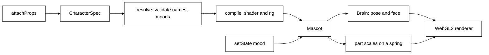

# Mascot engine

`bodies/mascot` (`@tagalong/mascot`, private, never published) is the WebGL engine that draws Scout as a
live 3D character. It is not wired into the UI yet; the dock pet moves onto it in the next slice.

## Where it comes from

A fork of the wobnimo 0.2.0 mascot engine, MIT licensed. The licence notice stays
in `bodies/mascot/LICENSE`, and every file that derives from wobnimo says so in its header. The fork lives
in the repo (not as a dependency) because Tagalong adds to the engine's core: per-mood parts, custom moods
and props. Files new in the fork (`props/`, `runtime/moods.ts`) say they are not from wobnimo.

## How it works

A character is a plain-data spec (`CharacterSpec`): materials, bones, shaped parts, eyes, a face, anchors,
acting per expression and effects. `compile` turns a spec into one fragment shader (the body is
ray-marched on the GPU) and a rig; `Mascot` runs the loop (`Brain` picks the pose, `Rig` poses the bones,
`Fx` emits particles, the renderer draws).



## Moods

The built-in states are `idle`, `thinking`, `listening`, `speaking`, `sleeping`, `working`, `error`,
`surprised`, `celebrating` and `sad`. `happy` is the short reaction to a poke, not a state you set.

A spec can add its own moods, which inherit a built-in state and override bits of its face:

```ts
const spec = {
  // ...
  moods: {
    coding: { base: 'working', face: { glow: [0.2, 0.9, 0.4] } },
    nap: { base: 'sleeping' },
  },
};
mascot.setState('coding');
```

A mood plays its `base` state (face, acting, effects). `face` replaces any of the base state's face
targets (`lid`, `squint`, `smile`, `tilt`, `energy`, `flap`, `glow`, `exposure`, `wide`, `asym`).
`resolve` rejects, with the character and field named: a base that is not a state, a mood named like a
built-in state, a part shown in an unknown mood, and a part with an empty `moods` list.

## Parts visible per mood

A part with `moods: ['coding', 'thinking']` shows only in those moods (names of built-in states or of the
spec's moods). It scales in and out on a slightly underdamped spring about its `pivot` (default its `at`),
so it grows with a small overshoot and shrinks without popping. Under reduced motion it jumps to its
final scale. The maths is in `src/props/visibility.ts`, kept pure so it is tested without a GPU.

## Props

A prop is a data file in `src/props/` (a `PropSpec`): its own materials, optional bones, parts in its own
space, and optional acting for its bones. `attachProps(spec, [[prop, attach]])` hangs each prop on a
character bone and returns a new spec; the original is untouched.

```ts
const scout = attachProps(base, [
  [lightbulb, { bone: 'head', at: [0.4, 0.9, 0], moods: ['thinking'] }],
  [laptop, { bone: 'body', at: [0, 0, 0.5], scale: 0.8, moods: ['working'] }],
]);
```

`PropAttach`: `bone` (where it hangs), `at` (its origin in that bone's space), `scale`, `moods` (where it
shows) and `colors` (recolour its materials by local name). A prop's materials join the character as
`name.material`. Props may not carve (`op: 'sub'`), since a carve would cut the body.

The library: `laptop` (its lid opens while `working`), `desk`, `lightbulb`, `tablet`, `notepad`,
`headphones`, `pillow`, `nightcap`, `partyHat`, `wrench`. Confetti is not a prop but the built-in `celebrating` effect.

## Public API

From `@tagalong/mascot`: `mount(element, spec, options)` or `new Mascot(canvas, spec, options)`, then
`setState(mood)`, `setPalette`, `setSpec`, `poke`, `on('ready' | 'poke' | 'state')`, `dispose`;
`attachProps`, the props, `recolor`, `variant`, `defineCharacter`, `isSupported`, `warm`. React:
`@tagalong/mascot/react` exports `Mascot` (`character`, `state`, `status`, `palette`).

## Build and test

`pnpm --filter @tagalong/mascot build` (plain `tsc -b`, run by `pnpm build` too) and
`pnpm --filter @tagalong/mascot test` (vitest in node; the tests cover the pure logic, no WebGL).
