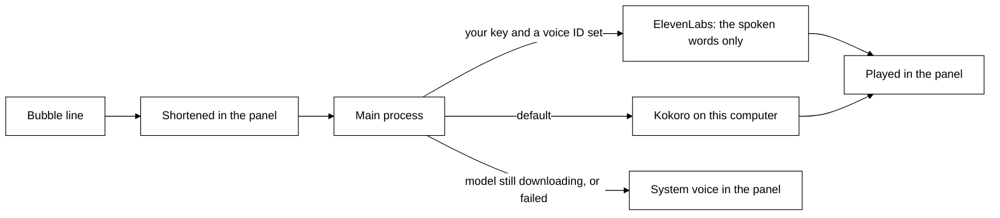
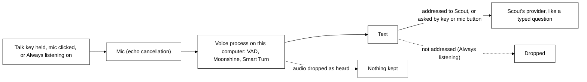

# Privacy in detail

What Tagalong reads, when, and what it never reads. The short version is in the [README](../README.md#privacy).

## What is captured, and when

Nothing on screen is read until you press a key, with three exceptions: **keeping an eye on things**,
which is on by default and follows window titles only (below), and **rolling memory** and a **watch** a
pet started at your request, which you switch on yourself (both below). Otherwise there is no
screenshot and no window text read between one question and the next — each hotkey reads once, sends
that, and stops.

| You do                  | It reads                                                                        |
| ----------------------- | ------------------------------------------------------------------------------- |
| `Ctrl+Shift+Space`      | The selected text and the active window's title. No picture.                    |
| Click the pet           | Nothing. The bubble opens; the pet looks only if it needs to.                   |
| Drop something on Scout | That one item, read only after you choose ([below](#dropping-things-on-scout)). |

Everything else the pet reads through its own tools, mid-answer: list what is open, read one
window's text, take a screenshot of the window you were using or of one listed window even behind
others (never a minimized one, which has nothing drawn), fetch another monitor, zoom into part of one.
Each of these is announced like any capture, and blind spots refuse every one. Those run only inside a turn you started, are shown in the panel as
they happen, and obey everything below.

## What the window list holds

The pet's `list_windows` tool reads a list of every open window: its application, its title, which screen it
is on (numbered and sized, never pictured), whether it is in front, behind something else or minimized, and roughly how much readable
text it holds. **It never contains the text inside those windows.** Reading one is a separate,
deliberate step the pet takes for a single named window.

That "roughly" is honest: counting is given a short budget per window, so a window holding 35,000
characters may be listed as holding about 4,000. The number is there to help the pet decide whether
a window is worth reading, and nothing treats it as exact.

## Windows you cannot see are still read

This is the part that goes further than a screenshot ever did, so it is worth stating plainly.
Windows exposes an accessibility layer, and Tagalong reads it — which means a pet asked to can read
the text of a window **sitting behind another one, or minimized to the taskbar**, without it ever
being on screen.

Two limits. Applications that draw their own text — code editors, terminals, design tools — publish
very little through that layer. When a read comes back that thin and the window is on screen, the text
is read from a picture of the window instead, with the text recognition built into Windows: on this
computer, with nothing installed and nothing sent anywhere, and the picture handed over in memory,
never written to disk. That read is announced like a screenshot, covers only what the window shows,
and may misread a word, and the pet is told so. A minimized window has nothing drawn, so when its
text layer is thin the pet is told the difference between "this window is empty" and "I could not
read inside it", and says so rather than guessing.
And a browser publishes only the tab you are on: the other tabs are not readable this way, and the
pet is told to say so instead of pretending.

## What the Chrome extension reads

Only when you ask — the toolbar button, its shortcut, **Read this page**, or an ask while Chrome is
in front — the extension reads the tab in front: your selection, the URL and title, and the page's
main text with menus and footers stripped, capped at 40,000 characters. The sight bar names what is
attached before you send. Nothing is read from tabs you are not on, the extension never runs in a
page you did not ask about, and the capture exclusion list applies to tab titles too. It talks only to
`127.0.0.1`, and the engine lets it do only what its side panel needs (ask, stop, and read the pet
and role lists): it cannot change settings, approve a tool, add a connection, an expert or a
routine, or start a hand-off.
The extension's public privacy policy, for the Chrome Web Store, is
[chrome-web-store/privacy-policy.md](chrome-web-store/privacy-policy.md).

## What is never read

- **The built-in blind spots.** Always on, listed read-only in Settings → Privacy under **Scout never looks
  at**, as chips built from the `BLIND_SPOTS` labels, and kept apart from your own exclusion list so clearing that list never removes them
  (`BLIND_SPOTS` in `packages/protocol/src/blind-spots.ts`):
  - password managers: 1Password, Bitwarden, KeePass, KeePassXC, LastPass, Dashlane, Keeper, Proton
    Pass, Enpass;
  - the Windows sign-in screen, the UAC prompt, Windows Security and Credential Manager;
  - secret files named in a window title, as an editor shows the open file: `.env` and `.env.*`,
    `*.pem`, `*.key`, `*.pfx`, `*.p12`, `id_rsa`, `id_ecdsa`, `id_ed25519`, `.npmrc`, `.pypirc`,
    `.netrc`, `.git-credentials`, `.htpasswd`, `credentials.json`, `kubeconfig`, `*.tfvars`,
    `secrets.*`, `*.kdbx`;
  - private browsing (InPrivate, Incognito, Private Browsing);
  - authenticator apps (Authy, WinAuth) and Remote Desktop.

  A blind spot is refused before anything is read: no screenshot, no text, no character count, and
  no Ctrl+C for a selection — a highlight in a `.env` file never reaches the clipboard. Its title
  is not sent either: when the window in front is a blind spot or on your exclusion list, Scout
  is told only the app's name (for example `chrome.exe`) and which rule blocked it, never the
  window or tab title, so the title stays out of the conversation and out of any expert's brief.

- **Your own exclusions.** Add any app or window title in settings; they work the same way.
- **Secrets that slip past.** A title rule only works while the title names the file (an editor
  shows `.env` only while that tab is open). So everything sent to a model — your question,
  selections, window text, tool results, memories — and every brief to an expert passes through
  `hideSecrets` first. API keys and tokens (`sk-`, `ghp_`, `github_pat_`, `AKIA`, `xox`, `AIza`,
  Stripe keys), login tokens (JWTs), private key blocks, the password in a connection string, the
  values of `PASSWORD=`, `SECRET=`, `TOKEN=` and `API_KEY=` settings, and card numbers become a
  marker such as `[hidden: API key]`, so the pet knows something was there without seeing it.
- **Secret files, by your experts.** Claude Code reads files for itself, so it is started with deny
  rules for every secret file name above (`Read(**/.env)`, `Edit(**/.env)` and so on).
- **Experts run sealed.** An expert run of Claude Code gets only the tools its mode allows (read and
  search; plus edit when you allowed edits; web search and fetch when you switched on **Let it
  search the web**, or for a routine's research), none of
  your MCP servers, none of the project folder's `.claude` settings (so a project cannot grant
  itself permissions or run hooks), and no hooks from your own settings either. Its answer, its
  error and its progress steps pass through `hideSecrets` before they are kept in Activity or shown,
  so a key it read in a file is not repeated back. Its standing instructions pass through
  `hideSecrets` too, into a temp file that is removed when the run ends.
- **Two-step hand-offs.** When one card names two steps (say a Coder, then a Reviewer), both are
  confirmed by the one Send, with each step's access shown on the card; nothing starts later on its
  own. Step 2 is briefed with step 1's answer (already scrubbed by `hideSecrets`, and cut at 8,000
  characters) and the names of the files it changed, works in the same project with its own access,
  and never runs if step 1 failed, timed out or was stopped, or once Tagalong is closing.
  Each step's brief is its own "Sent to expert" row in the log of what Scout saw.
- **Notes to a working expert.** What you ask Scout to tell a working expert ("use dayjs, not
  moment") leaves the machine to that expert like the brief did: your words, passed through
  `hideSecrets`, written into the same live Claude Code session when its current step ends. It
  cannot change what the expert may do: same folder, same tools, still sealed. Each note delivered
  is its own "Sent to expert" row (its size, never its words), and it is added to the hand-off's
  Activity row under "What Coder was told". A note still waiting when the run ends is never sent,
  and the card says so. What the expert writes between its tools may be said aloud by Scout (first
  sentence, at most 120 characters, keys hidden), at most once every 20 seconds, only while Scout
  talks is on.
- **A monitor with an excluded window on it.** If a password manager is open and visible on your
  second screen, that whole screen is blanked in the full-view capture — not just when it is the
  window you are working in. The blanked screen is replaced with a flat panel reading BLOCKED, so
  the pet can see that something was withheld rather than being handed a gap it might guess at.
  Minimized windows do not blank their monitor: a vault in the taskbar is not on screen, and
  blanking a screen you are working on because something is hidden would be a bug, not caution.
  The same check runs before a close-up crop (`look_closer`, and the sharp crop a "what changed"
  check takes) and before a plain screenshot falls back to a whole screen: a screen with an
  excluded window on it is never cropped or photographed. When Tagalong cannot tell which screen
  a picture is of, it takes none while anything at all is blocked.
- **Anything at all, while sight is paused** — see [Pausing sight](#pausing-sight).

## The rest

- A visible indicator shows every capture.
- Built-in blind spots and your own exclusion list block capture in password managers, secret
  files and other listed apps.
- When Windows reports no foreground window at all — a locked session, a UAC prompt on the secure
  desktop — capture falls back to the screen rather than refusing, which matches the exclusion
  rules: a window that cannot be named is allowed, because a pet that never sees reads as broken.
- Everything is stored locally in SQLite.
- Screenshots are not persisted by default. The image is stripped from the stored snapshot before
  the row is written, so the database holds the question and the window title but never the pixels.
  Set `screenshotRetention` to `{ "mode": "hours", "hours": 1-24 }` to keep them for debugging;
  expired images — and every stored image, the moment you switch retention back off — are swept on
  the next turn.
- A pet whose provider cannot see images never receives the screenshot: it is dropped before the
  request is built and the host is told with a `turn.warning` (`code: "vision_unsupported"`), so the
  turn still answers instead of failing.
- API keys live in the OS keychain through Electron safe storage, the ElevenLabs key included.
- The hello Scout says as Tagalong opens reads nothing on screen. The summaries model is sent only
  the time of day, how long since Tagalong last opened, the names and briefs of expert hand-offs
  that finished meanwhile, the names of routines that ran, whether Tagalong closed unexpectedly last
  time and how many tasks stopped, and, after an update, the new version and its what's-new text. Turn it off under Settings → Privacy → **Say hello when Tagalong opens**.
  While Scout talks is on, the hello is also spoken (below).
- Tagalong records, in its local settings file, whether the last launch closed cleanly and which
  app version it ran, so Scout can say it crashed or was updated. The markers themselves
  stay in that file on this computer; only the facts listed above reach the brain you chose, inside
  the prompt that writes the line.
- Setup stores each answer in local settings as it is given: the step reached, how you answer, your
  name or that you declined it (`userNameDeclined`), how Scout thinks and whether it talks. A pasted
  key is saved to the OS keychain before its one test (one tiny request to that service); a key that
  fails the test stays there until you replace it or remove it in Settings. It is never
  spoken, shown or logged. Checking your Claude sign-in only reads the local sign-in and sends nothing.
- The health check ("Scout, what's wrong?") reads no screen and calls no model. It asks only this
  computer and the engine: whether you are signed in to Claude Code, whether a key is stored (never
  the key), whether each expert that is on answers its no-cost test (Claude Code's `--version`), your connections' states,
  the microphones' ids against the one you picked, whether the voice models' files are on disk, and
  whether the browser extension is connected. Nothing it reads is stored or sent anywhere, and the
  card never shows a key, token or secret.
- The name you give Scout (setup, or Settings → **You**; optional) is stored locally in settings.
  It is sent to the AI provider only as part of Scout's prompt: one line in its system prompt, and
  in the hello's facts when Tagalong opens. Clear the box and it is gone from both.

## Connected apps: what goes to them

Apps you connect in Home, Connections (Notion, GitHub, Linear, a local tool) are reached only
when Scout calls one of their tools in a turn you started.

- **What is sent.** Only the arguments Scout fills in for that tool, such as a search query or a
  page title. Nothing on screen is sent on its own. Keys, passwords and card numbers are hidden in
  the arguments before they leave, and blind spots are never read, so their content cannot reach an
  app.
- **Changes ask first.** A tool the app marks read-only runs at once. Every other tool, including
  any the app says nothing about, shows a card in Scout's bubble saying which app, which tool and
  what Scout filled in, every argument in full (long ones scroll); it runs only on **Allow once**.
  Cancel, or two minutes without an answer, and nothing changes. A change too long to show in full
  (over 4,000 characters) is not offered at all.
- **What comes back** is treated as data, not instructions: Scout is told never to follow anything
  written in it, and the app cannot end that fence early. An app's error message is fenced the
  same way. It goes to Scout's brain provider like any window text, and is not stored.
- **Tokens and keys.** Sign-in tokens, a pasted key and a local tool's secret values are kept in
  the OS keychain through Electron safe storage (`connection.<id>.*`), never in settings, the
  database, the repository or logs. **Disconnect** deletes them.
- **Sign-in** opens the app's own page in your system browser, which sends you back to a one-time
  address on `127.0.0.1`. Tagalong never sees your password. Only a reply carrying this sign-in's
  own random state is accepted.
- **Found on this PC** reads Claude Code's `~/.claude.json` read-only, and never copies a key out
  of it: a value written there in full is left behind, and you are asked for it if the app needs it.
- **Activity** records each call as the app, the tool, read or write, and whether it worked. Not
  what was sent or what came back, and not an app's error text either.
- **"What needs me?"** (asked, or the **What needs me** routine) calls only the apps' read tools,
  with no screen content in what it sends; what comes back goes to Scout's brain provider like any
  other app answer.
- **"File this as a bug"** sends screen text to an app, because you asked for exactly that. Scout
  reads the window with the error and quotes it (at most 40 lines) in the issue, as data: it never
  follows instructions written in it.
  The text goes to GitHub or Linear only after you press **Allow once** on the card, which shows the
  whole issue; Cancel sends nothing. Keys and passwords in it are hidden first, blind spots are
  never read, and no screenshot is attached.

## Routines: what runs on its own

A routine is something Scout does for you at a time or when something happens, such as new papers
every weekday at 8. Nothing becomes a routine until you press **Save**, on Scout's card or in Home.

- **What saving allows.** Saving is your consent for the routine's read-only work: each run is one
  of Scout's turns, so it may read your connected apps' read-only tools, as Scout does when you ask.
  A tool that changes something still shows **Allow once** every time, and does nothing if you are
  not there to press it.
- **Experts.** A routine hands work to an expert without asking only when its card said so ("May
  hand to: Researcher, read-only, no project"). Exactly one such hand-off per run: that expert then
  runs in an empty folder of its own, with web search and web fetch only, so it cannot read your
  projects or edit any file, but it can search the web and open web pages. Its brief is only the
  routine's saved instruction plus Scout's request for this run, never what is on your screen, a
  selection or file names. A second hand-off in the same run, or to any other expert, shows the
  usual card and waits for Send.
- **What a run sees.** The routine's own words and topics, and, for a trigger, what triggered it: the
  first 600 characters of an expert's answer, or a watch's message. A routine that waits for an app
  or site reads window titles only, every 15 seconds, never a picture or window text, and never a
  blind spot's title.
- **Where results go.** Only where the routine says: a line in Scout's bubble, Scout's voice, a
  Windows notification. Each run is also a row in Activity, and its answer is kept in Scout's
  conversation on this computer so you can ask about it later. Results wait while a full-screen app
  or a call is in front.
- **Missed runs.** If the computer was asleep or Tagalong was closed, a routine runs once when it is
  back, and says it ran late. Never more than once. A meeting prep never runs late: once a meeting
  has started, its prep is skipped.
- **Meeting prep's calendar link.** The secret .ics link you paste in the Meeting prep form is a key
  to your calendar, so it is kept in the OS keychain through Electron safe storage
  (`calendar.ics`), never in settings, the database, the repository, logs, an error message or
  chat. Tagalong sends nothing with it: every 15 minutes at most it fetches that link from your
  calendar host, over https only, and reads it on this computer. Only the meetings in the next 36
  hours are kept, in memory. Ten (or thirty) minutes before a meeting, its title, time, attendees,
  room or link and up to 600 characters of its description go to Scout's brain provider as part of
  that routine's turn, fenced as invite text Scout must never follow, since anyone can send you an
  invite. Scout may then use your connected apps' read tools to find the last thread and related
  docs. A calendar fetch carries nothing from your screen, so it is not a row in Activity. Nothing
  is fetched while no meeting routine is on, except one check when you open the Meeting prep form
  with a link kept, and **Forget the link** in the form deletes it from
  the keychain.
- **During a call.** A prep that is still waiting when the meeting starts goes out as a Windows
  notification only, never spoken aloud.
- **The daily budget.** With a cap set, a routine that comes due after that day's priced spend
  reached it does not run; Activity records it as skipped. **Run now** always runs.
- Routines are kept in the database on this computer (`routines` table). Delete one in Home, or ask
  Scout to, and it is gone.

## Scout's voice: what is spoken, and where it goes

Scout says its bubble lines aloud while **Scout talks** is on (Settings → Voice, on by default).
What reaches a speech engine is only the line being spoken, after it is shortened in the panel:
markdown stripped, code blocks, lists, tables, quoted (`>`) lines, in any language, and URLs left out. An ordinary answer is cut to its
first sentence or two, and a long sentence is cut at a word (about 200 characters), ending with
"The rest is in the bubble." An answer to a spoken question, or to a typed "read this to me", is
said in full, sentence by sentence, still without code or lists. Never the screen, the window list,
the question or the conversation.

**Reading aloud.** When you ask Scout to read something to you, it reads your selection or the
window in front (as for any question about your screen) and says that text, about 300 words at a
time, asking "Shall I go on?" between parts. So the text of that window or selection goes to the
chosen speech engine: it stays on this computer with Kokoro or the system voice, and is sent to
ElevenLabs when ElevenLabs is the chosen voice. With **Scout talks** off, the reading is only shown
in the bubble.

**Translating.** Scout translates with its own model: there is no translation service, so the text
it read goes only to Scout's model, like any question about your screen, and reads are logged as
they are today. A translation into English is spoken like any answer while **Scout talks** is on:
its first sentence or two, or all of it when you asked to hear it ("translate this and read it to
me"). That goes to the chosen speech engine: it stays on this computer with Kokoro or the system
voice, and goes to ElevenLabs when ElevenLabs is the chosen voice. A translation into any other
language is shown in the bubble as a quoted block and never spoken, with ElevenLabs too; only the
English line before it ("It's in the bubble.") is. A target language you ask Scout to remember is kept as a remembered
preference, like anything else you ask it to remember.

- **Kokoro, on this computer (default).** The Kokoro-82M model (Apache-2.0, quantised, about
  92 MB) is downloaded from Hugging Face the first time Scout speaks, into the `voice` folder of
  the app's data directory (`%APPDATA%\Tagalong\voice` on Windows), and read from there afterwards.
  The download fetches the model only; no text is sent. Speech is made on the CPU. Its files are
  checked like the listening models (see **Model files are checked** under "Talking to Scout" below).
- **The system voice.** While the model downloads, or if it cannot load, the panel speaks through
  the operating system's own voice (a British male voice such as Microsoft George when installed).
- **ElevenLabs (optional).** Used when picked under Settings → Voice → **Who speaks**, or when an older install already had a voice ID, and only with your own key and a voice ID you picked from your ElevenLabs
  library, both under Settings → Advanced. Each spoken line is sent to ElevenLabs' Flash model and
  billed to your account, including every line of a reading aloud. The key is encrypted with the OS keychain like the others. If ElevenLabs
  fails, Scout uses Kokoro.
- Nothing spoken is recorded or stored. Closing the bubble or `Ctrl+Shift+Alt+M` stops speech at
  once.

## Talking to Scout: your microphone

Scout listens continuously only after you switch **Always listening** on, once, in the bubble
(or in Settings → Privacy). It is remembered until you switch it off. A clear mark on Scout shows
the whole time it is on, and Scout never switches it on itself. Audio is understood on the
computer and is never sent or stored.

Otherwise the microphone is used only while you hold the talk key (`Ctrl+Shift+Alt+Space` by
default, Settings → Voice) or after you click the mic in the text box, until you let go or click
again (at most 30 seconds). Hold-to-talk and the mic button need no name, whether or not Always
listening is on. After an answer the bubble only offers the key to reply. Setup listens for its
answers only after you choose **Talk to me** (below).

- **On this computer.** While you talk, the microphone's audio streams in memory, a frame at a
  time, from the panel through the app to its voice process, where three small models turn it into
  text on the CPU: Silero VAD (MIT, about 2 MB) spots speech, Moonshine tiny (Useful Sensors, MIT,
  quantised, about 32 MB) writes the words, shown in the bubble as you talk, and Smart Turn v3.2
  (Pipecat, BSD-2-Clause, about 9 MB) judges when you have finished. They are about 43 MB in all,
  downloaded from Hugging Face (`onnx-community/silero-vad`, `onnx-community/moonshine-tiny-ONNX`,
  `pipecat-ai/smart-turn-v3`) the first time you talk to Scout, into the same `voice` folder as the
  voice. The download fetches the models only; no audio is sent.
- **Model files are checked.** Every model file (listening and Kokoro) is fetched from one fixed
  Hugging Face commit, never from a branch that can move, and must match a SHA-256 written into the
  app. A file that does not match is never kept: it is deleted and fetched once more. If the
  listening models are still wrong, the bubble says "The speech model I downloaded was damaged.
  Check the connection and try again."; if Kokoro's are, Scout keeps speaking in the system voice. The files on disk are checked again once each
  time the voice process starts. The model library is told never to fetch anything itself, so it
  only reads files that were checked. Kokoro's voices come with the app's own packages. A copy an
  older version downloaded is checked like any other and replaced if it does not match.
- **The audio never leaves the computer and is never stored.** It lives in memory until it has been
  turned into text, and is then dropped. Before you start to speak, only the last quarter of a
  second is held in memory (so the first syllable of a word is not cut off), each frame dropped as
  a newer one comes. Only the text goes on, to Scout's provider, exactly as if
  you had typed it, with the name of the window you are on (never the selected text).
- The microphone is the one picked in Settings → Voice, or the system default. Windows' own
  microphone privacy setting applies.
- There is no cloud speech to text: ElevenLabs is used for Scout's voice only, never for yours.

### Always listening

Off by default. You switch it on in the bubble's header or in Settings → Privacy, once. It stays
on, across restarts, until you switch it off. When it is on at launch, Scout's first line says it
is listening and how to stop, and the mark shows from the first second.

- **The mark.** A small green dot on Scout shows the whole time. It is solid while Scout listens
  and an outline while listening is paused. It is never hidden.
- **Hiding the pets pauses listening.** While the pets are hidden (the tray's **Hide pets**), the
  microphone is closed, so it is never open while the mark is out of sight. Showing the pets
  again resumes listening.
- **Only Scout's name counts.** Scout acts only on what starts with "Scout" (optionally "hey
  Scout" or "ok Scout"). Everything else is dropped on the computer and goes nowhere. "Scout's
  plan" or "Scout-like" is talk about Scout, not to it, so it is dropped too. Only the
  addressed question, with the name taken off, goes to Scout's provider as text, as typing does.
  So you can have a conversation that is not for Scout without it leaving the computer, but
  anything you say that starts with "Scout" is sent.
- **"Scout, stop".** Saying "Scout, stop" (or "Scout, stop listening") switches Always listening
  off. So does the switch in the bubble or Settings.
- **Paused while a call or a full-screen window is in front.** From window titles only, Scout
  checks the front window when listening comes on and every 2 seconds after: if it is a call app
  (for example Teams, Zoom or Google Meet) or fills the screen, the microphone closes and the mark
  turns to an outline until that window is no longer in front. It is the front window that
  counts, as with keeping an eye on things: a Teams window in front pauses listening even with no
  call, and a call behind another window does not.
- **Deaf while the system voice speaks.** The system voice is not echo-cancelled, so Scout
  ignores what it hears while that voice is speaking. Kokoro and ElevenLabs are echo-cancelled,
  so you can interrupt them by saying "Scout".
- **Hold-to-talk and the mic button need no name**, in every case, also while Always listening
  is on: that question is asked as said, then listening carries on.
- **Closing the bubble does not stop listening.** It drops a question being asked; switch Always
  listening off to stop.
- **Models and size.** The same three models as above, about 43 MB in all, run on the CPU.
- **Paused while setup is open.** Setup may be listening for its answers, so Always listening
  waits until the setup window closes, and the talk key brings setup forward instead of opening
  the bubble's mic. One window listens at a time.

### Setup by voice

Setup's first question is "Talk or type?". **Talk to me** is setup's permission to use the
microphone; **I'll type** (or a fresh setup that has not been answered yet) leaves it closed.

- **Only after "Talk to me".** Setup listens only once you chose it. If you close setup part way
  after choosing it, setup carries on listening when it opens again: the red dot shows and the
  answer chip says Talking, and **I’ll type** stops it. Opening a finished setup again starts with
  the microphone closed until you choose again.
- **The model first, then the mic.** The first time, the same three speech models as above
  (about 43 MB) download before the microphone opens; the header shows the download, and you can
  type or tap meanwhile. Only then does the mic open.
- **The indicator shows the whole time.** While the mic is open, a red dot and "Listening for
  your answer" show in setup's header. Windows' own microphone indicator shows too.
- **On this computer.** Audio is understood on the computer, as above, and is never sent or
  stored. What you say is matched to setup's fixed answers on the computer, with no AI; nothing
  goes to a provider.
- **No name needed, and "stop" is just a word.** Every turn is an answer. Say or tap "I'll type"
  to stop listening.
- **The mic closes** when setup ends (Try it, or the window closing), when you choose **I'll
  type**, and while the system voice speaks. A missing microphone, a refused permission or a
  model that will not download is said plainly, the mic stays closed, and setup carries on by
  typing; it saves that you type, so it does not try again until you choose **Talk to me** again.
- **Always listening is separate.** Its switch on the keys step is off by default and only you
  switch it on; it starts once setup is closed.

## Keeping an eye on things

On by default; switch it off under Settings → Privacy → **Keep an eye on things**. Off means no
tracking at all: the window list is not even taken.

- **Always, for free:** every five seconds the desktop lists the open windows — application, title,
  which one is in front, whether one fills its whole screen — and sends that list to the engine on
  this computer. No picture is taken, no window text is read, and no model is called. The list is
  kept in memory only, for the session.
- **Rarely, one cheap look:** when you have stayed on a window new to this session for about thirty
  seconds, or a title reads like trouble (`error`, `failed`, `failing`, `failure`, `exception`,
  `traceback`, `crashed`), Scout reads **that one window's text** (the last 4,000 characters) and
  sends it, with its app and title, to the summaries model (Settings → Summaries, else Scout's own)
  in one short call that asks whether there is one useful thing to say. Most of the time the answer
  is nothing and nothing is shown.
- **Limits:** at most one line every ten minutes; never two looks at the same window (same window
  and same title); nothing while a full-screen app or a Teams, Zoom or Google Meet window is in
  front; **Not now** on the line quiets it for an hour. Pausing sight stops it too.
- **Blind spots apply everywhere:** a window on the built-in list or your exclusion list is never
  considered, its title included, and its text is never read.
- **Nothing is delegated on its own.** When the line offers help, **Hand it over** opens the usual
  hand-off card; nothing goes to an expert until you press Send there.
- **Stuck? reads nothing until you click.** When an error title (as above) has stayed in front for
  three minutes, Scout says one fixed line, "That error’s still up. Want me to hand it to Coder?",
  from the title alone: no window text is read and no model is called. Only if you press **Hand it
  over** does Scout read that one window's text (the last 4,000 characters), hide any key, token or
  password in it, and put it in the brief on the hand-off card, which says "Includes the end of the error window". The read is logged in **What Scout
  saw** like every other read, and nothing goes to the expert until you press **Send**. At most once
  every thirty minutes, never twice for the same error, and never during Not now, a call, full
  screen or a blind spot.
- **Scout's moods use the same titles.** A wince when the window in front newly reads like a failed
  build, a cheer when it reads like passing tests: from the title alone, with no window text read
  and no model called, at most once a minute, and never for a blind spot, a call or full screen.
  A finished hand-off can make Scout wince or cheer too, from the expert's own reply, which is
  already on this computer.
- **The daily budget stops it too.** With a cap set under Settings → **Daily budget**, once that
  day's priced spend reaches it no window is looked at and no call is made until midnight. Moods
  carry on, since they call no model.

### Dozing: your idle time

Scout dozes when you have been away for five minutes or the screen is locked. For this the desktop
reads one number from the operating system every fifteen seconds, how long since the last key or
mouse input, and hears the lock and unlock events. Nothing on screen is read, the number is never
stored, and it never leaves this computer.

### Gentle nudges: idle time and titles

Off by default; switch it on under Settings → Privacy → **Gentle nudges**. While it is on, and sight
is not paused, the desktop sends the engine on this computer two things once a minute: the idle time
(how long since the last key or mouse input) and the window titles keeping an eye already lists (no
picture, no window text). Nothing is stored and no model is called: the lines are fixed text.

- After an hour and a half with no five-minute break, Scout looks tired and suggests a stretch,
  once. After 23:00, once you have been active for half an hour, it says it is late, once a night.
- Nothing appears during a call or over a full-screen app, and **Not now** quiets it for an hour.
- **Nothing leaves this computer unless you take the offer.** With an expert switched on, the late
  line offers **Hand it over**, which opens the hand-off card with "Write a short note of where I am
  so I can pick up tomorrow" and the app and title of the window in front (never a blind spot's).
  Nothing goes to the expert until you press Send there.
- Nudges read nothing beyond the titles feed, so they add no rows to what Scout saw.

## Pick up where you left off

On by default; switch it off under Settings → Privacy → **Pick up where you left off**. Off means no
snapshot at all, and switching it off deletes the one kept.

- **What it holds:** one row in `tagalong.db` (table `pick_up`), on this computer, overwritten
  every ten minutes while the app runs. From window titles only: up to three projects open in an
  editor (the project's name and folder, the branch read from its `.git/HEAD`, and the file name
  in the title, which is never opened or read), and up to three hand-offs left half done (the
  expert's name and the ask; never the selected text or window a brief carried).
- **Nothing is sent.** No picture, no window text and no model call. The line is written from
  these facts on this computer.
- **Blind spots apply:** a window on the built-in list or your exclusion list is never noted, its
  title included.
- **When you are back** after six hours or more, the snapshot is offered once and a new one
  starts. Nothing opens until you press a button on the card. **Open** opens only a folder that
  pick-up named, through VS Code's or Cursor's own link or Explorer; **Brief again** only fills in
  the hand-off card, which waits for Send. No keys are typed and the mouse is never moved.

## Spend: what the cost meter keeps

Every model call Scout makes and every expert run is counted in the local database, for Home's
**Spend** card and the daily budget.

- **Counts only:** when, Scout or an expert, the provider, the model, input and output tokens, and
  the dollar cost when the model has a known price. Never what was asked, said, read or seen.
- **Stays on this computer.** Nothing about it is sent anywhere; prices come from a table built into
  the app, so working out a cost makes no network call.
- **The Claude sign-in is shown as tokens only,** as your plan, never as money.

## Rolling memory: what the buffer holds

Off until you switch on **Remember the last few minutes of the screen** in Settings → Privacy. While
it is on:

- Every five seconds the desktop takes a **640-pixel picture of each screen**, the **list of open
  windows** (titles and positions, never their text) and which window was in front.
- It keeps the last **ten minutes** by default (you choose one to thirty) and drops anything older.
- It lives **in memory only**. Nothing is written to disk — not a file, not the database, not a
  cache — and the code that holds it imports no file APIs, which a test checks.
- A frame is **skipped** while an app on your exclusion list is in front, and a screen showing one is
  never stored. Excluded apps are never remembered.
- **Pausing sight clears it.** Pressing the pause key stops recording and throws away every frame it
  held, and the red dot on the pets disappears. Resume starts an empty buffer.
- **Quitting clears it.** After a restart there is nothing to recall from before it; the pet says how
  far back memory actually reaches.
- **Turning it off clears it**, at once, without a restart.

Only the frame a pet asks for with `recall_screen` or `what_changed` is ever sent to a model.

## Watches

A watch photographs one screen every five seconds at 640 pixels and compares it with the last frame,
**on this machine**. Even with rolling memory off, it keeps that screen's recent frames in memory for
as long as the watch runs, and drops them 30 seconds after the watch ends; pausing sight drops them
too. A model only sees something when the watched region changed: then the changed part is cropped
and sent to the pet's small check model — or, for a text-only model, the last 4,000 characters of the
window you were watching. Every watch shows a **Watching** chip with **Stop**, and ends on its own
after its timeout or its check limit.

## What Scout saw: the log of its own looking

Home has a page, **What Scout saw**, that lists each time Scout looked at your screen or sent
something off this computer, newest first, grouped Today, Yesterday and Earlier. It is always on;
there is no switch, because it holds no content and an off switch would weaken the audit.

| Row                    | Written when                                                                                                 | What the row keeps                                               |
| ---------------------- | ------------------------------------------------------------------------------------------------------------ | ---------------------------------------------------------------- |
| **Listed windows**     | the window list is read (a tool, a routine, the hotkey's full view)                                          | how many windows                                                 |
| **Read text**          | one window's text is read (accessibility tree or OCR), or a hotkey ask arrives with a selection or page text | the app, the window title, how many characters                   |
| **Screenshot**         | a screenshot, a crop, a window picture, a frame from screen memory, or a watch's before-and-after crops      | the app and title when known, how many pictures                  |
| **Sent to AI**         | any call to Scout's provider: a turn, a summary, a watch check, keeping an eye on things, the launch line    | the provider and model, how many characters and pictures         |
| **Sent to expert**     | a brief goes to an expert, or a note from you reaches a working one                                          | the expert's name, how many characters                           |
| **Read element names** | Scout points at a named button or field, so the window's element names are read to find it                   | the app and the window title; not the name asked or any it found |

- **Metadata only.** The table behind it (`sight_log`) has no column for text, pixels or a brief, and
  a test checks that it never gains one. A window title passes through the same secret scrubber as
  everything sent; the title of a blind spot or a window on your exclusion list is not kept at all,
  only its app.
- **What makes no row.** A read the blind spots or your exclusions refused, and anything while sight is
  paused, because nothing was read. A watch comparing frames on this computer with no picture sent. The
  window titles keeping an eye on things follows every five seconds. The key check in Welcome, which
  sends no screen. Voice: audio never leaves the computer and is never stored, so there is no "heard"
  row; what you say to Scout becomes a question, and its text reaching the provider is a **Sent to
  AI** row.
- **Kept 7 days** by default, 1 to 30 in **Settings → Privacy → Keep the record of what Scout saw**.
  Older rows are deleted as new ones are written and when Tagalong starts.
- **Deleting.** Each row has a delete button; **Delete all** asks first. Deleting removes the record,
  not what was already sent, and does not touch your conversations.
- The Chrome extension cannot read or delete the log.

## What did we do today?

Ask Scout "What did we do today?" (or yesterday) and it reads back the records above: the apps and
window titles in the log of what Scout saw, your questions (the first 120 characters), which experts
got which ask and how they ended, routines and app calls by name, and what pick-up last saw (only
when pick-up is on). Those titles, questions and asks go to **Scout's own model** to be summed up,
like any tool result, with any key, token or password in them hidden first. Answers from experts, turns and routines are not included, nor the selection
or window a brief carried. Nothing new is recorded for it, and the hours are an estimate from the
first to the last look: Scout only knows what it looked at or was asked.

## Searching your history

Ask "what was that article about vector databases I read Tuesday?" and Scout searches a local
full-text index in `tagalong.db` of the window titles and apps in the log of what Scout saw and of
your questions, expert asks and routine names. It stores no new content: the index holds the same
words as those rows and is kept in step with them, so deleting a row, **Delete all**, or the
retention dropping old rows removes them from search too. Nothing older than the days the log
keeps is found. A blind spot or excluded window was only ever kept as its app name, so its title
cannot be found. Up to 20 matching lines (day, time, app and the title or ask, with any key, token
or password hidden) go to **Scout's own model** as a tool result. No page text, answers or
selections are searched or sent, nothing leaves the machine except that tool result, and the
Chrome extension cannot query the index.

## Pausing sight

`Ctrl+Shift+Alt+P` turns every kind of looking off, and pressing it again turns it back on. The
tray carries the same item, because this is the one hotkey whose loss matters: a user who needs to
blind the pet right now must not first discover that something else on their machine owns the
combination.

While paused:

- Every screenshot, display capture, crop, window enumeration and window text read is **refused
  before it runs**. The refusal happens above the adapter, so nothing is captured and then
  discarded — the same ordering the exclusion list uses, for the same reason.
- The avatar wears a grey eye for as long as it lasts. The amber eye that marks a capture cannot
  appear, because nothing was read.
- The pet is told sight is paused rather than that a capture failed, so it says "you turned sight
  off" rather than inventing a reason or claiming a window is empty.
- The selection and the clipboard still work. Pausing blinds the pet; it does not refuse what you
  hand it deliberately, or a paused pet would be useless rather than merely blind.

Pause is a moment, not a setting, so it is deliberately **not** remembered across restarts — an app
that boots blind because of a keypress last Tuesday reads as broken rather than private. The
exclusion list is the setting that persists.

It is also one gate rather than a check repeated at each call site. Every read goes through the
platform adapter, and the adapter handed to the rest of the app is already wrapped, so a capture
path added later is covered by construction rather than by remembering. Which reads pause covers is
a mapped type over the adapter's own methods, so adding a method without deciding what pause does to
it does not compile.

## Pointing at things

When you ask where something is ("where's the export button?"), Scout can show you with a ring
around it (`point_at`).

- **What is read.** Only the names of the elements inside the one window Scout names, through
  Windows' accessibility tree, to find the one called, say, "Export", and its rectangle. The search
  starts at that window and never walks the rest of the desktop. Nothing else in the window is read,
  and no picture is taken.
- **Blind spots and exclusions apply first.** A window on the built-in blind spots or your
  exclusion list is refused before anything in it is read, and a minimized window is not searched:
  Scout asks you to bring it forward. Pausing sight refuses pointing too.
- **The ring is drawn, never clicked.** The overlay is a click-through window that only draws.
  Tagalong never moves the mouse, clicks or types for this. `Esc` is listened for, never sent, and
  only while a ring shows.
- **The ring stays out of Scout's own pictures.** The overlay is excluded from screen capture, so a
  screenshot Scout takes never shows it.
- Nothing about a point is stored.

## Drafts and the clipboard

When you ask Scout to draft a reply, a message or a PR description, it reads what it needs the
usual way (your selection, then the window's text, a picture only when the text is not enough) and
writes the draft in the bubble.

- **The clipboard is written only on Copy.** Pressing **Copy** under a draft puts that draft, and
  nothing else, on the clipboard. Main does the write (`clipboard.writeText`); it takes only text,
  at most 20,000 characters, and only from the bubble's window.
- **The clipboard is never read** for this, and nothing is pasted or typed into any app: pasting is
  yours.
- A spoken request has only its one line spoken; the draft is shown, never read aloud.
- The draft is part of Scout's answer, so it is stored with the conversation like any answer.

## Dropping things on Scout

You can drag a file, an image, a link or selected text onto Scout. The bubble opens on a card
("report.md: want me to explain it, or hand it to an expert?") with **Explain**, **Hand it to an
expert** and **Cancel**.

- **Nothing is read on the drop.** Tagalong notes the item's name and path only. The file is read
  from disk when you press **Explain** or **Hand it to an expert**, and only that one item goes,
  with that one question. **Cancel** sends nothing. An item nobody sends is let go, unread, ten
  minutes after the drop, and a button pressed later says to drop it again.
- **What is read.** A text file (by its extension, up to 1 MB): its text, capped like a selection.
  A PNG or JPEG (up to 10 MB): scaled to the screenshot size and sent as a picture. Any other file
  (PDF, Word, a WebP or GIF, a file too big): its name, path and size only. Tagalong does not open
  it, and an expert you hand it to reads it from the path. A link or dropped text is passed as it is.
- **Secrets files are refused.** A file whose name matches the secret-file list (`.env`,
  `id_rsa`, `secrets.json`, `*.pem` and the rest) gets "That looks like a secrets file, so I won’t
  read it or pass it on." with no buttons. Secrets inside other text are still hidden on the
  way out, like everything sent to a brain.
- **Only a button sends it.** With Always listening on, saying "Scout, explain it" while the card
  is open is an ordinary question and does not carry the dropped item.
- **Hand it to an expert** goes through Scout, which writes the brief. The usual hand-off card
  appears, and nothing reaches the expert until you press **Send**.
- **Stored like a screenshot.** The conversation keeps the dropped item's name, path and text like
  a selection. A dropped image is kept out of the database by the screenshot retention rule, and a
  brain that cannot see images never gets it (Scout says so).
- **It shows in What Scout saw.** The question that carries the item is a turn, so it is logged
  as **Sent to AI** with its characters and pictures, like any other. The drop itself reads
  nothing, so it adds no row.
- **Pausing sight does not block a drop.** A drop is something you hand over on purpose, not Scout
  reading the screen.
- **Nothing opens by accident.** The pet's and the bubble's windows refuse to navigate, so a file
  dropped there never opens inside Tagalong.
