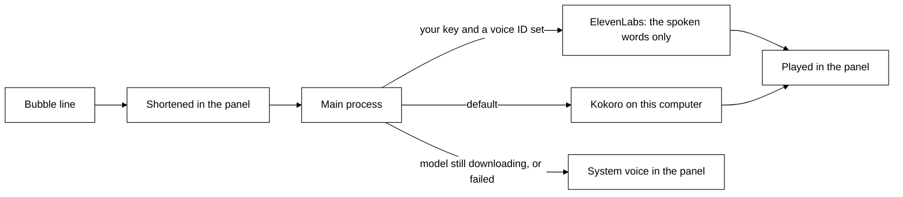
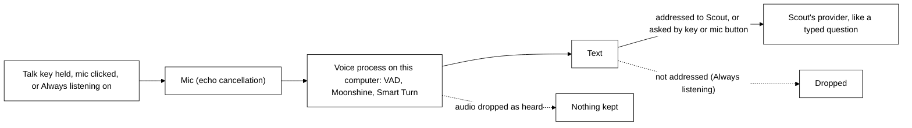

# Privacy in detail

What Tagalong reads, when, and what it never reads. The short version is in the [README](../README.md#privacy).

## What is captured, and when

Nothing on screen is read until you press a key, with three exceptions: **keeping an eye on things**,
which is on by default and follows window titles only (below), and **rolling memory** and a **watch** a
pet started at your request, which you switch on yourself (both below). Otherwise there is no
screenshot and no window text read between one question and the next — each hotkey reads once, sends
that, and stops.

| You do             | It reads                                                      |
| ------------------ | ------------------------------------------------------------- |
| `Ctrl+Shift+Space` | The selected text and the active window's title. No picture.  |
| Click the pet      | Nothing. The bubble opens; the pet looks only if it needs to. |

Everything else the pet reads through its own tools, mid-answer: list what is open, read one
window's text, take a screenshot of the window you were using or of one listed window even behind
others (never a minimized one, which has nothing drawn), fetch another monitor, zoom into part of one.
Each of these is announced like any capture, and blind spots refuse every one. Those run only inside a turn you started, are shown in the panel as
they happen, and obey everything below.

## What the window list holds

The pet's `list_windows` tool reads a list of every open window: its application, its title, which screen it
is on (numbered and sized, never pictured), whether it is in front, behind something else or minimized, and roughly how much readable
text it holds. **It never contains the text inside those windows.** Reading one is a separate,
deliberate step the pet takes for a single named window.

That "roughly" is honest: counting is given a short budget per window, so a window holding 35,000
characters may be listed as holding about 4,000. The number is there to help the pet decide whether
a window is worth reading, and nothing treats it as exact.

## Windows you cannot see are still read

This is the part that goes further than a screenshot ever did, so it is worth stating plainly.
Windows exposes an accessibility layer, and Tagalong reads it — which means a pet asked to can read
the text of a window **sitting behind another one, or minimized to the taskbar**, without it ever
being on screen.

Two limits. Applications that draw their own text — code editors, terminals, design tools — publish
very little through that layer. When a read comes back that thin and the window is on screen, the text
is read from a picture of the window instead, with the text recognition built into Windows: on this
computer, with nothing installed and nothing sent anywhere, and the picture handed over in memory,
never written to disk. That read is announced like a screenshot, covers only what the window shows,
and may misread a word, and the pet is told so. A minimized window has nothing drawn, so when its
text layer is thin the pet is told the difference between "this window is empty" and "I could not
read inside it", and says so rather than guessing.
And a browser publishes only the tab you are on: the other tabs are not readable this way, and the
pet is told to say so instead of pretending.

## What the Chrome extension reads

Only when you ask — the toolbar button, its shortcut, **Read this page**, or an ask while Chrome is
in front — the extension reads the tab in front: your selection, the URL and title, and the page's
main text with menus and footers stripped, capped at 40,000 characters. The sight bar names what is
attached before you send. Nothing is read from tabs you are not on, the extension never runs in a
page you did not ask about, and the capture exclusion list applies to tab titles too. It talks only to
`127.0.0.1`, and the engine lets it do only what its side panel needs (ask, stop, and read the pet
and role lists): it cannot change settings, approve a tool, add a connection, an expert or a
routine, or start a hand-off.
The extension's public privacy policy, for the Chrome Web Store, is
[chrome-web-store/privacy-policy.md](chrome-web-store/privacy-policy.md).

## What is never read

- **The built-in blind spots.** Always on, listed read-only in Settings → Privacy under **Scout never looks
  at**, as chips built from the `BLIND_SPOTS` labels, and kept apart from your own exclusion list so clearing that list never removes them
  (`BLIND_SPOTS` in `packages/protocol/src/blind-spots.ts`):
  - password managers: 1Password, Bitwarden, KeePass, KeePassXC, LastPass, Dashlane, Keeper, Proton
    Pass, Enpass;
  - the Windows sign-in screen, the UAC prompt, Windows Security and Credential Manager;
  - secret files named in a window title, as an editor shows the open file: `.env` and `.env.*`,
    `*.pem`, `*.key`, `*.pfx`, `*.p12`, `id_rsa`, `id_ecdsa`, `id_ed25519`, `.npmrc`, `.pypirc`,
    `.netrc`, `.git-credentials`, `.htpasswd`, `credentials.json`, `kubeconfig`, `*.tfvars`,
    `secrets.*`, `*.kdbx`;
  - private browsing (InPrivate, Incognito, Private Browsing);
  - authenticator apps (Authy, WinAuth) and Remote Desktop.

  A blind spot is refused before anything is read: no screenshot, no text, no character count, and
  no Ctrl+C for a selection — a highlight in a `.env` file never reaches the clipboard. Its title
  is not sent either: when the window in front is a blind spot or on your exclusion list, Scout
  is told only the app's name (for example `chrome.exe`) and which rule blocked it, never the
  window or tab title, so the title stays out of the conversation and out of any expert's brief.

- **Your own exclusions.** Add any app or window title in settings; they work the same way.
- **Secrets that slip past.** A title rule only works while the title names the file (an editor
  shows `.env` only while that tab is open). So everything sent to a model — your question,
  selections, window text, tool results, memories — and every brief to an expert passes through
  `hideSecrets` first. API keys and tokens (`sk-`, `ghp_`, `github_pat_`, `AKIA`, `xox`, `AIza`,
  Stripe keys), login tokens (JWTs), private key blocks, the password in a connection string, the
  values of `PASSWORD=`, `SECRET=`, `TOKEN=` and `API_KEY=` settings, and card numbers become a
  marker such as `[hidden: API key]`, so the pet knows something was there without seeing it.
- **Secret files, by your experts.** Claude Code reads files for itself, so it is started with deny
  rules for every secret file name above (`Read(**/.env)`, `Edit(**/.env)` and so on).
- **Experts run sealed.** An expert run of Claude Code gets only the tools its mode allows (read and
  search; plus edit when you allowed edits; web search and fetch for a routine's research), none of
  your MCP servers, none of the project folder's `.claude` settings (so a project cannot grant
  itself permissions or run hooks), and no hooks from your own settings either. Its answer, its
  error and its progress steps pass through `hideSecrets` before they are kept in Activity or shown,
  so a key it read in a file is not repeated back.
- **A monitor with an excluded window on it.** If a password manager is open and visible on your
  second screen, that whole screen is blanked in the full-view capture — not just when it is the
  window you are working in. The blanked screen is replaced with a flat panel reading BLOCKED, so
  the pet can see that something was withheld rather than being handed a gap it might guess at.
  Minimized windows do not blank their monitor: a vault in the taskbar is not on screen, and
  blanking a screen you are working on because something is hidden would be a bug, not caution.
  The same check runs before a close-up crop (`look_closer`, and the sharp crop a "what changed"
  check takes) and before a plain screenshot falls back to a whole screen: a screen with an
  excluded window on it is never cropped or photographed. When Tagalong cannot tell which screen
  a picture is of, it takes none while anything at all is blocked.
- **Anything at all, while sight is paused** — see [Pausing sight](#pausing-sight).

## The rest

- A visible indicator shows every capture.
- Built-in blind spots and your own exclusion list block capture in password managers, secret
  files and other listed apps.
- When Windows reports no foreground window at all — a locked session, a UAC prompt on the secure
  desktop — capture falls back to the screen rather than refusing, which matches the exclusion
  rules: a window that cannot be named is allowed, because a pet that never sees reads as broken.
- Everything is stored locally in SQLite.
- Screenshots are not persisted by default. The image is stripped from the stored snapshot before
  the row is written, so the database holds the question and the window title but never the pixels.
  Set `screenshotRetention` to `{ "mode": "hours", "hours": 1-24 }` to keep them for debugging;
  expired images — and every stored image, the moment you switch retention back off — are swept on
  the next turn.
- A pet whose provider cannot see images never receives the screenshot: it is dropped before the
  request is built and the host is told with a `turn.warning` (`code: "vision_unsupported"`), so the
  turn still answers instead of failing.
- API keys live in the OS keychain through Electron safe storage, the ElevenLabs key included.
- The hello Scout says as Tagalong opens reads nothing on screen. The summaries model is sent only
  the time of day, how long since Tagalong last opened, and the names and briefs of expert hand-offs
  that finished meanwhile. Turn it off under Settings → Privacy → **Say hello when Tagalong opens**.
  While Scout talks is on, the hello is also spoken (below).
- The name you give Scout (Welcome, or Settings → **You**; optional) is stored locally in settings.
  It is sent to the AI provider only as part of Scout's prompt: one line in its system prompt, and
  in the hello's facts when Tagalong opens. Clear the box and it is gone from both.

## Connected apps: what goes to them

Apps you connect in Home, Connections (Notion, GitHub, Linear, a local tool) are reached only
when Scout calls one of their tools in a turn you started.

- **What is sent.** Only the arguments Scout fills in for that tool, such as a search query or a
  page title. Nothing on screen is sent on its own. Keys, passwords and card numbers are hidden in
  the arguments before they leave, and blind spots are never read, so their content cannot reach an
  app.
- **Changes ask first.** A tool the app marks read-only runs at once. Every other tool, including
  any the app says nothing about, shows a card in Scout's bubble saying which app, which tool and
  what Scout filled in, every argument in full (long ones scroll); it runs only on **Allow once**.
  Cancel, or two minutes without an answer, and nothing changes. A change too long to show in full
  (over 4,000 characters) is not offered at all.
- **What comes back** is treated as data, not instructions: Scout is told never to follow anything
  written in it, and the app cannot end that fence early. An app's error message is fenced the
  same way. It goes to Scout's brain provider like any window text, and is not stored.
- **Tokens and keys.** Sign-in tokens, a pasted key and a local tool's secret values are kept in
  the OS keychain through Electron safe storage (`connection.<id>.*`), never in settings, the
  database, the repository or logs. **Disconnect** deletes them.
- **Sign-in** opens the app's own page in your system browser, which sends you back to a one-time
  address on `127.0.0.1`. Tagalong never sees your password. Only a reply carrying this sign-in's
  own random state is accepted.
- **Found on this PC** reads Claude Code's `~/.claude.json` read-only, and never copies a key out
  of it: a value written there in full is left behind, and you are asked for it if the app needs it.
- **Activity** records each call as the app, the tool, read or write, and whether it worked. Not
  what was sent or what came back, and not an app's error text either.

## Routines: what runs on its own

A routine is something Scout does for you at a time or when something happens, such as new papers
every weekday at 8. Nothing becomes a routine until you press **Save**, on Scout's card or in Home.

- **What saving allows.** Saving is your consent for the routine's read-only work: each run is one
  of Scout's turns, so it may read your connected apps' read-only tools, as Scout does when you ask.
  A tool that changes something still shows **Allow once** every time, and does nothing if you are
  not there to press it.
- **Experts.** A routine hands work to an expert without asking only when its card said so ("May
  hand to: Researcher, read-only, no project"). Exactly one such hand-off per run: that expert then
  runs in an empty folder of its own, with web search and web fetch only, so it cannot read your
  projects or edit any file, but it can search the web and open web pages. Its brief is only the
  routine's saved instruction plus Scout's request for this run, never what is on your screen, a
  selection or file names. A second hand-off in the same run, or to any other expert, shows the
  usual card and waits for Send.
- **What a run sees.** The routine's own words and topics, and, for a trigger, what triggered it: the
  first 600 characters of an expert's answer, or a watch's message. A routine that waits for an app
  or site reads window titles only, every 15 seconds, never a picture or window text, and never a
  blind spot's title.
- **Where results go.** Only where the routine says: a line in Scout's bubble, Scout's voice, a
  Windows notification. Each run is also a row in Activity, and its answer is kept in Scout's
  conversation on this computer so you can ask about it later. Results wait while a full-screen app
  or a call is in front.
- **Missed runs.** If the computer was asleep or Tagalong was closed, a routine runs once when it is
  back, and says it ran late. Never more than once.
- Routines are kept in the database on this computer (`routines` table). Delete one in Home, or ask
  Scout to, and it is gone.

## Scout's voice: what is spoken, and where it goes

Scout says its bubble lines aloud while **Scout talks** is on (Settings → Voice, on by default).
What reaches a speech engine is only the line being spoken, after it is shortened in the panel:
markdown stripped, code blocks, lists, tables and URLs left out, and at most two sentences (an
answer to a spoken question is said in full, sentence by sentence, still without code or lists).
Never the screen, the window list, the question or the conversation.

- **Kokoro, on this computer (default).** The Kokoro-82M model (Apache-2.0, quantised, about
  90 MB) is downloaded from Hugging Face the first time Scout speaks, into the `voice` folder of
  the app's data directory (`%APPDATA%\Tagalong\voice` on Windows), and read from there afterwards.
  If the model cannot load (an interrupted download, say), its folder is deleted and it is
  downloaded again next time. The download fetches the model only; no text is sent. Speech is made on the CPU.
- **The system voice.** While the model downloads, or if it cannot load, the panel speaks through
  the operating system's own voice (a British male voice such as Microsoft George when installed).
- **ElevenLabs (optional).** Used when picked under Settings → Voice → **Who speaks**, or when an older install already had a voice ID, and only with your own key and a voice ID you picked from your ElevenLabs
  library, both under Settings → Advanced. Each spoken line is sent to ElevenLabs' Flash model and
  billed to your account. The key is encrypted with the OS keychain like the others. If ElevenLabs
  fails, Scout uses Kokoro.
- Nothing spoken is recorded or stored. Closing the bubble or `Ctrl+Shift+Alt+M` stops speech at
  once.

## Talking to Scout: your microphone

Scout listens continuously only after you switch **Always listening** on, once, in the bubble
(or in Settings → Privacy). It is remembered until you switch it off. A clear mark on Scout shows
the whole time it is on, and Scout never switches it on itself. Audio is understood on the
computer and is never sent or stored.

Otherwise the microphone is used only while you hold the talk key (`Ctrl+Shift+Alt+Space` by
default, Settings → Voice) or after you click the mic in the text box, until you let go or click
again (at most 30 seconds). Hold-to-talk and the mic button need no name, whether or not Always
listening is on. After an answer the bubble only offers the key to reply.

- **On this computer.** While you talk, the microphone's audio streams in memory, a frame at a
  time, from the panel through the app to its voice process, where three small models turn it into
  text on the CPU: Silero VAD (MIT, about 2 MB) spots speech, Moonshine tiny (Useful Sensors, MIT,
  quantised, about 32 MB) writes the words, shown in the bubble as you talk, and Smart Turn v3.2
  (Pipecat, BSD-2-Clause, about 9 MB) judges when you have finished. They are about 43 MB in all,
  downloaded from Hugging Face (`onnx-community/silero-vad`, `onnx-community/moonshine-tiny-ONNX`,
  `pipecat-ai/smart-turn-v3`) the first time you talk to Scout, into the same `voice` folder as the
  voice. The download fetches the models only; no audio is sent.
- **The audio never leaves the computer and is never stored.** It lives in memory until it has been
  turned into text, and is then dropped. Only the text goes on, to Scout's provider, exactly as if
  you had typed it, with the name of the window you are on (never the selected text).
- The microphone is the one picked in Settings → Voice, or the system default. Windows' own
  microphone privacy setting applies.
- There is no cloud speech to text: ElevenLabs is used for Scout's voice only, never for yours.

### Always listening

Off by default. You switch it on in the bubble's header or in Settings → Privacy, once. It stays
on, across restarts, until you switch it off. When it is on at launch, Scout's first line says it
is listening and how to stop, and the mark shows from the first second.

- **The mark.** A small green dot on Scout shows the whole time. It is solid while Scout listens
  and an outline while listening is paused. It is never hidden.
- **Only Scout's name counts.** Scout acts only on what starts with "Scout" (optionally "hey
  Scout" or "ok Scout"). Everything else is dropped on the computer and goes nowhere. "Scout's
  plan" or "Scout-like" is talk about Scout, not to it, so it is dropped too. Only the
  addressed question, with the name taken off, goes to Scout's provider as text, as typing does.
  So you can have a conversation that is not for Scout without it leaving the computer, but
  anything you say that starts with "Scout" is sent.
- **"Scout, stop".** Saying "Scout, stop" (or "Scout, stop listening") switches Always listening
  off. So does the switch in the bubble or Settings.
- **Paused for calls and full screen.** Every 2 seconds, from window titles only, Scout checks
  whether the front window is a call (Teams, Zoom, Google Meet) or fills the screen. If so, the
  microphone closes and the mark turns to an outline until the call or full screen ends.
- **Deaf while the system voice speaks.** The system voice is not echo-cancelled, so Scout
  ignores what it hears while that voice is speaking. Kokoro and ElevenLabs are echo-cancelled,
  so you can interrupt them by saying "Scout".
- **Hold-to-talk and the mic button need no name**, in every case.
- **Models and size.** The same three models as above, about 43 MB in all, run on the CPU.

## Keeping an eye on things

On by default; switch it off under Settings → Privacy → **Keep an eye on things**. Off means no
tracking at all: the window list is not even taken.

- **Always, for free:** every five seconds the desktop lists the open windows — application, title,
  which one is in front, whether one fills its whole screen — and sends that list to the engine on
  this computer. No picture is taken, no window text is read, and no model is called. The list is
  kept in memory only, for the session.
- **Rarely, one cheap look:** when you have stayed on a window new to this session for about thirty
  seconds, or a title reads like trouble (`error`, `failed`, `failing`, `failure`, `exception`,
  `traceback`, `crashed`), Scout reads **that one window's text** (the last 4,000 characters) and
  sends it, with its app and title, to the summaries model (Settings → Summaries, else Scout's own)
  in one short call that asks whether there is one useful thing to say. Most of the time the answer
  is nothing and nothing is shown.
- **Limits:** at most one line every ten minutes; never two looks at the same window (same window
  and same title); nothing while a full-screen app or a Teams, Zoom or Google Meet window is in
  front; **Not now** on the line quiets it for an hour. Pausing sight stops it too.
- **Blind spots apply everywhere:** a window on the built-in list or your exclusion list is never
  considered, its title included, and its text is never read.
- **Nothing is delegated on its own.** When the line offers help, **Hand it over** opens the usual
  hand-off card; nothing goes to an expert until you press Send there.

## Rolling memory: what the buffer holds

Off until you switch on **Remember the last few minutes of the screen** in Settings → Privacy. While
it is on:

- Every five seconds the desktop takes a **640-pixel picture of each screen**, the **list of open
  windows** (titles and positions, never their text) and which window was in front.
- It keeps the last **ten minutes** by default (you choose one to thirty) and drops anything older.
- It lives **in memory only**. Nothing is written to disk — not a file, not the database, not a
  cache — and the code that holds it imports no file APIs, which a test checks.
- A frame is **skipped** while an app on your exclusion list is in front, and a screen showing one is
  never stored. Excluded apps are never remembered.
- **Pausing sight clears it.** Pressing the pause key stops recording and throws away every frame it
  held, and the red dot on the pets disappears. Resume starts an empty buffer.
- **Quitting clears it.** After a restart there is nothing to recall from before it; the pet says how
  far back memory actually reaches.
- **Turning it off clears it**, at once, without a restart.

Only the frame a pet asks for with `recall_screen` or `what_changed` is ever sent to a model.

## Watches

A watch photographs one screen every five seconds at 640 pixels and compares it with the last frame,
**on this machine**. Even with rolling memory off, it keeps that screen's recent frames in memory for
as long as the watch runs, and drops them 30 seconds after the watch ends; pausing sight drops them
too. A model only sees something when the watched region changed: then the changed part is cropped
and sent to the pet's small check model — or, for a text-only model, the last 4,000 characters of the
window you were watching. Every watch shows a **Watching** chip with **Stop**, and ends on its own
after its timeout or its check limit.

## Pausing sight

`Ctrl+Shift+Alt+P` turns every kind of looking off, and pressing it again turns it back on. The
tray carries the same item, because this is the one hotkey whose loss matters: a user who needs to
blind the pet right now must not first discover that something else on their machine owns the
combination.

While paused:

- Every screenshot, display capture, crop, window enumeration and window text read is **refused
  before it runs**. The refusal happens above the adapter, so nothing is captured and then
  discarded — the same ordering the exclusion list uses, for the same reason.
- The avatar wears a grey eye for as long as it lasts. The amber eye that marks a capture cannot
  appear, because nothing was read.
- The pet is told sight is paused rather than that a capture failed, so it says "you turned sight
  off" rather than inventing a reason or claiming a window is empty.
- The selection and the clipboard still work. Pausing blinds the pet; it does not refuse what you
  hand it deliberately, or a paused pet would be useless rather than merely blind.

Pause is a moment, not a setting, so it is deliberately **not** remembered across restarts — an app
that boots blind because of a keypress last Tuesday reads as broken rather than private. The
exclusion list is the setting that persists.

It is also one gate rather than a check repeated at each call site. Every read goes through the
platform adapter, and the adapter handed to the rest of the app is already wrapped, so a capture
path added later is covered by construction rather than by remembering. Which reads pause covers is
a mapped type over the adapter's own methods, so adding a method without deciding what pause does to
it does not compile.
