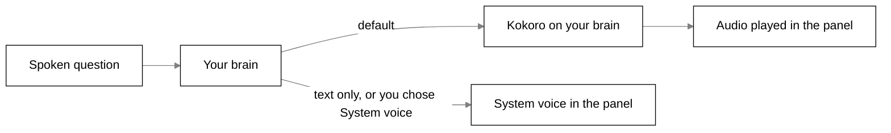
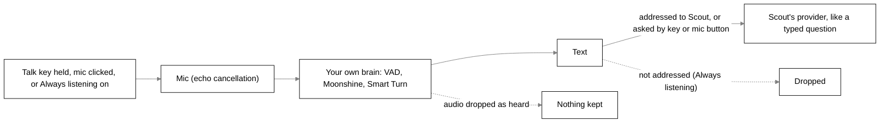

# Privacy in detail

What Tagalong reads, when, and what it never reads. The short version is in the [README](../README.md#privacy).
How each part is built is in the subsystem docs: [sight.md](sight.md) (captures, exclusions),
[voice.md](voice.md) (microphone and speech),
[memory.md](memory.md), [brain.md](brain.md) (the Python brain's prompts, asks and
experts), [connected-apps.md](connected-apps.md), [browser-body.md](browser-body.md) and
[settings-and-secrets.md](settings-and-secrets.md).

## What is captured, and when

Nothing on screen is read until you press a key, with one exception: the **front window's title**,
which the desktop tells the brain when it changes (names only, never the window's text). There is
no screenshot and no window text read between one question and the next — each hotkey reads once,
sends that, and stops.

| You do                  | It reads                                                                        |
| ----------------------- | ------------------------------------------------------------------------------- |
| `Ctrl+Shift+Space`      | The selected text and the active window's title. No picture.                    |
| Hold the talk key       | The active window's title, never the selection. No picture. Announced.          |
| Click the pet           | Nothing. The bubble opens; the pet looks only if it needs to.                   |
| Drop something on Scout | That one item, read only after you choose ([below](#dropping-things-on-scout)). |

Everything else the pet reads through its own tools, mid-answer: list what is open, read one
window's text, take a screenshot of the window you were using or of one listed window even behind
others (never a minimized one, which has nothing drawn), fetch another monitor, zoom into part of one.
Blind spots refuse every one. A screenshot, a window picture and a window read from a picture
(OCR) are announced on Scout and in the tray tooltip like any capture; listing windows, reading a
window's text layer and a close-up crop are not announced (the full
table is under "Capture announcements" in [sight.md](sight.md#capture-announcements)). Those run
only inside a turn you started, are shown in the panel as they happen, and obey everything below.

## What the window list holds

The pet's `list_windows` tool reads a list of every open window: its application, its title, which screen it
is on (numbered and sized, never pictured), whether it is in front, behind something else or minimized, and roughly how much readable
text it holds. **It never contains the text inside those windows.** Reading one is a separate,
deliberate step the pet takes for a single named window.

That "roughly" is honest: counting is given a short budget per window, so a window holding 35,000
characters may be listed as holding about 4,000. The number is there to help the pet decide whether
a window is worth reading, and nothing treats it as exact.

## Windows you cannot see are still read

This is the part that goes further than a screenshot ever did, so it is worth stating plainly.
Windows exposes an accessibility layer, and Tagalong reads it — which means a pet asked to can read
the text of a window **sitting behind another one, or minimized to the taskbar**, without it ever
being on screen.

Two limits. Applications that draw their own text — code editors, terminals, design tools — publish
very little through that layer. When a read comes back that thin and the window is on screen, the text
is read from a picture of the window instead, with the text recognition built into Windows: on this
computer, with nothing installed and nothing sent anywhere, and the picture handed over in memory,
never written to disk. That read is announced like a screenshot, covers only what the window shows,
and may misread a word, and the pet is told so. A minimized window has nothing drawn, so when its
text layer is thin the pet is told the difference between "this window is empty" and "I could not
read inside it".
And a browser publishes only the tab you are on: the other tabs are not readable this way, and the
pet is told that too, as a fact.

## What the browser body reads

The browser body has no screen of its own; it only offers Scout tools, and each one asks you first.
Scout uses them while you talk to it, through four tools:

- `tabs`: listing your tabs (title, address, whether each is active or asleep) needs your yes to
  "see open tabs". Reading one, or a picture of the visible part of the tab in front, needs that and
  a yes for the site: **Allow on this site**, **Allow on all sites** or **Not now**, in a small
  window that waits 25 seconds. A read gives one tab's selection, URL, title and main text, capped at
  40,000 characters. A sleeping tab is never woken, and Chrome's own pages, the Web Store and other
  extensions' pages are never read.
- `page_parts`: a page's links, tables, forms (field names and types only, never what was typed) or
  headings, under the same two yeses as reading a tab.
- `browser_search`: your history, bookmarks, downloads, recently closed tabs or reading list, each
  needing its own yes. It returns matching entries up to a small limit.
- `tab_actions`: open an address (http or https only) or a web search, close, switch to or group
  tabs, reopen the one closed last, add a bookmark or a reading list entry. Tagalong asks you first in
  its bubble until you set the tool to auto.

Two facts are sent without Scout asking, while the body is connected and you have allowed them: the
title and address of the tab in front when it changes (needs "see open tabs") and the name and
outcome of a finished or failed download (needs downloads). Addresses lose their query string and
fragment, and a private (incognito) window is never reported or asked from.

You can also ask Scout from the page: right-click selected text (once turned on in the popup) or
type `scout` and a question in the address bar. That sends your text, or the selection (at most 2,000
characters, marked as page text, not instructions). A right-click also sends the page address; the
page title, and the address for an address-bar ask, come only with "see open tabs". No script runs in
a page until you have allowed it.

The body can only open websockets, to the brain (`127.0.0.1:47321` unless you change it in the
popup). It keeps on this browser the brain's address, a name for the browser and its body id (local
storage), and the number of the last message it received (session storage, which Chrome clears when
the browser closes). It keeps no pages, tabs or conversations. The toolbar popup lists what you have
allowed, and Chrome's extension page can remove any of it. What the brain does with a page it was given follows the brain's
own rules. The extension's public privacy policy, for the Chrome Web Store, is
[chrome-web-store/privacy-policy.md](chrome-web-store/privacy-policy.md).

## What is never read

- **The built-in blind spots.** Always on, listed read-only in Settings → Privacy under **Scout never looks
  at**, as chips built from the `BLIND_SPOTS` labels, and kept apart from your own exclusion list so clearing that list never removes them
  (`BLIND_SPOTS` in `bodies/desktop/src/shared/blind-spots.ts`):
  - password managers: 1Password, Bitwarden, KeePass, KeePassXC, LastPass, Dashlane, Keeper, Proton
    Pass, Enpass;
  - the Windows sign-in screen, the UAC prompt, Windows Security and Credential Manager;
  - secret files named in a window title, as an editor shows the open file: `.env` and `.env.*`,
    `*.pem`, `*.key`, `*.pfx`, `*.p12`, `id_rsa`, `id_ecdsa`, `id_ed25519`, `.npmrc`, `.pypirc`,
    `.netrc`, `.git-credentials`, `.htpasswd`, `credentials.json`, `kubeconfig`, `*.tfvars`,
    `secrets.*`, `*.kdbx`;
  - private browsing (InPrivate, Incognito, Private Browsing);
  - authenticator apps (Authy, WinAuth) and Remote Desktop.

  A blind spot is refused before anything is read: no screenshot, no text, no character count, and
  no Ctrl+C for a selection — a highlight in a `.env` file never reaches the clipboard. Its title
  is not sent either: when the window in front is a blind spot or on your exclusion list, Scout
  is told only the app's name (for example `chrome.exe`) and which rule blocked it, never the
  window or tab title, so the title stays out of the conversation and out of any expert's brief.

- **Your own exclusions.** They work the same way. Settings has no editor for them: you add an app
  or a window title, or remove one, by editing `captureExclusions` in `settings.json` by hand.
- **Secrets that slip past.** A title rule only works while the title names the file (an editor
  shows `.env` only while that tab is open). So everything sent to a model — your question,
  selections, window text, tool results, memories — and every brief to an expert passes through
  `hideSecrets` first. API keys and tokens (`sk-`, `ghp_`, `github_pat_`, `AKIA`, `xox`, `AIza`,
  Stripe keys), login tokens (JWTs), private key blocks, the password in a connection string, the
  values of `PASSWORD=`, `SECRET=`, `TOKEN=` and `API_KEY=` settings, and card numbers become a
  marker such as `[hidden: API key]`, so the pet knows something was there without seeing it.
- **Experts.** Claude Code runs in the folder you name, on your own Claude login, through the Agent Client Protocol. Each thing it wants to do that needs permission comes back to you as an ask (see [brain.md](brain.md#experts)). A note you ask Scout to pass to a working expert
  (`tell_expert`) leaves the machine to that expert like the brief did.
- **A monitor with an excluded window on it.** Tagalong never photographs a whole screen, only
  one listed window at a time, and a window on the exclusion list is refused before any pixel is
  read. A password manager open beside the window Scout looks at is not in the picture.
- **Anything at all, while sight is paused** — see [Pausing sight](#pausing-sight).

## The rest

- A visible indicator shows every screenshot, window picture, OCR read and hotkey read.
- Built-in blind spots and your own exclusion list block capture in password managers, secret
  files and other listed apps.
- When Windows reports no foreground window at all — a locked session, a UAC prompt on the secure
  desktop — capture falls back to the screen rather than refusing, which matches the exclusion
  rules: a window that cannot be named is allowed, because a pet that never sees reads as broken.
- Everything is stored locally in SQLite.
- Screenshots are never saved: the saved chat keeps only the marker `[screenshot]` (see [memory.md](memory.md#saved-chat)).
- The desktop stores no API keys. Keys are never spoken, shown or logged.
- The health check ("Scout, what's wrong?") reads no screen and calls no model. It asks only this
  computer and the brain: your connections' states,
  the microphones' ids against the one you picked, whether the voice models' files are on disk. Nothing it reads is stored or sent anywhere, and the
  card never shows a key, token or secret.
- With every question, Scout's AI provider also gets one **Now** line: your local date, time and UTC
  offset. What Scout remembers rides in the same message: the same notes, to the same provider,
  nothing new. Nothing of this is stored by the line itself.

## Connected apps: what goes to them

Apps you connect in Home, Connections (Notion, GitHub, Linear, a local tool) are reached only
when Scout calls one of their tools in a turn you started.

- **What is sent.** Only the arguments Scout fills in for that tool, such as a search query or a
  page title. Nothing on screen is sent on its own. Keys, passwords and card numbers are hidden in
  the arguments before they leave, and blind spots are never read, so their content cannot reach an
  app.
- **Changes ask first.** A tool the app marks read-only runs at once. Every other tool, including
  any the app says nothing about, shows a card in Scout's bubble saying which app, which tool and
  what Scout filled in, every argument in full (long ones scroll); it runs only on **Allow once**.
  Cancel, an hour without an answer, a stopped conversation, or Tagalong closing before you answer,
  and nothing changes. A change still waiting when Tagalong closes is never run later. A change too
  long to show in full (over 4,000 characters) is not offered at all. A change that cannot be undone
  (the app says so, or its name says send, delete, merge and the like) is labelled "Can’t be undone".
- **Approvals.** Each change waiting for you, and each hand-off ask (the card where you pick a mode), is saved as an ask in
  `tagalong.db` on this computer, listed in Home › **Approvals**, where you can answer it too. An
  ask keeps Scout's summary of what will happen (the app, the tool and what Scout filled in, with
  keys and passwords hidden). Tagalong never puts a window
  title, your selection or window text into an ask by itself, though the summary keeps what Scout
  wrote, which can quote the screen when you asked for that (a bug report, say).
- **What comes back** is treated as data, not instructions: Scout is told never to follow anything
  written in it, and the app cannot end that fence early. An app's error message is fenced the
  same way. It goes to Scout's brain provider like any window text, and is not stored.
- **Tokens and keys.** The Python brain keeps sign-in tokens, a pasted key, a local tool's secret
  env values and secret url parts in its own files, `app-tokens.json` and `app-oauth/`, never in
  the apps table, the repository or logs; see [connected apps](connected-apps.md) and the next
  section. **Disconnect** deletes them.

### What is masked on disk, what is not

The Python brain replaces secrets with `[secret]` before text is saved:

- **Masked:** the saved chat (including a tool's input and a tool's result text), an approval's
  summary and input, a job's result and progress, and log lines (message, traceback and stack).
  In the saved chat, roles, block types and ids are never touched, so it always rebuilds into valid
  history. A thinking block that holds a secret is dropped from the saved copy (its signature
  cannot be rewritten); the live turn keeps it.
- **What is matched:** the exact stored secret values of 8 or more characters (app tokens, env
  secrets, url query values, OAuth access and refresh tokens, `ANTHROPIC_API_KEY`), and common key
  shapes: `sk-ant-`, `Bearer <token>`, `ghp_`-style GitHub tokens, `xox*-` Slack tokens, `AKIA`
  keys, and `?token=`-style url params (Bearer and url param names match in any letter case).
  Every literal env value of 8 or more characters from an app's env config is treated as a secret,
  so an ordinary word or path in it reads `[secret]` wherever it shows up in saved text.
- **If masking fails,** the text is stored as `[withheld]`, never raw. The list of secret values
  is reused for up to 1 second.
- **Not masked:** Scout's live turn (the model sees and uses the real value), the side-check
  prompt, the tool's own input (an app gets the real arguments), a job's task text,
  the sentence of an approval preference, and any secret shorter than 8 characters that has no
  recognisable shape.
- **Sign-in** opens the app's own page in your system browser, which sends you back to a one-time
  address on `127.0.0.1`. Tagalong never sees your password. Only a reply carrying this sign-in's
  own random state is accepted.
- **Found on this PC** reads Claude Code's `~/.claude.json` read-only, and never copies a key out
  of it: a value written there in full is left behind, and you are asked for it if the app needs it.

## Scout's voice: what is spoken, and where it goes

Scout says its bubble lines aloud while **Scout talks** is on (Settings → Voice, on by default).
What reaches a speech engine is only the line being spoken, shaped in the panel: markdown
stripped, and show-only blocks left out (fenced code blocks, tables, quoted
(`>`) lines in any language) along with URLs. Scout's mind decides what it says: everything it
writes outside a block is spoken, whether you typed or spoke, with no length cap; "Scout, stop",
the stop button and the talk key cut it off at once. Never the screen, the window list, the
question or the conversation. A health check and an expert's narration are shown, never spoken.

**Reading aloud.** When you ask Scout something by voice, it says its answer aloud. If you ask it
to read something to you, it reads your selection or the window in front (as for any question
about your screen). So the text of that answer goes to the speech engine, and it stays with your
brain (Kokoro) or on this computer (the system voice). A question you type is answered in the
bubble only, and with **Scout talks** off nothing is read aloud.

- **Kokoro, on your brain (default).** The Kokoro-82M model (Apache-2.0, quantised, about 92 MB)
  is fetched by the brain from Hugging Face the first time it speaks, and read from its own data
  folder afterwards. The download fetches the model only; no text is sent. Speech is made on the
  CPU, and its files are checked like the listening models (see **Model files are checked**
  under "Talking to Scout" below).
- **The system voice.** If the brain cannot speak, or you chose **System voice** in Settings, the
  panel speaks through the operating system's own voice (a British male voice such as Microsoft
  George when installed).
- Nothing spoken is recorded or stored. Closing the bubble or `Ctrl+Shift+Alt+M` stops speech at
  once.

## Talking to Scout: your microphone

Scout listens continuously only after you switch **Always listening** on, once, in the bubble
(or in Settings → Privacy). It is remembered until you switch it off. A clear mark on Scout shows
the whole time it is on, and Scout never switches it on itself. Audio is understood on the
computer and is never sent or stored.

Otherwise the microphone is used only while you hold the talk key (Right Ctrl on its own by
default, Settings → Voice) or after you click the mic in the text box, until you let go or click
again (at most 30 seconds). Hold-to-talk and the mic button need no name, whether or not Always
listening is on. After an answer the bubble only offers the key to reply.

To see the talk key go down and come up whichever app you are in, Tagalong watches the keyboard
through a key hook. It compares each key with the talk key and drops it at once: Tagalong keeps
only whether the talk key is down and whether some other key went down while it was, and nothing
you type is read, logged, kept or sent. It sends no
keys either. Pressing any other key while you hold the talk key (Right Ctrl+C, say) closes the
microphone and sends nothing, because you meant a shortcut.

- **Your own brain.** While you talk, the microphone's audio streams in memory, a frame at a time,
  from the panel through the app to your brain, where three small models turn it into text on the
  CPU: Silero VAD (MIT, about 2 MB) spots speech, Moonshine tiny (Useful Sensors, MIT, quantised,
  about 32 MB) writes the words, shown in the bubble as you talk, and Smart Turn v3.2 (Pipecat,
  BSD-2-Clause, about 9 MB) judges when you have finished. The app itself holds no speech model.
- **Model files are checked.** The brain fetches its model files (listening and Kokoro) from one
  fixed Hugging Face commit, never from a branch that can move, and each must match a SHA-256
  written into the brain. A file that does not match is never kept. The download fetches the
  models only; no audio is sent. If the models cannot load, the bubble says so, and Scout keeps
  speaking in the system voice when Kokoro is the one that failed.
- **Audio goes only to your own brain and is never stored; with the brain on this computer it never
  leaves it.** It lives in memory until it has been turned into text, and is then dropped. Before
  you start to speak, only the last quarter of a second is held in memory (so the first syllable
  of a word is not cut off), each frame dropped as a newer one comes. Only the text goes on, to
  Scout's provider, exactly as if you had typed it, with the name of the window you are on (never
  the selected text).
- The microphone is the one picked in Settings → Voice, or the system default. Windows' own
  microphone privacy setting applies.
- There is no cloud speech to text: Scout's voice is made by your brain, and your voice is never sent to anyone else.

### Always listening

Off by default. You switch it on in the bubble's header or in Settings → Privacy, once. It stays
on, across restarts, until you switch it off. When it is on at launch, Scout shows a **Listening**
tag for a few seconds (its tooltip says how to stop), and the mark shows from the first second.
Nothing is said aloud about it.

- **The mark.** A small green dot on Scout shows the whole time. It is solid while Scout listens
  and an outline while listening is paused (Scout also shows **Not listening** then). It is never
  hidden. It pulses for a moment when it hears speech, any speech in the room, so you can see the
  ears work: the avatar only learns that speech started or ended, never the words.
- **Hiding the pets pauses listening.** While the pets are hidden (the tray's **Hide pets**), the
  microphone is closed, so it is never open while the mark is out of sight. Showing the pets
  again resumes listening.
- **Only Scout's name counts.** Scout acts only on what starts with "Scout" (optionally "hey
  Scout" or "ok Scout"), or with a word that sounds like it. Speech to text often mishears the
  name, so a first word that starts "sc" or "sk" and is one letter away from "scout" counts too:
  "Scott", "Scot", "Scoot", "Skout", "Scouts". Everything else is dropped on the computer and
  goes nowhere. "Scout's plan", "Scott's car" or "Scout-like" is talk about someone, not to
  Scout, so it is dropped too. Only the addressed question, with the name taken off, goes to
  Scout's provider as text, as typing does. So you can have a conversation that is not for Scout
  without it leaving the computer, but anything you say that starts with "Scout", or a word that
  sounds like it, is sent. **This can pick up room talk:** someone saying "Scott, can you…" to a
  person called Scott reaches Scout as a question.
- **The follow-up window.** Right after Scout finishes answering aloud a question you asked by
  voice, your next reply needs no name for about 20 seconds, so a back-and-forth flows. It takes
  one reply, then the name is needed again. It opens only after a spoken answer to a spoken
  question, never after an answer you stopped or talked over, and it closes after 20 seconds, on a
  call or full screen, the talk key, closing the bubble, the stop button or key, switching off,
  or a plain "stop". While it is open the dot has a ring around it. **This can pick up room
  talk:** whatever is said in that window, to Scout or not, is sent as the reply.
- **A hint when the name was missed.** The first time in a run that a question of three words or
  more is dropped for not starting with the name, Scout shows **Say “Scout”** for a few seconds.
  Only the fact that something was dropped is used: the words are not kept or shown.
- **"Scout, stop".** Saying "Scout, stop" (or "Scout, stop listening") switches Always listening
  off. So does the switch in the bubble or Settings.
- **Paused while a call or a full-screen window is in front.** From window titles only, Scout
  checks the front window when listening comes on and every 2 seconds after: if it is a call app
  (for example Teams, Zoom or Google Meet) or fills the screen, the microphone closes and the mark
  turns to an outline until that window is no longer in front. It is the front window that
  counts: a Teams window in front pauses listening even with no
  call, and a call behind another window does not.
- **Deaf while the system voice speaks.** The system voice is not echo-cancelled, so Scout
  ignores what it hears while that voice is speaking. Kokoro is echo-cancelled,
  so you can interrupt it by saying "Scout".
- **Hold-to-talk and the mic button need no name**, in every case, also while Always listening
  is on: that question is asked as said, then listening carries on.
- **Closing the bubble does not stop listening.** It drops a question being asked; switch Always
  listening off to stop.
- **Models and size.** The same three models as above, about 43 MB in all, run on the CPU.

## Dozing: your idle time

Scout dozes when you have been away for five minutes or the screen is locked. For this the desktop
reads one number from the operating system every fifteen seconds, how long since the last key or
mouse input, and hears the lock and unlock events. Nothing on screen is read, the number is never
stored, and it never leaves this computer.

## Spend: what the cost meter keeps

Every model call Scout makes is priced from its token counts and added to one running total for the
day, for Home's **Spend** card and the daily budget.

- **One number:** the brain keeps a small ledger in its data folder with the date and the dollars
  spent that day. Never what was asked, said, read or seen.
- **Stays on this computer.** Nothing about it is sent anywhere; prices come from a table built into
  the brain, so working out a cost makes no network call.

## What Scout remembers: see it, delete it

Scout keeps what it learns about you (facts, preferences, and short summaries of long
conversations) in the database on this computer, until you delete it.

- **Home → What Scout remembers** shows every one of them, newest first, with its kind and the
  day it was saved. Each has a delete button; deleting is for good, and Scout no longer recalls it.
- **Ask Scout to forget.** "Forget that I like tea": Scout finds the matching memories and deletes
  the one you mean.
- Deleting a memory does not take back what was already sent to the AI in earlier questions.
- The Chrome extension cannot read or delete them.

### How long things are kept

| What                     | Kept                  |
| ------------------------ | --------------------- |
| Facts and preferences    | Until you delete them |
| Conversation summaries   | Until deleted         |
| Conversations with Scout | Until deleted         |

## Pausing sight

`Ctrl+Shift+Alt+P` turns every kind of looking off, and pressing it again turns it back on. The
tray carries the same item, because this is the one hotkey whose loss matters: a user who needs to
blind the pet right now must not first discover that something else on their machine owns the
combination.

While paused:

- Every screenshot, display capture, crop, window enumeration and window text read is **refused
  before it runs**. The refusal happens above the adapter, so nothing is captured and then
  discarded — the same ordering the exclusion list uses, for the same reason.
- The avatar wears a grey eye for as long as it lasts. The amber eye that marks a capture cannot
  appear, because nothing was read.
- The pet is told sight is paused rather than that a capture failed, so it says "you turned sight
  off" rather than inventing a reason or claiming a window is empty.
- The selection and the clipboard still work. Pausing blinds the pet; it does not refuse what you
  hand it deliberately, or a paused pet would be useless rather than merely blind.

Pause is a moment, not a setting, so it is deliberately **not** remembered across restarts — an app
that boots blind because of a keypress last Tuesday reads as broken rather than private. The
exclusion list is the setting that persists.

It is also one gate rather than a check repeated at each call site. Every read goes through the
platform adapter, and the adapter handed to the rest of the app is already wrapped, so a capture
path added later is covered by construction rather than by remembering. Which reads pause covers is
a mapped type over the adapter's own methods, so adding a method without deciding what pause does to
it does not compile.

## Dropping things on Scout

You can drag a file, an image, a link or selected text onto Scout. The bubble opens on a card
("report.md: want me to explain it, or hand it to an expert?") with **Explain**, **Hand it to an
expert** and **Cancel**.

- **Nothing is read on the drop.** Tagalong notes the item's name and path only. The file is read
  from disk when you press **Explain** or **Hand it to an expert**, and only that one item goes,
  with that one question. **Cancel** sends nothing. An item nobody sends is let go, unread, ten
  minutes after the drop, and a button pressed later says to drop it again.
- **What is read.** A text file (by its extension, up to 1 MB): its text, capped like a selection.
  A PNG or JPEG (up to 10 MB): scaled to the screenshot size and sent as a picture. Any other file
  (PDF, Word, a WebP or GIF, a file too big): its name, path and size only. Tagalong does not open
  it, and an expert you hand it to reads it from the path. A link or dropped text is passed as it is.
- **Secrets files are refused.** A file whose name matches the secret-file list (`.env`,
  `id_rsa`, `secrets.yaml`, `*.pem` and the rest) gets "Looks like a secrets file: not read, not
  passed on." with no buttons. Secrets inside other text are still hidden on the
  way out, like everything sent to a brain.
- **Only a button sends it.** With Always listening on, saying "Scout, explain it" while the card
  is open is an ordinary question and does not carry the dropped item.
- **Hand it to an expert** goes through Scout, which writes the brief. The hand-off ask card
  appears, and nothing reaches the expert until you pick a mode there.
- **Stored like a selection.** The conversation keeps the dropped item's name, path and text like
  a selection. A dropped image is kept as the marker `[screenshot]`, and a brain that cannot see
  images never gets it (Scout says so).
- **Pausing sight does not block a drop.** A drop is something you hand over on purpose, not Scout
  reading the screen.
- **Nothing opens by accident.** The pet's and the bubble's windows refuse to navigate, so a file
  dropped there never opens inside Tagalong.

## The log file

Tagalong keeps a small log of its own warnings and errors, so you can send it when something goes
wrong. It never leaves your computer on its own.

- **Where.** `%APPDATA%\Tagalong\logs\tagalong.log`. The health card ("Scout, what's wrong?") has
  **Open logs folder**, which only opens the folder: you choose what to send, and no log text is
  copied anywhere.
- **What is written.** Only the desktop app's warnings and errors: main's, the windows' (marked `[renderer]`). Each is a time, `WARN` or `ERROR`, the app's own fixed text and, for
  an error, its name and message, for example
  `2026-10-16T21:40:00.000Z WARN [main] could not save Always listening Error: EPERM`. When Always
  listening pauses for a call or a full-screen window, one line says so with the app's process
  name (for example `Code`), never the window's title, and one more when it resumes.
- **What is never written.** Anything passed along with a warning other than an error (an object, a
  turn, a second piece of text) becomes just its type, such as `[object]`, so what you said, what
  is on your screen, file contents and Scout's answers never reach the file. A window's warning arrives as one line Chromium has already put
  together, so there it is the app's own rule (no speech, screen or file text in a warning) that
  keeps it clean. Nothing is logged on ordinary use.
- **Secrets are hidden** with the same rules as everything sent to a brain (a key becomes
  `[hidden: API key]`), and each line is cut at 300 characters.
- **Small.** When the file passes 1 MB it is renamed `tagalong.1.log` (replacing the older one) and
  a new one starts, so the log never takes more than about 2 MB.
- **Deleting it.** Delete the `logs` folder at any time; Tagalong starts a new file at the next
  warning. A failed write is skipped and never stops the app.
