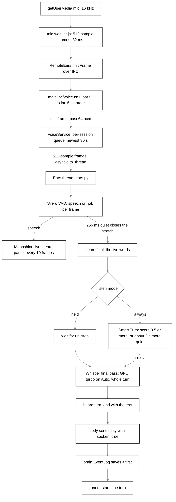
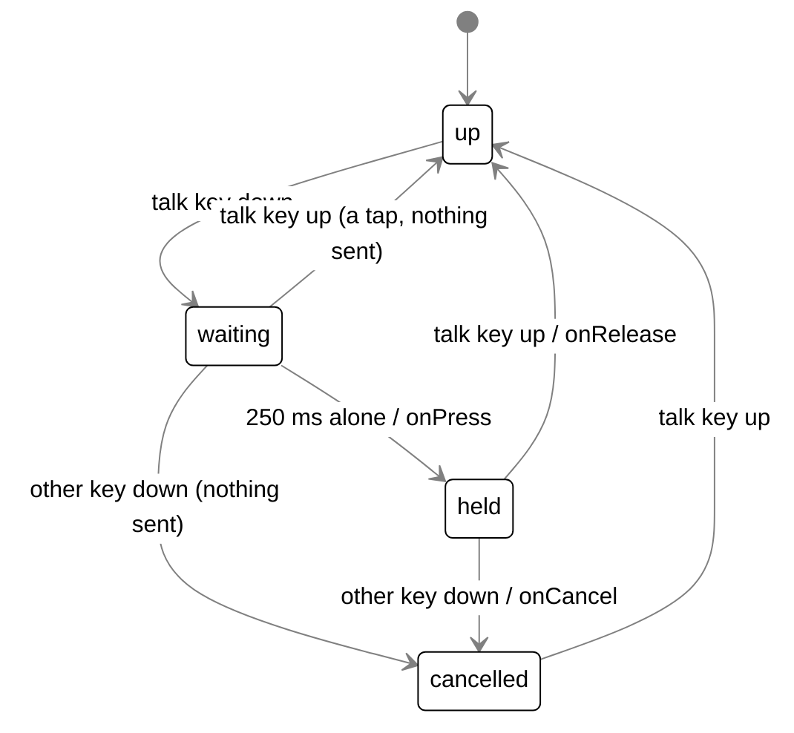
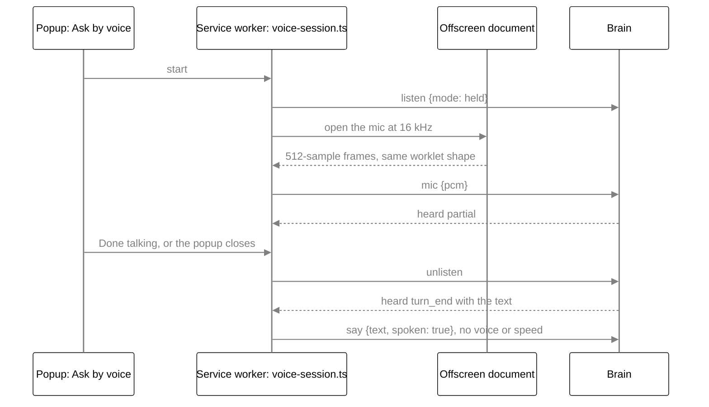
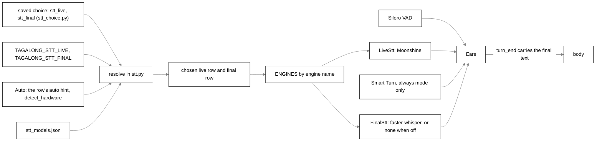

# How speech works

How Scout hears you: the microphone, the talk key, Always listening, the follow-up window and the
speech models. Read it to change anything on the way in, from the mic to the words the brain gets.
How Scout answers aloud is in [speaking.md](speaking.md); the benchmark behind the model choice is
in [stt-results.md](stt-results.md).

**The brain does the hearing**: it runs the speech models (Silero, Moonshine, Smart Turn and
Whisper). The desktop only streams the microphone to the brain, so no speech model, ONNX runtime
or extra process ships with it. A heard question goes to the brain as an ordinary `say` with
`spoken: true`, and the brain speaks the answer.

Audio goes only to your own brain and is never stored; with the brain on this computer it never
leaves it.

Contents: [Where it lives](#where-it-lives), [Who does what](#who-does-what),
[The speech-in pipeline](#the-speech-in-pipeline), [The brain's ears](#the-brains-ears),
[What crosses to the brain](#what-crosses-to-the-brain), [The renderer side](#the-renderer-side),
[The talk key](#the-talk-key), [Always listening](#always-listening),
[The follow-up window](#the-follow-up-window), [The browser mic path](#the-browser-mic-path),
[Speech models](#speech-models), [Interfaces](#interfaces),
[Constants and limits](#constants-and-limits), [Storage](#storage),
[Failure handling](#failure-handling), [Privacy notes](#privacy-notes),
[Tests that pin it](#tests-that-pin-it).

## Where it lives

| Area                    | Files                                                                                                                                                                                                                                                                                                                                                                                   |
| ----------------------- | --------------------------------------------------------------------------------------------------------------------------------------------------------------------------------------------------------------------------------------------------------------------------------------------------------------------------------------------------------------------------------------- |
| Shared types and rules  | `bodies/ui/src/shapes/voice.ts` (`Ears`, `ListenMode`, `EARS_IDS`), `bodies/desktop/src/shared/voice.ts` (`EARS_SAMPLE_RATE`, `EARS_FRAME`), `bodies/ui/src/shapes/addressing.ts` (`addressedToScout`, `isStopListening`, `mightBeStop`, `FOLLOW_UP_MS`), `bodies/desktop/src/shared/settings.ts` (`TALK_KEYS`, `voice`, `listening`, `hotkeys.talk`), `bodies/ui/src/shapes/status.ts` |
| Talk key (main)         | `bodies/desktop/src/main/talk-key.ts` (`TalkKeyWatch`, `startTalkKey`, `loadKeyHook`), `talkPressed` and `toPanel` in `bodies/desktop/src/main/index.ts`                                                                                                                                                                                                                                |
| Always listening (main) | `bodies/desktop/src/main/always-listening.ts` (`AlwaysListening`, `listeningPaused`, `startListeningGuard`, `saveListening`), `markListening` in `bodies/desktop/src/main/status-marks.ts`                                                                                                                                                                                              |
| IPC and the bridge      | `bodies/desktop/src/main/ipc/voice.ts` (`createVoiceBridge`, `registerVoiceIpc`), channels and types in `bodies/desktop/src/shared/ipc.ts`, the bridge in `bodies/desktop/src/preload/index.ts`                                                                                                                                                                                         |
| Renderer                | `bodies/desktop/src/renderer/src/mic.ts`, `mic-worklet.js`, `remote-ears.ts`, `talk.ts` (`useTalk`), `talk-rules.ts`, `mic-failure.ts`, `voice-seam.ts`                                                                                                                                                                                                                                 |
| UI package              | `bodies/ui/src/voice/listen-controller.ts`, `push-to-talk.ts`, `voice-models-field.tsx`                                                                                                                                                                                                                                                                                                 |
| Wiring                  | `bodies/desktop/src/renderer/src/panel.tsx` (`useTalk`), `bodies/ui/src/companion-bubble.tsx` (asks a heard question as spoken)                                                                                                                                                                                                                                                         |
| Brain, ears             | `brain/src/brain/voice/`: `service.py` (`VoiceService`), `ears.py` (`Ears`), `silero.py`, `smart_turn.py`, `engines/` (`moonshine.py`, `faster_whisper.py`), `stt.py`, `stt_models.json`, `stt_choice.py`, `stt_tools.py`, `load.py`, `cuda.py`, `cuda_wheels.json`                                                                                                                     |
| Browser body            | `bodies/browser/src/voice/`, `src/offscreen/`, `src/permission/` ([browser.md](../bodies/browser.md#voice))                                                                                                                                                                                                                                                                             |

The speaking side (the mouth, the voice roster, the player) is in [speaking.md](speaking.md).

## How it works

### Who does what

- **The panel renderer** owns the microphone and the listening state machine.
- **Main** watches the talk key, holds the Always listening state, and is the only window to the
  brain. It forwards mic frames as `mic`, relays the brain's `heard` and `voice` frames to the
  windows and sends `listen` and `unlisten`.
- **The brain** hears: voice activity, speech to text and end-of-turn. It downloads and loads the
  models itself. Nothing is loaded in Electron.

### The speech-in pipeline

One heard question, from the microphone to a Scout turn:



The ears work on 32 ms frames. Held mode (the talk key or the mic button) ends the turn only when
the body sends `unlisten`, so Smart Turn is not asked there. Always mode asks Smart Turn at each
closed stretch. The final Whisper pass runs only when the turn had speech; a failed or empty pass
keeps the live words. The brain also sends `voice {status}` (`loading`, `ready`, `failed`) while the
models load, and the body shows it as a status mark.

#### Timings

All in `brain/src/brain/voice/ears.py` and `service.py`, so a test can drive them frame by frame.

| Constant               | Value               | What it does                                                                                      |
| ---------------------- | ------------------- | ------------------------------------------------------------------------------------------------- |
| `SAMPLE_RATE`          | 16,000 Hz           | The one rate the ears hear.                                                                       |
| `FRAME`                | 512 samples (32 ms) | One Silero window; the body sends this size.                                                      |
| `PRE_ROLL_FRAMES`      | 3 (96 ms)           | Fed to Moonshine before the first speech frame (more makes it invent a first word such as "You"). |
| `PARTIAL_EVERY_FRAMES` | 10 (320 ms)         | A `partial` goes out this often while speech goes on, if the words changed.                       |
| `PAUSE_FRAMES`         | 8 (256 ms)          | Quiet this long closes a stretch and emits `final`.                                               |
| `GIVE_UP_FRAMES`       | 63 (about 2 s)      | Always mode: this much more quiet ends the turn without waiting for Smart Turn.                   |
| `TURN_THRESHOLD`       | 0.5                 | Smart Turn score at or above which the turn is over.                                              |
| `TURN_SAMPLES`         | 8 s                 | Smart Turn reads the last 8 s of audio.                                                           |
| `MAX_STRETCH_FRAMES`   | 938 (about 30 s)    | A stretch of speech with no pause is closed here.                                                 |
| `FINAL_MAX_SAMPLES`    | 60 s                | The turn's audio kept in memory for the final pass (the last 60 s).                               |
| `MAX_BUFFER_SECONDS`   | 30 s                | The per-session queue in `VoiceService`; the oldest frames are dropped, never the end marker.     |

### The brain's ears

The brain hears the mic itself. A body sends `listen {mode}`, then `mic {pcm}` frames (16 kHz
int16, base64), and gets `heard` and `voice` back; the contract is in
[protocol/README.md](../../protocol/README.md). The body keeps deciding what a heard turn means
(addressing, follow-up) and sends the words as an ordinary `say` with `spoken: true`.

`moonshine-voice` pulls in `sounddevice`, which needs PortAudio (`libportaudio2` on Linux) when a
listen first loads the ears.

| Piece                       | Model                                                                            | Job                                                |
| --------------------------- | -------------------------------------------------------------------------------- | -------------------------------------------------- |
| `silero.py`                 | Silero VAD v5 on onnxruntime                                                     | Speech or not, per 32 ms window                    |
| `engines/moonshine.py`      | Moonshine streaming (`moonshine-voice`), the model chosen from `stt_models.json` | The words so far                                   |
| `smart_turn.py`             | Smart Turn v3.2 on onnxruntime                                                   | Whether the person has finished, from the last 8 s |
| `engines/faster_whisper.py` | `faster-whisper` (the final model chosen from `stt_models.json`)                 | The final text of the whole turn                   |

- **`Ears`** (`voice/ears.py`) is synchronous and holds no asyncio, so tests drive it frame by
  frame with fakes (`tests/fake_voice.py`). Silence is ignored. The first speech frame emits
  `speech_start`. Every 10 speech frames, if the words changed, `partial`. 256 ms of quiet closes
  the stretch and emits `final`, with the words from Moonshine's final pass (`finish`: the live read
  trails the audio and clipped the last word; a failed final pass raises, so the service's error
  path logs it). Held mode ends the turn only on `finish` (the key was released), with the last
  words kept and exactly one `turn_end`, even if nothing was said. Always mode asks Smart Turn at
  each pause and ends the turn at a score of 0.5 or more, or after about 2 s more of quiet; a
  failing Smart Turn counts as "over". With a final model (`EarsParts.final`, a `FinalStt`) the ears
  also keep the turn's audio in memory and, when a turn that had speech ends, transcribe all of it
  again; that text goes in `turn_end`. `load.py` loads the final model after the live one and
  leaves it out (with a logged warning) if it cannot be downloaded or loaded. When a card is seen
  without cuBLAS and cuDNN, `load.py` first calls `cuda.ensure_cuda` (Windows only) and looks again.
- **`VoiceService`** implements `VoiceHooks`. `listen` starts a session for that body; a new
  session silences every earlier one, so only one body listens at a time. `mic` converts int16 to
  float32 (an odd byte count is ignored) and queues it; one worker task per session feeds
  512-sample frames to `Ears` with `asyncio.to_thread`, under a lock because the models hold state,
  so a slow decode never stalls the websocket. `unlisten` on a held session flushes the queue and
  sends the last words and one `turn_end`; on an always session it stops at once and sends nothing.
  A disconnect calls `unlisten`, so a gone body never keeps a session. `hush` goes to the mouth
  ([speaking.md](speaking.md)).
- **Events** go out with `Bodies.send_live`: no `seq`, never stored or replayed. `heard
{event, text?}`; `voice {status: loading | ready | failed, message?, progress?}`. `loading` with
  `progress` is sent only while something is downloaded (at most every 2%), then `ready`. Frames
  that arrive while the models load are kept (the newest 30 s). If loading fails (no internet on
  the first run, a damaged download, a model that would not start) the body gets
  `voice {failed, message}` once, the session ends (a held one sends an empty `turn_end`), and the
  next `listen` tries again.
- **Models** load on the first `listen`, not at start. `VoiceService.reload()` (after a speech-model
  pick) bumps a generation: a session already running keeps its models and the next listen loads
  the new ones. `prefetch()` downloads the files early without loading them (the first-run tour
  calls it). Files live in `<TAGALONG_HOME>/voice`: `ears/silero-vad/model.onnx` and
  `ears/smart-turn-v3/…onnx` (about 11 MB, pinned to a commit with a SHA-256, written to `.part`
  then renamed, one retry on a bad hash) and `moonshine/` (about 120 MB for small, the Auto live
  model; tiny is about 45 MB and medium bigger; fetched by `moonshine-voice` into that folder). The
  first `listen` on a new computer downloads about 130 MB (and about 1.5 GB more for turbo when a
  card is found). See [Speech models](#speech-models).
- **Python** is pinned to `>=3.12,<3.14`. Dependencies: `moonshine-voice`, `onnxruntime`, `numpy`,
  `faster-whisper`. Linux wheels exist for all of them, so the CI brain job resolves them from
  `uv.lock`.

Speed on Windows 11, Python 3.12, CPU only:

| Piece                    | Result                                                                                    |
| ------------------------ | ----------------------------------------------------------------------------------------- |
| Moonshine tiny streaming | About 20 to 26 ms per 32 ms frame, about 6 ms to read the words; first frame up to 0.45 s |
| Silero VAD               | About 0.4 ms per window                                                                   |
| Smart Turn v3.2          | About 40 to 60 ms for one 8 s inference                                                   |

Moonshine does its own splitting into lines, so the stream is reset between our stretches (`stop`
then `start`). Moonshine at about 80% of real time is the tightest part: it is fed only while
someone speaks, but a slower computer will lag.

### What crosses to the brain

Contract v1 (see [protocol/README.md](../../protocol/README.md)):

| Frame | Direction | Meaning |
| ----- | --------- | ------- |

| `listen { mode: 'held' or 'always' }` | body to brain | Request: start hearing. Rejected with `BrainOffline` while the brain is down; the desktop then shows "Listening could not start" or the offline words. |
| `mic { pcm }` | body to brain | A frame of 16 kHz mono 16-bit samples, base64. Main converts the renderer's Float32 frame (clamped, rounded). |
| `unlisten` | body to brain | Notification: stop hearing. In held mode the brain then ends the turn with what it heard. |
| `heard { event, text? }` | brain to body | `speech_start`, `partial`, `final`, `turn_end`. Main maps these to the renderer's `speechStart`, `partial`, `final`, `turnEnd`. |
| `voice { status, message?, progress? }` | brain to body | The ears' models: `loading` (with `progress`), `ready` or `failed`. Only the ears send it; the mouth sends none. |

`heard` and `voice` are live only (no `seq`), so they are not replayed after a reconnect.
`createVoiceBridge` remembers the open listening mode (also when `listen` found the brain
offline), and when the brain comes back (`onOnline`) it sends `listen` again and sends the renderer
an `earsStatusEvent` of `online`, which makes `ListenController.retryNow()` skip the 30 s to 5 min
wait. So Always listening survives a brain restart and starts at launch as soon as the brain is up.
Everything the ears send goes to every window; the player's frames go to the panel alone
([speaking.md](speaking.md)).

`models()` (the health check) reports `{ ears: !failed }`: the ears are fine until the brain sends
`voice { status: 'failed' }`. Its row reads "The brain could not load its speech models."

### The renderer side

#### The microphone

`renderer/src/mic.ts#openMic(deviceId?)`:

- It calls `getUserMedia` for one channel with `echoCancellation`, `noiseSuppression` and
  `autoGainControl` on. The device is `voice.microphoneId` when set, otherwise the system default.
- It opens an `AudioContext` at 16 kHz and loads the `tagalong-mic` AudioWorklet. The worklet is
  imported as `?url&no-inline`, because the panel's CSP (`default-src 'self'`) blocks the `data:`
  URL Vite would inline.
- The worklet must be connected towards the speakers to run, so it goes through a gain node set
  to `0`. Nothing plays.
- If anything fails after `getUserMedia`, the tracks stop, the context closes, and the error is
  rethrown as a plain `Error`. An `AbortError` from a worklet that would not load therefore never
  reads as a microphone another app holds.
- The returned `OpenMic` is itself the `MicStream`: a `Pushable` holding at most 940 frames, about
  30 s. It has an idempotent `close()`, and ending iteration early closes it too.

`listMicrophones()` lists the `audioinput` devices, leaving out `default`, for Settings and the
health check.

#### The level meter

"Test your microphone" (walkthrough step 5, Settings → Voice) shows how loud the mic is. It is
local to the window and sends nothing: no IPC, no contract frame, no brain.

- `renderer/src/mic-level.ts#watchLevel(open, onLevel, onError)` opens its own short-lived
  `openMic` (the picked device, or the default), turns each frame into a 0..1 level with
  `frameLevel` (RMS on a fixed -60 to 0 dB window; it rises at once and falls by 0.8 a frame) and
  drops the frame. Nothing is recorded or kept; only the number reaches the page.
- `MicTest` (`@tagalong/ui`) is the button and the `LevelMeter` (`role="meter"`). It is off until
  pressed, restarts when the microphone select changes (an unsaved choice is enough), and stops on
  a second press, on unmount (leaving the step, closing Settings) and an open failure, which shows
  why (not allowed, in use by another app, no microphone). `stop()` always closes the mic.
- The talk key and Always listening run in the panel window, which Settings cannot see, so there
  is no shared listening flag to read. Settings' test stops when its window loses focus, on a
  best-effort basis. If you hold the talk key while Settings is still focused, the meter and the
  talk mic share the device briefly. Either way the meter records and sends nothing.
- If the device goes away (a track ends, a USB mic is unplugged), `openMic` ends its frames and
  `watchLevel` reports `no-mic`, so the bar stops with a message instead of freezing.

`mic-worklet.js` gathers samples into 512-sample frames (32 ms) and posts each one. A worklet
cannot import, so the number 512 is repeated there. It must match `EARS_FRAME` in
`bodies/desktop/src/shared/voice.ts`.

#### RemoteEars

`renderer/src/remote-ears.ts`. This is the `Ears` a window uses.

- `listen(mic)` invokes `earsListen(mode)` and sends each frame with `micFrame`. `micFrame` is an
  `ipcRenderer.send`, not an invoke.
- `stop()` invokes `earsStop`. In `always` mode it drops its handlers at once. In `held` mode it
  keeps them until the `turnEnd` that follows, because the question's words arrive after the stop.
- Every window hears the one stream of `earsEvent`s. Each `ListenController` decides which events
  belong to its own session.

#### ListenController

`bodies/ui/src/voice/listen-controller.ts`. This decides when the mic is open and where the
words go. It holds at most one session (`held` or `always`), plus a set of released held
questions still waiting for their words.

Held questions:

- **`hold()`** is the talk key or the mic button. It closes the follow-up window, ends any
  `always` session, and starts a `held` session. Main sends the brain's `listen` and `unlisten` in
  order, so the always session's ears stop first. The mic opens, the ears listen, and `onMicOpen(mode)` fires,
  but only once the mic has really opened.
- **`release()`** closes the mic. A session whose mic never opened is `onNothingHeard`. Otherwise
  the session is marked released and stops its ears, and its `turnEnd` later carries the question.
- **Which `turnEnd` belongs to whom.** A held session takes a `turnEnd` only once it has been
  released. Released questions take `turnEnd`s in the order they were released, each one once
  (`#taken`, cleared on a microtask). A non-empty trimmed text goes to `onHeard`. An empty one goes
  to `onNothingHeard`, and the panel shows "Nothing heard."
- **`cancel()`** is the bubble closing. It drops the held question and every released question
  still waiting. An always session goes on, or comes back.
- **Late mic.** A mic that opens after its session ended is closed unused. A session whose mic
  never opened never sends `ears.stop`, which could end another session.

Failures:

- **`onMicFailed`.** If `getUserMedia` or the audio setup rejects, the session ends and
  `onMicFailed(error)` fires.
- **`earsFailed()`** runs when the ears status says `failed`. It drops every question and ends the
  session. If an always session was running, it schedules a retry: 30 s at first (`retryMs`),
  doubling each time up to five minutes. Switching off cancels the retry. A question heard resets
  the wait to 30 s. A `setAlways` or `setPaused` call starts a session again sooner.

The always session (`#sync`):

- One `always` session is open exactly while `always && !paused`. The mic is never muted while Scout speaks. A held session is left
  alone, because the key wins.
- `setAlways(on)` is the person's switch. `setPaused(paused)` covers a call, full screen, the pets
  or hidden.
- When an always session ends mid-turn after it had already cut Scout off, `onDropped` fires and
  its words leave the bubble.

Addressing in always mode (`#addressed`):

- **Name required.** Only talk addressed to Scout counts (`addressedToScout`). While a released
  held question waits, nothing counts, because those words are the held question's.
- **Bare speech.** A plain `speechStart` with Scout quiet does nothing in always mode. Talk in the
  room must not cut Scout off. With Scout speaking (`speaking()`), any `speechStart` calls `pause()`
  instead, with no name needed; see [Talking over Scout](speaking.md#talking-over-scout).
- **Partials.** The first addressed `partial` of a turn calls `onSpeechStart` once (it brings the bubble up; nothing is cancelled), and
  each addressed partial shows. A partial that may still grow into "stop listening"
  (`mightBeStop`, for example "Scout, st") neither cuts Scout off nor shows.
- **Addressed `turnEnd`.** It closes the follow-up window. If the question is "stop" or "stop
  listening" (`isStopListening`):
  - with the name, it calls `onStopListening`
  - in the follow-up window without the name, it only ends the window

  and in both cases it calls `onDropped` if it had cut Scout off. Any other question resets the
  retry wait and goes to `onHeard`.

- **Unaddressed `turnEnd`.** It calls `onDropped` if the turn had cut Scout off. If the turn had
  three words or more, no follow-up window was open, and no released question was waiting, it
  calls `onUnaddressed()` without the words.

#### PushToTalk

`bodies/ui/src/voice/push-to-talk.ts`. This turns key presses, releases and mic-button clicks
into `start`, `stop` or `none`. It has four modes: `idle`, `held`, `clicked` and `spent`.

- **Repeats.** A press within `FRESH_PRESS_MS` (1,100 ms) of the last one while `held` is a
  repeat and does nothing.
- **Missed release.** A press after that time stops, in case a release was missed.
- **Mic button.** `click()` toggles.
- **`end()`** marks a hold as `spent` when listening ended some other way while the key is still
  down: the 30 s cap, or a mic or ears failure. Its repeats start nothing until the key comes up
  or a fresh press arrives.

#### useTalk

`renderer/src/talk.ts`. This is the panel's wiring. It builds one `ListenController` with
`RemoteEars` and `openMic`.

- **`onTalk(at)`** feeds `PushToTalk.press`.
- **`onTalkRelease`** feeds `release`. It goes to PushToTalk whether or not anything is listening,
  so it also clears a spent hold.
- **`onTalkCancel`** calls `release()`. Only if that returns `stop` (the key was holding a question
  open) does it cancel. A question from the mic button stays. So does one the 30 s cap already
  sent.
- **`start`** pauses Scout's voice (`TalkOver.press()`: `player.pause()`, nothing cancelled), brings
  the bubble up (`begin` → `onBegin`) and clears the note and the partial. It calls `hold()` and arms the `MAX_LISTEN_MS` (30 s) cap. The bubble state
  becomes `listening` only in `onMicOpen`.
- **`stop`** with a held question pending sets state `hearing`, shown as "Turning that into
  text…", and calls `release()`. With nothing pending it goes straight to `idle`.
- **Always listening.** It reads `getListening()` at mount and follows `onListening`. It calls
  `setPaused` before `setAlways`, so switching on during a call never opens the mic for a moment.
- **Talking over Scout.** It passes the `SpeechPlayer`'s `speaking`, `pause`, `resume` and `text` to
  the controller, and `onInterrupt` delivers the words like any heard question, with what was heard
  of Scout (`interrupted {turn, heard}`) riding on the question itself. "Scout, stop listening"
  over Scout still switches Always listening off (and cuts Scout off), and is not sent to the brain.
  The talk key and mic button read `SpeechPlayer.interruption()` before the player pauses
  (`TalkOver` in `talk-rules.ts`), so a held question carries it too.
  A pause from the talk key always ends: in a cut-off (words heard) or a resume (nothing heard, or the
  mic or ears failed, which calls `TalkOver.nothing()`).
- **Delivery.** A heard question goes through `HeardInbox`. If no bubble is mounted (a one-line
  hello or remark is up, or Scout is still waking), the question is held, the line
  gives way through `onBegin`, and the bubble asks it as it subscribes. Only the latest is held.
- **Marks and notes.** `talk-rules.ts` holds the pure decisions: `settles`, `shownPartial` (always
  words shown without the leading name), `FailureStreak`, `EarsNotes`, `FollowUpCue`, `micMark` and
  `micNote`.

`useTalk` returns `talk.always` (`{ on, paused, onToggle }`) for the bubble's switch, and `hush()`
for the stop button and the stop key.

#### Mic failures

`renderer/src/mic-failure.ts#micFailure` maps a microphone error to `denied`, `busy` or `no-mic`:

- `NotAllowedError` or `SecurityError` is `denied`
- `NotReadableError` or `AbortError` is `busy`
- anything else is `no-mic`

#### The voice seam

`renderer/src/voice-seam.ts#installVoiceSeam`. This puts `window.tagalongVoice` (`ears`,
`openMic`) on the panel. Its `ears.on` subscribes to `onEarsEvent` for good, and `listen` and
`stop` go to one `held` `RemoteEars`.

### The talk key

`main/talk-key.ts`. The talk key is one key held alone, never a combo. `TALK_KEYS` and their
`uiohook-napi` keycodes are:

| `TalkKey`                | Label       | Keycode |
| ------------------------ | ----------- | ------- |
| `RightControl` (default) | Right Ctrl  | 3613    |
| `RightAlt`               | Right Alt   | 3640    |
| `RightShift`             | Right Shift | 54      |
| `ScrollLock`             | Scroll Lock | 70      |

A global shortcut cannot bind a lone modifier and never reports a release. So main runs a key
hook instead: `uiohook-napi`, loaded by `loadKeyHook` through a dynamic import, so a missing
binary is caught. `startTalkKey` feeds its `keydown` and `keyup` keycodes into `TalkKeyWatch`.
Every event is compared with the talk key's keycode and dropped. The watch keeps only its mode.
Nothing typed is logged, stored or sent, and the hook sends no input.



- **Confirm.** `TALK_CONFIRM_MS` is 250 ms. A shortcut such as Right Ctrl+C has its second key
  down well within that time, so it never raises the bubble or cuts Scout off. A shorter tap is
  nothing. Repeated downs while the key is held are ignored.
- **Press.** `onPress` calls `talkPressed()` in `main/index.ts`:
  - If the bubble is hidden, it shows the avatar and brings the panel up with
    `showPanelQuietly`, which does not take the keyboard. A focused bubble would swallow the
    shortcut the person meant.
  - It then sends `IPC.talkEvent` with `Date.now()`.
- **Release and cancel.** `onRelease` sends `IPC.talkReleaseEvent` and `onCancel` sends
  `IPC.talkCancelEvent`, both to the panel only (`toPanel`). The release is seen in main, so it
  arrives whichever window has the keyboard.
- **Changing the key.** `setKey(key)` comes from `applyHotkeys`, so Settings changes apply live.
  Changing the key while the old one is held drops that hold.
- **No hook.** If the hook will not load or start, there is one `[talk-key]` warning and a `talk`
  outcome with the error on the hotkey-problem path (see [desktop.md](../bodies/desktop.md)). There is no fallback key,
  the mic button still works, and nothing crashes. The hook stops on quit.

The stop key (`hotkeys.stopVoice`, default `CommandOrControl+Shift+Alt+M`) is a normal global
shortcut. It broadcasts `IPC.stopVoiceEvent`, and the panel calls `hush()` and `player.cutOff()`.

### Always listening

Always listening is the person's switch, `settings.listening.always`, off by default. It has no
wake-word engine. The brain turns words into text, and `addressedToScout` checks the
transcript.

**Addressing** (`bodies/ui/src/shapes/addressing.ts`):

- **The name.** The first word, after an optional "hey", "ok" or "okay", must sound like "Scout".
  That means it starts with "sc" (or "sk", read as "sc") and is at most one edit from "scout":
  "Scott", "Scot", "Scoot", "Skout" and "Scouts" count; "shout", "scope", "about" and "count" do
  not.
- **Possessives.** The word must end there, so "Scout's" and "Scout-like" do not count.
- **The question.** What follows the name, with leading punctuation trimmed, is the question. A
  name alone is `null`.
- **Follow-up.** With `{ followUp: true }`, the whole turn is the question, with the name removed
  if it was said.
- **Stop.** `isStopListening` matches "stop" or "stop listening" with trailing punctuation.
  `mightBeStop` is true for any prefix of "stop listening".

**State in main** (`main/always-listening.ts`):

- **The state.** `AlwaysListening` holds `{ on, paused, followUp }`. It starts from the saved
  setting before any window opens, and every change goes to every window as
  `IPC.listeningEvent`.
- **Who changes it.** Only `setListening(on)` changes `on`: the bubble's switch, Settings →
  Privacy, or "Scout, stop" through the panel.
- **Follow-up flag.** `followUp` can be true only while `on && !paused`. Pausing or switching off
  clears it.
- **Saving.** `saveListening` saves `on` with `settings.set { listening: { always } }` when it
  changes. A failed save is logged and the next change tries again. `paused` is never saved.
- **Pausing.** `listeningPaused` is `blocked || !petsShown`. `blocked` comes from
  `startListeningGuard`. The avatar's `show` and `hide` events set `petsShown`, so listening pauses
  while the pets are hidden and the mark on Scout is always in sight while the mic is open.
- **The guard.** While listening is on, `startListeningGuard` lists the windows every
  `LISTENING_GUARD_MS` (2,000 ms). It also checks at once when listening comes on, at launch or
  when switched on. `listeningBlocked` is `callOrFullScreenInFront` in `main/front-window.ts`: it is the
  front window that counts, so a Teams window in front blocks even without a call. A failed listing
  keeps the last answer. When listening is switched off, the guard forgets its answer and unblocks.
  Each pause logs one line naming the kind of window and its process, never its title, for
  example `[listening] paused: a call app in front (Teams)`. A resume logs `[listening] resumed`.
  See `sight.md` for how windows are listed.
- **The marks.** `markListening` sets `listening-on` for `LISTENING_MARK_MS` (8 s) at launch when
  on, and again each time listening is switched on. It sets `listening-paused` while
  `on && paused`. No spoken line announces listening. The dot on the avatar is described in
  `bubble.md`.

**Raising the bubble.** `createVoiceBridge` relays every `heard` frame to every window. For a
`partial` or `turnEnd` whose text is addressed to Scout (`followUp` read from `AlwaysListening`),
it also calls `onSpoken`. That brings the hidden bubble up beside a visible pet with
`showPanelQuietly`, without taking the keyboard. It does not do this for bare speech, for "stop",
or for a partial that `mightBeStop`. Main and the panel apply the same addressing rule.

### The follow-up window

`FOLLOW_UP_MS` is 20,000 ms. `FollowUpCue` in `talk-rules.ts` watches the panel's `speaking` and
`answering`, both from `SpeechPlayer`'s `onState`.

- **Opening.** The window opens when Scout's answer to a question asked by voice has finished
  both streaming and speaking, and some of it was said aloud. A gap between chunks does not
  open it.
- **What opens nothing.** Talking over Scout (`cue.hushed()` in `begin`), the stop button or stop key
  (`hush`), and the bubble's close (`cancel`).
- **While open.** `openFollowUp()` takes effect only while `always && !paused`. For the next 20 s,
  one reply needs no name.
- **Closing.** The window closes on:
  - the reply itself, whatever it was
  - the time running out
  - `setPaused(true)`, `hold()` or `cancel()`
  - switching off
  - `hush`
  - a plain "stop", which only ends the window

  Each open and close goes to main through `IPC.setFollowUp` (`onFollowUp`).

### The browser mic path

The browser extension is a second body that can hear. It listens only: it says `display: false`,
so the brain speaks the answer on the desktop. Only one body listens at a time, as everywhere.



An offscreen document is the one page that may hold the microphone in a Manifest V3 extension.
Chrome's prompt cannot show from an offscreen page, so the first use opens a small page to allow
the microphone. If the link drops, listening ends with an error and is not restarted. The full
description is [browser.md](../bodies/browser.md#voice).

## Speech models

The words come from a list of models kept as data, not from one hard-wired model.

- **The list** is `brain/src/brain/voice/stt_models.json`. Each row has an `id`, a `role`
  (`live`, `final` or `both`), an `engine`, its files (each with a size and SHA-256, fetched like
  the other voice models), `size_mb`, `gpu` (`none`, `preferred`, `required`), `languages`, a
  `note`, `options` and an optional `auto` hint. Today it holds three Moonshine rows
  (`moonshine-tiny`, `moonshine-small`, `moonshine-medium`) and two final rows
  (`whisper-large-v3-turbo`, `whisper-small-en`). A bad row (unknown role or engine, a live model
  on an engine that cannot stream, a duplicate id, a file without a 64-digit lowercase hex hash) stops the loader and the
  error names the row.
- **Engines** are code: `voice/engines/<engine>.py`, registered in `voice/engines/__init__.py`
  (`ENGINES`: does it stream, how to load a live model, how to load a final one). The loader
  reaches a model only through `ENGINES[model.engine]`, so a new engine is one module, rows in the
  list and a dependency, with no change to `load.py`.
- **The choice** is the saved choice, then `TAGALONG_STT_LIVE` / `TAGALONG_STT_FINAL`, then Auto
  (`resolve` in `voice/stt.py`). An id that is not listed, or names a model of the wrong role,
  reads as Auto. **Auto** is data: a row's `auto` hint (`{"cpu"|"gpu": "live"|"final"}`) says where
  it is the pick, and `auto_pick` in `stt.py` reads the hints with no branches on ids. Today Auto
  live is `moonshine-small` on any PC; Auto final is `whisper-large-v3-turbo` when a usable
  graphics card is found (`detect_hardware`: CTranslate2 sees an NVIDIA device and the NVIDIA libraries
  are found: a device plus cuBLAS and cuDNN, on the system or in `<TAGALONG_HOME>/voice/cuda`) and no final pass otherwise. Only `off` means no final pass; any other
  unknown word (an old `same` included) reads as Auto. The numbers behind
  this are in [stt-results.md](stt-results.md). The saved choice is the text settings
  `stt_live` and `stt_final` (`voice/stt_choice.py`; `auto` and `off` are words, a stored id the list no longer has
  reads as Auto). Home reads and writes it with two tools, `stt_state` (the list with each model's role, size and
  `gpu` need, the effective choice, and the card name) and `set_stt {live?, final?}`, which saves and
  calls `VoiceService.reload()`. A change applies on the next listen, never under a running session; a load
  that was already running when the choice changed is not kept.
- **The picker.** Settings has a **Speech to text** card after Voice (`stt-section.tsx` over the shared
  `VoiceModelsField`): a chip with the graphics card or "No graphics card", **While you talk** (Auto
  and the live models with their sizes) and **When you finish** (Auto, "Don't double-check" and the
  final models; a model that needs a graphics card (`gpu: required`, today `whisper-large-v3-turbo`)
  is disabled with "Needs a graphics card" when there is none). A pick saves at
  once. The same card has **Show words while I talk**, the desktop setting
  `voice.showWordsWhileTalking` (default on): off, push-to-talk hides the words until the talk key is
  let go and the final text appears. Always listening ignores it.
- **The final pass.** The live model's words are a preview. While a turn runs, the ears keep its
  audio in memory (the pre-roll and every stretch, at most the last 60 s). When the turn ends,
  the final model (`faster-whisper`, rows `whisper-large-v3-turbo` (`gpu: required`) and
  `whisper-small-en` (`gpu: preferred`)) transcribes all of it again, and that text is what `turn_end` carries. The
  per-stretch `final` events stay live text. It runs only on a turn that had speech (a stretch
  with live words), because Whisper invents words ("Thank you.") from silence or noise. With a
  graphics card it first probes CUDA once in a short child process (a missing cuDNN
  sub-library can kill the process instead of raising; a clean answer is kept in
  `voice/cuda/probe.json`, keyed by the wheels, a False for 24 hours; a timeout is not kept, and
  a failure logs the last lines of the child's stderr), then loads the model on CUDA in float16 and warms
  it up with one second of silence. If CUDA cannot run it, a row Auto picked only for the card
  (`whisper-large-v3-turbo`) gets no final pass, never int8 turbo on the processor; a model the
  person chose still falls back to the processor in int8, with one warning; a `gpu: required` row never does. A `gpu: required` row
  (turbo) with no usable card is dropped before anything is downloaded or loaded: no final pass. The CUDA libraries
  are not bundled. On Windows, when a card is seen but cuBLAS or cuDNN is missing, the first
  listen fetches them (`voice/cuda.py`): two pinned PyPI wheels (`cuda_wheels.json`: cuBLAS
  12.8.4.1 and cuDNN 9.10.2.21, the cuDNN CTranslate2 4.9 ships; url, size, SHA-256, about 1.2 GB
  together), one after the other (a wheel whose DLL is already there is skipped), each fetched, its `bin/*.dll` extracted (streamed, safe) into
  `<TAGALONG_HOME>/voice/cuda` and the wheel deleted. The fetch is the first half of the loading
  bar. CTranslate2 and cuDNN open cuBLAS and the cuDNN sub-libraries later with `LoadLibrary`,
  which ignores `os.add_dll_directory`, so `cuda.add_dll_directory` also puts the folder first
  on `PATH`; it runs before CTranslate2 is imported (in `detect_hardware` and `load_final`). A
  failed or mismatched download is one warning, a failure marker (`voice/cuda/failed.json`) and
  no retry for 24 hours; the verified wheel it had is kept until extracted, even when only the extraction failed. Linux uses its system
  CUDA; nothing is fetched there. Its files are downloaded by `ensure_files` (size and
  SHA-256 checked, each row pinned to a Hugging Face commit, never `main`) into
  `<TAGALONG_HOME>/voice/stt/<id>`, after the live model, in the same loading progress. The
  first listen waits for this download, with the loading bar; the library never downloads by
  itself.



The choice is read in the order saved choice, environment, Auto. Silero and Smart Turn are fixed pieces, not part of the list.

### Measuring speech models

`brain/tools/stt_bench/` is a dev-only harness (not shipped, never run in CI, not in the wheel).
From `brain/`:

```
uv run python -m tools.stt_bench [--models moonshine-tiny whisper-small-en ...] [--clips DIR ...] [--no-kokoro] [--snr 15] [--idle-seconds 60]
```

It downloads what it measures: Kokoro (to speak the test lines in three voices), the Silero
model for the idle measure, and every listed speech model unless `--models` narrows it. Files go
to `<TAGALONG_HOME>/voice`, checked by size and SHA-256 like the app's own downloads. The test
set is Kokoro lines ("Scout, what time is it?", file names, numbers) with white noise at `--snr`
dB, plus optional folders of your own clips (`name.wav` beside `name.txt` with what was said; a
clip with no WAV is skipped and printed). It prints a table per model: word error rate, how
often "Scout" survives as the first word (the same sound-alike rule as `addressing.ts`), CPU
cores and peak GPU while decoding, seconds per clip (the delay after the end of a turn, for final
models), and Silero's idle CPU. `MODES` in `__main__.py` is where a later wake-word mode plugs in.
The results of the last run, the decision and the exact commands are in
[stt-results.md](stt-results.md).

## Interfaces

### IPC channels

From `IPC` in `bodies/desktop/src/shared/ipc.ts`. Handlers are in `main/ipc/voice.ts` unless noted.
The playback channels are in [speaking.md](speaking.md#ipc-channels).

| Channel | Direction | Payload | Notes |
| ------- | --------- | ------- | ----- |

| `tagalong:voice:ears-listen` | invoke | `mode` | Anything but `held` or `always` throws. For `held`, main first notes the active window (`noteActiveWindow`, never the selection). Then the brain's `listen`. |
| `tagalong:voice:mic-frame` | send | `Float32Array` | Copied into a `Float32Array` if needed, converted to 16-bit, sent as `mic`. Never kept. |
| `tagalong:voice:ears-stop` | invoke | none | The brain's `unlisten`. |
| `tagalong:voice:ears-event` | main → windows | `{ event, text? }` | Every window. From `heard`. |
| `tagalong:voice:ears-status` | main → windows | `EarsStatus` | Every window. From `voice`, or a failed `listen`. |
| `tagalong:voice:get-listening` / `set-listening` | invoke | `boolean` → `ListeningState` | A non-boolean is refused with "Always listening is on or off." |
| `tagalong:voice:set-follow-up` | invoke | `boolean` | A non-boolean is refused. Applied only while on and not paused. |
| `tagalong:voice:listening` | main → windows | `ListeningState` | |
| `tagalong:voice:talk` | main → panel | `at: number` | The talk key confirmed. |
| `tagalong:voice:talk-release` / `talk-cancel` | main → panel | none | |
| `tagalong:voice:stop` | main → windows | none | The stop key, or a cancelled turn. |
| `tagalong:voice:models` | invoke | → `VoiceModels { ears }` | The health check: whether the brain's ears have failed. |
| `tagalong:status:set` | invoke | `(id, on)` | Handled by `setPanelMark`. The panel can set only `mic-busy`, `mic-failed` and `say-name`. |

`earsListen`, `micFrame` and `earsStop` run through one promise chain (`inOrder`). Frames and a
stop therefore wait behind a held listen that is still noting the window, and the brain hears them
in the order the panel sent them. A failed step does not hold up the next.

### Types

- `Ears { listen(mic), stop(), on(event, handler) }` (`bodies/ui/src/shapes/voice.ts`).
- `EarsStatus { status, message?, progress? }`, `ListeningState { on, paused, followUp }`,
  `VoiceModels { ears }` (`shared/ipc.ts`).
- `TagalongVoice { ears, openMic }` (`voice-seam.ts`).

### Settings fields

`bodies/desktop/src/shared/settings.ts`. The ears' settings stay in the desktop. The speaking
settings are in [speaking.md](speaking.md#settings-fields).

| Field                         | Default                          | Meaning                                                         |
| ----------------------------- | -------------------------------- | --------------------------------------------------------------- |
| `voice.microphoneId`          | absent                           | Absent means the system default.                                |
| `voice.ears`                  | absent                           | Only `local` exists (`EARS_IDS`), labelled "The brain's ears".  |
| `voice.showWordsWhileTalking` | `true`                           | Off: push-to-talk hides the words until the talk key is let go. |
| `listening.always`            | `false`                          | Always listening.                                               |
| `hotkeys.talk`                | `'RightControl'`                 | One of `TALK_KEYS`.                                             |
| `hotkeys.stopVoice`           | `'CommandOrControl+Shift+Alt+M'` | The stop key.                                                   |

The brain's saved speech-model choice (`stt_live`, `stt_final`) is in the brain's settings table,
not the desktop's. See [settings-and-secrets.md](../data/settings-and-secrets.md) for the whole schema.

## Constants and limits

The brain's ear timings are in [Timings](#timings).

| Constant                                 | Value                           | Where                                           |
| ---------------------------------------- | ------------------------------- | ----------------------------------------------- |
| `EARS_SAMPLE_RATE` / `EARS_FRAME`        | 16,000 Hz / 512 samples (32 ms) | `shared/voice.ts`, repeated in `mic-worklet.js` |
| Mic `MAX_WAITING`                        | 940 frames                      | `mic.ts`                                        |
| `MAX_LISTEN_MS`                          | 30,000 ms                       | `talk.ts`                                       |
| `TALK_CONFIRM_MS`                        | 250 ms                          | `talk-key.ts`                                   |
| `FRESH_PRESS_MS`                         | 1,100 ms                        | `push-to-talk.ts`                               |
| `FOLLOW_UP_MS`                           | 20,000 ms                       | `addressing.ts`                                 |
| Ears retry                               | 30 s, doubling, max 5 min       | `listen-controller.ts`                          |
| `LISTENING_GUARD_MS`                     | 2,000 ms                        | `always-listening.ts`                           |
| `LISTENING_MARK_MS` / `SAY_NAME_MARK_MS` | 8,000 ms / 8,000 ms             | `status-marks.ts`                               |
| Unaddressed hint                         | 3 words or more                 | `listen-controller.ts`                          |

## Storage

- **Models.** None on the desktop. The brain keeps them in its own data folder; which speech
  model is used is chosen from `stt_models.json` (see [Speech models](#speech-models)).
- **Settings.** `voice.*`, `listening.always` and `hotkeys.talk` are in the settings store. See
  [settings-and-secrets.md](../data/settings-and-secrets.md).
- **Nothing heard.** Audio, transcripts and key events are not stored or logged anywhere by the
  desktop. Frames live only in memory: in the mic `Pushable`, and in flight to the brain. In the
  brain the ears keep the turn's audio (at most 60 s) in memory for the final pass and drop it
  when the turn ends; it is never written to disk. The text of a heard question is stored only as
  the ask it becomes, like a typed one (see [memory.md](../data/memory.md)).

## Failure handling

| Failure                                                                                                       | What happens                                                                                                                                                                                                                                                                                                                                                                              |
| ------------------------------------------------------------------------------------------------------------- | ----------------------------------------------------------------------------------------------------------------------------------------------------------------------------------------------------------------------------------------------------------------------------------------------------------------------------------------------------------------------------------------- |
| Mic busy (`NotReadableError`, `AbortError` from `getUserMedia`)                                               | `onMicFailed`. The hold is `end()`ed, the 30 s cap is cleared, and the `mic-busy` mark is set. The note is `STATUS_WORDS['mic-busy'].detail`.                                                                                                                                                                                                                                             |
| Mic failed (any other error, including an audio-graph failure rethrown by `openMic`)                          | The same, with `mic-failed`.                                                                                                                                                                                                                                                                                                                                                              |
| Mic failing repeatedly                                                                                        | `FailureStreak` reports it once per run of failures. Always listening retries after each system-voice line. The mark and the streak clear on the next partial or heard question, or when the person presses the key or the mic button (`micOk`).                                                                                                                                          |
| Brain offline when listening starts                                                                           | `listen` rejects with `BrainOffline`. Windows get `ears-status: failed` with the brain-offline words. The session is not kept, so the next press tries again.                                                                                                                                                                                                                             |
| Brain comes back during a session                                                                             | `onOnline` sends `listen` again with the same mode.                                                                                                                                                                                                                                                                                                                                       |
| The brain's models cannot load                                                                                | `voice { status: 'failed' }` becomes `ears-status: failed` and the `ears-failed` mark; the health row reads "The brain could not load its speech models." `earsFailed()` drops every question and ends the always session, then retries with back-off.                                                                                                                                    |
| Ears status `failed` in the panel                                                                             | `EarsNotes` shows the failure line once. The note is shown only if a question was being asked or always listening was running.                                                                                                                                                                                                                                                            |
| The final speech model fails to download or load (offline, a hash mismatch), fails to run, or returns nothing | The first listen waits for the download (loading bar), so there is no "still downloading" state. The turn ends with the live words, exactly as without a final model: a failed download or load is logged and the session goes on without it; a failed or empty pass is logged and the live text is sent. CUDA that fails to load or to run falls back to the processor with one warning. |
| Key hook will not load                                                                                        | One warning, and a `talk` hotkey problem shown in the panel and Settings. The mic button still works.                                                                                                                                                                                                                                                                                     |
| A mic frame cannot reach the brain                                                                            | `brain.mic` drops it (the connection is down) and the next frame still goes; an error is logged.                                                                                                                                                                                                                                                                                          |

**Status marks.** The voice marks are `ears-failed`, `mic-busy`, `mic-failed`, `ears-loading`,
`listening-paused`, `say-name` and `listening-on` (`bodies/ui/src/shapes/status.ts`). Their order,
words, holders and clearing rules are in [bubble.md](bubble.md#status-marks). A `voice` frame with
`ready` clears `ears-loading` and `ears-failed`; `loading` with `progress` sets `ears-loading` with
a percent.

## Privacy notes

- **Audio goes only to your own brain and is never stored; with the brain on this computer it never
  leaves it.** Frames go from the panel through main to the brain, in memory only. See
  [privacy.md](../data/privacy.md).
- **What a heard question sends.** Its text goes on to the brain as a `say`. The ask carries the
  name of the window you are on (`noteActiveWindow`), never the selection, because copying the
  selection would press keys while the talk key is held.
- **The key hook.** It compares every key event with one keycode and drops it.
- **Always listening.** It is opt-in. It pauses for calls, full screen, and hidden pets.
  A mark on Scout always shows while it is on. An unaddressed turn is dropped, and its words are
  never passed on (`onUnaddressed` gets none).

The full statement is in [privacy.md](../data/privacy.md).

## Tests that pin it

| Test | Pins |
| ---- | ---- |

| `bodies/desktop/src/main/ipc/voice.test.ts` | Mode validation, window noting, ordering, offline failure, `hush`, `speak_sample`, the re-listen on reconnect, heard/voice/speech forwarding, `speech_state` to the brain (a bad shape dropped) and `speech_control` to the panel alone, addressing (follow-up, "stop", `mightBeStop`), marks. |
| `bodies/desktop/src/main/talk-key.test.ts` | The 250 ms confirm, shortcuts sending nothing, taps, repeats, cancel, key change, keycodes, and a hook that will not load. |
| `bodies/desktop/src/main/always-listening.test.ts`, `status-marks.test.ts` | State, follow-up gating, pause reasons, the guard timing and logging, saving in order, `listening-on` and `say-name` marks. |
| `bodies/ui/src/voice/listen-controller.test.ts` | Hold, release and cancel, late mics, `turnEnd` ownership, the always session lifecycle, addressing, stop, speech start once per turn, a held question that is only Scout's echo, the follow-up window, speech over Scout (pause, resume on noise or echo, interrupt), retry back-off. |
| `bodies/ui/src/voice/push-to-talk.test.ts` | Repeats, missed release, the mic button, spent holds. |
| `bodies/ui/src/shapes/addressing.test.ts`, `voice.test.ts`; `bodies/desktop/src/shared/voice.test.ts`, `settings.test.ts` | "Scout"-like words, possessives, follow-up, stop, `chosenMouth`, `Pushable`. |
| `bodies/desktop/src/renderer/src/mic.test.ts`, `remote-ears.test.ts`, `voice-seam.test.ts` | The mic closed on audio failure and a worklet failure not read as busy, handlers kept until a held `turnEnd`, the seam. |
| `bodies/desktop/src/renderer/src/talk-rules.test.ts`, `mic-failure.test.ts` | `FollowUpCue`, `EarsNotes`, `FailureStreak`, `HeardInbox`, `TalkOver` (the key pauses, real words cut off, nothing resumes), `micFailure`. |
| `bodies/desktop/e2e/listening.spec.ts` | Always listening off at launch, on only when switched (the brain gets `listen` and mic frames), a "Scout, ..." turn answered, then off again (`unlisten`). |

| `brain/tests/test_voice_*.py` | Silero, Smart Turn, Moonshine and Whisper behind fakes, `Ears` frame by frame, `VoiceService` sessions, the speech-model list and choice, the CUDA fetch. |
