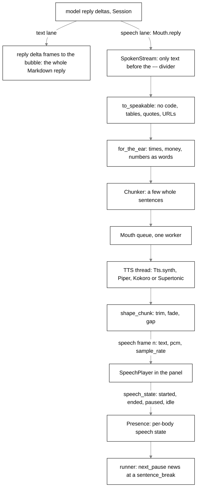
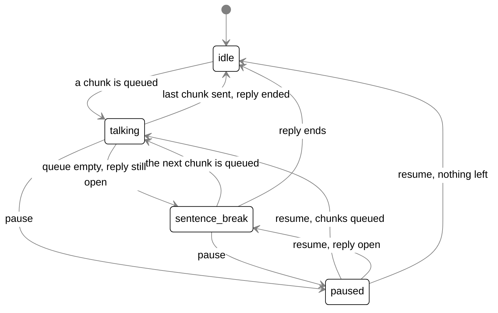
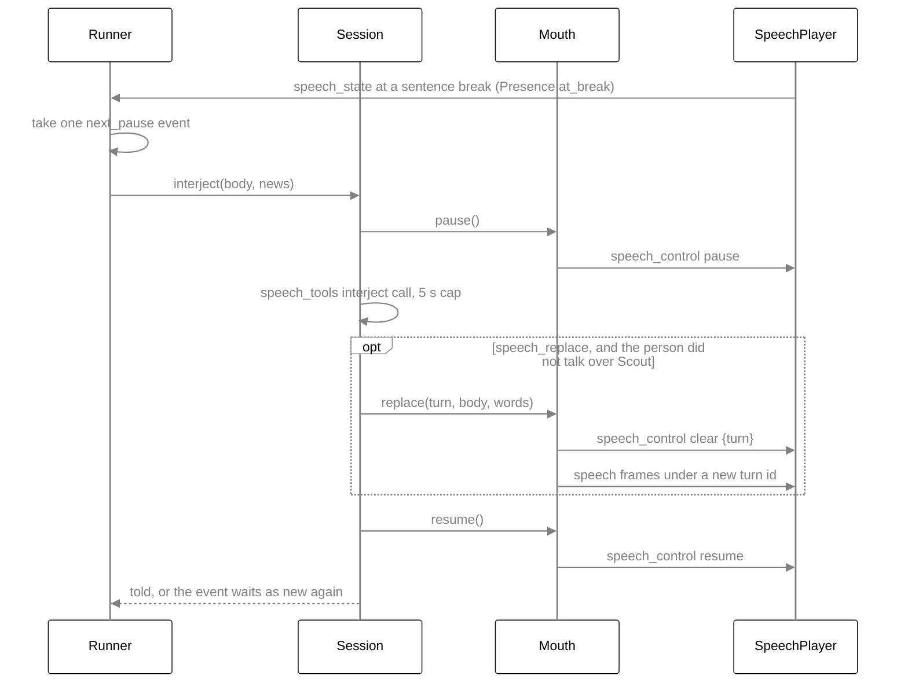
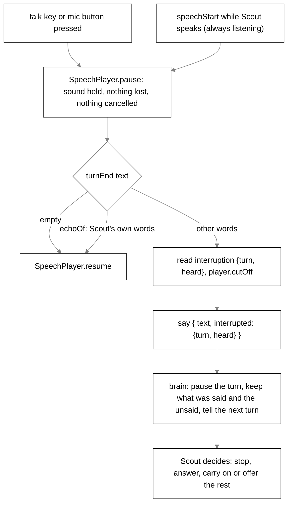

# How Scout talks back

How a reply becomes sound: which turns are spoken, how the brain cuts a reply into chunks and
voices them, how the panel plays them, and what happens when you talk over Scout. Read it to
change anything from the model's words to the speaker. How Scout hears you is in
[hearing.md](hearing.md).

**The brain speaks; the panel plays.** The brain runs the voice (Piper, Kokoro or Supertonic, from
a roster) and sends audio chunks. The desktop only plays them, and falls back to the computer's own
voice for a chunk that has text and no audio.

Contents: [Where it lives](#where-it-lives), [The speech-out pipeline](#the-speech-out-pipeline),
[Which turns are spoken](#which-turns-are-spoken), [Say and show](#say-and-show),
[Read for the ear](#read-for-the-ear), [The mouth's queue](#the-mouths-queue),
[Pause, resume and clear](#pause-resume-and-clear),
[Speech state across bodies](#speech-state-across-bodies), [Interjections](#interjections),
[Talking over Scout](#talking-over-scout), [The player](#the-player), [Voices](#voices),
[What crosses to the brain](#what-crosses-to-the-brain), [Interfaces](#interfaces),
[Constants and limits](#constants-and-limits), [Failure handling](#failure-handling),
[Privacy notes](#privacy-notes), [Tests that pin it](#tests-that-pin-it).

## Where it lives

| Area                    | Files                                                                                                                                                                                |
| ----------------------- | ------------------------------------------------------------------------------------------------------------------------------------------------------------------------------------ |
| Shared types and rules  | `bodies/ui/src/shapes/voice.ts` (`MOUTH_IDS`), `bodies/desktop/src/shared/voice.ts` (`chosenMouth`, `VOICE_ADAPTERS`), `bodies/desktop/src/shared/settings.ts` (`voice`)             |
| IPC and the bridge      | `bodies/desktop/src/main/ipc/voice.ts` (`createVoiceBridge`), `main/ipc/turns.ts` (spoken `say`, Stop sends `hush`), `main/brain/body-events.ts` (`readAloudEvent`)                  |
| Renderer, playing       | `bodies/desktop/src/renderer/src/voice-player.ts` (`SpeechPlayer`, `playVoiceSample`, `playWav`, `speakWithSystem`, `pickSystemVoice`, `applySpeechControl`)                         |
| UI package              | `bodies/ui/src/voice/voice-field.tsx` (the voice card), `voice-download-line.tsx`, `bodies/ui/src/shapes/voice-picker.ts`                                                            |
| Brain, mouth            | `brain/src/brain/voice/`: `mouth.py` (`Mouth`), `speakable.py` (`SpokenStream`, `to_speakable`), `chunker.py` (`Chunker`), `ear_text.py` (`for_the_ear`), `shape.py` (`shape_chunk`) |
| Brain, voices           | `tts.py` (the `Tts` protocol, the roster loader), `tts_models.json`, `tts_engines.py`, `kokoro.py`, `piper.py`, `supertonic.py`, `tts_choice.py`, `tts_tools.py`                     |
| Brain, around the mouth | `speech_tools.py` (the interjection), `presence.py` (who is speaking), `server.py` (`speech_state`), `mind/ear.md`, `mind/interjection.md`                                           |

## How it works

### The speech-out pipeline

A reply streams from the model into two lanes at once. The text lane is what you read; the speech
lane is what you hear.

The bubble gets every delta; the voice gets only the part before a line that is exactly `---`, so
speech starts at the first sentence and never reads the on-screen part. One `speech` frame is one
chunk, and `n` counts chunks within the turn. The player reports back with `speech_state`, and
that is how the brain knows where Scout is between sentences. What Scout says aloud about a long
tool result is its own call: the soul tells it to say the short version and offer the rest, and a
long result reaches it as a capped preview (see [turns.md](../brain/turns.md)).

### Which turns are spoken

A turn is spoken when its body asks for it. Two ways:

- **A heard question.** It is a `say` with `spoken: true`: `CompanionBubble.submit(text, context,
asSpoken = true)` asks it, and `turns.ts` adds `speed` from the saved settings, only when
  `voice.enabled`. When the turn completes, the bubble shows the "Hold <key> to reply" hint.
- **Everything else** rides on the `read_aloud` body event, `{on, speed, system_voice}` (see
  `readAloudEvent` in `body-events.ts`). `on` is Scout talks, `speed` comes from the saved
  settings, and `system_voice` is true when Settings picked "System voice". The desktop sends it
  each time the brain comes online and each time the voice setting is saved. The brain keeps the
  latest per body across reconnects and speaks any turn that body displays while `on` is true: a
  typed question, the hello, a wake's remark and `pet.remark` lines. With `system_voice` the brain
  sends text-only `speech` frames and never loads or downloads a voice.

One rule decides (`Session._wants_speech`): a voice exists, the person spoke or the body asked for
read-aloud, and the body has not turned it off. The body is the turn's displaying body, never the
sender of a display-less body, and a turn with no displaying body is not spoken. With Scout talks
off the brain speaks nothing, not even a `say` with `spoken: true` (a browser voice question gets
a text-only answer). A spoken `say` that joins a running typed turn makes it spoken from then on.
The voice is the brain's own choice (`tts_voice`), never the body's: `say` and `read_aloud` carry
only `speed` (default 1.0).

### Say and show

One reply carries what Scout says and, when there is more, what it shows. The reply is Markdown;
the spoken part comes first, and a line that is exactly `---` (a rule, with a blank line before and
after) ends it. Everything after is the on-screen part. `SpokenStream` (`speakable.py`) says only
the text before the divider, so speech starts at the first sentence and never reads the on-screen
part. The divider stays in the stored text, so the chat keeps both parts and the bubble draws a
horizontal rule between them with no body change. The blank line before the divider matters:
without it Markdown renders the spoken part above as a heading. With no divider the whole reply is spoken; a
divider with nothing before it says nothing at all. A second divider changes nothing, and a `---`
inside a sentence (`5---6`) is not a divider, only a line of its own is.

A short lead-in said before a tool round is held by the chunker until more text arrives, so it can
wait through the round; this is accepted.

The model is told the rule by the ear guide (`mind/ear.md`), which every read-aloud turn carries
(`prompt.ear_note()`, one extra text block after the content): write the spoken part for the ear, put
lists, links, code, tables and long numbers after the divider, use it once and only in the last
message of the turn (so a lead-in before tool rounds is still spoken), and never repeat the
on-screen part aloud. Why a divider and not a tool call or tags: a tool call cannot stream the
spoken part before the model finishes, tags need every body to strip them, and a divider streams,
needs no schema and degrades to today's behaviour.

The guide sits in the user content rather than the system prompt, so the cached system prompt is
the same for typed and spoken turns. Code never says an opening sentence: there is no canned line
and no earcon. The guide is an instruction to the model and not guaranteed.

### Read for the ear

Each sentence goes through `for_the_ear` (`voice/ear_text.py`) after `to_speakable` and before the
chunker, so the voice and the `text` of the frame are the words as said ("3:30" is "three thirty").
Our own small ordered rules, no library; the order matters and `test_voice_ear_text.py` pins it:

1. emoji dropped, and a bracketed aside (`(see below)`) dropped; a sentence left empty is not said
2. ISO dates that are real days (`2026-11-14` is "November fourteenth, twenty twenty six";
   `2026-02-30` is left as written), then versions (`v1.2.3` is "version one point two point
   three"; after the word "Version" it is not said twice), then ranges (`10-20`, `3–5` is "to")
   and a leading minus ("minus five"); longer digit runs such as phone numbers are left alone
3. times (`3:30pm`, `9:00` is "nine o'clock", `14:05` is "fourteen oh five"), then money
   (`$4.50` is "four dollars fifty", `$3.2B` is "three point two billion dollars"; pounds and
   euros too; `k`, `M`, `B` and `bn` scale), then percent, then `km/h` and `mph`
4. ordinals (`22nd`), then plain, comma-grouped and decimal numbers: words for 0 to 999,999, a year
   style for 1100 to 2099 ("eighteen fifty") (`2026` is "twenty twenty six"), a `.` is "point" only between digits;
   larger numbers and codes with a leading zero stay digits for the engine
5. `e.g.`, `i.e.`, `etc.`, `vs.`, `Dr.`, `and/or`, arrows (`->`, `→` is "to") and `&` ("and")

The rewrite is idempotent: text that is already words comes back unchanged.

Audio is then shaped by `shape_chunk` (`voice/shape.py`) before it is sent. The engine's own
padding is trimmed (samples quieter than `TRIM_LEVEL` at an edge, keeping `KEEP_MS` of silence),
each end fades over `FADE_MS` so there is no click, and a gap of zeros is appended: `GAP_MS` after a
chunk, `PARAGRAPH_GAP_MS` after one that ends a paragraph. The gap is part of the chunk's PCM, so a
chunk is still one frame and the player is unchanged. The picker's sample is shaped too, without
the paragraph gap.

To retune, edit the constants at the top of `shape.py` (`TRIM_LEVEL = 0.01`, `KEEP_MS = 20`,
`FADE_MS = 8`, `GAP_MS = 180`, `PARAGRAPH_GAP_MS = 450`) and listen with
`uv run python tests/voice_smoke.py` (hand run, it prints each chunk's duration).

The text the model later sees as heard or unsaid is this ear text ("three thirty", not "3:30"), by
design: it is what was said.

### The mouth's queue

Every spoken chunk of every turn goes into one queue and one worker says them in order: it makes
the audio in a thread (`asyncio.to_thread`), waits for it, then sends the `speech` frame with
`Bodies.send_live`. Two syntheses therefore never overlap (a lock also keeps a voice sample from
overlapping one, because the espeak phonemizer is not thread-safe), and a talk-over or a pause
never has to cancel a synth thread. A failure on one chunk is logged and the worker goes on;
`close()` stops the worker at brain shutdown.

A chunk is a few whole sentences, because a voice reads them better together than one by one.
`SpokenStream` (`speakable.py`) finds the sentences as the reply streams: a `.`, `!` or `?` ends one
when a capital, digit or quote follows, but not after an abbreviation (`e.g.`, `i.e.`, `etc.`,
`Dr.`, `St.`, an initial like `J.`), inside `3.5` or `v1.2.3`, or after a list number; a single
line break is a space except that a sentence ends before a list, table, quote, fence, `---` or
heading line and after a heading line (a sentence with no mark gets a `.` when chunks are joined);
a blank line ends the sentence and the paragraph, a line with no word in it (`-`, `--`) is
dropped, and text that ends right after a mark waits for more; an unpunctuated run over 45 words
is cut at its last comma or space as it streams. The `Chunker` (`chunker.py`) groups them, with constants meant for
tuning by ear: the first chunk is the first complete sentence of at least `FIRST_MIN_WORDS = 4`
words; later chunks grow by whole sentences to `TARGET_WORDS = 30`; a sentence that would pass
`MAX_WORDS = 45` starts the next chunk; one sentence over 45 words is cut at its last comma or
semicolon before the cap, else at the last space; a paragraph break ends the chunk; a chunk or
paragraph of `LONE_WORDS = 3` words or fewer joins the previous unsent chunk, else waits for the
next sentence, and is said alone only when it is the whole reply. One `speech` frame is one chunk,
`n` counts chunks, and `interrupted.heard` counts whole chunks: the chunk being played when the
person talks over Scout is unheard, and everything from it on is in the unsaid rest. A chunk the
chunker still holds when the turn is cut is kept in that rest too.

`Mouth.sentences(turn)` returns what was sent for the newest three turns (`KEPT_TURNS`; frame `n`
is index `n - 1`), then the chunks made but not yet sent; it survives a clear. `Mouth.unsaid(turn)`
is only the made-but-unsent part. After the last chunk the mouth sends `speech {turn, done: true}`.

`Mouth.state` is `talking` (a chunk is being made or sent, or more are queued), `sentence_break`
(a reply is still open but nothing is queued), `paused` or `idle`. `on_state` is called on each
change; the brain wires it to presence as the fallback for a turn no body reports on.

### Pause, resume and clear

- **`pause()`** takes effect after the chunk in flight is sent; what is queued stays. It sends
  `speech_control pause` to every body with a live turn and to the last body the mouth sent to (a
  turn already fully sent is still reached). **`resume()`** carries on in order and sends `resume`
  the same way; `resume(tell=False)` carries on without telling the body, for when the person
  paused it.
- **`clear(turn)`** (every turn when `None`) drops that turn's queued chunks, ignores its later
  deltas and sends no more `speech` for it, not even `done`. What was made but not yet sent moves
  to the chunk log. The text reply still shows. A body's `hush` clears every turn spoken on that
  body (`VoiceService.hush`); other bodies' turns go on. A spoken `say` that joins the turn after a
  clear speaks again from the next delta.
- **`replace(turn, body_id, text)`** sends the body `speech_control {action: "clear", turn}` (the
  chunks already sent sit in its player), mutes the old turn's later words and says `text` in the
  same voice as a new turn, whose id (`{turn}-{8 hex}`) it returns; `None` when the turn is gone.
- **`speaking(turn, body_id)`** says the turn is still live and owns the queue.
- `unlisten` does not hush (a held-mode reply goes on being spoken) and `cancel` does not hush, so
  a body sends `hush` on Stop.

### Speech state across bodies

The body that plays the audio is the truth about speech while it reports. Each body sends
`speech_state {turn, n?, state}`; `server.py` maps `started` to `talking`, `ended` to
`sentence_break`, and passes `paused` and `idle` on to `Presence.speech(body_id, state, turn, n)`.
Presence keeps the last state per body, and `idle` ends that body's claim. With no body
reporting, `Mouth.on_state` is the source (wired in `main.py` through `VoiceService.follow_speech`
to `Presence.mouth`), which covers a turn another body plays. A claim is cleared on the body's
`hello` and when its connection closes (`speech_gone`), so a dead connection cannot leave Scout
"talking".

- `talking()` is true while any body reports, else while the mouth is not idle.
- `at_break()` is true only when every body that reports is at a `sentence_break` or `paused`, and
  at least one is at a `sentence_break`. A paused body does not hold the others back but alone is
  never a break.
- `break_seen()` is a latch set when `at_break()` becomes true (or the mouth breaks with no body
  reporting), so two frames handled back to back (`sentence_break`, then `talking`) cannot lose
  it. Reading it spends it. The runner reads it to tell `next_pause` news.
- `heard(body_id)` is the turn and how many chunks that body last finished.

| Body A         | Body B                       | `talking()` | `at_break()` |
| -------------- | ---------------------------- | ----------- | ------------ |
| talking        | none                         | yes         | no           |
| sentence_break | none                         | yes         | yes          |
| sentence_break | talking                      | yes         | no           |
| sentence_break | paused                       | yes         | yes          |
| paused         | none                         | yes         | no           |
| none reporting | mouth is on a sentence_break | yes         | yes          |

A body with no audio (WhatsApp, typed chat) has no speech state, so its next pause is the end of
the running reply: the runner starts nothing while a turn runs, and the turn's end pokes it.

### Interjections

News that may speak at the next pause and arrives while Scout is talking does not wait for the
turn to end. The runner takes one such event when presence is at a `sentence_break`, the mouth
pauses its queue, and one short model call (`speech_tools.interject`, wording in
`mind/interjection.md`) sees the news and the chunks not yet said. It answers with one of two tools:
`speech_continue` (say the rest as planned; no tool also means continue) or `speech_replace` (say
these words instead, through `Mouth.replace`). The call is cut off after 5 s because the queue is
held meanwhile. Only a real replace counts as telling the news; otherwise the event goes back to
`new` and a plain turn tells it later. The full flow is in [turns.md](../brain/turns.md).

The voice is held only for the one short call and always resumes after it. A replace mutes the old
turn's unsaid words and speaks the new words as a turn of its own; if the person talked over Scout
meanwhile, nothing is replaced and the player stays paused for them.

### Talking over Scout

Talking over Scout pauses it; nothing is destroyed. The mic stays open while Scout speaks, the
system voice included. What the person said then decides what happens. The decision
is mechanical where it can be and the brain's where it matters:

- **Held.** The talk key (or the mic button) only pauses Scout's voice, through `TalkOver.press()`
  in `talk-rules.ts`, and brings the bubble up (`onBegin` clears any one-line remark). No turn is
  cancelled and nothing is hushed before words arrive. The held session's `turnEnd` runs the
  same echo check as Always: empty or Scout's own echo calls `TalkOver.nothing()`, which resumes
  playback; real words call `TalkOver.heard()`, which reads what was heard, cuts Scout off
  (`player.cutOff()`, so the brain hushes) and sends the question with `interrupted`.
- **Always.** With Scout speaking, any speech pauses it. With Scout quiet, only the first
  addressed partial, or the addressed `turnEnd`, of a turn brings the bubble up.
- **The bubble.** Listening starting does not stop the running reply. The Stop button and
  the close still do (`bridge.interrupt`, which cancels the turn: an explicit stop). Real words
  reach the brain as a `say` with `interrupted`, and the brain pauses the turn.
- **Stop.** Cancelling a turn does not hush its speech on the brain. So `turns.ts#interrupt` cancels
  the turn and then broadcasts the stop-voice event, and the panel's `player.cutOff()` sends `hush`.
  The Stop button, the stop key and the bubble's close end in `player.cutOff()`.
- **Pause is local.** `SpeechPlayer.pause()` suspends the WebAudio clock and pauses
  `speechSynthesis`; `resume()` undoes it, and `clear()` releases a pause. A partial transcript
  neither resumes nor sends; only the turn's end decides.
- **Two mechanical resumes only.** Nothing transcribed (a cough), or the words are Scout's own
  voice coming back: `echoOf(transcript, playingText)` is a plain match of at least two words,
  in a row, inside the text of the turn being spoken. A lone word is never an echo, so a bare
  "stop" always reaches Scout. No model and no word lists.
- **What the brain gets.** `interrupted { turn, heard }`: `heard` is the number of chunks
  played to the end (`SpeechPlayer.interruption()`, counted from the numbered `speech` frames).
  It travels on the `ask` payload itself (`AskInput.interrupted`), so it can never attach to a
  later question. The player's `cutOff()` hushes the brain first, so the mouth keeps the turn's
  chunk log (sent and made-but-unsent) through the hush: the unsaid rest survives.
  `SpeechPlayer.text()` (the echo check) is only the chunk playing and the one before it.
- **What the brain does.** `Session.say` pauses that turn (`Session.interrupt`: generation stops,
  nothing is cancelled and no open item is closed), saves only the chunks that were said,
  marked `[interrupted: the owner spoke over this]`, and gives the model the unsaid chunks
  once, in a `<data kind="interruption">` block with the owner's words. A tool still running
  finishes in the background and its result comes back through the event log as a
  `tool_result` event. See [turns.md](../brain/turns.md).

### The player

`SpeechPlayer` (`renderer/src/voice-player.ts`):

- **Order.** `enqueue(chunk)` adds a sentence; sentences play one after another. `answering` is
  true from the first chunk of a turn until `done(turn)` and the queue has drained, and `speaking`
  is true while a sentence plays. Both go to `onState`, which drives the panel's speaking indicator
  and the follow-up window.
- **Which voice.** With `voice.mouth` on the brain's voice (the setting value `kokoro`, the default) and a chunk that has `pcm` and a sample rate, the audio
  is decoded (little-endian 16-bit mono at the frame's `sample_rate`) and played through an `AnalyserNode` (`fftSize` 256);
  each animation frame the peak level goes to the CSS variable `--tg-voice-level`. Otherwise the
  chunk's `text` is spoken through `speechSynthesis` at the saved speed (`rate`). So a brain with no
  voice ready (a `speech` frame with text only) is spoken by the system voice, and choosing "System
  voice" in Settings makes the desktop ignore the audio.
- **Pause and resume.** `pause()` holds the sound and the pump: the sentence in flight stays held
  and no queued sentence starts or is dropped. `resume()` carries on from the held sentence
  without replaying it.
- **Clear.** `clear(turn?)` aborts the sentence playing, empties the queue and drops late chunks
  of that turn, without telling the brain to hush (the brain asked, or `cutOff` did). With a
  `turn` it drops only that turn's sentences (playing or queued) and other turns still speak. A
  pause between sentences holds the next one too, and a pause with nothing to say sends nothing.
- **Cut off.** `cutOff()` is the person's stop: it sends `hush` to the brain, then `clear()`s.
- **Speech state.** `onSpeech` fires `started` and `ended` per sentence (with its `n`), `paused`
  on a pause, `started` again for the held sentence on a resume, and `idle` when the player runs
  dry or is cleared. The panel passes each to the host's `speechState`, which becomes the
  contract's `speech_state`. `applySpeechControl(player, control)` maps the brain's
  `speech_control` onto the player.
- **A sentence that fails to play** is logged and the next one plays.
- **The system voice.** `pickSystemVoice`: an `en-GB` voice named George first, then another
  British male name (`ryan|thomas|oliver|arthur|alfie|elliot|ethan|noah`), otherwise the system
  default. While it speaks, the level is held at 0.5.
  `getVoices()` is called once at load so the list is ready.
- **The voice picker.** The shared `VoiceField` ("Scout's voice" card, `bodies/ui/src/voice/`) is
  used by Settings' Voice page and the tour's voice step ("Pick Scout's voice"). Its Play is
  `playVoiceSample(voice, speed)` (a `HostBridge` call the renderer supplies): the brain's
  `speak_sample {voice, speed}` tool through `IPC.speakSample`, played as WAV (`playWav`); it
  rejects when the brain has no sample. `ttsState()` and `setTts(voice)` read the roster and save
  the pick through `tts_state` and `set_tts`; picking saves at once, so the tour's Next never waits
  on a download. The brain starts a download as soon as a voice is picked (`mouth.choose`), the
  chosen row shows its progress from `voice_download`, and the card reads only that cheap call while
  it runs, reading the full state again on `tts` and `link` changes and when the download ends;
  answers carry a request number so a late one never overwrites a newer one. One sample plays at a
  time: the bridge stops the previous one, and every Play is disabled while one plays. `title`
  renames the card's heading (the tour uses "Pick Scout's voice"). There is no separate Preview button and no voice id in the desktop's settings.

### The voice is fetched early

While the first-run tour is open the desktop calls the Home tool `fetch_voice` each time the brain
comes online, until the tour is finished. `VoiceService.prefetch()` starts `Mouth.prefetch()`
(the chosen voice, as a task off the event loop) and downloads the listening models' files the
same way (download only: nothing is loaded into memory until you listen; a failure there is one
warning). Nothing waits on it. Until the voice is ready the computer's own voice speaks (the brain
sends text-only `speech` frames); once it is ready Scout switches to it from the next chunk, never
mid-sentence.

`Mouth.download` is `{voice, status: idle | downloading | ready | failed, progress}`. Each change,
at most one per 2%, calls `on_download`, which `main.py` turns into `changed {what:
"voice_download"}` (no new contract frame); Home reads it with the tool `voice_download`.
Settings' Voice page shows one status line under the voice card while the chosen voice downloads
("Downloading Scout's voice… N%. Using the computer's voice until then." with a thin bar), hides it
when done, and on a failure says so with a **Try again** button (`fetch_voice {retry: true}`); the
line is `VoiceDownloadLine` in `bodies/ui/src/voice/`. A failed load keeps the system voice working
and is tried again on the next spoken turn.

### Voice licences

Checked 2026-11-14. Tagalong's own licence is GPL-3.0-or-later (its LICENSE file is at the repo root),
so a GPL-3.0 engine can run in the brain's process the way espeak-ng already does
through Kokoro.
Tagalong never redistributes a voice file: the user's machine downloads each one, pinned to a
commit and a SHA-256, from its upstream host.

| Engine / voice                                                  | Code licence     | Weights licence                                                                                                                                                                                          | What we ship                                                                              | Verdict                                                                                                                                    |
| --------------------------------------------------------------- | ---------------- | -------------------------------------------------------------------------------------------------------------------------------------------------------------------------------------------------------- | ----------------------------------------------------------------------------------------- | ------------------------------------------------------------------------------------------------------------------------------------------ |
| Piper engine (`piper-tts` 1.8.0 on PyPI)                        | GPL-3.0-or-later | n/a                                                                                                                                                                                                      | The dependency, run in-process                                                            | Yes. Compatible with Tagalong's own licence.                                                                                               |
| Piper voice `en_GB/alan/medium` (rhasspy/piper-voices)          | MIT (repo tag)   | Dataset: MycroftAI mimic3-voices `en_UK/apope_low`. The model card says "License: See URL"; that folder's LICENSE reads "Copyright 2022 Mycroft AI, All Rights Reserved". The repo root is CC-BY-SA-4.0. | A download from Hugging Face on the user's machine; the file is never redistributed by us | Yes, the user's call (the default voice). The doubt is recorded: the dataset's terms are unclear.                                          |
| Piper voice `en_GB/northern_english_male/medium`                | MIT (repo tag)   | CC-BY-SA-4.0 (dataset OpenSLR 83)                                                                                                                                                                        | A download from Hugging Face                                                              | Yes, with attribution.                                                                                                                     |
| Kokoro (`hexgrad/Kokoro-82M`, via `kokoro-onnx`)                | Apache-2.0       | Apache-2.0                                                                                                                                                                                               | A download of the int8 model and voices                                                   | Yes.                                                                                                                                       |
| Supertonic (`Supertone/supertonic`; `supertonic` 1.3.1 on PyPI) | MIT              | BigScience OpenRAIL-M                                                                                                                                                                                    | A download of four ONNX files, two config files and two voice styles                      | Yes, with the licence's use-based restrictions passed on. The repo is live (updated 2025-12-10). One male and one female style are listed. |
| Pocket TTS (`kyutai/pocket-tts`)                                | MIT              | CC-BY-4.0 (attribution needed)                                                                                                                                                                           | Nothing                                                                                   | Not shipped. The Hugging Face repo is gated, which a download step would have to handle.                                                   |

### Voices

The roster is `brain/src/brain/voice/tts_models.json`, read by `voice/tts.py` the way
`stt_models.json` is read by `stt.py`. One row per voice: `id`, `label`, `descriptor` (the short
words under the name), `engine` (a key of `TTS_ENGINES`), `voice` (the engine's own name for it),
`files` (pinned `ModelFile`s under `tts/<engine>/`: URL pinned to a commit, size, sha256),
`size_mb`, `sample` (the release clip, or `null` while the clips are pending), `licence` (see
above), `runtime` (`brain` only for now) and `auto` (exactly one row is the default). The loader
refuses an unknown engine or runtime, a duplicate id, a file without a size and 64-digit sha256,
an empty licence and any number of auto rows other than one. Today's rows: Piper `piper-alan`
(the default) and `piper-northern-english-male`, Kokoro `kokoro-george`, `kokoro-fable`,
`kokoro-emma` and `kokoro-heart` (one download serves all four), and Supertonic `supertonic-m1`
and `supertonic-f1` (styles M1 and F1 of the package's ten).

Engines live in `tts_engines.TTS_ENGINES`; each `load(row, folder)` returns a `Tts` (the protocol
in `tts.py`: `synth(text, voice, speed)` gives int16 samples and a rate). Piper joins its
per-sentence chunks and maps speed to `length_scale = 1 / speed`; Supertonic loads its style once
and passes speed through; Kokoro is unchanged. Libraries are imported only inside `load`.

- **Add a voice of a known engine:** add a row. Take each file's size and sha256 from the
  Hugging Face API (`.../api/models/<repo>/tree/<commit>/<dir>?expand=true`, `lfs.oid` for large
  files; hash the small text files yourself) and pin the URL to the commit.
- **Add an engine:** a module with an `Adapter` and a `load(row, folder)`, an entry in
  `TTS_ENGINES`, then rows.
- **Sample clips:** `cd brain && uv run python tools/voice_samples.py OUT_DIR` says
  `SAMPLE_TEXT` with every voice (it downloads the real models; hand run only), writes
  `<id>.wav` and prints each clip's size and sha256. Upload the WAVs to the GitHub release
  `voice-samples-v1` and paste each URL, size and sha256 into the row's `sample`. Until then
  every row has `sample: null`.

**The choice.** The brain owns it: the `tts_voice` setting is `auto` (the roster's default
row) or a voice id. Home reads and changes it with the tools `tts_state` and `set_tts` (a
`changed {what: "tts"}` follows) and plays a voice with `speak_sample {voice, speed?}`: live if
the voice is installed, else its release clip, fetched once and cached, else "No sample yet.".
A pick loads in the background (latest pick only; an older load is cancelled and its partial
file removed). Speech goes on in the most recently ready voice, or in the body's system voice
when none is ready, and switches at the next chunk. `say` and `read_aloud` carry no voice,
only `speed`.

**The sample.** The Home tool `speak_sample {voice, speed?}` returns a text part holding the JSON
`{"mime": "audio/wav", "data": <base64>}` of `SAMPLE_TEXT`. An installed voice speaks it live;
otherwise the row's release clip is fetched once (size and sha256 checked) into the voice folder
and served from there, so Play works offline afterwards. No clip and not installed is
`tool_failed` "No sample yet."; an unlisted id is `invalid_params`. The picker's sample is shaped
too, without the paragraph gap.

**Hand check.** `cd brain && uv run python tests/voice_smoke.py [DATA_DIR] [OUT_DIR]` runs every
roster voice once and prints load time, time per sentence and the real-time factor (not part of
`pytest`).

## What crosses to the brain

Contract v1 (see [protocol/README.md](../../protocol/README.md)). The listening frames are in
[hearing.md](hearing.md#what-crosses-to-the-brain).

| Frame                                            | Direction     | Meaning                                                                                                                                                                                                                                                                                                                                               |
| ------------------------------------------------ | ------------- | ----------------------------------------------------------------------------------------------------------------------------------------------------------------------------------------------------------------------------------------------------------------------------------------------------------------------------------------------------- |
| `hush`                                           | body to brain | Notification: stop speaking now.                                                                                                                                                                                                                                                                                                                      |
| `speech_state { turn, n?, state }`               | body to brain | Notification: the player started or ended chunk `n`, paused, or went idle (`started`, `ended`, `paused`, `idle`). Live only. The brain feeds it to presence (`started` is talking, `ended` a chunk break, then `paused` or `idle`); it wins over the mouth's own state while a body reports it, and `idle` ends that body's claim.                    |
| `say { ..., spoken: true, speed }`               | body to brain | A heard question is asked as spoken, with the speed from Settings. Other turns are spoken per `read_aloud`.                                                                                                                                                                                                                                           |
| `speech { turn, n?, text?, pcm?, sample_rate? }` | brain to body | One chunk (a few whole sentences): `n` (1-based within its turn), `text`, plus `pcm` (16-bit mono little-endian, base64) and `sample_rate` when a voice spoke it. A frame with `text` only means use the system voice.                                                                                                                                |
| `speech { turn, done: true }`                    | brain to body | The last chunk of that turn has been sent.                                                                                                                                                                                                                                                                                                            |
| `speech_control { action, turn? }`               | brain to body | `pause` holds the player where it is, `resume` carries on from the held chunk, `clear` drops what is queued (one turn's, if `turn` is given). Live only. The mouth sends `pause` and `resume` to the body playing the turn when it pauses or resumes (an interjection holds the queue this way); `Mouth.replace` sends `clear` for the replaced turn. |

`speech`, `speech_state` and `speech_control` are live only (no `seq`), so they are not replayed
after a reconnect. Spoken audio (`speechChunk`, `speechDone`) and `speechControl` go to the panel
alone; the panel's `speechState` events arrive over IPC and `createVoiceBridge.speechState` checks
their shape before sending them on (a bad one is dropped). The sample (`speakSample(voice, speed)`)
coerces what the page sends: the voice to a string, the speed to a number, and a speed that is no
number is no sample. The mouth has no status frame: `voice` is the ears' channel, and text without
`pcm` already means "use your own voice".

## Interfaces

### IPC channels

From `IPC` in `bodies/desktop/src/shared/ipc.ts`. Handlers are in `main/ipc/voice.ts`. The
listening channels are in [hearing.md](hearing.md#ipc-channels).

| Channel                         | Direction      | Payload                                                  | Notes                                                                  |
| ------------------------------- | -------------- | -------------------------------------------------------- | ---------------------------------------------------------------------- |
| `tagalong:voice:hush`           | invoke         | none                                                     | The brain's `hush`.                                                    |
| `tagalong:voice:speak-sample`   | invoke         | `(text, voice, speed)` returning `SpeakSample` or `null` | The brain's `speak_sample` tool. `null` when it cannot speak.          |
| `tagalong:voice:speech-chunk`   | main → windows | `SpeechChunk { turn, text?, pcm?, sampleRate? }`         | From `speech`.                                                         |
| `tagalong:voice:speech-done`    | main → windows | `{ turn }`                                               | From `speech { done }`.                                                |
| `tagalong:voice:speech-state`   | send           | `SpeechEvent { turn, n?, state }`                        | The player's state, sent on as `speech_state`. A bad shape is dropped. |
| `tagalong:voice:speech-control` | main → panel   | `SpeechControl { action, turn? }`                        | From `speech_control`. The panel applies it with `applySpeechControl`. |

### Types

- `SpeechChunk { turn, text?, pcm?, sampleRate? }`, `SpeakSample { mime, data }`,
  `SpeechEvent { turn, n?, state }`, `SpeechControl { action, turn? }` (`shared/ipc.ts`).

### Settings fields

`bodies/desktop/src/shared/settings.ts`. Voice settings stay in the desktop; the speed rides along
on each spoken `say`. Which voice speaks is the brain's (`tts_state`), not a desktop setting.

| Field           | Default | Meaning                                                                                                                                |
| --------------- | ------- | -------------------------------------------------------------------------------------------------------------------------------------- |
| `voice.enabled` | `true`  | Scout talks.                                                                                                                           |
| `voice.speed`   | `0.95`  | `MIN_VOICE_SPEED` 0.7 to `MAX_VOICE_SPEED` 1.3                                                                                         |
| `voice.mouth`   | absent  | `kokoro` ("Scout's voice (on the brain)": whichever roster voice the brain chose) or `system` ("System voice"). Absent means `kokoro`. |

See [settings-and-secrets.md](../data/settings-and-secrets.md) for the whole schema. The listening
settings are in [hearing.md](hearing.md#settings-fields).

## Constants and limits

| Constant                      | Value                         | Where                                   |
| ----------------------------- | ----------------------------- | --------------------------------------- |
| Speech sample rate            | from the engine, in the frame | `speech.sample_rate` (Kokoro 24,000 Hz) |
| `FIRST_MIN_WORDS`             | 4                             | `chunker.py`                            |
| `TARGET_WORDS` / `MAX_WORDS`  | 30 / 45                       | `chunker.py`                            |
| `LONE_WORDS`                  | 3                             | `chunker.py`                            |
| `TRIM_LEVEL` / `KEEP_MS`      | 0.01 / 20 ms                  | `shape.py`                              |
| `FADE_MS`                     | 8 ms                          | `shape.py`                              |
| `GAP_MS` / `PARAGRAPH_GAP_MS` | 180 ms / 450 ms               | `shape.py`                              |
| `KEPT_TURNS`                  | 3 turns of chunk logs         | `mouth.py`                              |
| `DEFAULT_SPEED`               | 1.0                           | `mouth.py`                              |
| Interjection `MAX_TOKENS`     | 300                           | `speech_tools.py`                       |
| Interjection timeout          | 5 s                           | the session's `INTERJECTION_TIMEOUT_S`  |

## Storage

- **Voices.** None on the desktop. The brain keeps each voice's files under
  `<TAGALONG_HOME>/voice/tts/<engine>/`, checked by size and SHA-256.
- **The choice.** The brain's `tts_voice` setting (`auto` or a roster id). See
  [settings-and-secrets.md](../data/settings-and-secrets.md).
- **What was said.** The chunk log (the newest three turns) lives in memory; the saved chat keeps
  only the spoken chunks of a cut turn, marked `[interrupted: the owner spoke over this]`. No audio
  is stored.

## Failure handling

| Failure                                             | What happens                                                                                                                                                                       |
| --------------------------------------------------- | ---------------------------------------------------------------------------------------------------------------------------------------------------------------------------------- |
| No voice is ready (first run, offline, load failed) | It sends `speech` with text only; the panel speaks it with the system voice. A chunk the voice cannot say (an odd character) also goes out as text, and the turn's speech goes on. |
| A sentence fails to play                            | `SpeechPlayer` logs it and plays the next.                                                                                                                                         |

## Privacy notes

- **No audio is stored.** The brain makes each chunk's audio, sends it to the panel and keeps only
  the chunk's text in memory. Nothing is sent to a speech service; every voice runs on the brain's
  own computer, and its files are fetched once from the engine's upstream host.
- **What the voice reads.** The reply text, never a tool result in full, and never the on-screen
  part after `---`. See [privacy.md](../data/privacy.md).

## Tests that pin it

| Test                                                                                                                                                                       | Pins                                                                                                                                                                                                                                                                                                                                                                               |
| -------------------------------------------------------------------------------------------------------------------------------------------------------------------------- | ---------------------------------------------------------------------------------------------------------------------------------------------------------------------------------------------------------------------------------------------------------------------------------------------------------------------------------------------------------------------------------- |
| `bodies/desktop/src/main/ipc/turns.test.ts`                                                                                                                                | A spoken ask carries `spoken` and `speed`; a cancelled turn also stops the voice.                                                                                                                                                                                                                                                                                                  |
| `bodies/desktop/src/shared/voice.test.ts`, `settings.test.ts`                                                                                                              | `chosenMouth`, the voice and speed settings.                                                                                                                                                                                                                                                                                                                                       |
| `bodies/desktop/src/renderer/src/voice-player.test.ts`                                                                                                                     | `SpeechPlayer` order, answering and speaking state, cutOff dropping late chunks and sending `hush`, pause and resume (the held sentence is not replayed, the queue is kept), clear (no `hush`), the `speech_state` events per sentence, `applySpeechControl`, the sentences played to the end, the turn's text, the system-voice fallback, `playVoiceSample`, system voice choice. |
| `bodies/desktop/e2e/smoke.spec.ts`                                                                                                                                         | Talking to Scout on the fake brain's `heard` and `speech` frames and Chromium's fake mic, ending with the "Hold Right Ctrl to reply" hint and a spoken `say`.                                                                                                                                                                                                                      |
| `brain/tests/test_voice_mouth.py`, `test_voice_chunker.py`, `test_voice_speakable.py`, `test_voice_ear_text.py`, `test_voice_shape.py`                                     | The queue, pause, resume, clear and replace; chunk sizes; the sentence rules and the divider; the ear rewrites in order; the audio shaping.                                                                                                                                                                                                                                        |
| `brain/tests/test_voice_tts_models.py`, `test_voice_tts_engines.py`, `test_voice_tts_choice.py`, `test_voice_piper.py`, `test_voice_kokoro.py`, `test_voice_supertonic.py` | The roster loader and its refusals, the engines, the saved choice, each adapter on fakes.                                                                                                                                                                                                                                                                                          |
| `brain/tests/test_front_door_routing.py`, `test_sessions_voice.py`                                                                                                         | Speech state routing and the spoken turn through the session.                                                                                                                                                                                                                                                                                                                      |
