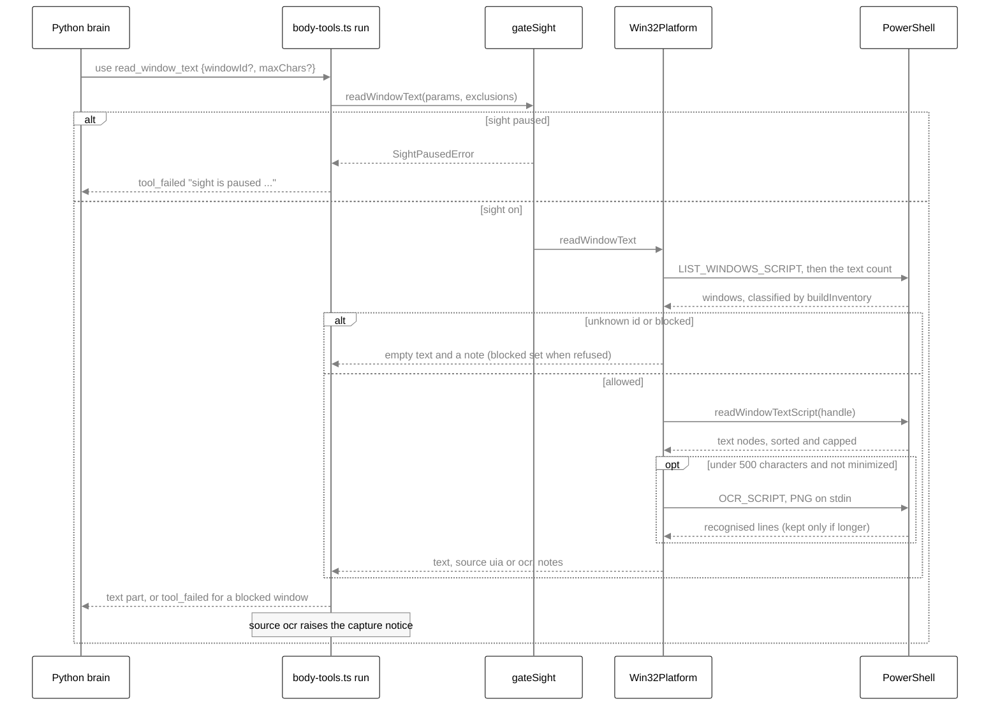
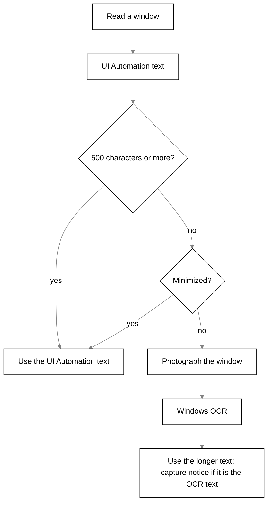
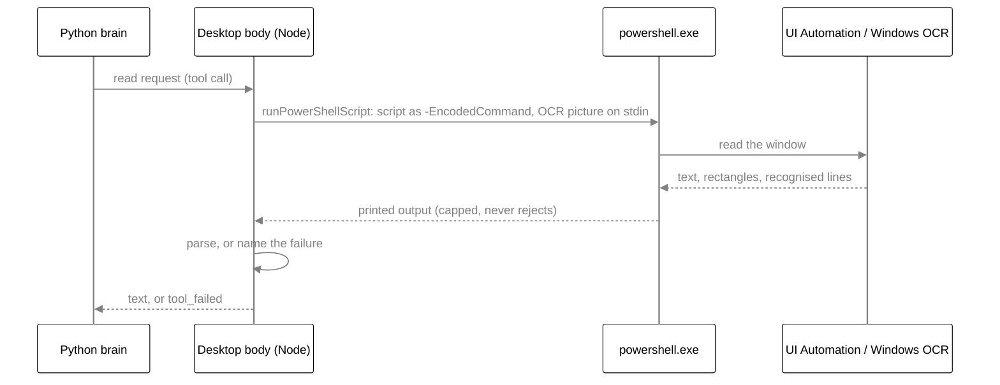
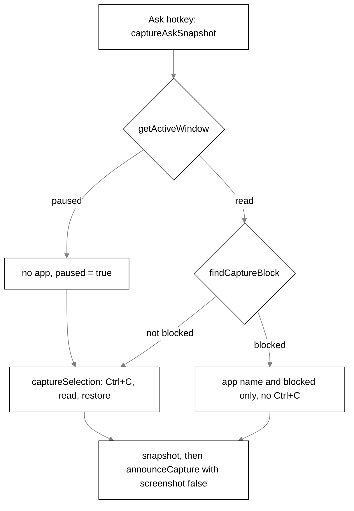
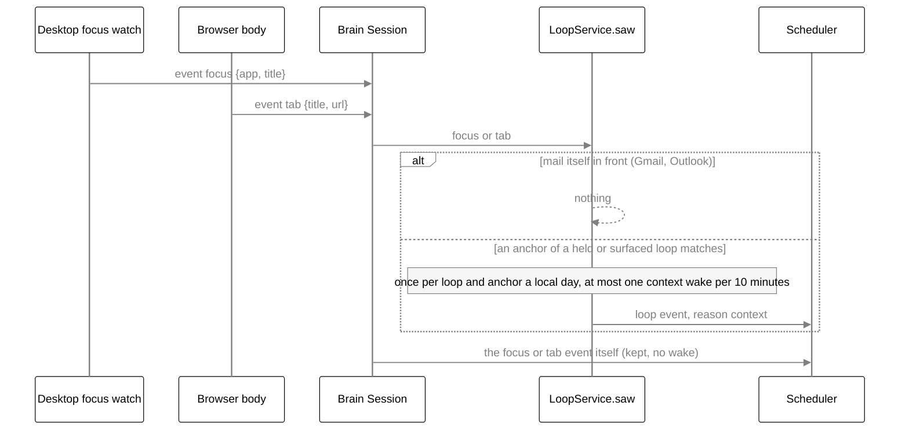

# Sight

## Purpose

The Python brain reaches the screen only through the desktop's body tools (`list_windows`, `read_window_text`, `look_at_window`); this doc covers what the desktop reads and the rules around it.

How Scout sees the desktop: the window list, window text (accessibility tree and OCR) and a screenshot
of one window. This doc covers how each read is made and what refuses it (blind spots,
the person's exclusions, the sight pause).

The desktop host does the reading. Windows is the only platform.

## Where it lives

| Area                           | Files                                                                                                                                                                 |
| ------------------------------ | --------------------------------------------------------------------------------------------------------------------------------------------------------------------- |
| Platform interface and factory | `bodies/desktop/src/main/platform/index.ts` (`Platform`, `createPlatform`, `WindowInventory`)                                                                         |
| Windows adapter                | `bodies/desktop/src/main/platform/win32.ts` (`Win32Platform`)                                                                                                         |
| Sight pause gate               | `bodies/desktop/src/main/platform/sight-gate.ts` (`gateSight`, `SIGHT_POLICY`, `SightPausedError`); `bodies/desktop/src/main/sight-pause.ts` (`SightPause`)           |
| PowerShell transport           | `bodies/desktop/src/main/platform/powershell.ts` (`runPowerShellScript`), `platform/window-helper.ts` (`runWindowHelper`, `LIST_WINDOWS_SCRIPT`, `PER_MONITOR_AWARE`) |
| Window list                    | `platform/window-list.ts` (`parseWindowList`, `placeOnDisplays`, `countableHandles`, `handleOf`, `screensOf`)                                                         |
| Window text                    | `platform/window-text.ts` (scripts, `parseWindowText`), `platform/text-layer.ts` (`TextLayerProvider`), `platform/read-text.ts` (`readWindowTextWith`)                |
| OCR                            | `platform/ocr.ts` (`recognizeText`, `OCR_SCRIPT`)                                                                                                                     |
| Screenshots                    | `platform/capture.ts` (`captureWindowImageWith`, one window by handle), `platform/window-shot.ts` (`lookAtWindowWith`), `platform/downscale.ts` (`fitWithin`)         |
| Selection                      | `platform/selection.ts` (`captureSelectionWith`)                                                                                                                      |
| Body tools                     | `bodies/desktop/src/main/brain/body-tools.ts` (`list_windows`, `read_window_text`, `look_at_window`)                                                                  |
| Focus events                   | `bodies/desktop/src/main/brain/body-events.ts` (`startFocusWatch`, `frontWindow`)                                                                                     |
| Ask and voice snapshots        | `bodies/desktop/src/main/context.ts` (`captureAskSnapshot`, `captureActiveWindow`), `capture-notice.ts`                                                               |
| Exclusion rules and inventory  | `bodies/desktop/src/main/platform/exclusions.ts`, `inventory.ts`, `text-layer-notes.ts`; `bodies/desktop/src/shared/blind-spots.ts`                                   |
| Wire shapes                    | `bodies/ui/src/shapes/context.ts` (`@tagalong/ui/shapes`), `shared/settings.ts`                                                                                       |

## How it works

### The read path

On the desktop, `Platform` is the one door to the screen: every read goes through `gateSight(Platform)`, which applies the sight pause, and the exclusion check runs before any pixel or text is read. The ask hotkey and the talk key call it from `context.ts`; the brain calls it through the body tools.

The brain asks for reads with three body tools (`body-tools.ts`): `list_windows`, `read_window_text` and `look_at_window`. `read_window_text` and `look_at_window` take a window id minted by the list (`read_window_text` defaults to the foreground window). The brain sends a `use` frame, the desktop's `BrainClient` hands it to `run`, and every run is bounded at `RUN_TIMEOUT_MS` = 15,000; anything that is not already an `RpcError` (the sight pause, a helper failing) becomes a `tool_failed` error carrying its own words. The browser body offers its own tools instead (`tabs`, `page_parts` and others; see [browser-body.md](browser-body.md)).

The path of one `read_window_text`, end to end:



### The platform adapter

`Platform` (`platform/index.ts`) is every read the host can make:

| Method                                    | Reads                                               | Pause class   |
| ----------------------------------------- | --------------------------------------------------- | ------------- |
| `getActiveWindow()`                       | app name, title and bounds of the foreground window | `sight`       |
| `listWindows(exclusions, { countText? })` | every top-level window, no contents                 | `sight`       |
| `readWindowText(params, exclusions)`      | one window's text                                   | `sight`       |
| `lookAtWindow(params, exclusions)`        | PNG of one listed window                            | `sight`       |
| `captureSelection()`                      | the selection, by the clipboard trick               | `handed-over` |

`createPlatform` returns `Win32Platform` on `win32` and throws on any other OS, so an unsupported
platform fails at boot instead of perceiving nothing.

Each capability is a free function that takes its Electron and process dependencies as ports
(`desktopCapturer`, `screen`, `clipboard`, a script runner). `Win32Platform` only wires the real
ones in. The whole layer is therefore unit-tested in Node with no display; the real PowerShell
transport and the real recogniser are covered by the Windows-only `*.integration.test.ts` files,
and real pixels by the Electron smoke test.

`getActiveWindow` uses the `get-windows` native module, imported lazily. `captureSelection` uses
`@nut-tree-fork/nut-js`, also lazy, to press Ctrl+C: the only keyboard automation in Tagalong.

#### Talking to PowerShell

Node cannot see inside other apps' windows; Windows can, through UI Automation (a window's text)
and Windows OCR (text in a picture). PowerShell ships with every Windows and reaches both without a
native add-on to compile and sign, so each read runs a small script and parses what it prints.

The two Windows tools it reaches both run in the desktop body, on the person's machine; the brain
never touches them, it asks through a tool call and gets text back:

- **UI Automation** is Windows' accessibility layer, the one screen readers such as Narrator use.
  Apps describe their screen as a tree of elements (a window holds a toolbar, the toolbar a button
  named "Save", a text box holds its value), each with a type, a name, a value and a rectangle. The
  script walks that tree through .NET's `System.Windows.Automation` and collects names and values.
  It only reads; it never clicks or types. It gives exact text without a picture, but only what
  the app chooses to describe: games, canvas-drawn apps, image-only PDFs and video give little or
  nothing.
- **Windows OCR** (`Windows.Media.Ocr`) is the text-recognition engine built into Windows 10 and 11. It finds printed text in a picture on the machine, offline and free, in the languages
  installed for the user (`TryCreateFromUserProfileLanguages`).

UI Automation goes first because it is exact and needs no picture; OCR is the fallback for apps
that describe themselves poorly, and an answer that comes from OCR raises the capture notice. The
numbers are in [Screen text, selection and OCR](#screen-text-selection-and-ocr).





UI Automation and OCR run in `powershell.exe`, spawned per read. `runPowerShellScript` is the one
place the host starts it; nothing else may spawn PowerShell, and the transport integration test
calls this function rather than its own copy of the arguments.

- Arguments (`powerShellArgs`): `-NoProfile -NonInteractive -ExecutionPolicy Bypass
-EncodedCommand <base64 UTF-16LE>`, spawned with `windowsHide: true`.
- `-EncodedCommand` delivers the script as one argument parsed as one block. Feeding it over stdin
  (`-Command -`) parses line by line and silently drops any multi-line block, with exit 0 and empty
  output. Stdin is used only for data: the OCR picture.
- Scripts are strings in the source, never bundled `.ps1` files, so they cannot go missing from
  the packaged app. The C# P/Invoke definitions are single-quoted one-liners; a test asserts no
  here-string returns and that the encoded length stays well under the ~32,000-character command
  line limit.
- `runWindowHelper` never rejects: a missing interpreter, a policy block, a spawn error or a
  timeout all resolve to the output collected so far (killed at the timeout), capped at
  `MAX_OUTPUT_BYTES` = 1,000,000. The parsers turn anything unusable into a named failure.
- `PER_MONITOR_AWARE` sets per-monitor DPI awareness v2 before UI Automation loads, so rectangles on
  mixed-scale desks come back in physical pixels. Best effort.
- Only integers (window handles, checked by `safeHandle`) are interpolated into scripts; the count
  pass drops any handle that is not a safe integer. The one piece of data a script takes, the OCR
  picture, goes in on stdin.

### The window list

`listWindows` (`win32.ts`):

1. Runs `LIST_WINDOWS_SCRIPT` with `WINDOW_HELPER_TIMEOUT_MS` = 8,000. The script walks the
   desktop root's children through UI Automation, keeps windows that are visible or minimized
   (`IsWindowVisible`, `IsIconic`), and prints `handle`, `processName`, `title` (the UIA name),
   `minimized`, `foreground` (`GetForegroundWindow`) and `bounds` as JSON. It reads no window
   contents.
2. `parseWindowList` validates entries, keeps the first `MAX_WINDOWS` = 64, mints ids as
   `w-<handle>`, and sets `state` to `minimized`, `foreground` or `background` (minimized wins
   over foreground). It returns a `failure` instead of an empty list: `no-output` (zero bytes),
   `unparseable` (not JSON) or `no-windows` (none survived; a running desktop always has
   Tagalong's own window).
3. `placeOnDisplays` converts physical pixels to DIPs with `screen.screenToDipRect`, picks the
   display with `getDisplayMatching`, and sets `fullScreen` when the window covers the whole
   display. A minimized window (parked near -32000) or one that cannot be placed gets no
   `displayId`, never a guessed one.
4. Unless `countText: false`, `countableHandles` drops every window `findCaptureBlock` refuses, and
   the text layer counts readable characters for the rest in one PowerShell run
   (`COUNT_PASS_TIMEOUT_MS` = 5,000 total, `WINDOW_COUNT_WALK_MS` = 400 per window). A count that
   hit its budget is a floor. A blocked window is never walked.
5. `buildInventory` (`platform/inventory.ts`) classifies each window into
   `WindowEntry`: `browser` for the Chromium and Firefox families (`chrome`, `msedge`, `brave`,
   `vivaldi`, `opera`, `chromium`, `firefox`), and for a blocked window `blocked` set, `title`
   emptied and `textChars` left out.
6. `screensOf` adds `displays` (`ScreenInfo`: id, bounds, primary) in `screen.getAllDisplays()`
   order.

`handleOf` turns an id back into a handle and returns null for anything the host did not mint, so a
model-invented id fails as "no such window" rather than reaching a script.

Callers that need titles only pass `countText: false`: the focus watch, the listening guard and
the minimized check `look_at_window` makes before its picture. The `list_windows` tool, the
lookups inside `readWindowText` and `lookAtWindow`, and `windowInFocus` list with counts.

### Active window and title handling

- The ask hotkey (`hotkeys.ask`, default `CommandOrControl+Shift+Space`) calls
  `captureAskSnapshot` (`context.ts`): `getActiveWindow`, then the exclusion check, then the
  selection unless that window is blocked. No picture, no displays, no window list ride along with
  an ask; Scout takes those by tool. While sight is paused the window read is refused (no app),
  but the selection is still copied: it is handed over, not seen.
- Holding the talk key (Right Ctrl) calls `noteActiveWindow` (`main/index.ts`, reached through
  the voice IPC in `ipc/voice.ts`), which calls `captureActiveWindow`: the window only, never the
  selection, because copying would press keys while the talk key is held. A blocked or paused
  read sends no snapshot. See [voice.md](voice.md).



- A click on the pet captures nothing (`openPanelNow`).
- `windowInFocus` looks past Tagalong's own windows: when the foreground app is Tagalong's own
  executable (`process.execPath`), it uses the topmost non-minimized window from the list that is
  not Tagalong's. The talk-key path uses it, so the window named is the one the person is on.
- `appOf` builds the snapshot's `app`: for a blocked window only `{ name, blocked }`, never the title, so the title never reaches a prompt or an expert's brief.

### Screenshots and captures

| Capture           | Function                                      | Size limit                           | Exclusion check                                                                 |
| ----------------- | --------------------------------------------- | ------------------------------------ | ------------------------------------------------------------------------------- |
| One listed window | `lookAtWindowWith` + `captureWindowImageWith` | `LONG_SIDE` = 1568 (`body-tools.ts`) | against the classified list before any pixel; minimized refused (nothing drawn) |
| OCR picture       | `captureWindowImageWith`                      | `OCR_MAX_LONG_SIDE` = 2,500          | the text read's own check                                                       |

Rules shared by every picture:

- The size bound goes into the `desktopCapturer.getSources` request (`thumbnailSize`), and
  `fitWithin` resizes afterwards as a safety net. `fitWithin` never upscales and clamps each side
  to at least 1 pixel. All images are PNG (`CapturedImage` is base64 plus size; the
  `look_at_window` answer adds `mime: 'image/png'`).
- A window picture matches the capturer's source ids `window:<handle>:` and skips an empty
  thumbnail (a window Electron could not read); no match gives null, never another window.

#### Capture announcements

`announceCapture` (`index.ts`) sends a `CaptureNotice` (`shared/ipc.ts`: `at`, `screenshot`,
`message`, optional `blocked`, optional `paused`) to every window on `IPC.captureEvent`
(`tagalong:capture-event`) and sets the tray tooltip (`captureTooltip`). `captureNotice` writes
the sentence: paused first ("Sight is paused — Tagalong read nothing…"), then blocked (naming the
exclusion entry, never the window title), then "Tagalong captured the screen." or "Tagalong read
the selection and the active window." The avatar (`renderer/src/avatar.tsx`) shows its `seeing`
state for `SEEING_MS` = 2,500 unless the notice is paused or blocked.

Which reads announce:

| Path                                                | Announced                                                                                         |
| --------------------------------------------------- | ------------------------------------------------------------------------------------------------- |
| Ask hotkey (`openPanelWithContext`)                 | yes, `screenshot: false` (paused or blocked when refused)                                         |
| Talk key (`noteActiveWindow`)                       | yes, `screenshot: false` (paused or blocked when refused)                                         |
| `look_at_window`                                    | yes, `screenshot: true`, with `blocked` when refused; none when paused or the window is minimized |
| `read_window_text` read by OCR                      | yes, `screenshot: true`                                                                           |
| `read_window_text` by UI Automation, `list_windows` | no notice                                                                                         |

### Screen text, selection and OCR

**Window text.** `readWindowTextWith` (`read-text.ts`) answers `read_window_text`:

1. Lists windows (classified) and finds the target by id, or the foreground window when no id is
   given. Missing, blocked and unknown-id cases return an answer with empty `text` and a `notes`
   sentence, never an exception. A blocked window returns `blocked`, which the body tool turns
   into a failed tool call carrying that sentence.
2. Reads through `TextLayerProvider.readWindowText(handle, maxChars)`. `readWindowTextScript`
   finds the window by `NativeWindowHandleProperty` among the root's children (never walking from
   the desktop root), collects descendants of control type Text, Edit and Document, prefers
   `ValuePattern.Value` over `Name`, and stops after `WINDOW_TEXT_WALK_MS` = 2,500 (process
   timeout 3,500).
3. `parseWindowText` sorts nodes by top then left, splits lines, drops consecutive duplicate lines
   (a Document republishing its child), and caps at `maxChars` on a line boundary, setting
   `truncated`. Zero bytes is `failure: 'no-output'`, bad JSON `unparseable`; either becomes a note
   saying the read did not happen, so Scout does not call the window empty.
4. If the text is under `THIN_TEXT_CHARS` = 500 and the window is not minimized, it photographs the
   window at 2,500 and runs OCR. The OCR text wins only if it is longer; the answer is then
   `source: 'ocr'`, cut to `maxChars`, with a note that it covers only what is on screen and may
   misread words (and one more when it was cut).
5. Otherwise `textLayerNotes` (`platform/text-layer-notes.ts`) adds caveats: no text
   published, under 500 characters (likely menus only), a browser window (active tab only; other
   tabs need the extension), or truncated.

The per-read budget is `DEFAULT_WINDOW_TEXT_CHARS` = 8,000 in `body-tools.ts`; a `maxChars` the
model names wins.

**OCR.** `recognizeText` (`ocr.ts`) runs `OCR_SCRIPT` with `OCR_TIMEOUT_MS` = 10,000. The PNG goes
to PowerShell's stdin as base64, so it is never written to disk. The script uses
`Windows.Media.Ocr.OcrEngine.TryCreateFromUserProfileLanguages()`; with no recogniser it prints
`#no-recogniser` and the result is empty. `parseOcr` and `recognizeText` return `{ text, noRecogniser }`, so "no recogniser" is
not confused with "no text": when a read fell back to the picture and there was no recogniser, `textLayerNotes` adds
"Windows has no text recognition for your language, so text in pictures could not be read." Reading never installs
anything and nothing leaves the machine. Never rejects.

**Reading status and the language pack.** `detectReading` (`reading-status.ts`) runs `READING_SCRIPT` with
`DETECT_TIMEOUT_MS` = 20,000: UI Automation's root element for window text, `TryCreateFromUserProfileLanguages()` for
text from pictures, and the display language (`Get-WinUILanguageOverride`, else `Get-UICulture`). It never calls
`Get-WindowsCapability`, which needs administrator rights. Empty output, a blocked script or a thrown runner reads
as `not-working`, never as working; `needs-language-pack` needs a valid display tag. `installOcrLanguage`
(`ocr-install.ts`) validates the tag against the contract's pattern before building any script, then starts an
elevated PowerShell (`Start-Process -Verb RunAs -Wait`) that finds the capability name itself
(`Get-WindowsCapability -Online -Name "Language.OCR~~~<tag>~*"`) and runs `Add-WindowsCapability`. A refused
administrator prompt is `declined`. Tests use a fake runner; nothing installs in tests.

**Selection.** `captureSelectionWith` (`selection.ts`) saves the clipboard, presses Ctrl+C, waits
`COPY_SETTLE_MS` = 150, reads, and restores the original clipboard in a `finally`. An unchanged or
empty clipboard means nothing was selected (`null`). The result is cut to `MAX_SELECTION_CHARS` =
20,000. Only the ask hotkey reads the selection.

### Exclusions

Two lists, one matcher. `findCaptureBlock(window, exclusions)` (`exclusions.ts`) returns the
`CaptureBlock` (`{ rule: 'processName' | 'titlePattern', entry }`) that refuses a window, or null.
It checks, in order:

1. `BUILT_IN_EXCLUSIONS`, built from `BLIND_SPOTS` (`bodies/desktop/src/shared/blind-spots.ts`), always:
   - password managers: process names `1Password.exe`, `Bitwarden.exe`, `KeePass.exe`,
     `KeePassXC.exe`, `LastPass.exe`, `Dashlane.exe`, `Keeper Password Manager.exe`,
     `Proton Pass.exe`, `Enpass.exe`, and title globs `*1Password*`, `*Bitwarden*`, `*KeePass*`,
     `*LastPass*`, `*Dashlane*`, `*Keeper Password*`, `*Proton Pass*`, `*Enpass*`;
   - Windows sign-in and security prompts: `CredentialUIBroker.exe`, `LogonUI.exe`, `consent.exe`,
     titles `*Windows Security*`, `Credential Manager*`;
   - private browsing: titles `*InPrivate*`, `*Incognito*`, `*Private Browsing*`;
   - authenticator apps: `Authy Desktop.exe`, `WinAuth.exe`;
   - remote desktop: `mstsc.exe`.
2. Secret files named in the title (`matchSecretFile`): each whitespace-separated word, and the last
   path segment of each, is matched whole against `SECRET_FILES`: `.env`, `.env.*`, `*.pem`,
   `*.key`, `*.pfx`, `*.p12`, `id_rsa`, `id_ecdsa`, `id_ed25519`, `.npmrc`, `.pypirc`, `.netrc`,
   `.git-credentials`, `.htpasswd`, `credentials.json`, `kubeconfig`, `*.tfvars`, `secrets.*`,
   `*.kdbx`. `secretFileRule` is also used for files dropped on Scout.
3. The person's `captureExclusions` (`{ processNames, titlePatterns }`, both empty by default).

Matching: process names are compared whole after `normalizeProcessName` (trim, lower case, strip
`.exe`). Title patterns are anchored, case-insensitive globs with `*` as the only wildcard; every
other character is escaped, so no pattern can carry regex syntax. A window with neither process
name nor title is allowed: refusing everything unnamed would leave Scout blind.

The person's list has no editor in Settings and Scout cannot change it; Settings → Privacy shows
the blind spots read-only under **Scout never looks at**. An entry is added or removed by editing
`captureExclusions` in `settings.json` by hand. See [privacy.md](privacy.md) and
[settings-and-secrets.md](settings-and-secrets.md).

Enforcement points, all before any pixel or text is read:

| Read                        | Where the refusal happens                                                                   |
| --------------------------- | ------------------------------------------------------------------------------------------- |
| Ask snapshot                | `captureAskSnapshot`: blocked window keeps only its app name; Ctrl+C is never pressed there |
| Window list                 | `countableHandles` skips the text count; `buildInventory` drops title and count             |
| Window text, window picture | the target is looked up in the classified list; `blocked` returns before the read           |
| Focus event                 | `frontWindow` returns null for a blocked front window, so an empty `focus` goes instead     |

No whole-screen capture exists, so there is no display-level refusal: a picture is always of one
listed window, and that window was checked first. How `look_at_window` decides (every refusal is a
failed tool call carrying the sentence shown):

```mermaid
%%{init: {"theme": "base", "themeVariables": {"primaryColor": "#ffffff", "primaryTextColor": "#000000", "primaryBorderColor": "#000000", "lineColor": "#808080", "arrowheadColor": "#808080", "secondaryColor": "#f2f2f2", "tertiaryColor": "#ffffff", "clusterBkg": "#f7f7f7", "clusterBorder": "#808080", "edgeLabelBackground": "#ffffff", "titleColor": "#808080", "actorBkg": "#ffffff", "actorBorder": "#000000", "actorTextColor": "#000000", "actorLineColor": "#808080", "signalColor": "#808080", "signalTextColor": "#808080", "sequenceNumberColor": "#ffffff", "labelBoxBkgColor": "#ffffff", "labelBoxBorderColor": "#808080", "labelTextColor": "#000000", "loopTextColor": "#808080", "noteBkgColor": "#f7f7f7", "noteBorderColor": "#808080", "noteTextColor": "#000000", "activationBkgColor": "#f7f7f7", "activationBorderColor": "#808080", "fontFamily": "Segoe UI, Helvetica, Arial, sans-serif"}}}%%
flowchart TD
  A[look_at_window] --> B{Sight paused?}
  B -- yes --> P[SightPausedError, nothing read, no notice]
  B -- no --> E{Minimized and not blocked?}
  E -- yes --> M[refused: nothing drawn, no notice]
  E -- no --> C{Window in the list?}
  C -- no --> N[no such window]
  C -- yes --> D{Window blocked?}
  D -- yes --> X[refused, blocked = entry]
  D -- no --> S[captureWindowImageWith at LONG_SIDE]
  S -- no usable source --> F[could not photograph]
  S -- found --> I[PNG fitted to the long side]
  N --> Q[capture notice, screenshot true]
  X --> Q
  F --> Q
  I --> Q
```

The first two checks run in `body-tools.ts` on a titles-only list; the rest in
`lookAtWindowWith` on a fresh, classified list.

### Pausing sight

`SightPause` (`sight-pause.ts`) holds one boolean in main. It is toggled by the pause hotkey
(`hotkeys.pauseSight`, default `CommandOrControl+Shift+Alt+P`, `DEFAULT_PAUSE_SIGHT_HOTKEY`) and by
the tray's **Pause sight** checkbox, and is never persisted: every launch starts with sight on.

`start()` builds the platform as `gateSight(createPlatform(), () => sightPause.paused)`; nothing in
the app holds the ungated adapter. `SIGHT_POLICY` is a mapped type over `keyof Platform`, so a new
`Platform` method without a pause decision does not compile. Every `sight` method checks
`isPaused()` per call and rejects with `SightPausedError` before reaching the adapter;
the `handed-over` method (`captureSelection`) passes through.

A paused read throws rather than returning nothing, so it cannot look like a quiet desktop.
`attempt` in `context.ts` swallows ordinary perception failures but re-throws this one;
`unlessPaused` turns it into `paused: true` on the whole capture; the body tools let it reach the
brain as a failed tool call. `AskCapture.paused` is separate from `blocked`, because the fix differs (a key versus a list).

On a change, `sightPause.onChange` sends
`IPC.sightPauseEvent` (`tagalong:sight-pause-event`) to every window (the avatar greys its eye),
rebuilds the tray menu and sets the tooltip to `Tagalong — sight is paused`. A window that opens
later reads the state with `IPC.getSightPaused`. The focus watch checks the pause itself before
listing (`enabled`) and sends one empty `focus` instead; the listening guard's listing is refused
by the gate and it keeps its last answer. Drops are not refused by a pause: they are handed over.

### Focus and tab also feed loops

The focus watch (`startFocusWatch`, `body-events.ts`) lists windows titles-only every
`FOCUS_POLL_MS` = 5,000 and sends a `focus` event (`{app, title}`) only when the front window
changed. A blocked front window, or sight paused, sends one empty `focus` (app `''`) so the brain
stops naming the old app; a send the brain missed is tried again next tick. The browser body sends
`tab` (`{title, url}`, the URL without query or fragment, throttled to one per `TAB_THROTTLE_MS` =
2,000).

In the brain, `Session` hands both to the loops service (`LoopService.saw`) as well as to the event
queue, where they never wake Scout on their own (`wakes=False`) and only the latest per body is kept
for the prompt. The title is cut to 200 characters and the URL to 300 (`events.py`). If one matches
an anchor of a loop Scout is holding (the deck a mail asked about, the page it linked), Scout may
speak up. No new screen read is made: only titles and addresses already sent. See
[brain.md](brain.md#loops).



Matching (`loops/triggers/context.py`) leans strict: an address anchor matches on host and path,
a file-name anchor needs the whole name and its extension in the title, and any other anchor needs
two shared words that are at least half of it; common titles ("New Tab", "Inbox") never count.

### Dropping things on Scout

A drop is something handed over, not a screen read, and is covered in [bubble.md](bubble.md). What
touches sight: a dropped image becomes `snapshot.dropped.image` scaled to
`MAX_SCREENSHOT_LONG_SIDE` = 1568 and leads the attached images; a file whose name matches
`secretFileRule` is refused with `SECRET_REFUSAL`; text files up to `MAX_TEXT_FILE_BYTES` = 1 MB,
PNG and JPEG up to `MAX_IMAGE_FILE_BYTES` = 10 MB, an unsent item released after `DROP_HOLD_MS` =
10 minutes (`drop.ts`). A dropped image is saved only as the `[screenshot]` marker. Pausing sight does
not block a drop.

## Interfaces

**Desktop IPC** (`bodies/desktop/src/shared/ipc.ts`):

| Channel                                                                                  | Direction      | Use                      |
| ---------------------------------------------------------------------------------------- | -------------- | ------------------------ |
| `tagalong:context:get`, `tagalong:context-event`                                         | invoke / event | the pending ask snapshot |
| `tagalong:capture-event`                                                                 | event          | `CaptureNotice`          |
| `tagalong:get-sight-paused`, `tagalong:toggle-sight-pause`, `tagalong:sight-pause-event` | invoke / event | pause state              |

**Settings** (`bodies/desktop/src/shared/settings.ts`): `captureExclusions`, `hotkeys.ask`, `hotkeys.pauseSight`.

## Constants and limits

| Constant                    | Value     | File                                   |
| --------------------------- | --------- | -------------------------------------- |
| `LONG_SIDE`                 | 1568      | `main/brain/body-tools.ts`             |
| `MAX_SCREENSHOT_LONG_SIDE`  | 1568      | `bodies/desktop/src/main/drop.ts`      |
| `OCR_MAX_LONG_SIDE`         | 2,500     | `platform/ocr.ts`                      |
| `OCR_TIMEOUT_MS`            | 10,000    | `platform/ocr.ts`                      |
| `WINDOW_HELPER_TIMEOUT_MS`  | 8,000     | `platform/win32.ts`                    |
| `WINDOW_TEXT_WALK_MS`       | 2,500     | `platform/window-text.ts`              |
| `WINDOW_COUNT_WALK_MS`      | 400       | `platform/window-text.ts`              |
| `COUNT_PASS_TIMEOUT_MS`     | 5,000     | `platform/text-layer.ts`               |
| `MAX_OUTPUT_BYTES`          | 1,000,000 | `platform/window-helper.ts`            |
| `MAX_WINDOWS`               | 64        | `platform/window-list.ts`              |
| `THIN_TEXT_CHARS`           | 500       | `platform/text-layer-notes.ts`         |
| `COPY_SETTLE_MS`            | 150       | `platform/selection.ts`                |
| `MAX_SELECTION_CHARS`       | 20,000    | `bodies/ui/src/shapes/context.ts`      |
| `MAX_PAGE_TEXT_CHARS`       | 40,000    | `bodies/browser/src/content/limits.ts` |
| `DEFAULT_WINDOW_TEXT_CHARS` | 8,000     | `main/brain/body-tools.ts`             |
| `RUN_TIMEOUT_MS`            | 15,000    | `main/brain/body-tools.ts`             |
| `FOCUS_POLL_MS`             | 5,000     | `main/brain/body-events.ts`            |
| `SEEING_MS`                 | 2,500     | `renderer/src/avatar.tsx`              |
| `TAB_THROTTLE_MS`           | 2,000     | `bodies/browser/src/events.ts`         |

## Storage

- **RAM only:** the pending ask snapshot and the sight pause flag.

## Failure handling

- **Perception is best effort.** `attempt` logs and returns null for one failed read, so the rest
  of a capture survives. The sight pause is the exception and is re-thrown.
- **Silent emptiness is named.** An empty window list carries `failure`, and
  `list_windows` turns it into a failed tool call ("the window list could not be read"), so an
  empty list is never reported as "no windows".
- **PowerShell never throws** to callers; text reads distinguish "the read never happened" from
  "the window published nothing".
- **Model mistakes come back in words.** Unknown window ids, closed windows, blocked windows and
  minimized windows come back with a sentence the pet can repeat: as notes in the
  `read_window_text` result, or as the message of a failed tool call for `look_at_window` and for
  a blocked text read.
- **Slow reads are bounded.** Every body tool run gives up after 15 s with a `timeout` error; the
  platform has no abort, so a late OCR read still raises its capture notice.
- **No foreground window** (locked session, UAC, full-screen game) gives a snapshot with no app.

## Privacy notes

The privacy reference for everything above is [privacy.md](privacy.md): what is captured and when, the blind spots, the window list's contents, OCR, pausing sight and drops. Points that follow from this design:

- The exclusion check always runs before the read, never as a filter afterwards.
- A blocked window's title never leaves the host; only its app name and the rule.
- Window text, pixels and briefs are never written to a log.

## Tests that pin it

| Behaviour                                                                                                                                               | Tests                                                                                    |
| ------------------------------------------------------------------------------------------------------------------------------------------------------- | ---------------------------------------------------------------------------------------- |
| Every `Platform` method has a pause class; gated reads never reach the adapter; pause read per call                                                     | `bodies/desktop/src/main/platform/sight-gate.test.ts`                                    |
| Pause state and listeners                                                                                                                               | `bodies/desktop/src/main/sight-pause.test.ts`                                            |
| Ask snapshot takes no picture; blocked window keeps no title and no Ctrl+C; the voice snapshot reads the window only; looks past Tagalong's own windows | `bodies/desktop/src/main/context.test.ts`                                                |
| Notice wording and tooltip                                                                                                                              | `bodies/desktop/src/main/capture-notice.test.ts`                                         |
| Screenshot picking and resizing, never upscaling                                                                                                        | `platform/capture.test.ts`, `platform/downscale.test.ts`, `platform/window-shot.test.ts` |
| Window list parsing, failures, DPI placement, counts only for allowed windows                                                                           | `platform/window-list.test.ts`, `platform/text-layer.test.ts`                            |
| Text read order, caps, thin-text notes, OCR fallback, minimized not photographed                                                                        | `platform/window-text.test.ts`, `platform/read-text.test.ts`, `platform/ocr.test.ts`     |
| `-EncodedCommand`, no here-strings, encoded length, never rejects                                                                                       | `platform/powershell.test.ts`, `platform/window-helper.test.ts`                          |
| Real PowerShell transport and real recogniser (Windows CI only)                                                                                         | `platform/transport.integration.test.ts`, `platform/ocr.integration.test.ts`             |
| Selection borrow and restore                                                                                                                            | `platform/selection.test.ts`                                                             |
| Exclusion matching, blind spots, secret files                                                                                                           | `platform/exclusions.test.ts`, `shared/blind-spots.test.ts`                              |
| Inventory classification, text-layer notes                                                                                                              | `platform/inventory.test.ts`, `platform/text-layer-notes.test.ts`                        |
| Body tools: list failure named, OCR read announced, blocked read refused, minimized look refused                                                        | `bodies/desktop/src/main/brain/body-tools.test.ts`                                       |
| Focus watch: once per change, empty focus for a blocked window or a pause, retry after a missed send                                                    | `bodies/desktop/src/main/brain/body-events.test.ts`                                      |
| Focus and tab surface a matching loop; context matching rules                                                                                           | `brain/tests/test_loops_surface.py`, `brain/tests/test_loops_triggers.py`                |
| A paused sight refuses a `list_windows` tool call, end to end                                                                                           | `bodies/desktop/e2e/smoke.spec.ts`                                                       |
