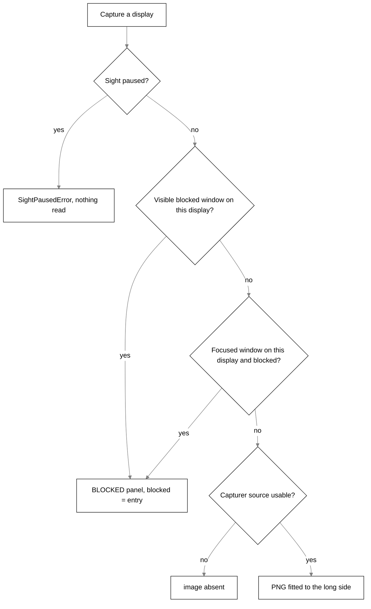
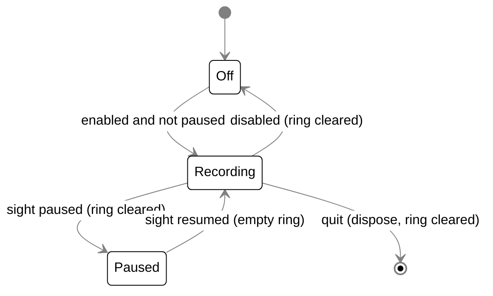

# Sight

## Purpose

The Python brain reaches the screen only through the desktop's body tools (`list_windows`, `read_window_text`, `look_at_window`); this doc covers what the desktop reads and the rules around it.

How Scout sees the desktop: the window list, window text (accessibility tree and OCR), screenshots
of a window, a display or a region, the composite of every display, and the opt-in rolling memory
of the last few minutes. This doc covers how each read is made and what refuses it (blind spots,
the person's exclusions, the sight pause).

The desktop host does the reading. Windows is the only platform.

## Where it lives

| Area                           | Files                                                                                                                                                                                                           |
| ------------------------------ | --------------------------------------------------------------------------------------------------------------------------------------------------------------------------------------------------------------- |
| Platform interface and factory | `bodies/desktop/src/main/platform/index.ts` (`Platform`, `createPlatform`, `WindowInventory`)                                                                                                                   |
| Windows adapter                | `bodies/desktop/src/main/platform/win32.ts` (`Win32Platform`)                                                                                                                                                   |
| Sight pause gate               | `bodies/desktop/src/main/platform/sight-gate.ts` (`gateSight`, `SIGHT_POLICY`, `SightPausedError`); `bodies/desktop/src/main/sight-pause.ts` (`SightPause`)                                                     |
| PowerShell transport           | `bodies/desktop/src/main/platform/powershell.ts` (`runPowerShellScript`), `platform/window-helper.ts` (`runWindowHelper`, `LIST_WINDOWS_SCRIPT`, `PER_MONITOR_AWARE`)                                           |
| Window list                    | `platform/window-list.ts` (`parseWindowList`, `placeOnDisplays`, `countableHandles`, `handleOf`, `screensOf`)                                                                                                   |
| Window text                    | `platform/window-text.ts` (scripts, `parseWindowText`), `platform/text-layer.ts` (`TextLayerProvider`), `platform/read-text.ts` (`readWindowTextWith`)                                                          |
| OCR                            | `platform/ocr.ts` (`recognizeText`, `OCR_SCRIPT`)                                                                                                                                                               |
| Screenshots                    | `platform/capture.ts` (focused window, one window by handle), `platform/window-shot.ts` (`lookAtWindowWith`), `platform/displays.ts` (every display, composite, `displayRefusals`), `platform/region.ts` (crop) |
| Composite drawing              | `platform/composite.ts`, `platform/canvas.ts`, `platform/label.ts`, `platform/downscale.ts` (`fitWithin`)                                                                                                       |
| Selection                      | `platform/selection.ts` (`captureSelectionWith`)                                                                                                                                                                |
| Capture paths and notices      | `bodies/desktop/src/main/context.ts` (`captureAskSnapshot`, `capturePatch`, `answerCapture`, `DESKTOP_CAPABILITIES`), `capture-notice.ts`                                                                       |
| Rolling memory and diff        | `bodies/desktop/src/main/awareness/` (`rolling-memory.ts`, `frame-ring.ts`, `perception-memory.ts`, `pixel-diff.ts`, `native-codec.ts`, `clock.ts`)                                                             |
| Exclusion rules and inventory  | `bodies/desktop/src/main/platform/exclusions.ts`, `inventory.ts`, `text-layer-notes.ts`; `bodies/desktop/src/shared/blind-spots.ts`                                                                             |
| Wire shapes                    | `bodies/ui/src/shapes/context.ts` (`@tagalong/ui/shapes`), `bodies/desktop/src/main/awareness/recall.ts`, `shared/settings.ts`                                                                                  |

## How it works

### The read path

The Python brain does not ask for reads yet. On the desktop, `Platform` is the one door to the screen: every read goes through `gateSight(Platform)`, which applies the sight pause, and the exclusion check runs before any pixel or text is read. The ask hotkey and the bubble's capture path call it from `context.ts`.

The desktop advertises `DESKTOP_CAPABILITIES` (`context.ts`): `selection`, `activeWindow`, `clipboard`, `screenshot`, `displays`, `textLayer`, `recall`. The browser body offers a `tabs` tool instead (see [browser-body.md](browser-body.md)).

### The platform adapter

`Platform` (`platform/index.ts`) is every read the host can make:

| Method                                              | Reads                                                  | Pause class   |
| --------------------------------------------------- | ------------------------------------------------------ | ------------- |
| `getActiveWindow()`                                 | app name, title and bounds of the foreground window    | `sight`       |
| `captureActiveWindowImage(maxLongSide, exclusions)` | PNG of the focused window, or its screen as a fallback | `sight`       |
| `captureDisplays(maxLongSide, exclusions)`          | every display plus a composite                         | `sight`       |
| `listWindows(exclusions, { countText? })`           | every top-level window, no contents                    | `sight`       |
| `captureRegion(params, exclusions)`                 | a native-resolution crop of one display                | `sight`       |
| `readWindowText(params, exclusions)`                | one window's text                                      | `sight`       |
| `lookAtWindow(params, exclusions)`                  | PNG of one listed window                               | `sight`       |
| `captureSelection()`                                | the selection, by the clipboard trick                  | `handed-over` |
| `readClipboard()`                                   | the clipboard text                                     | `handed-over` |

`createPlatform` returns `Win32Platform` on `win32` and throws on any other OS, so an unsupported
platform fails at boot instead of perceiving nothing.

Each capability is a free function that takes its Electron and process dependencies as ports
(`desktopCapturer`, `screen`, `nativeImage`, a script runner). `Win32Platform` only wires the real
ones in. The whole layer is therefore unit-tested in Node with no display; the real PowerShell
transport and the real recogniser are covered by the Windows-only `*.integration.test.ts` files,
and real pixels by the Electron smoke test.

`getActiveWindow` uses the `get-windows` native module, imported lazily. `captureSelection` uses
`@nut-tree-fork/nut-js`, also lazy, to press Ctrl+C: the only keyboard automation in Tagalong.

#### Talking to PowerShell

UI Automation and OCR run in `powershell.exe`, spawned per read. `runPowerShellScript` is the one
place the host starts it; nothing else may spawn PowerShell, and the transport integration test
calls this function rather than its own copy of the arguments.

- Arguments (`powerShellArgs`): `-NoProfile -NonInteractive -ExecutionPolicy Bypass
-EncodedCommand <base64 UTF-16LE>`, spawned with `windowsHide: true`.
- `-EncodedCommand` delivers the script as one argument parsed as one block. Feeding it over stdin
  (`-Command -`) parses line by line and silently drops any multi-line block, with exit 0 and empty
  output. Stdin is used only for data: the OCR picture.
- Scripts are strings in the source, never bundled `.ps1` files, so they cannot go missing from
  the packaged app. The C# P/Invoke definitions are single-quoted one-liners; a test asserts no
  here-string returns and that the encoded length stays well under the ~32,000-character command
  line limit.
- `runWindowHelper` never rejects: a missing interpreter, a policy block, a spawn error or a
  timeout all resolve to the output collected so far (killed at the timeout), capped at
  `MAX_OUTPUT_BYTES` = 1,000,000. The parsers turn anything unusable into a named failure.
- `PER_MONITOR_AWARE` sets per-monitor DPI awareness v2 before UI Automation loads, so rectangles on
  mixed-scale desks come back in physical pixels. Best effort.
- Only integers (window handles, checked by `safeHandle`) are interpolated into scripts. The
  element name for pointing goes in as base64 and is decoded inside PowerShell.

### The window list

`listWindows` (`win32.ts`):

1. Runs `LIST_WINDOWS_SCRIPT` with `WINDOW_HELPER_TIMEOUT_MS` = 8,000. The script walks the
   desktop root's children through UI Automation, keeps windows that are visible or minimized
   (`IsWindowVisible`, `IsIconic`), and prints `handle`, `processName`, `title` (the UIA name),
   `minimized`, `foreground` (`GetForegroundWindow`) and `bounds` as JSON. It reads no window
   contents.
2. `parseWindowList` validates entries, keeps the first `MAX_WINDOWS` = 64, mints ids as
   `w-<handle>`, and sets `state` to `minimized`, `foreground` or `background` (minimized wins
   over foreground). It returns a `failure` instead of an empty list: `no-output` (zero bytes),
   `unparseable` (not JSON) or `no-windows` (none survived; a running desktop always has
   Tagalong's own window).
3. `placeOnDisplays` converts physical pixels to DIPs with `screen.screenToDipRect`, picks the
   display with `getDisplayMatching`, and sets `fullScreen` when the window covers the whole
   display. A minimized window (parked near -32000) or one that cannot be placed gets no
   `displayId`, never a guessed one.
4. Unless `countText: false`, `countableHandles` drops every window `findCaptureBlock` refuses, and
   the text layer counts readable characters for the rest in one PowerShell run
   (`COUNT_PASS_TIMEOUT_MS` = 5,000 total, `WINDOW_COUNT_WALK_MS` = 400 per window). A count that
   hit its budget is a floor. A blocked window is never walked.
5. `buildInventory` (`platform/inventory.ts`) classifies each window into
   `WindowEntry`: `browser` for the Chromium and Firefox families (`chrome`, `msedge`, `brave`,
   `vivaldi`, `opera`, `chromium`, `firefox`), and for a blocked window `blocked` set, `title`
   emptied and `textChars` left out.
6. `screensOf` adds `displays` (`ScreenInfo`: id, bounds, primary) in `screen.getAllDisplays()`
   order, which is the order the composite numbers its slots.

`handleOf` turns an id back into a handle and returns null for anything the host did not mint, so a
model-invented id fails as "no such window" rather than reaching a script.

Callers that need titles only pass `countText: false`: gentle nudges and the listening guard.

### Active window and title handling

- The ask hotkey (`hotkeys.ask`, default `CommandOrControl+Shift+Space`) calls
  `captureAskSnapshot` (`context.ts`): `getActiveWindow`, then the exclusion check, then the
  selection unless that window is blocked. No picture, no displays, no window list ride along with
  an ask; Scout takes those by tool.
- Holding the talk key (Right Ctrl) calls `captureForPanel(['activeWindow'])` through the voice IPC
  (`ipc/voice.ts`, `noteActiveWindow`): the window only, never the selection, because copying
  would press keys while the talk key is held. See [voice.md](voice.md).
- A click on the pet captures nothing (`openPanelNow`).
- `windowInFocus` looks past Tagalong's own windows: when the foreground app is Tagalong's own
  executable (`process.execPath`), it uses the topmost non-minimized window from the list that is
  not Tagalong's, and screenshots it with `lookAtWindow` by id.
- `appOf` builds the snapshot's `app`: for a blocked window only `{ name, blocked }`, never the title, so the title never reaches a prompt or an expert's brief.

### Screenshots and captures

| Capture                     | Function                                      | Size limit                                                       | Exclusion check                                                                    |
| --------------------------- | --------------------------------------------- | ---------------------------------------------------------------- | ---------------------------------------------------------------------------------- |
| Focused window              | `captureActiveWindowImageWith` (`capture.ts`) | `MAX_SCREENSHOT_LONG_SIDE` = 1568 long side                      | caller checks the focused window first; the screen fallback runs `displayRefusals` |
| One listed window           | `lookAtWindowWith` + `captureWindowImageWith` | 1568 (`CROP_LONG_SIDE` in the tool)                              | against the classified list before any pixel; minimized refused (nothing drawn)    |
| Every display + composite   | `captureDisplaysWith` (`displays.ts`)         | 1568 per display and for the composite                           | `displayRefusals` per display, inside the capture                                  |
| Region crop (`look_closer`) | `captureRegionWith` (`region.ts`)             | captured at the display's full pixel size, crop then fit to 1568 | `displayRefusals` for that display; null when refused                              |
| OCR picture                 | `captureWindowImageWith`                      | `OCR_MAX_LONG_SIDE` = 2,500                                      | the text read's own check                                                          |
| Rolling memory frame        | `captureDisplays`                             | `FRAME_LONG_SIDE` = 640                                          | focused window first, then per display                                             |
| Diff after-crop             | `captureRegion`                               | `AFTER_CROP_LONG_SIDE` = 1024                                    | `displayRefusals`                                                                  |

Rules shared by every picture:

- The size bound goes into the `desktopCapturer.getSources` request (`thumbnailSize`), and
  `fitWithin` resizes afterwards as a safety net. `fitWithin` never upscales and clamps each side
  to at least 1 pixel. All images are PNG (`CapturedImage`, `mime: 'image/png'`).
- `captureDisplaysWith` asks the capturer for sources once per look, not once per display.
- The focused-window picker matches a capturer window source by title (Electron's ids and
  `get-windows` share nothing else), then falls back to the screen holding the window, then any
  allowed screen. A window picture by handle matches source ids `window:<handle>:`.
- A display that no source covers keeps `image` absent (and the gutter colour in the composite),
  never a stale or empty image block.
- Region crops convert DIP display bounds to real pixels with `scaleFactor`, clamp the rectangle
  to the display, and refuse one entirely off it.

The composite (`buildComposite`) is the one image Tagalong draws. `layoutComposite` places each
display by its DIP geometry inside a canvas fitted to 1568 on its long side, rounding each edge
from its absolute position so touching monitors leave no seam. Slots are filled by resizing each
thumbnail and blitting BGRA buffers (`canvas.ts`); the backdrop is `GUTTER` rgb(24, 24, 27). Each
slot gets its 1-based ordinal drawn in a 3x5 pixel font (`label.ts`) at scale
`clamp(round(slotHeight / 60), 1, 6)`. A blocked display is a flat `BLOCKED_FILL` rgb(63, 63, 70)
panel reading BLOCKED, both in its own image and in its composite slot. The only Electron call is
the final `nativeImage.createFromBitmap(...).toPNG()`.

#### Capture announcements

`announceCapture` (`index.ts`) sends a `CaptureNotice` (`shared/ipc.ts`: `at`, `screenshot`,
`message`, optional `blocked`, optional `paused`) to every window on `IPC.captureEvent`
(`tagalong:capture-event`) and sets the tray tooltip (`captureTooltip`). `captureNotice` writes
the sentence: paused first ("Sight is paused — Tagalong read nothing…"), then blocked (naming the
exclusion entry, never the window title), then "Tagalong captured the screen." or "Tagalong read
the selection and the active window." The avatar shows its `seeing` state for `SEEING_MS` = 2,500
unless the notice is paused or blocked.

Which reads announce:

| Path                                                                                                                                 | Announced                                                    |
| ------------------------------------------------------------------------------------------------------------------------------------ | ------------------------------------------------------------ |
| Ask hotkey (`openPanelWithContext`)                                                                                                  | yes, `screenshot: false`                                     |
| Bubble capture (`IPC.capture`, `captureForPanel`), talk key                                                                          | yes, `screenshot` when asked for                             |
| `perception.capture` (look_at_screen, get_selection, list_displays, look_at_display)                                                 | yes, `screenshot` only when the targets include `screenshot` |
| `perception.captureWindow` (look_at_window)                                                                                          | yes, `screenshot: true`                                      |
| `perception.readText` read by OCR                                                                                                    | yes, `screenshot: true`                                      |
| `perception.readText` by UI Automation, `perception.listWindows`, `perception.captureRegion`, `perception.recall`, `perception.diff` | no notice                                                    |

### Screen text, selection and OCR

**Window text.** `readWindowTextWith` (`read-text.ts`) answers `perception.readText`:

1. Lists windows (classified) and finds the target by id, or the foreground window when no id is
   given. Missing, blocked and unknown-id cases return an answer with empty `text` and a `notes`
   sentence, never an exception. A blocked window returns `blocked`.
2. Reads through `TextLayerProvider.readWindowText(handle, maxChars)`. `readWindowTextScript`
   finds the window by `NativeWindowHandleProperty` among the root's children (never walking from
   the desktop root), collects descendants of control type Text, Edit and Document, prefers
   `ValuePattern.Value` over `Name`, and stops after `WINDOW_TEXT_WALK_MS` = 2,500 (process
   timeout 3,500).
3. `parseWindowText` sorts nodes by top then left, splits lines, drops consecutive duplicate lines
   (a Document republishing its child), and caps at `maxChars` on a line boundary, setting
   `truncated`. Zero bytes is `failure: 'no-output'`, bad JSON `unparseable`; either becomes a note
   saying the read did not happen, so Scout does not call the window empty.
4. If the text is under `THIN_TEXT_CHARS` = 500 and the window is not minimized, it photographs the
   window at 2,500 and runs OCR. The OCR text wins only if it is longer; the answer is then
   `source: 'ocr'` with a note that it covers only what is on screen and may misread words.
5. Otherwise `textLayerNotes` (`platform/text-layer-notes.ts`) adds caveats: no text
   published, under 500 characters (likely menus only), a browser window (active tab only; other
   tabs need the extension), or truncated.

The per-read budget is `windowTextBudget` (default `DEFAULT_WINDOW_TEXT_CHARS` = 8,000, at most
`MAX_WINDOW_TEXT_CHARS` = 40,000). The tool reads the setting per call; a `maxChars` the model
names wins.

**OCR.** `recognizeText` (`ocr.ts`) runs `OCR_SCRIPT` with `OCR_TIMEOUT_MS` = 10,000. The PNG goes
to PowerShell's stdin as base64, so it is never written to disk. The script uses
`Windows.Media.Ocr.OcrEngine.TryCreateFromUserProfileLanguages()`; with no recogniser it prints
`#no-recogniser` and the result is empty. Nothing is installed and nothing leaves the machine.
Never rejects.

**Selection.** `captureSelectionWith` (`selection.ts`) saves the clipboard, presses Ctrl+C, waits
`COPY_SETTLE_MS` = 150, reads, and restores the original clipboard in a `finally`. An unchanged or
empty clipboard means nothing was selected (`null`). The result is cut to `MAX_SELECTION_CHARS` =
20,000. In a browser, `get_selection` and a hotkey ask prefer the extension's DOM selection
(`browser-route.ts`, `BROWSER_HOST_TIMEOUT_MS` = 500); see
[browser-body.md](browser-body.md).

### Exclusions

Two lists, one matcher. `findCaptureBlock(window, exclusions)` (`exclusions.ts`) returns the
`CaptureBlock` (`{ rule: 'processName' | 'titlePattern', entry }`) that refuses a window, or null.
It checks, in order:

1. `BUILT_IN_EXCLUSIONS`, built from `BLIND_SPOTS` (`bodies/desktop/src/shared/blind-spots.ts`), always:
   - password managers: process names `1Password.exe`, `Bitwarden.exe`, `KeePass.exe`,
     `KeePassXC.exe`, `LastPass.exe`, `Dashlane.exe`, `Keeper Password Manager.exe`,
     `Proton Pass.exe`, `Enpass.exe`, and title globs `*1Password*`, `*Bitwarden*`, `*KeePass*`,
     `*LastPass*`, `*Dashlane*`, `*Keeper Password*`, `*Proton Pass*`, `*Enpass*`;
   - Windows sign-in and security prompts: `CredentialUIBroker.exe`, `LogonUI.exe`, `consent.exe`,
     titles `*Windows Security*`, `Credential Manager*`;
   - private browsing: titles `*InPrivate*`, `*Incognito*`, `*Private Browsing*`;
   - authenticator apps: `Authy Desktop.exe`, `WinAuth.exe`;
   - remote desktop: `mstsc.exe`.
2. Secret files named in the title (`matchSecretFile`): each whitespace-separated word, and the last
   path segment of each, is matched whole against `SECRET_FILES`: `.env`, `.env.*`, `*.pem`,
   `*.key`, `*.pfx`, `*.p12`, `id_rsa`, `id_ecdsa`, `id_ed25519`, `.npmrc`, `.pypirc`, `.netrc`,
   `.git-credentials`, `.htpasswd`, `credentials.json`, `kubeconfig`, `*.tfvars`, `secrets.*`,
   `*.kdbx`. `secretFileRule` is also used for files dropped on Scout.
3. The person's `captureExclusions` (`{ processNames, titlePatterns }`, both empty by default).

Matching: process names are compared whole after `normalizeProcessName` (trim, lower case, strip
`.exe`). Title patterns are anchored, case-insensitive globs with `*` as the only wildcard; every
other character is escaped, so no pattern can carry regex syntax. A window with neither process
name nor title is allowed: refusing everything unnamed would leave Scout blind.

The person's list has no editor in Settings; Settings → Privacy shows the blind spots read-only
under **Scout never looks at**. An entry is added by asking Scout ("never look at Signal"), which
shows a settings card for `captureExclusions.add` (a name ending `.exe` goes to `processNames`,
anything else to `titlePatterns`); applying it is the person's click. See
[settings-and-secrets.md](settings-and-secrets.md).

Enforcement points, all before any pixel or text is read:

| Read                                       | Where the refusal happens                                                                   |
| ------------------------------------------ | ------------------------------------------------------------------------------------------- |
| Ask snapshot                               | `captureAskSnapshot`: blocked window keeps only its app name; Ctrl+C is never pressed there |
| Window list                                | `countableHandles` skips the text count; `buildInventory` drops title and count             |
| Window text, window picture, pointing      | the target is looked up in the classified list; `blocked` returns before the read           |
| Every display, a crop, the screen fallback | `displayRefusals` (below)                                                                   |
| Rolling memory tick and diff               | the focused window is checked first; blocked displays are not stored                        |

`displayRefusals` (`displays.ts`) makes one decision for every whole-display capture. A display is
refused when a non-minimized blocked window with a known `displayId` is on it, or when it holds the
focused window and that window is blocked. The focused check is the floor that still holds when
the window list fails. `refusalFor.any` is used for a capturer source with no usable `display_id`:
if anything at all is blocked, such a screen is refused. Minimized windows never blank a display,
and an unplaced window never blanks a guessed one.

### Pausing sight

`SightPause` (`sight-pause.ts`) holds one boolean in main. It is toggled by the pause hotkey
(`hotkeys.pauseSight`, default `CommandOrControl+Shift+Alt+P`, `DEFAULT_PAUSE_SIGHT_HOTKEY`) and by
the tray's **Pause sight** checkbox, and is never persisted: every launch starts with sight on.

`start()` builds the platform as `gateSight(createPlatform(), () => sightPause.paused)`; nothing in
the app holds the ungated adapter. `SIGHT_POLICY` is a mapped type over `keyof Platform`, so a new
`Platform` method without a pause decision does not compile. Every `sight` method checks
`isPaused()` per call and rejects with `SightPausedError` before reaching the adapter;
`handed-over` methods (`captureSelection`, `readClipboard`) pass through.

A paused read throws rather than returning nothing, so it cannot look like a quiet desktop.
`attempt` in `context.ts` swallows ordinary perception failures but re-throws this one;
`unlessPaused` turns it into `paused: true` on the whole capture; `answerCapture` re-throws
`SightPausedError` when a paused `perception.capture` asked for `screenshot` or `displays`.
`AskCapture.paused` is separate from `blocked`, because the fix differs (a key versus a list).

On a change, `sightPause.onChange` stops rolling memory and clears its ring
(`rolling.pauseChanged`), clears the diff scratch rings (`perceptionMemory.clear()`), sends
`IPC.sightPauseEvent` (`tagalong:sight-pause-event`) to every window (the avatar greys its eye),
rebuilds the tray menu and sets the tooltip to `Tagalong — sight is paused`. A window that opens
later reads the state with `IPC.getSightPaused`. The focus watch and the listening guard
also check the pause before listing. Drops are not refused by a pause: they are handed over.

### Rolling memory

**Rolling memory** (`RollingMemory`, `awareness/rolling-memory.ts`) is off by default
(`rollingMemory: { enabled: false, minutes: 10 }`, minutes 1 to `MAX_ROLLING_MEMORY_MINUTES` = 30;
Settings → Privacy → **Remember the last few minutes of the screen**). `configure` runs at boot and
on every settings save that touches it (`ipc/settings.ts`), with no restart.

While `recording` (enabled and not paused), a 5,000 ms interval (`ROLLING_TICK_MS`) runs `tick`,
which skips if a tick is still running and then:

1. `getActiveWindow`; if `findCaptureBlock` refuses it, the frame is skipped.
2. `captureDisplays(640, exclusions)` and `listWindows(exclusions)` through the gated platform (the
   list includes text counts, never text).
3. Drops the moment if recording stopped or sight was paused while the capture ran.
4. Keeps each display that is not blocked and has an image as a `StoredFrame` (PNG bytes, size,
   and the display's real pixel size), and pushes a `Moment { at, frames, windows, focused }`.

`FrameRing` is a time window, not a count: `push` evicts everything older than `minutes`, and
`setWindow` trims at once. Frames stay PNG (about a tenth of a 640-pixel BGRA bitmap). Nothing in
`awareness/` imports `fs`, and a test asserts it. `onRecordingChange` sends `IPC.recordingEvent`
(`tagalong:recording-event`) so every avatar shows the red recording dot; `IPC.getRecording`
answers on mount.

**PerceptionMemory** (`perception-memory.ts`) answers both methods:

- The body keeps the frames; the brain has no tool that reads them yet, so Scout cannot recall from them. `recall` reads the rolling ring with `nearest(now - secondsAgo, displayId)`. Rolling memory off
  returns `recording: false` and no frames.
- `diff` takes a fresh 640-pixel frame of every display (reused if under `FRESH_MS` = 1,000 old), refusing first if an excluded window has focus. It pushes the
  frame into a per-display scratch ring, finds the earlier frame nearest `sinceSeconds` ago in the
  rolling ring or the scratch ring, decodes both (`nativeCodec`, BGRA) and runs `diffBitmaps`. A
  pixel changes when any channel moves more than `CHANNEL_TOLERANCE` = 24; the ratio is changed
  pixels over the region's area; frames of different sizes count as wholly changed. With images it
  adds the before crop from memory and an after crop re-captured at native resolution through
  `captureRegion` (1024 long side), falling back to the frame's own pixels.
- Scratch rings exist only for displays a diff asked about and are dropped after
  `SCRATCH_IDLE_MS` = 30,000 without one, on a pause, and on quit. So a diff works with rolling
  memory off.

Quitting calls `rolling.dispose()` and `perceptionMemory.clear()`; nothing was written anywhere.

### Dropping things on Scout

A drop is something handed over, not a screen read, and is covered in [bubble.md](bubble.md). What
touches sight: a dropped image becomes `snapshot.dropped.image` scaled to
`MAX_SCREENSHOT_LONG_SIDE` = 1568 and leads the attached images; a file whose name matches
`secretFileRule` is refused with `SECRET_REFUSAL`; text files up to `MAX_TEXT_FILE_BYTES` = 1 MB,
PNG and JPEG up to `MAX_IMAGE_FILE_BYTES` = 10 MB, an unsent item released after `DROP_HOLD_MS` =
10 minutes (`drop.ts`). A dropped image is saved only as the `[screenshot]` marker. Pausing sight does
not block a drop.

## Interfaces

**Desktop IPC** (`bodies/desktop/src/shared/ipc.ts`):

| Channel                                                                                  | Direction      | Use                                                          |
| ---------------------------------------------------------------------------------------- | -------------- | ------------------------------------------------------------ |
| `tagalong:capture` (`IPC.capture`)                                                       | invoke         | bubble capture of named targets; null when refused or paused |
| `tagalong:context:get`, `tagalong:context-event`                                         | invoke / event | the pending ask snapshot                                     |
| `tagalong:capture-event`                                                                 | event          | `CaptureNotice`                                              |
| `tagalong:get-sight-paused`, `tagalong:toggle-sight-pause`, `tagalong:sight-pause-event` | invoke / event | pause state                                                  |
| `tagalong:get-recording`, `tagalong:recording-event`                                     | invoke / event | the recording dot                                            |

**Settings** (`bodies/desktop/src/shared/settings.ts`): `captureExclusions`, `rollingMemory`, `hotkeys.ask`, `hotkeys.pauseSight`.

## Constants and limits

| Constant                     | Value           | File                                    |
| ---------------------------- | --------------- | --------------------------------------- |
| `MAX_SCREENSHOT_LONG_SIDE`   | 1568            | `bodies/desktop/src/main/context.ts`    |
| `FRAME_LONG_SIDE`            | 640             | `awareness/rolling-memory.ts`           |
| `AFTER_CROP_LONG_SIDE`       | 1024            | `awareness/perception-memory.ts`        |
| `OCR_MAX_LONG_SIDE`          | 2,500           | `platform/ocr.ts`                       |
| `OCR_TIMEOUT_MS`             | 10,000          | `platform/ocr.ts`                       |
| `WINDOW_HELPER_TIMEOUT_MS`   | 8,000           | `platform/win32.ts`                     |
| `WINDOW_TEXT_WALK_MS`        | 2,500           | `platform/window-text.ts`               |
| `WINDOW_COUNT_WALK_MS`       | 400             | `platform/window-text.ts`               |
| `COUNT_PASS_TIMEOUT_MS`      | 5,000           | `platform/text-layer.ts`                |
| `MAX_OUTPUT_BYTES`           | 1,000,000       | `platform/window-helper.ts`             |
| `MAX_WINDOWS`                | 64              | `platform/window-list.ts`               |
| `THIN_TEXT_CHARS`            | 500             | `platform/text-layer-notes.ts`          |
| `COPY_SETTLE_MS`             | 150             | `platform/selection.ts`                 |
| `MAX_SELECTION_CHARS`        | 20,000          | `bodies/ui/src/shapes/context.ts`       |
| `MAX_PAGE_TEXT_CHARS`        | 40,000          | `bodies/browser/src/content/limits.ts`  |
| `DEFAULT_WINDOW_TEXT_CHARS`  | 8,000           | `main/brain/body-tools.ts`              |
| `ROLLING_TICK_MS`            | 5,000           | `awareness/rolling-memory.ts`           |
| `MAX_ROLLING_MEMORY_MINUTES` | 30 (default 10) | `bodies/desktop/src/shared/settings.ts` |
| `FRESH_MS`                   | 1,000           | `awareness/perception-memory.ts`        |
| `SCRATCH_IDLE_MS`            | 30,000          | `awareness/perception-memory.ts`        |
| `CHANNEL_TOLERANCE`          | 24              | `awareness/pixel-diff.ts`               |

## Storage

- **RAM only:** rolling memory's `FrameRing`, the diff scratch rings, the pending ask snapshot,
  the sight pause flag. Nothing in `awareness/` imports `fs`.

## Failure handling

- **Perception is best effort.** `attempt` logs and returns null for one failed read, so the rest
  of a capture survives. The sight pause is the exception and is re-thrown.
- **Silent emptiness is named.** An empty window list carries `failure` and becomes a warning in
  `PatchCapture.warnings` ("the window list helper returned nothing at all", and so on); a
  `displays` target with no result warns "the displays could not be captured". Empty lists are
  left out of the prompt rather than rendered as "no windows".
- **PowerShell never throws** to callers; text reads distinguish "the read never happened" from
  "the window published nothing".
- **Model mistakes are answers.** Unknown window or display ids, closed windows, zero-area crops,
  off-screen rectangles and minimized windows come back as tool results with a sentence the pet can
  repeat.
- **No foreground window** (locked session, UAC, full-screen game) falls through to a screen
  capture, still under `displayRefusals`.
- **Rolling memory** logs and skips a tick that fails; a pause during a capture drops the frame.

## Privacy notes

The privacy reference for everything above is [privacy.md](privacy.md): what is captured and when, the blind spots, the window list's contents, OCR, rolling memory, pausing sight and drops. Points that follow from this design:

- The exclusion check always runs before the read, never as a filter afterwards.
- A blocked window's title never leaves the host; only its app name and the rule.
- Window text, pixels and briefs are never written to a log.

## Tests that pin it

| Behaviour                                                                                                                                    | Tests                                                                                                               |
| -------------------------------------------------------------------------------------------------------------------------------------------- | ------------------------------------------------------------------------------------------------------------------- |
| Every `Platform` method has a pause class; gated reads never reach the adapter; pause read per call                                          | `bodies/desktop/src/main/platform/sight-gate.test.ts`                                                               |
| Pause state and listeners                                                                                                                    | `bodies/desktop/src/main/sight-pause.test.ts`                                                                       |
| Ask snapshot takes no picture; blocked window keeps no title and no Ctrl+C; looks past Tagalong's own windows; tool captures obey exclusions | `bodies/desktop/src/main/context.test.ts`                                                                           |
| Notice wording and tooltip                                                                                                                   | `bodies/desktop/src/main/capture-notice.test.ts`                                                                    |
| Display blanking (focused and unfocused, minimized ignored), composite placeholder, one `getSources` call                                    | `platform/displays.test.ts`, `platform/composite.test.ts`, `platform/canvas.test.ts`, `platform/label.test.ts`      |
| Screenshot picking and resizing, never upscaling                                                                                             | `platform/capture.test.ts`, `platform/downscale.test.ts`, `platform/window-shot.test.ts`, `platform/region.test.ts` |
| Window list parsing, failures, DPI placement, counts only for allowed windows                                                                | `platform/window-list.test.ts`, `platform/text-layer.test.ts`                                                       |
| Text read order, caps, thin-text notes, OCR fallback, minimized not photographed                                                             | `platform/window-text.test.ts`, `platform/read-text.test.ts`, `platform/ocr.test.ts`                                |
| `-EncodedCommand`, no here-strings, encoded length, never rejects                                                                            | `platform/powershell.test.ts`, `platform/window-helper.test.ts`                                                     |
| Real PowerShell transport and real recogniser (Windows CI only)                                                                              | `platform/transport.integration.test.ts`, `platform/ocr.integration.test.ts`                                        |
| Selection borrow and restore                                                                                                                 | `platform/selection.test.ts`                                                                                        |
| Exclusion matching, blind spots, secret files                                                                                                | `platform/exclusions.test.ts`, `shared/blind-spots.test.ts`                                                         |
| Inventory classification, text-layer notes                                                                                                   | `platform/inventory.test.ts`, `platform/text-layer-notes.test.ts`                                                   |
| Rolling memory: opt-in, 640 px every 5 s, skip on exclusion, clear on pause/off/quit, no `fs`                                                | `bodies/desktop/src/main/awareness/rolling-memory.test.ts`, `frame-ring.test.ts`                                    |
| Recall and diff, scratch ring expiry, refusal on exclusion                                                                                   | `awareness/perception-memory.test.ts`, `awareness/pixel-diff.test.ts`                                               |
| Real downscaled PNG, sight pause and sight settings end to end                                                                               | `bodies/desktop/e2e/smoke.spec.ts`                                                                                  |
