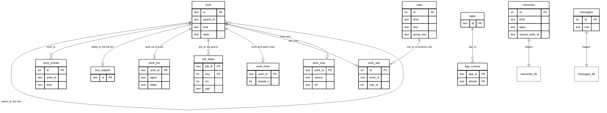
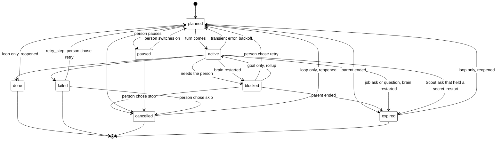

# Storage

## Purpose

How the brain stores data: every table, its columns, who writes and reads it, how long rows live
and whether they are masked.

The brain keeps its data in one SQLite file, `tagalong.db`, under `TAGALONG_HOME` (default
`~/.tagalong`). The file runs in WAL mode. Its schema is the numbered files in
`brain/src/brain/store/migrations/`, applied in order and numbered by `PRAGMA user_version` (see
[Store layer](#store-layer)); a file from a newer brain stops the brain at start, and so does a
Python SQLite without FTS5. Times are UTC ISO text. What the desktop and the browser body keep is
in [desktop.md](desktop.md#what-it-stores) and [browser-body.md](browser-body.md#what-it-stores).

## Store layer

The `brain/src/brain/store/` package opens the file and owns its schema. `Memory` gets its
connection from `store.db.open_db`; nothing else opens the file.

- `store/db.py`: `open_db(path)` makes the folder, runs the FTS5 probe, sets WAL and runs the
  migrations. `migrate(db, migrations, upto)` applies every migration newer than `user_version`,
  `transaction(db)` is a `BEGIN IMMEDIATE` block, and `utc_text(at)` writes the stored time text.
- `store/search.py`: the SQLite-only full-text helpers, `probe_fts5` and `fts_query`, plus
  `search(db, query, kind, limit)` over `memories_fts` and `messages_fts` and its `Hit`.
- `store/conversation.py`: owns `messages` (`save_messages`, `replace_last_message`,
  `load_messages`).
- `store/memory.py`: owns `memories` (`remember`, `forget`, `list_items`, `always_loaded`,
  `add_summary`), with the kinds table, `Item` and `MemoryRefused`.
- `store/connections.py`: owns `apps` (`list_apps`, `add_app`, `set_app_enabled`, `remove_app`,
  the mail switch `set_reads_mail` and `reads_mail_apps`) and `app_cursors` (`cursor`, `set_cursor`,
  `clear_mail`).
- `store/outputs.py`: owns `tool_outputs` (`put_output`, `get_output`, `prune_outputs`).
- `store/rules.py`: owns `rules` (modes, preferences, offers).
- `store/settings.py`: owns `settings` (`get_setting`, `set_setting`), a small key and value table; today it holds the chosen Scout model under `model` and, for updates, `auto_update.{app,expert}.{official,community}` (`"1"` or `"0"`: whether that group updates by itself; absent means Official on, Community off). The last check time and the latest versions seen are a cache file, `<TAGALONG_HOME>/cache/updates.json`, not a table.
- `store/open_items.py`: owns `open_items` (`insert`, `get`, `close`, `list_open`, `list_answered`, `find_open`, `due`, `live_only_open`, `ids_for_job`) and `StoredItem`.
- `store/work.py`: `WorkStore` over `work`, `work_events`, `work_fts` and the detail tables
  `work_job`, `work_timer`, `work_loop`, `work_ask` and `job_steps`: create, the state machine,
  rollup, retry, due queries, search, the resume scan and the sweep. Jobs, asks, timers and loops
  all reach it through their own modules (`job_records.py`, `asks.py`, `timers.py`,
  `loops/store.py`).

Nothing outside this package runs SQL: `tests/test_store_boundary.py` fails if any other module
under `brain/src/brain` calls `.execute`, `.executescript` or `.executemany`.

- `store/migrations/`: `NNNN_name.sql` (or `NNNN_name.py` with a `migrate(db)` function) files,
  `0001_memories` to `0031_open_items`. The numbers have no gaps (the loader refuses a gap or a
  duplicate). Each file runs in one transaction together with its `user_version` bump, so a
  failure leaves the file at the last good version. A file is never edited after it has merged;
  a schema change is a new file.

`Memory` keeps its public methods and each one calls the matching store function with its
connection. It keeps no SQL of its own.

## Tables and relations

Key columns only; the full columns are in each table's section.

The links are by value, not declared foreign keys: SQLite is not told about them, so deleting a
row does not cascade; [the sweep](#cleanup) deletes a whole tree's rows itself. An offer rule's
`group_key` and `work_ask.group_key` name the same kind of action. `memories.source_work_id` and
`source_msg_from`/`source_msg_to` are for the memory work that comes later; nothing sets them yet. A continued job keeps the earlier job's
id in a `continued` event on its goal row.

## Conversation

### messages

The saved chat, so a restart picks the conversation back up.

| Column         | Type                | Meaning                                                                                                                                       |
| -------------- | ------------------- | --------------------------------------------------------------------------------------------------------------------------------------------- |
| `id`           | INTEGER PRIMARY KEY | Order of the message                                                                                                                          |
| `at`           | TEXT                | When it was saved                                                                                                                             |
| `role`         | TEXT                | `user` or `assistant`                                                                                                                         |
| `content_json` | TEXT                | The message content as JSON, rebuilt into model history at start                                                                              |
| `text`         | TEXT                | Searchable text of the message; images and documents appear as `[screenshot]` and `[document]`                                                |
| `body`         | TEXT                | Kind of body the turn was shown on (`desktop`, `browser` or `whatsapp`); old rows and turns with no body read `desktop`. Nothing reads it yet |

- Written by: `store/conversation.py` `save_messages`, `replace_last_message` (through `Memory`,
  called from `sessions.py`).
- Read by: `store/conversation.py` `load_messages` (skips `cut` rows; via `mind/resume.py` `rebuild_history`, which also says whether it added a cancelled tool_result) and `search`.
- Retention: kept forever.
- Upgrade: migration `0026_message_body` adds `body`; every old row reads `desktop`.
- Upgrade: migration `0027_message_cut` adds `cut` (0 or 1): a request cancelled before any
  reply is kept in the chat but `load_messages` skips it unless asked, so it is not resumed.
- Masked: yes, through the `save` guard (`mask_message`) before saving. Image and document blocks
  are replaced by text markers and never stored.

`messages_fts` is an FTS5 index over `messages.text` (external content, tokenizer
`porter unicode61`), kept in step by insert, update and delete triggers. `store/search.py` `search` ranks
it with bm25; free text is turned into quoted words joined by OR (`fts_query`).

## Memory

### memories

What Scout remembers across restarts, by kind.

| Column            | Type                | Meaning                                                           |
| ----------------- | ------------------- | ----------------------------------------------------------------- |
| `id`              | INTEGER PRIMARY KEY | The id Scout uses to `forget` or replace an item                  |
| `kind`            | TEXT                | `instruction`, `about_you`, `project` or `summary`                |
| `text`            | TEXT                | The item, masked                                                  |
| `created_at`      | TEXT                | When it was saved                                                 |
| `updated_at`      | TEXT                | When it last changed                                              |
| `layer`           | TEXT                | `core` (default) or `episodic`; see [memory.md](memory.md#layers) |
| `period`          | TEXT                | `day` for an episodic entry; null for core                        |
| `span_start`      | TEXT                | Start of the time an episodic entry covers; null for core         |
| `span_end`        | TEXT                | End of that time                                                  |
| `source_msg_from` | INTEGER             | First chat message the entry was made from; not set yet           |
| `source_msg_to`   | INTEGER             | Last chat message it was made from; not set yet                   |
| `source_work_id`  | TEXT                | The work row it describes; not set yet                            |

- Written by: `store/memory.py` `remember`, `add_summary`, `forget` (called from `tools.py` and the
  compaction in `sessions.py`).
- Read by: `store/memory.py` `always_loaded` (the prompt), `list_items`; `store/search.py` `search`.
- Retention: kept until forgotten or replaced. Caps per kind: `instruction` 50 items of 300
  characters, `about_you` 50 of 300, `project` 200 of 500; `summary` is
  uncapped and written by code.
- Masked: yes. `Memory` masks the text on its way in (`remember`, `add_summary`) with the
  session's `save` guard, so a pasted key is stored as `[secret]`.
- Upgrade: migration `0025_memory_layers` adds the layer columns. Every old row is `core`
  except `summary` rows, which become `episodic`, period `day`, spanning their `created_at`.
  `kind` is untouched, so Home's list is the same.

`memories_fts` is an FTS5 index over `memories.text`, built and searched the same way as
`messages_fts`; it backs the `recall` tool.

## Work

The work model. Every job, step, ask, timer, watch and loop is one row in `work`, in a tree,
with one state, an append-only `work_events` log and a small detail table for what `work` has no
column for. `store/work.py` (`WorkStore`) is the only code that touches these tables.

### work

One row per piece of work, in a tree: a goal has steps, and a step can have asks and timers.

| Column                                 | Type             | Meaning                                                                            |
| -------------------------------------- | ---------------- | ---------------------------------------------------------------------------------- |
| `id`                                   | TEXT PRIMARY KEY | Short id (8 hex characters)                                                        |
| `parent_id`                            | TEXT             | The work this belongs to; null for a root                                          |
| `root_id`                              | TEXT             | Top of the tree; its own id for a root                                             |
| `seq`                                  | INTEGER          | Order among siblings                                                               |
| `kind`                                 | TEXT             | `goal`, `expert_call`, `tool_call`, `ask`, `question`, `timer`, `loop`, `watch`    |
| `state`                                | TEXT             | `planned`, `active`, `blocked`, `paused`, `done`, `failed`, `cancelled`, `expired` |
| `title`                                | TEXT             | Scout's words, masked, capped at 200                                               |
| `input`                                | TEXT (JSON)      | What the step was given, so a retry knows what to run                              |
| `summary`                              | TEXT             | Short text of what was done, found or left; what Scout reads                       |
| `detail_id`                            | TEXT             | Points to `tool_outputs`: the full text                                            |
| `progress`                             | TEXT             | One live line while `active`; cleared when the row ends                            |
| `checkpoint`                           | TEXT (JSON)      | Enough to carry on (an expert call keeps its session id)                           |
| `attempt`, `max_attempts`              | INTEGER          | Retries so far, and the limit (default 3)                                          |
| `safe_to_retry`                        | INTEGER          | 0 or 1                                                                             |
| `error_kind`, `last_error`             | TEXT             | `transient` or `permanent`; the masked error, capped at 300                        |
| `due_at`                               | TEXT             | Next time something should happen: timer, retry backoff, cadence                   |
| `created_at`, `updated_at`, `ended_at` | TEXT             | UTC ISO text                                                                       |
| `end_reason`                           | TEXT             | Why it ended, in a short phrase                                                    |
| `reported_at`                          | TEXT             | Null means Scout has not told the person                                           |
| `source_message_id`                    | INTEGER          | The chat message that started it, if any                                           |

Indexes: `(state, due_at)`, `(root_id, seq)`, `(parent_id, seq)`, `(kind, state)`, and
`(reported_at)` for ended rows only.

Terminal states are `done`, `failed`, `cancelled` and `expired`; an ended row always has
`ended_at` and `end_reason`. `WorkStore.transition` allows only these moves, runs in one
transaction with its `state` event, and raises `TransitionRefused` for a move from a state that
has already changed (`expect=`), so two writers on one row never overwrite each other.

- Goal only: `blocked` to `active`; `done` and `failed` only through `close_goal`, which also
  accepts a goal still `planned`.
- Skip: a `failed` step can move to `cancelled`; a cancelled step no longer blocks its goal.
- Loop only: an ended loop goes back to `planned` (with a `reopened` event).
- Rollup: a child that goes `blocked` or `failed` blocks its active goal; when no child is
  `blocked` or `failed` any more and one moves to `planned`, `active` or `cancelled`, the goal is
  `active` again. A goal is never failed automatically.
- Parent end: when a row ends, its open children end too: asks and questions `expired` ("parent
  ended: ..."), everything else `cancelled` ("goal closed"). Rows ended this way are marked
  reported, since Scout already knows the parent ended.
- Retry: `fail(id, "transient", reason)` on a `safe_to_retry` row with tries left goes back to
  `planned` with `attempt + 1` and `due_at` = now + backoff (30 s, 2 min, 10 min; the last value
  repeats). Otherwise the row is `failed` ("gave up after N tries: ..." or "not retryable: ...")
  with `reported_at` null. `retry_step` is the person's retry choice.
  The retry columns are used by Scout's goal `tool_call` rows (`safe_to_retry` comes from the
  tool's effect and name, `error_kind` from `retry.classify`) and by `expert_call` restarts;
  `Timers` reruns the due ones, and a step that gives up emits `work_failed`
  (see [brain.md](brain.md#retries-and-give-ups)).
- Resume scan at start (`resume_scan`, run by `Jobs.startup`): open asks and questions expire
  ("brain restarted"); an active expert call with a saved session whose expert can reload it
  becomes `blocked` (Scout is told and offers to carry on), any other `failed`; an active tool
  call reruns when safe, else fails; timers, watches, loops, goals and planned, paused or blocked
  rows are left alone. Running it twice changes nothing.

### work_events

Append-only log of what happened to a row: `created`, `state` (`{from, to, reason}`),
`attempt_failed`, `retried`, `reopened`, `resumed`, `failed on restart`.

| Column    | Type                | Meaning               |
| --------- | ------------------- | --------------------- |
| `id`      | INTEGER PRIMARY KEY | Order of events       |
| `work_id` | TEXT                | The row it belongs to |
| `at`      | TEXT                | UTC ISO text          |
| `kind`    | TEXT                | What happened         |
| `data`    | TEXT (JSON)         | Details, or null      |

Indexed on `(work_id, id)`.

### work_fts

FTS5 over `work.title` and `work.summary`, external content keyed by `work`'s rowid, with the
same tokenizer (`porter unicode61`) and trigger style as `messages_fts`. `WorkStore.search` reads
it, so Scout can find "that invoice thing". Any rebuild of `work` must copy `rowid` explicitly and
then run `INSERT INTO work_fts(work_fts) VALUES('rebuild')`, because the index is keyed by rowid.

## Jobs as work rows

One hand-off of a task to an expert, seen from Scout's side, is a goal row in `work` with the
job's id. Each expert's share of it (part `p1`, then `p2` for a follow-up) is an `expert_call`
row under that goal, named `<job>.<part>`. `job_records.py` (`JobRecords`) turns the `Job` and
`JobPart` shapes the rest of the brain reads into `WorkStore` moves and back; it has no SQL of its
own. Home and Scout's tools see the same words as before (`running`, `done`, `error`, `stopped`):
`home_state` maps `active`, `done`, `failed` and everything else.

### work_job

What a job row needs that `work` has no column for. One row per goal and per expert call.

| Column    | Type             | Meaning                                   |
| --------- | ---------------- | ----------------------------------------- |
| `work_id` | TEXT PRIMARY KEY | The goal or expert_call row it describes  |
| `agent`   | TEXT             | Which expert ran it (expert calls)        |
| `folder`  | TEXT             | The folder the expert works in            |
| `mode`    | TEXT             | The expert's mode the person chose (goal) |
| `task`    | TEXT             | What was asked first (goal)               |

- Written by: `job_records.py` through `WorkStore.set_job_detail`.
- Read by: `job_records.py` through `WorkStore.job_details`.
- Retention: kept with its work row. Not masked: `task` and `folder` never were.

### The goal row (a job)

| `work` column | Holds                                                                                                                                 |
| ------------- | ------------------------------------------------------------------------------------------------------------------------------------- |
| `state`       | `active` while Scout works on it; `blocked` when a part failed; Scout's close ends it                                                 |
| `title`       | Scout's short title, masked, capped at 200                                                                                            |
| `input`       | `{"watch": [{text, done}, ...]}`: what Scout expects from the job                                                                     |
| `summary`     | Scout's write-up of the result, masked; over 2,000 characters the rest is in `tool_outputs` through `detail_id` (capped at 1,000,000) |
| `ended_at`    | When Scout closed it (`close_job`, outcome `done` or `failed`)                                                                        |

A continued job (a hand-off that resumes an earlier job's session) records the earlier job's id
in a `continued` event. The job's own state is derived, as before: running while any part is
active, failed once the goal failed, otherwise the state of the part that ended last.

### The expert_call row (a part)

| `work` column | Holds                                                                                                                                                             |
| ------------- | ----------------------------------------------------------------------------------------------------------------------------------------------------------------- |
| `state`       | `active`, then `done`, `failed` or `cancelled` (a stopped part)                                                                                                   |
| `input`       | `{"task": ...}`: what this part was asked                                                                                                                         |
| `progress`    | A running tail of what the expert last said, capped at 2,000; cleared when it ends                                                                                |
| `checkpoint`  | `{"session_id": ...}`: the expert's own session id, used to resume it                                                                                             |
| `summary`     | The expert's final report, masked; the first 2,000 characters, with the whole text in `tool_outputs` (pointed at by `detail_id`) when longer, capped at 1,000,000 |
| `end_reason`  | Why it ended, such as `end_turn` or `brain restarted`                                                                                                             |
| `reported_at` | Null until Scout has been told it ended                                                                                                                           |

- Written by: `jobs.py` through `JobRecords` (`add_job`, `add_part`, `update_part`, `set_title`,
  `set_result`, `set_watch`, `close_job`, `mark_reported`).
- Read by: `jobs.py`, `tools.py` (`list_jobs`, Home only), `timers.py`, `job_activity.py` through
  `JobRecords` (`get_job`, `parts_of`, `last_part_for`, `unreported_jobs`, `running_jobs`).
- Retention: swept with the whole job `TAGALONG_WORK_KEEP_DAYS` after it ended (see
  [Cleanup](#cleanup)). Parts still active when the brain starts are settled by the resume scan:
  `blocked` with the reason `brain restarted` when they saved a session the expert can reload,
  else `failed` with that reason; either way their job's step log ends with a "stopped" line.
- Masked: title, watch, progress, report and result yes (the work store masks them on the way in);
  `task` and `folder` no.
- A report over 2,000 characters lives in `tool_outputs`; `prune_outputs` keeps any output a work
  row points at, and the sweep deletes it with the row.
- Upgrade: migration `0019_jobs_to_work` moves every `jobs` and `job_parts` row into this shape
  (old part states `running`, `done`, `stopped`, `error` become `active`, `done`, `cancelled`,
  `failed`), then drops both tables. Only a job Scout closed (`closed_at` set) becomes an ended
  goal, with `ended_at` and `reported_at` set to that `closed_at`; a job never closed stays `active`
  (`blocked` if its last part failed) so it can still take a follow-up part. Ended parts have no
  progress, as at runtime. A part with no job is dropped and counted in the log.

## Steps, timers and loops

### job_steps

A job's steps as a log (the old `job_activity` table, renamed by migration `0020_job_steps`): commands, output, messages and tool calls, masked and capped.

| Column   | Type    | Meaning                                                                                |
| -------- | ------- | -------------------------------------------------------------------------------------- |
| `job_id` | TEXT    | The job; part of the primary key `(job_id, seq)`                                       |
| `rev`    | INTEGER | Rises on every write; the cursor readers page by. Index `job_steps_rev(job_id, rev)`   |
| `seq`    | INTEGER | Display order, fixed at insert; 0 is the `[older steps dropped]` marker                |
| `at`     | TEXT    | When the step was written                                                              |
| `kind`   | TEXT    | `command`, `output`, `edit`, `read`, `search`, `other`, `say`, `plan`, `end` or `tool` |
| `step`   | TEXT    | The expert's step id, linking an output to its command                                 |
| `status` | TEXT    | The step's status as the expert reports it                                             |
| `exit`   | INTEGER | A command's exit code                                                                  |
| `text`   | TEXT    | The step text                                                                          |
| `part`   | TEXT    | Which part wrote it; default `p1`                                                      |
| `source` | TEXT    | Label of the app or tool behind a Scout step                                           |

- Written by: `job_activity.py` `JobActivity` through `WorkStore.save_activity`, `trim_activity`.
- Read by: `WorkStore.activity_after`, `job_activity.py` `activity_summary`, the Home-only
  `job_activity` tool (the tool keeps its name).
- Retention: per job, at most `TAGALONG_JOB_STEPS_MAX_ENTRIES` (2,000) entries and
  `TAGALONG_JOB_STEPS_MAX_BYTES` (1,000,000) bytes of text; the oldest are dropped
  behind the marker. They leave with the job's tree when [the sweep](#cleanup) removes it.
- Masked: yes, the text is masked and then capped.

### work_timer

The repeat of a `timer` or `watch` row. The timer itself is a row in `work`: `title` is the note
(a note longer than 200 characters is kept whole in `input.note`), `due_at` the next fire time
(UTC ISO text), `parent_id` the job it checks back on, and `state` where it is: `planned` waiting,
`active` fired but Scout has not heard it yet, `done` a one-off that fired, `cancelled`, or
`paused` (a watch that is switched off).

| Column     | Type             | Meaning                                                  |
| ---------- | ---------------- | -------------------------------------------------------- |
| `work_id`  | TEXT PRIMARY KEY | The `timer` or `watch` row                               |
| `repeat_s` | INTEGER          | Seconds between fires; null for a one-off (at least 300) |

- Written by: `tools.py` (`set_timer`, `cancel_timer`, `watch`) through `store/work.py`
  (`create`, `set_repeat`, `transition`); `timers.py` `Timers` moves due rows.
- Read by: `timers.py` (`due`, `repeat_of`), `list_timers`, `watch list`.
- Retention: a cancelled or fired row stays until the sweep takes it, like any ended work. Closing a job cancels its
  timers (a restart does not). A repeat keeps its row `planned` and moves
  `due_at` forward from now, so a brain that was off fires an overdue repeat once.
- Migrated: the old `timers` table became `timer` rows (`t<id>`), and each `tracking` memory
  became a `paused` `watch` row (`w<id>`) with its cadence in `repeat_s` when it parsed (daily,
  every N hours, and so on) or in `input.cadence` when it did not. Scout mentions the paused
  watches once, as a `watches_paused` event, and the person switches them on.
- Masked: yes, the title and a long note, like all work text.

### work_loop

Things left open that Scout found in mail: a reply owed, a reply awaited. The loop itself is a
`loop` row in `work`, with the loop id as its id. `title` is the short title, `due_at` the real
deadline, `created_at` when it was found and `updated_at` when it last changed (the stale clock).
A loop's status is not stored; Home and the triggers get it from the row:

| Work state  | Loop status | Notes                                          |
| ----------- | ----------- | ---------------------------------------------- |
| `planned`   | `held`      | `snoozed` while `snoozed_until` is set (Later) |
| `done`      | `done`      |                                                |
| `cancelled` | `dropped`   |                                                |
| `expired`   | `stale`     | `end_reason` "went quiet"                      |

There is no `surfaced` status: when a loop comes up it gets a `surfaced` event.

| Column          | Type             | Meaning                                                             |
| --------------- | ---------------- | ------------------------------------------------------------------- |
| `work_id`       | TEXT PRIMARY KEY | The `loop` row                                                      |
| `source`        | TEXT             | Which source it came from, such as the Gmail app id                 |
| `ref`           | TEXT             | The source's own id (a thread); `UNIQUE(source, ref)`               |
| `asks`          | TEXT             | What is being asked                                                 |
| `direction`     | TEXT             | `i_owe` or `they_owe`                                               |
| `people`        | TEXT             | JSON list of names                                                  |
| `quiet_after`   | TEXT             | When silence starts to matter                                       |
| `anchors`       | TEXT             | JSON list of things that make it relevant (a project, a person)     |
| `snoozed_until` | TEXT             | When a snoozed loop (Later) comes back; `due_at` stays the deadline |

- Events on the loop row: `history` (`note`, and `mail_at` when the mail itself arrived, so a
  later reply can be compared with it) and `surfaced` (`anchor`, `day`: when a loop last came up
  for an anchor or its due time, so Scout does not repeat itself; the latest per anchor counts).
- Written by: `loops/store.py` `LoopStore` (`save`, `set_status`, `snooze`, `add_history`,
  `mark_surfaced`) through `store/work.py`, driven by `loops/service.py` and Scout's loop tools.
  New mail on a `done` or `stale` loop reopens it (the loop-only move back to `planned`); a
  dropped one stays dropped.
- Read by: `loops/store.py`, `loops/service.py`, `loops/triggers/`.
- Retention: kept until `forget` (one loop) or `wipe` (every loop, its events and the cursors).
  A done, dropped or stale loop is swept like other ended work; a held or snoozed one never is.
- Masked: `title`, `asks`, `people`, `anchors` and history notes yes (the mask is wired in
  `main.py`).

### The daily digest

One `watch` row, id `loop-digest`, with `input.trigger = "return"` and `repeat_s` 86400. `Timers`
skips a row with that trigger, and `watch list` hides it. `loops/service.py` runs it when a
`back` or `body_online` event arrives and `due_at` has passed: it moves `due_at` to the next local
midnight (even when nothing was held) and, if loops were held that day, emits one `digest` event.
`wipe` leaves it.

### app_cursors

How far each app's mail has been read.

| Column       | Type | Meaning                                                                          |
| ------------ | ---- | -------------------------------------------------------------------------------- |
| `app_id`     | TEXT | The app; part of the primary key `(app_id, stream)`                              |
| `stream`     | TEXT | `mail` (inbox cursor), `sent` (sent-mail cursor) or `backfill` (first read done) |
| `value`      | TEXT | A timestamp, or `done`                                                           |
| `updated_at` | TEXT | When it last moved                                                               |

- Written by: `loops/store.py` through `store/connections.py` `set_cursor`; read by
  `loops/service.py`.
- Retention: everything goes on `wipe`.
- Masked: no.

## Rules and approvals

### rules

One table for what the person has decided about asks: a tool's mode, a standing sentence, and
an offered sentence. `kind` tells them apart. Code reaches it only through `store/rules.py`.

| Column       | Type                | Meaning                                                                                               |
| ------------ | ------------------- | ----------------------------------------------------------------------------------------------------- |
| `id`         | INTEGER PRIMARY KEY | Rule id (a preference keeps its old id, which `work_ask.rule_id` names)                               |
| `kind`       | TEXT                | `mode` (a tool's off/ask/auto), `sentence` (a preference), `offer` (an offer Scout made)              |
| `tool`       | TEXT                | `mode`: the tool. `sentence`: optional scope, the tool                                                |
| `source`     | TEXT                | Optional scope: where the ask comes from                                                              |
| `group_key`  | TEXT                | Optional scope: the kind of action                                                                    |
| `effect`     | TEXT                | `mode`: `off`, `ask` or `auto`. `offer`: the outcome word (`yes`, `keep_asking`, `none`, `no_answer`) |
| `sentence`   | TEXT                | `sentence`: what Scout checks an ask against                                                          |
| `state`      | TEXT                | `active`, `offered`, `declined` or `removed`                                                          |
| `decided_at` | TEXT                | When an offer was answered                                                                            |
| `expires_at` | TEXT                | Optional; nothing sets it yet                                                                         |
| `builtin`    | INTEGER             | 0 or 1: the default sentence seeded by the first migration                                            |
| `use_count`  | INTEGER             | How many asks a sentence has covered                                                                  |
| `last_used`  | TEXT                | When it last covered one                                                                              |
| `created_at` | TEXT                | When it was added (an offer: when it was made)                                                        |

Indexes: `(kind, tool)` and `(kind, group_key)`.

- A tool has no `mode` row until the person sets one; then its default applies. Setting it
  again updates the one row.
- A preference is `kind=sentence`, `state=active`. Removing it sets `state=removed`; it is no
  longer listed or used, and the row stays so the approval log never points at nothing.
- An offer's state follows its outcome: `yes` is `active`, `keep_asking` and `none` are
  `declined`, `no_answer` is `offered`. The outcome word stays in `effect` so the
  keep-asking window in `offers.py` reads it.
- Migration `0022_rules` moved the old `permissions`, `preferences` and `offers` tables into
  it (preferences first, keeping their ids) and dropped them.
- Written by: `store/rules.py` (`set_permission_mode`, `add_preference`, `edit_preference`,
  `remove_preference`, `use_preference`, `add_offer`) for the `set_permission` tool, Home,
  `approvals.py` and `offers.py`.
- Read by: `store/rules.py` (`permission_modes`, `list_preferences`, `has_user_preferences`,
  `has_preference_for`, `offers_for`) for `toolbox.py`, `side_check.py`, `offers.py`, Home and
  the prompt.
- Retention: kept until changed; a removed preference is kept as a `removed` row.
- Masked: no.

### work_ask

An `ask` row in `work` is a permission ask, from the moment it is opened until it ends. Its
`title` is the one-line summary, its `parent_id` the job the ask belongs to (a root row when it
has none, or the job is gone). The row id is the ask id the bodies see, so an open ask and its
log entry are one row. Home's log is the ask rows that were decided.

| Work state  | Meaning                                                            |
| ----------- | ------------------------------------------------------------------ |
| `active`    | Open: a body can answer it                                         |
| `done`      | Approved                                                           |
| `cancelled` | Refused (a refused ask does not block its job)                     |
| `expired`   | Ended unanswered: its job ended, a restart, or its deadline passed |

`end_reason` is the outcome word (`approved`, `refused`, `expired`) once decided; `timed_out` and
`no_one` appear only on older rows (a Scout ask now waits instead of timing out or finding nobody).
A Scout ask (no job above it) has no `ask` row while it waits: its open item holds the saved call
(masked by the log's guards) and the deadline from `ask_wait_hours`. `Approvals.record` writes the
row when the ask ends; an `expired` ask's `decided` event keeps a plain reason (`no answer` at the deadline).
An ask that ended before it was decided (answered, timed out) first ends with its own reason
and is re-ended with the outcome when `Approvals.record` decides it.

| Column          | Type                | Meaning                                                                      |
| --------------- | ------------------- | ---------------------------------------------------------------------------- |
| `id`            | INTEGER PRIMARY KEY | Log id: Home's approval id and paging cursor                                 |
| `work_id`       | TEXT UNIQUE         | The `ask` row                                                                |
| `source`        | TEXT                | `scout_tool`, `claude_code` or `app`                                         |
| `tool`          | TEXT                | The tool asked about                                                         |
| `summary`       | TEXT                | One-line description of the action                                           |
| `input`         | TEXT                | The tool input as JSON                                                       |
| `group_key`     | TEXT                | The kind of action, to group like asks                                       |
| `decided_by`    | TEXT                | `person`, `scout`, `rule` or `none`; NULL while undecided                    |
| `rule_id`       | INTEGER             | The `sentence` rule Scout approved under                                     |
| `rule_sentence` | TEXT                | That rule's sentence as it was then, so editing it later rewrites no history |

- Events on the row: `decided` (`outcome`, `decided_by`); an answered ask also keeps the chosen
  `option` in its end event.
- Written by: `asks.py` `Asks` (opens and ends the row), `approvals.py` `Approvals.record`
  (`store/work.py` `add_ask`, `decide_ask`).
- Read by: `store/work.py` `list_asks`, `ask_counts`, `person_asks_since`; `offers.py`,
  `side_check.py`; Home.
- Retention: the same as other work rows (swept after `TAGALONG_WORK_KEEP_DAYS`, so the log
  shows the last 30 days by default); the log shows decided asks only.
- Masked: `summary` and `input` yes.
- Migration `0024_asks` turned every `approvals` row into an ended ask row (`a<id>`, under the
  job when that job exists) and kept the ids. A `preference_id` is kept only when it still names
  a `sentence` rule: since rules share one table, an old id could name a mode or offer rule.
  Home's ask `job_id` is the row's `parent_id`, so it is null when the job was gone at migration
  or had closed before `record` ran.

An expert's question to Scout is a `question` row under its job: `active` while waiting,
`done` when answered or passed, `expired` when Scout never answered or the job ended. Its
`title` is the question and its `summary` the answer.

## Open items

### open_items

Everything waiting on the person (a card, choice, install, sign-in, expert question, offer or
setup step), one row each with one lifecycle. Scout's asks (kind `ask`) write it with the saved
call; choices (`choice`, live-only), offers (`offer`, the offer as its saved call) and setup events
(`setup`, the event as its saved call) write it too; installs move onto it in a later slice. The
choice, offer and setup-event waits that lived only in memory are gone.

| Column            | Type             | Meaning                                                                                        |
| ----------------- | ---------------- | ---------------------------------------------------------------------------------------------- |
| `id`              | TEXT PRIMARY KEY | A random hex id                                                                                |
| `kind`            | TEXT             | `ask`, `choice`, `install`, `signin`, `expert_ask`, `offer` or `setup` (CHECK)                 |
| `origin_body`     | TEXT             | The body the item came from, so a reply goes back to it                                        |
| `state`           | TEXT             | `open`, `answered`, `done` or `expired` (CHECK); default `open`                                |
| `saved_call_json` | TEXT             | The call to run on a later yes, as JSON, or null. Callers mask it before saving                |
| `live_only`       | INTEGER          | 1 when the item is tied to a running process (an expert's permission ask) and cannot run later |
| `job_id`          | TEXT             | The job it belongs to, or null; `Job.open_items` lists a job's ids                             |
| `created_at`      | TEXT             | UTC time text                                                                                  |
| `deadline_at`     | TEXT             | UTC time text: `created_at` plus `DEADLINE_S` (one day) unless the item asked for another      |
| `closed_at`       | TEXT             | When it left `open`, or null                                                                   |
| `closed_by`       | TEXT             | Who closed it: the answering body, or `brain`                                                  |
| `answer`          | TEXT             | The person's answer, set when it is `answered` and kept when the item is later `done`          |
| `reason`          | TEXT             | Why it closed: `answered`, `deadline`, `process_ended`, or the finish reason for `done`        |

- Moves: `open` to `answered`, `done` or `expired`; `answered` to `done`. A person's answer counts
  while the item is `open`, even if the turn that raised it is gone; after the deadline it is
  refused (`expired`). `live_only` items are expired at start and when their process ends (for `expert_ask`, only that job's: `expire_live_only(job_id=...)`).
- Written by: `open_items.py` `OpenItems` through `store/open_items.py`, for `ask` by the ask runner, `choice` by
  `choices.py`, `offer` by `offers.py` and `setup` by `setup/events.py`. The `rules` table keeps the
  offer's outcome word (the keep-asking window); the open item is the pending offer.
- Read by: `OpenItems.list_open`, `list_answered`, `find_open` (the open item with a given saved call), `get`.
- Retention: closed rows stay until a later slice sweeps them.
- Index: `open_items_open(state, deadline_at)` for the deadline scan.

## Apps

### apps

Connected apps (MCP servers).

| Column       | Type             | Meaning                                                                                             |
| ------------ | ---------------- | --------------------------------------------------------------------------------------------------- |
| `id`         | TEXT PRIMARY KEY | App id                                                                                              |
| `name`       | TEXT             | Display name                                                                                        |
| `transport`  | TEXT             | `stdio` or `http` (CHECK)                                                                           |
| `config`     | TEXT             | Transport details as JSON; secrets are never in it                                                  |
| `auth`       | TEXT             | `none`, `token` or `oauth` (CHECK)                                                                  |
| `enabled`    | INTEGER          | 0 or 1; default 1                                                                                   |
| `reads_mail` | INTEGER          | 0 or 1; default 0. The "Read my mail for loops" switch for this app, kept across a restart          |
| `trust`      | TEXT             | `official` or `community` (CHECK); default `community`. Kept from the install so Home still tags it |
| `version`    | TEXT             | The package version pinned in the command, or empty (a hand-added or remote app); default empty     |

- Written by: `apps.py` `Apps` through `store/connections.py` `add_app`, `set_app_enabled`, `remove_app`, `set_app_package` (an update).
- Read by: `store/connections.py` `list_apps`.
- Retention: until the app is removed.
- Upgrade: migration `0028_app_trust` adds `trust` with no backfill: an older row holds only the
  registry title and a URL or command, which prove nothing, so apps connected before it read
  Community until they are added again. A registry install saves it from the entry's id; an app added by hand
  is `community`. Migration `0030_app_updates` adds `version`, backfilled from the package argument
  in the stored command; an app with none (added by hand, or remote) shows no update until it is
  added again.
- Masked: secrets are moved out of the row into separate files before it is saved
  (`apps.py` `split_secrets`); `${VAR}` references stay as written. See
  [connected-apps.md](connected-apps.md).

## Tool outputs

### tool_outputs

A long tool result stored whole, so Scout can read the rest of a capped preview with `read_output`.

| Column  | Type             | Meaning                                |
| ------- | ---------------- | -------------------------------------- |
| `id`    | TEXT PRIMARY KEY | Short id Scout passes to `read_output` |
| `tool`  | TEXT             | The tool that produced it              |
| `chars` | INTEGER          | Length of the stored text              |
| `text`  | TEXT             | The full masked text                   |
| `at`    | TEXT             | When it was stored                     |

- Written by: `outputs.py` `OutputStore.put` through `store/outputs.py` `put_output` (via `Memory`).
- Read by: `store/outputs.py` `get_output` (via `Memory`), paged by `OutputStore.page`.
- Retention: at brain start `prune_outputs` keeps the newest `TAGALONG_OUTPUTS_KEEP` (200) rows
  that no work row names and deletes older ones. A row a work row points at (`detail_id`) is never
  counted or cut; it goes with its tree in the sweep.
- Masked: yes, before storing.

## Cleanup

At brain start, `Session` runs two things, in this order:

1. `WorkStore.sweep(TAGALONG_WORK_KEEP_DAYS)` (default 30). A tree is removed when its root
   is `done`, `failed`, `cancelled` or `expired`, its `ended_at` is older than the setting, and
   every row under the root has ended too. So an open watch, a repeating timer, a held loop, or a
   goal with a running child is never swept. Per root, in one transaction, it deletes the `work`
   rows, their `work_events`, the job's `job_steps`, the `work_job`, `work_timer`, `work_loop` and
   `work_ask` rows, and the `tool_outputs` rows named by `detail_id`. A crash leaves whole trees.
2. `prune_outputs(TAGALONG_OUTPUTS_KEEP)` (default 200), for outputs no work row names.

Chat, memories, rules, apps and cursors are not swept.

## Masking

The `Masker` (`masking.py`) replaces exact secret values (8 characters or more) and common key
shapes (`sk-ant-`, `Bearer`, GitHub, Slack and AWS keys, `?token=` style query parameters) with
`[secret]`. It runs as the `save` guard on the chat, approvals, job titles, results, progress and
activity, tool outputs, loops and memories, and as a filter on every log handler. Scout's live
turn is not masked, only what reaches disk or logs. Preference sentences and job `task` text are
not covered.

## Registry caches

Not in `tagalong.db`: plain JSON files under `<TAGALONG_HOME>/cache/`, written atomically and safe
to delete. `acp-registry.json` and `mcp-registry.json` hold the registry pages (24 h; served
stale when offline); a search or a later page is `mcp-<hash>-registry.json`, the hash being of the
query and cursor together, so each page has its own file. `why-registry.json` maps
`<id>@<version>` to the one-line "why pick it" the model wrote for a community app.

## In memory only

These are lost when the brain restarts.

| State                | Where                           | What a restart means                                                                                                                                                             |
| -------------------- | ------------------------------- | -------------------------------------------------------------------------------------------------------------------------------------------------------------------------------- |
| Open asks            | `asks.py` `Asks`                | The waiting is gone. A job's ask or card row is expired ("brain restarted"); a Scout ask is an `ask` open item that stays open and its card returns when a displaying body joins |
| Expert questions     | `questions.py` `ScoutQuestions` | The waiting is gone; its `question` row is expired ("brain restarted")                                                                                                           |
| Scheduler wakes      | `scheduler.py` `Scheduler`      | Held wake batches and the rolling hour's wake count start empty                                                                                                                  |
| Outboxes             | `bodies.py` `Outbox`            | The replay buffer (500 frames, 24 hours per body) is empty, so a reconnecting body gets a fresh start                                                                            |
| Running jobs         | `jobs.py`, `experts.py`         | The expert processes end; their rows become `cancelled`                                                                                                                          |
| Live history         | `sessions.py` `history`         | Rebuilt from `messages`                                                                                                                                                          |
| App connection state | `apps.py`                       | Each enabled app reconnects; state and tool lists are rebuilt                                                                                                                    |
| Voice session        | `voice/service.py`              | The listening session ends; the body starts a new `listen`                                                                                                                       |
