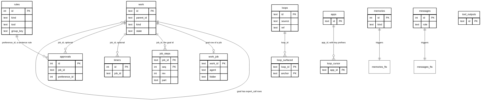
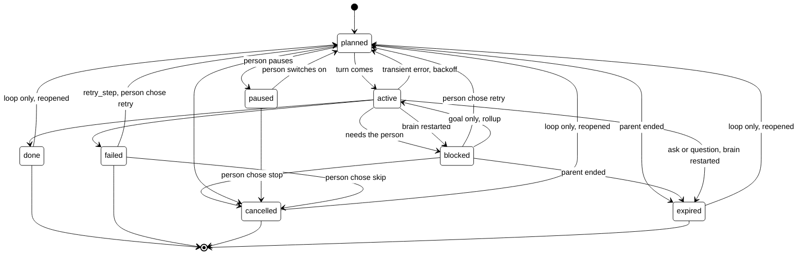

# Storage

## Purpose

How the brain stores data: every table, its columns, who writes and reads it, how long rows live
and whether they are masked.

The brain keeps its data in one SQLite file, `tagalong.db`, under `TAGALONG_HOME` (default
`~/.tagalong`). The file runs in WAL mode. Its schema is the numbered files in
`brain/src/brain/store/migrations/`, applied in order and numbered by `PRAGMA user_version` (see
[Store layer](#store-layer)); a file from a newer brain stops the brain at start, and so does a
Python SQLite without FTS5. Times are UTC ISO text. What the desktop and the browser body keep is
in [desktop.md](desktop.md#what-it-stores) and [browser-body.md](browser-body.md#what-it-stores).

## Store layer

The `brain/src/brain/store/` package opens the file and owns its schema. `Memory` gets its
connection from `store.db.open_db`; nothing else opens the file.

- `store/db.py`: `open_db(path)` makes the folder, runs the FTS5 probe, sets WAL and runs the
  migrations. `migrate(db, migrations, upto)` applies every migration newer than `user_version`,
  `transaction(db)` is a `BEGIN IMMEDIATE` block, and `utc_text(at)` writes the stored time text.
- `store/search.py`: the SQLite-only full-text helpers, `probe_fts5` and `fts_query`, plus
  `search(db, query, kind, limit)` over `memories_fts` and `messages_fts` and its `Hit`.
- `store/conversation.py`: owns `messages` (`save_messages`, `replace_last_message`,
  `load_messages`).
- `store/memory.py`: owns `memories` (`remember`, `forget`, `list_items`, `always_loaded`,
  `add_summary`), with the kinds table, `Item` and `MemoryRefused`.
- `store/connections.py`: owns `apps` (`list_apps`, `add_app`, `set_app_enabled`, `remove_app`).
- `store/outputs.py`: owns `tool_outputs` (`put_output`, `get_output`, `prune_outputs`).
- `store/work.py`: `WorkStore` over the `work`, `work_events` and `work_fts` tables: create, the
  state machine, rollup, retry, due queries, search and the resume scan. Jobs use it through
  `job_records.py` (S2a); the other areas move over in later slices.

- `store/migrations/`: `NNNN_name.sql` (or `NNNN_name.py` with a `migrate(db)` function) files,
  `0001_memories` to `0021_rules`. The numbers have no gaps (the loader refuses a gap or a
  duplicate). Each file runs in one transaction together with its `user_version` bump, so a
  failure leaves the file at the last good version. A file is never edited after it has merged;
  a schema change is a new file.

`Memory` keeps its public methods and each one calls the matching store function with its
connection. The other tables (timers, approvals) keep
their SQL in `memory.py` until the slice that rewrites them moves them.

## Tables and relations

Key columns only; the full columns are in each table's section.

The links are by value, not declared foreign keys: SQLite is not told about them, so deleting a
row does not cascade. `tool_outputs` stands alone. An offer rule's `group_key`
and `approvals.group_key` name the same kind of action. A continued job keeps the earlier job's
id in a `continued` event on its goal row.

## Conversation

### messages

The saved chat, so a restart picks the conversation back up.

| Column         | Type                | Meaning                                                                                        |
| -------------- | ------------------- | ---------------------------------------------------------------------------------------------- |
| `id`           | INTEGER PRIMARY KEY | Order of the message                                                                           |
| `at`           | TEXT                | When it was saved                                                                              |
| `role`         | TEXT                | `user` or `assistant`                                                                          |
| `content_json` | TEXT                | The message content as JSON, rebuilt into model history at start                               |
| `text`         | TEXT                | Searchable text of the message; images and documents appear as `[screenshot]` and `[document]` |

- Written by: `store/conversation.py` `save_messages`, `replace_last_message` (through `Memory`,
  called from `sessions.py`).
- Read by: `store/conversation.py` `load_messages` (via `mind/resume.py` `rebuild_history`) and `search`.
- Retention: kept forever.
- Masked: yes, through the `save` guard (`mask_message`) before saving. Image and document blocks
  are replaced by text markers and never stored.

`messages_fts` is an FTS5 index over `messages.text` (external content, tokenizer
`porter unicode61`), kept in step by insert, update and delete triggers. `store/search.py` `search` ranks
it with bm25; free text is turned into quoted words joined by OR (`fts_query`).

## Memory

### memories

What Scout remembers across restarts, by kind.

| Column       | Type                | Meaning                                                        |
| ------------ | ------------------- | -------------------------------------------------------------- |
| `id`         | INTEGER PRIMARY KEY | The id Scout uses to `forget` or replace an item               |
| `kind`       | TEXT                | `instruction`, `about_you`, `tracking`, `project` or `summary` |
| `text`       | TEXT                | The item                                                       |
| `cadence`    | TEXT                | How often to check a `tracking` item; null for the others      |
| `created_at` | TEXT                | When it was saved                                              |
| `updated_at` | TEXT                | When it last changed                                           |

- Written by: `store/memory.py` `remember`, `add_summary`, `forget` (called from `tools.py` and the
  compaction in `sessions.py`).
- Read by: `store/memory.py` `always_loaded` (the prompt), `list_items`; `store/search.py` `search`.
- Retention: kept until forgotten or replaced. Caps per kind: `instruction` 50 items of 300
  characters, `about_you` 50 of 300, `tracking` 30 of 300, `project` 200 of 500; `summary` is
  uncapped and written by code.
- Masked: no.

`memories_fts` is an FTS5 index over `memories.text`, built and searched the same way as
`messages_fts`; it backs the `recall` tool.

## Work

The work model. Every job, step, ask, timer and loop becomes one row in `work`; each area moves
over in its own slice and drops its old tables. Jobs and their parts have moved (S2a, see
"Jobs as work rows" below); the sections after that, up to Rules and approvals, still describe the old
shape and go away slice by slice. `store/work.py` (`WorkStore`) is the only code that touches the
three tables below, plus `work_job`.

### work

One row per piece of work, in a tree: a goal has steps, and a step can have asks and timers.

| Column                                 | Type             | Meaning                                                                            |
| -------------------------------------- | ---------------- | ---------------------------------------------------------------------------------- |
| `id`                                   | TEXT PRIMARY KEY | Short id (8 hex characters)                                                        |
| `parent_id`                            | TEXT             | The work this belongs to; null for a root                                          |
| `root_id`                              | TEXT             | Top of the tree; its own id for a root                                             |
| `seq`                                  | INTEGER          | Order among siblings                                                               |
| `kind`                                 | TEXT             | `goal`, `expert_call`, `tool_call`, `ask`, `question`, `timer`, `loop`, `watch`    |
| `state`                                | TEXT             | `planned`, `active`, `blocked`, `paused`, `done`, `failed`, `cancelled`, `expired` |
| `title`                                | TEXT             | Scout's words, masked, capped at 200                                               |
| `input`                                | TEXT (JSON)      | What the step was given, so a retry knows what to run                              |
| `summary`                              | TEXT             | Short text of what was done, found or left; what Scout reads                       |
| `detail_id`                            | TEXT             | Points to `tool_outputs`: the full text                                            |
| `progress`                             | TEXT             | One live line while `active`; cleared when the row ends                            |
| `checkpoint`                           | TEXT (JSON)      | Enough to carry on (an expert call keeps its session id)                           |
| `attempt`, `max_attempts`              | INTEGER          | Retries so far, and the limit (default 3)                                          |
| `safe_to_retry`                        | INTEGER          | 0 or 1                                                                             |
| `error_kind`, `last_error`             | TEXT             | `transient` or `permanent`; the masked error, capped at 300                        |
| `due_at`                               | TEXT             | Next time something should happen: timer, retry backoff, cadence                   |
| `created_at`, `updated_at`, `ended_at` | TEXT             | UTC ISO text                                                                       |
| `end_reason`                           | TEXT             | Why it ended, in a short phrase                                                    |
| `reported_at`                          | TEXT             | Null means Scout has not told the person                                           |
| `source_message_id`                    | INTEGER          | The chat message that started it, if any                                           |

Indexes: `(state, due_at)`, `(root_id, seq)`, `(parent_id, seq)`, `(kind, state)`, and
`(reported_at)` for ended rows only.

Terminal states are `done`, `failed`, `cancelled` and `expired`; an ended row always has
`ended_at` and `end_reason`. `WorkStore.transition` allows only these moves, runs in one
transaction with its `state` event, and raises `TransitionRefused` for a move from a state that
has already changed (`expect=`), so two writers on one row never overwrite each other.

- Goal only: `blocked` to `active`; `done` and `failed` only through `close_goal`, which also
  accepts a goal still `planned`.
- Skip: a `failed` step can move to `cancelled`; a cancelled step no longer blocks its goal.
- Loop only: an ended loop goes back to `planned` (with a `reopened` event).
- Rollup: a child that goes `blocked` or `failed` blocks its active goal; when no child is
  `blocked` or `failed` any more and one moves to `planned`, `active` or `cancelled`, the goal is
  `active` again. A goal is never failed automatically.
- Parent end: when a row ends, its open children end too: asks and questions `expired` ("parent
  ended: ..."), everything else `cancelled` ("goal closed"). Rows ended this way are marked
  reported, since Scout already knows the parent ended.
- Retry: `fail(id, "transient", reason)` on a `safe_to_retry` row with tries left goes back to
  `planned` with `attempt + 1` and `due_at` = now + backoff (30 s, 2 min, 10 min; the last value
  repeats). Otherwise the row is `failed` ("gave up after N tries: ..." or "not retryable: ...")
  with `reported_at` null. `retry_step` is the person's retry choice.
- Resume scan at start (`resume_scan`, run by `Jobs.startup`): open asks and questions expire
  ("brain restarted"); an active expert call with a saved session whose expert can reload it
  becomes `blocked` (Scout is told and offers to carry on), any other `failed`; an active tool
  call reruns when safe, else fails; timers, watches, loops, goals and planned, paused or blocked
  rows are left alone. Running it twice changes nothing.

### work_events

Append-only log of what happened to a row: `created`, `state` (`{from, to, reason}`),
`attempt_failed`, `retried`, `reopened`, `resumed`, `failed on restart`.

| Column    | Type                | Meaning               |
| --------- | ------------------- | --------------------- |
| `id`      | INTEGER PRIMARY KEY | Order of events       |
| `work_id` | TEXT                | The row it belongs to |
| `at`      | TEXT                | UTC ISO text          |
| `kind`    | TEXT                | What happened         |
| `data`    | TEXT (JSON)         | Details, or null      |

Indexed on `(work_id, id)`.

### work_fts

FTS5 over `work.title` and `work.summary`, external content keyed by `work`'s rowid, with the
same tokenizer (`porter unicode61`) and trigger style as `messages_fts`. `WorkStore.search` reads
it, so Scout can find "that invoice thing". Any rebuild of `work` must copy `rowid` explicitly and
then run `INSERT INTO work_fts(work_fts) VALUES('rebuild')`, because the index is keyed by rowid.

## Jobs as work rows

One hand-off of a task to an expert, seen from Scout's side, is a goal row in `work` with the
job's id. Each expert's share of it (part `p1`, then `p2` for a follow-up) is an `expert_call`
row under that goal, named `<job>.<part>`. `job_records.py` (`JobRecords`) turns the `Job` and
`JobPart` shapes the rest of the brain reads into `WorkStore` moves and back; it has no SQL of its
own. Home and Scout's tools see the same words as before (`running`, `done`, `error`, `stopped`):
`home_state` maps `active`, `done`, `failed` and everything else.

### work_job

What a job row needs that `work` has no column for. One row per goal and per expert call.

| Column    | Type             | Meaning                                   |
| --------- | ---------------- | ----------------------------------------- |
| `work_id` | TEXT PRIMARY KEY | The goal or expert_call row it describes  |
| `agent`   | TEXT             | Which expert ran it (expert calls)        |
| `folder`  | TEXT             | The folder the expert works in            |
| `mode`    | TEXT             | The expert's mode the person chose (goal) |
| `task`    | TEXT             | What was asked first (goal)               |

- Written by: `job_records.py` through `WorkStore.set_job_detail`.
- Read by: `job_records.py` through `WorkStore.job_details`.
- Retention: kept with its work row. Not masked: `task` and `folder` never were.

### The goal row (a job)

| `work` column | Holds                                                                                                                                 |
| ------------- | ------------------------------------------------------------------------------------------------------------------------------------- |
| `state`       | `active` while Scout works on it; `blocked` when a part failed; Scout's close ends it                                                 |
| `title`       | Scout's short title, masked, capped at 200                                                                                            |
| `input`       | `{"watch": [{text, done}, ...]}`: what Scout expects from the job                                                                     |
| `summary`     | Scout's write-up of the result, masked; over 2,000 characters the rest is in `tool_outputs` through `detail_id` (capped at 1,000,000) |
| `ended_at`    | When Scout closed it (`close_job`, outcome `done` or `failed`)                                                                        |

A continued job (a hand-off that resumes an earlier job's session) records the earlier job's id
in a `continued` event. The job's own state is derived, as before: running while any part is
active, failed once the goal failed, otherwise the state of the part that ended last.

### The expert_call row (a part)

| `work` column | Holds                                                                                                                                                             |
| ------------- | ----------------------------------------------------------------------------------------------------------------------------------------------------------------- |
| `state`       | `active`, then `done`, `failed` or `cancelled` (a stopped part)                                                                                                   |
| `input`       | `{"task": ...}`: what this part was asked                                                                                                                         |
| `progress`    | A running tail of what the expert last said, capped at 2,000; cleared when it ends                                                                                |
| `checkpoint`  | `{"session_id": ...}`: the expert's own session id, used to resume it                                                                                             |
| `summary`     | The expert's final report, masked; the first 2,000 characters, with the whole text in `tool_outputs` (pointed at by `detail_id`) when longer, capped at 1,000,000 |
| `end_reason`  | Why it ended, such as `end_turn` or `brain restarted`                                                                                                             |
| `reported_at` | Null until Scout has been told it ended                                                                                                                           |

- Written by: `jobs.py` through `JobRecords` (`add_job`, `add_part`, `update_part`, `set_title`,
  `set_result`, `set_watch`, `close_job`, `mark_reported`).
- Read by: `jobs.py`, `tools.py` (`list_jobs`, Home only), `timers.py`, `job_activity.py` through
  `JobRecords` (`get_job`, `parts_of`, `last_part_for`, `unreported_jobs`, `running_jobs`).
- Retention: kept forever. Parts still active when the brain starts are settled by the resume scan:
  `blocked` with the reason `brain restarted` when they saved a session the expert can reload,
  else `failed` with that reason; either way their job's step log ends with a "stopped" line.
- Masked: title, watch, progress, report and result yes (the work store masks them on the way in);
  `task` and `folder` no.
- A report over 2,000 characters lives in `tool_outputs`; `prune_outputs` keeps any output a work
  row points at.
- Upgrade: migration `0019_jobs_to_work` moves every `jobs` and `job_parts` row into this shape
  (old part states `running`, `done`, `stopped`, `error` become `active`, `done`, `cancelled`,
  `failed`), then drops both tables. Only a job Scout closed (`closed_at` set) becomes an ended
  goal, with `ended_at` and `reported_at` set to that `closed_at`; a job never closed stays `active`
  (`blocked` if its last part failed) so it can still take a follow-up part. Ended parts have no
  progress, as at runtime. A part with no job is dropped and counted in the log.

## Work (old shape)

### job_steps

A job's steps as a log (the old `job_activity` table, renamed by migration `0020_job_steps`): commands, output, messages and tool calls, masked and capped.

| Column   | Type    | Meaning                                                                                |
| -------- | ------- | -------------------------------------------------------------------------------------- |
| `job_id` | TEXT    | The job; part of the primary key `(job_id, seq)`                                       |
| `rev`    | INTEGER | Rises on every write; the cursor readers page by. Index `job_steps_rev(job_id, rev)`   |
| `seq`    | INTEGER | Display order, fixed at insert; 0 is the `[older steps dropped]` marker                |
| `at`     | TEXT    | When the step was written                                                              |
| `kind`   | TEXT    | `command`, `output`, `edit`, `read`, `search`, `other`, `say`, `plan`, `end` or `tool` |
| `step`   | TEXT    | The expert's step id, linking an output to its command                                 |
| `status` | TEXT    | The step's status as the expert reports it                                             |
| `exit`   | INTEGER | A command's exit code                                                                  |
| `text`   | TEXT    | The step text                                                                          |
| `part`   | TEXT    | Which part wrote it; default `p1`                                                      |
| `source` | TEXT    | Label of the app or tool behind a Scout step                                           |

- Written by: `job_activity.py` `JobActivity` through `WorkStore.save_activity`, `trim_activity`.
- Read by: `WorkStore.activity_after`, `job_activity.py` `activity_summary`, the Home-only
  `job_activity` tool (the tool keeps its name).
- Retention: per job, at most `TAGALONG_JOB_STEPS_MAX_ENTRIES` (2,000) entries and
  `TAGALONG_JOB_STEPS_MAX_BYTES` (1,000,000) bytes of text; the oldest are dropped
  behind the marker. Rows stay after the job ends.
- Masked: yes, the text is masked and then capped.

### timers

Scout's timers, one-off or repeating, optionally tied to a running job.

| Column       | Type                | Meaning                                                                       |
| ------------ | ------------------- | ----------------------------------------------------------------------------- |
| `id`         | INTEGER PRIMARY KEY | Timer id                                                                      |
| `note`       | TEXT                | What Scout wanted to be told                                                  |
| `next_at`    | TEXT                | Next fire time, UTC ISO text, so text order is time order                     |
| `repeat_s`   | INTEGER             | Seconds between fires; null for a one-off (at least 300)                      |
| `created_at` | TEXT                | When it was set                                                               |
| `fired`      | INTEGER             | 0 or 1: a one-off that already woke Scout, kept so a restart never replays it |
| `job_id`     | TEXT                | The running job it checks back on; null otherwise                             |

- Written by: `tools.py` `set_timer` through `memory.py` `add_timer`, `set_timer_next`,
  `mark_timer_fired`, `delete_timer`; `timers.py` `Timers`.
- Read by: `timers.py` (`due_timers`, `fired_timers`), `list_timers`.
- Retention: deleted on cancel and when its job ends (`delete_timers_for_job`, and at start for
  running jobs). A fired one-off stays.
- Masked: no.

### loops

Things left open that Scout found in mail: a reply owed, a reply awaited.

| Column          | Type             | Meaning                                                          |
| --------------- | ---------------- | ---------------------------------------------------------------- |
| `id`            | TEXT PRIMARY KEY | Loop id                                                          |
| `source`        | TEXT             | Which source it came from, such as the Gmail app id              |
| `ref`           | TEXT             | The source's own id (a thread); `UNIQUE(source, ref)`            |
| `title`         | TEXT             | Short title                                                      |
| `asks`          | TEXT             | What is being asked                                              |
| `direction`     | TEXT             | `i_owe` or `they_owe`                                            |
| `people`        | TEXT             | JSON list of names                                               |
| `due`           | TEXT             | The real deadline, if any                                        |
| `quiet_after`   | TEXT             | When silence starts to matter                                    |
| `anchors`       | TEXT             | JSON list of things that make it relevant (a project, a person)  |
| `status`        | TEXT             | `held`, `surfaced`, `snoozed`, `done`, `dropped` or `stale`      |
| `history`       | TEXT             | JSON list of what happened to it                                 |
| `created`       | TEXT             | When it was found                                                |
| `updated`       | TEXT             | When it last changed                                             |
| `snoozed_until` | TEXT             | When a snoozed loop (Later) comes back; `due` stays the deadline |

- Written by: `loops/store.py` `LoopStore` (`save`, `set_status`, `snooze`, `add_history`),
  driven by `loops/service.py` and Scout's loop tools.
- Read by: `loops/store.py`, `loops/service.py`, `loops/triggers/`.
- Retention: kept until `forget` (one loop) or `wipe` (every loop and cursor); done and dropped
  loops stay.
- Masked: `title`, `asks`, `people` and `anchors` yes (the mask is wired in `main.py`).

### loop_surfaced

When a loop last came up for each anchor, so Scout does not repeat itself.

| Column    | Type | Meaning                                               |
| --------- | ---- | ----------------------------------------------------- |
| `loop_id` | TEXT | The loop; part of the primary key `(loop_id, anchor)` |
| `anchor`  | TEXT | The anchor, or the due time, it came up for           |
| `day`     | TEXT | The day it came up                                    |

- Written by: `loops/store.py`; read by `loops/store.py` and `loops/triggers/`.
- Retention: removed with its loop (`forget`, `wipe`).
- Masked: no.

### loop_cursor

How far each app's mail has been read, plus a few per-app flags kept under prefixed keys.

| Column   | Type             | Meaning                                                                                                                                         |
| -------- | ---------------- | ----------------------------------------------------------------------------------------------------------------------------------------------- |
| `app_id` | TEXT PRIMARY KEY | An app id, or a prefixed key: `sent:<app>` (sent-mail cursor), `on:<app>` (loops switched on), `backfill:<app>` (first read done), `digest:day` |
| `value`  | TEXT             | A timestamp, `1`, `done` or a day                                                                                                               |

- Written by: `loops/store.py` `set_cursor`, `set_on`, `set_backfilled`; read by
  `loops/service.py`.
- Retention: `on:<app>` is removed when the app is switched off; everything goes on `wipe`.
- Masked: no.

## Rules and approvals

### rules

One table for what the person has decided about asks: a tool's mode, a standing sentence, and
an offered sentence. `kind` tells them apart. Code reaches it only through `store/rules.py`.

| Column       | Type                | Meaning                                                                 |
| ------------ | ------------------- | ----------------------------------------------------------------------- |
| `id`         | INTEGER PRIMARY KEY | Rule id (a preference keeps its old id, which `approvals.preference_id` names) |
| `kind`       | TEXT                | `mode` (a tool's off/ask/auto), `sentence` (a preference), `offer` (an offer Scout made) |
| `tool`       | TEXT                | `mode`: the tool. `sentence`: optional scope, the tool                  |
| `source`     | TEXT                | Optional scope: where the ask comes from                                |
| `group_key`  | TEXT                | Optional scope: the kind of action                                      |
| `effect`     | TEXT                | `mode`: `off`, `ask` or `auto`. `offer`: the outcome word (`yes`, `keep_asking`, `none`, `no_answer`) |
| `sentence`   | TEXT                | `sentence`: what Scout checks an ask against                            |
| `state`      | TEXT                | `active`, `offered`, `declined` or `removed`                            |
| `decided_at` | TEXT                | When an offer was answered                                              |
| `expires_at` | TEXT                | Optional; nothing sets it yet                                           |
| `builtin`    | INTEGER             | 0 or 1: the default sentence seeded by the first migration              |
| `use_count`  | INTEGER             | How many asks a sentence has covered                                    |
| `last_used`  | TEXT                | When it last covered one                                                |
| `created_at` | TEXT                | When it was added (an offer: when it was made)                          |

Indexes: `(kind, tool)` and `(kind, group_key)`.

- A tool has no `mode` row until the person sets one; then its default applies. Setting it
  again updates the one row.
- A preference is `kind=sentence`, `state=active`. Removing it sets `state=removed`; it is no
  longer listed or used, and the row stays so the approval log never points at nothing.
- An offer's state follows its outcome: `yes` is `active`, `keep_asking` and `none` are
  `declined`, `no_answer` is `offered`. The outcome word stays in `effect` so the
  keep-asking window in `offers.py` reads it.
- Migration `0021_rules` moved the old `permissions`, `preferences` and `offers` tables into
  it (preferences first, keeping their ids) and dropped them.
- Written by: `store/rules.py` (`set_permission_mode`, `add_preference`, `edit_preference`,
  `remove_preference`, `use_preference`, `add_offer`) for the `set_permission` tool, Home,
  `approvals.py` and `offers.py`.
- Read by: `store/rules.py` (`permission_modes`, `list_preferences`, `has_user_preferences`,
  `has_preference_for`, `offers_for`) for `toolbox.py`, `side_check.py`, `offers.py`, Home and
  the prompt.
- Retention: kept until changed; a removed preference is kept as a `removed` row.
- Masked: no.

### approvals

The log of how each ask ended.

| Column                | Type                | Meaning                                                                            |
| --------------------- | ------------------- | ---------------------------------------------------------------------------------- |
| `id`                  | INTEGER PRIMARY KEY | Log id                                                                             |
| `source`              | TEXT                | `scout_tool`, `claude_code` or `app` (CHECK)                                       |
| `tool`                | TEXT                | The tool asked about                                                               |
| `summary`             | TEXT                | One-line description of the action                                                 |
| `input`               | TEXT                | The tool input                                                                     |
| `job_id`              | TEXT                | The job, for an expert's ask                                                       |
| `group_key`           | TEXT                | The kind of action, to group like asks                                             |
| `outcome`             | TEXT                | `approved`, `refused`, `timed_out` or `no_one` (CHECK)                             |
| `decided_by`          | TEXT                | `person`, `scout` or `none` (CHECK)                                                |
| `preference_id`       | INTEGER             | The preference Scout approved under                                                |
| `at`                  | TEXT                | When it ended                                                                      |
| `preference_sentence` | TEXT                | That preference's sentence as it was then, so editing it later rewrites no history |

- Written by: `approvals.py` `Approvals` through `memory.py` `add_approval`.
- Read by: `memory.py` `list_approvals`, `approval_counts`, `person_approvals_since`; `offers.py`;
  Home.
- Retention: kept forever.
- Masked: `summary` and `input` yes.

## Apps

### apps

Connected apps (MCP servers).

| Column      | Type             | Meaning                                            |
| ----------- | ---------------- | -------------------------------------------------- |
| `id`        | TEXT PRIMARY KEY | App id                                             |
| `name`      | TEXT             | Display name                                       |
| `transport` | TEXT             | `stdio` or `http` (CHECK)                          |
| `config`    | TEXT             | Transport details as JSON; secrets are never in it |
| `auth`      | TEXT             | `none`, `token` or `oauth` (CHECK)                 |
| `enabled`   | INTEGER          | 0 or 1; default 1                                  |

- Written by: `apps.py` `Apps` through `store/connections.py` `add_app`, `set_app_enabled`, `remove_app`.
- Read by: `store/connections.py` `list_apps`.
- Retention: until the app is removed.
- Masked: secrets are moved out of the row into separate files before it is saved
  (`apps.py` `split_secrets`); `${VAR}` references stay as written. See
  [connected-apps.md](connected-apps.md).

## Tool outputs

### tool_outputs

A long tool result stored whole, so Scout can read the rest of a capped preview with `read_output`.

| Column  | Type             | Meaning                                |
| ------- | ---------------- | -------------------------------------- |
| `id`    | TEXT PRIMARY KEY | Short id Scout passes to `read_output` |
| `tool`  | TEXT             | The tool that produced it              |
| `chars` | INTEGER          | Length of the stored text              |
| `text`  | TEXT             | The full masked text                   |
| `at`    | TEXT             | When it was stored                     |

- Written by: `outputs.py` `OutputStore.put` through `store/outputs.py` `put_output` (via `Memory`).
- Read by: `store/outputs.py` `get_output` (via `Memory`), paged by `OutputStore.page`.
- Retention: the newest 200 are kept; older rows are deleted at brain start (`prune_outputs`).
- Masked: yes, before storing.

## Masking

The `Masker` (`masking.py`) replaces exact secret values (8 characters or more) and common key
shapes (`sk-ant-`, `Bearer`, GitHub, Slack and AWS keys, `?token=` style query parameters) with
`[secret]`. It runs as the `save` guard on the chat, approvals, job titles, results, progress and
activity, tool outputs and loops, and as a filter on every log handler. Scout's live turn is not
masked, only what reaches disk or logs. Memories, timer notes, preference sentences and job `task`
text are not covered.

## In memory only

These are lost when the brain restarts.

| State                | Where                           | What a restart means                                                                                  |
| -------------------- | ------------------------------- | ----------------------------------------------------------------------------------------------------- |
| Open asks            | `asks.py` `Asks`                | A pending permission ask is gone; the body no longer lists it                                         |
| Expert questions     | `questions.py` `ScoutQuestions` | A question waiting on Scout is gone                                                                   |
| Scheduler wakes      | `scheduler.py` `Scheduler`      | Held wake batches and the rolling hour's wake count start empty                                       |
| Outboxes             | `bodies.py` `Outbox`            | The replay buffer (500 frames, 24 hours per body) is empty, so a reconnecting body gets a fresh start |
| Running jobs         | `jobs.py`, `experts.py`         | The expert processes end; their rows become `cancelled`                                               |
| Live history         | `sessions.py` `history`         | Rebuilt from `messages`                                                                               |
| App connection state | `apps.py`                       | Each enabled app reconnects; state and tool lists are rebuilt                                         |
| Voice session        | `voice/service.py`              | The listening session ends; the body starts a new `listen`                                            |
