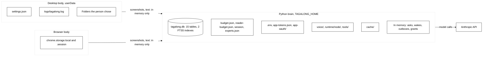

# Storage

## Purpose

One map of every place Tagalong keeps data, grouped by kind: what it holds, where it lives, who
writes and reads it, how long it is kept and whether a secret can land in it. This is the one
place the layout of each store is described; other docs link here. The code on `main` is the
source of truth. Paths are relative to `TAGALONG_HOME` (default `~/.tagalong`) unless the row says
otherwise.

## Where data lives

Not stored anywhere: embeddings or vectors, screenshots, audio, a brain log file (see
[Not stored](#not-stored)).

## Contents

1. [Relational: SQLite tables](#1-relational-sqlite-tables) (15)
2. [Search index: FTS5](#2-search-index-fts5) (2)
3. [Vectors and embeddings](#3-vectors-and-embeddings) (0)
4. [Object and file storage](#4-object-and-file-storage) (5)
5. [Key-value and config files](#5-key-value-and-config-files) (4)
6. [Secrets](#6-secrets) (3)
7. [Caches](#7-caches) (3)
8. [Body-side storage](#8-body-side-storage) (5)
9. [Memory only](#9-memory-only) (12)

## 1. Relational: SQLite tables

All in `tagalong.db`, one file, one connection (`Memory.db` in `memory.py`; the loops store reuses
it). WAL mode. Schema history is the `MIGRATIONS` tuple in `memory.py`, numbered by
`PRAGMA user_version`; a file from a newer brain stops the brain. Times are UTC ISO text. The
brain needs a Python SQLite with FTS5 and stops without it.

| Table           | Shape (columns)                                                                                                                                                         | Purpose                                                                                                               | Written by / read by                                                                                                       | Retention                                                                                                                      | Secrets, masking                                                                                                 |
| --------------- | ----------------------------------------------------------------------------------------------------------------------------------------------------------------------- | --------------------------------------------------------------------------------------------------------------------- | -------------------------------------------------------------------------------------------------------------------------- | ------------------------------------------------------------------------------------------------------------------------------ | ---------------------------------------------------------------------------------------------------------------- |
| `memories`      | id, kind, text, cadence, created_at, updated_at                                                                                                                         | Scout's long-term items (instruction, about_you, tracking, project, summary)                                          | `memory.py: remember, add_summary, forget` / `always_loaded, list_items, search`                                           | Caps per kind (50, 50, 30, 200 items; `summary` uncapped); removed only by `forget` or `replaces`                              | Possible (the model writes the text). Not masked                                                                 |
| `messages`      | id, at, role, content_json, text                                                                                                                                        | The saved chat, so a restart resumes it                                                                               | `memory.py: save_messages, replace_last_message` (from `sessions.py`) / `load_messages`, `mind/resume.py: rebuild_history` | None: grows forever. Images and documents are replaced by `[screenshot]` and `[document]` before saving                        | Masked on save (`mask_message`, guard `mask_secrets`)                                                            |
| `permissions`   | tool, mode (`off`, `ask`, `auto`)                                                                                                                                       | The person's per-tool choice; no row means the tool's default                                                         | `memory.py: set_permission_mode` / `permission_modes` (read by `toolbox.py`)                                               | Kept until changed                                                                                                             | No                                                                                                               |
| `jobs`          | id, task, folder, mode, state, started_at, ended_at, parent_job, watch (JSON), title, scout_result, closed_at                                                           | One expert hand-off from Scout's side                                                                                 | `jobs.py: Jobs` via `memory.py: add_job, update_job, set_title, set_result, close_job` / `memory.py: _jobs`                | None. Rows still `running` at brain start become `stopped`                                                                     | `title`, `watch`, `scout_result` masked (`mask_json`); `task` and `folder` not masked                            |
| `job_parts`     | job_id, id, agent, task, state, reason, progress, session_id, report, reported, started_at, ended_at, folder                                                            | One expert's part of a job; `session_id` is the expert's own session                                                  | `jobs.py` via `memory.py: add_part, update_part` / `parts_of`, `unreported_jobs`                                           | None. `report` capped at 1,000,000 characters, `progress` at 2,000                                                             | `progress` and `report` masked; `task` not masked                                                                |
| `job_activity`  | job_id, rev, seq, at, kind, step, status, exit, text, part, source (index `job_activity_rev`)                                                                           | A job's steps as a capped log                                                                                         | `job_activity.py: JobActivity._put` via `memory.py: trim_activity` / `activity_after`, `activity_summary`                  | Per job: 2,000 entries and 1,000,000 bytes, oldest dropped behind a `[older steps dropped]` marker. Never deleted with the job | Masked before capping                                                                                            |
| `apps`          | id, name, transport, config (JSON), auth, enabled                                                                                                                       | Connected apps (MCP servers)                                                                                          | `apps.py: Apps` via `memory.py: add_app, set_app_enabled, remove_app` / `list_apps`                                        | Until the app is removed                                                                                                       | Secrets are split out into `app-tokens.json` before the row is saved (`split_secrets`); `${VAR}` references stay |
| `timers`        | id, note, next_at, repeat_s, created_at, fired, job_id                                                                                                                  | Scout's timers                                                                                                        | `tools.py: set_timer` via `memory.py: add_timer, mark_timer_fired` / `timers.py: Timers`                                   | Deleted by cancel or when a job ends. A fired one-off is kept (so a restart never replays it) and never removed                | Possible in `note`. Not masked                                                                                   |
| `approvals`     | id, source, tool, summary, input, job_id, group_key, outcome, decided_by, preference_id, at, preference_sentence                                                        | The log of how each ask ended                                                                                         | `approvals.py: Approvals` via `memory.py: add_approval` / `list_approvals`, `approval_counts`                              | None: grows forever                                                                                                            | `summary` and `input` masked                                                                                     |
| `preferences`   | id, sentence, source, tool, group_key, builtin, created_at, use_count, last_used                                                                                        | The person's standing sentences ("always ask before risky actions")                                                   | `memory.py: add_preference, edit_preference, use_preference` / `list_preferences` (read by `side_check.py`, `offers.py`)   | Until the person removes one. One built-in row is seeded by the migration                                                      | Possible (free text). Not masked                                                                                 |
| `offers`        | id, group_key, at, outcome                                                                                                                                              | Each "want me to handle these?" so Scout does not nag                                                                 | `offers.py: Offers` via `memory.py: add_offer` / `offers_for`                                                              | None                                                                                                                           | No                                                                                                               |
| `tool_outputs`  | id, tool, chars, text, at                                                                                                                                               | A long tool result stored whole so `read_output` can page it                                                          | `outputs.py: OutputStore.put` via `memory.py: put_output` / `get_output`                                                   | Newest 200 kept; pruned at brain start (`outputs.prune`, called from `sessions.py`)                                            | Masked before storing                                                                                            |
| `loops`         | id, source, ref, title, asks, direction, people (JSON), due, quiet_after, anchors (JSON), status, history (JSON), created, updated, snoozed_until; unique (source, ref) | Things left open, found in mail                                                                                       | `loops/store.py: LoopStore.save, set_status, snooze` / `loops/service.py`                                                  | Until `forget` or `wipe`. Done and dropped loops stay                                                                          | `title`, `asks`, `people`, `anchors` masked (`mask_json`, wired in `main.py`)                                    |
| `loop_surfaced` | loop_id, anchor, day                                                                                                                                                    | When a loop last came up for each anchor                                                                              | `loops/store.py` / `loops/triggers/`                                                                                       | Removed with its loop                                                                                                          | No                                                                                                               |
| `loop_cursor`   | app_id, value                                                                                                                                                           | How far each app's mail was read. The key also carries flags by prefix: `sent:`, `on:`, `backfill:`, and `digest:day` | `loops/store.py: set_cursor, set_on, set_backfilled` / `loops/service.py`                                                  | Removed by `wipe` or by turning an app off (`on:` key only)                                                                    | No                                                                                                               |

## 2. Search index: FTS5

| Index          | Kind                                   | Location      | Shape                                | Purpose                           | Written by / read by                                      | Retention                      | Secrets                 |
| -------------- | -------------------------------------- | ------------- | ------------------------------------ | --------------------------------- | --------------------------------------------------------- | ------------------------------ | ----------------------- |
| `memories_fts` | FTS5, external content over `memories` | `tagalong.db` | `text`; tokenizer `porter unicode61` | Ranked `recall` over memory items | Triggers `memories_ai/ad/au` / `memory.py: search` (bm25) | Follows `memories` row for row | Same as `memories.text` |
| `messages_fts` | FTS5, external content over `messages` | `tagalong.db` | `text`; tokenizer `porter unicode61` | `recall` over the saved chat      | Triggers `messages_ai/ad/au` / `memory.py: search`        | Follows `messages`             | Masked text only        |

`fts_query` turns free text into quoted words joined by OR, so a query cannot inject FTS syntax.

## 3. Vectors and embeddings

None. A search of `brain/`, `bodies/`, `protocol/` and `docs/` finds no embedding model, vector
column or vector library. Recall is keyword search (FTS5, section 2). The ONNX files under
`voice/` (section 4) are speech and turn-taking models, not embeddings.

## 4. Object and file storage

| Name              | Location                                                                                                                          | Shape                                                       | Purpose                                                 | Written by / read by                                                                                      | Retention                                                        | Secrets |
| ----------------- | --------------------------------------------------------------------------------------------------------------------------------- | ----------------------------------------------------------- | ------------------------------------------------------- | --------------------------------------------------------------------------------------------------------- | ---------------------------------------------------------------- | ------- |
| Ears models       | `voice/ears/silero-vad/model.onnx`, `voice/ears/smart-turn-v3/smart-turn-v3.2-cpu.onnx` (about 11 MB)                             | Pinned URL, size and SHA-256 per file                       | Voice activity and end-of-turn detection                | `voice/models.py: ensure_files` (checked download to `.part`, then rename) / `voice/load.py: ears_loader` | Kept; a file that fails its hash is deleted and fetched again    | No      |
| Kokoro voice      | `voice/tts/kokoro/kokoro-v1.0.int8.onnx`, `voices-v1.0.bin` (about 120 MB)                                                        | Same pinned, checked download                               | Local speech                                            | `voice/models.py` / `voice/load.py: tts_loader`, `voice/kokoro.py`                                        | Kept                                                             | No      |
| Moonshine         | `voice/moonshine/`                                                                                                                | The `moonshine-voice` package's own download (`cache_root`) | Speech to text                                          | `voice/moonshine.py: load` / same                                                                         | Kept. Not hash-checked by Tagalong                               | No      |
| Tagalong's Node   | `runtime/node/` (marker file `.tagalong-node-version`; `runtime/node.part/` and `runtime/node.new/` exist only during an install) | An official Node archive, checksum from `SHASUMS256.txt`    | Runs installed experts without touching the system Node | `setup/node_runtime.py`, `setup/archive.py` (safe extract) / `setup/install.py`, `setup/facts.py`         | Replaced on upgrade; old copy removed after the swap             | No      |
| Installed experts | `tools/<expert>/` (`tools/<expert>.part`, `.dl`, `.old` during an install)                                                        | An expert's npm packages                                    | The code behind an installed expert                     | `setup/install.py: install_expert` / `experts.py` (runs the command)                                      | Removed on a failed install (only what was staged); no uninstall | No      |

Long tool outputs are also blobs in effect, but they are stored in the `tool_outputs` table
(section 1). No image, screenshot or audio file is written by the brain.

## 5. Key-value and config files

| Name              | Location                                                  | Shape                                                                  | Purpose                                        | Written by / read by                                                                     | Retention                                                | Secrets                                                                                                    |
| ----------------- | --------------------------------------------------------- | ---------------------------------------------------------------------- | ---------------------------------------------- | ---------------------------------------------------------------------------------------- | -------------------------------------------------------- | ---------------------------------------------------------------------------------------------------------- |
| Budget ledger     | `budget.json`                                             | `{"date", "spent_usd"}`                                                | Scout's daily spend, kept across restarts      | `guardrails.py: Budget.spend` / `Budget._load`                                           | One day: resets to zero on a new local date              | No                                                                                                         |
| Reader ledger     | `reader-budget.json`                                      | Same shape                                                             | The mail reader's own daily allowance          | Same class, a second instance (`main.py`)                                                | One day                                                  | No                                                                                                         |
| Session id        | `session`                                                 | One hex id                                                             | The id `hello` returns, stable across restarts | `config.py: session_id`                                                                  | Kept                                                     | No (an id, not a credential)                                                                               |
| Installed experts | `experts.json` (`.part` while writing, `.bad` if corrupt) | `{"experts": [{id, name, version, command, source, logged_in, node}]}` | Which experts are installed and logged in      | `setup/store.py: ExpertStore` (also written by the CLI) / `experts.py`, `setup/tools.py` | Kept; a corrupt file is renamed `.bad` and read as empty | The command is stored; the code says it holds no secret (per-expert env keys are stripped, `setup/env.py`) |

## 6. Secrets

| Name        | Location                  | Shape                                                                                       | Purpose                                                    | Written by / read by                                                                                                                                | Retention                                                | Protection                                                                                                                                                                                            |
| ----------- | ------------------------- | ------------------------------------------------------------------------------------------- | ---------------------------------------------------------- | --------------------------------------------------------------------------------------------------------------------------------------------------- | -------------------------------------------------------- | ----------------------------------------------------------------------------------------------------------------------------------------------------------------------------------------------------- |
| `.env`      | `.env`                    | `NAME=value` lines: `ANTHROPIC_API_KEY` and any `TAGALONG_*` setting                        | The Anthropic key and settings                             | `config.py: upsert_env_value` (temp file created `0600`, then rename; also `cli.py: key set`, `tools.py: set_api_key`) / `config.py: load_env_file` | Kept until edited                                        | Owner-only where the platform honours it (little on Windows). The key is in the `Masker` list, so it becomes `[secret]` before anything is saved or logged. `key_status` never returns any part of it |
| App tokens  | `app-tokens.json`         | `{"<id>": bearer token, "<id>:env:<NAME>": literal env value, "<id>:url_query": "a=b&c=d"}` | Pasted tokens and the secret parts of an app's env and url | `apps.py: TokenFile` (temp then rename, `0600` attempted) / `Apps` at connect, `secret_values`                                                      | Removed with its app (`clear_app`)                       | Same as `.env`; values are in the `Masker` list; never in the `apps` row, a tool list or an error line                                                                                                |
| App sign-in | `app-oauth/<app_id>.json` | `{tokens, client_info, saved_at}` (OAuth)                                                   | An app's OAuth client registration and tokens              | `app_oauth.py: FileTokenStorage` (created `0600`) / the MCP SDK's provider, `apps.py`                                                               | Deleted by `clear` when the app is removed or signed out | Same; access and refresh tokens are in the `Masker` list                                                                                                                                              |

What is masked: the `Masker` (`masking.py`) replaces exact secret values (8 characters or more)
and common key shapes (`sk-ant-`, `Bearer`, GitHub, Slack and AWS keys, `?token=` style query
parameters) with `[secret]`. It runs as the `save` guard on chat, approvals, job titles, results,
progress and activity, tool outputs and loops, and as a filter on every log handler. Scout's live
turn is not masked, only what reaches disk or logs. Memories, timer notes, preferences and job
`task` text are not covered (see Observations). The desktop applies its own `hide-secrets.ts` to
its log file.

## 7. Caches

Safe to delete; each is rebuilt on next use.

| Name               | Location                                                                               | Shape                           | Purpose                                         | Written by / read by                                                      | Retention                                                                        | Secrets                                |
| ------------------ | -------------------------------------------------------------------------------------- | ------------------------------- | ----------------------------------------------- | ------------------------------------------------------------------------- | -------------------------------------------------------------------------------- | -------------------------------------- |
| ACP registry list  | `cache/acp-registry.json`                                                              | `{"data", "fetched_at"}`        | The expert registry, for Scout's `find_experts` | `setup/registry.py: _write_cache` / `_load`                               | Fresh for 24 h (`TTL_S`); served and flagged `stale` when offline. Never deleted | No                                     |
| MCP registry lists | `cache/mcp-registry.json` and `cache/mcp-<12 hex>-registry.json` (one per search text) | Same                            | The connected-apps registry, per search         | Same                                                                      | Same; one file per distinct search, never deleted                                | No (search text is hashed in the name) |
| Login done files   | `cache/login-<expert>-<8 hex>.done`                                                    | The exit code of a login window | Tells the brain a terminal login window closed  | `setup/terminal.py` (the window's wrapper) / `setup/login.py: _read_code` | Not deleted (the name is unique per login); each login leaves one tiny file      | No                                     |

The voice models (section 4) can also be deleted and are downloaded again.

## 8. Body-side storage

Bodies keep only what they need to be a body. Settings other than these live in the brain.

| Name                             | Body, location                                                                | Shape                                                                                                                                                                  | Purpose                                          | Written by / read by                                                                   | Retention                                                                                            | Secrets                                                                                                    |
| -------------------------------- | ----------------------------------------------------------------------------- | ---------------------------------------------------------------------------------------------------------------------------------------------------------------------- | ------------------------------------------------ | -------------------------------------------------------------------------------------- | ---------------------------------------------------------------------------------------------------- | ---------------------------------------------------------------------------------------------------------- |
| `settings.json`                  | Desktop, `<userData>` (`%APPDATA%\Tagalong`); also `.tmp`, `.bak`, `.corrupt` | JSON: hotkeys, avatar x/y, `captureExclusions` (process names, title patterns), `voice` (enabled, voice, speed), `listening.always`, `walkthrough.done`, `fileFolders` | The desktop's own settings                       | `bodies/desktop/src/main/settings-store.ts: SettingsStore` / same, `index.ts` at start | Kept; the previous good file is `.bak`, an invalid one becomes `.corrupt`                            | No key lives here (the key is in the brain's `.env`)                                                       |
| `tagalong.log`, `tagalong.1.log` | Desktop, `<userData>/logs/`                                                   | One line each: time, level, text (max 300 characters)                                                                                                                  | Warnings and errors a person can send            | `main/log-file.ts: installLogFile` / `openLogsFolder`                                  | Rotates at 1 MB: `tagalong.log` becomes `tagalong.1.log`, replacing the old one (about 2 MB at most) | Secrets hidden by `hide-secrets.ts`; only a text first argument is kept, other arguments become their type |
| Chosen folders                   | Desktop, any folder the person added to `fileFolders`                         | The person's own files                                                                                                                                                 | Where Scout's file tools may read and write      | `main/tools/files.ts` (the only writer, confined to the folders by real path)          | The person's files; Tagalong never deletes by itself                                                 | Whatever the person's files hold; not masked on disk                                                       |
| `chrome.storage.local`           | Browser                                                                       | `bodyId` (random id), `brainAddr`, `bodyName`                                                                                                                          | Identity and the brain's address across restarts | `identity.ts`, `settings.ts` / `service-worker.ts`, popup                              | Until the extension is removed                                                                       | No                                                                                                         |
| `chrome.storage.session`         | Browser                                                                       | `lastSeq` (last message number)                                                                                                                                        | Replay position after a service-worker restart   | `body.ts: seqStore`                                                                    | Cleared when the browser session ends                                                                | No                                                                                                         |

Checked and found none: `localStorage`, `sessionStorage` and IndexedDB in `bodies/ui`,
`bodies/desktop` and `bodies/browser`; electron-store; any file the desktop or browser body writes
for a capture. The browser's offscreen page (`src/offscreen/`) holds the microphone stream only
while listening and stores nothing. Electron and Chromium keep their own profile files under
`<userData>` (caches, session data); Tagalong's code writes none of them.

## 9. Memory only

Lost on restart. Single user, so most are small.

| State               | Where                                                               | Purpose                                                                                              | Bounded by                                             |
| ------------------- | ------------------------------------------------------------------- | ---------------------------------------------------------------------------------------------------- | ------------------------------------------------------ |
| Open asks           | `asks.py: Asks._open`                                               | Permission asks waiting for an answer; a reconnecting body can list them                             | Timeout and cancel close them                          |
| Expert questions    | `questions.py: ScoutQuestions._open`                                | An expert's question while Scout decides; unsettled ones resolve to "ask the owner"                  | Settled by Scout or timeout                            |
| Scheduler           | `scheduler.py: _groups, _latest, _wakes`                            | Held wake batches and the rolling hour's wake count (`TAGALONG_WAKES_PER_HOUR`)                      | Replaced by key; hour window                           |
| Outboxes            | `bodies.py: Outbox`                                                 | Frames replayed to a body that reconnects                                                            | 500 frames and 24 h per body (`LIMITS`)                |
| Connected bodies    | `bodies.py: Bodies`                                                 | Online peers, declared tools and names, pending calls                                                | Dropped on disconnect (tools and names are kept after) |
| Reading status      | `reading.py: ReadingStore`                                          | How each body says it reads the screen; Home shows the latest                                        | The body resends on connect                            |
| Read-aloud flags    | `sessions.py: _read_aloud`                                          | Per body choice to speak replies                                                                     | Per connection                                         |
| Live history        | `sessions.py: history`, `_inbox`                                    | The model's working conversation. Rebuilt from `messages` at start (`rebuild_history`)               | Compaction; what is saved is in `messages`             |
| Running jobs        | `jobs.py: _runs, _activity, _ask_ids` and `experts.py: ExpertHosts` | Live expert processes, ACP sessions and open job asks. The job rows survive; the processes do not    | A restart marks running jobs `stopped`                 |
| Expert app grants   | `expert_apps.py: _grants`                                           | Per job part bearer tokens for the loopback MCP bridge                                               | Die with the job part                                  |
| Connected app state | `apps.py: _Slot`                                                    | State (`off`, `connecting`, `connected`, `needs-sign-in`, `error`), tool lists and live MCP sessions | Rebuilt at start from `apps`                           |
| Voice sessions      | `voice/service.py: _sessions`, `voice/mouth.py`                     | One listening session; speech audio is built as WAV bytes in memory and sent as `speech` frames      | One session at a time                                  |

Also in memory: the Masker's cached secret list (refreshed each second), loops throttles and
failure counts (`loops/service.py`), the login driver's tasks (`setup/login.py`), and in the
desktop its `pendingSnapshot`, dropped item and status marks.

### Not stored

- Screenshots and screen text. The desktop captures one window with `desktopCapturer` (or reads
  its text through UI Automation or OCR), holds the PNG as base64 in memory and sends it in the
  tool result. No temporary file is written. The brain forwards it to the model; before the chat is
  saved, image blocks become the text `[screenshot]`.
- Audio. Microphone frames stream to the brain and are dropped after transcription; spoken replies
  are generated and sent without a file.
- Brain logs. `main.py` logs to stderr only (secret-filtered). The desktop starts the brain in
  development with inherited output, so lines go to its terminal, not to `tagalong.log`.
- Experts' own state. Claude Code and other experts keep their own sessions and settings in their
  own folders, outside `TAGALONG_HOME`; `job_parts.session_id` only points at them.

## Observations for the review

Facts only.

- No retention, grows forever: `messages`, `approvals`, `offers`, `jobs`, `job_parts`, fired
  one-off `timers`, done and dropped `loops`, `memories` of kind `summary`, the `cache/` registry
  and login files. Pruned or capped: `tool_outputs` (200), `job_activity` (per job), `memories`
  (per kind), the desktop log (2 MB), the outboxes.
- `job_activity` rows are never deleted with their job, and there is no delete for a job.
- Not masked although the model or a person can put free text in them: `memories`, `timers.note`,
  `preferences.sentence`, `jobs.task`, `job_parts.task`, and `apps.config` beyond what
  `split_secrets` moves. Everything else that reaches disk goes through `mask_json`.
- Secrets are in three places (`.env`, `app-tokens.json`, `app-oauth/`) with three writers.
  Owner-only permissions are attempted on all three but do little on Windows.
- Overlap: `jobs` and `job_parts` both carry `task`, `folder` and `state`; `job_parts` also holds
  `report` while `jobs` holds `scout_result`. `loop_cursor` mixes cursors and on/off flags in one
  key space by prefix.
- Two budget files use one class with two instances; two registry cache name schemes
  (`acp-registry` and a hashed `mcp-...`).
- State words differ: `jobs.state` and `job_parts.state` (`running`, `stopped`, ...), `loops.status`
  (`held`, `surfaced`, `snoozed`, `done`, `dropped`, `stale`), `approvals.outcome` (`approved`,
  `refused`, `timed_out`, `no_one`), `offers.outcome` (`yes`, `keep_asking`, `no_answer`, `none`),
  apps (`off`, `connecting`, `connected`, `needs-sign-in`, `error`, memory only),
  `experts.json.logged_in` (true, false, null). Flags are `reported`, `fired`, `enabled` and
  `builtin` as 0/1 integers.
- Time text differs: `memories`, `messages`, `jobs` and `tool_outputs` use `isoformat()` with
  fractions; `timers` and `loops` use whole-second UTC.
- Settings are split: the desktop's `settings.json`, the brain's `.env` and `*_USD` limits, the
  browser's `chrome.storage`, and tool modes in the `permissions` table. The brain keeps no desktop
  settings and the desktop keeps no brain state.
- The desktop and the brain use different folders (`%APPDATA%\Tagalong` for the desktop,
  `~/.tagalong` for the brain unless `TAGALONG_HOME` is set); the desktop does not set
  `TAGALONG_HOME` for the brain it starts in development, and a packaged app starts no brain.
- Only in memory: asks, expert questions, scheduler batches and wake counts, outboxes, expert
  grants, app connection state. A restart loses pending asks and held wakes; running jobs are
  marked `stopped`.
- Voice models are not cleaned up and Moonshine's download is not hash-checked by Tagalong.
