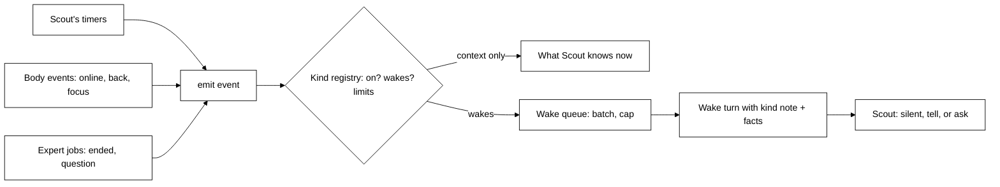

# Scheduler: events and timers (Row 10) — design

Date: 2026-10-28. Status: draft for review.

## Intent

Today Scout only thinks when the user talks to it or when an expert job ends. Row 10 gives Scout
chances to speak first, so it can behave like a smart assistant: the user hands over work (for
example a Claude Code job), gets on with their day, and Scout comes back only when something
truly needs them.

The core idea is a **framework**: one front door where anything can report "something happened".
Code decides _when_ Scout gets a chance to think; the model decides _whether_ to say anything and
_what_. Adding, removing or retuning a trigger must be a small, local change, because we expect
to keep adding triggers (desktop notifications, mail watches, later a camera on a physical Scout
noticing the user looks sad).

## Goals

- One entry point, `emit(event)`, used by every source. An event is a kind plus a few facts.
- A registry of event kinds in one place. Each kind has: on/off, whether it wakes Scout, its
  limits, and a plain-English note telling Scout how to weigh it. Retuning Scout's behaviour for
  a kind means editing its note, not code.
- Each waking event becomes one short wake turn. Scout may stay silent, tell the user, or ask
  first ("You have a message from X. Want me to read it?"). Asking first is Scout's choice.
- Timers Scout sets itself (one-off and repeating), which survive a brain restart. "Watch my
  email" is a repeating timer whose note tells Scout what to check with which connected app.
- Day-one sources: Scout's timers, body online, user back from idle, expert job ended, expert
  question asks. Focus changes are recorded as context but do not wake Scout.
- Hard limits in code so this cannot flood the user or burn the budget.

## Non-goals (this row)

- No regular heartbeat. Scout wakes only for events and its own timers (user's decision).
- Learned approvals (Scout learning which permission asks the user always approves, offering a
  standing rule, acting under it). That is the next row, built on this framework.
- Reading Windows notifications, camera or mood, the physical body. The framework must make
  these small additions later; they are not built now.
- No settings screen on Home for event kinds. "Easy to nudge" means easy for us to change while
  building: the registry and notes live in the brain's code and prompt files.

## Anti-goals (failure even if it works)

- Scout chatters: speaks on routine progress, every window switch, or repeats itself.
- Canned lines or hand-coded behaviour ("if email from boss, say X"). Code supplies the moment
  and the facts; Scout writes every word. A silent wake is a good outcome, not a failure.
- Scout acts on the user's behalf in new ways. In this row Scout only _answers expert questions_
  it can answer from the conversation and memory; permission asks still go to the user.
- Adding a trigger requires touching the scheduler core.

## Constraints

- Python brain only, plus a small desktop-body change for idle and focus events. Bodies talk only
  to the brain (contract v1, `protocol/README.md`). Any contract change is additive and updates
  the README, examples and both schema packages in the same PR.
- One turn at a time (contract rule). Wakes queue behind the user's conversation and run when no
  turn is running and a body is online — today's `Session.wake` behaviour (`sessions.py:111-143`).
- Wake turns use the existing daily budget and step cap (`guardrails.py`, `config.py`).
- A wake turn shows on the last body the user talked to if online, else any online body (Plan rule 3).
- TDD; the test clock is injected (`Session(now=...)`, `Memory(now=...)`).

## Design

### Events and the registry

- `Event(kind: str, facts: dict[str, str|int], key: str | None)`. `key` lets a source say "this
  replaces an earlier pending event" (for example one pending "back from idle" per body).
- The registry is a single list of `EventKind` entries in `brain/src/brain/events.py`:
  `name`, `enabled`, `wakes` (bool), `batch_seconds` (events of this kind arriving within this
  window go into one wake), `max_per_hour` (wakes of this kind), and the note.
- Notes live in `brain/src/brain/mind/events.md`, one `## <kind>` section per kind, loaded once like
  `soul.md`. A kind with `wakes=True` must have a note (a test enforces it).
- Unknown kinds and disabled kinds are dropped and logged; nothing crashes.

### The scheduler

- `brain/src/brain/scheduler.py` owns the wake queue that `Session` has today. `Session.wake` and
  `_run_wakes` move into it; `Session` keeps running turns. Job-finished wakes move onto `emit`
  with no change in behaviour (including `mark_reported` on start and re-queue after restart).
- Batching: waking events of one kind within `batch_seconds` merge into one wake listing all of them.
- Limits: per-kind `max_per_hour`, and a global cap on wake turns per hour (default 12, in
  `config.py`). Events over a cap are held and merged into the next allowed wake, not dropped,
  except when the daily budget is spent: then waking events are dropped and logged.
- The wake turn's message is a fenced `<data kind="event">` block (same fence pattern as job notes
  today) holding each event's kind, facts and time, plus the kind's note. Scout gets no wording to
  repeat.
- A silent wake turn must leave nothing visible on a body (how: see "Silent brain-started turns"
  below).

### Timers

- New `timers` table (new MIGRATIONS entry in `memory.py`): id, note, next fire time, repeat
  interval (optional; minimum 5 minutes), created time.
- Tools for Scout: `set_timer` (at a time or in N minutes, optional repeat, a note to its future
  self), `list_timers`, `cancel_timer`. Same mode as `remember`/`forget` (auto).
- A due timer emits kind `timer` with its note. A repeating timer schedules its next fire. A timer
  missed while the brain was down fires once at start, never once per missed interval.
- Mail watching needs no new source: Scout sets a repeating timer whose note says what to check
  and with which connected app, and on each wake uses the app's tools and decides whether
  anything is worth saying.

### Body events

- The brain starts handling the body→brain `event` notification (today it is dropped:
  `server.py` `_dispatch`). Names: `back` (user returned after idle; data: idle seconds) and
  `focus` (app and window title).
- Body online comes from the brain's own connect hook, not an event message.
- `focus` is context only: the brain keeps the latest focus per body and puts it in the prompt's
  "Now" section. It does not wake Scout. Its switch is in the registry, so focus wakes can be
  tried later by flipping `wakes`.
- The desktop body sends `back` after a meaningful idle period (default 5 minutes idle) and `focus`
  on change (throttled). The contract README documents both names.

### Expert events

- Job ended (done, error, stopped): moves onto `emit`, same facts as today's `job_note`.
- Expert _question_ asks (free-text questions from the expert, `jobs.py:177-195`) go to Scout first
  as a waking event. Scout answers from the conversation and memory when it can, and asks the user
  only when it truly needs them. Scout's answer goes back to the expert through a tool.
- Expert _permission_ asks and progress are unchanged: permission asks still go straight to the
  user as cards (until learned approvals), progress never wakes Scout.

## Decisions settled after the builder check (designer's calls)

- **Expert questions must resolve.** A question wake gives Scout two tools: answer the expert, or
  pass the question to the user (it then appears as today's question card). If the wake turn ends
  without either, or the wake cannot run (budget spent), the question goes to the user as a card
  automatically. Question wakes skip batching and the hourly caps (they block the expert's work),
  but still queue behind a running turn. No extra timeout beyond today's.
- **Silent brain-started turns.** The turn `started` notification gains an additive field saying
  who started the turn (user or brain). A body shows no thinking state or bubble for a
  brain-started turn until a reply or an ask arrives. Contract README, examples and both schema
  packages are updated in 10c.
- **Holding and caps.** Held and queued events live in memory only. What must survive a restart
  already does: unreported jobs re-queue (today's path), and a missed timer fires once at start.
  Caps use a rolling 60-minute window. `key` replacement applies to held events too. Per-kind
  `max_per_hour` counts wakes, not events.
- **Queue ownership.** The scheduler owns the queue. `Session` tells it when a turn ends and when
  a body connects. `on_start` callbacks (job `mark_reported`) are kept.
- **Repeating timers** compute their next fire time when they fire, and use the timer id as `key`,
  so a fire still waiting in the queue is replaced and fires never pile up.
- **Defaults per kind:**

  | Kind           | Wakes                                      | Batch | Max per hour |
  | -------------- | ------------------------------------------ | ----- | ------------ |
  | `timer`        | yes                                        | 0 s   | 6            |
  | `body_online`  | yes, only if that body was offline 10+ min | 0 s   | 2            |
  | `back`         | yes                                        | 0 s   | 2            |
  | `job_ended`    | yes                                        | 30 s  | 10           |
  | `job_question` | yes (no batch, no cap)                     | —     | —            |
  | `focus`        | no (context only)                          | —     | —            |

  Global cap: 12 wake turns per rolling hour (`job_question` not counted).

- **Time.** Timers are stored in UTC. `set_timer` takes minutes from now, or an ISO time with a
  UTC offset. Scout already sees the current time; it must include the UTC offset so Scout can
  convert "3 pm".
- **Focus in the prompt.** The latest focus per body goes beside the "bodies online" line, which
  is already rebuilt every step, not into the cached soul part.
- **Event names and data.** `back {idle_seconds: int}` and `focus {app: str, title: str}`,
  documented in the contract README with example frames.

## Suggested slices

1. **10a** Scheduler core: `Event`, registry, notes file, `emit`, batching, caps, wake message
   format; move job-ended wakes onto it.
2. **10b** Timers: table, tools, firing, restart behaviour.
3. **10c** Body events: brain handles `event`; `back` wakes, `focus` as context; desktop sends
   them; a silent brain-started turn shows nothing on the desktop.
4. **10d** Expert questions to Scout first.

Then the learned-approvals row.

## Left to the builder

- Exact names of classes, tools and functions; the idle threshold and focus throttle in the desktop.
- How the wake message lists several batched events.
