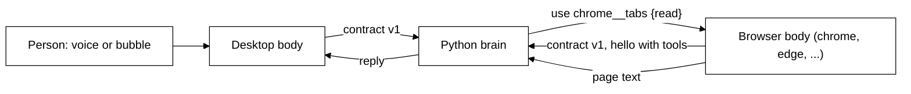

# Browser body (row 12): design

Status: draft, agreed in chat 2026-10-29; awaiting builder check and approval.

## Intent

The Chrome extension becomes Scout's eyes (and later hands) in the person's own browser: a body with no chat
of its own. The person talks to Scout through the desktop bubble or voice; when Scout decides it needs what is
in the browser, it calls the browser body's tools and gets plain text back. No screenshot loop, no
click-by-click driving: reading a page is one quick call and a few thousand tokens.

Today the extension is broken: it dials the old TypeScript engine (`packages/core`) inside the desktop app,
which the desktop no longer starts. Row 12 moves it onto the Python brain over contract v1, the same way the
desktop body connects, and unblocks row 13 (deleting the old core).

## Goals

- The extension is optional. Everything works without it; with it, Scout reads real page text and the exact
  selection instead of guessing from a screenshot.
- It connects straight to the brain (`ws://127.0.0.1:47321` by default, address changeable), no pairing.
- Nothing is sent automatically. Scout reads only when the model decides to call a tool.
- Any Chromium browser (Chrome, Edge, Brave, Opera, Vivaldi, Arc) runs the same build, each as its own body.
- Adding a browser ability later is one tool (or one action on an existing tool), with no contract change.
- Installed unpacked from the desktop app for now.

## Non-goals

- Chat inside the browser (the side panel goes).
- Form filling, clicking buttons, driving pages. Slow, fragile and screenshot-shaped; it belongs to a later
  "Scout's own browser" row (try Lightpanda as a connected app over MCP, once the brain can run on a Mac/Pi).
- Firefox and Safari. The browser layer is kept thin so Firefox is one more layer later.
- Chrome Web Store publishing (later; the listing drafts in `docs/chrome-web-store/` stay).
- The desktop showing whether a browser is connected (later; needs a brain tool listing bodies).

## Anti-goals (failure even if it works)

- Scout taking screenshots of pages by default, or sending page content with every message.
- Scout changing anything in the browser without the person's Ask/Auto permission saying so.
- A long list of narrow tools that bloats every turn and makes the model choose worse.
- Two browsers knocking each other off the brain.

## How it fits

- The browser body says `hello` with `body: { id: <browser>, kind: "browser", name: <Browser name> }` and its
  tools. The brain shows them to the model as `<id>__<tool>` (`chrome__tabs`, `edge__tabs`).
- While the browser is closed its tools cannot be served (the brain's toolbox already knows an offline body's
  tools and answers `body_offline`); Scout falls back to the desktop's screen tools.
- Every brain notification reaches every body; the browser body ignores everything except `use` and `cancel`.

## Decisions

Made by the person in chat:

1. Keep the extension; it is optional.
2. Connect directly to the Python brain; no pairing token.
3. No automatic page content; Scout reads when it decides to.
4. No chat in the browser; talk through the desktop bubble or voice.
5. Install unpacked from the desktop app now; publish later.
6. Start read-only, built to grow; then add the rest in three slices.
7. All the abilities listed below except form filling and clicking.
8. Design for different browsers; build for Chromium-based ones only.
9. Scout's own browser (Lightpanda) is a later row, not part of row 12.

My calls (the person can overturn any):

10. **Folder and name.** `apps/extension` moves to `bodies/browser` (`@tagalong/browser`), since it is no
    longer Chrome-only and is a body.
11. **One body per install (browser and profile).** The extension detects its browser
    (`navigator.userAgentData.brands`, falling back to the user agent: `chrome`, `edge`, `brave`, `opera`,
    `vivaldi`, `arc`, else `chromium`). On first run it makes its body id from that plus four random characters
    (`chrome-7k2f`), saved in `chrome.storage.local`, so it stays stable across restarts. Every browser and every
    profile is its own install, so two browsers or two Chrome profiles open at once are separate bodies and never
    knock each other off (the person asked for this to never be a blocker). The body `name` defaults to the
    browser's name ("Chrome"); the popup has an optional name field ("Work", "Personal") so Scout and the
    person can tell profiles apart; tool descriptions mention the body's name.
12. **Few, broad tools** (each has an `action` or `source` field) so the tool list stays short:

    | Tool | Effect | Slice | What it does |
    | --- | --- | --- | --- |
    | `tabs` | read | 12a (list, read), 12b (picture) | `list` open tabs (id, title, url, active, asleep); `read` one tab (default the active tab of the focused window): url, title, readable text, selection; `picture` one tab as an image when text is not enough |
    | `page_parts` | read | 12b | Just the `links`, `tables`, `forms` or `headings` of one tab, as text |
    | `browser_search` | read | 12b | Search `history`, `bookmarks`, `reading_list`, `downloads` or `closed` tabs by words and date |
    | `tab_actions` | change | 12c | `open` (url or search), `close`, `switch`, `group`, `reopen` (a closed tab), `bookmark`, `reading_list` |

    `tab_actions` is `effect: "change"`, so it asks under the person's permissions like every change tool.
    Read tools carry `effect: "read"` and no `confirm`; the person's per-tool Ask/Auto setting decides.
13. **Reading rules.** Page text is the Readability text the extension already extracts, capped at 40,000
    characters with a plain "truncated" note. A sleeping (discarded) tab is never reloaded: `read` fails with
    `tool_failed` saying the tab is asleep. Pages the browser locks (`chrome://`, the Web Store, other
    extensions) fail with `tool_failed` saying so. A `picture` uses `captureVisibleTab`, which only sees the
    visible tab of a window; for a background tab it fails saying so rather than switching tabs.
14. **Permissions: ask when Scout needs them, never up front** (the person's decision). Install asks only for
    what carries no browser warning (`storage`, `scripting`). Everything else is an optional permission
    (`tabs`, site access, `history`, `bookmarks`, `downloads`, `sessions`, `readingList`, `tabGroups`,
    `contextMenus`) requested the first time a tool needs it:
    - Browsers only let a permission be requested from a click on an extension page, never from the background
      worker. So when a tool lacks one, the body opens a small extension window naming what Scout wants and why
      ("Scout wants to read this page on example.com") with **Allow on this site**, **Allow on all sites**
      (for site access) or **Allow** (for the others), and **Not now**. The click triggers the browser's own
      prompt.
    - The tool waits up to 25 s (inside the brain's 30 s `use` timeout). Granted: it continues and returns its
      result. Declined, closed or no answer: `tool_failed` with a plain reason ("the person has not allowed
      reading example.com"), so the model knows and can say so in its own words.
    - Site access is asked per site by default; "all sites" is one click for people who want it.
    - Once granted, never asked again. The popup lists what has been granted, with a Remove for each.
    - Right-click "Ask Scout" (12c) needs `contextMenus` before the menu item can exist, so the popup offers
      to turn it on; the `scout` address-bar keyword needs no permission.
    `readingList` is Chrome-only; elsewhere that source answers `tool_failed` "not supported in this browser".
15. **Events** (12b). Two new body event names, documented in the browser body's doc:
    - `tab {title, url}`: the active tab changed (throttled like `focus`, at most one per 2 s, URL without query
      string or fragment). Brain kind `tab`, `wakes=False`: a fact Scout sees on its next turn, never a wake.
    - `download {name, state}`: a download finished or failed. Brain kind `download`, `wakes=False`.
    Each gets a note in `brain/src/brain/mind/events.md`; wording stays the model's.
16. **Shared connection.** The desktop's `bodies/desktop/src/main/brain/brain-client.ts` moves into
    `@tagalong/contract` (`protocol/ts`) as `BrainClient`, used by both bodies. It already imports only the
    contract and the global `WebSocket`. Changes: the body is a constructor argument (not hardcoded `desktop`);
    `last_seq` storage is pluggable (the browser keeps it in `chrome.storage.session` so a service-worker restart
    replays instead of resyncing); an optional keepalive (the browser worker cannot see ping frames and Chrome
    stops idle workers after 30 s, so it sends a cheap `call` every 20 s; any brain tool that only reads will
    do, e.g. `spend_today`). Retry stays a fixed 2 s.
17. **Popup.** A small toolbar popup replaces the side panel and the options page: one status line
    (connecting, connected, brain not reachable, needs an update on `version_mismatch`) and a brain-address
    field (default `127.0.0.1:47321`, saved in `chrome.storage.local`; changing it reconnects).
18. **Desktop install entry.** The Settings "Browser extension" section (whose pairing token never arrives)
    becomes "Add Scout to your browser": three steps (open `chrome://extensions` or `edge://extensions`, turn on
    Developer mode, Load unpacked), a Show folder button (`shell.showItemInFolder` on the bundled folder:
    `resources/extension` packaged, `bodies/browser/dist` in dev) and Copy buttons for the folder path and the
    extensions-page address (desktop apps cannot reliably open `chrome://` URLs). The old "Browser extension"
    health row goes: it reads from the old engine. `electron-builder.json` points at `bodies/browser/dist`.
19. **Right-click and address bar** (12c). A context-menu item "Ask Scout about this" (on a selection or a
    page) and the omnibox keyword `scout` send a `say` from the browser body, with the selection or the typed
    question as `text` and `{ url, title }` as `context`. Because the browser body shows nothing, the reply must
    appear in the desktop bubble. Contract change (optional field, no version bump): `Body.display?: boolean`,
    default true. When a body with `display: false` sends `say`, the brain sets the turn's `body` to the body the
    person last talked to that is online and has a display, otherwise any online body with a display, otherwise
    `null` (the same rule as brain-started turns). The field, its routing and the browser sending
    `display: false` all land together in 12c (nothing in 12a or 12b sends `say` from a browser). Asks, replies
    and other broadcasts stay broadcast: the browser body ignores them and the desktop shows them. With no body
    that has a display online, an Ask-mode tool times out as it does today when no body is online, and the
    model is told.
20. **What is deleted in 12a.** The side panel, options page, pairing, `PortHub`/port bridge/port messages,
    `EngineConnection`, `EXTENSION_CAPABILITIES`, `perception.capture` handling and the extension's dependency
    on `@tagalong/protocol` and `@tagalong/ui`. The engine side in `packages/core` (`browser-route.ts`,
    `EXTENSION_METHODS`, the pairing token) is left for row 13, which deletes the old core.
21. **No wake when a browser connects.** `body_online` (Scout may speak when a body returns after 10 minutes)
    skips bodies of kind `browser`: opening Chrome is not the person coming back, and the desktop's `back`
    covers that. This is a one-line brain change in 12a.
22. **Timeouts and failures.** The brain's 30 s `use` timeout applies unchanged. `read` injects the page
    reader on demand (as today); an injection failure and a locked page are both `tool_failed` with a plain
    reason. A `use` running when the service worker is stopped ends as `body_offline`, as for any body.
    `last_seq` lives in `chrome.storage.session`, so a worker restart replays and a browser restart resyncs
    (harmless: the browser ignores asks and turns).
23. **Event settings.** `tab` and `download` are `wakes=False`, so they need no batching or caps; the brain
    keeps the latest `tab` per body (key = body id), like `focus`. The body throttles `tab` (2 s). No
    de-duplication against the desktop's `focus`; they are different facts.
24. **Dev builds.** `pnpm dev:desktop` builds `bodies/browser` first, so Show folder always has a folder; if
    the folder is still missing, the section says how to build it instead of failing.

## Slices

Each slice is one PR, test first.

- **12a: browser body on the brain.** Move to `bodies/browser`; shared `BrainClient` in `@tagalong/contract`
  (desktop switched to it, no behaviour change); browser detection and body id; `tabs` `list` and `read`;
  the ask-when-needed permission window (14); popup with name field and granted permissions; desktop "Add Scout to your browser" section and health-row removal; packaging path; deletions in 20;
  no `body_online` wake for browser bodies (21); `dev:desktop` builds the browser body (24).
  Docs: `docs/browser-extension.md` rewritten for the browser body (its tools and events live there),
  `docs/architecture.md`, README, CLAUDE.md layout, feature-test guide.
- **12b: more to read.** `tabs` `picture`, `page_parts`, `browser_search`; `tab` and `download` events with
  their brain kinds and notes; permissions for these. Docs and feature-test guide.
- **12c: acting and asking from the browser.** `tab_actions`; the `Body.display` field in the contract (spec,
  zod, pydantic, examples), the browser sending `display: false`, and brain routing for its `say`; context-menu
  item and `scout` omnibox keyword. Docs and feature-test guide.

## Testing

- Browser body: vitest against fake browser adapters (the existing `chrome-adapters.ts` pattern: real APIs
  behind small interfaces). Readability extraction keeps its jsdom tests.
- `BrainClient`: its existing desktop tests move with it, plus body-as-argument, pluggable `last_seq` and
  keepalive.
- Brain: pytest for the `display` routing rule (12c), the `tab` and `download` event kinds (12b), and contract
  examples for the new `Body.display` field shared by both test suites.
- Desktop: the install section's unit tests; the e2e suites (fake brain) keep passing.
- By hand (feature-test guide): load unpacked in Chrome and Edge at once, ask from the bubble about the open
  page, about a background tab, after closing the browser (falls back to the screen).

## Left to the builder

- Exact JSON schemas, descriptions and output wording of the tools (descriptions are written for the model:
  plain, short, saying when to use the tool).
- How `list` marks the active and sleeping tabs; how `browser_search` dates are expressed.
- File layout inside `bodies/browser` (keep the thin browser-API layer separate from the tools and the
  connection, so a Firefox layer can be added later).
- The popup's look, following DESIGN.md.
