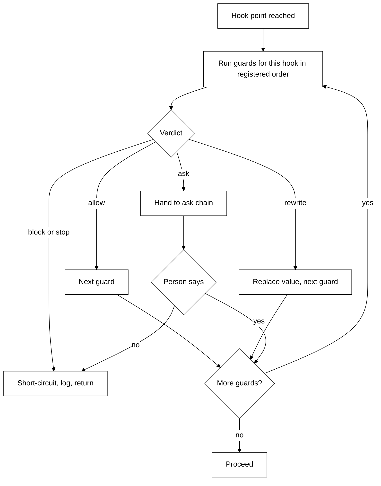

# Guardrails: design

Date: 2026-10-29. Launch board row 11 "Guardrails: confirm, timeouts, secrets".

## Intent

The brain already has guardrails, but each is its own piece of code in its own file: the daily
budget and step cap in the thinking loop, the tool gate and ask chain in the toolbox, the
side-check, offers, the expert permission relay, wake caps in the scheduler. Nothing is
shared, nothing is logged in one place, and the gaps are the kind that bite later: no time limit
on a Scout turn or a model call, expert asks that can wait 30 minutes, and secrets that can sit
in the approvals history, in a side-check prompt, or in an app's stored config.

This design puts every guardrail behind one small framework in the Python brain, moves the
existing checks onto it without changing behavior, then adds the missing ones. After that,
adding a guardrail means writing one guard, one test, and registering it.

## Goals

- One guardrail framework in the Python brain for all guardrails.
- Every guardrail decision goes through it and is logged: which guard, which verdict, why.
- Settings for all guards live in one place (`config.py`, env vars as today).
- Close the gaps: a time limit on a Scout turn, Scout always telling the person what an expert
  did (even when they were away), secrets masked on disk, and the locked-tool rule.
- A new guard needs no change to the thinking loop or the toolbox.

## Non-goals

- Auth, TLS, pairing, multi-user. Single user, no security work yet (see protocol/README.md).
  The local websocket `call` path with caller `home` skips the gate (`server.py:182-197`); that
  stays as it is and is noted here only so nobody thinks the framework covers it.
- Moving plumbing limits. These stay where they are: reconnect replay buffer, history trim to
  50, list page sizes, prompt-text char caps, memory item and char caps, timer constants.
- A Home page for guards. Env settings and log lines are enough (user decision).
- Validating app tool input against its `input_schema` (user decision: out).
- New expert timeouts. The brain is event-based; an expert ask stays open until answered or the
  existing 1800 s run cap (user decision).
- Masking Scout's live turn or the side-check prompt (user decision, see Secrets).

## Anti-goals (failure even if it works)

- A plugin system, dynamic loading, or a rules language. Guards are plain Python functions
  registered in one list.
- Changing behavior during G1 and G2. They are moves, not fixes. Existing tests stay green and
  no env var changes name or meaning.
- Putting policy in the model's hands. Code decides when and which guard runs; the model only
  keeps the jobs it has today (side-check and offers choose under a preference).
- A second budget, a second config, or a guard that quietly does its own logging elsewhere.

## Constraints

- Guards run on the event loop; they must be quick or async. A guard that needs the model (the
  side-check) is async and has its own time limit.
- A guard failing (raising) must not open the door. Hook points that protect spend or tool
  calls fail closed (treated as block, logged). A side-check that raises or times out falls
  through to the person ask, as today. A masking guard that raises withholds the text rather
  than saving it raw. (Lead's call.)
- Contract v1 (protocol/README.md) does not change. Verdicts surface through existing results
  and reasons (`over_budget`, `step_cap`, `error`, `denied`, `timeout`).
- Every file opens with a 2-6 line header; comments say why, not history.

## The design

### Guard shape

A guard is one small unit with a name, one hook point, and a function that returns a verdict.

```python
# shape only, not final code
@dataclass(frozen=True)
class Guard:
    name: str            # appears in the log line
    hook: Hook           # where it runs
    check: Callable[[Context], Verdict | Awaitable[Verdict]]
```

`Context` is a small dataclass per hook point (see below), so a guard reads facts and never
reaches into the loop or toolbox.

### Verdicts

| Verdict | Meaning                                      | Effect                                                                           |
| ------- | -------------------------------------------- | -------------------------------------------------------------------------------- |
| allow   | nothing to say                               | next guard runs                                                                  |
| ask     | the person must decide                       | the ask chain runs (tool call and expert permission only)                        |
| block   | do not do this, tell the model or caller why | the action is refused with an error result                                       |
| stop    | end the whole turn or wake                   | the turn ends with a reason (`over_budget`, `step_cap`, a new timeout reason)    |
| rewrite | pass on a changed value                      | the next guard and the caller see the new value (masking, on the save hook only) |

"Approve once" (the side-check's answer) is `allow` with a flag, not a sixth verdict.

Each verdict except allow carries a short plain-words `reason`.

### Hook points

| Hook        | Runs                                                        | Context                                                    | Verdicts that make sense                                   |
| ----------- | ----------------------------------------------------------- | ---------------------------------------------------------- | ---------------------------------------------------------- |
| model_call  | before each model call in the loop (and side-check, offers) | turn, steps so far, spend                                  | allow, stop, block                                         |
| tool_call   | before a tool runs                                          | tool spec, input, caller, source kind                      | allow, ask, block                                          |
| ask         | before an ask reaches the person                            | ask facts, who is asking                                   | allow (go to the person), approve-once (side-check), block |
| tool_result | after a tool returns, before the model sees it              | tool, result                                               | allow, block (the model gets an error result text)         |
| emit        | before the scheduler starts a wake                          | event kind, wake counts                                    | allow, block (hold, as today)                              |
| save        | before text is written to disk                              | what is being saved (chat, approval, job result, log line) | allow, rewrite                                             |

The `save` hook is new: masking makes a separate stored copy and never changes what a tool
receives or what the model sees, so rewrite lives here and not on tool_call.

The `ask` hook is the existing chain: mode resolution, then side-check, then the person, then
the offer. In the framework it is one ordered list of guards, so the order is visible in one
place instead of spread across `_ask`.

### Runner order and short-circuit



Rules:

- Guards run in registration order for their hook. Order is data in one list, not hidden in
  call sites.
- The first block or stop ends the run; later guards do not run.
- rewrite feeds the new value to later guards.
- ask runs the ask chain once, after all non-ask guards have had their say. A block always beats
  an ask.
- A guard that raises counts as block (see Constraints), logged with the exception.

### Logging

Standard logger `brain.guardrails`, INFO, one line per non-allow verdict:
`guard=<name> hook=<hook> verdict=<kind> reason=<text>` plus the turn id when there is one.
Allow is not logged (too noisy). The approvals history keeps recording asks as today; this log
is for developers. Log lines never contain tool input or result text. (Lead's call.)

### Config

All guard settings move into `Config` in `config.py`, read from env as now. Existing names stay
(`TAGALONG_DAILY_BUDGET_USD`, `TAGALONG_STEP_CAP`, `TAGALONG_WAKES_PER_HOUR`,
`TAGALONG_EXPERT_TIMEOUT_S`, the offer settings). The one new one is `TAGALONG_TURN_TIMEOUT_S` (default 300, G3). Guards receive their settings when registered, not by
importing `config`.

## How each existing check maps

Line numbers checked against the tree at drafting time.

| Today                                                       | Where                                                                                                     | Becomes                                                            | Hook              |
| ----------------------------------------------------------- | --------------------------------------------------------------------------------------------------------- | ------------------------------------------------------------------ | ----------------- |
| Daily budget (`Budget.allows`, `TAGALONG_DAILY_BUDGET_USD`) | `guardrails.py:21-71`; used at `mind/turn.py:92`, `side_check.py:77`, `offers.py:104`, `scheduler.py:118` | `daily_budget` guard (the ledger stays in `guardrails.py`)         | model_call; emit  |
| Step cap (`TAGALONG_STEP_CAP`)                              | `mind/turn.py:95-97`                                                                                      | `step_cap` guard                                                   | model_call        |
| Mode resolution: self_asks, locked, stored, default, effect | `toolbox.py:149-159`, `set_mode` 161-171                                                                  | `tool_mode` guard (yields ask or allow); locked rule changes in G2 | tool_call         |
| Home caller skips the ask                                   | `toolbox.py:262`                                                                                          | stays in `tool_mode` (caller is in the context)                    | tool_call         |
| No one online: refuse                                       | `toolbox.py:224-228`                                                                                      | `anyone_online` guard (block)                                      | ask               |
| Side-check, allow once                                      | `toolbox.py:229-239`, `side_check.py:71-104`                                                              | `side_check` guard; locked rule changes in G2                      | ask               |
| Person ask, 300 s                                           | `toolbox.py:240-249`, `asks.py:41-56`                                                                     | `person_ask` guard (Asks keeps the wire work)                      | ask               |
| Always -> mode auto; offer after approve                    | `toolbox.py:251-254`, `offers.py`                                                                         | after-answer step of the ask chain                                 | ask               |
| Expert permission relay                                     | `jobs.py:184-234`                                                                                         | same `side_check` and `person_ask` guards, source `claude_code`    | ask               |
| Expert question to Scout first                              | `jobs.py:259-285`, `questions.py`                                                                         | stays as is; no new limit (G3 checks the person is told)           | ask               |
| Scheduler wake caps (per hour, per kind)                    | `scheduler.py:116-188`, `events.py`                                                                       | `wake_caps` guard                                                  | emit              |
| Locked heuristic for app tools                              | `app_tools.py:37-70`                                                                                      | stays a classifier feeding `ToolSpec.locked`; `tool_mode` reads it | tool_call         |
| App result 8000 chars and fence                             | `app_tools.py:100`                                                                                        | stays plumbing (output size), not a guard                          | tool_result (n/a) |

Plumbing that stays where it is, by the rule in Goals: body tool call 30 s (`bodies.py:162-191`),
app tool call 60 s (`apps.py:336-357`), app connect and sign-in timeouts, expert run 1800 s and
startup 60 s (`experts.py`), the 20 s side-check timeout, the 300 s person ask. These are
per-call time limits owned by their transport. The only new limit is the Scout turn.

Not a guard: expert env strip of `ANTHROPIC_API_KEY` and `ANTHROPIC_AUTH_TOKEN`
(`experts.py:32`). It is process setup, not a decision. Left alone.

Bug in scope (G3): the body output size check at `toolbox.py:115-121` counts bytes only for
parts that have `.data` (image, file). `TextPart` (`protocol.py:113`) has `text`, so large text
never counts toward `part_bytes` (5 MB) or `message_bytes` (20 MB). Count text length too.

## Locked tools

Today a locked tool always asks: `Toolbox.mode` returns "ask" first (`toolbox.py:152`),
`set_mode` refuses auto (`toolbox.py:169`), the side-check skips it only while the builtin
default preference exists (`side_check.py:75`; that default can be deleted, `memory.py:128`),
and Home shows "Always asks" with the switch fixed (`bodies/ui/src/home/permissions-panel.tsx:68-76`).

New rule (user decision): a locked tool comes to the person until the person explicitly unlocks
it. Two ways, both explicit:

- A per-tool switch on Home, Ask to Auto, now allowed for locked tools, with a warning that it
  is a risky action. This changes the `set_mode` rule, the `mode` order (a stored auto now
  counts for a locked tool) and the permissions panel.
- A preference that names that locked tool. The side-check may approve a locked tool only under
  such a preference; general preferences never count. Deleting the builtin default no longer
  opens anything.

The "Always" button in the ask stays hidden for locked tools (`asks.py:50`); the Home switch is
the one deliberate way. This is a behavior change, so G2's PR calls it out.

## Experts and news while away

Rule (user decision): no new expert timeouts. An expert's permission ask or question stays open
until answered or the 1800 s run cap. What matters is that Scout always tells the person what
happened with an expert: finished, asked something, stalled, or died. If the person is offline,
the news is held and told when they are back.

G3's builder verifies this for a dead or stalled expert, and for a question or permission asked
while the person is offline (today `Asks.open` returns "nobody" at once when no body is online,
`asks.py:73-74`). Gaps found are fixed in G3.

## Secrets

Primary rule: keep secrets out of the model. Masking is the backstop.

- Apps: stop storing literal env values and URL secrets in `apps.config`; move them to the
  existing token file (`apps.py:153`, `app-tokens.json`) and migrate rows already stored.
- Mask in everything written to disk: saved chat (`memory.py:694` `save_messages`), approvals
  history (`approvals.py`), job results, and log lines. Mask as `[secret]`, matching the exact
  values the brain holds (API key, app bearer tokens, OAuth tokens) plus a few well-known key
  shapes. This is the `save` hook with `rewrite`.
- Not masked: Scout's live turn and the side-check prompt.

## Slices

Each slice is about 500 to 1,000 changed lines, one PR, written test first.

### G1: framework, budget and step cap (behavior-preserving)

- `Guard`, `Verdict`, `Hook`, `Context` types, the runner, and the log line.
- Move the daily budget and step cap onto `model_call`, and the scheduler's budget drop onto
  `emit`. `Budget` (ledger, prices) stays in `guardrails.py`. The loop, side-check and offers
  call the runner instead of `budget.allows()` and the step check.

Done when: runner tests (order, short-circuit, rewrite chaining, a raising guard counts as
block, one log line per non-allow); existing turn, side-check, offers and scheduler tests pass
unchanged; `over_budget` and `step_cap` come out as before; no env or protocol change; docs
updated.

### G2: tool gate and ask chain, plus the locked-tool rule

- `tool_call`: `tool_mode` guard is the single mode source. `ask`: ordered guards (no one
  online, side-check, person). After-answer steps (record, always to auto, offer) stay outside
  the list. The expert permission relay (`jobs.py:184-234`) uses the same chain with source
  `claude_code`. `wake_caps` moves to `emit`.
- The locked-tool rule above: brain (`toolbox.py`, `side_check.py`) and the Home switch with
  its warning (`bodies/ui`, with the host bridge and tests).

Done when: all existing toolbox, asks, side-check, jobs and scheduler tests pass, with edits
only where the locked rule changes the expected result; one test per guard and one end-to-end
test per path; a locked tool asks by default, runs after the Home switch, runs under a
preference that names it, and does not run under a general preference even with the builtin
default deleted; the expert relay no longer holds its own copy of the sequence; the PR names the
behavior change.

### G3: turn timeout, expert news while away, body size fix

- Scout turn timeout: the loop wraps the turn in `asyncio.timeout`; on expiry the turn ends with
  reason `error` (contract v1 unchanged) and a clear message to the person. Setting
  `TAGALONG_TURN_TIMEOUT_S`, default 300, held with the guard config.
- Verify and fix expert news (see above).
- Count text parts in the body output size check.

Done when: a stalled model ends the turn within the limit with the message (fake clock or tiny
limit); tests show the person is told when an expert finishes, asks, stalls or dies, including
while offline; a large text part from a body is refused with `over_limit`.

### G4: secrets

- Move `apps.config` env values and URL secrets to the token file, with a migration for stored
  rows (no secret left in the table afterwards).
- The `save` hook and a masking guard on chat, approvals, job results and log lines.

Done when: a fake API key, bearer token and a `?token=` URL are `[secret]` in the saved chat,
approvals row, stored job result and log output; the live turn and the tool still get the real
values; an old app row is migrated and still connects.

## Docs to update with each slice

`docs/brain.md` (guardrails, hook list), `docs/asks.md` (ask chain, locked rule),
`docs/connected-apps.md`, `docs/settings-and-secrets.md` (new env var, secret storage),
`docs/privacy.md` (what is masked), `docs/testing/feature-test-guide.md`, and the CLAUDE.md
Layout line for `guardrails.py` if files move. `README.md` where it lists settings.

## Decided

User:

- One framework in the Python brain for all guardrails; new ones added as needed.
- Verdicts allow, ask, block, stop, rewrite; a guard is a small unit with a hook point;
  ordered, logged, one config. Adding a guard changes neither the loop nor the toolbox.
- Plumbing limits stay where they are.
- Locked tools: the rule above (Home switch plus naming preference; loophole closed).
- No new expert timeouts; the one new limit is the Scout turn at 300 s; Scout always tells the
  person what an expert did, held while they are offline.
- Secrets: move app secrets out of `apps.config` with a migration; mask on disk; live turn and
  side-check prompt not masked.
- Body size fix in. App input schema validation out. Home guardrails page out.

## Calls made by the lead

- Masking is a separate stored copy; `rewrite` belongs to the new `save` hook, not tool_call.
- The loop enforces the turn timeout; reason `error` with a clear message, so contract v1 holds.
- A side-check that raises or times out falls through to the person ask. Spend and tool guards
  that raise fail closed.
- On `emit`, block means hold (today's behavior). On `tool_result`, block gives the model an
  error result text.
- "Approve once" is allow with a flag, not a sixth verdict.
- Logger `brain.guardrails`, INFO for non-allow, turn id when known, never tool input or result.
- `anyone_online` applies to expert asks as today.
- Slices cut as G1 to G4 above.

## Left to the builder

- Exact types, file names (a new `brain/guards.py` or growing `guardrails.py`), registration in
  `sessions.py`.
- Wording of the Home risk warning and the turn-timeout message.
- The key-shape patterns and test fixtures; the migration for stored app rows.
- Which expert-news gaps exist (G3 verifies first).
- The test seam for fake time.
