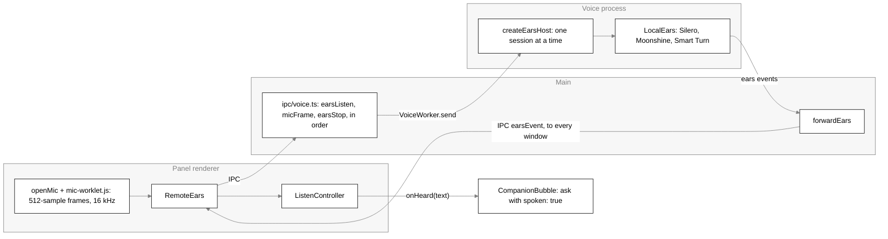
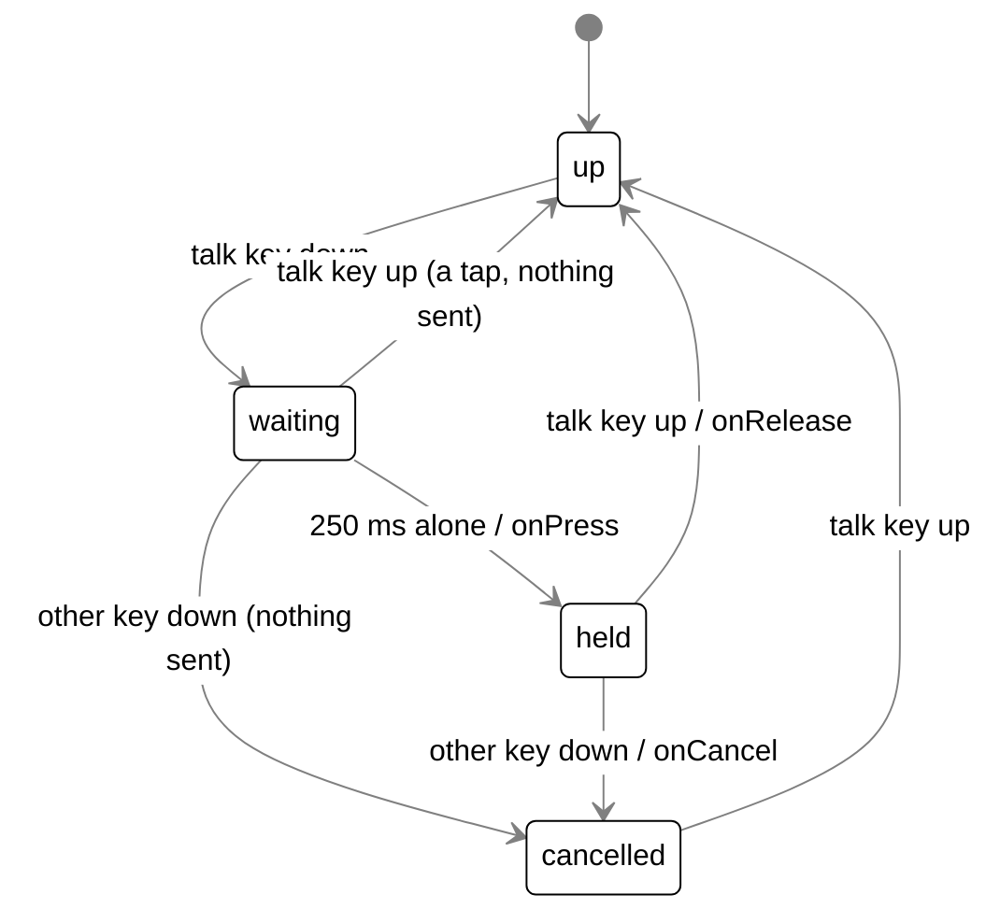
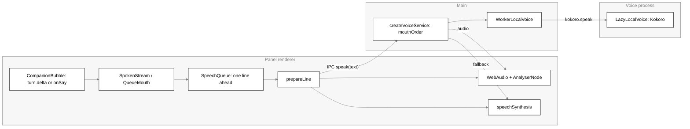

# Voice

## Purpose

How Scout hears and speaks. This covers the talk key, the mic button, Always listening, the
follow-up window, barge-in, and the speech models in the voice utility process. On the speaking
side it covers Kokoro and the system voice. Speech to text runs on this computer. The
configured brain still answers: a heard question goes to the brain as an ordinary ask with
`spoken: true`.

## Where it lives

| Area                           | Files                                                                                                                                                                                                                                                                                                                                                                                                                                                                                                    |
| ------------------------------ | -------------------------------------------------------------------------------------------------------------------------------------------------------------------------------------------------------------------------------------------------------------------------------------------------------------------------------------------------------------------------------------------------------------------------------------------------------------------------------------------------------- |
| Shared types and rules         | `bodies/ui/src/shapes/voice.ts` (`Ears`, `Mouth`, `ListenMode`, `EARS_IDS`, `MOUTH_IDS`), `bodies/desktop/src/shared/voice.ts` (`EARS_SAMPLE_RATE`, `EARS_FRAME`, `mouthOrder`, `chosenMouth`, `VOICE_ADAPTERS`), `bodies/ui/src/shapes/addressing.ts` (`addressedToScout`, `isStopListening`, `mightBeStop`, `FOLLOW_UP_MS`), `bodies/desktop/src/shared/settings.ts` (`TALK_KEYS`, `TALK_KEY_LABELS`, `voice`, `listening`, `hotkeys.talk`), `bodies/ui/src/shapes/status.ts` (the ears and mic marks) |
| Voice utility process          | `bodies/desktop/src/main/voice/worker/main.ts` (entry), `messages.ts`, `handler.ts`, `ears-host.ts`, `client.ts` (`VoiceWorker`, in main), `worker-local-voice.ts` (`WorkerLocalVoice`, in main)                                                                                                                                                                                                                                                                                                         |
| Ears (voice process)           | `bodies/desktop/src/main/voice/ears/local-ears.ts`, `ort-ears.ts`, `smart-turn.ts`, `load-ears.ts`, `fake-ears.ts`, `model-files.ts`                                                                                                                                                                                                                                                                                                                                                                     |
| Mouth (main and voice process) | `bodies/desktop/src/main/voice/voice.ts` (`createVoiceService`, `LazyLocalVoice`, `localMouth`, `fakeTts`), `kokoro.ts`, `model-cache.ts`                                                                                                                                                                                                                                                                                                                                                                |
| Talk key (main)                | `bodies/desktop/src/main/talk-key.ts` (`TalkKeyWatch`, `startTalkKey`, `loadKeyHook`), `talkPressed` and `toPanel` in `bodies/desktop/src/main/index.ts`                                                                                                                                                                                                                                                                                                                                                 |
| Always listening (main)        | `bodies/desktop/src/main/always-listening.ts` (`AlwaysListening`, `listeningPaused`, `startListeningGuard`, `saveListening`), `markListening` in `bodies/desktop/src/main/status-marks.ts`                                                                                                                                                                                                                                                                                                               |
| IPC                            | `bodies/desktop/src/main/ipc/voice.ts` (`registerVoiceIpc`, `forwardEars`), channels and types in `bodies/desktop/src/shared/ipc.ts`, the bridge in `bodies/desktop/src/preload/index.ts`                                                                                                                                                                                                                                                                                                                |
| Renderer, hearing              | `bodies/desktop/src/renderer/src/mic.ts`, `mic-worklet.js`, `remote-ears.ts`, `talk.ts` (`useTalk`), `talk-rules.ts`, `mic-failure.ts`, `voice-seam.ts`                                                                                                                                                                                                                                                                                                                                                  |
| Renderer, speaking             | `bodies/desktop/src/renderer/src/voice-player.ts` (`prepareLine`, `playLine`, `onSystemVoice`, `pickSystemVoice`)                                                                                                                                                                                                                                                                                                                                                                                        |
| UI package                     | `bodies/ui/src/voice/listen-controller.ts`, `push-to-talk.ts`, `speech-queue.ts`, `spoken-stream.ts`, `speakable.ts`, `mouth.ts` (`QueueMouth`)                                                                                                                                                                                                                                                                                                                                                          |
| Wiring                         | `bodies/desktop/src/renderer/src/panel.tsx` (the panel's `SpeechQueue`, `QueueMouth` and `useTalk`), `bodies/ui/src/companion-bubble.tsx` (asks a heard question, streams the spoken answer, barge-in)                                                                                                                                                                                                                                                                                                   |
| Build                          | `bodies/desktop/electron.vite.config.ts` (entries `main` and `voice-worker`; `onnxruntime-node` and `uiohook-napi` in `NATIVE_DEPS`), `bodies/desktop/electron-builder.json` (`asarUnpack` for `*.node`, `onnxruntime-node/bin`, `@img`)                                                                                                                                                                                                                                                                 |

## How it works

### Processes

Three places take part in voice:

- **The panel renderer** owns the microphone, the listening state machine and the speech queue.
  Audio plays here, and the system voice speaks here.
- **Main** watches the talk key and holds the Always listening state. It relays mic frames and
  ears events, and picks who says each line.
- **The voice process** is an Electron `utilityProcess` running `dist/voice-worker.js`. All models
  load and run here: Silero, Moonshine, Smart Turn and Kokoro. A slow decode or synthesis never
  stalls a window, and main never loads a model.

`VoiceWorker` (`worker/client.ts`) forks the process lazily, on the first `call` or `send`, with
`serviceName: 'Tagalong voice'` and `TAGALONG_VOICE_DIR=<userData>/voice` in its env. Usually
that is `warmAtStart` at launch, when an earlier run downloaded Kokoro, Scout talks is on and the
chosen mouth is not `system`. Otherwise it is Scout's first line or the first listen. Each call
gets a numbered `id`. Results and errors resolve or reject the matching promise. `log` messages
go to main's console, and from there to the log file, prefixed `[voice process]`. Other messages
go to `onMessage` listeners. If the process exits, every pending call rejects with "The voice
process stopped.", `onExit` listeners run, and the next call forks a fresh process. Quitting
calls `stop()`, which kills it.

### Voice process message protocol

`worker/messages.ts`.

Main to the voice process (`ToWorker`):

| Message                                                            | Kind    | Meaning                                                                                   |
| ------------------------------------------------------------------ | ------- | ----------------------------------------------------------------------------------------- |
| `{ kind: 'call', id, method: 'kokoro.warm' }`                      | call    | Start loading Kokoro. Resolves `true` once loaded.                                        |
| `{ kind: 'call', id, method: 'kokoro.speak', text, voice, speed }` | call    | Synthesise one line. Resolves `SpokenAudio` (`{ audio: Uint8Array, mime: 'audio/wav' }`). |
| `{ kind: 'call', id, method: 'ears.ensure' }`                      | call    | Download and check the ears' files, posting `ears.progress`. Resolves `true`.             |
| `{ kind: 'ears.listen', mode }`                                    | one-way | Start a listening session, `held` or `always`.                                            |
| `{ kind: 'ears.frame', samples }`                                  | one-way | One 512-sample Float32 frame at 16 kHz.                                                   |
| `{ kind: 'ears.stop' }`                                            | one-way | End the current session.                                                                  |

The voice process to main (`FromWorker`):

| Message                                                                       | Meaning                                                                                         |
| ----------------------------------------------------------------------------- | ----------------------------------------------------------------------------------------------- |
| `{ kind: 'result', id, value }` / `{ kind: 'error', id, message }`            | The answer to a call.                                                                           |
| `{ kind: 'kokoro.ready' }`                                                    | Kokoro loaded. Posted once per process.                                                         |
| `{ kind: 'ears', event, text? }`                                              | `speechStart`, `partial`, `final` or `turnEnd`, with words where there are any.                 |
| `{ kind: 'ears.status', status: 'loading' \| 'ready' \| 'failed', message? }` | The models are loading (only when a download is needed), loaded, or failed with a line to show. |
| `{ kind: 'ears.progress', fraction }`                                         | The share of the ears' bytes done, 0 to 1.                                                      |
| `{ kind: 'log', level: 'warn' \| 'error', text }`                             | A console warning or error in the voice process (`forwardConsole`).                             |

`createWorkerHandler` (`handler.ts`) runs each call and posts `result` or `error`. It sends the
three `ears.*` one-way messages to the ears host.

### Model files, download and checksums

`ears/model-files.ts`. Every `ModelFile` has four fields:

- `url`, pinned to one Hugging Face commit (`resolve/<40-hex commit>/`, never `resolve/main/`)
- `path`, under the voice folder
- `bytes`, its exact size
- `sha256`, a constant written into the source and never fetched at run time

Bumping a model means a new commit and new hashes.

| Set            | Files                                                                                                                                                                                                                                                                                                                                                            | Total        |
| -------------- | ---------------------------------------------------------------------------------------------------------------------------------------------------------------------------------------------------------------------------------------------------------------------------------------------------------------------------------------------------------------- | ------------ |
| `EARS_FILES`   | `ears/silero-vad/model.onnx` (2,243,022 B); Moonshine tiny (`onnx-community/moonshine-tiny-ONNX/`: `config.json`, `generation_config.json`, `preprocessor_config.json`, `tokenizer.json`, `tokenizer_config.json`, `onnx/encoder_model_quantized.onnx`, `onnx/decoder_model_merged_quantized.onnx`); `ears/smart-turn-v3/smart-turn-v3.2-cpu.onnx` (8,679,182 B) | 43,001,836 B |
| `KOKORO_FILES` | `onnx-community/Kokoro-82M-v1.0-ONNX/`: `config.json`, `tokenizer.json`, `tokenizer_config.json`, `onnx/model_quantized.onnx` (92,361,116 B)                                                                                                                                                                                                                     | 92,364,770 B |

Moonshine and Kokoro sit in the transformers.js cache layout under `<userData>/voice`, so the
pipeline finds them locally. Kokoro's voice embeddings come from the `kokoro-js` package, which
the lockfile covers, not from a download.

- `filesPresent(dir, files)` only checks that every file exists, with no hash. It is enough to
  know whether a listen will download, and it backs the `voiceModels` health check.
- `ensureFiles(dir, files, fetch, onProgress)` first hashes each file on disk as a stream
  (`sha256OfFile`) and deletes any that does not match. Each missing file is then fetched by
  `download`:
  - The body streams to `<file>.part` and is hashed as it arrives.
  - The `.part` file is renamed into place only when its hash matches, so bad bytes never sit at
    the final path.
  - A bad copy is deleted and fetched once more. A second bad copy throws `ModelIntegrityError`.
  - A non-OK response or a failed request throws at once and leaves no `.part`.

  `onProgress` hears the share of all bytes done after each file, never above 1, and always ends
  with exactly `1`. With everything already good it hears only `1`.

- `sharedEnsureFiles(dir, files)` wraps `ensureFiles` for the whole voice process. A second
  caller during a download joins it and hears its progress, so two callers never write the same
  `.part`. After one successful check the files are not hashed again in that process. A failure
  lets the next call start over. `worker/main.ts` makes one for the ears and one for Kokoro.
  `loadEars` and the `ears.ensure` call share the ears' one.
- `model-cache.ts#isDownloaded` and `kokoro.ts#kokoroDownloaded` only check whether Kokoro's q8
  weights exist. `warmAtStart` uses this, so launch never starts a download.

Both loaders set transformers.js `env.cacheDir` and `env.localModelPath` to the voice folder, and
`env.allowRemoteModels = false`, so the library only reads files that passed the check.

### The ears

#### Hearing pipeline

#### LocalEars

`ears/local-ears.ts`. This is the `Ears` implementation. It sits behind three seams that the
unit tests fake:

- `Vad.accept(frame)`: is this frame speech?
- `StreamingStt` (`accept`, `text`, `reset`): the words so far for the current stretch.
- `EndOfTurn.complete(samples)`: how sure the model is, 0 to 1, that the person has finished,
  judged from the last 8 s.

A **turn** is made of **stretches** of speech separated by pauses. LocalEars works frame by frame:

- **Before speech.** Silent frames are ignored, apart from a pre-roll ring of the last
  `PRE_ROLL_FRAMES` frames.
- **First speech frame.** It starts the turn and emits `speechStart`. At the start of each
  stretch, the pre-roll is fed to the speech model and the end-of-turn audio, so the first
  syllable is not clipped. This also happens between the stretches of one turn.
- **During speech.** Every frame goes to the speech model and to the end-of-turn buffer. That
  buffer is capped at the last 8 s (`TURN_SAMPLES`). Every `PARTIAL_EVERY_FRAMES` speech frames,
  LocalEars asks `stt.text()`. The words so far are emitted as `partial` when they are non-empty
  and have changed.
- **Pause.** After `PAUSE_FRAMES` quiet frames inside a stretch, the stretch closes. Its words
  are emitted as `final` and the speech model resets. A stretch that never goes quiet closes after
  `MAX_STRETCH_FRAMES`.
- **Held mode.** The turn ends only when listening stops, through `stop()` or the mic stream
  ending. `stop()` waits for any stretch still closing, closes the open stretch with
  `stopping = true`, and always emits one `turnEnd` with everything heard, even if that is empty.
  If the speech model fails during the stop, the turn still ends with what was heard.
- **Always mode.** After each stretch closes, Smart Turn scores the last 8 s. A score of
  `TURN_THRESHOLD` or more ends the turn. If the end-of-turn model throws, the score counts as
  `1`. After `PAUSE_FRAMES + GIVE_UP_FRAMES` quiet frames outside speech, the turn ends whatever
  the model said. A `turnEnd` is emitted only if some words were heard. `stop()` resets at once
  and drops a half-heard turn.
- **Runs.** Each `listen` or `stop` bumps `#run`. Work belonging to an older run is ignored, and a
  second `stop()` does nothing. A frame loop that throws behaves by mode. Held, it ends the turn
  as a stop does. Always, it calls `onFailed`, and the ears host reports a failure.

Nothing is kept once a turn is handed over, and nothing at all after `stop`.

#### The real models

These are loaded in the voice process only, never in tests.

- `ort-ears.ts#loadOrtParts`: Silero VAD v5 and Moonshine.
  - Silero runs on `onnxruntime-node` with one intra-op and one inter-op thread. Each run takes the
    previous frame's last 64 samples (`CONTEXT`) plus the 512-sample frame, carries the `[2,1,128]`
    state between runs, and sets `sr` to 16000. A probability of 0.5 or more counts as speech.
  - Moonshine tiny runs through the transformers.js `automatic-speech-recognition` pipeline (`q8`,
    `cpu`). `text()` decodes every frame buffered since the last `reset()`. Decodes are chained, so
    a second `text()` waits for the one before.
- `smart-turn.ts#loadSmartTurn`: Smart Turn v3.2 on `onnxruntime-node`.
  - The input is the last 8 s (128,000 samples), normalised to zero mean and unit variance
    (epsilon `1e-7`) and left-padded with silence.
  - The features are 80 Whisper log-mel bins × 800 frames from transformers.js's
    `WhisperFeatureExtractor` (`hop_length` 160, `n_fft` 400).
  - The model's output is already a probability.
- `load-ears.ts#loadEars(dir, ensure)` awaits `ensure()`, the shared download, then loads both
  parts above in parallel.

One ONNX runtime serves everything. `onnxruntime-node` is pinned to `1.21.0`, the version
`@huggingface/transformers` pins.

#### The ears host

`worker/ears-host.ts#createEarsHost`. The voice process has one ears host.

- **On `ears.listen`**, the host opens a session with an inbox: a `Pushable` holding at most
  `MAX_BUFFERED_FRAMES` frames, after which the oldest go. Frames are kept while the models load,
  so the first words are not lost, even during the first download. A listen during an open session
  supersedes it.
- **Loading.** The models load once per process and are shared (`parts`). If `filesPresent` says
  a download is needed, the host posts `ears.status: loading` first. Once loaded it posts
  `ready`.
- **One session at a time.** Sessions run strictly one after another (`previous`), because the
  models hold state. A session that was skipped still waits for the one before it.
- **On `ears.stop`.** A held session only ends its inbox. The ears still hear the frames queued
  behind a slow decode, then end the turn when the inbox runs dry, so the last words are kept. An
  `always` session, or a superseded one, calls `ears.stop()` at once.
- **Load failure.** If the models fail to load, the host forgets the load so the next listen
  tries again, and posts `failed` with one of three lines:
  - `ModelIntegrityError`: `EARS_MODEL_DAMAGED`
  - a download was needed: `EARS_DOWNLOAD_FAILED`
  - otherwise: `EARS_START_FAILED`
- **Run-time failure.** If `LocalEars` cannot be built, or a model breaks while always listening,
  the host forgets the loaded models and posts `failed` with `EARS_START_FAILED`. A held question
  whose model breaks still ends with its words and posts no failure.
- **Fake.** Under `TAGALONG_FAKE_STT=1` the host uses `FakeEars` and never loads a model.
  `ears.ensure` reports `1` and downloads nothing.

#### FakeEars

`ears/fake-ears.ts`. These ears have no model. They are fed by Chromium's fake microphone: under
`TAGALONG_FAKE_STT=1`, main adds `use-fake-device-for-media-stream` and
`use-fake-ui-for-media-stream`. On the first frame they emit `speechStart` and a partial.

- **Held:** when the mic ends or the session stops, they emit `final` and `turnEnd` with
  `FAKE_TRANSCRIPT`, "What am I looking at?".
- **Always:** after `FAKE_TURN_FRAMES` (20) frames they emit `FAKE_ALWAYS_TRANSCRIPT`, "Scout,
  what am I looking at?".

### The renderer side

#### The microphone

`renderer/src/mic.ts#openMic(deviceId?)`:

- It calls `getUserMedia` for one channel with `echoCancellation`, `noiseSuppression` and
  `autoGainControl` on. The device is `voice.microphoneId` when set, otherwise the system default.
- It opens an `AudioContext` at 16 kHz and loads the `tagalong-mic` AudioWorklet. The worklet is
  imported as `?url&no-inline`, because the panel's CSP (`default-src 'self'`) blocks the `data:`
  URL Vite would inline.
- The worklet must be connected towards the speakers to run, so it goes through a gain node set
  to `0`. Nothing plays.
- If anything fails after `getUserMedia`, the tracks stop, the context closes, and the error is
  rethrown as a plain `Error`. An `AbortError` from a worklet that would not load therefore never
  reads as a microphone another app holds.
- The returned `OpenMic` is itself the `MicStream`: a `Pushable` holding at most 940 frames, about
  30 s. It has an idempotent `close()`, and ending iteration early closes it too.

`listMicrophones()` lists the `audioinput` devices, leaving out `default`, for Settings and the
health check.

`mic-worklet.js` gathers samples into 512-sample frames (32 ms) and posts each one. A worklet
cannot import, so the number 512 is repeated there. It must match `EARS_FRAME` in
`bodies/desktop/src/shared/voice.ts`.

#### RemoteEars

`renderer/src/remote-ears.ts`. This is the `Ears` a window uses.

- `listen(mic)` invokes `earsListen(mode)` and sends each frame with `micFrame`. `micFrame` is an
  `ipcRenderer.send`, not an invoke.
- `stop()` invokes `earsStop`. In `always` mode it drops its handlers at once. In `held` mode it
  keeps them until the `turnEnd` that follows, because the question's words arrive after the stop.
- Every window hears the one stream of `earsEvent`s. Each `ListenController` decides which events
  belong to its own session.

#### ListenController

`bodies/ui/src/voice/listen-controller.ts`. This decides when the mic is open and where the
words go. It holds at most one session (`held` or `always`), plus a set of released held
questions still waiting for their words.

Held questions:

- **`hold()`** is the talk key or the mic button. It closes the follow-up window, ends any
  `always` session, and starts a `held` session. The voice process runs sessions in order, so the
  always session's ears stop first. The mic opens, the ears listen, and `onMicOpen(mode)` fires,
  but only once the mic has really opened.
- **`release()`** closes the mic. A session whose mic never opened is `onNothingHeard`. Otherwise
  the session is marked released and stops its ears, and its `turnEnd` later carries the question.
- **Which `turnEnd` belongs to whom.** A held session takes a `turnEnd` only once it has been
  released. Released questions take `turnEnd`s in the order they were released, each one once
  (`#taken`, cleared on a microtask). A non-empty trimmed text goes to `onHeard`. An empty one goes
  to `onNothingHeard`, and the panel shows "Nothing heard."
- **`cancel()`** is the bubble closing. It drops the held question and every released question
  still waiting. An always session goes on, or comes back.
- **Late mic.** A mic that opens after its session ended is closed unused. A session whose mic
  never opened never sends `ears.stop`, which could end another session.

Failures:

- **`onMicFailed`.** If `getUserMedia` or the audio setup rejects, the session ends and
  `onMicFailed(error)` fires.
- **`earsFailed()`** runs when the ears status says `failed`. It drops every question and ends the
  session. If an always session was running, it schedules a retry: 30 s at first (`retryMs`),
  doubling each time up to five minutes. Switching off cancels the retry. A question heard resets
  the wait to 30 s. A `setAlways`, `setPaused` or `setDeaf` call starts a session again sooner.

The always session (`#sync`):

- One `always` session is open exactly while `always && !paused && !deaf`. A held session is left
  alone, because the key wins.
- `setAlways(on)` is the person's switch. `setPaused(paused)` covers a call, full screen, the pets
  or hidden. `setDeaf(deaf)` is true while the system voice speaks.
- When an always session ends mid-turn after it had already cut Scout off, `onDropped` fires and
  its words leave the bubble.

Addressing in always mode (`#addressed`):

- **Name required.** Only talk addressed to Scout counts (`addressedToScout`). While a released
  held question waits, nothing counts, because those words are the held question's.
- **Bare speech.** A plain `speechStart` does nothing in always mode. Talk in the room must not
  cut Scout off.
- **Partials.** The first addressed `partial` of a turn calls `onSpeechStart` once (barge-in), and
  each addressed partial shows. A partial that may still grow into "stop listening"
  (`mightBeStop`, for example "Scout, st") neither cuts Scout off nor shows.
- **Addressed `turnEnd`.** It closes the follow-up window. If the question is "stop" or "stop
  listening" (`isStopListening`):
  - with the name, it calls `onStopListening`
  - in the follow-up window without the name, it only ends the window

  and in both cases it calls `onDropped` if it had cut Scout off. Any other question resets the
  retry wait and goes to `onHeard`.

- **Unaddressed `turnEnd`.** It calls `onDropped` if the turn had cut Scout off. If the turn had
  three words or more, no follow-up window was open, and no released question was waiting, it
  calls `onUnaddressed()` without the words.

#### PushToTalk

`bodies/ui/src/voice/push-to-talk.ts`. This turns key presses, releases and mic-button clicks
into `start`, `stop` or `none`. It has four modes: `idle`, `held`, `clicked` and `spent`.

- **Repeats.** A press within `FRESH_PRESS_MS` (1,100 ms) of the last one while `held` is a
  repeat and does nothing.
- **Missed release.** A press after that time stops, in case a release was missed.
- **Mic button.** `click()` toggles.
- **`end()`** marks a hold as `spent` when listening ended some other way while the key is still
  down: the 30 s cap, or a mic or ears failure. Its repeats start nothing until the key comes up
  or a fresh press arrives.

#### useTalk

`renderer/src/talk.ts`. This is the panel's wiring. It builds one `ListenController` with
`RemoteEars` and `openMic`.

- **`onTalk(at)`** feeds `PushToTalk.press`.
- **`onTalkRelease`** feeds `release`. It goes to PushToTalk whether or not anything is listening,
  so it also clears a spent hold.
- **`onTalkCancel`** calls `release()`. Only if that returns `stop` (the key was holding a question
  open) does it cancel. A question from the mic button stays. So does one the 30 s cap already
  sent.
- **`start`** cuts Scout off at once (`bargeIn` → `onBegin` → `mouth.stop()`) and clears the note
  and the partial. It calls `hold()` and arms the `MAX_LISTEN_MS` (30 s) cap. The bubble state
  becomes `listening` only in `onMicOpen`.
- **`stop`** with a held question pending sets state `hearing`, shown as "Turning that into
  text…", and calls `release()`. With nothing pending it goes straight to `idle`.
- **Always listening.** It reads `getListening()` at mount and follows `onListening`. It calls
  `setPaused` before `setAlways`, so switching on during a call never opens the mic for a moment.
- **Deafness.** It passes `onSystemVoice` to `setDeaf`.
- **Delivery.** A heard question goes through `HeardInbox`. If no bubble is mounted (a one-line
  hello or remark is up, or Scout is still waking), the question is held, the line
  gives way through `onBegin`, and the bubble asks it as it subscribes. Only the latest is held.
- **Marks and notes.** `talk-rules.ts` holds the pure decisions: `settles`, `shownPartial` (always
  words shown without the leading name), `FailureStreak`, `EarsNotes`, `FollowUpCue`, `micMark` and
  `micNote`.

`useTalk` returns `talk.always` (`{ on, paused, onToggle }`) for the bubble's switch, and `hush()`
for the stop button and the stop key.

#### Mic failures

`renderer/src/mic-failure.ts#micFailure` maps a microphone error to `denied`, `busy` or `no-mic`:

- `NotAllowedError` or `SecurityError` is `denied`
- `NotReadableError` or `AbortError` is `busy`
- anything else is `no-mic`

#### The voice seam

`renderer/src/voice-seam.ts#installVoiceSeam`. This puts `window.tagalongVoice` (`ears`,
`openMic`, `ensureEars`) on the panel. Its `ears.on` subscribes to `onEarsEvent` for
good, and `listen` and `stop` go to one `held` `RemoteEars`. `ensureEars(onProgress)` invokes
`IPC.ensureEars`. While the call runs, the preload relays `IPC.earsProgressEvent` to
`onProgress`.

### The talk key

`main/talk-key.ts`. The talk key is one key held alone, never a combo. `TALK_KEYS` and their
`uiohook-napi` keycodes are:

| `TalkKey`                | Label       | Keycode |
| ------------------------ | ----------- | ------- |
| `RightControl` (default) | Right Ctrl  | 3613    |
| `RightAlt`               | Right Alt   | 3640    |
| `RightShift`             | Right Shift | 54      |
| `ScrollLock`             | Scroll Lock | 70      |

A global shortcut cannot bind a lone modifier and never reports a release. So main runs a key
hook instead: `uiohook-napi`, loaded by `loadKeyHook` through a dynamic import, so a missing
binary is caught. `startTalkKey` feeds its `keydown` and `keyup` keycodes into `TalkKeyWatch`.
Every event is compared with the talk key's keycode and dropped. The watch keeps only its mode.
Nothing typed is logged, stored or sent, and the hook sends no input.

- **Confirm.** `TALK_CONFIRM_MS` is 250 ms. A shortcut such as Right Ctrl+C has its second key
  down well within that time, so it never raises the bubble or cuts Scout off. A shorter tap is
  nothing. Repeated downs while the key is held are ignored.
- **Press.** `onPress` calls `talkPressed()` in `main/index.ts`:
  - If the bubble is hidden, it shows the avatar and brings the panel up with
    `showPanelQuietly`, which does not take the keyboard. A focused bubble would swallow the
    shortcut the person meant.
  - It then sends `IPC.talkEvent` with `Date.now()`.
- **Release and cancel.** `onRelease` sends `IPC.talkReleaseEvent` and `onCancel` sends
  `IPC.talkCancelEvent`, both to the panel only (`toPanel`). The release is seen in main, so it
  arrives whichever window has the keyboard.
- **Changing the key.** `setKey(key)` comes from `applyHotkeys`, so Settings changes apply live.
  Changing the key while the old one is held drops that hold.
- **No hook.** If the hook will not load or start, there is one `[talk-key]` warning and a `talk`
  outcome with the error on the hotkey-problem path (see `desktop.md`). There is no fallback key,
  the mic button still works, and nothing crashes. The hook stops on quit.

The stop key (`hotkeys.stopVoice`, default `CommandOrControl+Shift+Alt+M`) is a normal global
shortcut. It broadcasts `IPC.stopVoiceEvent`, and the panel calls `hush()` and `mouth.stop()`.

### Always listening

Always listening is the person's switch, `settings.listening.always`, off by default. It has no
wake-word engine. Words are turned into text locally, and `addressedToScout` checks the
transcript.

**Addressing** (`bodies/ui/src/shapes/addressing.ts`):

- **The name.** The first word, after an optional "hey", "ok" or "okay", must sound like "Scout".
  That means it starts with "sc" (or "sk", read as "sc") and is at most one edit from "scout":
  "Scott", "Scot", "Scoot", "Skout" and "Scouts" count; "shout", "scope", "about" and "count" do
  not.
- **Possessives.** The word must end there, so "Scout's" and "Scout-like" do not count.
- **The question.** What follows the name, with leading punctuation trimmed, is the question. A
  name alone is `null`.
- **Follow-up.** With `{ followUp: true }`, the whole turn is the question, with the name removed
  if it was said.
- **Stop.** `isStopListening` matches "stop" or "stop listening" with trailing punctuation.
  `mightBeStop` is true for any prefix of "stop listening".

**State in main** (`main/always-listening.ts`):

- **The state.** `AlwaysListening` holds `{ on, paused, followUp }`. It starts from the saved
  setting before any window opens, and every change goes to every window as
  `IPC.listeningEvent`.
- **Who changes it.** Only `setListening(on)` changes `on`: the bubble's switch, Settings →
  Privacy, or "Scout, stop" through the panel. `listeningOff` in the settings IPC also sets it off.
- **Follow-up flag.** `followUp` can be true only while `on && !paused`. Pausing or switching off
  clears it.
- **Saving.** `saveListening` saves `on` with `settings.set { listening: { always } }` when it
  changes. A failed save is logged and the next change tries again. `paused` is never saved.
- **Pausing.** `listeningPaused` is `blocked || !petsShown`. `blocked` comes from
  `startListeningGuard`. The avatar's `show` and `hide` events set `petsShown`, so listening pauses
  while the pets are hidden and the mark on Scout is always in sight while the mic is open.
- **The guard.** While listening is on, `startListeningGuard` lists the windows every
  `LISTENING_GUARD_MS` (2,000 ms). It also checks at once when listening comes on, at launch or
  when switched on. `listeningBlocked` is `callOrFullScreenInFront` in `main/front-window.ts`: it is the
  front window that counts, so a Teams window in front blocks even without a call. A failed listing
  keeps the last answer. When listening is switched off, the guard forgets its answer and unblocks.
  Each pause logs one line naming the kind of window and its process, never its title, for
  example `[listening] paused: a call app in front (Teams)`. A resume logs `[listening] resumed`.
  See `sight.md` for how windows are listed.
- **The marks.** `markListening` sets `listening-on` for `LISTENING_MARK_MS` (8 s) at launch when
  on, and again each time listening is switched on. It sets `listening-paused` while
  `on && paused`. No spoken line announces listening. The dot on the avatar is described in
  `bubble.md`.

**Raising the bubble.** `forwardEars(worker, send, onSpoken, { followUp, marks })` relays every
ears message to every window. For a `partial` or `turnEnd` whose text is addressed to Scout
(`followUp` read from `AlwaysListening`), it also calls `onSpoken`. That brings the hidden bubble
up beside a visible pet with `showPanelQuietly`, without taking the keyboard. It does not do this
for bare speech, for "stop", or for a partial that `mightBeStop`. Main and the panel apply the
same addressing rule.

### The follow-up window

`FOLLOW_UP_MS` is 20,000 ms. `FollowUpCue` in `talk-rules.ts` watches the panel's `speaking`
(from `SpeechQueue`) and `answering` (from `QueueMouth`).

- **Opening.** The window opens when Scout's answer to a question asked by voice has finished
  both streaming and speaking, and some of it was said aloud. A gap between sentences does not
  open it.
- **What opens nothing.** A barge-in (`cue.hushed()` in `bargeIn`), the stop button or stop key
  (`hush`), and the bubble's close (`cancel`).
- **While open.** `openFollowUp()` takes effect only while `always && !paused`. For the next 20 s,
  one reply needs no name.
- **Closing.** The window closes on:
  - the reply itself, whatever it was
  - the time running out
  - `setPaused(true)`, `hold()` or `cancel()`
  - switching off
  - `hush`
  - a plain "stop", which only ends the window

  Each open and close goes to main through `IPC.setFollowUp` (`onFollowUp`).

### Barge-in

- **Held.** `hold()` (the talk key or the mic button) cuts Scout off at once. So does the ears'
  `speechStart` in a held session. Both go through `onBegin`, which calls `mouth.stop()` and clears
  any one-line hello or remark.
- **Always.** Only the first addressed partial, or the addressed `turnEnd`, of a turn barges in.
- **The bubble.** It subscribes to `talk.onListen`. If an answer is still streaming, the bubble
  ends that answer's `SpokenStream` and calls `bridge.interrupt(turnId)`. It keeps the text shown
  so far and ignores the rest of the stopped turn.

### Deafness while the system voice speaks

Echo cancellation in `getUserMedia` removes Scout's own WebAudio playback, but not the system
voice. While `speechSynthesis` speaks, `voice-player.ts` reports it through `onSystemVoice`.
`useTalk` passes that to `setDeaf(true)`, which closes the always session.
When the system voice stops, the session opens again. A held question is not affected.

### The mouth

#### Speaking pipeline

#### What goes in

`bodies/ui`:

- **A spoken question.** The bubble creates a `Pushable<string>`, hands it to `mouth.speak`
  (`QueueMouth`), and feeds each `turn.delta` of its own turn to a `SpokenStream`. Each complete
  sentence is pushed as soon as it is complete. The finished answer is not said again.
- **A typed question.** Its answer goes whole to `onSay` on `turn.completed` and is said through
  `QueueMouth.say`.
- **Other lines.** The panel also speaks the lines
  described in `bubble.md`.
- **Status rows.** A turn that ends with a status reason (`stopStatus`) says nothing.

`QueueMouth` (`mouth.ts`) counts the spoken answers still streaming and reports `onAnswering`.
`stop()` bumps its run, so pieces still streaming in are dropped, and stops the queue.

#### Shaping and splitting

`spoken-stream.ts` and `speakable.ts`:

- **Sentences.** `SpokenStream` emits a piece at `SENTENCE_END`: one or more of `.!?`, then an
  optional closing quote or bracket, then whitespace; or a line break.
- **Left out.** It skips fenced blocks, even when a fence arrives split across deltas (it keeps
  the last two backticks in the buffer). It drops a whole line that starts with `|` (a table row)
  or `>` (a quote, which mostly holds a translation the English voice would mangle).
- **Lists.** It strips a list marker (`-`, `*`, `+`, `•`, `1.`, `1)`), and waits when a line start
  could still become one.
- **`toSpeakable`** removes Markdown on each piece: headings, list markers, images, link syntax
  (keeping the text), inline code ticks and emphasis. It also removes bare URLs and collapses
  whitespace.
- **Nothing added.** Nothing is cut and nothing is added. An answer that is all blocks says
  nothing.

#### SpeechQueue

`speech-queue.ts`:

- **Input.** `say(text)` splits the text into sentences through a `SpokenStream`.
- **Merging.** `mergeShortLines` joins a waiting line under `SHORT_LINE` (40 characters) with the
  next, because Kokoro says a lone "Done." badly.
- **Look-ahead.** One line plays at a time. While it plays, the next is already being prepared:
  `prepare` starts `speak` in main at once. A short next line is not prepared early, because a
  later line may still join it.
- **Stopping.** `stop()` aborts the line playing and drops everything waiting, the prepared line
  included, which is never played.
- **Speaking flag.** `onSpeaking(true/false)` drives the panel's `speaking` state and the speaking
  indicator. A line that fails to play is logged and the queue moves on.

#### Who says it

`main/voice/voice.ts#createVoiceService`.

- **Off.** `speak(text, preview?)` answers `{ kind: 'off' }` when `voice.enabled` is false,
  unless it is a Settings preview.
- **Fake.** With `TAGALONG_FAKE_TTS=1`, `fakeTts` returns 100 ms of silent WAV (`silentWav`), with
  no download and no network.
- **The order.** Otherwise the service walks `mouthOrder(preview?.mouth ?? chosenMouth(voice))`:
  the chosen mouth, then `kokoro` (`LOCAL_MOUTH`), then `system`, each once.
  - `chosenMouth` is `voice.mouth` when set, and `kokoro` when it is unset.
  - For each mouth other than `system`: if it is not `usable()`, the service skips it. If its
    `speak` returns `null` (not ready), the service moves on. If it throws, the service logs
    `[voice] <id> failed, trying the next voice` and moves on.
  - Reaching `system` answers `{ kind: 'fallback', speed }`, the preview speed or the saved one.
- **The mouths.** The `MouthEngines` registry has one entry, since the system voice is the window's own:
  - `kokoro` (`localMouth`) is always usable. If Kokoro is not `ready()`, it calls `warm()` and
    returns `null`, so the first line before the model loads falls through.
- **Preview.** A preview overrides `voice`, `speed` and `mouth` with what the form shows.
- **`warmAtStart(downloaded)`** calls `local.warm()` only when Kokoro was downloaded on an earlier
  run, Scout talks is on, the chosen mouth is not `system`, and the fake is off. It never starts a
  download.

**Kokoro** (`kokoro.ts`). Main's `WorkerLocalVoice` turns `warm` and `speak` into voice-process
calls. Its `ready()` turns true on `kokoro.ready` (or a `true` warm result), and false when the
process exits. In the voice process:

- `LazyLocalVoice` loads on first `warm()`. A failed load is logged, and the next `warm()` tries
  again.
- `loadKokoro` awaits the shared Kokoro `ensure`, sets transformers.js to local-only, and calls
  `KokoroTTS.from_pretrained('onnx-community/Kokoro-82M-v1.0-ONNX', { dtype: 'q8', device: 'cpu' })`.
- `speak` calls `generate(text, { voice, speed })` and returns `toWav()` as `audio/wav`.
- The voices are `bm_george` (default) and `bm_fable`.

#### Playing

`renderer/src/voice-player.ts`:

- **`prepareLine(text, preview?)`** invokes `IPC.speak` at once and returns a player. A result
  that is never played has its rejection swallowed. When the player runs:
  - `off` plays nothing.
  - `fallback` speaks through `speechSynthesis` at the `speed` main sent (`rate`, 1 is normal).
  - `audio` decodes the bytes in one shared `AudioContext` and plays them through an
    `AnalyserNode` (`fftSize` 256). Each animation frame, the peak level goes to the CSS variable
    `--tg-voice-level` for the speaking indicator.
- **Abort.** An abort signal stops the source, or cancels `speechSynthesis`.
- **The system voice.** It is `pickSystemVoice`: an `en-GB` voice named George first, then another
  British male name (`ryan|thomas|oliver|arthur|alfie|elliot|ethan|noah`), otherwise the system
  default. Its `rate` is the preview speed, or 1. While it speaks, the level is held at 0.5 and
  `onSystemVoice(true)` fires. `getVoices()` is called once at load so the list is ready.

### How the brain learns a turn was spoken

`CompanionBubble.submit(text, context, asSpoken = true)` sends
`ask { ..., spoken: true }` (`spoken` in the ask params of contract v1). A typed turn never carries it.
The Python brain accepts the field and does not act on it yet.

## Interfaces

### IPC channels

From `IPC` in `bodies/desktop/src/shared/ipc.ts`. Handlers are in `main/ipc/voice.ts` unless noted.

| Channel                                          | Direction      | Payload                                          | Notes                                                                                                                                                 |
| ------------------------------------------------ | -------------- | ------------------------------------------------ | ----------------------------------------------------------------------------------------------------------------------------------------------------- |
| `tagalong:voice:speak`                           | invoke         | `(text, preview?: SpeakPreview)` → `SpeakResult` | `String(text)` goes to `voice.speak`.                                                                                                                 |
| `tagalong:voice:ears-listen`                     | invoke         | `mode`                                           | Anything but `held` or `always` throws. For `held`, main first notes the active window (`noteActiveWindow`, never the selection). Then `ears.listen`. |
| `tagalong:voice:mic-frame`                       | send           | `Float32Array`                                   | Copied into a `Float32Array` if needed, then `ears.frame`. Never kept.                                                                                |
| `tagalong:voice:ears-stop`                       | invoke         | none                                             | `ears.stop`.                                                                                                                                          |
| `tagalong:voice:ensure-ears`                     | invoke         | none                                             | The `ears.ensure` call, outside the order queue.                                                                                                      |
| `tagalong:voice:ears-event`                      | main → windows | `{ event, text? }`                               | Every window.                                                                                                                                         |
| `tagalong:voice:ears-status`                     | main → windows | `EarsStatus`                                     | Every window.                                                                                                                                         |
| `tagalong:voice:ears-progress`                   | main → windows | `{ fraction }`                                   | Every window.                                                                                                                                         |
| `tagalong:voice:get-listening` / `set-listening` | invoke         | `boolean` → `ListeningState`                     | A non-boolean is refused with "Always listening is on or off."                                                                                        |
| `tagalong:voice:set-follow-up`                   | invoke         | `boolean`                                        | A non-boolean is refused. Applied only while on and not paused.                                                                                       |
| `tagalong:voice:listening`                       | main → windows | `ListeningState`                                 |                                                                                                                                                       |
| `tagalong:voice:talk`                            | main → panel   | `at: number`                                     | The talk key confirmed.                                                                                                                               |
| `tagalong:voice:talk-release` / `talk-cancel`    | main → panel   | none                                             |                                                                                                                                                       |
| `tagalong:voice:stop`                            | main → windows | none                                             | The stop key.                                                                                                                                         |
| `tagalong:voice:models`                          | invoke         | → `VoiceModels { mouth, ears }`                  | Only checks that the files exist. Used by the health check.                                                                                           |
| `tagalong:status:set`                            | invoke         | `(id, on)`                                       | Handled by `setPanelMark`. The panel can set only `mic-busy`, `mic-failed` and `say-name`.                                                            |

`earsListen`, `micFrame` and `earsStop` run through one promise chain (`inOrder`). Frames and a
stop therefore wait behind a held listen that is still noting the window, and the voice process
hears them in the order the panel sent them. A failed step does not hold up the next.

### Types

- `Ears { listen(mic), stop(), on(event, handler) }`, `Mouth { speak(AsyncIterable<string>), stop() }`
  (`bodies/ui/src/shapes/voice.ts`).
- `SpeakResult = { kind: 'audio', audio, mime } | { kind: 'fallback', speed } | { kind: 'off' }`,
  `SpeakPreview { voice?, speed?, mouth? }`, `EarsStatus { status, message? }`,
  `ListeningState { on, paused, followUp }`, `VoiceModels { mouth, ears }` (`shared/ipc.ts`).
- `TagalongVoice { ears, openMic, ensureEars }` (`voice-seam.ts`).

### Settings fields

`bodies/desktop/src/shared/settings.ts`.

| Field                | Default                          | Meaning                                        |
| -------------------- | -------------------------------- | ---------------------------------------------- |
| `voice.enabled`      | `true`                           | Scout talks.                                   |
| `voice.voice`        | `'bm_george'`                    | Kokoro voice: `bm_george` or `bm_fable`.       |
| `voice.speed`        | `0.95`                           | `MIN_VOICE_SPEED` 0.7 to `MAX_VOICE_SPEED` 1.3 |
| `voice.microphoneId` | absent                           | Absent means the system default.               |
| `voice.mouth`        | absent                           | `kokoro` or `system`. Absent means `kokoro`.   |
| `voice.ears`         | absent                           | Only `local` exists (`EARS_IDS`).              |
| `listening.always`   | `false`                          | Always listening.                              |
| `hotkeys.talk`       | `'RightControl'`                 | One of `TALK_KEYS`.                            |
| `hotkeys.stopVoice`  | `'CommandOrControl+Shift+Alt+M'` | The stop key.                                  |

See `settings-and-secrets.md` for the whole schema.

## Constants and limits

| Constant                                 | Value                                                    | Where                                           |
| ---------------------------------------- | -------------------------------------------------------- | ----------------------------------------------- |
| `EARS_SAMPLE_RATE` / `EARS_FRAME`        | 16,000 Hz / 512 samples (32 ms)                          | `shared/voice.ts`, repeated in `mic-worklet.js` |
| `PAUSE_FRAMES`                           | 8 frames (256 ms)                                        | `local-ears.ts`                                 |
| `GIVE_UP_FRAMES`                         | 63 frames (about 2 s more; turn ends at 71 quiet frames) | `local-ears.ts`                                 |
| `PARTIAL_EVERY_FRAMES`                   | 10 speech frames (about 3 a second)                      | `local-ears.ts`                                 |
| `TURN_THRESHOLD`                         | 0.5                                                      | `local-ears.ts`                                 |
| `MAX_STRETCH_FRAMES`                     | 938 frames (about 30 s)                                  | `local-ears.ts`                                 |
| `PRE_ROLL_FRAMES`                        | 8 frames (256 ms)                                        | `local-ears.ts`                                 |
| `TURN_SAMPLES` (Smart Turn window)       | 8 s (128,000 samples)                                    | `local-ears.ts`, `smart-turn.ts`                |
| Silero speech threshold / context        | 0.5 / 64 samples                                         | `ort-ears.ts`                                   |
| `MAX_BUFFERED_FRAMES`                    | 940 (about 30 s)                                         | `ears-host.ts`                                  |
| Mic `MAX_WAITING`                        | 940 frames                                               | `mic.ts`                                        |
| `MAX_LISTEN_MS`                          | 30,000 ms                                                | `talk.ts`                                       |
| `TALK_CONFIRM_MS`                        | 250 ms                                                   | `talk-key.ts`                                   |
| `FRESH_PRESS_MS`                         | 1,100 ms                                                 | `push-to-talk.ts`                               |
| `FOLLOW_UP_MS`                           | 20,000 ms                                                | `addressing.ts`                                 |
| Ears retry                               | 30 s, doubling, max 5 min                                | `listen-controller.ts`                          |
| `LISTENING_GUARD_MS`                     | 2,000 ms                                                 | `always-listening.ts`                           |
| `LISTENING_MARK_MS` / `SAY_NAME_MARK_MS` | 8,000 ms / 8,000 ms                                      | `status-marks.ts`                               |
| Unaddressed hint                         | 3 words or more                                          | `listen-controller.ts`                          |
| `SHORT_LINE`                             | 40 characters                                            | `speakable.ts`                                  |
| Download attempts per file               | 2                                                        | `model-files.ts`                                |
| Model sizes                              | ears 43,001,836 B; Kokoro 92,364,770 B                   | `model-files.ts`                                |

## Storage

- **Models.** `<userData>/voice` (`%APPDATA%\Tagalong\voice` on Windows) holds `ears/silero-vad/`,
  `ears/smart-turn-v3/`, `onnx-community/moonshine-tiny-ONNX/` and
  `onnx-community/Kokoro-82M-v1.0-ONNX/`. A `.part` file exists only during a download.
- **Settings.** `voice.*`, `listening.always` and `hotkeys.talk` are in the settings store. See
  `settings-and-secrets.md`.
- **Nothing heard.** Audio, transcripts and key events are not stored or logged anywhere. Frames
  live only in memory: in the mic `Pushable`, the inbox, the pre-roll ring and the 8 s end-of-turn
  buffer. They are dropped once the turn is handed over. The text of a heard question is stored
  only as the ask it becomes, like a typed one (see `memory.md`).

## Failure handling

| Failure                                                                              | What happens                                                                                                                                                                                                                                                                                                  |
| ------------------------------------------------------------------------------------ | ------------------------------------------------------------------------------------------------------------------------------------------------------------------------------------------------------------------------------------------------------------------------------------------------------------- |
| Mic busy (`NotReadableError`, `AbortError` from `getUserMedia`)                      | `onMicFailed`. The hold is `end()`ed, the 30 s cap is cleared, and the `mic-busy` mark is set. The note is `STATUS_WORDS['mic-busy'].detail`.                                                                                                                                                                 |
| Mic failed (any other error, including an audio-graph failure rethrown by `openMic`) | The same, with `mic-failed`.                                                                                                                                                                                                                                                                                  |
| Mic failing repeatedly                                                               | `FailureStreak` reports it once per run of failures. Always listening retries after each system-voice line. The mark and the streak clear on the next partial or heard question, or when the person presses the key or the mic button (`micOk`).                                                              |
| First download offline                                                               | `ears.status: failed` with `EARS_DOWNLOAD_FAILED` ("Speech models didn’t download. Check the internet connection.").                                                                                                                                                                                          |
| Download damaged twice                                                               | `ModelIntegrityError`, then `EARS_MODEL_DAMAGED` ("The speech model download was damaged. Check the connection."). Nothing is kept at the final path.                                                                                                                                                         |
| Models on disk will not start, or a model breaks while always listening              | `EARS_START_FAILED` ("Listening couldn’t start. It retries on its own."). The loaded models are forgotten, and the next listen loads them again.                                                                                                                                                              |
| A model breaks during a held question                                                | The turn ends with what was heard. No failure is posted.                                                                                                                                                                                                                                                      |
| End-of-turn model throws                                                             | The turn is taken as over (score 1).                                                                                                                                                                                                                                                                          |
| Voice process exits                                                                  | Pending calls reject. Windows get `failed`, "Listening stopped unexpectedly. Try again." The `ears-failed` mark is set only if the ears were used in that process. The next call forks a fresh process, so the next talk press listens again (pinned in `ipc/voice.test.ts` and `listen-controller.test.ts`). |
| Ears status `failed` in the panel                                                    | `earsFailed()` drops every question and ends the always session, then retries with back-off. `EarsNotes` shows the failure line once and clears the first-time download note. The note is shown only if a question was being asked or always listening was running.                                           |
| Kokoro not loaded or failed                                                          | The line falls through to `system` (`fallback`). The next line tries the load again.                                                                                                                                                                                                                          |
| A line fails to play                                                                 | `SpeechQueue` logs `[voice] a line could not be spoken` and plays the next.                                                                                                                                                                                                                                   |
| Key hook will not load                                                               | One warning, and a `talk` hotkey problem shown in the panel and Settings. The mic button still works.                                                                                                                                                                                                         |
| A mic frame cannot reach the voice process                                           | It is logged, and the next frame still goes.                                                                                                                                                                                                                                                                  |

**Status marks.** The voice marks are `ears-failed`, `mic-busy`, `mic-failed`, `ears-loading`,
`listening-paused`, `say-name` and `listening-on` (`bodies/ui/src/shapes/status.ts`). Their order,
words, holders and clearing rules are in [bubble.md](bubble.md#status-marks). `ready` clears
`ears-loading` and `ears-failed`; progress of `1` clears `ears-loading`.

## Privacy notes

- **Audio stays here.** Audio never leaves the computer and is never stored. Frames go from the
  panel through main to the voice process, in memory only.
- **What a heard question sends.** Only its text goes on, to the configured brain, as an ask.
  The ask carries the name of the window you are on (`noteActiveWindow`), never the selection,
  because copying the selection would press keys while the talk key is held.
- **What leaves the machine for speech.**
  - No spoken word or heard sound is sent anywhere.
  - The model downloads go to `huggingface.co`, fetching files only.
  - There is no cloud speech to text.
- **The key hook.** It compares every key event with one keycode and drops it.
- **Always listening.** It is opt-in. It pauses for calls, full screen, and hidden pets.
  A mark on Scout always shows while it is on. An unaddressed turn is dropped, and its words are
  never passed on (`onUnaddressed` gets none).

The full statement is in `privacy.md`.

## Tests that pin it

| Test                                                                                                                      | Pins                                                                                                                                                                                                |
| ------------------------------------------------------------------------------------------------------------------------- | --------------------------------------------------------------------------------------------------------------------------------------------------------------------------------------------------- |
| `bodies/desktop/src/main/voice/ears/local-ears.test.ts`                                                                   | Turn and stretch logic: partials, Smart Turn waits and give-up, a failing end-of-turn model, stop in both modes, the max stretch, the pre-roll, and exactly one held `turnEnd`.                     |
| `bodies/desktop/src/main/voice/ears/model-files.test.ts`                                                                  | Pinned commits and hashes, progress ending at 1, no `.part` left on failure, one refetch then `ModelIntegrityError`, corrupt files on disk replaced, `sharedEnsureFiles` joining and checking once. |
| `bodies/desktop/src/main/voice/ears/ort-ears.test.ts`, `kokoro.test.ts`, `model-cache.test.ts`                            | Loaders read only the voice folder with remote fetching off. Kokoro never loads when its files fail the check.                                                                                      |
| `bodies/desktop/src/main/voice/ears/fake-ears.test.ts`                                                                    | The fake transcripts in both modes.                                                                                                                                                                 |
| `bodies/desktop/src/main/voice/worker/ears-host.test.ts`                                                                  | Frames buffered while loading, one session at a time, superseded and skipped sessions, the held drain after stop, and the failure lines and reload.                                                 |
| `bodies/desktop/src/main/voice/worker/client.test.ts`, `handler.test.ts`, `worker-local-voice.test.ts`                    | Lazy fork, id matching, every pending call rejected on exit, `kokoro.ready`.                                                                                                                        |
| `bodies/desktop/src/main/voice/voice.test.ts`                                                                             | The mouth order and fall-through, off and preview, `warmAtStart`, the system voice choice never loading Kokoro, the fake.                                                                           |
| `bodies/desktop/src/main/talk-key.test.ts`                                                                                | The 250 ms confirm, shortcuts sending nothing, taps, repeats, cancel, key change, keycodes, and a hook that will not load.                                                                          |
| `bodies/desktop/src/main/ipc/voice.test.ts`                                                                               | Mode validation, window noting, ordering, `forwardEars` addressing (follow-up, "stop", `mightBeStop`), marks, the voice-process exit.                                                               |
| `bodies/desktop/src/main/always-listening.test.ts`, `status-marks.test.ts`                                                | State, follow-up gating, pause reasons, the guard timing and logging, saving in order, `listening-on` and `say-name` marks.                                                                         |
| `bodies/ui/src/voice/listen-controller.test.ts`                                                                           | Hold, release and cancel, late mics, `turnEnd` ownership, the always session lifecycle, addressing, stop, barge-in once per turn, the follow-up window, deafness, retry back-off.                   |
| `bodies/ui/src/voice/push-to-talk.test.ts`                                                                                | Repeats, missed release, the mic button, spent holds.                                                                                                                                               |
| `bodies/ui/src/voice/speech-queue.test.ts`, `spoken-stream.test.ts`                                                       | Sentence splitting, show-only blocks, list markers, short-line merging, one line ahead, stop dropping the prepared line.                                                                            |
| `bodies/ui/src/shapes/addressing.test.ts`, `voice.test.ts`; `bodies/desktop/src/shared/voice.test.ts`, `settings.test.ts` | "Scout"-like words, possessives, follow-up, stop, `mouthOrder`, `chosenMouth`, `Pushable`.                                                                                                          |
| `bodies/desktop/src/renderer/src/mic.test.ts`, `remote-ears.test.ts`, `voice-seam.test.ts`                                | The mic closed on audio failure and a worklet failure not read as busy, handlers kept until a held `turnEnd`, the seam.                                                                             |
| `bodies/desktop/src/renderer/src/talk-rules.test.ts`, `mic-failure.test.ts`, `voice-player.test.ts`                       | `FollowUpCue`, `EarsNotes`, `FailureStreak`, `HeardInbox`, `micFailure`, system voice choice and its start and stop events.                                                                         |
| `bodies/desktop/e2e/smoke.spec.ts`                                                                                        | Talking to Scout through the real voice process on `FakeEars` and Chromium's fake mic, ending with the "Hold Right Ctrl to reply" hint.                                                             |
| `bodies/desktop/e2e/listening.spec.ts`                                                                                    | Always listening off at launch, on only when switched, a "Scout, …" turn answered, then off again.                                                                                                  |
