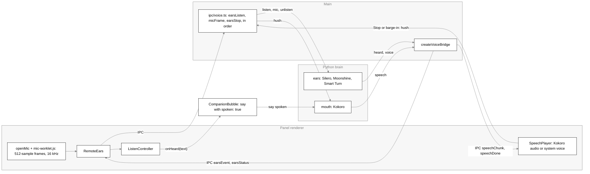
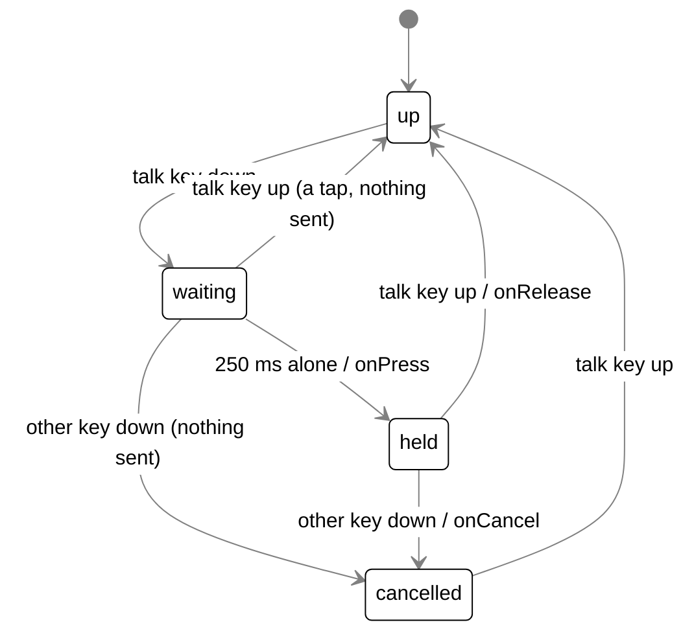
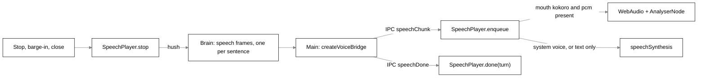

# Voice

## Purpose

How Scout hears and speaks. This covers the talk key, the mic button, Always listening, the
follow-up window, barge-in, and the system voice. **The brain does the hearing and the speaking**:
it runs the speech models (Silero, Moonshine, Smart Turn and Kokoro; see
[Brain ears](brain.md#brain-ears) and [Brain mouth](brain.md#brain-mouth)). The desktop only
streams the microphone to the brain and plays what the brain sends back, so no speech model, ONNX
runtime or extra process ships with it. A heard question goes to the brain as an ordinary `say`
with `spoken: true`, and the brain speaks the answer.

Audio goes only to your own brain and is never stored; with the brain on this computer it never
leaves it.

## Where it lives

| Area                    | Files                                                                                                                                                                                                                                                                                                                                                                                                                                 |
| ----------------------- | ------------------------------------------------------------------------------------------------------------------------------------------------------------------------------------------------------------------------------------------------------------------------------------------------------------------------------------------------------------------------------------------------------------------------------------- |
| Shared types and rules  | `bodies/ui/src/shapes/voice.ts` (`Ears`, `ListenMode`, `EARS_IDS`, `MOUTH_IDS`), `bodies/desktop/src/shared/voice.ts` (`EARS_SAMPLE_RATE`, `EARS_FRAME`, `chosenMouth`, `VOICE_ADAPTERS`), `bodies/ui/src/shapes/addressing.ts` (`addressedToScout`, `isStopListening`, `mightBeStop`, `FOLLOW_UP_MS`), `bodies/desktop/src/shared/settings.ts` (`TALK_KEYS`, `voice`, `listening`, `hotkeys.talk`), `bodies/ui/src/shapes/status.ts` |
| Talk key (main)         | `bodies/desktop/src/main/talk-key.ts` (`TalkKeyWatch`, `startTalkKey`, `loadKeyHook`), `talkPressed` and `toPanel` in `bodies/desktop/src/main/index.ts`                                                                                                                                                                                                                                                                              |
| Always listening (main) | `bodies/desktop/src/main/always-listening.ts` (`AlwaysListening`, `listeningPaused`, `startListeningGuard`, `saveListening`), `markListening` in `bodies/desktop/src/main/status-marks.ts`                                                                                                                                                                                                                                            |
| IPC and the bridge      | `bodies/desktop/src/main/ipc/voice.ts` (`createVoiceBridge`, `registerVoiceIpc`), `main/ipc/turns.ts` (spoken `say`, Stop sends `hush`), channels and types in `bodies/desktop/src/shared/ipc.ts`, the bridge in `bodies/desktop/src/preload/index.ts`                                                                                                                                                                                |
| Renderer, hearing       | `bodies/desktop/src/renderer/src/mic.ts`, `mic-worklet.js`, `remote-ears.ts`, `talk.ts` (`useTalk`), `talk-rules.ts`, `mic-failure.ts`, `voice-seam.ts`                                                                                                                                                                                                                                                                               |
| Renderer, speaking      | `bodies/desktop/src/renderer/src/voice-player.ts` (`SpeechPlayer`, `previewVoice`, `playWav`, `speakWithSystem`, `onSystemVoice`, `pickSystemVoice`)                                                                                                                                                                                                                                                                                  |
| UI package              | `bodies/ui/src/voice/listen-controller.ts`, `push-to-talk.ts`                                                                                                                                                                                                                                                                                                                                                                         |
| Wiring                  | `bodies/desktop/src/renderer/src/panel.tsx` (the panel's `SpeechPlayer` and `useTalk`), `bodies/ui/src/companion-bubble.tsx` (asks a heard question as spoken, barge-in)                                                                                                                                                                                                                                                              |
| Brain side              | The brain's ears and mouth: [brain.md](brain.md)                                                                                                                                                                                                                                                                                                                                                                                      |

## How it works

### Who does what

- **The panel renderer** owns the microphone, the listening state machine and the playback. Audio
  plays here, and the system voice speaks here.
- **Main** watches the talk key, holds the Always listening state, and is the only window to the
  brain. It forwards mic frames as `mic`, relays the brain's `heard`, `voice` and `speech` frames
  to the windows, and sends `hush`.
- **The brain** hears (VAD, speech to text, end-of-turn) and speaks (Kokoro). It downloads and loads
  the models itself. Nothing is loaded in Electron.

### What crosses to the brain

Contract v1 (see [protocol/README.md](../protocol/README.md)):

| Frame                                        | Direction     | Meaning                                                                                                                                                |
| -------------------------------------------- | ------------- | ------------------------------------------------------------------------------------------------------------------------------------------------------ |
| `listen { mode: 'held' or 'always' }`        | body to brain | Request: start hearing. Rejected with `BrainOffline` while the brain is down; the desktop then shows "Listening could not start" or the offline words. |
| `mic { pcm }`                                | body to brain | A frame of 16 kHz mono 16-bit samples, base64. Main converts the renderer's Float32 frame (clamped, rounded).                                          |
| `unlisten`                                   | body to brain | Notification: stop hearing. In held mode the brain then ends the turn with what it heard.                                                              |
| `hush`                                       | body to brain | Notification: stop speaking now.                                                                                                                       |
| `say { ..., spoken: true, voice, speed }`    | body to brain | A heard question is asked as spoken, with the voice and speed from Settings. A typed question is not spoken.                                           |
| `heard { event, text? }`                     | brain to body | `speech_start`, `partial`, `final`, `turn_end`. Main maps these to the renderer's `speechStart`, `partial`, `final`, `turnEnd`.                        |
| `voice { status, message?, progress? }`      | brain to body | The ears' models: `loading` (with `progress`), `ready` or `failed`. Only the ears send it; the mouth sends none.                                       |
| `speech { turn, text?, pcm?, sample_rate? }` | brain to body | One sentence: `text`, plus `pcm` (16-bit, 24,000 Hz, base64) when Kokoro spoke it. A frame with `text` only means use the system voice.                |
| `speech { turn, done: true }`                | brain to body | The last sentence of that turn has been sent.                                                                                                          |

`heard`, `voice` and `speech` are live only (no `seq`), so they are not replayed after a
reconnect. `createVoiceBridge` remembers the open listening mode (also when `listen` found the
brain offline), and when the brain comes back (`onOnline`) it sends `listen` again and sends the
renderer an `earsStatusEvent` of `online`, which makes `ListenController.retryNow()` skip the
30 s to 5 min wait. So Always listening survives a brain restart and starts at launch as soon as
the brain is up. Spoken audio (`speechChunk`, `speechDone`) goes to the panel alone; everything
else the ears send goes to every window. The preview (`speakSample`) coerces what the panel
sends: the voice to a string, the speed to a number, and a speed that is no number is no preview.

`models()` (the health check) reports `{ ears: !failed }`: the ears are fine until
the brain sends `voice { status: 'failed' }`; the mouth has no status of its own and is not reported. Its row
reads "The brain could not load its speech models."

### The renderer side

#### The microphone

`renderer/src/mic.ts#openMic(deviceId?)`:

- It calls `getUserMedia` for one channel with `echoCancellation`, `noiseSuppression` and
  `autoGainControl` on. The device is `voice.microphoneId` when set, otherwise the system default.
- It opens an `AudioContext` at 16 kHz and loads the `tagalong-mic` AudioWorklet. The worklet is
  imported as `?url&no-inline`, because the panel's CSP (`default-src 'self'`) blocks the `data:`
  URL Vite would inline.
- The worklet must be connected towards the speakers to run, so it goes through a gain node set
  to `0`. Nothing plays.
- If anything fails after `getUserMedia`, the tracks stop, the context closes, and the error is
  rethrown as a plain `Error`. An `AbortError` from a worklet that would not load therefore never
  reads as a microphone another app holds.
- The returned `OpenMic` is itself the `MicStream`: a `Pushable` holding at most 940 frames, about
  30 s. It has an idempotent `close()`, and ending iteration early closes it too.

`listMicrophones()` lists the `audioinput` devices, leaving out `default`, for Settings and the
health check.

`mic-worklet.js` gathers samples into 512-sample frames (32 ms) and posts each one. A worklet
cannot import, so the number 512 is repeated there. It must match `EARS_FRAME` in
`bodies/desktop/src/shared/voice.ts`.

#### RemoteEars

`renderer/src/remote-ears.ts`. This is the `Ears` a window uses.

- `listen(mic)` invokes `earsListen(mode)` and sends each frame with `micFrame`. `micFrame` is an
  `ipcRenderer.send`, not an invoke.
- `stop()` invokes `earsStop`. In `always` mode it drops its handlers at once. In `held` mode it
  keeps them until the `turnEnd` that follows, because the question's words arrive after the stop.
- Every window hears the one stream of `earsEvent`s. Each `ListenController` decides which events
  belong to its own session.

#### ListenController

`bodies/ui/src/voice/listen-controller.ts`. This decides when the mic is open and where the
words go. It holds at most one session (`held` or `always`), plus a set of released held
questions still waiting for their words.

Held questions:

- **`hold()`** is the talk key or the mic button. It closes the follow-up window, ends any
  `always` session, and starts a `held` session. Main sends the brain's `listen` and `unlisten` in
  order, so the always session's ears stop first. The mic opens, the ears listen, and `onMicOpen(mode)` fires,
  but only once the mic has really opened.
- **`release()`** closes the mic. A session whose mic never opened is `onNothingHeard`. Otherwise
  the session is marked released and stops its ears, and its `turnEnd` later carries the question.
- **Which `turnEnd` belongs to whom.** A held session takes a `turnEnd` only once it has been
  released. Released questions take `turnEnd`s in the order they were released, each one once
  (`#taken`, cleared on a microtask). A non-empty trimmed text goes to `onHeard`. An empty one goes
  to `onNothingHeard`, and the panel shows "Nothing heard."
- **`cancel()`** is the bubble closing. It drops the held question and every released question
  still waiting. An always session goes on, or comes back.
- **Late mic.** A mic that opens after its session ended is closed unused. A session whose mic
  never opened never sends `ears.stop`, which could end another session.

Failures:

- **`onMicFailed`.** If `getUserMedia` or the audio setup rejects, the session ends and
  `onMicFailed(error)` fires.
- **`earsFailed()`** runs when the ears status says `failed`. It drops every question and ends the
  session. If an always session was running, it schedules a retry: 30 s at first (`retryMs`),
  doubling each time up to five minutes. Switching off cancels the retry. A question heard resets
  the wait to 30 s. A `setAlways`, `setPaused` or `setDeaf` call starts a session again sooner.

The always session (`#sync`):

- One `always` session is open exactly while `always && !paused && !deaf`. A held session is left
  alone, because the key wins.
- `setAlways(on)` is the person's switch. `setPaused(paused)` covers a call, full screen, the pets
  or hidden. `setDeaf(deaf)` is true while the system voice speaks.
- When an always session ends mid-turn after it had already cut Scout off, `onDropped` fires and
  its words leave the bubble.

Addressing in always mode (`#addressed`):

- **Name required.** Only talk addressed to Scout counts (`addressedToScout`). While a released
  held question waits, nothing counts, because those words are the held question's.
- **Bare speech.** A plain `speechStart` does nothing in always mode. Talk in the room must not
  cut Scout off.
- **Partials.** The first addressed `partial` of a turn calls `onSpeechStart` once (barge-in), and
  each addressed partial shows. A partial that may still grow into "stop listening"
  (`mightBeStop`, for example "Scout, st") neither cuts Scout off nor shows.
- **Addressed `turnEnd`.** It closes the follow-up window. If the question is "stop" or "stop
  listening" (`isStopListening`):
  - with the name, it calls `onStopListening`
  - in the follow-up window without the name, it only ends the window

  and in both cases it calls `onDropped` if it had cut Scout off. Any other question resets the
  retry wait and goes to `onHeard`.

- **Unaddressed `turnEnd`.** It calls `onDropped` if the turn had cut Scout off. If the turn had
  three words or more, no follow-up window was open, and no released question was waiting, it
  calls `onUnaddressed()` without the words.

#### PushToTalk

`bodies/ui/src/voice/push-to-talk.ts`. This turns key presses, releases and mic-button clicks
into `start`, `stop` or `none`. It has four modes: `idle`, `held`, `clicked` and `spent`.

- **Repeats.** A press within `FRESH_PRESS_MS` (1,100 ms) of the last one while `held` is a
  repeat and does nothing.
- **Missed release.** A press after that time stops, in case a release was missed.
- **Mic button.** `click()` toggles.
- **`end()`** marks a hold as `spent` when listening ended some other way while the key is still
  down: the 30 s cap, or a mic or ears failure. Its repeats start nothing until the key comes up
  or a fresh press arrives.

#### useTalk

`renderer/src/talk.ts`. This is the panel's wiring. It builds one `ListenController` with
`RemoteEars` and `openMic`.

- **`onTalk(at)`** feeds `PushToTalk.press`.
- **`onTalkRelease`** feeds `release`. It goes to PushToTalk whether or not anything is listening,
  so it also clears a spent hold.
- **`onTalkCancel`** calls `release()`. Only if that returns `stop` (the key was holding a question
  open) does it cancel. A question from the mic button stays. So does one the 30 s cap already
  sent.
- **`start`** cuts Scout off at once (`bargeIn` → `onBegin` → `player.stop()`) and clears the note
  and the partial. It calls `hold()` and arms the `MAX_LISTEN_MS` (30 s) cap. The bubble state
  becomes `listening` only in `onMicOpen`.
- **`stop`** with a held question pending sets state `hearing`, shown as "Turning that into
  text…", and calls `release()`. With nothing pending it goes straight to `idle`.
- **Always listening.** It reads `getListening()` at mount and follows `onListening`. It calls
  `setPaused` before `setAlways`, so switching on during a call never opens the mic for a moment.
- **Deafness.** It passes `onSystemVoice` to `setDeaf`.
- **Delivery.** A heard question goes through `HeardInbox`. If no bubble is mounted (a one-line
  hello or remark is up, or Scout is still waking), the question is held, the line
  gives way through `onBegin`, and the bubble asks it as it subscribes. Only the latest is held.
- **Marks and notes.** `talk-rules.ts` holds the pure decisions: `settles`, `shownPartial` (always
  words shown without the leading name), `FailureStreak`, `EarsNotes`, `FollowUpCue`, `micMark` and
  `micNote`.

`useTalk` returns `talk.always` (`{ on, paused, onToggle }`) for the bubble's switch, and `hush()`
for the stop button and the stop key.

#### Mic failures

`renderer/src/mic-failure.ts#micFailure` maps a microphone error to `denied`, `busy` or `no-mic`:

- `NotAllowedError` or `SecurityError` is `denied`
- `NotReadableError` or `AbortError` is `busy`
- anything else is `no-mic`

#### The voice seam

`renderer/src/voice-seam.ts#installVoiceSeam`. This puts `window.tagalongVoice` (`ears`,
`openMic`) on the panel. Its `ears.on` subscribes to `onEarsEvent` for good, and `listen` and
`stop` go to one `held` `RemoteEars`.

### The talk key

`main/talk-key.ts`. The talk key is one key held alone, never a combo. `TALK_KEYS` and their
`uiohook-napi` keycodes are:

| `TalkKey`                | Label       | Keycode |
| ------------------------ | ----------- | ------- |
| `RightControl` (default) | Right Ctrl  | 3613    |
| `RightAlt`               | Right Alt   | 3640    |
| `RightShift`             | Right Shift | 54      |
| `ScrollLock`             | Scroll Lock | 70      |

A global shortcut cannot bind a lone modifier and never reports a release. So main runs a key
hook instead: `uiohook-napi`, loaded by `loadKeyHook` through a dynamic import, so a missing
binary is caught. `startTalkKey` feeds its `keydown` and `keyup` keycodes into `TalkKeyWatch`.
Every event is compared with the talk key's keycode and dropped. The watch keeps only its mode.
Nothing typed is logged, stored or sent, and the hook sends no input.

- **Confirm.** `TALK_CONFIRM_MS` is 250 ms. A shortcut such as Right Ctrl+C has its second key
  down well within that time, so it never raises the bubble or cuts Scout off. A shorter tap is
  nothing. Repeated downs while the key is held are ignored.
- **Press.** `onPress` calls `talkPressed()` in `main/index.ts`:
  - If the bubble is hidden, it shows the avatar and brings the panel up with
    `showPanelQuietly`, which does not take the keyboard. A focused bubble would swallow the
    shortcut the person meant.
  - It then sends `IPC.talkEvent` with `Date.now()`.
- **Release and cancel.** `onRelease` sends `IPC.talkReleaseEvent` and `onCancel` sends
  `IPC.talkCancelEvent`, both to the panel only (`toPanel`). The release is seen in main, so it
  arrives whichever window has the keyboard.
- **Changing the key.** `setKey(key)` comes from `applyHotkeys`, so Settings changes apply live.
  Changing the key while the old one is held drops that hold.
- **No hook.** If the hook will not load or start, there is one `[talk-key]` warning and a `talk`
  outcome with the error on the hotkey-problem path (see `desktop.md`). There is no fallback key,
  the mic button still works, and nothing crashes. The hook stops on quit.

The stop key (`hotkeys.stopVoice`, default `CommandOrControl+Shift+Alt+M`) is a normal global
shortcut. It broadcasts `IPC.stopVoiceEvent`, and the panel calls `hush()` and `player.stop()`.

### Always listening

Always listening is the person's switch, `settings.listening.always`, off by default. It has no
wake-word engine. The brain turns words into text, and `addressedToScout` checks the
transcript.

**Addressing** (`bodies/ui/src/shapes/addressing.ts`):

- **The name.** The first word, after an optional "hey", "ok" or "okay", must sound like "Scout".
  That means it starts with "sc" (or "sk", read as "sc") and is at most one edit from "scout":
  "Scott", "Scot", "Scoot", "Skout" and "Scouts" count; "shout", "scope", "about" and "count" do
  not.
- **Possessives.** The word must end there, so "Scout's" and "Scout-like" do not count.
- **The question.** What follows the name, with leading punctuation trimmed, is the question. A
  name alone is `null`.
- **Follow-up.** With `{ followUp: true }`, the whole turn is the question, with the name removed
  if it was said.
- **Stop.** `isStopListening` matches "stop" or "stop listening" with trailing punctuation.
  `mightBeStop` is true for any prefix of "stop listening".

**State in main** (`main/always-listening.ts`):

- **The state.** `AlwaysListening` holds `{ on, paused, followUp }`. It starts from the saved
  setting before any window opens, and every change goes to every window as
  `IPC.listeningEvent`.
- **Who changes it.** Only `setListening(on)` changes `on`: the bubble's switch, Settings →
  Privacy, or "Scout, stop" through the panel.
- **Follow-up flag.** `followUp` can be true only while `on && !paused`. Pausing or switching off
  clears it.
- **Saving.** `saveListening` saves `on` with `settings.set { listening: { always } }` when it
  changes. A failed save is logged and the next change tries again. `paused` is never saved.
- **Pausing.** `listeningPaused` is `blocked || !petsShown`. `blocked` comes from
  `startListeningGuard`. The avatar's `show` and `hide` events set `petsShown`, so listening pauses
  while the pets are hidden and the mark on Scout is always in sight while the mic is open.
- **The guard.** While listening is on, `startListeningGuard` lists the windows every
  `LISTENING_GUARD_MS` (2,000 ms). It also checks at once when listening comes on, at launch or
  when switched on. `listeningBlocked` is `callOrFullScreenInFront` in `main/front-window.ts`: it is the
  front window that counts, so a Teams window in front blocks even without a call. A failed listing
  keeps the last answer. When listening is switched off, the guard forgets its answer and unblocks.
  Each pause logs one line naming the kind of window and its process, never its title, for
  example `[listening] paused: a call app in front (Teams)`. A resume logs `[listening] resumed`.
  See `sight.md` for how windows are listed.
- **The marks.** `markListening` sets `listening-on` for `LISTENING_MARK_MS` (8 s) at launch when
  on, and again each time listening is switched on. It sets `listening-paused` while
  `on && paused`. No spoken line announces listening. The dot on the avatar is described in
  `bubble.md`.

**Raising the bubble.** `createVoiceBridge` relays every `heard` frame to every window. For a
`partial` or `turnEnd` whose text is addressed to Scout (`followUp` read from `AlwaysListening`),
it also calls `onSpoken`. That brings the hidden bubble up beside a visible pet with
`showPanelQuietly`, without taking the keyboard. It does not do this for bare speech, for "stop",
or for a partial that `mightBeStop`. Main and the panel apply the same addressing rule.

### The follow-up window

`FOLLOW_UP_MS` is 20,000 ms. `FollowUpCue` in `talk-rules.ts` watches the panel's `speaking` and
`answering`, both from `SpeechPlayer`'s `onState`.

- **Opening.** The window opens when Scout's answer to a question asked by voice has finished
  both streaming and speaking, and some of it was said aloud. A gap between sentences does not
  open it.
- **What opens nothing.** A barge-in (`cue.hushed()` in `bargeIn`), the stop button or stop key
  (`hush`), and the bubble's close (`cancel`).
- **While open.** `openFollowUp()` takes effect only while `always && !paused`. For the next 20 s,
  one reply needs no name.
- **Closing.** The window closes on:
  - the reply itself, whatever it was
  - the time running out
  - `setPaused(true)`, `hold()` or `cancel()`
  - switching off
  - `hush`
  - a plain "stop", which only ends the window

  Each open and close goes to main through `IPC.setFollowUp` (`onFollowUp`).

### Barge-in

- **Held.** `hold()` (the talk key or the mic button) cuts Scout off at once. So does the ears'
  `speechStart` in a held session. Both go through `onBegin`, which calls `player.stop()` and clears
  any one-line hello or remark.
- **Always.** Only the first addressed partial, or the addressed `turnEnd`, of a turn barges in.
- **The bubble.** It subscribes to `talk.onListen`. If an answer is still streaming, the bubble
  calls `bridge.interrupt(turnId)`. It keeps the text shown so far and ignores the rest of the
  stopped turn.
- **Stop.** Cancelling a turn does not hush its speech on the brain. So `turns.ts#interrupt` cancels
  the turn and then broadcasts the stop-voice event, and the panel's `player.stop()` sends `hush`.
  The Stop button, the stop key, the bubble's close and a barge-in all end in `player.stop()`.

### Deafness while the system voice speaks

Echo cancellation in `getUserMedia` removes Scout's own WebAudio playback, but not the system
voice. While `speechSynthesis` speaks, `voice-player.ts` reports it through `onSystemVoice`.
`useTalk` passes that to `setDeaf(true)`, which closes the always session.
When the system voice stops, the session opens again. A held question is not affected.

### The mouth

The brain speaks; the panel plays.

`SpeechPlayer` (`renderer/src/voice-player.ts`):

- **Order.** `enqueue(chunk)` adds a sentence; sentences play one after another. `answering` is
  true from the first chunk of a turn until `done(turn)` and the queue has drained, and `speaking`
  is true while a sentence plays. Both go to `onState`, which drives the panel's speaking indicator
  and the follow-up window.
- **Which voice.** With `voice.mouth` Kokoro and a chunk that has `pcm` and a sample rate, the audio
  is decoded (little-endian 16-bit mono) and played through an `AnalyserNode` (`fftSize` 256);
  each animation frame the peak level goes to the CSS variable `--tg-voice-level`. Otherwise the
  chunk's `text` is spoken through `speechSynthesis` at the saved speed (`rate`). So a brain with no
  Kokoro (a `speech` frame with text only) is spoken by the system voice, and choosing "System
  voice" in Settings makes the desktop ignore the audio.
- **Stop.** `stop()` aborts the sentence playing, clears the queue, sends `hush` to the brain, and
  drops late chunks of that turn.
- **A sentence that fails to play** is logged and the next one plays.
- **The system voice.** `pickSystemVoice`: an `en-GB` voice named George first, then another
  British male name (`ryan|thomas|oliver|arthur|alfie|elliot|ethan|noah`), otherwise the system
  default. While it speaks, the level is held at 0.5 and `onSystemVoice(true)` fires.
  `getVoices()` is called once at load so the list is ready.
- **Preview.** `previewVoice({ text, mouth, voice, speed })` is Settings' Preview button. For
  Kokoro it calls the brain's `speak_sample` tool through `IPC.speakSample` and plays the returned
  WAV (`playWav`). If the brain has no voice, is offline, or the mouth is "System voice", it
  falls back to the system voice.

**Only a spoken question is spoken.** The brain speaks only the answer to a `say` with
`spoken: true`. A typed question, the hello, a wake's remark and `pet.remark` lines are shown but
not read aloud.

### How the brain learns a turn was spoken

`CompanionBubble.submit(text, context, asSpoken = true)` asks with `spoken: true` for a heard
question; `turns.ts` adds `voice` and `speed` from the saved settings to the `say`, and only when
`voice.enabled`. A typed turn never carries `spoken`. When the turn completes, the bubble shows the
"Hold <key> to reply" hint for a spoken question.

### The browser body

The browser extension is a second body that can hear. It listens only: it says `display: false`, so
the brain speaks the answer on the desktop. The popup's **Ask by voice** button starts a held
`listen`; an offscreen document (the one page that may hold the microphone in a Manifest V3
extension) opens it at 16 kHz and posts the same 512-sample frames as the desktop's worklet; the
service worker forwards them as `mic` frames; **Done talking** (or closing the popup) sends
`unlisten`; the brain's `heard` `turn_end` carries the question, and the worker sends it as `say`
with `spoken: true` and no `voice` or `speed`. Only one body listens at a time, as everywhere.
Chrome's prompt cannot show from an offscreen page, so the first use opens a small page to allow
the microphone. If the link drops, listening ends with an error and is not restarted. The full
description is [browser-body.md](browser-body.md#voice).

## Interfaces

### IPC channels

From `IPC` in `bodies/desktop/src/shared/ipc.ts`. Handlers are in `main/ipc/voice.ts` unless noted.

| Channel                                          | Direction      | Payload                                                  | Notes                                                                                                                                                        |
| ------------------------------------------------ | -------------- | -------------------------------------------------------- | ------------------------------------------------------------------------------------------------------------------------------------------------------------ |
| `tagalong:voice:ears-listen`                     | invoke         | `mode`                                                   | Anything but `held` or `always` throws. For `held`, main first notes the active window (`noteActiveWindow`, never the selection). Then the brain's `listen`. |
| `tagalong:voice:mic-frame`                       | send           | `Float32Array`                                           | Copied into a `Float32Array` if needed, converted to 16-bit, sent as `mic`. Never kept.                                                                      |
| `tagalong:voice:ears-stop`                       | invoke         | none                                                     | The brain's `unlisten`.                                                                                                                                      |
| `tagalong:voice:hush`                            | invoke         | none                                                     | The brain's `hush`.                                                                                                                                          |
| `tagalong:voice:speak-sample`                    | invoke         | `(text, voice, speed)` returning `SpeakSample` or `null` | The brain's `speak_sample` tool. `null` when it cannot speak.                                                                                                |
| `tagalong:voice:ears-event`                      | main → windows | `{ event, text? }`                                       | Every window. From `heard`.                                                                                                                                  |
| `tagalong:voice:ears-status`                     | main → windows | `EarsStatus`                                             | Every window. From `voice`, or a failed `listen`.                                                                                                            |
| `tagalong:voice:speech-chunk`                    | main → windows | `SpeechChunk { turn, text?, pcm?, sampleRate? }`         | From `speech`.                                                                                                                                               |
| `tagalong:voice:speech-done`                     | main → windows | `{ turn }`                                               | From `speech { done }`.                                                                                                                                      |
| `tagalong:voice:get-listening` / `set-listening` | invoke         | `boolean` → `ListeningState`                             | A non-boolean is refused with "Always listening is on or off."                                                                                               |
| `tagalong:voice:set-follow-up`                   | invoke         | `boolean`                                                | A non-boolean is refused. Applied only while on and not paused.                                                                                              |
| `tagalong:voice:listening`                       | main → windows | `ListeningState`                                         |                                                                                                                                                              |
| `tagalong:voice:talk`                            | main → panel   | `at: number`                                             | The talk key confirmed.                                                                                                                                      |
| `tagalong:voice:talk-release` / `talk-cancel`    | main → panel   | none                                                     |                                                                                                                                                              |
| `tagalong:voice:stop`                            | main → windows | none                                                     | The stop key, or a cancelled turn.                                                                                                                           |
| `tagalong:voice:models`                          | invoke         | → `VoiceModels { mouth, ears }`                          | The health check: whether the brain's ears have failed.                                                                                                      |
| `tagalong:status:set`                            | invoke         | `(id, on)`                                               | Handled by `setPanelMark`. The panel can set only `mic-busy`, `mic-failed` and `say-name`.                                                                   |

`earsListen`, `micFrame` and `earsStop` run through one promise chain (`inOrder`). Frames and a
stop therefore wait behind a held listen that is still noting the window, and the brain
hears them in the order the panel sent them. A failed step does not hold up the next.

### Types

- `Ears { listen(mic), stop(), on(event, handler) }` (`bodies/ui/src/shapes/voice.ts`).
- `SpeechChunk`, `SpeakSample { mime, data }`, `EarsStatus { status, message?, progress? }`,
  `ListeningState { on, paused, followUp }`, `VoiceModels { mouth, ears }` (`shared/ipc.ts`).
- `TagalongVoice { ears, openMic }` (`voice-seam.ts`).

### Settings fields

`bodies/desktop/src/shared/settings.ts`. Voice settings stay in the desktop; they ride along on
each spoken `say` and each preview.

| Field                | Default                          | Meaning                                                                                 |
| -------------------- | -------------------------------- | --------------------------------------------------------------------------------------- |
| `voice.enabled`      | `true`                           | Scout talks.                                                                            |
| `voice.voice`        | `'bm_george'`                    | Kokoro voice: `bm_george` or `bm_fable`.                                                |
| `voice.speed`        | `0.95`                           | `MIN_VOICE_SPEED` 0.7 to `MAX_VOICE_SPEED` 1.3                                          |
| `voice.microphoneId` | absent                           | Absent means the system default.                                                        |
| `voice.mouth`        | absent                           | `kokoro` ("Kokoro (on the brain)") or `system` ("System voice"). Absent means `kokoro`. |
| `voice.ears`         | absent                           | Only `local` exists (`EARS_IDS`), labelled "The brain's ears".                          |
| `listening.always`   | `false`                          | Always listening.                                                                       |
| `hotkeys.talk`       | `'RightControl'`                 | One of `TALK_KEYS`.                                                                     |
| `hotkeys.stopVoice`  | `'CommandOrControl+Shift+Alt+M'` | The stop key.                                                                           |

See `settings-and-secrets.md` for the whole schema. The brain's side (model files, checksums,
thresholds, the sentence rules) is in [brain.md](brain.md#brain-ears).

## Constants and limits

| Constant                                 | Value                           | Where                                           |
| ---------------------------------------- | ------------------------------- | ----------------------------------------------- |
| `EARS_SAMPLE_RATE` / `EARS_FRAME`        | 16,000 Hz / 512 samples (32 ms) | `shared/voice.ts`, repeated in `mic-worklet.js` |
| Speech sample rate from the brain        | 24,000 Hz                       | contract v1, `speech.sample_rate`               |
| Mic `MAX_WAITING`                        | 940 frames                      | `mic.ts`                                        |
| `MAX_LISTEN_MS`                          | 30,000 ms                       | `talk.ts`                                       |
| `TALK_CONFIRM_MS`                        | 250 ms                          | `talk-key.ts`                                   |
| `FRESH_PRESS_MS`                         | 1,100 ms                        | `push-to-talk.ts`                               |
| `FOLLOW_UP_MS`                           | 20,000 ms                       | `addressing.ts`                                 |
| Ears retry                               | 30 s, doubling, max 5 min       | `listen-controller.ts`                          |
| `LISTENING_GUARD_MS`                     | 2,000 ms                        | `always-listening.ts`                           |
| `LISTENING_MARK_MS` / `SAY_NAME_MARK_MS` | 8,000 ms / 8,000 ms             | `status-marks.ts`                               |
| Unaddressed hint                         | 3 words or more                 | `listen-controller.ts`                          |

## Storage

- **Models.** None on the desktop. The brain keeps them in its own data folder.
- **Settings.** `voice.*`, `listening.always` and `hotkeys.talk` are in the settings store. See
  `settings-and-secrets.md`.
- **Nothing heard.** Audio, transcripts and key events are not stored or logged anywhere by the
  desktop. Frames live only in memory: in the mic `Pushable`, and in flight to the brain. The text
  of a heard question is stored only as the ask it becomes, like a typed one (see `memory.md`).

## Failure handling

| Failure                                                                              | What happens                                                                                                                                                                                                                                           |
| ------------------------------------------------------------------------------------ | ------------------------------------------------------------------------------------------------------------------------------------------------------------------------------------------------------------------------------------------------------ |
| Mic busy (`NotReadableError`, `AbortError` from `getUserMedia`)                      | `onMicFailed`. The hold is `end()`ed, the 30 s cap is cleared, and the `mic-busy` mark is set. The note is `STATUS_WORDS['mic-busy'].detail`.                                                                                                          |
| Mic failed (any other error, including an audio-graph failure rethrown by `openMic`) | The same, with `mic-failed`.                                                                                                                                                                                                                           |
| Mic failing repeatedly                                                               | `FailureStreak` reports it once per run of failures. Always listening retries after each system-voice line. The mark and the streak clear on the next partial or heard question, or when the person presses the key or the mic button (`micOk`).       |
| Brain offline when listening starts                                                  | `listen` rejects with `BrainOffline`. Windows get `ears-status: failed` with the brain-offline words. The session is not kept, so the next press tries again.                                                                                          |
| Brain comes back during a session                                                    | `onOnline` sends `listen` again with the same mode.                                                                                                                                                                                                    |
| The brain's models cannot load                                                       | `voice { status: 'failed' }` becomes `ears-status: failed` and the `ears-failed` mark; the health row reads "The brain could not load its speech models." `earsFailed()` drops every question and ends the always session, then retries with back-off. |
| Ears status `failed` in the panel                                                    | `EarsNotes` shows the failure line once. The note is shown only if a question was being asked or always listening was running.                                                                                                                         |
| The brain cannot speak (no Kokoro)                                                   | It sends `speech` with text only; the panel speaks it with the system voice.                                                                                                                                                                           |
| A sentence fails to play                                                             | `SpeechPlayer` logs it and plays the next.                                                                                                                                                                                                             |
| Key hook will not load                                                               | One warning, and a `talk` hotkey problem shown in the panel and Settings. The mic button still works.                                                                                                                                                  |
| A mic frame cannot reach the brain                                                   | `brain.mic` drops it (the connection is down) and the next frame still goes; an error is logged.                                                                                                                                                       |

**Status marks.** The voice marks are `ears-failed`, `mic-busy`, `mic-failed`, `ears-loading`,
`listening-paused`, `say-name` and `listening-on` (`bodies/ui/src/shapes/status.ts`). Their order,
words, holders and clearing rules are in [bubble.md](bubble.md#status-marks). A `voice` frame with
`ready` clears `ears-loading` and `ears-failed`; `loading` with `progress` sets `ears-loading` with
a percent.

## Privacy notes

- **Audio goes only to your own brain and is never stored; with the brain on this computer it never
  leaves it.** Frames go from the panel through main to the brain, in memory only. See
  [privacy.md](privacy.md).
- **What a heard question sends.** Its text goes on to the brain as a `say`. The ask carries the
  name of the window you are on (`noteActiveWindow`), never the selection, because copying the
  selection would press keys while the talk key is held.
- **The key hook.** It compares every key event with one keycode and drops it.
- **Always listening.** It is opt-in. It pauses for calls, full screen, and hidden pets.
  A mark on Scout always shows while it is on. An unaddressed turn is dropped, and its words are
  never passed on (`onUnaddressed` gets none).

The full statement is in `privacy.md`.

## Tests that pin it

| Test                                                                                                                      | Pins                                                                                                                                                                                                |
| ------------------------------------------------------------------------------------------------------------------------- | --------------------------------------------------------------------------------------------------------------------------------------------------------------------------------------------------- |
| `bodies/desktop/src/main/ipc/voice.test.ts`                                                                               | Mode validation, window noting, ordering, offline failure, `hush`, `speak_sample`, the re-listen on reconnect, heard/voice/speech forwarding, addressing (follow-up, "stop", `mightBeStop`), marks. |
| `bodies/desktop/src/main/ipc/turns.test.ts`                                                                               | A spoken ask carries `spoken`, `voice` and `speed`; a cancelled turn also stops the voice.                                                                                                          |
| `bodies/desktop/src/main/talk-key.test.ts`                                                                                | The 250 ms confirm, shortcuts sending nothing, taps, repeats, cancel, key change, keycodes, and a hook that will not load.                                                                          |
| `bodies/desktop/src/main/always-listening.test.ts`, `status-marks.test.ts`                                                | State, follow-up gating, pause reasons, the guard timing and logging, saving in order, `listening-on` and `say-name` marks.                                                                         |
| `bodies/ui/src/voice/listen-controller.test.ts`                                                                           | Hold, release and cancel, late mics, `turnEnd` ownership, the always session lifecycle, addressing, stop, barge-in once per turn, the follow-up window, deafness, retry back-off.                   |
| `bodies/ui/src/voice/push-to-talk.test.ts`                                                                                | Repeats, missed release, the mic button, spent holds.                                                                                                                                               |
| `bodies/ui/src/shapes/addressing.test.ts`, `voice.test.ts`; `bodies/desktop/src/shared/voice.test.ts`, `settings.test.ts` | "Scout"-like words, possessives, follow-up, stop, `chosenMouth`, `Pushable`.                                                                                                                        |
| `bodies/desktop/src/renderer/src/mic.test.ts`, `remote-ears.test.ts`, `voice-seam.test.ts`                                | The mic closed on audio failure and a worklet failure not read as busy, handlers kept until a held `turnEnd`, the seam.                                                                             |
| `bodies/desktop/src/renderer/src/talk-rules.test.ts`, `mic-failure.test.ts`                                               | `FollowUpCue`, `EarsNotes`, `FailureStreak`, `HeardInbox`, `micFailure`.                                                                                                                            |
| `bodies/desktop/src/renderer/src/voice-player.test.ts`                                                                    | `SpeechPlayer` order, answering and speaking state, stop dropping late chunks and sending `hush`, the system-voice fallback, `previewVoice`, system voice choice.                                   |
| `bodies/desktop/e2e/smoke.spec.ts`                                                                                        | Talking to Scout on the fake brain's `heard` and `speech` frames and Chromium's fake mic, ending with the "Hold Right Ctrl to reply" hint and a spoken `say`.                                       |
| `bodies/desktop/e2e/listening.spec.ts`                                                                                    | Always listening off at launch, on only when switched (the brain gets `listen` and mic frames), a "Scout, ..." turn answered, then off again (`unlisten`).                                          |
