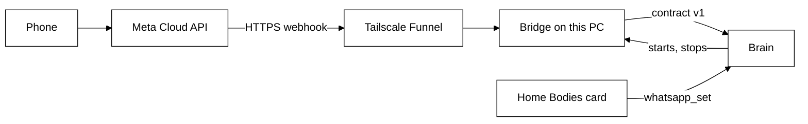

# WhatsApp

Scout can answer on WhatsApp as one more body: the same Scout and the same conversation, reached
from the phone. A small bridge process (`bodies/whatsapp`) receives Meta's webhook and talks to the
brain over contract v1; the brain starts and watches it ([brain.md](brain.md#whatsapp-bridge)). This
doc covers the part the person does: the one-time Meta setup and Home's Bodies card.

## Home: Connections > Bodies

The Bodies card (`bodies/ui/src/home/bodies-panel.tsx`) shows Desktop, Browser and WhatsApp as
Connected or Not connected, then the WhatsApp setup:

- Five fields: access token, app secret and verify token (password inputs), phone number ID and your
  number. A saved value shows only the word Saved and is never shown again; type a new one to
  replace it. Save sends only the fields typed, then clears them.
- One switch, named WhatsApp. It stays off, with the reason beside it, until all five values are saved.
- One line in plain words for the bridge: off, waiting for the five values, starting, running, not built
  or Node failed.
- The values stay on this PC (`<TAGALONG_HOME>/.env`). They are never returned by a tool or by IPC.

The card uses the Home tools `bodies_status`, `whatsapp_status` and `whatsapp_set`
([brain.md](brain.md#whatsapp-setup-tools)) through `ipc/bodies.ts` ([desktop.md](desktop.md)).
Saving or switching makes the brain start, stop or restart the bridge at once.

## One-time setup on Meta's side

Meta's screens change, so this is the shape, not a script. Meta's free test number is enough to start.

1. Create a Meta developer account and a Business app with the WhatsApp product.
2. Take the test number and its **phone number ID** from the app's WhatsApp page.
3. Add your own number as a recipient and verify it with the code Meta sends.
4. Make a long-lived **System User token** with WhatsApp permissions (the default token lasts about a
   day).
5. Copy the **app secret** from the app's settings.
6. Invent a **verify token**: any phrase. Meta echoes it back when it checks the webhook.
7. Enter the five values in Home > Connections > Bodies (access token, app secret, verify token, phone
   number ID, your number) and press Save.
8. Install Tailscale and run Funnel on the bridge's port, `47322` by default, so only `/webhook` is
   public. The brain's own port stays on `127.0.0.1:47321`.
9. In Meta, set the callback URL to `https://<name>.ts.net/webhook` with the verify token, and subscribe
   to `messages`.
10. Switch WhatsApp on in Home. Save the test number in your phone as "Scout" and send `hello`.

## Verify at build

Numbers and shapes that depend on Meta's current docs are pinned as constants in the bridge, not
guessed here: the Graph API version (`GRAPH_VERSION`), the 4096-character text cap, the reply-button
limits and the 24-hour free-text window. The bridge's own rules are in its package; Home does not
depend on them.

## Not in this slice

Voice notes and images from the phone are ignored. Scout-first messages (timers, held mail) never go
to WhatsApp.
