# The WhatsApp body

## Purpose

`bodies/whatsapp` is a small Node program that makes WhatsApp a body for the Python brain. You
message Scout from your phone; the bridge says it to the brain over contract v1 and sends Scout's
finished answer back to the same chat. It holds no brain of its own and adds no frame to the
contract: it is an ordinary body whose `kind` is `whatsapp`. This page covers the bridge core
(webhook, send, window) and asks answered from the phone. Home's Places page and the one-time Meta setup are below.

## Flow

```mermaid
%%{init: {"theme": "base", "themeVariables": {"primaryColor": "#ffffff", "primaryTextColor": "#000000", "primaryBorderColor": "#000000", "lineColor": "#808080", "arrowheadColor": "#808080", "secondaryColor": "#f2f2f2", "tertiaryColor": "#ffffff", "clusterBkg": "#f7f7f7", "clusterBorder": "#808080", "edgeLabelBackground": "#ffffff", "titleColor": "#808080", "actorBkg": "#ffffff", "actorBorder": "#000000", "actorTextColor": "#000000", "actorLineColor": "#808080", "signalColor": "#808080", "signalTextColor": "#808080", "sequenceNumberColor": "#ffffff", "labelBoxBkgColor": "#ffffff", "labelBoxBorderColor": "#808080", "labelTextColor": "#000000", "loopTextColor": "#808080", "noteBkgColor": "#f7f7f7", "noteBorderColor": "#808080", "noteTextColor": "#000000", "activationBkgColor": "#f7f7f7", "activationBorderColor": "#808080", "fontFamily": "Segoe UI, Helvetica, Arial, sans-serif"}}}%%
flowchart LR
  P[Phone] --> M[Meta Cloud API]
  M -->|HTTPS webhook| F[Public tunnel]
  F --> B[Bridge, started by the brain]
  B -->|say, loopback| R[Brain, always on]
  R -->|reply| B
  B -->|Graph API send| M
  M --> P
```



The brain starts and watches the bridge (`brain/src/brain/bridges.py`, see [brain.md](brain.md)). It
gives the bridge its settings as environment variables and holds a stdin pipe open. When that pipe
closes the brain is gone, so the bridge exits; a hard kill of the brain therefore leaves no bridge
behind. The bridge prints its log lines on stdout, which the brain writes to `brain.log` through its
secret filter.

## Identity and context

- Hello: `{"protocol":1,"body":{"id":"whatsapp","kind":"whatsapp","name":"WhatsApp"},"tools":[]}`. No
  tools and no `display: false`, so the brain counts it as a body that shows answers.
- Each text becomes `say` with `context: {channel: "whatsapp", note: "text chat on a phone; keep replies short and offer detail on request"}`.
- A `reply` is kept only when its `body` is `whatsapp`, buffered per turn and sent at `done`. A reply
  for another body is ignored. If the brain is down when you write, the message is logged and nothing
  is sent to the phone.
- Voice notes and images from you are ignored without a word in this version.

## The webhook

Only `/webhook` exists (anything else is 404). The bridge listens on `127.0.0.1:<port>` and the tunnel
you set up reaches it; the brain's own socket is never public.

| Request         | Rule                                                                                                                                                                                                                                     |
| --------------- | ---------------------------------------------------------------------------------------------------------------------------------------------------------------------------------------------------------------------------------------- |
| `GET`           | `hub.verify_token` must equal the verify token, then the challenge is echoed with 200; else 403                                                                                                                                          |
| `POST`          | the raw body is read up to about 1 MB (over it: 413), then `X-Hub-Signature-256` is checked as `sha256=` plus the HMAC-SHA256 of the raw body with the app secret, in constant time, **before any JSON parsing** (missing or wrong: 401) |
| after the check | 200 at once, then each text message or button tap from the allowed number whose id was not seen before is handed to the bridge; statuses, other senders, other message types and repeated ids are dropped                                |

The seen ids are kept in memory (the last 1000), so a restart forgets them; a Meta retry after a
restart could in theory say the same text twice.

## Sending, splitting and the 24-hour window

- `graph.ts` posts to `https://graph.facebook.com/v21.0/<phone number id>/messages` (`GRAPH_VERSION`
  is the one constant to change) with the access token as a bearer token. One retry on a network
  error or a 5xx, then it logs a line without the token or the text and gives up. There is no queue.
  It sends plain text and reply buttons (`type: interactive`).
- `split.ts` cuts a reply at about 4000 characters (WhatsApp allows 4096), at a blank line, else a
  line, else a space, else hard. A reply that needs more than four messages is cut: the fourth
  ends with `(cut: ask me for the rest)` and stays within the limit.
- `window.ts`: WhatsApp allows free text only for 24 hours after your last message. If a reply
  finishes after that, it is dropped with one log line; the desktop chat still shows it.

## Asks from the phone

A permission ask or question from Scout reaches the phone as a message, and the answer goes back
through the same `answer` call as at the desk. A yes from WhatsApp counts exactly like a yes there; no
rule is per body.

- **Buttons or a list.** An ask is sent as reply buttons only when it has one to three options,
  each at most 20 characters and different from the others, a text of 1 to 1024 characters, and
  does not take a typed answer. Anything else is sent as numbered text (`1. allow`), split like a
  reply if it is long; a question that takes a typed answer adds a line saying the typed reply is the
  answer. An ask with no text says which tool it wants to use and with what input. The limits are
  constants in `asks.ts` marked "verify at build" against Meta's docs, like the 24-hour window and
  the Graph version.
- **Typing answers only the latest ask.** A typed text can answer an open ask only while no reply
  has been sent to the phone since the ask was shown. After a newer reply, a "yes" is about the
  chat and goes to Scout as a normal message; only a tap answers that older ask. This holds for typed
  questions too.
- **One such ask.** A tap answers it. So does a typed number, an option word, or `yes` / `no` (the
  options `allow` / `deny`); for a typed question any text is the answer. Text that matches nothing
  (including a number outside the options) is a normal message to Scout, since you may be changing
  the subject.
- **Two or more such asks.** If the text would answer at least one of them, the bridge cannot say
  which and replies `More than one question is open: please tap a button`, doing nothing else. Text
  that answers none is a normal message.
- **A send that fails.** If the ask could not be sent to the phone, the bridge forgets it, so it can
  never be answered unseen.
- **One send queue.** Asks, the two fixed lines and replies go out through one queue, so an ask that
  arrives while a long reply is being sent waits until all its parts are out.
- **Closed or unknown.** A tap on an ask the brain closed, or one the bridge never held, replies
  `That question is closed.` The same line follows an answer the brain refuses as not found.
- **Late taps.** An ask that is still open on the brain (for example one parked past its turn) can
  be answered however long after, as the tap itself reopens the 24-hour window.
- **Outside the window.** An ask that arrives after the 24 hours is not sent and not remembered
  here; it stays open on the other bodies.
- **After a reconnect** the bridge forgets its asks and shows again the ones the brain re-sends,
  once each.

The two fixed lines and the cut note are the bridge's only words, besides the ask's own wording
(options, the typed-reply line, and the tool and input of an ask with no text); everything else is
Scout's.

## Settings the bridge reads

Passed by the brain, never from `.env`: `TAGALONG_WHATSAPP_ACCESS_TOKEN`, `_APP_SECRET`, `_VERIFY_TOKEN`,
`_PHONE_NUMBER_ID`, `_ALLOWED_NUMBER`, `_PORT` (default 47322) and `TAGALONG_BRAIN_ADDR` (default
`127.0.0.1:47321`). A missing value stops the bridge with a plain message that names the variable and
never shows a value.

## Files

| File                            | Responsibility                                                            |
| ------------------------------- | ------------------------------------------------------------------------- |
| `bodies/whatsapp/src/config.ts` | `readConfig`: the settings above                                          |
| `src/webhook.ts`                | the signed webhook server                                                 |
| `src/graph.ts`                  | the Graph send: text and reply buttons                                    |
| `src/asks.ts`                   | `AskDesk`: open asks, buttons or numbered text, which ask a reply answers |
| `src/split.ts`                  | `splitReply`                                                              |
| `src/window.ts`                 | the 24-hour window                                                        |
| `src/bridge.ts`                 | `createBridge`: the contract v1 body                                      |
| `src/index.ts`                  | the entry: real websocket, stdin pipe, SIGTERM                            |
| `vite.config.ts`                | bundles everything (contract and zod included) into `dist/index.js`       |

## Build and test

On a fresh checkout run `pnpm install` first: the build fails until the package's dependencies are installed.

```bash
pnpm --filter @tagalong/whatsapp build   # writes bodies/whatsapp/dist/index.js, one file
pnpm --filter @tagalong/whatsapp test
```

`pnpm dev:desktop` builds it too, so the brain finds `dist/index.js`. Tests use only fakes: a fake
brain socket, a fake `fetch` for the Graph API, a movable clock and locally signed webhook requests.
No Meta or network call is made.

## Home: Places

The Places page (`bodies/ui/src/home/places-view.tsx`) shows This PC, the Chrome add-on and WhatsApp, each with a purpose line and Connected, Not set up or Offline (WhatsApp is Offline when its five values are saved but it is not connected). Press **Set up** on the WhatsApp row (or **Settings** once it is connected) to open the setup under it:

- Five fields: access token, app secret and verify token (password inputs), phone number ID and your
  number. A saved value shows only the word Saved and is never shown again; type a new one to
  replace it. Save sends only the fields typed, then clears them.
- One switch, named WhatsApp. It stays off, with the reason beside it, until all five values are saved.
- One line in plain words for the bridge: off, waiting for the five values, starting, running, not built
  or Node failed.
- The values stay on this PC (`<TAGALONG_HOME>/.env`). They are never returned by a tool or by IPC.

The page uses the Home tools `bodies_status`, `whatsapp_status` and `whatsapp_set`
([brain.md](brain.md#whatsapp-setup-tools)) through `ipc/bodies.ts` ([desktop.md](desktop.md)).
Saving or switching makes the brain start, stop or restart the bridge at once.

## One-time setup on Meta's side

Meta's screens change, so this is the shape, not a script. Meta's free test number is enough to start.

1. Create a Meta developer account and a Business app with the WhatsApp product.
2. Take the test number and its **phone number ID** from the app's WhatsApp page.
3. Add your own number as a recipient and verify it with the code Meta sends.
4. Make a long-lived **System User token** with WhatsApp permissions (the default token lasts about a
   day).
5. Copy the **app secret** from the app's settings.
6. Invent a **verify token**: any phrase. Meta echoes it back when it checks the webhook.
7. Enter the five values in Home > Places > WhatsApp (access token, app secret, verify token, phone
   number ID, your number) and press Save.
8. Install Tailscale and run Funnel on the bridge's port, `47322` by default, so only `/webhook` is
   public. The brain's own port stays on `127.0.0.1:47321`.
9. In Meta, set the callback URL to `https://<name>.ts.net/webhook` with the verify token, and subscribe
   to `messages`.
10. Switch WhatsApp on in Home. Save the test number in your phone as "Scout" and send `hello`.
